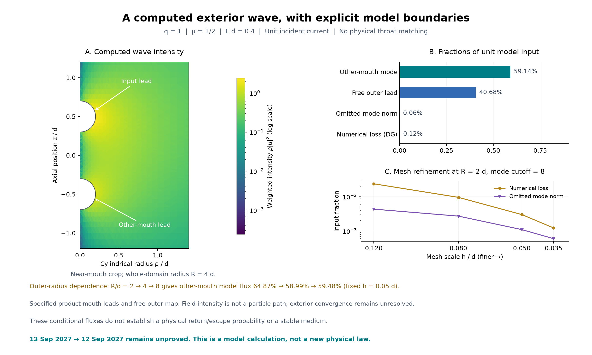

# Time-travel model research

A computational research workbench for testing proposed chronology-changing geometries, quantum sources, and particle transport against general relativity and quantum field theory. The repository contains executable derivations, numerical experiments, refinement checks, saved results, and figures—including failed candidates and limits of the approximations.

**Current outcome:** this project has not established a stable time machine, an obtainable supporting material, a new physical law, or a demonstrated backward passage. Traveling from **13 September 2027 to 12 September 2027 remains unproved**. The useful results are narrower: reproducible calculations that identify which proposed mechanisms survive a particular test and what must be calculated next.

## Start with the current work

The present direction tests whether charged fermions actually return through the magnetic exterior used in an idealized traversable-wormhole construction. A field-line picture alone cannot determine the spinor's return amplitude, phase, or quantum stress.

A connected **q=1** model now calculates complex transmission between two finite mouths with explicitly chosen cylindrical leads. Its flux budget separates outgoing channels from numerical loss. Changing the radius where the magnetic exterior is cut off still changes the answer materially; the complete exterior return map remains unresolved.

| Component | What is checked | What it supplies |
| --- | --- | --- |
| [Connected exterior solve](exterior_boundary_map.py) · [results](exterior_boundary_map_results.json) | Full two-dimensional point-pair field between finite mouths; regular-axis conditions, modal lead matching, independent free controls and mesh/channel/radius comparisons | A conditional complex transmission amplitude with a closed flux ledger; the outer magnetic tail and actual curved throat are unresolved |
| [Spherical lead maps](spherical_weyl_leads.py) · [two-mouth mesh](two_mouth_mesh.py) | Exact free outgoing partial waves, explicit q=1 product-lead modes, and a conforming polygonal mesh with geometry refinement | Boundary data and geometry for the connected test; finite facets introduce an additional controlled-by-refinement approximation |
| [Spinful return benchmark](spinful_return.py) · [results](spinful_return_results.json) | Exact reduced Weyl-operator identities, transverse zero modes and their normalization, plus short unitary two-dimensional evolution with refinement controls | A baseline for testing the magnetic guiding approximation; the propagation box is periodic |
| [Incoming modes](incoming_modes.py) · [report](INCOMING_MODES.md) | Isolated-monopole reference modes, gauge covariance, unit flux, positive-energy pulse, and a bounded partner-field residual at the saved model's collar | Incident reference data and one quantified matching term; the full curved two-mouth matching remains unresolved |
| [Exact angular collar modes](dipole_collar_modes.py) · [results](dipole_collar_modes_results.json) | The partner magnetic focus is included exactly in the local angular equation; independent full-operator and normalization checks quantify the remaining radial residual | About 158-fold reduction of the local residual at the saved sphere; no accumulated transport-error bound |
| [Local radial correction](collar_dressing_bound.py) · [results](collar_dressing_bound_results.json) | An explicit opposite-spin correction, an energy-dependent analytic residual bound, and an independently constructed small-q control | A more accurate flux-normalized incident approximation; validity requires the stated angular-gap and flux conditions |
| [Open-boundary spinor calibration](open_boundary_spinor.py) · [report](OPEN_BOUNDARY_SCATTERING.md) | Frozen planar outgoing modes, complex reflection phases, evanescent behavior, and an independently checked absorber loss budget | A boundary-calibration contract; absorber loss is not a physical escape probability |
| [Scattering-to-vacuum bridge](scattering_vacuum.py) · [results](scattering_vacuum_results.json) | A specified unitary loop/reservoir model, complex phases, causal delay, reference-subtracted energy and local stress | An exact conditional benchmark: equal return probabilities can produce opposite stress signs; the physical exterior return map remains unknown |

These components do not yet form a complete physical two-mouth scattering solution. The next calculation continues the coupled angular waves through the magnetic tail outside the finite mesh, followed by matching the actual curved throat and computing quantum state/stress. A one-particle probability alone does not determine the vacuum source supporting a throat.



*The field is computed for the declared q=1 model. The radius comparison exposes a remaining exterior approximation; these numbers are not a certified return probability for the physical candidate. See [the phase-sensitive stress benchmark](scattering_vacuum_progress.png) for the later connection to the quantum source.*

## Quickstart

Run commands from the repository root. The recorded environment is **CPython 3.12.14 on Windows**, with NumPy, SciPy, SymPy, mpmath, and Matplotlib pinned in [requirements.txt](requirements.txt). Other platforms have not been certified by the saved runs.

For a fresh environment in PowerShell:

```powershell
gh repo clone Winter-Soren/time-travel
Set-Location time-travel
py -3.12 -m venv .venv
.\.venv\Scripts\python.exe -m pip install -r requirements.txt
```

If you already have the checkout and `.venv`, reuse them and skip their creation. Activation is unnecessary when invoking Python directly.

Start with a small symbolic check that does not rewrite results:

```powershell
.\.venv\Scripts\python.exe -B -W error -X utf8 -c "from spinful_return import operator_identity; print(operator_identity())"
```

Expected output: `['0', '0']`. The function also asserts that both operator residuals vanish.

The connected model and its small geometry/lead controls can be reproduced with:

```powershell
.\.venv\Scripts\python.exe -B -W error -X utf8 two_mouth_mesh.py
.\.venv\Scripts\python.exe -B -W error -X utf8 spherical_weyl_leads.py
.\.venv\Scripts\python.exe -B -W error -X utf8 exterior_boundary_map.py
```

The connected run took about 30 seconds in the recorded environment and rewrites its results JSON. It saves complex amplitudes, raw boundary traces, one representative field, and the unresolved outer-radius sensitivity. Earlier focused incoming, boundary, and vacuum components can also be reproduced independently:

```powershell
.\.venv\Scripts\python.exe -B -W error -X utf8 incoming_modes.py
.\.venv\Scripts\python.exe -B -W error -X utf8 dipole_collar_modes.py
.\.venv\Scripts\python.exe -B -W error -X utf8 collar_dressing_bound.py
.\.venv\Scripts\python.exe -B -W error -X utf8 open_boundary_spinor.py
.\.venv\Scripts\python.exe -B -W error -X utf8 scattering_vacuum.py
```

These commands print their checks and **rewrite their corresponding `*_results.json` files**. Preserve the committed record when comparing environments. Each report explains the parameters, tolerances, and physical scope.

Regenerate only the current figure from saved data:

```powershell
.\.venv\Scripts\python.exe -B -W error -X utf8 -c "from quantum_horizon_plot import exterior_boundary_progress; exterior_boundary_progress()"
```

For the broader local propagation benchmark:

```powershell
.\.venv\Scripts\python.exe -B -W error -X utf8 spinful_return.py
```

This includes multiple spatial, temporal, and domain configurations, writes a larger JSON record, and costs more than the algebra-only check. It does not regenerate the figure automatically.

**Avoid starting with every historical suite.** The large `mmp_pulse.py`, `polyakov_response.py`, and `future_time.py` programs contain many research increments; broad regeneration can be costly and may use saved checkpoints or native-code helpers. Follow the specific reproduction command in the relevant report rather than assuming a single fast project-wide test command.

## Repository map

The research scripts and neighboring artifacts intentionally retain their existing paths. [DIRECTORY_GUIDE.md](DIRECTORY_GUIDE.md) provides the fuller inventory.

| Area | Main entrypoints and documentation |
| --- | --- |
| Current findings and derivations | [RESEARCH.md](RESEARCH.md); [TASK_STATE.md](TASK_STATE.md) records the latest state and unresolved dependencies |
| Fermion source and magnetic exterior | `dirac_*.py`, `magnetic_*.py`, [QUANTUM_COMPLETION.md](QUANTUM_COMPLETION.md), and the current components above |
| Reduced throat dynamics and matching | [mmp_pulse.py](mmp_pulse.py), [polyakov_response.py](polyakov_response.py), [moving_exterior_maps.py](moving_exterior_maps.py), [moving_exterior_nonlinear.py](moving_exterior_nonlinear.py) |
| Earlier chronology and cavity models | [coupled_misner.py](coupled_misner.py), [coupled_ori.py](coupled_ori.py), [casimir_cavity.py](casimir_cavity.py), [ori_quantum_source.py](ori_quantum_source.py), and the `ori_*` constraint/evolution files |
| Forward time-dilation and source feasibility | [future_time.py](future_time.py), [SOURCE_FEASIBILITY.md](SOURCE_FEASIBILITY.md); this branch is distinct from backward calendar-time travel |
| Evidence | Root `*_results.json`, NPZ states, coefficient snapshots, and `*_progress.png` / `*_progress.pdf` figures |
| Historical audit and provenance | [chronology_onset_audit/](chronology_onset_audit/), [provenance/](provenance/), and [maintenance/](maintenance/) |

Saved failed cases and checkpoints are research evidence. The local virtual environment and regenerable caches are not included in the repository.

## Reproducibility and evidence

Recent result files record check outcomes, parameters, errors/refinement comparisons, equations, scope, and the SHA-256 of the source used to produce them. Older artifacts use their own report or manifest conventions. A stored `passed: true` means that component's stated controls passed; it does not certify a physical device or every approximation in the model.

For example, check that the saved spinful record belongs to the current source without rerunning propagation:

```powershell
$record = Get-Content .\spinful_return_results.json -Raw | ConvertFrom-Json
$sourceHash = (Get-FileHash .\spinful_return.py -Algorithm SHA256).Hash.ToLowerInvariant()
if ($sourceHash -ne $record.source_sha256) { throw "Source differs from the saved benchmark" }
$record.tests | Format-List
Get-FileHash .\spinful_return_results.json -Algorithm SHA256
```

Hashes identify exact bytes; they are not substitutes for mathematical review or numerical checks. The repository preserves line endings through `.gitattributes` because changing them changes these hashes. Floating-point results can vary across runtimes, so use the documented tolerances and independent controls when assessing a new run.

The [cleanup record](maintenance/cleanup-2026-09-20.json) records retained-file hashes and an existing provenance discrepancy: seven JSON files in the historical chronology audit differ from its original manifest. That discrepancy predates cleanup; the files and original manifest were preserved. Repository preparation is not a claim that all historical suites were freshly rerun.

## Interpreting the calculations

- **Geometry, source, state, and preparation are separate requirements.** A formal metric or negative-energy expectation value does not establish a realizable, stable supporting medium.
- **Scope follows the equations and boundary data.** A fixed-background field calculation, a spherical reduction, a finite local patch, and a global semiclassical solution answer different questions. The reports identify their assumptions and omitted terms.
- **Numerical agreement has a stated scope.** Refinement, conserved quantities, exact identities, and independent formulations provide evidence; sampled agreement is not automatically a rigorous continuum bound or a stability theorem.
- **Transport and vacuum physics must be connected explicitly.** A planar marginal mode is not a three-dimensional channel count. A numerical absorber is not an escape detector, and forward relativistic time dilation does not demonstrate travel to yesterday.

## Primary references

The detailed reports cite the sources used for each derivation. Useful starting points are:

- Maldacena, Milekhin and Popov, [*Traversable wormholes in four dimensions*](https://arxiv.org/abs/1807.04726): the idealized magnetic-fermion construction motivating the present source and transport work.
- Erdős and Vougalter, [*Pauli operator and Aharonov–Casher theorem for measure valued magnetic fields*](https://arxiv.org/abs/math-ph/0109015): context for the known planar zero-mode result reproduced in the spinful benchmark.
- Hammer, Pötz and Arnold, [*A dispersion and norm preserving finite difference scheme with transparent boundary conditions for the Dirac equation in (1+1)D*](https://arxiv.org/abs/1302.5587): a primary reference for transparent-boundary methodology; its scheme is not claimed as implemented here.

The project tests and extends specified model calculations. Reproducing a published theorem or finding a failure of a particular approximation is not the discovery of a new physical law.
