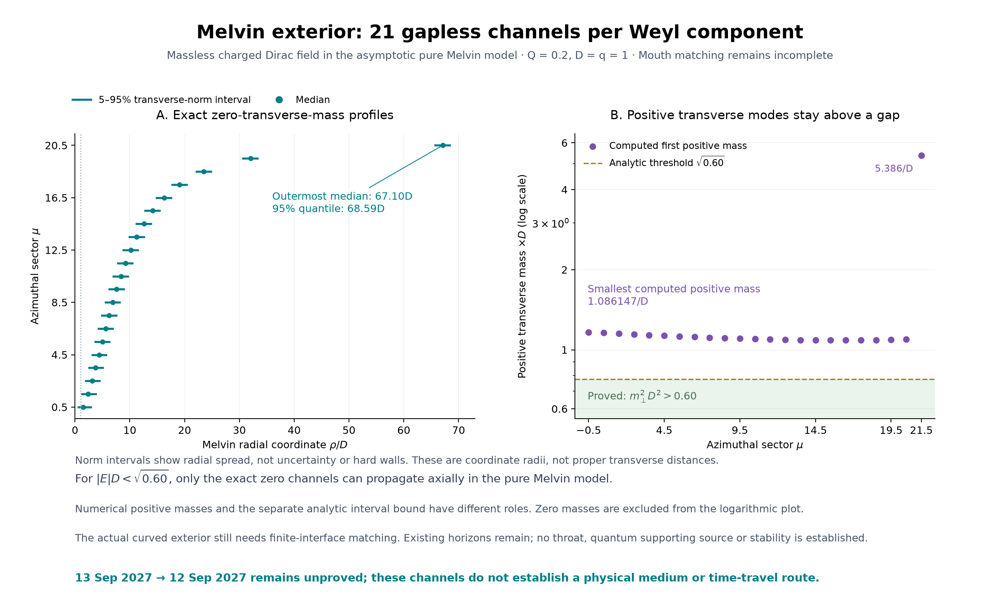
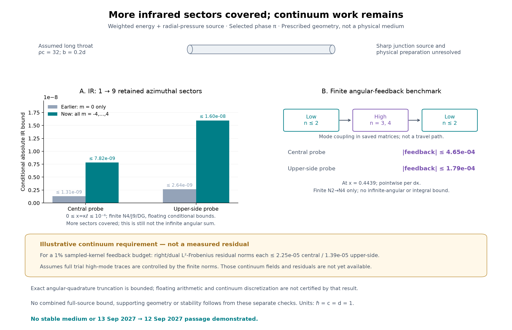
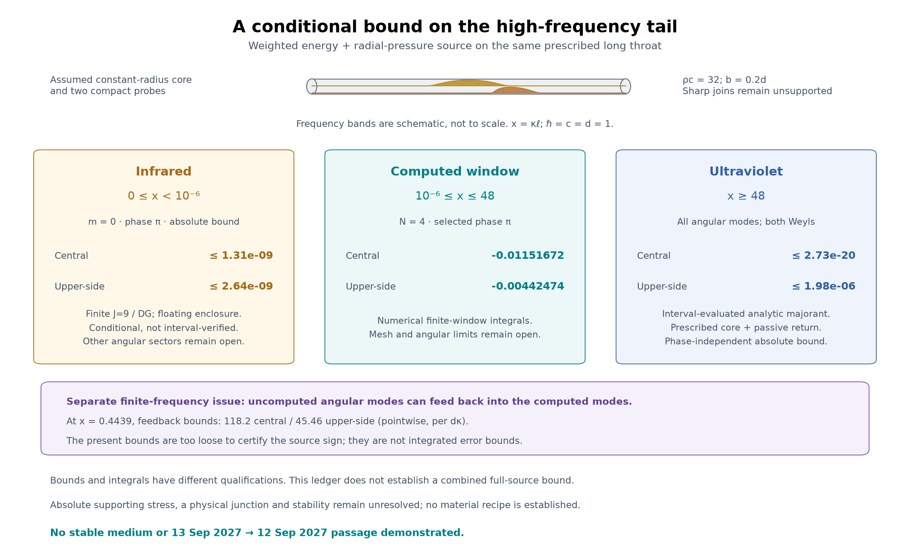
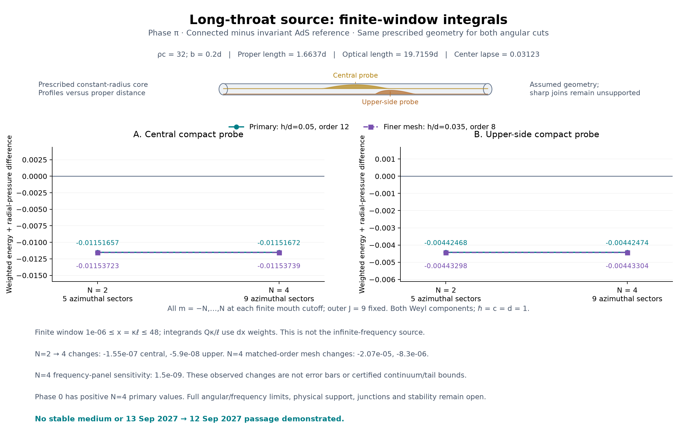
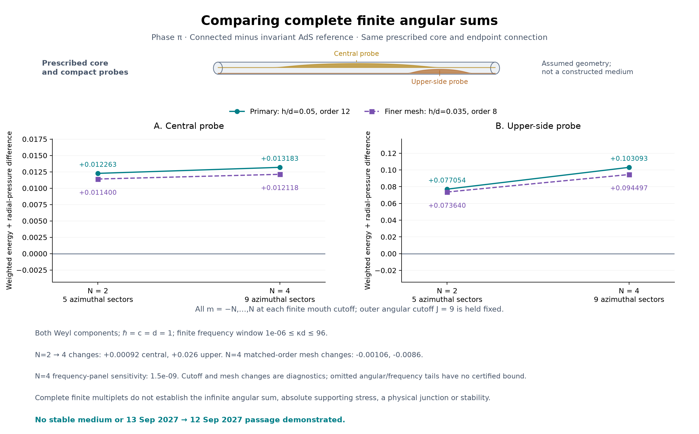

# Time-travel model research

A computational research workbench for testing proposed chronology-changing geometries, quantum sources, and particle transport against general relativity and quantum field theory. The repository contains executable derivations, numerical experiments, refinement checks, saved results, and figures—including failed candidates and limits of the approximations.

**Current outcome:** this project has not established a stable time machine, an obtainable supporting material, a new physical law, or a demonstrated backward passage. Traveling from **13 September 2027 to 12 September 2027 remains unproved**. The useful results are narrower: reproducible calculations that identify which proposed mechanisms survive a particular test and what must be calculated next.

## Start with the current work

The [Melvin channel calculation](melvin_leads.py) supplies the quantum modes of the gravitating exterior. It verifies 21 transverse zero channels and a separate interval bound on every positive transverse mass: lambda^2 > 0.60/D^2. The zero channels remain open along the magnetic field. A finite-channel [curved axial calculation](dihole_axial_tail.py) carries the distant boundary data inward; the full connection to the mouths and its supporting quantum stress remain unresolved. See [current derivations and limits](RESEARCH.md).

The [balanced dihole exterior](balanced_dihole.py) now supplies a known exact classical geometry with both gravity and magnetic fields. Its 14 checks and independent audit pass; the actual attachment surface has a clock rate near 0.196 and angularly varying boundary data. This replaces the flat-surroundings assumption, while introducing an external Melvin magnetic field and a different quantum environment. The solution still contains black-hole horizons: no traversable throat has been attached. The [RN compatibility gate](rn_exterior_gate.py) also quantifies why the earlier short collar cannot be transferred unchanged. See [current research and next steps](RESEARCH.md).

The preceding [smooth-collar calculation](smooth_magnetic_collar.py) uses one explicit smooth connection for the magnetic response and gravitational stress requirement. Its 18 checks pass; the geometry still requires negative integrated radial-null stress, and the magnetic field adds a positive contribution. This is a prescribed test background, not a supported solution. If its radius is identified with the classical magnetic radius, the exterior gravitational correction at the proposed join is not small: the next physical step is gravitationally consistent exterior matching before a precision quantum-source calculation. See the [results](smooth_magnetic_collar_results.json) and [derivation](RESEARCH.md).

The preceding step fixes the magnetic field at the two throat mouths before calculating its quantum support. The [finite magnetic matching calculation](magnetic_mouth_matching.py) determines induced multipoles from the actual exterior field and the throat's response. At L=9, the retained equations match near floating-point precision; the monitored higher-mode mismatch is 2.23e-8, versus 0.08295 for the original pair field. The untested angular tail and the sharp metric junction remain unresolved. These corrected fields require a new quantum-source calculation on a smooth common geometry.

On the earlier prescribed magnetic field, the [long-throat integral](long_throat_integral.py) finds negative radial-null responses at both compact probes for the selected phase-pi state across the tested frequency window. The result survives the tested angular and spatial refinements. The phase-zero state gives positive responses on the same geometry, so the state matters. This is a complete finite N=4 sum over a finite frequency window; it does not establish a full supporting source or repair the prescribed joins.

The [high-frequency bound](ultraviolet_source_bound.py) controls the entire source above x=48, including every angular mode, under the prescribed-core and passive-return assumptions. Its upper-side bound is less than 0.045% of the computed finite-window signal. The latest [complete retained threshold calculation](complete_threshold_bound.py) extends the low-frequency enclosure to all nine retained sectors; the selected state's upper-side bound is below 0.00037% of that signal. These are conditional finite-model low-frequency bounds; the infinite angular and continuum limits remain open.

The [actual conforming-field pilot](conforming_exterior_trial.py) tests the [two-leg feedback estimate](feedback_residual_bound.py) with a continuous physical field, exact round-mouth boundary conditions and the differential-equation residual. Its construction checks pass, but its measured residual is about 24,366 times the illustrative accuracy budget. The matrix solve's tiny residual did not imply a small physical residual. This rejects the present recovery/taper strategy at that target and caps blind refinement; it does not disprove the earlier finite negative response or a physical wormhole.

A separate [smooth-collar calculation](smooth_collar_mode.py) proves that the first massive multiplet's response to two specified circle holonomies is far too small to supply the same collar's flare budget. It does not determine the absolute stress or physical exterior return.

A connected **q=1** model supplies a spectral determinant on a prescribed throat and exterior. Compact metric variations probe energy plus radial pressure and energy flow inside it, compared with an invariant AdS reference vacuum. Both the earlier shorter core (rho_c=2) and the latest longer core (rho_c=32) include every angular orientation through finite mouth cutoffs N=2 and N=4, with an independently fixed outer cutoff. The shorter core's tested sums were positive; the longer core's selected state gives negative sums. Verified Gram-weighted reuse avoids duplicate exterior solves while retaining separate source calculations at each cutoff.

Local state-admissibility arguments are now supplied for both the full invariant reference and the specified reflected continuum connection. A conditional angular-error estimate separates omitted modes' direct stress from their feedback through the exterior. The complete angular/frequency limits, numerical convergence, physical junctions, self-consistent geometry and stability remain unresolved. The earlier smooth, large-flux source and collar remain a separate approximation whose assumed exterior must be completed.

| Component | What is checked | What it supplies |
| --- | --- | --- |
| [Melvin quantum channels](melvin_leads.py) · [results](melvin_leads_results.json) · [figure](melvin_channel_progress.png) | Regular-axis spectra, exact zero modes, full radial residuals and an interval lower comparison over all sectors | 21 open zero channels per Weyl and positive transverse squared gap >0.60/D^2; no quantum stress or physical throat |
| [Curved axial tail](dihole_axial_tail.py) · [results](dihole_axial_tail_results.json) | Actual dihole coefficients, canonical current trace and finite-channel imaginary-frequency propagation | An inward boundary-response pilot; not the complete two-mouth exterior or a return probability |
| [Exact classical dihole exterior](balanced_dihole.py) · [results](balanced_dihole_results.json) · [figure](balanced_exterior_progress.png) | Full Einstein-Maxwell checks, balanced axis, flux and nonspherical finite-cut data; independent high-precision audit | Gravitating two-hole exterior with Melvin asymptotics; horizons remain and the quantum-supported throat is unconstructed |
| [RN compatibility gate](rn_exterior_gate.py) · [results](rn_exterior_gate_results.json) | Exact endpoint/mass/width conditions and saved-profile Einstein-minus-monopole tensor | Conditional rejection of the short nonovershooting collar; not a no-go for other sources or geometries |
| [Smooth collar and support target](smooth_magnetic_collar.py) · [results](smooth_magnetic_collar_results.json) · [figure](smooth_collar_progress.png) | One C-infinity metric, propagated magnetic response, actual exterior matching and same-geometry null budgets | Smooth prescribed join; missing negative source quantified. Conditional magnetic-radius check rejects a controlled flat near-mouth interpretation; gravity, quantum support and infinite angular matching remain open |
| [Actual magnetic mouth matching](magnetic_mouth_matching.py) · [results](magnetic_mouth_matching_results.json) · [figure](magnetic_matching_progress.png) | Actual point-pair boundary data, physical throat response, induced decaying multipoles, flux and independent matching checks | Finite L=3/6/9 repair; monitored remainder decreases to 2.23e-8. This changes the quantum background; no smooth supported geometry or complete angular certificate |
| [Conforming field pilot](conforming_exterior_trial.py) · [results](conforming_exterior_trial_results.json) · [figure](conforming_trial_progress.png) | Actual continuous round-domain field, physical boundary closure, analytic derivatives, one matching solve and two residual quadratures | Construction checks pass; numerical residual 0.339946 exceeds the illustrative 1% feedback budget by 24,366 times. No continuum certificate or supporting geometry |
| [Two-leg feedback and residual target](feedback_residual_bound.py) · [results](feedback_residual_bound_results.json) · [figure](tail_completion_progress.png) | Exact Schur/defect identities, distinct physical ports, frozen finite mixing and continuum-residual inequality | A useful finite witness and conditional target; the current single-field pilot now supplies its full trace and a numerical residual, but misses that target |
| [Complete retained threshold](complete_threshold_bound.py) · [results](complete_threshold_bound_results.json) | Eight new zero-frequency sectors plus exact reuse of m=0, all18 sewing gates, physical channel counts and both Weyls | Conditional phase-pi low-frequency pressure bounds [7.817e-9,1.597e-8]; complete at N=4, with floating arithmetic and continuum limitations |
| [Magnetic-tail angular quadrature](tail_quadrature_bound.py) · [results](tail_quadrature_bound_results.json) | Exact rational potential-series remainder, polynomial degree, normalization and independent derivative controls | Exact-GL versus exact finite-J coupling error below8.874e-66 for r>=2; floating-node/harmonic errors and omitted channels remain separate |
| [All-angular high-frequency bound](ultraviolet_source_bound.py) · [results](ultraviolet_source_bound_results.json) · [figure](source_remainder_progress.png) | Positive analytic frequency majorants, every angular mode, interval evaluation and independent integral controls | Absolute bounds [2.722e-20,1.979e-6] above x=48; this frequency tail alone cannot reverse the computed signal. Other errors and geometry remain open |
| [One-sector threshold enclosure](threshold_return_bound.py) · [results](threshold_return_bound_results.json) | Actual finite-J magnetic tail to infinity, zero-frequency energy identity, open-matrix response and sewing-gap checks | Small conditional phase-pi low-frequency bounds in m=0; ordinary floating arithmetic, finite discretization and the other sectors remain separate limitations |
| [Buffered angular feedback](buffered_angular_bound.py) · [results](buffered_angular_bound_results.json) | Physical rotation commutators, full passive exterior graph bound and source-weighted redistribution | An explicit fixed-input decreasing estimate, but its sampled constants are much too large to settle the source sign |
| [Long-throat finite-window integral](long_throat_integral.py) · [results](long_throat_integral_results.json) · [figure](long_throat_integral_progress.png) | 1,812 fresh paired-Weyl responses, complete N=2/N=4 sums, separate quadrature/spatial controls and selected outer-cutoff/endpoints | Negative phase-pi responses at both probes on both meshes; phase-zero responses are positive. Full angular/frequency bounds and a supporting junction remain open |
| [Infinite-angular direct-trace envelope](radial_angular_envelope.py) · [results](radial_angular_envelope_results.json) | Analytic omitted-mode majorant, independent geometric sums and saved finite-feedback decomposition | Small direct bound in the long throat; retained feedback and the massive low-frequency remainder are not certified |
| [First massive smooth-collar mode](smooth_collar_mode.py) · [results](smooth_collar_mode_results.json) | Actual large-flux angular gap, stable logarithmic scattering, whole-frequency contrast bound, independent transfer and same-probe geometry checks | The specified two-holonomy contrast is negligible compared with the flare requirement; absolute stress and arbitrary physical exterior matching remain open |
| [Longer-throat source pilot](long_throat_source.py) · [results](long_throat_source_results.json) · [figure](long_throat_source_progress.png) | 63 new paired-Weyl responses, complete N=2/N=4 multiplets at three matched scaled frequencies, exact baseline reuse, and one matched spatial refinement | A useful change in sampled source sign; no frequency integral, physical junction or stability result |
| [Defect-weighted angular bound](angular_defect_bound.py) · [results](angular_defect_bound_results.json) | Analytic passive-feedback bound, full matrix defects, independently audited saved-matrix checks and a positive radial absorption equation | Removes the unweighted high-block inverse assumption; does not bound infinite weighted mixing or the low-frequency integral |
| [Complete finite angular source](complete_angular_source.py) · [pilot and integration evidence](complete_angular_source_results.json) · [derivations](RESEARCH.md) | All retained angular orientations, exact legacy reproduction, independently checked reuse between mouth cutoffs, and separate quadrature/spatial controls | Positive finite sums on both meshes; local continuum-state and conditional angular-error arguments do not certify an infinite sum or a physical supporting medium |
| [Three-sector reference sum](angular_reference_sum.py) · [results](angular_reference_sum_results.json) · [complete angular bases](complete_angular_modes.py) | Explicit added-sector integrals, exact reuse of the original sector, matched quadrature/spatial comparisons, and independently checked general angular bases | Tests the sign after adding field content; the complete bases are ready, but the full coupled angular sum and physical supporting geometry remain open |
| [Invariant interior reference](ads_reference_source.py) · [results](ads_reference_source_results.json) | Normalizable AdS caps, the paired massless Dirac domain, exact ground modes, common-core determinant subtraction and independent numerical refinements | A reference-relative interior source diagnostic; the full angular/frequency limits, numerical convergence, physical collar and gravitational response remain open |
| [Angular-sector extension](azimuthal_source.py) · [local modes](azimuthal_modes.py) · [results](azimuthal_source_results.json) | Angular eigenmodes and pole conditions, a specified reflected spin/gauge connection, actual sector and chirality sums, separate mesh/frequency controls | The change caused by a geometric endpoint choice and two added sectors; higher angular multiplets, absolute stress and physical throat support remain open |
| [Opposite-chirality matching](dirac_sewing_audit.py) · [results](dirac_sewing_audit_results.json) | Independently reversed bulk transport, swapped physical boundary bases, actual left response versus a separate adjoint control, and mesh/frequency refinements | A computed two-chirality phase contrast in the retained angular sector; no complete Dirac stress, absolute supporting source or stability proof |
| [Throat stress responses](throat_null_response.py) · [results](throat_null_response_results.json) | Compact clock/radial and stationary-shift variations, scattering derivatives against finite perturbations, exact chiral controls and separate numerical refinements | Smeared phase contrasts in energy plus radial pressure, energy flow and both radial null contractions; no absolute NEC or supporting source |
| [Compact local source response](local_lapse_response.py) · [results](local_lapse_response_results.json) | Direct lapse perturbations versus the analytic Green-function derivative, weighted-mass normalization and separate numerical refinements | A smeared phase difference in the energy-density diagnostic; no absolute negative energy, radial pressure, stability or material recipe |
| [Phase-dependent determinant](phase_vacuum_contrast.py) · [results](phase_vacuum_contrast_results.json) | Full mouth response, independent determinant elimination, fermion normalization and frequency/mesh sensitivity | A retained-sector phase-contrast functional; no absolute vacuum energy, local supporting stress, or physical phase preparation |
| [Matched spherical source](dirac_matched_source.py) · [smooth collar and return closure](dirac_return_closure.py) · [saved result](dirac_return_closure_results.json) | Derived source terms, Einstein constraints and a modeled complete-loop state at large flux | An opening branch in a truncated spherical/composite model; the nonradial exterior and its quantum source remain unresolved |
| [Curved radial modes](curved_throat_modes.py) · [connected closure](curved_exterior_closure.py) · [results](curved_exterior_closure_results.json) | Stable finite-throat scattering, all retained angular pairs, canonical endpoint coordinates and the driven-source balance | A conditional curved-throat field response; endpoint spin/gauge matching, geometry support and continuum errors remain open |
| [Junction source audit](throat_junction_audit.py) · [results](throat_junction_audit_results.json) | Independent extrinsic-curvature calculations at both cuts, Israel stress, full spherical Einstein components and a smooth-collar integral check | Required negative stress for this prescribed join and endpoint class; not a no-go for quantum support or a material-generation recipe |
| [Imaginary lead maps](imaginary_weyl_leads.py) · [connected response](imaginary_exterior.py) · [results](imaginary_exterior_results.json) | Decaying free/magnetic maps, independent Green-function control and the required bulk attenuation identity | Computed complex response on the positive imaginary-energy axis; its squared magnitude is not a probability |
| [Zero-mode loop connection](exterior_loop_closure.py) · [results](exterior_loop_closure_results.json) · [curved-throat equations](CURVED_THROAT_MATCHING.md) | Direct sewn solves and finite boundary determinant ratios agree with D=1−zT; canonical curved-mode equations and endpoint conventions are derived | A conditional loop determinant, not a renormalized four-dimensional vacuum determinant or a supporting stress tensor |
| [Magnetic tail](magnetic_tail_map.py) · [connected transport](exterior_tail_transport.py) · [results](exterior_tail_transport_results.json) | Coupled radial angular modes retain the actual pair field to a distant radius; full-matrix matching, coordinate conversion, flux accounting and independent refinements | Much smaller dependence on the artificial matching sphere in the conditional q=1 model; no certified infinity limit or physical throat |
| [Connected exterior solve](exterior_boundary_map.py) · [results](exterior_boundary_map_results.json) | Full two-dimensional point-pair field between finite mouths; regular-axis conditions, modal lead matching, independent free controls and mesh/channel/radius comparisons | A conditional complex transmission amplitude with a closed flux ledger; the outer magnetic tail and actual curved throat are unresolved |
| [Spherical lead maps](spherical_weyl_leads.py) · [two-mouth mesh](two_mouth_mesh.py) | Exact free outgoing partial waves, explicit q=1 product-lead modes, and a conforming polygonal mesh with geometry refinement | Boundary data and geometry for the connected test; finite facets introduce an additional controlled-by-refinement approximation |
| [Spinful return benchmark](spinful_return.py) · [results](spinful_return_results.json) | Exact reduced Weyl-operator identities, transverse zero modes and their normalization, plus short unitary two-dimensional evolution with refinement controls | A baseline for testing the magnetic guiding approximation; the propagation box is periodic |
| [Incoming modes](incoming_modes.py) · [report](INCOMING_MODES.md) | Isolated-monopole reference modes, gauge covariance, unit flux, positive-energy pulse, and a bounded partner-field residual at the saved model's collar | Incident reference data and one quantified matching term; the full curved two-mouth matching remains unresolved |
| [Exact angular collar modes](dipole_collar_modes.py) · [results](dipole_collar_modes_results.json) | The partner magnetic focus is included exactly in the local angular equation; independent full-operator and normalization checks quantify the remaining radial residual | About 158-fold reduction of the local residual at the saved sphere; no accumulated transport-error bound |
| [Local radial correction](collar_dressing_bound.py) · [results](collar_dressing_bound_results.json) | An explicit opposite-spin correction, an energy-dependent analytic residual bound, and an independently constructed small-q control | A more accurate flux-normalized incident approximation; validity requires the stated angular-gap and flux conditions |
| [Open-boundary spinor calibration](open_boundary_spinor.py) · [report](OPEN_BOUNDARY_SCATTERING.md) | Frozen planar outgoing modes, complex reflection phases, evanescent behavior, and an independently checked absorber loss budget | A boundary-calibration contract; absorber loss is not a physical escape probability |
| [Scattering-to-vacuum bridge](scattering_vacuum.py) · [results](scattering_vacuum_results.json) | A specified unitary loop/reservoir model, complex phases, causal delay, reference-subtracted energy and local stress | An exact conditional benchmark: equal return probabilities can produce opposite stress signs; the physical exterior return map remains unknown |

These components do not yet form a complete physical solution. The decision gate is a complete radial-null source budget and its gravitational response across a specified smooth collar. The invariant product reference helps with the interior; it does not determine the collar. A wrong sign or insufficient source rejects that state/collar candidate; passing this necessary condition would still leave the other Einstein equations and stability unresolved. The published wormhole construction motivating this branch is causal; success here would not by itself establish backward travel. See [Maldacena, Milekhin and Popov](https://arxiv.org/html/1807.04726v3).



*The left panel shows radial probability intervals of the asymptotic zero modes, not material rings. The positive transverse mass bound applies to the other modes. Neither panel shows a constructed passage or a payload trajectory.*


*The map shows a known classical exterior, magnetic flux contours and auxiliary attachment cuts. It does not show a connected passage. Its actual angular clock/geometry data and Melvin environment determine a different quantum problem; the full source, throat sewing and stability remain open. See the current [research notes](RESEARCH.md).*


*One right-Weyl m=0 field at one frequency. Regional residuals and their budget comparison are numerical estimates; fourteen passing construction checks do not mean the accuracy target passed. A same-geometry absolute collar source and stability remain separate physical requirements.*



*The low-frequency bounds now cover all nine retained sectors. The feedback panel is a separate finite N=2 to4 test at one frequency. Its residual targets are requirements for future continuous physical trial fields, not measured errors or a full-source certificate.*



*The high-frequency bound includes all angular modes. The low-frequency pilot includes only retained m=0 at N=4/J=9 and uses floating-point enclosure formulas. The finite window still lacks a useful complete angular-feedback bound. These three entries cannot yet be combined into a full-source certificate. All are relative interior responses on a prescribed geometry.*



*For rho_c=32, phase-pi N=4 central/upper responses are [-0.01151672,-0.004424743]. Matched-order spatial refinement changes them by about 0.1795% and 0.1875%; N=2 to N=4 changes are about 0.00135%. These are sensitivities, not error bars or a continuum certificate. The core and its junction are prescribed, not constructed. The [earlier three-frequency pilot](long_throat_source_progress.png) and shorter-core integrals below are preserved.*



*The phase-pi central/upper responses are [+0.0122632,+0.0770537] at N=2 and [+0.0131830,+0.1030926] at N=4. The finer-mesh N=4 values are [+0.0121182,+0.0944974]. The sign persists, but adding levels changes the upper result by about 34%, and N=4 mesh changes are about 8%. These sensitivities are not error bounds. Earlier [three-sector sign reversal](angular_reference_sum_progress.png), [invariant-reference comparison](ads_reference_source_progress.png), and [junction-support requirement](curved_junction_progress.png) remain available.*

## Quickstart

Run commands from the repository root. The recorded environment is **CPython 3.12.14 on Windows**, with NumPy, SciPy, SymPy, mpmath, and Matplotlib pinned in [requirements.txt](requirements.txt). Other platforms have not been certified by the saved runs.

For a fresh environment in PowerShell:

```powershell
gh repo clone Winter-Soren/time-travel
Set-Location time-travel
py -3.12 -m venv .venv
.\.venv\Scripts\python.exe -m pip install -r requirements.txt
```

If you already have the checkout and `.venv`, reuse them and skip their creation. Activation is unnecessary when invoking Python directly.

Start with a small symbolic check that does not rewrite results:

```powershell
.\.venv\Scripts\python.exe -B -W error -X utf8 -c "from spinful_return import operator_identity; print(operator_identity())"
```

Expected output: `['0', '0']`. The function also asserts that both operator residuals vanish.

The complete retained threshold calculation takes about31 seconds; the separate angular-quadrature check takes under2 seconds including imports:

```powershell
.\.venv\Scripts\python.exe -B -W error -X utf8 complete_threshold_bound.py
.\.venv\Scripts\python.exe -B -W error -X utf8 tail_quadrature_bound.py
.\.venv\Scripts\python.exe -B -W error -X utf8 feedback_residual_bound.py
```

The threshold adapter reuses the saved m=0 result and solves only the other eight zero-frequency sectors. The feedback helper reuses saved matrices and runs in about2 seconds. None repeats the long frequency integration.

The preceding three remainder checks each take a few seconds and write separate result files:

```powershell
.\.venv\Scripts\python.exe -B -W error -X utf8 buffered_angular_bound.py
.\.venv\Scripts\python.exe -B -W error -X utf8 threshold_return_bound.py
.\.venv\Scripts\python.exe -B -W error -X utf8 ultraviolet_source_bound.py
```

The angular helper reuses saved matrices; the threshold helper solves only the zero-frequency m=0 pilot; the high-frequency helper evaluates analytic interval majorants. The derivations and their distinct scopes are recorded at the start of [RESEARCH.md](RESEARCH.md).

The preceding long-throat integration took about 20 minutes 41 seconds in the recorded environment:

```powershell
.\.venv\Scripts\python.exe -B -W error -X utf8 long_throat_integral.py
```

It saves completed-sector checkpoints and includes independent frequency/spatial recipes. N=2 is reconstructed from the same exterior solves with its own Gram-weighted boundary projection and nonlinear source. The extra endpoint samples are not certified frequency-tail bounds.

The direct-angular envelope check takes about 2 seconds; the separate smooth-collar mode check takes about 24 seconds:

```powershell
.\.venv\Scripts\python.exe -B -W error -X utf8 radial_angular_envelope.py
.\.venv\Scripts\python.exe -B -W error -X utf8 smooth_collar_mode.py
```

Each writes its own result file. The collar helper exposes the existing dense background through an optional argument without changing its default output. Neither check establishes a physical supporting medium.

The preceding selected-frequency pilot takes about 98 seconds in the recorded environment:

```powershell
.\.venv\Scripts\python.exe -B -W error -X utf8 long_throat_source.py
```

The defect-weighted saved-matrix and radial-absorption check takes about 2 seconds:

```powershell
.\.venv\Scripts\python.exe -B -W error -X utf8 angular_defect_bound.py
```

Both save their own results; neither establishes a complete physical medium. The earlier complete finite-cut integration can be reproduced with:

```powershell
.\.venv\Scripts\python.exe -B -W error -X utf8 complete_angular_source.py
```

The recorded integration took about 27 minutes, plus the retained 50-second pilot. It computes both cutoffs from shared exterior solves, saves completed-sector checkpoints, and records quadrature, spatial and selected outer-cutoff changes separately. The pilot's exact executed source is retained in the JSON; its algebra and legacy witnesses are reused rather than rerun. The two cutoffs do not establish an infinite angular limit or a stable medium.

The preceding three-sector reference sum can be reproduced with:

```powershell
.\.venv\Scripts\python.exe -B -W error -X utf8 angular_reference_sum.py
```

It reuses the saved mu=1/2 quadratures exactly and computes the two added sectors with matching geometry, nodes and mesh recipes. It saves per-sector checkpoints and observed uncertainty separately from acceptance checks. The independent general angular basis check is `complete_angular_modes.py`; passing it does not complete the exterior/source sum.

The preceding interior-reference calculation can be reproduced with:

```powershell
.\.venv\Scripts\python.exe -B -W error -X utf8 ads_reference_source.py
```

It reuses saved angular-sector matrices for its pilot and computes new exterior responses for its frequency integral. It writes its own results JSON, including numerical sensitivity and failed acceptance gates. The common core and compact probe are held identical in the two environments. A finite reference-relative result is not a full supporting stress tensor.

The preceding angular-sector calculation can be reproduced with:

```powershell
.\.venv\Scripts\python.exe -B -W error -X utf8 azimuthal_source.py
```

It writes its own results JSON. The angular basis has separate checks in `azimuthal_modes.py`. The explicitly reflected endpoint connection changes existing paired modes as well as the added sectors, so both it and the inherited modal connection are evaluated separately. The exterior mixes angular levels within each azimuthal sector; the result is a partial coupled field sum, not an isolated lowest-multiplet determinant or a degeneracy multiplier.

The preceding opposite-chirality calculation can be reproduced with:

```powershell
.\.venv\Scripts\python.exe -B -W error -X utf8 dirac_sewing_audit.py
```

It writes its own results JSON. Both physical boundary maps are reconstructed after swapping the spherical characteristic bases. A deliberately adjoint-paired finite prescription is recorded separately as an algebraic control; it is not substituted for the physical projected maps. The computed sum retains one azimuthal sector and an explicit frequency window. It does not establish the full stress tensor or a material preparation procedure.

The preceding one-chirality throat source diagnostic can be reproduced with:

```powershell
.\.venv\Scripts\python.exe -B -W error -X utf8 throat_null_response.py
```

It writes its own results JSON. The lapse, radial metric and stationary shift vary only inside the throat, with the computed exterior and original endpoint clocks held fixed. The shift calculation retains the relative endpoint time factor after diagonalizing the interior metric. These derivatives measure weighted differences between phases; their numerical checks do not establish absolute NEC violation, a supported geometry or stability.

The preceding compact exterior-source calculation can be reproduced with:

```powershell
.\.venv\Scripts\python.exe -B -W error -X utf8 local_lapse_response.py
```

It writes its own results JSON. The three probe regions share each Green-function solve. It checks direct finite lapse perturbations and records frequency, mass-quadrature and spatial-mesh comparisons separately. Selected-frequency angular and outer-boundary comparisons do not bound the complete integral's error. The derivative concerns a difference between loop phases in the retained sector, not an absolute stress tensor.

The preceding global phase-contrast calculation can be reproduced with:

```powershell
.\.venv\Scripts\python.exe -B -W error -X utf8 phase_vacuum_contrast.py
```

It writes its own results JSON, including explicit frequency intervals and separate refinement diagnostics. The normalization describes one complex Weyl sector in the self-adjoint continuum interpretation; the finite dissipative discretization does not itself prove that interpretation or the missing limits.

The preceding curved transport and source audit can be reproduced with:

```powershell
.\.venv\Scripts\python.exe -B -W error -X utf8 curved_throat_modes.py
.\.venv\Scripts\python.exe -B -W error -X utf8 curved_exterior_closure.py
.\.venv\Scripts\python.exe -B -W error -X utf8 throat_junction_audit.py --write
```

These commands rewrite their respective results JSON files. The geometry audit assigns no SI length scale or obtainable material; it verifies the required stress of the stated synthetic geometry.

The preceding imaginary response and declared zero-mode loop connection can be reproduced with:

```powershell
.\.venv\Scripts\python.exe -B -W error -X utf8 imaginary_weyl_leads.py
.\.venv\Scripts\python.exe -B -W error -X utf8 imaginary_exterior.py
.\.venv\Scripts\python.exe -B -W error -X utf8 exterior_loop_closure.py
```

The connected run takes about 25 seconds in the recorded environment. These commands rewrite only their respective results JSON files. The curved-throat derivation and its limits are documented in [CURVED_THROAT_MATCHING.md](CURVED_THROAT_MATCHING.md).

The preceding real-energy tail and connected calculation can be reproduced with:

```powershell
.\.venv\Scripts\python.exe -B -W error -X utf8 magnetic_tail_map.py
.\.venv\Scripts\python.exe -B -W error -X utf8 exterior_tail_transport.py
```

The second run takes about 30 seconds in the recorded environment and rewrites its own results JSON. It reads the frozen previous results for a regression comparison. Finite-difference sensitivity checks do not certify an infinite-domain error bound.

The preceding connected model and its small geometry/lead controls can be reproduced with:

```powershell
.\.venv\Scripts\python.exe -B -W error -X utf8 two_mouth_mesh.py
.\.venv\Scripts\python.exe -B -W error -X utf8 spherical_weyl_leads.py
.\.venv\Scripts\python.exe -B -W error -X utf8 exterior_boundary_map.py
```

The connected run took about 30 seconds in the recorded environment and rewrites its results JSON. It saves complex amplitudes, raw boundary traces, one representative field, and the unresolved outer-radius sensitivity. Earlier focused incoming, boundary, and vacuum components can also be reproduced independently:

```powershell
.\.venv\Scripts\python.exe -B -W error -X utf8 incoming_modes.py
.\.venv\Scripts\python.exe -B -W error -X utf8 dipole_collar_modes.py
.\.venv\Scripts\python.exe -B -W error -X utf8 collar_dressing_bound.py
.\.venv\Scripts\python.exe -B -W error -X utf8 open_boundary_spinor.py
.\.venv\Scripts\python.exe -B -W error -X utf8 scattering_vacuum.py
```

These commands print their checks and **rewrite their corresponding `*_results.json` files**. Preserve the committed record when comparing environments. Each report explains the parameters, tolerances, and physical scope.

Regenerate only the current figure from saved data:

```powershell
.\.venv\Scripts\python.exe -B -W error -X utf8 -c "from quantum_horizon_plot import phase_vacuum_progress; phase_vacuum_progress()"
```

For the broader local propagation benchmark:

```powershell
.\.venv\Scripts\python.exe -B -W error -X utf8 spinful_return.py
```

This includes multiple spatial, temporal, and domain configurations, writes a larger JSON record, and costs more than the algebra-only check. It does not regenerate the figure automatically.

**Avoid starting with every historical suite.** The large `mmp_pulse.py`, `polyakov_response.py`, and `future_time.py` programs contain many research increments; broad regeneration can be costly and may use saved checkpoints or native-code helpers. Follow the specific reproduction command in the relevant report rather than assuming a single fast project-wide test command.

## Repository map

The research scripts and neighboring artifacts intentionally retain their existing paths. [DIRECTORY_GUIDE.md](DIRECTORY_GUIDE.md) provides the fuller inventory.

| Area | Main entrypoints and documentation |
| --- | --- |
| Current findings and derivations | [RESEARCH.md](RESEARCH.md); [TASK_STATE.md](TASK_STATE.md) records the latest state and unresolved dependencies |
| Fermion source and magnetic exterior | `dirac_*.py`, `magnetic_*.py`, [QUANTUM_COMPLETION.md](QUANTUM_COMPLETION.md), and the current components above |
| Reduced throat dynamics and matching | [mmp_pulse.py](mmp_pulse.py), [polyakov_response.py](polyakov_response.py), [moving_exterior_maps.py](moving_exterior_maps.py), [moving_exterior_nonlinear.py](moving_exterior_nonlinear.py) |
| Earlier chronology and cavity models | [coupled_misner.py](coupled_misner.py), [coupled_ori.py](coupled_ori.py), [casimir_cavity.py](casimir_cavity.py), [ori_quantum_source.py](ori_quantum_source.py), and the `ori_*` constraint/evolution files |
| Forward time-dilation and source feasibility | [future_time.py](future_time.py), [SOURCE_FEASIBILITY.md](SOURCE_FEASIBILITY.md); this branch is distinct from backward calendar-time travel |
| Evidence | Root `*_results.json`, NPZ states, coefficient snapshots, and `*_progress.png` / `*_progress.pdf` figures |
| Historical audit and provenance | [chronology_onset_audit/](chronology_onset_audit/), [provenance/](provenance/), and [maintenance/](maintenance/) |

Saved failed cases and checkpoints are research evidence. The local virtual environment and regenerable caches are not included in the repository.

## Reproducibility and evidence

Recent result files record check outcomes, parameters, errors/refinement comparisons, equations, scope, and the SHA-256 of the source used to produce them. Older artifacts use their own report or manifest conventions. A stored `passed: true` means that component's stated controls passed; it does not certify a physical device or every approximation in the model.

For example, check that the saved spinful record belongs to the current source without rerunning propagation:

```powershell
$record = Get-Content .\spinful_return_results.json -Raw | ConvertFrom-Json
$sourceHash = (Get-FileHash .\spinful_return.py -Algorithm SHA256).Hash.ToLowerInvariant()
if ($sourceHash -ne $record.source_sha256) { throw "Source differs from the saved benchmark" }
$record.tests | Format-List
Get-FileHash .\spinful_return_results.json -Algorithm SHA256
```

Hashes identify exact bytes; they are not substitutes for mathematical review or numerical checks. The repository preserves line endings through `.gitattributes` because changing them changes these hashes. Floating-point results can vary across runtimes, so use the documented tolerances and independent controls when assessing a new run.

The [cleanup record](maintenance/cleanup-2026-09-20.json) records retained-file hashes and an existing provenance discrepancy: seven JSON files in the historical chronology audit differ from its original manifest. That discrepancy predates cleanup; the files and original manifest were preserved. Repository preparation is not a claim that all historical suites were freshly rerun.

## Interpreting the calculations

- **Geometry, source, state, and preparation are separate requirements.** A formal metric or negative-energy expectation value does not establish a realizable, stable supporting medium.
- **Scope follows the equations and boundary data.** A fixed-background field calculation, a spherical reduction, a finite local patch, and a global semiclassical solution answer different questions. The reports identify their assumptions and omitted terms.
- **Numerical agreement has a stated scope.** Refinement, conserved quantities, exact identities, and independent formulations provide evidence; sampled agreement is not automatically a rigorous continuum bound or a stability theorem.
- **Transport and vacuum physics must be connected explicitly.** A planar marginal mode is not a three-dimensional channel count. A numerical absorber is not an escape detector, and forward relativistic time dilation does not demonstrate travel to yesterday.

## Primary references

The detailed reports cite the sources used for each derivation. Useful starting points are:

- Maldacena, Milekhin and Popov, [*Traversable wormholes in four dimensions*](https://arxiv.org/abs/1807.04726): the idealized magnetic-fermion construction motivating the present source and transport work.
- Erdős and Vougalter, [*Pauli operator and Aharonov–Casher theorem for measure valued magnetic fields*](https://arxiv.org/abs/math-ph/0109015): context for the known planar zero-mode result reproduced in the spinful benchmark.
- Hammer, Pötz and Arnold, [*A dispersion and norm preserving finite difference scheme with transparent boundary conditions for the Dirac equation in (1+1)D*](https://arxiv.org/abs/1302.5587): a primary reference for transparent-boundary methodology; its scheme is not claimed as implemented here.

The project tests and extends specified model calculations. Reproducing a published theorem or finding a failure of a particular approximation is not the discovery of a new physical law.
