# Time-travel model research

A computational research workbench for testing proposed chronology-changing geometries, quantum sources, and particle transport against general relativity and quantum field theory. The repository contains executable derivations, numerical experiments, refinement checks, saved results, and figures—including failed candidates and limits of the approximations.

**Current outcome:** this project has not established a stable time machine, an obtainable supporting material, a new physical law, or a demonstrated backward passage. Traveling from **13 September 2027 to 12 September 2027 remains unproved**. The useful results are narrower: reproducible calculations that identify which proposed mechanisms survive a particular test and what must be calculated next.

## Start with the current work

The [physical scaling and heat-cutoff calculation](docs/PHYSICAL_EUCLIDEAN_OPERATOR.md#physical-flux-scaling-and-a-subtracted-heat-cutoff) applies the model's charge normalization: fixed integer flux and physical coupling fix the size of the present shape. Enlarging it changes the field or geometry and requires a new source calculation. A [subtracted heat formula](results/dihole_heat_cutoff_results.json) isolates the short- and long-scale contributions needed for a full stress bound; their actual magnitudes remain unknown. All18 checks pass. See [scale results](results/dihole_flux_scale_results.json) and [visual](figures/dihole_flux_scale_progress.png). No supporting medium or new physical law is established.

The [localized-collar comparison](docs/PHYSICAL_EUCLIDEAN_OPERATOR.md#localized-collar-comparison-and-a-physical-decision-criterion) reduces squared auxiliary-solver error by **6.10%**, from 1,187.04 to 1,114.61; all44 provider, calculation and independent-audit checks pass. Almost all improvement available in this finite pool is already captured. The physical supporting stress remains unknown. The next target is a **coarse absolute bound on the full renormalized source**, which could reject this one-field candidate without resolving a tiny signal to high relative accuracy. Further basis growth must be justified by that physical error budget. See [results](results/dihole_collar_selection_results.json), [audit](results/dihole_collar_audit_results.json), and [visual](figures/dihole_collar_selection_progress.png).

Selecting [fields by the error they remove](docs/PHYSICAL_EUCLIDEAN_OPERATOR.md#residual-localization-and-optimal-candidate-combinations) reduced the squared auxiliary-solver error by **69.39%**, from 3,878.29 to 1,187.05, using 64 added combinations. The tested radial additions produced almost all of the improvement; extra angular modes 6/7 contributed very little in this test. All 45 checks across the new components pass. A [direct spatial check](results/dihole_selected_profile_results.json) places 99.64% of the remaining bridge error in its collars, identifying localized radial profiles as the next target. The supporting source remains unproved. See [results](results/dihole_residual_selection_results.json) and [visual](figures/dihole_residual_selection_progress.png).

The [opening-field test](docs/PHYSICAL_EUCLIDEAN_OPERATOR.md#fields-crossing-the-openings-and-regional-residuals) adds twelve fields that extend continuously through the bridge openings. The squared auxiliary-solver residual falls by **10.336%**, with34 checks passing across the new components. A failed integration check was preserved and corrected by finer exterior integration. The source interval still includes both signs: no supporting medium or new physics law is established. See [results](results/dihole_mouth_enrichment_results.json) and [visual](figures/dihole_mouth_enrichment_progress.png).

The [proper heat and common-filter tests](docs/PHYSICAL_EUCLIDEAN_OPERATOR.md#proper-heat-response-and-a-common-filter-residual-test) now combine the saved angular and exterior improvements into344 fields. The finite source estimate changes by0.00847%; ten heat checks pass and fourteen sampled scales have less than1% sensitivity to the latest refinements. Shorter scales remain unresolved. A separate [common-filter calculation](results/dihole_common_pv_residual_results.json), with eight checks passing, shows that preserving quantum cancellations still leaves a large field-equation residual. The next target is that missing field structure, with the physical supporting source still unproved. See [heat results](results/dihole_proper_heat_results.json) and [visual](figures/dihole_proper_heat_progress.png).

The [retained-source error test](docs/PHYSICAL_EUCLIDEAN_OPERATOR.md#retained-source-error-test-on-the-saved-sewn-forms) now evaluates a full-operator feedback bound from the saved sewn matrices. Seven [checks](results/dihole_retained_resolvent_results.json) pass, but its error radius is more than ten billion times the tested finite signal. Enlarging the available flux space barely improves it: this estimator cannot decide even the retained source sign. The next calculation must preserve the quantum cancellations and account for the omitted source. See the [visual](figures/dihole_retained_resolvent_progress.png); no new law or supported medium is established.

The [frequency and regulator proof](docs/PHYSICAL_EUCLIDEAN_OPERATOR.md#frequency-and-regulator-limits-of-the-compact-response) now establishes a finite compact first-variation response in the declared heat/zeta scheme, including the zero-state condition from153. Thirteen [controls](results/dirac_regulator_limits_results.json) pass. The result gives one finite-scale continuum anchor plus a convergent heat correction as the next numerical target; its error constants and physical source value are still unevaluated. The [visual](figures/dirac_regulator_limits_progress.png) shows algebra and flat-symbol controls. No supported medium or backward passage is established.

The [localized quantum Green-function proof](docs/PHYSICAL_EUCLIDEAN_OPERATOR.md#localized-green-identity-and-proper-mass-limit) now establishes the Euclidean/Hamiltonian correspondence at positive proper mass and its massless limit at fixed nonzero frequency, including the unbounded exterior lapse. Ten [algebra controls](results/dirac_green_mass_limit_results.json) pass. A joint infrared limit and stress coincidence still need proof before this supplies a physical source value. The [visual](figures/dirac_green_mass_limit_progress.png) distinguishes the completed identities from those remaining requirements; no supported bridge or backward travel is established.

The [causal and coupled perturbation test](docs/TILTED_CLOCK_ADMISSIBILITY.md) rules out closed future metric-causal paths wherever the same real scalar clock remains smooth, single-valued and timelike. Stop tuning this branch as a backward-time device. Eleven saved-state checks pass, including positive local kinetic and quartic terms, but global stability remains unproved. The selected reversing continuation covers incoming horizon pieces, with no demonstrated future exit. See [results](results/tilted_clock_admissibility_results.json) and [visual](figures/tilted_clock_admissibility_progress.png). The alternative quantum-source route still needs its physical source prescription established; its current static geometry also has no time loops.

The [tilted-clock calculation](docs/TILTED_CLOCK_THROAT.md) now supplies a local self-consistent throat and a regular field continuation through a selected horizon. Fourteen local checks and separate near-horizon refinement checks pass. The longer reversing continuation **fails its accuracy target**, and its field derivatives become large; global completeness, stability and a usable passage remain unproved. See [local results](results/tilted_clock_throat_results.json), [retained failure](results/tilted_clock_extension_results.json), [separate diagnostics](results/tilted_clock_diagnostics_results.json), and [visual](figures/tilted_clock_diagnostics_progress.png).

The [throat comparison](docs/THROAT_SOURCE_BUDGET.md) now rejects direct use of the saved packet for an Ellis throat at its width: the required negative null stress is about 396,208 times larger, with a different pressure pattern. A separate analytic check excludes the strictly static, clock-aligned branch with the intended regular distant regions. This narrows the next hypothesis to a changed field configuration; no new law or working medium is established. Eleven saved-state checks pass without rerunning the evolution. See [results](results/throat_source_budget_results.json) and [visual](figures/throat_source_budget_progress.png).

The [nonlinear evolution](docs/NONLINEAR_PACKET_EVOLUTION.md) now follows the same candidate field through Ht=0.5, with 18 checks passing. Its total central null stress remains negative, first deepening and then easing; independent geometric projections agree. Basis, domain, quadrature and time refinements pass. The saved finite-basis states have no spatial throat, and neither long-term stability nor material realization is established. See [results](results/nonlinear_packet_evolution_results.json), [saved states](data/nonlinear_packet_evolution_state.npz), and [visual](figures/nonlinear_packet_evolution_progress.png).

The [nonlinear initial-data calculation](docs/NONLINEAR_PACKET_CONSTRAINTS.md) now solves the full lapse and radial momentum constraints for a localized Gaussian in the assumed field theory. Fourteen checks pass, including independent matter/gravity projections and boundary refinement. The corrected gravitational profile differs by up to 29.6% of the linear peak. This is one consistent initial slice, with no spatial throat; the short nonlinear evolution above now follows it, while long-term stability remains unproved. See [results](results/nonlinear_packet_constraints_results.json) and [visual](figures/nonlinear_packet_constraints_progress.png).

The [localized spherical packet](docs/LOCALIZED_EXPANDING_PACKET.md) now has a negative linear-stress core, compensating positive surroundings and an analytic bound excluding a spatial throat. Twelve linear checks pass. A separate [geometry check](scripts/localized_packet_geometry.py) finds quadratic corrections larger than the tiny linear compactness signal at the chosen amplitude, so that gravitational prediction is rejected as quantitatively uncontrolled. The nonlinear initial-data calculation above addresses those constraints; the failed linear approximation remains documented. See [packet results](results/localized_expanding_packet_results.json), [rejection evidence](results/localized_packet_geometry_results.json), and [visual](figures/localized_expanding_packet_progress.png).

The [expanding completion](docs/EXPANDING_FIELD_COMPLETION.md) now derives the modified background and its full scalar constraints with an explicit vacuum-energy source. Fifteen checks pass. One illustrative mode has an analytic amplification bound of about 0.020014%, using the newly derived coefficients; instantaneous negative-gradient modes still exist. The homogeneous total null energy is zero, so a localized supporting source remains the next physical problem. See [calculation](scripts/expanding_field_completion.py), [results](results/expanding_field_completion_results.json), and [visual](figures/expanding_field_completion_progress.png).

The [localized-field hypothesis](docs/LOCALIZED_FIELD_HYPOTHESIS.md) tests a separate matter proposal now, without waiting for every refinement of the quantum-source calculation. A prescribed small region passes a reduced linear-stability condition, but its minimal gravitational completion has an unstable exterior and is rejected as a globally stable medium. Thirteen executable checks pass, including that rejection. A broader algebraic test shows why simply tuning the same static constraints cannot fix the longest wavelengths. See [calculation](scripts/localized_field_hypothesis.py), [results](results/localized_field_hypothesis_results.json), and [visual](figures/localized_field_hypothesis_progress.png). This is hypothesis testing, with no discovery or obtainable material established.

The [angular cross-check](scripts/dihole_angular_crosscheck.py) is complete at the improved radial resolution: 13 checks pass. Its changes remain much smaller than the last radial correction, including the separate finite-matrix frequency-tail budget. All eight new saved block certificates reproduce with the production thread settings. See [results](results/dihole_angular_crosscheck_results.json) and [figure](figures/dihole_angular_crosscheck_progress.png). A separate [localized infrared argument](docs/PHYSICAL_EUCLIDEAN_OPERATOR.md#local-infrared-target-a-gap-is-not-needed-for-source-existence) removes the need for a spectral gap on the Hamiltonian target; identifying the proper Euclidean numerical prescription with that target remains open.

The [exterior coupling test](scripts/dihole_exterior_feedback.py) adds 32 surrounding-field patterns while preserving the saved bridge. Its estimated change is about 0.009% of the finite response and remains below the last radial correction even with the separate frequency-tail budget. Eight connected checks pass; this tests one exterior family, with physical supporting stress still unknown. See [analysis and next calculation](docs/RESEARCH.md), [results](results/dihole_exterior_feedback_results.json), and [visual](figures/dihole_exterior_feedback_progress.png).

The [radial refinement](scripts/dihole_radial_refinement.py) now includes up to 12 independent modes along the bridge. The finite response remains negative, with a 0.659% change in the last refinement; seven connected checks pass. A coupled-mode calculation shows why the omitted fields cannot simply be added independently. This is numerical progress within established physics, with physical support still unproved. See [derivation and scope](docs/RADIAL_REFINEMENT.md), [results](results/dihole_radial_refinement_results.json), and [figure](figures/dihole_radial_refinement_progress.png).

The [interior-field calculation](scripts/dihole_bridge_enrichment.py) now lets the bridge field vary independently of its openings. This reverses the finite-model response to negative, but radial refinement still changes it by about 22%; physical support remains unproved. Seven connected checks pass, and the omitted frequency tails of the stored finite matrices have explicit outward bounds. See [derivation and next radial test](docs/INDEPENDENT_BRIDGE_FIELDS.md), [results](results/dihole_bridge_enrichment_results.json), and [figure](figures/dihole_bridge_enrichment_progress.png).

The [global sewn calculation](scripts/dihole_sewn_form.py) now extends trial fields through both exact openings into the actual exterior, with nine connected checks passing. Doubling the trial space changes the preliminary response by factors of 4.17 and 4.42: missing field patterns remain decisive. See [derivation and next enrichment](docs/GLOBAL_SEWN_FORM.md), [results](results/dihole_sewn_form_results.json), and [figure](figures/dihole_sewn_form_progress.png). No physical supporting stress is established.

The [physical Euclidean operator](docs/PHYSICAL_EUCLIDEAN_OPERATOR.md) now has an explicit common mass prescription and metric derivative. Its [actual bridge implementation](scripts/dihole_euclidean_form.py) passes ten focused checks and exposes terms lost by projecting before squaring. This is a local building block; supporting stress still requires the full sewn exterior and controlled remainders. See [results](results/dihole_euclidean_form_results.json) and [figure](figures/dihole_euclidean_form_progress.png).

The [expanded angular calculation](scripts/dihole_pv_sectors.py) now includes all nine sectors in the reference basis through $l=4$, increasing the bridge from 18 to 98 full-Dirac angular components. The added sectors change the finite-regulator response by 0.40% and 0.054% for the two phases; neither result establishes support. A new [explicit action reference](docs/DIRAC_SCHEME_MATCHING.md) and [local subtraction calculator](scripts/dihole_pv_counterterms.py) resolve the normalization definition without adding artificial support. See [results](results/dihole_pv_sectors_results.json), [figure](figures/dihole_pv_sectors_progress.png), and [scope and next physical calculation](docs/RESEARCH.md).

The [physical-mass regulator calculation](scripts/dihole_pv_source.py) now joins four actual massive Dirac fields on the same bridge and exterior. Its signed combination cancels the known flat-space artifact exactly; 16 connected checks and 12 bridge checks pass. The finite-regulator response is positive for both tested phases, with 5% and 2% frequency-grid sensitivity. Physical supporting stress remains undetermined. See [results](results/dihole_pv_source_results.json), [figure](figures/dihole_pv_source_progress.png), and [regulator derivation and remaining limits](docs/PHYSICAL_MASS_REGULATOR.md).

The [direct bridge calculation](scripts/dihole_direct_source.py) now restores a determinant factor missing from the loop-only result. Including it changes the finite-window diagnostic from negative to positive after its stated leading-power subtraction; nine checks pass. An exact flat-space benchmark also shows a finite regulator mismatch, so neither sign establishes physical supporting stress. The next calculation must match the covariant prescription. See [results](results/dihole_direct_source_results.json), [figure](figures/dihole_direct_source_progress.png), and [derivation and decisive normalization check](docs/RESEARCH.md).

The [sewn-state construction](docs/SEWN_SOURCE_STATE.md) now specifies a self-adjoint Dirac operator and Hadamard ground state on the complete prescribed bridge. The [local-source calculation](scripts/dihole_local_source.py) also quantifies the curvature and gauge terms needed for its source budget; seven checks pass. These are response coefficients, not measured couplings or the missing finite vacuum stress. See [results](results/dihole_local_source_results.json), [figure](figures/dihole_local_source_progress.png), and [source accounting and next calculation](docs/RESEARCH.md).

The [connected frequency-window calculation](scripts/dihole_source_window.py) now integrates the actual bridge/exterior response over 33 frequencies. Both tested phases give a negative contribution to the required energy-and-pressure probe; eight numerical checks pass. This is one finite angular sector and frequency window, with unresolved physical-domain and renormalization terms. Its magnitude alone does not supply a macroscopic supporting medium. See [results](results/dihole_source_window_results.json), [figure](figures/dihole_source_window_progress.png), and [exact source comparison and next dependency](docs/RESEARCH.md).

The [connected curved-return calculation](scripts/dihole_return_pilot.py) now joins the prescribed bridge to a finite exterior using the actual metric and magnetic field, and evaluates a compact metric-response diagnostic. Moving the remote boundary initially changed the result substantially; larger graded domains give changes below 0.6% at the tested frequency. This is sensitivity, not a certified exterior limit or supporting stress. See [curved solver](scripts/dihole_curved_exterior.py), [results](results/dihole_return_pilot_results.json), [figure](figures/dihole_return_pilot_progress.png), and [scope and next source calculation](docs/RESEARCH.md).

The [actual bridge-scattering calculation](scripts/dihole_bridge_scattering.py) now propagates a quantum field through both prescribed collars and the central segment, and measures its response to a compact metric change that probes energy plus longitudinal pressure. Eleven focused checks pass. This is one finite angular sector at selected frequencies; the physical exterior limit and full renormalized source remain unresolved. See [results](results/dihole_bridge_scattering_results.json), [figure](figures/dihole_bridge_scattering_progress.png), and [derivation and next physical dependency](docs/RESEARCH.md).

The accompanying [central-cylinder calculation](scripts/dihole_cylinder_transfer.py) uses the actual angularly varying clock rate. Its directly integrated zero mode and coupled finite spectra show a small central attenuation correction at the tested low frequency; both collars still make a substantial contribution to the full response. See [results](results/dihole_cylinder_transfer_results.json) and [figure](figures/dihole_cylinder_transfer_progress.png). No physical supporting material or new law follows from either calculation.

The [new bridge calculation](scripts/dihole_stretched_collar.py) supplies a smooth prescribed geometry that matches the actual exterior cuts, plus the extra energy-and-pressure source it requires. The weighted null-source integral across both collars is approximately -0.214389 D in geometric units. Ten focused checks pass; no supporting quantum state, material or stability has been established. See [results](results/dihole_stretched_collar_results.json), [figure](figures/dihole_stretched_collar_progress.png), and [equations and scope](docs/RESEARCH.md).

The [phase-sensitive return bound](scripts/quantum_return_support.py) shows why the earlier classical channel deficit cannot settle quantum support. In an explicitly optimistic proxy model, only about 3.09% residual return amplitude with a favorable phase crosses its ideal threshold. That amplitude has not been calculated for the physical exterior. The next calculation must use the actual bridge's angularly varying propagation and full renormalized source. See [results](results/quantum_return_support_results.json) and [figure](figures/quantum_return_support_progress.png). Existing spectral certificates remain reusable; further box refinement is deferred unless it directly resolves this source calculation.

The [central spectral certificate](scripts/dihole_sine_certificate.py) now proves both integration premises of the Schur comparison. Validated geometry, quadrature and arithmetic bound the retained-matrix error below 3.304e-6 and the residual-Gram error below 3.00e-4. The lowest squared-energy level of this exact Dirichlet-box sector is enclosed approximately between 0.180 and 0.190, under the documented arithmetic model. This is a continuum spectral result for one artificial box and sector; gravitational stability and supporting stress remain open. See [results](results/dihole_sine_certificate_results.json), [analytic remainder](scripts/dihole_sine_remainder.py), [saved matrices](data/dihole_sine_certificate_state.npz), [figure](figures/dihole_sine_certificate_progress.png), and [precise bounds and assumptions](docs/RESEARCH.md).

The [Schur spectrum calculation](scripts/dihole_schur_spectrum.py) now uses positivity of the full operator to obtain useful candidate bounds despite strong coupling to omitted modes. An outward-arithmetic matrix proof establishes a concrete implication: if two specified integration-error budgets hold, the central Dirichlet squared-energy level is at least 0.18. The central spectral certificate above now proves those two input budgets. The tighter displayed spectral and partial heat-trace intervals still require their own enclosed matrix checks and remain numerical diagnostics. See [results](results/dihole_schur_spectrum_results.json), [saved certificate trials](data/dihole_schur_spectrum_state.npz), [figure](figures/dihole_schur_spectrum_progress.png), and [proof and remaining premises](docs/RESEARCH.md).

The [spatial-complement calculation](scripts/dihole_spatial_complement.py) now proves that modes excluded by the N=18 sine basis have a dimensionless squared-energy bound above 31.68006 in the exact Dirichlet box. Direct residual calculations also expose substantial coupling to those modes: the simplest uniform error estimate is too loose to certify the heat calculation. The subsequent Schur comparison and central integration certificate address this coupling; the full heat calculation remains open. See [results](results/dihole_spatial_complement_results.json), [saved trials](data/dihole_spatial_complement_state.npz), [figure](figures/dihole_spatial_complement_progress.png), and [derivation and limits](docs/RESEARCH.md).

The [continuum angular bound](scripts/dihole_continuum_heat_tail.py) now includes every spatial mode in the omitted angular sectors of the exact Dirichlet box. Whole-region interval geometry and a heat-kernel estimate give a normalized tail below 5.721e-38 beyond angular cutoff 2559 at the shortest tested heat parameter. This does not certify the retained-sector heat values or the natural exterior. See [results](results/dihole_continuum_heat_tail_results.json), [proof and limits](docs/RESEARCH.md), and [figure](figures/dihole_continuum_heat_tail_progress.png).

The [angular completion](scripts/dihole_heat_angular.py) now reuses 769 sectors, calculates 3326 more, and bounds every remaining angular sector of the fixed N=18,A=4 matrix model. Interval arithmetic certifies a normalized tail below 1.50e-33 at the shortest tested heat parameter. Adding the missing modes changes the sampled results by at most 0.0108%; spatial and boundary errors remain separate. See [results](results/dihole_heat_angular_results.json), [saved matrices](data/dihole_heat_angular_state.npz), and [proof and limits](docs/RESEARCH.md).

The [finite heat calculation](scripts/dihole_finite_heat.py) now sums769 angular sectors in the actual curved exterior at three locations. Spatial refinement is reassuring at the shortest tested heat parameter, but longer-range values and off-center angular sums still change at the percent level. This is a finite-box pilot, with no certified exterior limit or renormalized stress. See [results](results/dihole_finite_heat_results.json), [derivation and limitations](docs/RESEARCH.md), and [figure](figures/dihole_finite_heat_progress.png).

The [optical heat calculation](scripts/dihole_optical_heat.py) now evaluates the short-distance subtraction coefficients needed for a full quantum-stress calculation, including curvature, the magnetic field, and their response to a lapse change. Exact spectral benchmarks, direct metric variations and independent curvature checks pass. Near the magnetic null the curvature term remains nonzero. These coefficients do not supply the finite vacuum energy or supporting stress. See [results](results/dihole_optical_heat_results.json), [derivation](docs/OPTICAL_HEAT_SUBTRACTION.md), and [figure](figures/dihole_optical_heat_progress.png).

The new [local lapse calculation](scripts/dihole_lapse_susceptibility.py) encloses how that compact quantum response changes under three smooth, localized variations of gravitational clock rate. All three derivative signs are resolved; the central derivative lies in $[-0.2841258294,-0.2776399945]$, displayed here with outward decimal rounding. The strict calculation takes about13 seconds and reuses the existing continuum certificate. See [results](results/dihole_lapse_susceptibility_results.json), [figure](figures/dihole_lapse_susceptibility_progress.png), and [state and stress bridge](docs/EXTERIOR_STRESS_BRIDGE.md). A negative response derivative is not evidence of negative energy or throat support.

The [curved-probe certificate](scripts/dihole_probe_certificate.py) now encloses one imaginary-frequency response in the **exact balanced exterior**, including the trial residual, integration remainder, parameter evaluation and arithmetic rounding. Its imaginary part lies in $[0.41900184413867064,\ 0.4190074151728139]$. The full run takes about 23 seconds and includes independent geometry controls. See [results](results/dihole_probe_certificate_results.json), [figure](figures/dihole_probe_certificate_progress.png), [derivation](docs/RESEARCH.md), and the updated [professor-assessment brief](docs/PROFESSOR_BRIEF.md).

The calculation uses the [natural self-adjoint domain](docs/DIHOLE_DIRAC_DOMAIN.md), [validated quadrature tables](scripts/dihole_interval_quadrature.py), [outward interval arithmetic](scripts/dihole_interval_arithmetic.py), and [analytic integration remainder](scripts/dihole_quadrature_remainder.py). It certifies one compact source in one angular sector at one imaginary frequency, under the documented arithmetic assumptions. A full exterior spectral ground state is now specified in the stress bridge; its renormalized stress, a self-consistent throat and a time-travel medium remain unresolved.

The [whole-plane calculation](scripts/null_saddle_resolvent.py) now replaces separate overlapping regions with one smooth field for a fixed Gaussian probe. An [independent interval calculation](scripts/null_saddle_residual_interval.py) bounds its full continuum error, including every omitted Hermite mode and rounding. Two imaginary-frequency responses have certified scalar error radii below $4.317\times10^{-8}$ and $4.086\times10^{-6}$. A lower-frequency probe remains poorly resolved. This is a controlled result for the ideal local saddle, with curved-geometry matching and quantum stress still open. See [results](results/null_saddle_resolvent_results.json) and [proof and limits](docs/RESEARCH.md).

The [frequency-dependent calculation](scripts/null_saddle_spectrum.py) now supplies real and imaginary-frequency responses with the correct phase reference and absorption accounting. Ten coupled checks pass. It also separates a distant-channel phase shift from the local boundary response: the latter agrees to about 1.5e-15 in the tested cap extension. This is numerical sensitivity, not an error bound; common-domain and omitted-mode control remain open. A separate [corner estimate](scripts/null_saddle_corner.py) proves a local gap for confined fields, while retaining the unknown interface terms. See [spectral results](results/null_saddle_spectrum_results.json), [corner results](results/null_saddle_corner_results.json), and [the exact limits](docs/RESEARCH.md).

The [varying-arm calculation](scripts/null_saddle_matched.py) now follows the changing magnetic channels beyond the central square, carrying both the incoming state and outgoing measurement. The dominant routing survives this replacement; ten coupled checks pass, with separate mesh, channel and remote-endpoint comparisons. The arms still overlap at their corners, and their connection to the curved exterior remains unresolved. [Results](results/null_saddle_matched_results.json) and [derivation](docs/RESEARCH.md) record these limits.

The [local two-dimensional scattering calculation](scripts/null_saddle_scattering.py) now resolves quantum mixing near the magnetic null. For one tested channel offset, its finest baseline gives about 97.74% and 2.24% in the two outgoing zero modes, with numerical and omitted-mode losses recorded separately. Nine checks pass, including symmetry, current accounting, and a manufactured solution; mesh, box-size and lead-pair comparisons are saved. This uses a finite square with frozen leads, so global curved-exterior matching and supporting quantum stress remain open. See [results](results/null_saddle_scattering_results.json), [derivation](docs/RESEARCH.md), and the [concise technical-assessment brief](docs/PROFESSOR_BRIEF.md).

The [two-dimensional slab bound](scripts/dihole_slab_bound.py) now covers every radial distance in a finite central strip, for the first azimuthal sector. It gives a rigorous but weak intrinsic transmission limit; exterior reflections are still missing. A separate [magnetic-null calculation](scripts/dihole_null_scaling.py) shows that quantum mixing near the null ring requires both spatial directions at leading order. These results define checks and scales for the next return calculation; they do not supply a supporting vacuum stress. See [derivations and limits](docs/RESEARCH.md).

The [return-path calculation](scripts/dihole_return_geometry.py) finds that **22.1% of the classical mouth flux connects to the other mouth** in the current geometry. A separate interval proof establishes a central transverse quantum barrier. In an explicitly idealized channel-energy model, a finite minimum requires more than 25% returning channels. Classical flux is not automatically a quantum channel count, so this is a conditional obstruction. [Results](results/dihole_return_geometry_results.json) and [derivation with assumptions](docs/RESEARCH.md) record nine passing checks and the remaining quantum-return problem.

The [Melvin channel calculation](scripts/melvin_leads.py) supplies the quantum modes of the gravitating exterior. It verifies 21 transverse zero channels and a separate interval bound on every positive transverse mass:

$$
\lambda^2 > \frac{0.60}{D^2}
$$

The zero channels remain open along the magnetic field. A finite-channel [curved axial calculation](scripts/dihole_axial_tail.py) carries the distant boundary data inward; the full connection to the mouths and its supporting quantum stress remain unresolved. See [current derivations and limits](docs/RESEARCH.md).

The [balanced dihole exterior](scripts/balanced_dihole.py) now supplies a known exact classical geometry with both gravity and magnetic fields. Its 14 checks and independent audit pass; the actual attachment surface has a clock rate near 0.196 and angularly varying boundary data. This replaces the flat-surroundings assumption, while introducing an external Melvin magnetic field and a different quantum environment. The solution still contains black-hole horizons: no traversable throat has been attached. The [RN compatibility gate](scripts/rn_exterior_gate.py) also quantifies why the earlier short collar cannot be transferred unchanged. See [current research and next steps](docs/RESEARCH.md).

The preceding [smooth-collar calculation](scripts/smooth_magnetic_collar.py) uses one explicit smooth connection for the magnetic response and gravitational stress requirement. Its 18 checks pass; the geometry still requires negative integrated radial-null stress, and the magnetic field adds a positive contribution. This is a prescribed test background, not a supported solution. If its radius is identified with the classical magnetic radius, the exterior gravitational correction at the proposed join is not small: the next physical step is gravitationally consistent exterior matching before a precision quantum-source calculation. See the [results](results/smooth_magnetic_collar_results.json) and [derivation](docs/RESEARCH.md).

The preceding step fixes the magnetic field at the two throat mouths before calculating its quantum support. The [finite magnetic matching calculation](scripts/magnetic_mouth_matching.py) determines induced multipoles from the actual exterior field and the throat's response. At $L = 9$, the retained equations match near floating-point precision; the monitored higher-mode mismatch is $2.23 \times 10^{-8}$, versus 0.08295 for the original pair field. The untested angular tail and the sharp metric junction remain unresolved. These corrected fields require a new quantum-source calculation on a smooth common geometry.

On the earlier prescribed magnetic field, the [long-throat integral](scripts/long_throat_integral.py) finds negative radial-null responses at both compact probes for the selected phase-$\pi$ state across the tested frequency window. The result survives the tested angular and spatial refinements. The phase-zero state gives positive responses on the same geometry, so the state matters. This is a complete finite $N = 4$ sum over a finite frequency window; it does not establish a full supporting source or repair the prescribed joins.

The [high-frequency bound](scripts/ultraviolet_source_bound.py) controls the entire source above $x = 48$, including every angular mode, under the prescribed-core and passive-return assumptions. Its upper-side bound is less than 0.045% of the computed finite-window signal. The latest [complete retained threshold calculation](scripts/complete_threshold_bound.py) extends the low-frequency enclosure to all nine retained sectors; the selected state's upper-side bound is below 0.00037% of that signal. These are conditional finite-model low-frequency bounds; the infinite angular and continuum limits remain open.

The [actual conforming-field pilot](scripts/conforming_exterior_trial.py) tests the [two-leg feedback estimate](scripts/feedback_residual_bound.py) with a continuous physical field, exact round-mouth boundary conditions and the differential-equation residual. Its construction checks pass, but its measured residual is about 24,366 times the illustrative accuracy budget. The matrix solve's tiny residual did not imply a small physical residual. This rejects the present recovery/taper strategy at that target and caps blind refinement; it does not disprove the earlier finite negative response or a physical wormhole.

A separate [smooth-collar calculation](scripts/smooth_collar_mode.py) proves that the first massive multiplet's response to two specified circle holonomies is far too small to supply the same collar's flare budget. It does not determine the absolute stress or physical exterior return.

A connected $q = 1$ model supplies a spectral determinant on a prescribed throat and exterior. Compact metric variations probe energy plus radial pressure and energy flow inside it, compared with an invariant AdS reference vacuum. Both the earlier shorter core ($\rho_c = 2$) and the latest longer core ($\rho_c = 32$) include every angular orientation through finite mouth cutoffs $N = 2$ and $N = 4$, with an independently fixed outer cutoff. The shorter core's tested sums were positive; the longer core's selected state gives negative sums. Verified Gram-weighted reuse avoids duplicate exterior solves while retaining separate source calculations at each cutoff.

Local state-admissibility arguments are now supplied for both the full invariant reference and the specified reflected continuum connection. A conditional angular-error estimate separates omitted modes' direct stress from their feedback through the exterior. The complete angular/frequency limits, numerical convergence, physical junctions, self-consistent geometry and stability remain unresolved. The earlier smooth, large-flux source and collar remain a separate approximation whose assumed exterior must be completed.

| Component | What is checked | What it supplies |
| --- | --- | --- |
| [Optical heat subtraction](scripts/dihole_optical_heat.py) · [results](results/dihole_optical_heat_results.json) | Full-rank local ultraviolet coefficients, exact spectral controls and direct lapse variations | Geometry-dependent subtraction and its variation; the finite heat kernel and physical stress remain open |
| [Local lapse susceptibility](scripts/dihole_lapse_susceptibility.py) · [results](results/dihole_lapse_susceptibility_results.json) | Fixed-spatial-metric variation, compact smooth masks, certified overlap integrals and inherited field-error bounds | Three enclosed response derivatives; no supporting stress or medium |
| [Curved local probe](scripts/dihole_probe_residual.py) · [results](results/dihole_probe_residual_results.json) · [field](data/dihole_probe_residual_fields.npz) | Actual curved operator, physical mode quantization, compact source, two defect corrections and quadrature comparisons | A smaller numerical residual with fixed source; no certified curved-response interval or supporting stress |
| [Whole-plane Gaussian response](scripts/null_saddle_resolvent.py) · [interval checker](scripts/null_saddle_residual_interval.py) · [results](results/null_saddle_resolvent_results.json) · [field](data/null_saddle_resolvent_fields.npz) | Self-adjoint domain, full continuum residual, independent coordinate control and interval primal/adjoint bounds | Certified responses to one fixed probe at two frequencies in the ideal saddle; no real-axis scattering, curved-model error bound or supporting stress |
| [Frequency response](scripts/null_saddle_spectrum.py) · [analytic arms](scripts/null_saddle_frequency_tail.py) · [results](results/null_saddle_spectrum_results.json) · [figure](figures/null_saddle_spectrum_progress.png) | Real/complex branch, near-plane phase reference, absorption ledger and independent transfer checks | Selected finite-model responses; nonzero-frequency outer-cap phase remains unresolved, with no stress or support claim |
| [Local corner estimate](scripts/null_saddle_corner.py) · [results](results/null_saddle_corner_results.json) | Exact unbounded scalar minimum, operator square, interval constants and compact-spinor controls | A local gap and cutoff-residual inequality; unknown common-field/interface data prevent an arm-overlap error certificate |
| [Varying magnetic arms](scripts/null_saddle_tail.py) · [matched node](scripts/null_saddle_matched.py) · [results](results/null_saddle_matched_results.json) · [figure](figures/null_saddle_matched_progress.png) | Exact projected moving-basis terms, transported input/output maps, independent transfer checks and matched DG controls | Local routing with finite varying arms; overlapping corners, infinite-mode errors and curved-exterior matching remain open |
| [Local quantum scattering](scripts/null_saddle_scattering.py) · [leads](scripts/null_saddle_leads.py) · [results](results/null_saddle_scattering_results.json) · [figure](figures/null_saddle_scattering_progress.png) | Actual two-dimensional field, analytic Hermite leads, finite-face Gram transforms, exact symmetry and numerical controls | Complex two-input/two-output amplitudes in a finite frozen-lead model; infinite arms and the curved exterior remain uncompleted |
| [Intrinsic slab transmission](scripts/dihole_slab_bound.py) · [results](results/dihole_slab_bound_results.json) | All-radius interval barrier, exact two-dimensional current identities, noncommuting algebra controls | A weak transmission-norm bound for one azimuthal sector with incoming data on one slab face; exterior feedback remains missing |
| [Magnetic-null quantum scaling](scripts/dihole_null_scaling.py) · [results](results/dihole_null_scaling_results.json) · [figure](figures/dihole_null_scaling_progress.png) | Independent Maxwell/Hessian identities and local coefficient/connection comparisons | A two-dimensional local Dirac equation and shrinking mixing scales at large magnetic charge; finite frozen-lead scattering is calculated above; global matching remains open |
| [Return paths and support threshold](scripts/dihole_return_geometry.py) · [results](results/dihole_return_geometry_results.json) · [figure](figures/dihole_return_progress.png) | Exact flux topology, actual field curves, interval central-slice gap and a conditional variational theorem | 22.1% connecting classical flux; the ideal channel ansatz requires more than 25%. Full quantum transport, vacuum stress and stability remain open |
| [Melvin quantum channels](scripts/melvin_leads.py) · [results](results/melvin_leads_results.json) · [figure](figures/melvin_channel_progress.png) | Regular-axis spectra, exact zero modes, full radial residuals and an interval lower comparison over all sectors | 21 open zero channels per Weyl and positive transverse squared gap $> 0.60/D^2$; no quantum stress or physical throat |
| [Curved axial tail](scripts/dihole_axial_tail.py) · [results](results/dihole_axial_tail_results.json) | Actual dihole coefficients, canonical current trace and finite-channel imaginary-frequency propagation | An inward boundary-response pilot; not the complete two-mouth exterior or a return probability |
| [Exact classical dihole exterior](scripts/balanced_dihole.py) · [results](results/balanced_dihole_results.json) · [figure](figures/balanced_exterior_progress.png) | Full Einstein-Maxwell checks, balanced axis, flux and nonspherical finite-cut data; independent high-precision audit | Gravitating two-hole exterior with Melvin asymptotics; horizons remain and the quantum-supported throat is unconstructed |
| [RN compatibility gate](scripts/rn_exterior_gate.py) · [results](results/rn_exterior_gate_results.json) | Exact endpoint/mass/width conditions and saved-profile Einstein-minus-monopole tensor | Conditional rejection of the short nonovershooting collar; not a no-go for other sources or geometries |
| [Smooth collar and support target](scripts/smooth_magnetic_collar.py) · [results](results/smooth_magnetic_collar_results.json) · [figure](figures/smooth_collar_progress.png) | One $C^\infty$ metric, propagated magnetic response, actual exterior matching and same-geometry null budgets | Smooth prescribed join; missing negative source quantified. Conditional magnetic-radius check rejects a controlled flat near-mouth interpretation; gravity, quantum support and infinite angular matching remain open |
| [Actual magnetic mouth matching](scripts/magnetic_mouth_matching.py) · [results](results/magnetic_mouth_matching_results.json) · [figure](figures/magnetic_matching_progress.png) | Actual point-pair boundary data, physical throat response, induced decaying multipoles, flux and independent matching checks | Finite $L = 3, 6, 9$ repair; monitored remainder decreases to $2.23 \times 10^{-8}$. This changes the quantum background; no smooth supported geometry or complete angular certificate |
| [Conforming field pilot](scripts/conforming_exterior_trial.py) · [results](results/conforming_exterior_trial_results.json) · [figure](figures/conforming_trial_progress.png) | Actual continuous round-domain field, physical boundary closure, analytic derivatives, one matching solve and two residual quadratures | Construction checks pass; numerical residual 0.339946 exceeds the illustrative 1% feedback budget by 24,366 times. No continuum certificate or supporting geometry |
| [Two-leg feedback and residual target](scripts/feedback_residual_bound.py) · [results](results/feedback_residual_bound_results.json) · [figure](figures/tail_completion_progress.png) | Exact Schur/defect identities, distinct physical ports, frozen finite mixing and continuum-residual inequality | A useful finite witness and conditional target; the current single-field pilot now supplies its full trace and a numerical residual, but misses that target |
| [Complete retained threshold](scripts/complete_threshold_bound.py) · [results](results/complete_threshold_bound_results.json) | Eight new zero-frequency sectors plus exact reuse of $m = 0$, all 18 sewing gates, physical channel counts and both Weyls | Conditional phase-$\pi$ low-frequency pressure bounds $[7.817 \times 10^{-9}, 1.597 \times 10^{-8}]$; complete at $N = 4$, with floating arithmetic and continuum limitations |
| [Magnetic-tail angular quadrature](scripts/tail_quadrature_bound.py) · [results](results/tail_quadrature_bound_results.json) | Exact rational potential-series remainder, polynomial degree, normalization and independent derivative controls | Exact-GL versus exact finite-$J$ coupling error below $8.874 \times 10^{-66}$ for $r \ge 2$; floating-node/harmonic errors and omitted channels remain separate |
| [All-angular high-frequency bound](scripts/ultraviolet_source_bound.py) · [results](results/ultraviolet_source_bound_results.json) · [figure](figures/source_remainder_progress.png) | Positive analytic frequency majorants, every angular mode, interval evaluation and independent integral controls | Absolute bounds $[2.722 \times 10^{-20}, 1.979 \times 10^{-6}]$ above $x = 48$; this frequency tail alone cannot reverse the computed signal. Other errors and geometry remain open |
| [One-sector threshold enclosure](scripts/threshold_return_bound.py) · [results](results/threshold_return_bound_results.json) | Actual finite-$J$ magnetic tail to infinity, zero-frequency energy identity, open-matrix response and sewing-gap checks | Small conditional phase-$\pi$ low-frequency bounds in $m = 0$; ordinary floating arithmetic, finite discretization and the other sectors remain separate limitations |
| [Buffered angular feedback](scripts/buffered_angular_bound.py) · [results](results/buffered_angular_bound_results.json) | Physical rotation commutators, full passive exterior graph bound and source-weighted redistribution | An explicit fixed-input decreasing estimate, but its sampled constants are much too large to settle the source sign |
| [Long-throat finite-window integral](scripts/long_throat_integral.py) · [results](results/long_throat_integral_results.json) · [figure](figures/long_throat_integral_progress.png) | 1,812 fresh paired-Weyl responses, complete $N = 2$ and $N = 4$ sums, separate quadrature/spatial controls and selected outer-cutoff/endpoints | Negative phase-$\pi$ responses at both probes on both meshes; phase-zero responses are positive. Full angular/frequency bounds and a supporting junction remain open |
| [Infinite-angular direct-trace envelope](scripts/radial_angular_envelope.py) · [results](results/radial_angular_envelope_results.json) | Analytic omitted-mode majorant, independent geometric sums and saved finite-feedback decomposition | Small direct bound in the long throat; retained feedback and the massive low-frequency remainder are not certified |
| [First massive smooth-collar mode](scripts/smooth_collar_mode.py) · [results](results/smooth_collar_mode_results.json) | Actual large-flux angular gap, stable logarithmic scattering, whole-frequency contrast bound, independent transfer and same-probe geometry checks | The specified two-holonomy contrast is negligible compared with the flare requirement; absolute stress and arbitrary physical exterior matching remain open |
| [Longer-throat source pilot](scripts/long_throat_source.py) · [results](results/long_throat_source_results.json) · [figure](figures/long_throat_source_progress.png) | 63 new paired-Weyl responses, complete $N = 2$ and $N = 4$ multiplets at three matched scaled frequencies, exact baseline reuse, and one matched spatial refinement | A useful change in sampled source sign; no frequency integral, physical junction or stability result |
| [Defect-weighted angular bound](scripts/angular_defect_bound.py) · [results](results/angular_defect_bound_results.json) | Analytic passive-feedback bound, full matrix defects, independently audited saved-matrix checks and a positive radial absorption equation | Removes the unweighted high-block inverse assumption; does not bound infinite weighted mixing or the low-frequency integral |
| [Complete finite angular source](scripts/complete_angular_source.py) · [pilot and integration evidence](results/complete_angular_source_results.json) · [derivations](docs/RESEARCH.md) | All retained angular orientations, exact legacy reproduction, independently checked reuse between mouth cutoffs, and separate quadrature/spatial controls | Positive finite sums on both meshes; local continuum-state and conditional angular-error arguments do not certify an infinite sum or a physical supporting medium |
| [Three-sector reference sum](scripts/angular_reference_sum.py) · [results](results/angular_reference_sum_results.json) · [complete angular bases](scripts/complete_angular_modes.py) | Explicit added-sector integrals, exact reuse of the original sector, matched quadrature/spatial comparisons, and independently checked general angular bases | Tests the sign after adding field content; the complete bases are ready, but the full coupled angular sum and physical supporting geometry remain open |
| [Invariant interior reference](scripts/ads_reference_source.py) · [results](results/ads_reference_source_results.json) | Normalizable AdS caps, the paired massless Dirac domain, exact ground modes, common-core determinant subtraction and independent numerical refinements | A reference-relative interior source diagnostic; the full angular/frequency limits, numerical convergence, physical collar and gravitational response remain open |
| [Angular-sector extension](scripts/azimuthal_source.py) · [local modes](scripts/azimuthal_modes.py) · [results](results/azimuthal_source_results.json) | Angular eigenmodes and pole conditions, a specified reflected spin/gauge connection, actual sector and chirality sums, separate mesh/frequency controls | The change caused by a geometric endpoint choice and two added sectors; higher angular multiplets, absolute stress and physical throat support remain open |
| [Opposite-chirality matching](scripts/dirac_sewing_audit.py) · [results](results/dirac_sewing_audit_results.json) | Independently reversed bulk transport, swapped physical boundary bases, actual left response versus a separate adjoint control, and mesh/frequency refinements | A computed two-chirality phase contrast in the retained angular sector; no complete Dirac stress, absolute supporting source or stability proof |
| [Throat stress responses](scripts/throat_null_response.py) · [results](results/throat_null_response_results.json) | Compact clock/radial and stationary-shift variations, scattering derivatives against finite perturbations, exact chiral controls and separate numerical refinements | Smeared phase contrasts in energy plus radial pressure, energy flow and both radial null contractions; no absolute NEC or supporting source |
| [Compact local source response](scripts/local_lapse_response.py) · [results](results/local_lapse_response_results.json) | Direct lapse perturbations versus the analytic Green-function derivative, weighted-mass normalization and separate numerical refinements | A smeared phase difference in the energy-density diagnostic; no absolute negative energy, radial pressure, stability or material recipe |
| [Phase-dependent determinant](scripts/phase_vacuum_contrast.py) · [results](results/phase_vacuum_contrast_results.json) | Full mouth response, independent determinant elimination, fermion normalization and frequency/mesh sensitivity | A retained-sector phase-contrast functional; no absolute vacuum energy, local supporting stress, or physical phase preparation |
| [Matched spherical source](scripts/dirac_matched_source.py) · [smooth collar and return closure](scripts/dirac_return_closure.py) · [saved result](results/dirac_return_closure_results.json) | Derived source terms, Einstein constraints and a modeled complete-loop state at large flux | An opening branch in a truncated spherical/composite model; the nonradial exterior and its quantum source remain unresolved |
| [Curved radial modes](scripts/curved_throat_modes.py) · [connected closure](scripts/curved_exterior_closure.py) · [results](results/curved_exterior_closure_results.json) | Stable finite-throat scattering, all retained angular pairs, canonical endpoint coordinates and the driven-source balance | A conditional curved-throat field response; endpoint spin/gauge matching, geometry support and continuum errors remain open |
| [Junction source audit](scripts/throat_junction_audit.py) · [results](results/throat_junction_audit_results.json) | Independent extrinsic-curvature calculations at both cuts, Israel stress, full spherical Einstein components and a smooth-collar integral check | Required negative stress for this prescribed join and endpoint class; not a no-go for quantum support or a material-generation recipe |
| [Imaginary lead maps](scripts/imaginary_weyl_leads.py) · [connected response](scripts/imaginary_exterior.py) · [results](results/imaginary_exterior_results.json) | Decaying free/magnetic maps, independent Green-function control and the required bulk attenuation identity | Computed complex response on the positive imaginary-energy axis; its squared magnitude is not a probability |
| [Zero-mode loop connection](scripts/exterior_loop_closure.py) · [results](results/exterior_loop_closure_results.json) · [curved-throat equations](docs/CURVED_THROAT_MATCHING.md) | Direct sewn solves and finite boundary determinant ratios agree with $D = 1 - zT$; canonical curved-mode equations and endpoint conventions are derived | A conditional loop determinant, not a renormalized four-dimensional vacuum determinant or a supporting stress tensor |
| [Magnetic tail](scripts/magnetic_tail_map.py) · [connected transport](scripts/exterior_tail_transport.py) · [results](results/exterior_tail_transport_results.json) | Coupled radial angular modes retain the actual pair field to a distant radius; full-matrix matching, coordinate conversion, flux accounting and independent refinements | Much smaller dependence on the artificial matching sphere in the conditional $q = 1$ model; no certified infinity limit or physical throat |
| [Connected exterior solve](scripts/exterior_boundary_map.py) · [results](results/exterior_boundary_map_results.json) | Full two-dimensional point-pair field between finite mouths; regular-axis conditions, modal lead matching, independent free controls and mesh/channel/radius comparisons | A conditional complex transmission amplitude with a closed flux ledger; the outer magnetic tail and actual curved throat are unresolved |
| [Spherical lead maps](scripts/spherical_weyl_leads.py) · [two-mouth mesh](scripts/two_mouth_mesh.py) | Exact free outgoing partial waves, explicit $q = 1$ product-lead modes, and a conforming polygonal mesh with geometry refinement | Boundary data and geometry for the connected test; finite facets introduce an additional controlled-by-refinement approximation |
| [Spinful return benchmark](scripts/spinful_return.py) · [results](results/spinful_return_results.json) | Exact reduced Weyl-operator identities, transverse zero modes and their normalization, plus short unitary two-dimensional evolution with refinement controls | A baseline for testing the magnetic guiding approximation; the propagation box is periodic |
| [Incoming modes](scripts/incoming_modes.py) · [report](docs/INCOMING_MODES.md) | Isolated-monopole reference modes, gauge covariance, unit flux, positive-energy pulse, and a bounded partner-field residual at the saved model's collar | Incident reference data and one quantified matching term; the full curved two-mouth matching remains unresolved |
| [Exact angular collar modes](scripts/dipole_collar_modes.py) · [results](results/dipole_collar_modes_results.json) | The partner magnetic focus is included exactly in the local angular equation; independent full-operator and normalization checks quantify the remaining radial residual | About 158-fold reduction of the local residual at the saved sphere; no accumulated transport-error bound |
| [Local radial correction](scripts/collar_dressing_bound.py) · [results](results/collar_dressing_bound_results.json) | An explicit opposite-spin correction, an energy-dependent analytic residual bound, and an independently constructed small-$q$ control | A more accurate flux-normalized incident approximation; validity requires the stated angular-gap and flux conditions |
| [Open-boundary spinor calibration](scripts/open_boundary_spinor.py) · [report](docs/OPEN_BOUNDARY_SCATTERING.md) | Frozen planar outgoing modes, complex reflection phases, evanescent behavior, and an independently checked absorber loss budget | A boundary-calibration contract; absorber loss is not a physical escape probability |
| [Scattering-to-vacuum bridge](scripts/scattering_vacuum.py) · [results](results/scattering_vacuum_results.json) | A specified unitary loop/reservoir model, complex phases, causal delay, reference-subtracted energy and local stress | An exact conditional benchmark: equal return probabilities can produce opposite stress signs; the physical exterior return map remains unknown |

These components do not yet form a complete physical solution. The decision gate is a complete radial-null source budget and its gravitational response across a specified smooth collar. The invariant product reference helps with the interior; it does not determine the collar. A wrong sign or insufficient source rejects that state/collar candidate; passing this necessary condition would still leave the other Einstein equations and stability unresolved. The published wormhole construction motivating this branch is causal; success here would not by itself establish backward travel. See [Maldacena, Milekhin and Popov](https://arxiv.org/html/1807.04726v3).

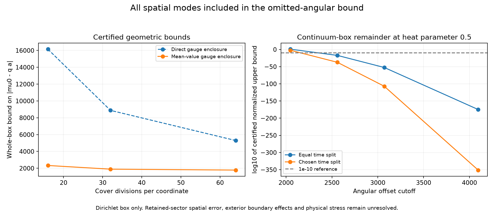

*These are uniform upper bounds for omitted angular sectors of the continuum box. The surrounding exterior and retained-mode errors remain separate.*

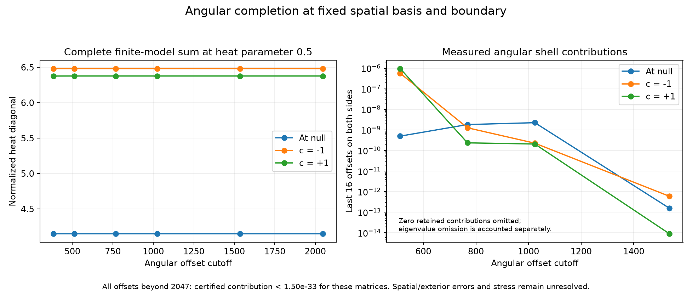

*The infinite angular tail is bounded for the saved matrices. Zero retained shell contributions are omitted from the logarithmic plot; physical stress remains unresolved.*

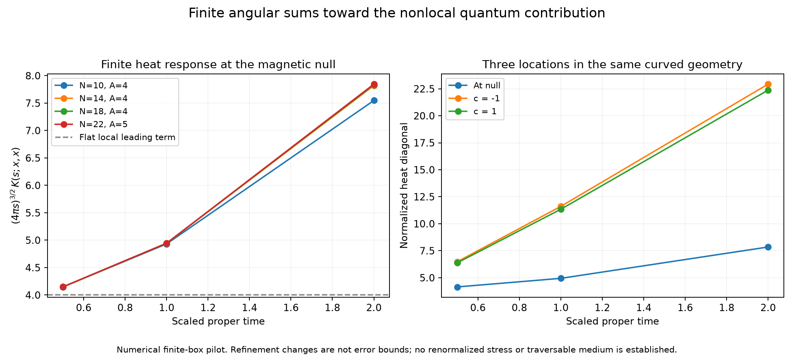

*The horizontal axis is a spectral heat parameter, not elapsed travel time. The plotted response is not energy density or a portal.*

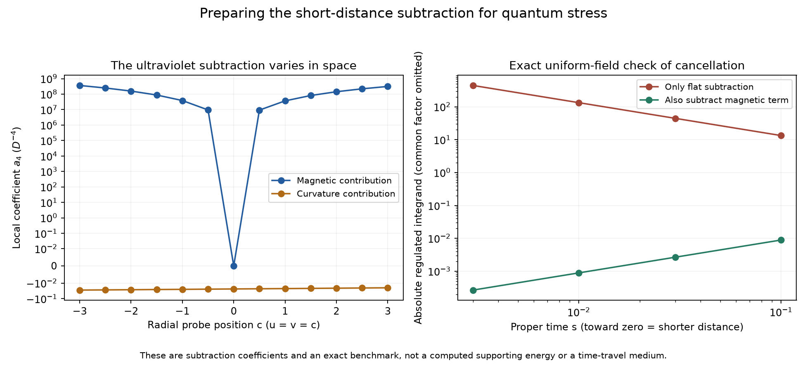

*Subtraction coefficients remove short-distance divergences; their signs are not signs of physical energy density.*

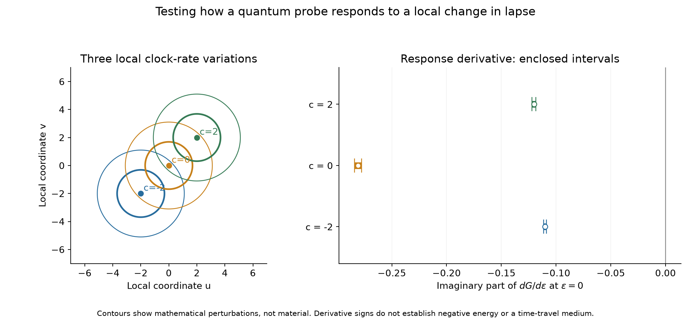

*The contours mark mathematical changes in clock rate. They do not depict a material or portal.*

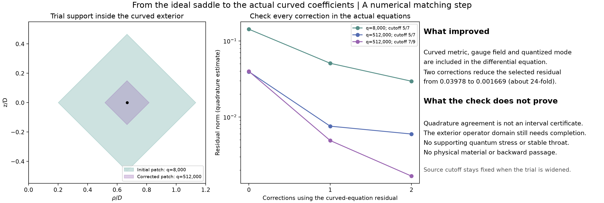

*The patches show where the mathematical trial is supported. They are not material objects or traversable portals.*

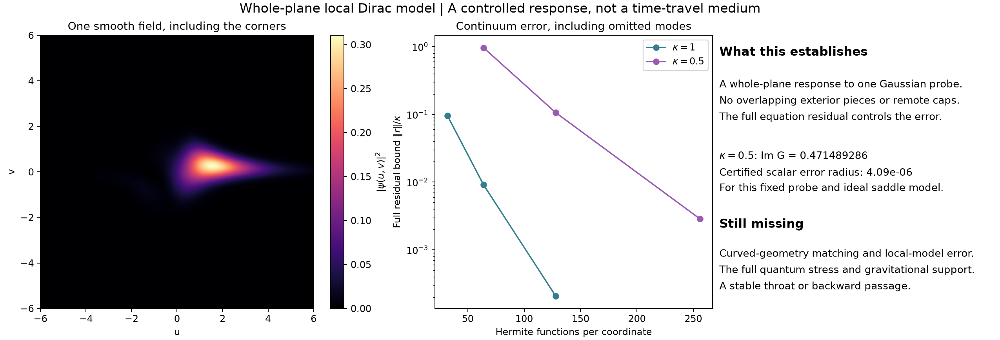

*The field image is a computed quantum response to a smooth mathematical probe. It is not a physical-material blueprint or a portal.*

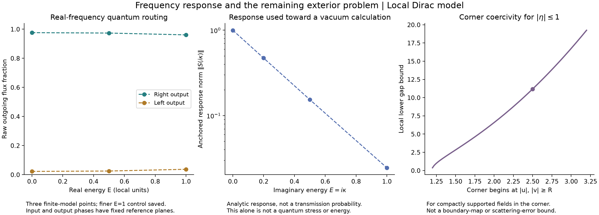

*Real-frequency routing and imaginary-frequency response are distinct quantities. The latter is not a probability or a quantum stress. The corner curve applies to confined fields, not the entire scattering problem. Distant-channel normalization and shared-interface errors are separate limitations.*

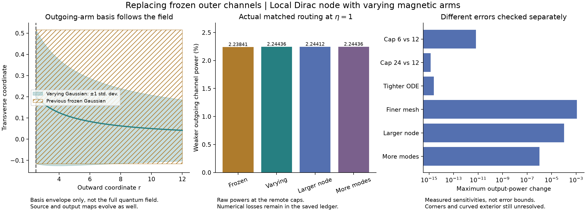

*The Gaussian basis contracts and moves along the arm; its source and detector must evolve too. Routing remains similar in the tested calculations. The separate cap, mesh, node-size and mode comparisons are measured sensitivities, not error bounds or a complete exterior solution.*

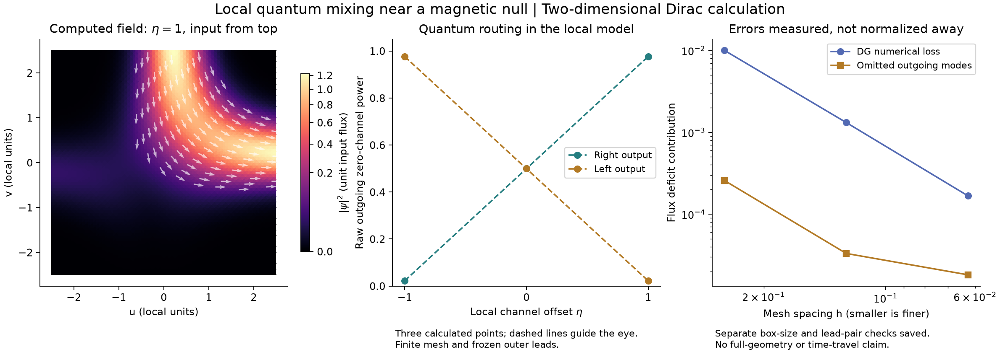

*Left: actual computed field density and current direction for one incoming channel. Middle: three tested offsets, with raw output powers. Right: measured numerical and omitted-mode losses. The square boundary uses frozen leads; this is neither a material blueprint nor a time-travel demonstration.*

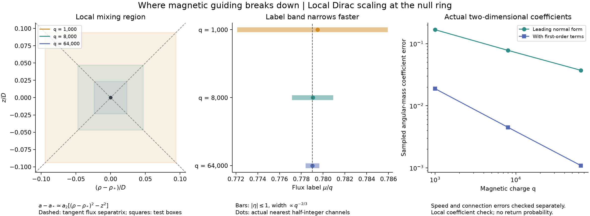

*These are local test regions and flux-label bands, not material structures. Both spatial directions enter the local quantum equation. The plotted approximation errors are sampled coefficient errors; they do not certify global scattering or a return probability.*

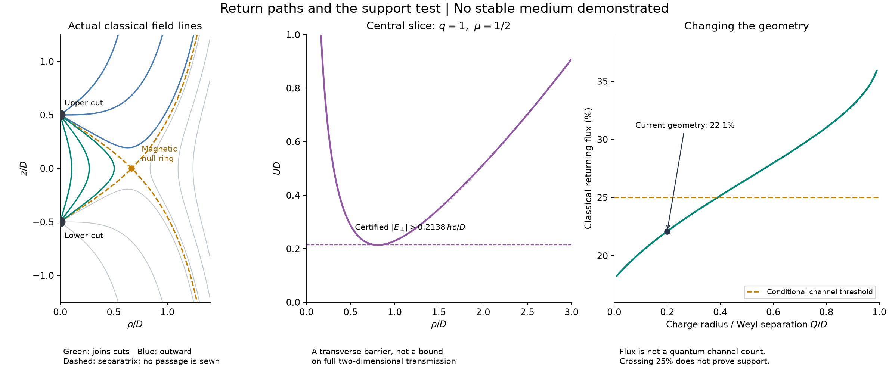

*Green curves connect the two auxiliary cuts in the classical exterior. They are not a sewn throat or payload trajectories. The magnetic-null ring breaks the local guiding approximation. The 25% rule applies to the specified channel-energy ansatz; changing geometry until a classical fraction exceeds it does not establish quantum support.*


*The left panel shows radial probability intervals of the asymptotic zero modes, not material rings. The positive transverse mass bound applies to the other modes. Neither panel shows a constructed passage or a payload trajectory.*

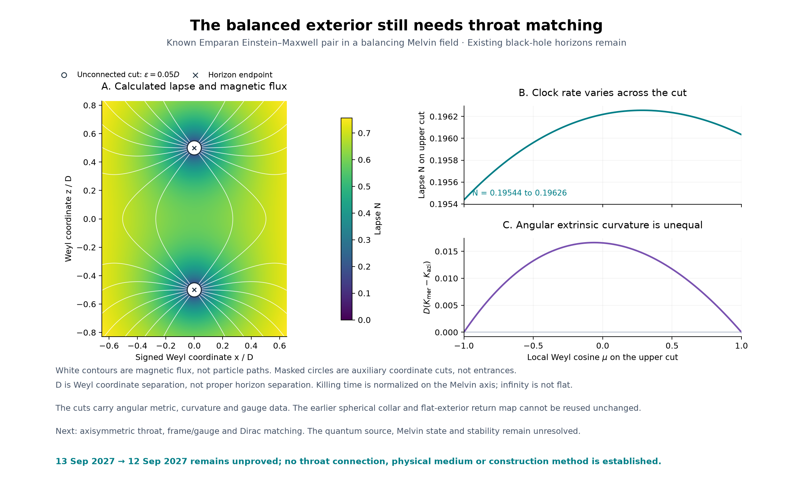

*The map shows a known classical exterior, magnetic flux contours and auxiliary attachment cuts. It does not show a connected passage. Its actual angular clock/geometry data and Melvin environment determine a different quantum problem; the full source, throat sewing and stability remain open. See the current [research notes](docs/RESEARCH.md).*

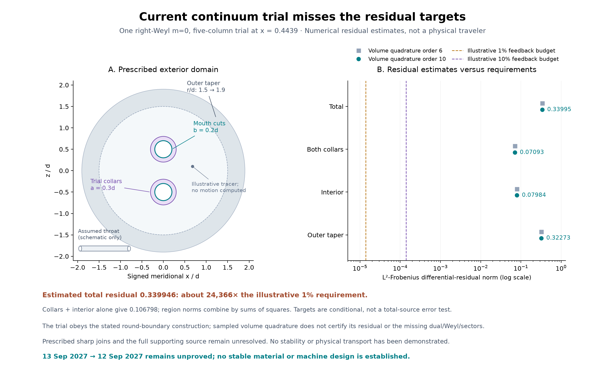

*One right-Weyl $m = 0$ field at one frequency. Regional residuals and their budget comparison are numerical estimates; fourteen passing construction checks do not mean the accuracy target passed. A same-geometry absolute collar source and stability remain separate physical requirements.*


*The low-frequency bounds now cover all nine retained sectors. The feedback panel is a separate finite $N = 2$ to $4$ test at one frequency. Its residual targets are requirements for future continuous physical trial fields, not measured errors or a full-source certificate.*


*The high-frequency bound includes all angular modes. The low-frequency pilot includes only retained $m = 0$ at $N = 4$, $J = 9$ and uses floating-point enclosure formulas. The finite window still lacks a useful complete angular-feedback bound. These three entries cannot yet be combined into a full-source certificate. All are relative interior responses on a prescribed geometry.*


*For $\rho_c = 32$, phase-$\pi$ $N = 4$ central/upper responses are $[-0.01151672, -0.004424743]$. Matched-order spatial refinement changes them by about 0.1795% and 0.1875%; $N = 2$ to $N = 4$ changes are about 0.00135%. These are sensitivities, not error bars or a continuum certificate. The core and its junction are prescribed, not constructed. The [earlier three-frequency pilot](figures/long_throat_source_progress.png) and shorter-core integrals below are preserved.*


*The phase-$\pi$ central/upper responses are $[+0.0122632, +0.0770537]$ at $N = 2$ and $[+0.0131830, +0.1030926]$ at $N = 4$. The finer-mesh $N = 4$ values are $[+0.0121182, +0.0944974]$. The sign persists, but adding levels changes the upper result by about 34%, and $N = 4$ mesh changes are about 8%. These sensitivities are not error bounds. Earlier [three-sector sign reversal](figures/angular_reference_sum_progress.png), [invariant-reference comparison](figures/ads_reference_source_progress.png), and [junction-support requirement](figures/curved_junction_progress.png) remain available.*

## Quickstart

Run commands from the repository root. The recorded environment is **CPython 3.12.14 on Windows**, with NumPy, SciPy, SymPy, mpmath, and Matplotlib pinned in [requirements.txt](requirements.txt). Other platforms have not been certified by the saved runs.

For a fresh environment in PowerShell:

```powershell
gh repo clone Winter-Soren/time-travel
Set-Location time-travel
py -3.12 -m venv .venv
.\.venv\Scripts\python.exe -m pip install -r requirements.txt
```

If you already have the checkout and `.venv`, reuse them and skip their creation. Activation is unnecessary when invoking Python directly.

For each PowerShell session, make the modules in `scripts/` available to the `-c` examples:

```powershell
$env:PYTHONPATH = (Join-Path (Get-Location) 'scripts')
```

Start with a small symbolic check that does not rewrite results:

```powershell
.\.venv\Scripts\python.exe -B -W error -X utf8 -c "from spinful_return import operator_identity; print(operator_identity())"
```

Expected output: `['0', '0']`. The function also asserts that both operator residuals vanish.

The local optical subtraction calculation takes about6 seconds, including geometry, spectral and metric-variation controls:

```powershell
.\.venv\Scripts\python.exe -B -W error -X utf8 scripts/dihole_optical_heat.py
```

The current local lapse calculation takes about13 seconds and writes its own results and figure, while checking and reusing the saved119 certificate:

```powershell
$env:OPENBLAS_NUM_THREADS='1'
$env:OMP_NUM_THREADS='1'
.\.venv\Scripts\python.exe -B -W error -X utf8 scripts/dihole_lapse_susceptibility.py
```

The complete retained threshold calculation takes about 31 seconds; the separate angular-quadrature check takes under 2 seconds including imports:

```powershell
.\.venv\Scripts\python.exe -B -W error -X utf8 scripts/complete_threshold_bound.py
.\.venv\Scripts\python.exe -B -W error -X utf8 scripts/tail_quadrature_bound.py
.\.venv\Scripts\python.exe -B -W error -X utf8 scripts/feedback_residual_bound.py
```

The threshold adapter reuses the saved $m = 0$ result and solves only the other eight zero-frequency sectors. The feedback helper reuses saved matrices and runs in about 2 seconds. None repeats the long frequency integration.

The preceding three remainder checks each take a few seconds and write separate result files:

```powershell
.\.venv\Scripts\python.exe -B -W error -X utf8 scripts/buffered_angular_bound.py
.\.venv\Scripts\python.exe -B -W error -X utf8 scripts/threshold_return_bound.py
.\.venv\Scripts\python.exe -B -W error -X utf8 scripts/ultraviolet_source_bound.py
```

The angular helper reuses saved matrices; the threshold helper solves only the zero-frequency $m = 0$ pilot; the high-frequency helper evaluates analytic interval majorants. The derivations and their distinct scopes are recorded at the start of [docs/RESEARCH.md](docs/RESEARCH.md).

The preceding long-throat integration took about 20 minutes 41 seconds in the recorded environment:

```powershell
.\.venv\Scripts\python.exe -B -W error -X utf8 scripts/long_throat_integral.py
```

It saves completed-sector checkpoints and includes independent frequency/spatial recipes. $N = 2$ is reconstructed from the same exterior solves with its own Gram-weighted boundary projection and nonlinear source. The extra endpoint samples are not certified frequency-tail bounds.

The direct-angular envelope check takes about 2 seconds; the separate smooth-collar mode check takes about 24 seconds:

```powershell
.\.venv\Scripts\python.exe -B -W error -X utf8 scripts/radial_angular_envelope.py
.\.venv\Scripts\python.exe -B -W error -X utf8 scripts/smooth_collar_mode.py
```

Each writes its own result file. The collar helper exposes the existing dense background through an optional argument without changing its default output. Neither check establishes a physical supporting medium.

The preceding selected-frequency pilot takes about 98 seconds in the recorded environment:

```powershell
.\.venv\Scripts\python.exe -B -W error -X utf8 scripts/long_throat_source.py
```

The defect-weighted saved-matrix and radial-absorption check takes about 2 seconds:

```powershell
.\.venv\Scripts\python.exe -B -W error -X utf8 scripts/angular_defect_bound.py
```

Both save their own results; neither establishes a complete physical medium. The earlier complete finite-cut integration can be reproduced with:

```powershell
.\.venv\Scripts\python.exe -B -W error -X utf8 scripts/complete_angular_source.py
```

The recorded integration took about 27 minutes, plus the retained 50-second pilot. It computes both cutoffs from shared exterior solves, saves completed-sector checkpoints, and records quadrature, spatial and selected outer-cutoff changes separately. The pilot's exact executed source is retained in the JSON; its algebra and legacy witnesses are reused rather than rerun. The two cutoffs do not establish an infinite angular limit or a stable medium.

The preceding three-sector reference sum can be reproduced with:

```powershell
.\.venv\Scripts\python.exe -B -W error -X utf8 scripts/angular_reference_sum.py
```

It reuses the saved $\mu = 1/2$ quadratures exactly and computes the two added sectors with matching geometry, nodes and mesh recipes. It saves per-sector checkpoints and observed uncertainty separately from acceptance checks. The independent general angular basis check is `scripts/complete_angular_modes.py`; passing it does not complete the exterior/source sum.

The preceding interior-reference calculation can be reproduced with:

```powershell
.\.venv\Scripts\python.exe -B -W error -X utf8 scripts/ads_reference_source.py
```

It reuses saved angular-sector matrices for its pilot and computes new exterior responses for its frequency integral. It writes its own results JSON, including numerical sensitivity and failed acceptance gates. The common core and compact probe are held identical in the two environments. A finite reference-relative result is not a full supporting stress tensor.

The preceding angular-sector calculation can be reproduced with:

```powershell
.\.venv\Scripts\python.exe -B -W error -X utf8 scripts/azimuthal_source.py
```

It writes its own results JSON. The angular basis has separate checks in `scripts/azimuthal_modes.py`. The explicitly reflected endpoint connection changes existing paired modes as well as the added sectors, so both it and the inherited modal connection are evaluated separately. The exterior mixes angular levels within each azimuthal sector; the result is a partial coupled field sum, not an isolated lowest-multiplet determinant or a degeneracy multiplier.

The preceding opposite-chirality calculation can be reproduced with:

```powershell
.\.venv\Scripts\python.exe -B -W error -X utf8 scripts/dirac_sewing_audit.py
```

It writes its own results JSON. Both physical boundary maps are reconstructed after swapping the spherical characteristic bases. A deliberately adjoint-paired finite prescription is recorded separately as an algebraic control; it is not substituted for the physical projected maps. The computed sum retains one azimuthal sector and an explicit frequency window. It does not establish the full stress tensor or a material preparation procedure.

The preceding one-chirality throat source diagnostic can be reproduced with:

```powershell
.\.venv\Scripts\python.exe -B -W error -X utf8 scripts/throat_null_response.py
```

It writes its own results JSON. The lapse, radial metric and stationary shift vary only inside the throat, with the computed exterior and original endpoint clocks held fixed. The shift calculation retains the relative endpoint time factor after diagonalizing the interior metric. These derivatives measure weighted differences between phases; their numerical checks do not establish absolute NEC violation, a supported geometry or stability.

The preceding compact exterior-source calculation can be reproduced with:

```powershell
.\.venv\Scripts\python.exe -B -W error -X utf8 scripts/local_lapse_response.py
```

It writes its own results JSON. The three probe regions share each Green-function solve. It checks direct finite lapse perturbations and records frequency, mass-quadrature and spatial-mesh comparisons separately. Selected-frequency angular and outer-boundary comparisons do not bound the complete integral's error. The derivative concerns a difference between loop phases in the retained sector, not an absolute stress tensor.

The preceding global phase-contrast calculation can be reproduced with:

```powershell
.\.venv\Scripts\python.exe -B -W error -X utf8 scripts/phase_vacuum_contrast.py
```

It writes its own results JSON, including explicit frequency intervals and separate refinement diagnostics. The normalization describes one complex Weyl sector in the self-adjoint continuum interpretation; the finite dissipative discretization does not itself prove that interpretation or the missing limits.

The preceding curved transport and source audit can be reproduced with:

```powershell
.\.venv\Scripts\python.exe -B -W error -X utf8 scripts/curved_throat_modes.py
.\.venv\Scripts\python.exe -B -W error -X utf8 scripts/curved_exterior_closure.py
.\.venv\Scripts\python.exe -B -W error -X utf8 scripts/throat_junction_audit.py --write
```

These commands rewrite their respective results JSON files. The geometry audit assigns no SI length scale or obtainable material; it verifies the required stress of the stated synthetic geometry.

The preceding imaginary response and declared zero-mode loop connection can be reproduced with:

```powershell
.\.venv\Scripts\python.exe -B -W error -X utf8 scripts/imaginary_weyl_leads.py
.\.venv\Scripts\python.exe -B -W error -X utf8 scripts/imaginary_exterior.py
.\.venv\Scripts\python.exe -B -W error -X utf8 scripts/exterior_loop_closure.py
```

The connected run takes about 25 seconds in the recorded environment. These commands rewrite only their respective results JSON files. The curved-throat derivation and its limits are documented in [docs/CURVED_THROAT_MATCHING.md](docs/CURVED_THROAT_MATCHING.md).

The preceding real-energy tail and connected calculation can be reproduced with:

```powershell
.\.venv\Scripts\python.exe -B -W error -X utf8 scripts/magnetic_tail_map.py
.\.venv\Scripts\python.exe -B -W error -X utf8 scripts/exterior_tail_transport.py
```

The second run takes about 30 seconds in the recorded environment and rewrites its own results JSON. It reads the frozen previous results for a regression comparison. Finite-difference sensitivity checks do not certify an infinite-domain error bound.

The preceding connected model and its small geometry/lead controls can be reproduced with:

```powershell
.\.venv\Scripts\python.exe -B -W error -X utf8 scripts/two_mouth_mesh.py
.\.venv\Scripts\python.exe -B -W error -X utf8 scripts/spherical_weyl_leads.py
.\.venv\Scripts\python.exe -B -W error -X utf8 scripts/exterior_boundary_map.py
```

The connected run took about 30 seconds in the recorded environment and rewrites its results JSON. It saves complex amplitudes, raw boundary traces, one representative field, and the unresolved outer-radius sensitivity. Earlier focused incoming, boundary, and vacuum components can also be reproduced independently:

```powershell
.\.venv\Scripts\python.exe -B -W error -X utf8 scripts/incoming_modes.py
.\.venv\Scripts\python.exe -B -W error -X utf8 scripts/dipole_collar_modes.py
.\.venv\Scripts\python.exe -B -W error -X utf8 scripts/collar_dressing_bound.py
.\.venv\Scripts\python.exe -B -W error -X utf8 scripts/open_boundary_spinor.py
.\.venv\Scripts\python.exe -B -W error -X utf8 scripts/scattering_vacuum.py
```

These commands print their checks and **rewrite their corresponding `*_results.json` files**. Preserve the committed record when comparing environments. Each report explains the parameters, tolerances, and physical scope.

Regenerate only the current figure from saved data:

```powershell
.\.venv\Scripts\python.exe -B -W error -X utf8 -c "from quantum_horizon_plot import phase_vacuum_progress; phase_vacuum_progress()"
```

For the broader local propagation benchmark:

```powershell
.\.venv\Scripts\python.exe -B -W error -X utf8 scripts/spinful_return.py
```

This includes multiple spatial, temporal, and domain configurations, writes a larger JSON record, and costs more than the algebra-only check. It does not regenerate the figure automatically.

**Avoid starting with every historical suite.** The large `scripts/mmp_pulse.py`, `scripts/polyakov_response.py`, and `scripts/future_time.py` programs contain many research increments; broad regeneration can be costly and may use saved checkpoints or native-code helpers. Follow the specific reproduction command in the relevant report rather than assuming a single fast project-wide test command.

## Repository map

Files are grouped by purpose. [DIRECTORY_GUIDE.md](DIRECTORY_GUIDE.md) is the navigation index, and [AGENTS.md](AGENTS.md) gives every research task the placement rules.

| Folder | Contents |
| --- | --- |
| [scripts/](scripts/) | Python research programs, plotting tools and shared path helpers; run them from the repository root as `python scripts/name.py` |
| [results/](results/) | Saved JSON calculations, checks and refinement records |
| [data/](data/) | NPZ states, numerical checkpoints and input data |
| [figures/](figures/) | Generated PNG and PDF figures |
| [docs/](docs/) | Research reports and derivations, starting with [RESEARCH.md](docs/RESEARCH.md) and [QUANTUM_COMPLETION.md](docs/QUANTUM_COMPLETION.md) |
| [chronology_onset_audit/](chronology_onset_audit/) | Preserved historical audit bundle with its own internal layout |
| [provenance/](provenance/) | Retained source evidence and historical artifacts |
| [maintenance/](maintenance/) | Cleanup records and the exact [directory migration map](maintenance/layout-migration.json) |

The root keeps this README, `DIRECTORY_GUIDE.md`, `TASK_STATE.md`, `AGENTS.md` and environment/repository setup files. [TASK_STATE.md](TASK_STATE.md) records the latest state and unresolved dependencies. Scripts use [project_paths.py](scripts/project_paths.py) to resolve project inputs and write outputs into `results/`, `data/` or `figures/`.

Saved failed cases and checkpoints are research evidence. The local virtual environment and regenerable caches are not included in the repository.

## Reproducibility and evidence

Recent result files record check outcomes, parameters, errors/refinement comparisons, equations, scope, and the SHA-256 of the source used to produce them. Older artifacts use their own report or manifest conventions. A stored `passed: true` means that component's stated controls passed; it does not certify a physical device or every approximation in the model.

For example, verify the saved spinful record against the current source or its exact recorded directory migration without rerunning propagation (after setting `PYTHONPATH` above):

```powershell
.\.venv\Scripts\python.exe -B -W error -X utf8 -c "import json; from project_paths import project_path, source_matches; record = json.loads(project_path('spinful_return_results.json').read_text(encoding='utf-8')); assert source_matches('spinful_return.py', record['source_sha256']), 'Source differs from the saved benchmark and recorded migration'; print(record['tests'])"
if ($LASTEXITCODE -ne 0) { throw "Saved-source verification failed" }
Get-FileHash .\results\spinful_return_results.json -Algorithm SHA256
```

The [migration manifest](maintenance/layout-migration.json) records old/new paths and SHA-256 hashes for 480 moves from commit `534bfaa83dbca3b940d7108aff96f9d6149180b2`. Historical JSON hashes and embedded commands remain unchanged as evidence of the original run; use the manifest to translate their former paths. `source_matches` accepts an exact source hash or the explicitly recorded old-to-new source pair, and rejects later unrecorded source edits. New calculations continue to record the actual source hash they execute. The migration did not rerun the science.

Historical Ori checkpoints retain their strict source checks. For an exact historical resumption, use the original Git revision and its matching checkpoints in a separate checkout; do not bypass those guards or relabel the saved source hashes.

Hashes identify exact bytes; they are not substitutes for mathematical review or numerical checks. The repository preserves line endings through `.gitattributes` because changing them changes these hashes. Floating-point results can vary across runtimes, so use the documented tolerances and independent controls when assessing a new run.

The [cleanup record](maintenance/cleanup-2026-09-20.json) records retained-file hashes and an existing provenance discrepancy: seven JSON files in the historical chronology audit differ from its original manifest. That discrepancy predates cleanup; the files and original manifest were preserved. Repository preparation is not a claim that all historical suites were freshly rerun.

## Interpreting the calculations

- **Geometry, source, state, and preparation are separate requirements.** A formal metric or negative-energy expectation value does not establish a realizable, stable supporting medium.
- **Scope follows the equations and boundary data.** A fixed-background field calculation, a spherical reduction, a finite local patch, and a global semiclassical solution answer different questions. The reports identify their assumptions and omitted terms.
- **Numerical agreement has a stated scope.** Refinement, conserved quantities, exact identities, and independent formulations provide evidence; sampled agreement is not automatically a rigorous continuum bound or a stability theorem.
- **Transport and vacuum physics must be connected explicitly.** A planar marginal mode is not a three-dimensional channel count. A numerical absorber is not an escape detector, and forward relativistic time dilation does not demonstrate travel to yesterday.

## Primary references

The detailed reports cite the sources used for each derivation. Useful starting points are:

- Maldacena, Milekhin and Popov, [*Traversable wormholes in four dimensions*](https://arxiv.org/abs/1807.04726): the idealized magnetic-fermion construction motivating the present source and transport work.
- Erdős and Vougalter, [*Pauli operator and Aharonov–Casher theorem for measure valued magnetic fields*](https://arxiv.org/abs/math-ph/0109015): context for the known planar zero-mode result reproduced in the spinful benchmark.
- Hammer, Pötz and Arnold, [*A dispersion and norm preserving finite difference scheme with transparent boundary conditions for the Dirac equation in (1+1)D*](https://arxiv.org/abs/1302.5587): a primary reference for transparent-boundary methodology; its scheme is not claimed as implemented here.

The project tests and extends specified model calculations. Reproducing a published theorem or finding a failure of a particular approximation is not the discovery of a new physical law.
