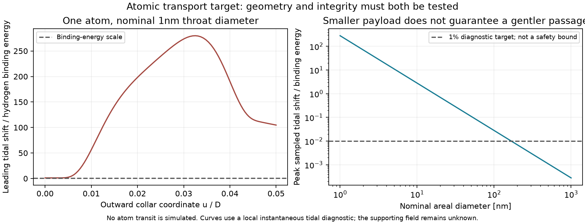

# Atomic transport is the first target

The user has reaffirmed that the first payload is a few atoms or molecules,
with human transport deferred. The working reference is **one neutral
hydrogen atom**, initially in its isolated nonrelativistic ground state,
and a **nominal throat areal diameter of 1nm**. This diameter is a starting
test, not a claimed feasible or minimum opening. Existing calculations
of the supporting field are not simulations of a human or an atom.

Success requires all of the following on the same physical model:

1. A self-consistent geometry, supporting stress and induced current with
   specified field content, state and physical couplings.
2. Stability for the preparation and transit interval, including the
   perturbation from the payload.
3. A propagated atomic center and internal quantum state, with quantified
   transmission, excitation/ionization and numerical errors. A probability
   of transmission through a prescribed geometry alone does not prove that
   the geometry can exist.
4. A specified comparison of exterior clocks. Backward travel requires
   return to an earlier event in the exterior chronology; future travel
   requires a calculated elapsed-time difference, rather than merely
   exiting later than entry.

None of these combined conditions is established. The currently prescribed
static metric has a global time function and cannot itself provide backward
causal passage. Shrinking the payload does not change that property.
Travel from13September2027 to12September2027 remains unproved.

## What an atom-sized target changes

The current shape has central areal radius $r_A=0.2276751874982177D$.
An areal diameter of1nm therefore means $D=2.1961110716$nm. In the fixed
shape and illustrative coupling of checkpoint160, the continuous flux
requirement is $q\simeq4.6428759050\times10^{24}$. Physical flux is integer;
this estimate locates the sector, not a production recipe. Keeping $q=1$
would instead require $\alpha_R\simeq3.3852533560\times10^{-52}$.
Neither alternative is an available material assumption.

The old illustrative $q=1$ areal diameter is
$2.1538374500\times10^{-34}$m, much smaller than an atom. Its quantum source
must not be relabeled as an atom-sized result. Changing flux changes the
charged Dirac operator, all mode sectors and the heat remainder. The same
coupling value used in160 is only an illustration, not a high-energy
measurement or a specified physical hydrogen interaction.

For an isolated hydrogen1s state with reduced mass $\mu$, let
$a_H=a_0m_e/\mu$. Its flat-space probability outside radius $r$ is

$$
P_{>r}=e^{-2r/a_H}\left[1+2r/a_H+2(r/a_H)^2\right].
$$

At $r=0.5$nm this is $1.2436413\times10^{-6}$. It concerns the internal
relative coordinate only. It excludes center-of-mass localization, motion,
the actual curved cross-section and supporting-field interactions; an
areal radius is not a physical hard wall.

## Tidal disturbance must be included

The [calculation](../scripts/atomic_aperture_budget.py) reuses the actual
collar metric jets and evaluates the static-frame tidal tensor

$$
\mathcal E_{\hat i\hat j}
=R_{\hat0\hat i\hat0\hat j}
=\frac{\operatorname{Hess}_h(N)_{ij}}
{N\sqrt{h_{ii}h_{jj}}}.
$$

Its trace agrees with the independently computed
$R_{\hat0\hat0}$ within $10^{-10}$. The64/128-order sampled peak changes
by0.0488%; this is a sensitivity check, not a global enclosure. These
components are the instantaneous Fermi-frame values for a geodesic
momentarily at rest relative to the static frame. A moving transit needs
its own boosted, transported frame and time history.

The leading internal tidal Hamiltonian is
$H_{\rm tidal}=\mu c^2\mathcal E_{ij}x_ix_j/2$, with
$\langle x_ix_j\rangle_{1s}=a_H^2\delta_{ij}$. This follows from the local
Fermi-coordinate coupling used, for example, by
[Boughn--Rothman, equations3.2--3.3](https://arxiv.org/pdf/gr-qc/0605052).
Using [NIST CODATA2022 central values](https://physics.nist.gov/cuu/Constants/Table/allascii.txt),
the largest sampled first-order shift for the nominal1nm diameter is
**279.90 times the isolated hydrogen binding energy**.

This rejects the assumption of a small tidal perturbation of an unchanged
1s atom at those points. It does not compute the true spectrum there,
prove destruction, give an ionization probability, or establish what a
moving atom experiences. Strong compression, excitation and subsequent
recovery require an actual internal-state evolution. The supporting field's
electromagnetic or hidden nature also remains unspecified.

At fixed dimensionless shape the diagnostic scales as diameter$^{-2}$.
Its sampled peak reaches1% at approximately167nm diameter. This is **not
a safe minimum opening**: source support, trajectory, field coupling,
higher tidal terms and stability are still missing. Changing diameter at
fixed physical coupling also changes flux and requires the corresponding
source calculation. We may revise the opening size or shape while keeping
the payload at one atom.

Eight [checks](../results/atomic_aperture_budget_results.json) pass. No
atom transit has been simulated, and neither atom survival nor a time shift
has been established.

The immediate work is to assess an admissible source and a geometry whose
tidal and supporting-field effects can be included in a controlled atomic
model. Existing small-scale field calculations remain reference data,
with their actual parameter values and limits preserved. Enlarging to
humans is outside the current transport milestone.

## Supporting-field update at atomic size

The [strong-field calculation](PHYSICAL_EUCLIDEAN_OPERATOR.md#strong-field-response-at-the-atomic-target)
now evaluates the leading local magnetic contribution at the atomic flux
estimate. With the physical subtraction reference and declared coupling
held fixed, it is positive and about ten million times smaller in magnitude
than the required negative supporting response. The omitted curvature,
field-gradient and global quantum contributions are not bounded, so this
is not a rejection of the complete candidate. It does show that the
computed local piece cannot supply the required support by itself.

The comparison distinguishes the fixed physical reference length from
the size of the new opening. Changing the subtraction convention without
matching the physical couplings would give a spurious improvement. No
atom trajectory, survival probability or clock advantage has been computed.

## Channel reduction update

The [exact slice-channel test](PHYSICAL_EUCLIDEAN_OPERATOR.md#exact-slice-channels-and-their-radial-coupling)
finds a small radial coupling of the proposed supporting-field states that
more flux alone does not remove relative to the local gap estimate. A
field-following correction cancels its leading term algebraically; its full
finite-flux residual remains untested. All14 controls pass. These are quantum
states of the proposed support field, not the hydrogen payload. The next
source calculation must retain their coupling and metric variation. Atom
survival, passage and exterior-clock difference are still uncomputed.

## Regular supporting-field trial

The [regular field-following trial](PHYSICAL_EUCLIDEAN_OPERATOR.md#pole-regular-field-following-channels-and-a-uniform-profile-envelope)
now evaluates the complete collar residual and metric variation. It improves
the tested high-flux local carriers but can worsen low-flux cases. A new
whole-collar profile envelope starts the next uniform error estimate;
normalization and derivative bounds remain to be supplied. All16 controls
pass. This advances the supporting-field approximation, not hydrogen transit.
The one-atom target and its support, stability, survival and clock requirements
remain unchanged. Neither past passage nor a future clock advantage is proved.

## Uniform supporting-field bounds

The [uniform collar result](PHYSICAL_EUCLIDEAN_OPERATOR.md#uniform-collar-errors-and-a-frozen-transverse-gap)
now bounds normalized supporting-field profiles and their full trial error
across a regular band, with 19 checks passing. A separate proof establishes
a positive gap above the frozen cross-section's zero state. These are local
mathematical controls on the proposed supporting field; they do not establish
the total support, stability or hydrogen propagation. The residual bounds
are loose, and the frozen gap is not a global or aligned-trial gap.

The next step is a controlled contribution to the total supporting stress,
including radial mixing and its uncertainty. The payload remains one neutral
hydrogen atom. Neither enlarging to humans nor claiming an atom has crossed
is justified. No backward passage or future exterior-clock advantage has
been calculated. See the [visual](../figures/dihole_channel_bounds_progress.png).

## Aligned-complement control

The [new projector comparison](PHYSICAL_EUCLIDEAN_OPERATOR.md#aligned-complement-gap-and-its-metric-response)
retains more than 99.96% of the frozen cross-section gap after accounting
for the supporting-field trial's mismatch at the continuous atomic-flux
estimate. It also bounds the complementary inverse and its first metric
variation; all 13 checks pass. This improves the local supporting-field
reduction. It does not establish total support, global stability or an
atom's motion. The chosen flux entry is a bound evaluated at a size
estimate, not an explicit quantized atomic-scale state. The one-hydrogen
payload and the outstanding support, survival and clock requirements remain.

## Full radial comparison

The [collar resolvent result](PHYSICAL_EUCLIDEAN_OPERATOR.md#full-collar-resolvent-comparison-and-a-finite-filtered-trace)
now retains full radial coupling and the cutoff commutator in an operator
comparison, with 12 checks passing. It bounds a finite Gaussian-filtered
channel observable near the atomic-flux estimate. The reported 0.05139
normalizes to a universal inverse-operator scale; it is not an atom's
transmission error or a percentage of supporting stress. The metric-weighted
source and omitted modes remain unresolved. One neutral hydrogen atom is
still the transport target, with no established opening, survival or time shift.

## Metric-response control

The [metric-insertion result](PHYSICAL_EUCLIDEAN_OPERATOR.md#metric-response-of-the-full-collar-resolvent) bounds a finite supporting-field observable with the actual geometry variation included. All 13 controls pass. This controls an error in the source reduction; it does not provide the total supporting stress or an atom trajectory. Its current frequency-error envelope is not integrable to infinity, so cancellations and the omitted sectors must be addressed next. One hydrogen atom and the trial 1 nm opening remain the target; stability, survival and clock advantage are unproved.

## Paired-frequency and source-selection control

The [paired-frequency result](PHYSICAL_EUCLIDEAN_OPERATOR.md#paired-frequencies-and-a-finite-selected-sign-insertion) bounds an integrated high-frequency remainder and a separate finite massless source selection. All 14 checks pass. This is supporting-field mathematics, not hydrogen propagation. Physical massive-regulator matching and the omitted field contributions remain necessary before a total supporting stress can be reported. The atom target, trial 1 nm diameter, survival and clock requirements remain unchanged.

## Checkpoint170: proper-mass supporting fields

The [massive-channel test](PHYSICAL_EUCLIDEAN_OPERATOR.md#proper-mass-channel-comparison-at-fixed-regulator) includes the real lapse-dependent mass and its leakage outside the retained channel. All 16 controls pass. The small leakage coefficient at atomic flux is a supporting-field bound, not a hydrogen transmission probability. The four components and regulator masses belong to the auxiliary field calculation; they do not model four particles, a human, or the payload's mass.

The first physical target remains one neutral hydrogen atom and a trial 1 nm areal diameter. Support, stability, atomic quantum evolution and an exterior-clock difference must hold together before passage is established. The next source calculation must preserve the common regulator cancellation while including omitted modes. Enlarging the opening would require a new source and stability calculation; it is not automatic scaling.

## Checkpoint171: common supporting-field response

The [proper-field comparison](PHYSICAL_EUCLIDEAN_OPERATOR.md#proper-euclidean-channel-and-a-common-metric-insertion) now bounds a finite geometry-response contribution while retaining the common regulator cancellation. All 17 controls pass. The result uses a fixed frequency, finite auxiliary regulator and positive infrared shift; it is not the total energy supporting the opening. The compact metric insertion offers the next route to removing that artificial shift. No atom has been propagated and no time difference has been established.

## Checkpoint172: one atom remains the physical milestone

The [localized calculation](PHYSICAL_EUCLIDEAN_OPERATOR.md#compact-zero-shift-insertion-and-integrated-frequency-tail) removes an artificial positive shift from a selected supporting-field contribution and bounds its high-frequency integral at fixed regulator. All 18 checks pass. This resolves a mathematical cutoff issue; the total supporting energy and stability remain unknown. The next calculation concerns the low-frequency contribution and omitted field content.

The payload is still **one neutral hydrogen atom**, with a **trial 1 nm areal diameter**. No atom has been propagated. A valid first demonstration requires the same model to provide support, stability, quantified atomic transmission and internal-state survival, and an exterior-clock comparison. The present static geometry cannot send it from 13 September 2027 to 12 September 2027. A future clock advantage is also uncalculated. Any later enlargement would require new support, stability and payload calculations.

## Checkpoint173: one selected energy contribution has a frequency bound

The [paired-frequency calculation](PHYSICAL_EUCLIDEAN_OPERATOR.md#paired-low-frequency-bound-with-zero-states-retained) now bounds a selected supporting-field contribution over all frequencies, including zero-energy states, with 20 checks passing. The bound remains finite over the declared artificial-shift interval at fixed regulator. It does not supply the total supporting energy: omitted field contributions and the physical limits remain unresolved.

The practical target is unchanged: one neutral hydrogen atom through a trial 1 nm opening, followed by a survival and exterior-clock calculation. No stable opening or atom passage has been established. Travel from 13 September 2027 to 12 September 2027 is excluded by the present static geometry; a future clock advantage is uncalculated. Human transport and enlarging the opening remain deferred.

## Checkpoint174: account for the whole supporting field

The [source-completion calculation](PHYSICAL_EUCLIDEAN_OPERATOR.md#full-source-completion-and-a-global-lapse-weight-bound) now separates the omitted transverse, spatial and Gaussian field contributions exactly. A new global lapse-weight bound applies across the prescribed exterior, collars and central section, with 23 checks passing. Two full-field smoothing quantities remain unevaluated; the selected contribution is not being presented as the total energy.

The next test remains whether this geometry can be supported at all. One hydrogen atom and the trial 1 nm diameter are unchanged. Stability, atomic transmission and survival, and an exterior-clock advantage have not been established.

## Checkpoint175: full-field smoothing bounds are now explicit

The [buffered full-field estimate](PHYSICAL_EUCLIDEAN_OPERATOR.md#full-field-smoothing-on-buffered-collars) evaluates the two missing smoothing norms and bounds the complete paired low-frequency contribution at a fixed regulator. Every angular state and exterior propagation remain included. The ceiling is very loose and does not determine the supporting stress or its sign. The full high-frequency contribution and physical regulator limit remain unresolved.

One hydrogen atom and the trial 1 nm areal diameter remain the target. No supported opening, stability, atomic passage or future clock advantage is established; the current static geometry excludes backward travel.

## Checkpoint176: the complete supporting-field frequency bound

The [full-frequency result](PHYSICAL_EUCLIDEAN_OPERATOR.md#complete-frequency-bound-at-fixed-common-regulator) now bounds the complete compact supporting-field response at a fixed artificial regulator, including every angular state and the exterior. All 16 controls pass. Keeping the source's first-order form removes a large overestimate, and its full high-frequency tail is integrable. The resulting ceiling still does not determine physical supporting stress or its sign. Matching to the physical regulator limit and counterterms is the next calculation.

This remains preparation for the **one-hydrogen-atom** target, using a **trial 1 nm areal diameter**. No atom has been propagated, and support, stability, transmission, internal-state survival and an exterior-clock advantage remain unproved. The present static geometry excludes travel from 13 September 2027 to 12 September 2027. A larger payload would need new support and stability calculations; it is not an automatic enlargement.

## Checkpoint177: a physical matching correction is partly bounded

The [new heat calculation](PHYSICAL_EUCLIDEAN_OPERATOR.md#full-field-heat-variation-and-a-regulator-matching-tail) turns the complete supporting-field estimate into a full heat-response bound. Its long-time correction to the physical subtraction scheme is now explicitly bounded, with all 14 controls passing. The remaining short-time remainder and the source at the required target regulator are still unknown. Making this one correction small does not establish the total supporting stress.

The payload remains one hydrogen atom through a trial 1 nm opening. Support, stability, transmission, internal-state survival and a clock difference remain unproved. The present static model cannot send the atom from 13 September 2027 to 12 September 2027.

## Checkpoint178: pure magnetic short-time correction bounded

The [new magnetic remainder bound](PHYSICAL_EUCLIDEAN_OPERATOR.md#signed-all-order-magnetic-remainder-on-the-actual-collars) controls the sign and magnitude of the local constant-field reference correction at every proper time. It uses the actual collar geometry and the exact variation mask, with all 12 controls passing. The remaining curved, varying-field heat contribution and full source at the target regulator are uncomputed. Two small correction bounds therefore do not establish the total supporting stress.

The first target remains one hydrogen atom and a trial 1 nm areal opening. No supported opening, stability, atom transmission, survival or clock advantage has been established. The static model cannot send it from 13 September 2027 to 12 September 2027.

## Checkpoint179: high derivatives of the actual opening are bounded

The [regular-coordinate calculation](PHYSICAL_EUCLIDEAN_OPERATOR.md#regular-collar-geometry-and-full-operator-high-derivative-bounds) now bounds the geometry through derivative order20 and the complete supporting-field operator and its variation through order18, including the smooth joins and both poles. All 13 checks pass. This provides inputs needed for the remaining quantum-field error estimate, not an atom propagation or proof of support.

The next calculation must quantify local transport and the heat defect. One hydrogen atom through a trial 1 nm opening remains the first milestone; humans are deferred. Stability, atomic survival and a future clock advantage remain unproved, and the present static geometry excludes backward travel.

## Checkpoint180: local field-propagation bounds, before atom propagation

The [local transport calculation](PHYSICAL_EUCLIDEAN_OPERATOR.md#explicit-normal-neighbourhood-heat-transport-and-graph-evaluation) now bounds a local normal neighbourhood, five heat coefficients and point evaluation of the quantum-field response. All 16 checks and three independent audits pass. Here "heat transport" is part of a quantum-field calculation; it does **not** mean that a hydrogen atom has crossed the proposed opening.

The target remains **one neutral hydrogen atom through a trial 1 nm areal diameter**, with humans deferred. That size is a parameter to test, not a proved viable aperture or a classical size-only passage condition. The next calculation must evaluate the remaining field-error bound and supporting source. A successful model then needs stability, nonzero atom transmission with quantified internal-state survival, and an operational exterior-clock comparison. Scaling to molecules or humans would require new calculations.

No supporting material or stable opening is established. The present static geometry cannot send an atom from 13 September 2027 to 12 September 2027. Future clock gain has not been established for this model.
