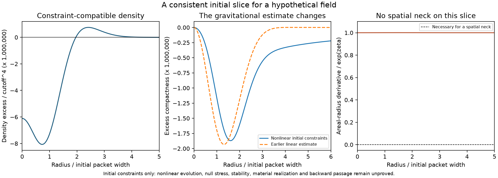

# Nonlinear initial constraints: a concrete but limited milestone

The illustrative field now has numerically constraint-compatible nonlinear
initial data. At amplitude 0.001, its compactness profile differs from the
linear result by up to 29.6% of the linear peak. Fourteen checks pass,
including the original constraints, matter-versus-geometry projections and
boundary refinement. This establishes one initial slice of a hypothetical
model. It does not establish nonlinear evolution, a stable medium, a new law
or travel from 13 September 2027 to 12 September 2027.

## Model and data

Use the same action and homogeneous background as the
[expanding completion](EXPANDING_FIELD_COMPLETION.md), with natural units
$\Lambda=1$, $P=\bar M_{\rm Pl}^2=10^4$, $\alpha=1$,
$H=0.004081258160863258$, $X_0=1+18H^2$ and $c=\alpha X_0$.
The supporting homogeneous vacuum term remains part of the assumed model.
At $a=1$, prescribe

$$\zeta=-\epsilon e^{-x^2/2},\quad \dot\zeta=0,\quad
x=r/R,\quad R=k_J^{-1}=70.70008025824305,\quad\beta=Hr w(x).$$

Here the profile is an exact Gaussian. The earlier packet used a smooth
spectral taper; their initial Gaussian profiles agree extremely closely,
but they are not exactly identical initial data. An exact Gaussian is not
strictly band limited. This calculation supplies no ultraviolet validity
bound for either the Gaussian or its nonlinear harmonics.

This is a test within an assumed effective field theory. The general family
of ghost-condensate modifications and its unusual dispersion are existing
research: [Arkani-Hamed et al., JHEP 2004](https://arxiv.org/abs/hep-th/0312099).
Nonlinear evolution and singular behavior have also been studied in that
family: [Arkani-Hamed et al., JHEP 2007](https://arxiv.org/abs/hep-ph/0507120).
Neither source establishes that this particular initial profile is a
realizable material or a time-travel medium. No novelty claim follows from
solving its constraints.

## Solved equations and boundary conditions

Define $u=x\zeta_x$, $t=1-w(1+u)$, $d=xw_x$, $e=3t-d$ and $y=N^{-2}$.
The extrinsic-curvature numerators are $E_t=Ht$, $E_r=H(t-d)$ and $E=He$.
The lapse equation is

$$A y^2+B y+C=0,$$
$$A=3cH^2e^2-\frac34X_0^2,\quad
B=PH^2(3t^2-2td)+\frac12X_0,\quad
C=\frac P2 R^{(3)}+\frac14-\rho_\Lambda,$$
$$R^{(3)}=\frac{e^{-2\zeta}}{R^2}
[-4(\zeta_{xx}+2\zeta_x/x)-2\zeta_x^2].$$

The selected root $y=(-B-\sqrt{B^2-4AC})/(2A)$ is the root connected to
$N=1$ at zero amplitude. The other root is not an interchangeable solution.
The radial momentum equation is

$$\left(\frac{Pt}{N}+\frac{ce}{N^3}\right)_x
+\frac{P(1+u)}N w_x=0.$$

Implicitly differentiating the lapse polynomial eliminates $N_x$ and gives
a second-order boundary-value equation for $w$. With
$F_y=2Ay+B$, $F_t=18cH^2ey^2+PH^2(6t-2d)y$,
$F_d=-6cH^2ey^2-2PH^2ty$, $D=PtN+3ce/N$ and $K=N^3/(2F_y)$,

$$
x(c+DKF_d)w_{xx}=-(PN^2+3c)wu_x-c(4+3u)w_x
-DK\{F_t[-(1+u)w_x-wu_x]+F_dw_x+C_x\}.
$$

At the center, regularity requires $w=w_0+b x^2/2+O(x^4)$, rather than a
vanishing central $\beta_r$. Its leading coefficient satisfies

$$b=\frac{-2(PN^2+3c)w_0\epsilon
-DK[-2\epsilon w_0F_t+C_{xx}(0)]}{5(c+DKF_d)},\qquad
C_{xx}(0)=\frac{10P\epsilon(1+\epsilon)e^{2\epsilon}}{R^2}.$$

The solver imposes this Taylor condition at $x_{\min}=10^{-5}$ and tests
$10^{-6}$. The first trial incorrectly imposed $w_x(x_{\min})=0$ and
exhausted the mesh budget; it was a numerical boundary-condition failure,
not evidence of physical collapse. The Taylor condition resolves it.

The outer condition $xw_x+3w=0$ selects the leading decaying tail
$w\sim x^{-3}$, hence $\beta\sim r^{-2}$. It is tested at outer radii
12 and 18; it is not an exact finite-radius asymptotic boundary condition.
The lapse discriminant stays above 0.238 and the implicit momentum
denominator stays above 3336 on the reported grid. No branch crossing occurs
in the converged solutions. These numerical checks are not an interval
proof of existence or uniqueness.

## Physical quantities and independent checks

With areal radius $\mathcal R=Re^\zeta x$, the total geometric density and
radial flux in the normal orthonormal frame are

$$\rho=\frac P2\left[R^{(3)}+\frac{H^2(6t^2-4td)}{N^2}\right],\qquad
j=T_{ue}=\frac{2PH e^{-\zeta}}R\left(\frac{wu_x}{N}+\frac{tN_x}{N^2}\right).$$

Their matter-action expressions, checked separately, are

$$\rho=\rho_\Lambda+X(X-1)-\frac{(X-1)^2}4
-\frac{3cH^2e^2}{N^4},\qquad
j=\frac{2cH e^{-\zeta}}R(e/N^3)_x,\quad X=X_0/N^2.$$

The same-areal-radius background-subtracted compactness is

$$\delta C=\mathcal R^2H^2[(t/N)^2-1]-2u-u^2.$$

The separate spherical mass identity is

$$(\mathcal R\delta C)_x=\frac{\mathcal R^2}P
[(\rho-3PH^2)\mathcal R_x-jRe^\zeta\mathcal R Ht/N].$$

The flux term and its sign are necessary. This identity checks consistency
of geometric observables; it does not replace the action constraints.

| Quantity at amplitude 0.001 | Numerical result |
| --- | ---: |
| Central density minus homogeneous density, in $\Lambda^4$ | $-6.11049\times10^{-6}$ |
| Largest sampled positive density excess | $7.48936\times10^{-7}$ |
| Largest absolute excess compactness | $1.86939\times10^{-6}$ |
| Largest pointwise difference from linear compactness / linear peak | 0.296161 |
| Maximum $|N-1|$ | $2.35536\times10^{-6}$ |
| Original lapse residual / sum of absolute terms | $5.68\times10^{-16}$ |
| Original momentum finite-difference residual / shift term peak | $2.18\times10^{-9}$ |
| Matter/geometric density relative disagreement | $6.83\times10^{-11}$ |
| Matter/geometric flux relative disagreement | $6.12\times10^{-9}$ |
| Integrated mass identity relative disagreement | $1.12\times10^{-8}$ |
| Largest compactness change on resolution refinement | $1.97\times10^{-12}$ |
| Largest compactness change on outer-radius refinement | $5.74\times10^{-13}$ |

Derivatives in the independent momentum and matter-flux checks use two
five-point difference steps. The source-free homogeneous control passes.
The nonlinear correction falls approximately quadratically with amplitude:
the relative discrepancy is 3.00% at $10^{-4}$ and 0.301% at $10^{-5}$.
These are numerical convergence diagnostics, not certified error bounds.

The density quoted above is a deficit relative to the expanding background;
the total density remains positive. Density alone does not determine null
energy. Pressure and total null stress need the evolution equations and
have not been computed at nonlinear order.

## Decision and next test

The previous reconstruction was not a nonlinear solution. This calculation
replaces it with initial data satisfying the full constraints to the tested
numerical precision. It preserves the earlier failed approximation as
evidence; it does not retroactively validate that approximation.

The prescribed Gaussian has $1+r\zeta_r=1+\epsilon x^2e^{-x^2/2}\ge1$.
Consequently this initial geometry has no spatial neck, regardless of how
accurately the lapse and shift are solved. This is a limitation of the
chosen initial slice, not a theorem excluding other geometries.

The next meaningful test is nonlinear evolution from these initial data:
derive the remaining equations, follow the field and geometry together,
and determine whether regularity and effective-theory control survive.
A singularity, loss of the constraint branch, or invalid effective-theory
scales must be recorded as a failure or a limit of this model. Changing
numerical settings cannot be counted as repairing a physical failure.
Even a successful evolution would leave throat formation, safe transport,
material realization and chronology change to be established separately.
There is no defensible deadline for a new physical law.

Reproduce with `.\.venv\Scripts\python.exe -B scripts/nonlinear_packet_constraints.py`.
See the [calculation](../scripts/nonlinear_packet_constraints.py),
[results and source hashes](../results/nonlinear_packet_constraints_results.json),
[saved fields](../data/nonlinear_packet_constraints_state.npz), and
[figure](../figures/nonlinear_packet_constraints_progress.png).
