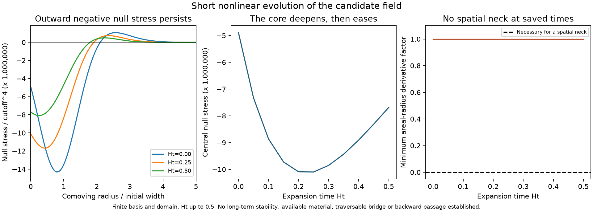

# Short nonlinear evolution and total null stress

The candidate now evolves from its constraint-compatible initial slice
through $0\le Ht\le0.5$, with the full nonlinear lapse and momentum
constraints reconstructed during integration. Eighteen checks pass.
The central null stress remains negative, first deepening and then easing.
No spatial neck appears in the represented states. This is a finite-basis,
short-time calculation of a hypothetical field, not a stability theorem,
an obtainable medium or a discovery of a new physical law.

The underlying framework belongs to the published
[ghost-condensate effective-theory family](https://arxiv.org/abs/hep-th/0312099).
[Published nonlinear studies](https://arxiv.org/abs/hep-ph/0507120) describe
singular behavior in related models. Those results motivate longer-time
and validity checks; they do not establish the fate of this particular
action and initial packet. The specific derivation and numerical results
below are project calculations, with no claim of peer-reviewed novelty.

## Closed evolution system

Use the action, background and units of the
[expanding completion](EXPANDING_FIELD_COMPLETION.md) and the
[nonlinear initial slice](NONLINEAR_PACKET_CONSTRAINTS.md).
In particular $\Lambda=1$, $P=10^4$, $\alpha=1$,
$X_0=1+18H^2$, $c=\alpha X_0$ and
$f(X)=(X-1)^2/4-\rho_\Lambda$. Put

$$y=N^{-2},\quad X=X_0y,\quad k=\Theta=E/N,\quad
\sigma=(\beta_r-\beta/r)/N,\quad m=(P+3cy)k.$$

Varying the radial action with respect to $\dot\zeta$ gives the conjugate
momentum per unit solid angle,

$$\pi_\zeta=-2r^2a^3e^{3\zeta}m.$$

The momentum constraint has the exact integral solution

$$\sigma_r+3(\zeta_r+1/r)\sigma=-m_r/P,$$
$$\sigma(r)=-\frac{e^{-3\zeta(r)}}{Pr^3}
\int_0^r s^3e^{3\zeta(s)}m_r(s)\,ds.$$

At each point, solve the lapse equation on the positive branch connected
to $N=1$:

$$\frac P2R^{(3)}+
\frac{(P+9cy)m^2}{3(P+3cy)^2}-\frac P3\sigma^2
+\frac{1+2X_0y-3X_0^2y^2}{4}-\rho_\Lambda=0.$$

Then reconstruct the shift using the asymptotic condition

$$\frac{\beta(r)}r=-\int_r^\infty\frac{N(s)\sigma(s)}s\,ds.$$

The two evolution equations are

$$\dot\zeta=\frac N3(k+\sigma)-H+\beta(\zeta_r+1/r),$$
$$\dot m=\beta m_r+P\Delta_\gamma N
-\frac N2\left[mk+P\sigma^2+3f+\frac P2R^{(3)}\right],$$
$$\Delta_\gamma N=a^{-2}e^{-2\zeta}
[N_{rr}+(2/r+\zeta_r)N_r].$$

The trace equation follows from the curvature variation
$\delta S_R/\delta\zeta=(P/2)r^2a^3e^{3\zeta}(NR^{(3)}-4\Delta_\gamma N)$.
An independent derivation agrees. The remaining traceless radial equation
has residual proportional to $1/(Ne^{3\zeta}r^3)$ when the constraints and
trace equation hold; a regular center sets that coefficient to zero. This
argument would require different boundary information on an excised or
two-ended throat domain.

The homogeneous solution gives zero evolution. At first order,
$\delta m=-K\dot\zeta+J\Delta\zeta/a^2$ and
$\dot{\delta m}=P\Delta_\gamma n+P\Delta\zeta/a^2-3H\delta m$.
These reproduce the previously derived scalar mode equation exactly.

## Nonlinear stress, independently checked

The spatial matter pressure for this action is isotropic in the normal
frame. Its energy density, pressure and radial flux are

$$\rho=2Xf_X-f-3cyk^2,\qquad
p=f+cyk^2+2D_u(cyk),\qquad j=2D_e(cyk),$$
$$D_u=N^{-1}(\partial_t-\beta\partial_r),\qquad
D_e=(ae^\zeta)^{-1}\partial_r.$$

Thus the two normalized radial null stresses are

$$T_\pm=\rho+p\pm2j
=2Xf_X-2cyk^2+2D_u(cyk)\pm4D_e(cyk).$$

This uses actual evolution to determine the time derivative. It is not an
inference of null energy from a density deficit. For an independent
geometric comparison, set $A=ae^\zeta$, $h=(k+\sigma)/3$ and
$k_r=(k-2\sigma)/3$. Exact Ricci/frame projections give

$$T_\pm=-2P\left\{
D_uh+h(h-k_r)
+A^{-2}[\zeta_{rr}+\zeta_r/r-(N_r/N)(\zeta_r+1/r)]
\pm\frac2A[h_r+(h-k_r)(\zeta_r+1/r)]\right\}.$$

The two calculations agree to $1.0\times10^{-7}$ relative to each saved
time's peak null stress. Directional time derivatives use the evolution
vector and two centered difference steps; changing the step alters the
matter null stress by less than $8.8\times10^{-10}$ of that scale.

## Failed numerical trials and the correction

Direct nodal finite differences produced rapid short-wavelength growth
and internal integration-stage lapse failures. Reducing the time step
barely changed the failure, while spatial refinement made it earlier.
Using nodal spline derivatives did not resolve it. These are preserved as
[trial evidence](../results/nonlinear_packet_evolution_fd_trial.json),
[finite-difference source](../provenance/nonlinear_packet_evolution_fd_trial.py),
and [spline source](../provenance/nonlinear_packet_evolution_spline_trial.py).
They are not classified as continuum physical singularities.

The nonlinear momentum integral contains a cancellation that is lost for
alternating nodal modes: their nodal first derivative vanishes while the
second derivative does not. An independent frozen-coefficient analysis
gives the continuum leading dispersion coefficient

$$\omega^2=\left[-\frac{PcN^2}{(P+3cy)F_y}\right]k_{\rm phys}^4,
\qquad F_y=\partial F/\partial y.$$

On the selected branch $F_y<0$, so this leading coefficient is positive.
The apparent order-$k^2$ trace terms cancel exactly. Symbolic checks verify
both identities. This excludes the proposed principal-sign explanation
for the observed numerical failure; it does not prove full hyperbolicity
or long-term nonlinear stability.

The successful representation uses radial basis functions
$j_0(n\pi x/L)$ for $\zeta$ and $\mu=(m-m_0)/(PH)$, where $x=r/R$.
Their spatial derivatives are analytic. Products are evaluated on an
oversampled Gauss grid, and the regular shear integral uses local Gauss
quadrature without subtracting large endpoint integrals near the center.
This removes the specific nodal defect without reducing amplitude 0.001.

## Numerical scope and results

The baseline retains 48 scalar modes on $0\le x\le12$, with 192 Gauss
nodes plus an explicitly regular center. Auxiliary lapse derivatives use 96
modes. The scalar fields vanish at the outer cut; the lapse and shift have
approximate exterior tails. These are finite-domain assumptions, checked
by changing the outer radius. The largest retained initial scalar
wavenumber is $0.177742\Lambda$; this is not a proof of the true EFT cutoff.
The parameter choice $\Lambda=0.01\bar M_{\rm Pl}$ remains an illustrative
high-energy regime, with no available material specification.

| Saved central quantity | Value |
| --- | ---: |
| $T_\pm/\Lambda^4$ at $Ht=0$ | $-4.8929338\times10^{-6}$ |
| Most negative saved value, at $Ht=0.25$ | $-1.0098732\times10^{-5}$ |
| $T_\pm/\Lambda^4$ at $Ht=0.5$ | $-7.6864657\times10^{-6}$ |
| $\zeta$ at $Ht=0.5$ | $-0.0009985304462$ |
| Minimum lapse across saved states | $0.9999976446$ |
| Largest sampled $|\delta C|$ over the run | $2.4614082\times10^{-6}$ |

Both null directions coincide at the regular center, where the flux is
zero. The core becomes more negative and then partially relaxes; it does
not simply dilute throughout this interval. The sources and geometry
remain weak perturbations of the assumed expanding background.

| Refinement | Maximum change in $\zeta$ | Maximum change in $\mu$ |
| --- | ---: | ---: |
| 48 to64 modes | $1.19\times10^{-14}$ | $1.22\times10^{-11}$ |
| Outer radius12 to18, maintaining spectral range | $2.03\times10^{-14}$ | $2.80\times10^{-11}$ |
| Gauss oversampling factor4 to6 | $3.55\times10^{-15}$ | $1.64\times10^{-12}$ |
| Tighter integration accuracy and half maximum step | $9.91\times10^{-17}$ | $8.15\times10^{-14}$ |

These compare reconstructed fields on a common interior grid at 11 saved
times. They are numerical agreement, not rigorous error enclosures. The
weak-amplitude run agrees with the independent linear mode solver within
$8.0\times10^{-8}$ relatively. The production evolution uses 1235 RHS
evaluations; every refinement run terminates successfully.

For each saved finite-basis state, $|v j_0'(v)|\le2$ implies

$$|r\zeta_r|\le2\sum_n|\zeta_n|\le0.002000000000000024.$$

Therefore $1+r\zeta_r>0.998$ for all radii in those represented states:
there is no spatial neck. This does not certify all unsaved times or the
exact nonlinear continuum. Negative null stress by itself has not supplied
the required bridge geometry.

## Next physical decision

The new result is a nonlinear negative-null-energy source within the
specified assumed action, followed for a short interval with meaningful
checks. It moves beyond an initial constraint solve. It does not establish
a stable apparatus, topology change, transport or a new physical law.

The next calculation should compare this actual stress with an explicit
throat's geometric requirements and check the effective-theory scale
assumptions. A self-consistent throat needs different spatial boundary
conditions from the regular-center weak packet used here. Longer-time
evolution can test persistence but cannot establish that geometric match
by itself. Travel from 13 September 2027 to 12 September 2027 remains unproved.

Reproduce with `.\.venv\Scripts\python.exe -B scripts/nonlinear_packet_evolution.py`.
See [source](../scripts/nonlinear_packet_evolution.py),
[results and hashes](../results/nonlinear_packet_evolution_results.json),
[saved coefficients and stresses](../data/nonlinear_packet_evolution_state.npz),
and [figure](../figures/nonlinear_packet_evolution_progress.png).
