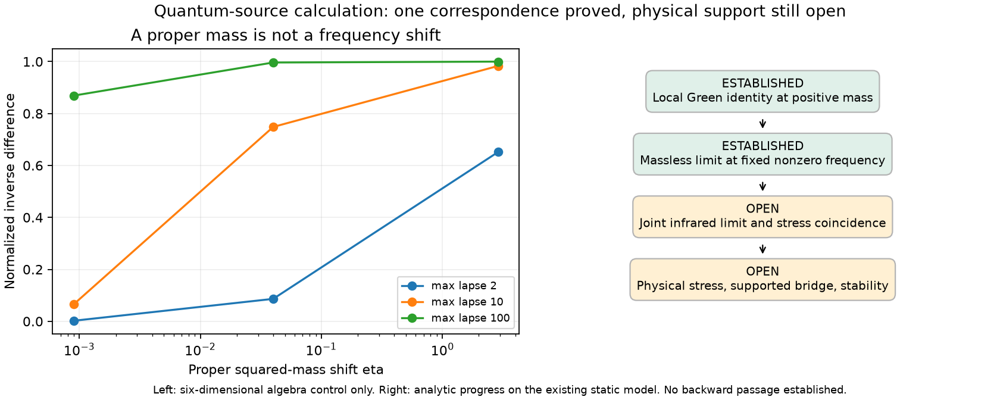
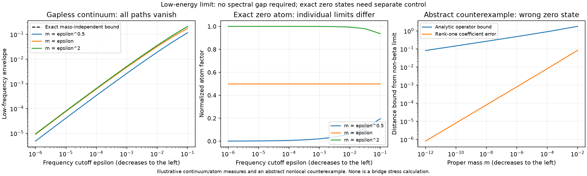
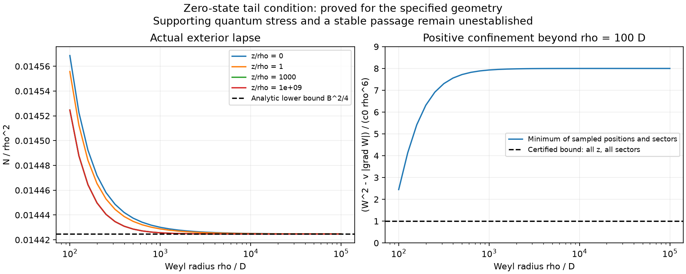
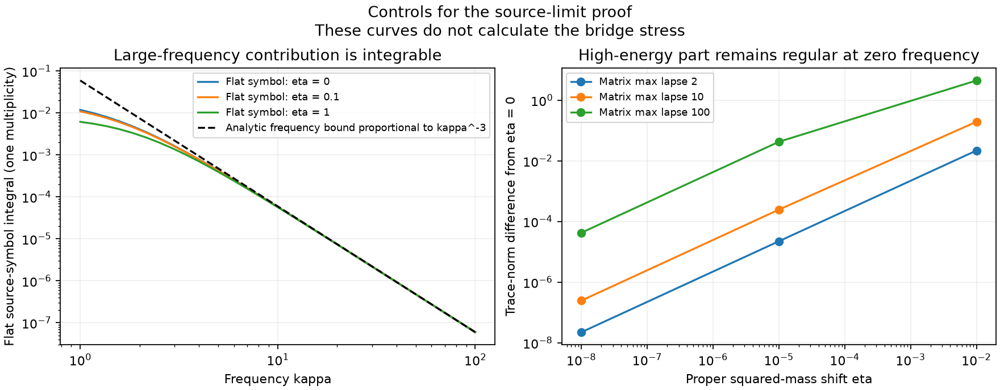

# A common physical Euclidean Dirac operator

Update154: the [frequency and regulator limits](#frequency-and-regulator-limits-of-the-compact-response) below establish a finite compact first-variation response in136's declared heat/zeta scheme, taking the common positive shift to zero at fixed regulator scale and then removing that scale. The high-energy remainder, large-frequency tail and lapse contacts are included. This is an existence result with unevaluated constants; the physical source value and supporting geometry remain unestablished.

Update153: [uniform zero-state confinement](#uniform-zero-state-confinement-on-the-sewn-geometry) proves the weighted-zero condition for the actual sewn background, for every axial sector. This closes152's bounded-energy signed-mass limit, including possible exact zero states. The full high-energy/regulator limit and physical supporting stress remain unresolved.

Update152: the [uniform low-energy limit and zero-state test](#uniform-low-energy-limit-and-zero-state-test) now prove joint convergence on bounded Hamiltonian energies if zero states are absent, or for the signed-mass average under an explicit weighted-zero density condition. That condition is not yet verified for the sewn geometry. An abstract counterexample shows why symmetry alone is insufficient; high-energy and regulator limits remain open.

Update151: the [localized Green identity and proper-mass limit](#localized-green-identity-and-proper-mass-limit) below close the positive-mass correspondence and the massless limit at fixed nonzero frequency without an upper lapse bound. The joint infrared limit and stress coincidence remain unresolved. No physical supporting stress is reported.

Increment137. This constructs the common positive operator needed by the
fixed-mass PV identity in [136](DIRAC_SCHEME_MATCHING.md). The background is
the exact smooth sewn manifold, magnetic bundle and chosen spin/flat-phase
sewing of [133](SEWN_SOURCE_STATE.md). The ultraviolet reference is now136's
explicit physical heat/zeta action; equality to133's point-split prescription
is not assumed. No absorbing numerical boundary is introduced below.

## Physical geometry, Hilbert spaces and domains

Write the static metric as $g=-N^2dt^2+h$, with $N>0$, and its Euclidean
section as $g_E=N^2d\tau^2+h$ on $\mathbb R_\tau\times\Sigma$. The connection
is spatial and unitary, with the same integer charge, polar patches and
handle phase as133. The four-component field is vectorlike.

The **physical** spatial metric $h$ is complete as well as the optical metric.
Indeed, the exact positive balanced exterior has
$N=\Lambda\ge1-2Mr/\Sigma_g$, where
$\Sigma_g=r^2-a_g^2\cos^2\theta$. This lower bound tends uniformly to1
at infinity; the lapse itself need not do so. The remaining terms in the numerator of
$\Lambda$ are nonnegative; see [Emparan, equations8--10](https://arxiv.org/pdf/hep-th/9906160).
The bridge and remaining bounded exterior are smooth with positive lapse,
so $N\ge c_N>0$ globally. Hence $h=N^2\widehat h\ge c_N^2\widehat h$,
and133's optical completeness implies physical completeness. A finite-length
Euclidean curve has a finite-length spatial projection, which converges in
$h$; near its limit $N$ has a positive lower bound, so its time coordinate
also cannot escape. Thus $g_E$ is complete. There is no horizon or Euclidean
bolt in the sewn geometry. The compact paired variations preserve this result.

Use Hamiltonian and Euclidean spatial norms

$$
\mathcal H=L^2(\Sigma,d\mathrm{vol}_h;S_4\otimes L_q),\qquad
\mathcal H_E=L^2(\Sigma,N\,d\mathrm{vol}_h;S_4\otimes L_q).
$$

The full Euclidean norm additionally integrates $d\tau$. Fix Hermitian
Hamiltonian matrices $\alpha^a,\beta$, with $\beta^2=I$ and
$\{\beta,\alpha^a\}=0$. In the project's chiral representation,
$H_0=\operatorname{diag}(h_W,-h_W)$ and
$\beta=\left(\begin{smallmatrix}0&I\\I&0\end{smallmatrix}\right)$.
Here $h_W$ includes the physical lapse connection:

$$
H_0=-iN\alpha^i\left(\nabla_i^{h,A}
+\tfrac12\partial_i\log N\right),\qquad \{\beta,H_0\}=0.
$$

Choose Euclidean Clifford matrices $\gamma^0=\beta$,
$\gamma^i=-i\beta\alpha^i$. The skew-Hermitian physical Dirac expression is

$$
\boxed{\mathcal D_E
=\beta N^{-1}\partial_\tau
+\gamma^i\left(\nabla_i^{h,A}+\tfrac12\partial_i\log N\right)
=N^{-1}\beta(\partial_\tau+H_0).}
$$

The convention differs by a factor of $i$ from a self-adjoint Euclidean
Dirac operator. The local Clifford-connection square is the usual
Laplace-type operator; compare [Vassilevich, equations3.26--3.28](https://arxiv.org/pdf/hep-th/0306138).
On the complete smooth twisted Dirac bundle, $-i\mathcal D_E$ and its square
are essentially self-adjoint on compact smooth sections by
[Bandara--Saratchandran, section3.1 and theorem3.5](https://arxiv.org/pdf/1606.06190).
Their hypotheses concern the complete metric and compatible smooth unitary
connection, not a bounded global gauge potential. Define

$$
\mathscr P=\overline{\mathcal D_E}^{\,\dagger}
\overline{\mathcal D_E}\ge0.
$$

All proper scalar masses use this same realization:
$(\mathcal D_E+m)^\dagger(\mathcal D_E+m)=\mathscr P+m^2$.
The first-order Euclidean domains are identical for finite $m$, since $mI$
is bounded. This does not assert identical maximal domains for the physical
Hamiltonians $H_m=H_0+mN\beta$, whose multiplication coefficient $N$ is unbounded.

## Fourier fibre and a form that can be assembled

Use $e^{i\kappa\tau}$, so $\partial_\tau=i\kappa$ and
$A_\kappa=i\kappa+H_0$. Existing $H_m-i\kappa$ conventions correspond to
$\kappa\mapsto-\kappa$. The Euclidean fibre and its positive form are

$$
\mathcal D_\kappa=N^{-1}\beta A_\kappa,\qquad
q_\kappa[u,v]=\langle A_\kappa u,N^{-1}A_\kappa v\rangle_{\mathcal H},
\qquad n[u,v]=\langle u,Nv\rangle_{\mathcal H}.
$$

Weighted adjunction gives $\mathcal D_\kappa^{\dagger_E}=-\mathcal D_\kappa$.
The unitary map $U_Nu=N^{1/2}u$ from $\mathcal H_E$ to $\mathcal H$ yields

$$
\widehat{\mathcal D}_\kappa
=D_h+i\kappa\beta/N,
\qquad D_h=\gamma^i\nabla_i^{h,A}.
$$

The spatial Dirac operator $-iD_h$ is self-adjoint on complete $h$, and
$\kappa\beta/N$ is bounded. Thus every real-$\kappa$ fibre has a definite
closure with a common spatial first-order domain; $q_\kappa$ is its closed
norm-square form. Axial projections reduce it with the global labels and
gauge transitions of133. The associated $P_\kappa$ is the Fourier fibre
of $\mathscr P$. This conclusion does not give a positive spectral gap:
even $\kappa\ne0$ supplies no uniform lower bound through $\kappa^2/N^2$.

For real $m$,

$$
\mathcal D_\kappa+m=N^{-1}\beta(i\kappa+H_m),\qquad
\boxed{q_{\kappa,m}=q_\kappa+m^2 n.}
$$

The cross term vanishes because
$(H_0-i\kappa)\beta+\beta(H_0+i\kappa)=0$ on the core. Closure gives the
same form identity. For conforming trial sections $\phi_a$, assemble

$$
G_{ab}=n[\phi_a,\phi_b],\qquad Q_{ab}=q_\kappa[\phi_a,\phi_b],\qquad
P_G=G^{-1/2}QG^{-1/2}.
$$

Every regulator is the **same** matrix pencil $Q+jM^2G$. Integrate the
actual differential actions in $Q$, including their components outside
the trial space. Squaring a projected first-order matrix generally omits
those components and gives a different form. This distinction is testable
with a basis that is not invariant under the differential operator.

## Bridge flux variables and the exact paired variation

For one Weyl field, the133 bridge flux amplitude is
$v_b=R\sqrt{P\sin\theta}\,\Psi_\mu$, with measure $ds\,d\theta$ before
weights. Set $W=P/N$ and

$$
T_W=-i\sigma_3\partial_s+\mathcal K/R,\qquad
\mathcal K=-i\sigma_1\partial_\theta
+\sigma_2\frac{NP(\mu-qa)}{\sin\theta}.
$$

Use the regular polar spin/gauge domain, not arbitrary endpoint conditions
on this coordinate expression. For the full field let
$T_4=\operatorname{diag}(T_W,-T_W)=F+\mathcal A$,
$F=-i\Sigma\partial_s$, $\Sigma=\operatorname{diag}(\sigma_3,-\sigma_3)$,
and $\mathcal A=\operatorname{diag}(\mathcal K/R,-\mathcal K/R)$.
Then

$$
H_0=W^{-1}T_4,\quad
\mathcal D_\kappa=P^{-1}\beta(i\kappa W+T_4),\quad
n_b[v]=\int P|v|^2,\quad
q_{\kappa,b}[v]=\int\left|P^{-1/2}(i\kappa W+T_4)v\right|^2.
$$

For $N_\epsilon=e^{\epsilon f(s)}N$ and
$h_{ss,\epsilon}=e^{-2\epsilon f(s)}h_{ss}$, keep the other spatial
coefficients and $A$ fixed. The physical volume $N_\epsilon\sqrt{h_\epsilon}$
is unchanged. In the varying flux coordinates, however,

$$
W_\epsilon=e^{-2\epsilon f}W,\qquad
T_{4,\epsilon}=F+e^{-\epsilon f}\mathcal A,\qquad
P_\epsilon=N_\epsilon W_\epsilon=e^{-\epsilon f}P.
$$

Here $P_\epsilon$ denotes the Euclidean flux density; it is not a replacement
of $P$ in all angular metric components. The unitary fixed-space identification
is $v_\epsilon=J_\epsilon v$, $J_\epsilon=e^{\epsilon f/2}$, from baseline
$L^2(P\,dsd\theta)$ to $L^2(P_\epsilon\,dsd\theta)$. Therefore

$$
q_{\kappa,\epsilon}[J_\epsilon v]=\|L_\epsilon v\|_{L^2(dsd\theta)}^2,
$$
$$
\boxed{L_\epsilon=P^{-1/2}\left[
e^{-\epsilon f}i\kappa W
+e^{\epsilon f}\left(F-\tfrac{i\epsilon}{2}f'\Sigma\right)
+\mathcal A\right],\qquad
\dot L=P^{-1/2}\left[-i\kappa fW+fF-\tfrac i2f'\Sigma\right].}
$$

The $f'$ term comes from differentiating $J_\epsilon v$ and cannot be
dropped. The angular operator cancels from $\dot L$, but remains in $L$:
$\dot q[u,v]=\langle\dot Lu,Lv\rangle+\langle Lu,\dot Lv\rangle$.
The norm matrix $G$ and proper mass term $m^2G$ are constant under this
identification. Compact smooth variations give equivalent form graph norms
by local elliptic estimates and unchanged coefficients outside the support.

For the exterior amplitude $v_e=\sqrt P\,\Psi_\mu$, the corresponding
Hamiltonian and Euclidean weights are $\rho W$ and $\rho P$. Use

$$
T_{e,W}=-i\sigma_x(\partial_\rho+1/(2\rho))
-i\sigma_z\partial_z+\sigma_y NP(\mu-qa)/\rho
$$

and the same formulas with measure $\rho\,d\rho dz$. At each mouth the
physical trace relation is
$v_b=R_c\sqrt{\sin\theta}\,U_{R,L}^\dagger v_e$, with133's fixed spin lift
and flat phase. These are internal sewing conditions, not absorbing ends.

## Relation to first-order determinants and what remains

On the smooth core there is the exact congruence

$$
\widehat{\mathcal D}_\kappa+m
=\beta N^{-1/2}(H_m+i\kappa)N^{-1/2}.
$$

It is not similarity to $H_m+i\kappa$. In a common finite representation
that respects this factorization exactly,

$$
\log\det(P_\kappa+m^2)
=2\Re\log\det(H_m+i\kappa)-2\log\det N.
$$

The mass-independent lapse factor cancels in the common PV sum because
$\sum c_j=0$. This algebra does not authorize separate multiplicative
factorizations of infinite-dimensional zeta determinants. The continuum
comparison requires the common domains, Hilbert identification, and a
jointly regulated relative trace permitting the cyclic operations.
In particular $N^{1/2}$ is unbounded at infinity. Boundary terms and the
local normalization must remain those of the chosen physical action.

Under those conditions the parity-even full-Dirac normalization is
$-\tfrac12\int d\kappa/(2\pi)\,\log\det(P_\kappa+m^2)$, equivalently
$-1/\pi\int_0^\infty\Re\log\det(H_m-i\kappa)\,d\kappa$ after the common
normalization. There is no further Weyl doubling. The136 local subtraction
is still required when the proper regulator mass tends to infinity.

A form-supported calculation on a finite bridge with zero traces converges,
at fixed cuts, to an artificial Dirichlet form problem. It does not replace
the natural full sewn exterior. Genuine conforming global trials must match
the bundle/spin traces and exhaust the physical domain, or come with a
controlled exterior resolvent/form reduction. Existing absorbing DG matrices
have neither been squared into this realization nor proved equivalent to it.

The immediate implementable object is $Q$, $G$ and $\dot Q$ from the displayed
forms, with all masses sharing $Q+jM^2G$. This settles operator and measure
normalization. Spatial/exterior, angular and frequency remainders remain to
be bounded. The infinite-volume relative trace and infrared limit, including
derivatives at zero crossings, are separate: retain133's empty exact-zero
prescription and do not silently replace it by a finite-temperature limit.
No renormalized supporting stress or physical throat solution follows from
this construction alone.

## Remainders tied to the physical source test

These are our conditional estimates for the common operator above, not
evaluated error bars. They identify what the next global calculation must
measure. All traces are per unit Euclidean Killing time and the compact
metric variation is represented on the fixed Euclidean Hilbert space.
Write its symmetric form as $\delta P=L_f^\dagger J_fL_f$, where $L_f$ is a
first-order row operator with compact spatial support and
$\|J_f\|\le C_f$. Define a positive and a signed local spectral measure:

$$
\mu_f(B)=\operatorname{Tr}_{/\mathcal T}
 [L_fE_P(B)L_f^\dagger],\qquad
\nu_f(B)=\operatorname{Tr}_{/\mathcal T}
 [J_fL_fE_P(B)L_f^\dagger],\qquad |\nu_f|\le C_f\mu_f.
$$

Whenever the indicated relative trace exists, the exact136 resolvent
identity gives

$$
Q_M=-\int_0^\infty w_M(\lambda)\,d\nu_f(\lambda),\qquad
w_M(\lambda)=\frac{3M^6}
 {\lambda(\lambda+M^2)(\lambda+2M^2)(\lambda+3M^2)}.
$$

For a **uniform proved bound** $\mu_f([0,\lambda])\le A\lambda^3$ for
every $\lambda\ge\lambda_*$, integration by parts, dropping the nonpositive
lower-end term, and $-w_M'(\lambda)\le12M^6\lambda^{-5}$ imply

$$
|Q_M^{\lambda\ge\lambda_*}|\le\frac{12C_fAM^6}{\lambda_*}.
$$

The cutoff $\lambda_*$ has units of mass squared. A local Weyl asymptotic
alone supplies neither this uniform inequality nor its constant $A$.
The bound is on the exact spectral projection of $P$, not on eigenvalues
of a separately compressed determinant.

In the infrared $w_M(\lambda)\sim1/(2\lambda)$. Absolute convergence of
the signed scalar response at zero requires and, away from zero atoms,
is equivalent to

$$
\int_{(0,\eta)}\lambda^{-1}\,d|\nu_f|(\lambda)<\infty.
$$

A stronger sufficient condition uses $C_f\mu_f$. For example, if
$\mu_f([0,\lambda])\le B\lambda^{1+\epsilon}$ at small $\lambda$, with
$\epsilon>0$, then $w_M\le1/(2\lambda)$ and integration by parts give

$$
|Q_M^{0<\lambda<\eta}|
\le\frac{C_fB(1+\epsilon)}{2\epsilon}\eta^\epsilon.
$$

No such threshold estimate has been proved here. Exact zero atoms and
differentiation through zero crossings retain the separate state convention;
a positive finite-trial eigenvalue does not settle them.

The paired variation offers a more efficient possible UV route. Since
$\delta a_0=0$, the signed inserted heat trace is formally

$$
h_f(s)=\operatorname{Tr}_{/\mathcal T}(\delta P e^{-sP})
=-\frac1s\delta\operatorname{Tr}_{/\mathcal T}e^{-sP}
\sim-\frac{a_2'}{16\pi^2s^2}-\frac{a_4'}{16\pi^2s}+O(1),
$$

where136 already supplies $a_2'=0.11400999281577749D$ and
$a_4'=7.706927314195081/D$. If a remainder estimate establishes
$|h_f(s)|\le H_2s^{-2}$ throughout $0<s\le s_0$, then

$$
\left| -\tfrac12\int_0^{s_0}(1-e^{-sM^2})^3h_f(s)\,ds\right|
\le\frac{H_2M^6s_0^2}{4}.
$$

This follows directly from $1-e^{-sM^2}\le sM^2$. The asymptotic coefficients
do not prove $H_2$, and this signed cancellation is not an estimate of the
total-variation spectral measure. The heat/resolvent framework is given in
[Vassilevich, sections1--2](https://arxiv.org/pdf/hep-th/0306138); the displayed
conditional bounds are derived here for this response.

For one Dirac field define the final, dimensionless physical response by
$Q_{\rm HK}=(\hbar c/D)C$. At the prescribed dimensionless geometry, the
existing masked non-Maxwell source target is

$$
Q_{\rm required}=-\frac{0.171015352199415\,c^4D}{8\pi G},\qquad
\boxed{C_{\rm required}=-0.006804484661784583\,(D/\ell_P)^2},\quad
\ell_P^2=\hbar G/c^3.
$$

Only after global fixed-$M$ control,136's local subtraction and regulator
removal can an interval for $C$ be compared to that target. This is a
necessary smeared Einstein-equation test, not a sufficient throat solution:
other stress components, induced current, backreaction and stability remain.
No finite compact-trial response in137, or absorbing total in136, is an
estimate of $C$ with a known remainder. The next calculation therefore needs
globally sewn trial traces or a controlled physical exterior reduction,
not more refinement of the isolated bridge Dirichlet problem.

The focused [implementation](../scripts/dihole_euclidean_form.py) exposes
`trial_data(bridge, radial_modes=3, radial_order=64)` and
`assemble(data, kappa, epsilon=0., mass=0.)`, returning `q`, `norm`,
`derivative` and `direct_massive` among its controls. Its
[saved results](../results/dihole_euclidean_form_results.json) use actual
bridge coefficients and compact $H^1$ sine trials in three azimuthal sectors.
The assembly evaluates multiplication by $P^{-1}$ pointwise, retains the
$f'$ term, and compares the direct massive form with $Q+m^2G$. These are
finite form/variation checks. The trials vanish at the mouth cuts, and
neither this calculation nor its refinement contains the sewn exterior.

## Local infrared target: a gap is not needed for source existence

Under the declared smooth geometry, natural self-adjoint Hamiltonian and
Hadamard state, the compact collar stress integral is finite. The local
two-point function minus its Hadamard parametrix is smooth, so its stress
differential coincidence limit is smooth. See
[Zahn, Proposition 3.6](https://arxiv.org/pdf/1210.4031) and the
[Sahlmann–Verch ground-state result](https://arxiv.org/pdf/math-ph/0002021).
This settles local observable existence under those hypotheses; it does not
prove the stronger absolute common-P trace estimate or every limit exchange
used by the numerical prescription.

There is also a gap-free localized Hamiltonian remainder lemma. Let
$E_0=\mathbf1_{[-E_*,E_*]}(H)$ and

$$g_\epsilon(\lambda)=\frac2\pi\operatorname{sgn}(\lambda)
\arctan\frac{\epsilon}{|\lambda|},\qquad g_\epsilon(0)=0.$$

For compactly supported differential operators $L_i$, local elliptic
estimates and bounded spectral support imply $A_i=L_iE_0$ is Hilbert–Schmidt:
factor through a sufficiently high compact Sobolev embedding. Since
$g_\epsilon(H)$ is bounded uniformly and tends strongly to zero,

$$L_1g_\epsilon(H)E_0L_2^*=A_1g_\epsilon(H)A_2^*\longrightarrow0
\quad\text{in trace norm}.$$

For any $\delta>0$, one explicit estimate is

$$
\|A_1g_\epsilon(H)A_2^*\|_1\le\|A_1\|_2
\left[\|\mathbf1_{\{0<|H|\le\delta\}}A_2^*\|_2
+\frac{2\epsilon}{\pi\delta}\|A_2\|_2\right].
$$

First take $\delta$ small, then $\epsilon$ small. The local spectral weight
vanishes as $\delta\downarrow0$ with exact zeros excluded; no inverse-energy
moment is needed. Applying the argument to arbitrary derivatives gives
localized kernel convergence in every finite Sobolev order and hence every
finite $C^r$ norm, allowing the differentiated diagonal on this low-Hamiltonian-
energy part. A computable rate still requires a bound on that spectral weight;
the high-energy part requires the separate existing UV subtraction.

The empty-zero covariance is $(I-\operatorname{sgn}H-P_0)/2$. For this
full-Dirac massless metric probe $V=\delta H_0$, the fixed identification gives
$\beta H_0\beta=-H_0$, $\beta V\beta=-V$, and $[\beta,P_0]=0$.
The localized compression $P_0VP_0$ is trace class by the same smoothing
argument, and its trace equals its own negative under conjugation by
$\beta$. Thus its zero-occupation correction vanishes for this probe.
This is not a claim for every observable, each Weyl block, or ground-energy
differentiability: $H_\epsilon=\epsilon\sigma_z$, $\beta=\sigma_x$ already
has vacuum energy $-|\epsilon|$.

The unresolved representation step is specific. The actual numerical
infrared cutoff concerns proper Euclidean $P$, not low $|H|$. The lapse is
unbounded at Melvin infinity, so the formal inverse associated with
$\widehat{\mathcal D}_\kappa=\beta N^{-1/2}(H+i\kappa)N^{-1/2}$ must be
justified as a compactly localized Green-kernel identity, not assumed to be
a bounded global inverse. One must then identify its stress-differentiated
common-P limit with the covariance above, retaining the correct lapse factors,
UV subtraction and ordered limits. The lemma removes an unnecessarily strong
absolute-IR premise on the Hamiltonian target; it does not automatically
authorize the present proper-P trace and limit interchanges.

## Localized Green identity and proper-mass limit

Increment151 resolves part of the representation problem just stated.
It uses the existing complete sewn geometry and self-adjoint domains, with
$N\ge c_N>0$ but no finite upper bound on $N$. These are analytic results
for that assumed geometry, not measurements or a new physical law.
The [finite algebra controls](../scripts/dirac_green_mass_limit.py) and
[saved results](../results/dirac_green_mass_limit_results.json) check the
factors independently; they do not approximate the bridge stress.

### A positive proper mass gives a Hamiltonian gap

Write $A_\kappa=\widehat{\mathcal D}_\kappa$ on the canonical spatial
Hilbert space, $B=N^{-1/2}$ and $H_m=H_0+mN\beta$. Here $A_\kappa$
is skew-adjoint, $B$ is bounded, and each $H_m$ has the self-adjoint
maximal domain established above. On the common compact smooth core,

$$\operatorname{Re}\langle\beta u,H_mu\rangle
=m\langle u,Nu\rangle.$$

The massless term has zero real part because $\{\beta,H_0\}=0$.
Cauchy--Schwarz and $N\ge c_N$ imply

$$\|H_mu\|\ge |m|c_N\|u\|.$$

This inequality extends by graph closure without assuming that every
vector in $D(H_m)$ belongs separately to $D(N)$. Self-adjointness then gives

$$\operatorname{spec}(H_m)\cap(-|m|c_N,|m|c_N)=\varnothing,
\qquad
\|(H_m+i\kappa)^{-1}\|\le
\frac1{\sqrt{\kappa^2+m^2c_N^2}}.$$

This is a mass-dependent gap. It supplies no gap at $m=0$.

### Compact Green identity without a bounded global lapse

For $m\ne0$, skew-adjointness gives a bounded inverse
$(A_\kappa+m)^{-1}$ with norm at most $1/|m|$. Take compactly
supported $f$ and put $u=(A_\kappa+m)^{-1}f$, $v=Bu$.
The already derived differential congruence implies, distributionally,

$$ (H_m+i\kappa)v=N^{1/2}\beta f.$$

Both $v$ and the right side are in the canonical $L^2$ space. The maximal
domain of $H_m$ therefore places $v$ in $D(H_m)$, so its resolvent
determines $v$ uniquely. For compact smooth spatial multipliers $a,b$,

$$\boxed{a(A_\kappa+m)^{-1}b
=aN^{1/2}(H_m+i\kappa)^{-1}N^{1/2}\beta b.}$$

In particular,

$$\|a(A_\kappa+m)^{-1}b\|
\le\frac{\|a\sqrt N\|_\infty\|b\sqrt N\|_\infty}
{\sqrt{\kappa^2+m^2c_N^2}}.$$

The factors are finite on the compact supports. This proof does not treat
$N^{1/2}$ as a bounded global map and does not assume a bounded global
inverse for the massless Euclidean fibre. For a compact source its actual
positive-mass solution also verifies the required weighted-domain condition.

### What removing the proper-mass shift proves

For a common positive shift $\eta$ of the proper squared operator,

$$P_\kappa+jM^2+\eta
=(A_\kappa+m_j)^\dagger(A_\kappa+m_j),
\qquad m_j=\sqrt{jM^2+\eta}.$$

This is a proper scalar mass, not $m_j=\sqrt jM+\sqrt\eta$ and not
$\kappa\mapsto\sqrt{\kappa^2+\eta}$. A nonconstant lapse matters.
For $m=\sqrt\eta$, functional calculus for the skew-adjoint $A_\kappa$
gives the exact identities

$$ (P_\kappa+m^2)^{-1}
=\frac{(A_\kappa+m)^{-1}-(A_\kappa-m)^{-1}}{2m},$$
$$\boxed{-A_\kappa(P_\kappa+m^2)^{-1}
=\tfrac12\left[(A_\kappa+m)^{-1}+(A_\kappa-m)^{-1}\right].}$$

On the common compact core, $H_mu\to H_0u$ as $m\to0$.
This implies strong resolvent convergence: for the dense set
$f=(H_0+i)u$, the resolvent identity bounds the difference by
$\|(H_m-H_0)u\|$, and the resolvent norms are uniformly bounded.
No norm-small bound on the global multiplication operator $mN$ is used.

Consequently, at each fixed $\kappa\ne0$, both localized first-order
inverses in the box converge strongly to

$$G_{0,\kappa}^{a,b}
=aN^{1/2}(H_0+i\kappa)^{-1}N^{1/2}\beta b.$$

Thus the **Dirac-weighted** proper-$P$ inverse has the natural local
massless Green limit. The bare squared inverse has an additional $1/m$
in its difference formula and has not been assigned the same conclusion.
The bound $C_{a,b}/|\kappa|$ also permits integration over any finite
frequency band bounded away from zero, in the strong/weak distributional
sense. Spatial derivatives are continuous on distributions. Evaluation
on the diagonal is not, so this argument alone does not prove a
stress-coincidence limit.

### The common regulated stress trace at positive shift

Let $A=\widehat{\mathcal D}_E$, $P=A^\dagger A=-A^2$ on the full
Euclidean spacetime, and keep the same fixed Hilbert identification for
the compact static metric variation. Put

$$R_\eta=\sum_{j=0}^3c_j(P+\eta+jM^2)^{-1},\qquad
S_\eta=-AR_\eta,\qquad c=(1,-3,3,-1).$$

At fixed $\eta>0$ the common response exists as the compact relative
trace per unit Killing time. Its heat representation has weight
$e^{-\eta s}(1-e^{-M^2s})^3$. The compact second-order inserted heat
trace is $O(s^{-3})$ at small $s$, so their product is bounded there;
at large $s$ the positive shift supplies exponential decay. Equivalently,
the common local orders are $R_\eta:-8$, $S_\eta:-7$ and
$\delta A S_\eta:-6$, below the four-dimensional trace-class threshold.
With the compact form factorization of the insertion, local heat smoothing
controls the large-$s$ trace before multiplication by $e^{-\eta s}$.
The local heat expansion used here is described in
[Vassilevich, section2](https://arxiv.org/pdf/hep-th/0306138); the common
positive-shift estimate and its restricted conclusion are given above.

Since $\delta P=-A\delta A-\delta A A$, cyclicity of this common
regulated trace, justified with spectral cutoffs before removal, yields

$$\boxed{\delta\Gamma_{\rm PV,\eta}
=-\tfrac12\operatorname{Tr}_{/\mathcal T}(\delta P R_\eta)
=-\operatorname{Tr}_{/\mathcal T}(\delta A S_\eta).}$$

This concerns the combined regulator expression. It does not split the
individual ultraviolet-divergent mass traces. The estimates depend on
$\eta$ and do not establish their uniformity as $\eta\downarrow0$.

For an exact finite representation respecting the congruence, a separate
metric-variation identity is

$$\delta\log\det(P_\kappa+m^2)
=2\operatorname{Re}\operatorname{Tr}
[(H_m+i\kappa)^{-1}\{\delta H_0+m\delta(N\beta)\}]
-2\operatorname{Tr}(N^{-1}\delta N).$$

The lapse term cancels in the common PV sum. The mass-dependent term in
$\delta H_m$ must remain. This finite identity does not authorize factoring
separate infinite-dimensional determinants or replacing a conforming
squared form by a squared compressed first-order matrix.

### Zero modes and the remaining limit

A simple exact control prevents an incorrect state identification. With
$H_0=0$, $N=I$ and $\beta=\operatorname{diag}(1,-1)$, positive mass
fills one zero-energy component as it tends to zero. Negative mass fills
the other. Their average occupies each by one half; the declared massless
state occupies neither. Thus small mass alone does not select the
empty-zero prescription.

In the finite-dimensional control, the zero-cluster splitting is
$m(P_0NP_0)\beta$. Its sign is $\operatorname{sgn}(m)\beta$ on that
cluster, since $P_0NP_0$ is positive and commutes with $\beta$.
For an infinite-dimensional operator with unbounded $N$, isolation and
finite multiplicity alone do not justify this expansion: the required
$N$ form/domain conditions and perturbation theorem must also hold.
The massless full-Dirac metric probe anticommutes with $\beta$, making
both $\operatorname{Tr}(P_0\delta H_0)$ and
$\operatorname{Tr}(\beta P_0\delta H_0)$ zero. This removes that
isolated-cluster contribution to this probe, not every zero-mode observable
or the embedded continuum-threshold problem. It also does not prove
differentiability of a massless vacuum energy through a zero crossing.

The proved fixed-frequency limit can be taken first, followed by the
previous Hamiltonian low-energy frequency limit with explicit zero
prescription. For $E_*<\infty$, that second step is controlled in local
differentiated kernel norms by the gap-free lemma above. This ordered
construction does not yet show that the original proper-$P$ response,
integrated over all frequencies before $\eta\to0$, has the same limit.

**Next unresolved decision:** control the joint small-mass/small-frequency
corner in the compact, stress-differentiated kernel with the declared state
and ultraviolet subtraction, or derive the source directly from the
declared covariance with an explicitly matched local prescription. Do not
redo the positive-mass identity or another radial basis sweep to answer
this question. Spatial remainder control and fixed-scheme $M\to\infty$
removal remain necessary before reporting the physical source value.

### Controls and literature scope

Ten executable controls pass for a six-dimensional factorization with
noncommuting lapse and Hamiltonian, lapse maxima 2, 10 and 100, three
frequencies and three positive shifts. Maximum normalized inverse,
variation and PV-sum discrepancies are below $2.2\times10^{-14}$.
The wrong-frequency substitution and the zero-occupation mismatch are
detected explicitly. This is an algebra benchmark, not continuum evidence.
The script records exact source/input hashes and reproduces the
[PNG](../figures/dirac_green_mass_limit_progress.png) and
[PDF](../figures/dirac_green_mass_limit_progress.pdf).

Static Dirac Wick rotation is developed in
[Muller, arXiv:1002.3263, sections3 and5](https://arxiv.org/pdf/1002.3263),
but its assumption A1 bounds both $q=1/N$ and its inverse. It cannot be
applied directly to this exterior's unbounded lapse. The compact-domain
argument above addresses precisely that issue; novelty is not claimed.
The self-adjoint closures remain those justified in the earlier sections
using [Bandara--Saratchandran](https://arxiv.org/abs/1606.06190).

## Uniform low-energy limit and zero-state test

Increment152 advances the actual infrared question from151. The results
below are conditional analytic statements for the specified operator family,
with a counterexample to a tempting unrestricted argument. No physical
supporting stress or chronology-changing geometry is obtained.
The [executable controls](../scripts/dirac_infrared_corner.py) and
[results](../results/dirac_infrared_corner_results.json) use explicitly
illustrative spectral measures and an abstract operator, not fitted bridge data.

### Uniform local smoothing removes the need for a spectral gap

Let $\theta\in C_c^\infty(\mathbb R)$ be real, even and one near zero.
For compactly supported differential operators $L_i$, put

$$A_{i,m}=L_i\theta(H_m),\qquad
C_i=\sup_{|m|\le m_0}\|A_{i,m}\|_2.$$

The norm $\|\cdot\|_2$ here is Hilbert--Schmidt; $\|\cdot\|_1$ below
is trace norm. On any fixed compact set, the coefficients of $H_m$ and
their derivatives are uniformly bounded for bounded $m$. Local elliptic
estimates and the bounded spectral support of $\theta$ give, for every $s$,
uniform maps $A_{i,m}:L^2\to H^s(K)$.
Choose a fixed local Laplacian basis with eigenvalues $\lambda_n$ and
projection $\Pi_J$. The resulting singular-value tail obeys

$$\|(I-\Pi_J)A_{i,m}\|_2^2
\le C_s^2\sum_{n>J}(1+\lambda_n)^{-s}.$$

Taking $s>\dim\Sigma/2$ makes this uniformly summable. Strong functional
calculus from151 gives adjoint strong convergence, first on smooth compact
test sections and then by the uniform operator bounds. Finite-rank rows
plus the uniform tail therefore prove

$$\boxed{A_{i,m}\longrightarrow A_{i,0}
\quad\hbox{in Hilbert--Schmidt norm}.}$$

This uses compact coefficient bounds, not a global upper bound on $N$.
Define the missing small-frequency factor

$$g_\epsilon(\lambda)=\frac2\pi\operatorname{sgn}(\lambda)
\arctan\frac\epsilon{|\lambda|},\quad g_\epsilon(0)=0,
\qquad T_{m,\epsilon}=A_{1,m}g_\epsilon(H_m)A_{2,m}^*.$$

With $E_m^\delta=\mathbf1_{[-\delta,\delta]}(H_m)$ and
$B_i(m,\delta)=\|A_{i,m}E_m^\delta\|_2$, split the spectrum to obtain

$$\boxed{\|T_{m,\epsilon}\|_1
\le B_1(m,\delta)B_2(m,\delta)
+\frac{2\epsilon}{\pi\delta}C_1C_2.}$$

Choose endpoints $\pm\delta$ carrying no $H_0$ spectral atoms.
Strong spectral-projection convergence and the Hilbert--Schmidt result give

$$B_i(m,\delta)\to B_i(0,\delta),\qquad
B_i(0,\delta)\to\|A_{i,0}P_0\|_2\quad(\delta\downarrow0),$$

where $P_0=\mathbf1_{\{0\}}(H_0)$. The interval must include zero:
deleting it at $m=0$ would invalidate the first limit.
If $P_0=0$, first choosing $\delta$, then small $m,\epsilon$, proves
$T_{m,\epsilon}\to0$ jointly without restricting $\epsilon/|m|$.
Repeating for every differentiated $L_i$ and applying Sobolev embedding
on $K\times K$ gives local $C^r$ kernel convergence for every finite $r$.
This covers a differentiated diagonal on this bounded-energy part.

With fixed $I-P_0$ projections on both external legs, the same statement
holds off the exact-zero space even when $P_0\ne0$. Without projection,
the displayed bound retains the localized zero-space contribution. There
is no numerical rate for the actual geometry until its spectral weight is bounded.

### A sufficient condition for the zero states

There is an additional criterion for the actual proper-space Dirac family.
Write $B=N^{-1/2}$ and let

$$T=\overline{N^{-1/2}H_0N^{-1/2}}$$

be the self-adjoint spatial Dirac operator on the complete physical metric.
It anticommutes with $\beta$. The same maximal-domain reasoning as151 gives
the bounded inverse identity, for $m\ne0$,

$$H_m^{-1}=B(T+m\beta)^{-1}B.$$

Since $(T+m\beta)^2=T^2+m^2$, spectral calculus yields, for $m\downarrow0$,

$$mH_m^{-1}\longrightarrow\beta C\quad\hbox{strongly},
\qquad C=B\mathbf1_{\{0\}}(T)B\ge0.$$

The support of $C$ is exactly

$$\overline{\ker H_0\cap D(N^{1/2})}.$$

Indeed, $y=Bv$ for $v\in\ker T$ is a zero vector of $H_0$ with
$N^{1/2}y\in L^2$; conversely any such weighted zero vector maps to
$\ker T$ by the maximal-domain argument. Thus a sufficient condition is

$$\boxed{\overline{\ker H_0\cap D(N^{1/2})}=\ker H_0.}$$

Under this condition, the limit spectral measure of every zero vector
for $\beta C$ has no atom at zero. Applying bounded functional calculus
to $mH_m^{-1}$ proves

$$\operatorname{sgn}(H_{\pm m})P_0\to\pm\beta P_0
\quad\hbox{strongly}.$$

Together with convergence off $P_0$, the averaged signs tend to
$\operatorname{sgn}H_0$. The averaged occupations still differ from the
declared empty-zero state by $P_0/2$. Their contribution to this particular
full-Dirac metric probe vanishes because $\{\beta,\delta H_0\}=0$;
the states are not identical for arbitrary observables.

This also controls the signed-mass average of the joint corner. For
$a=|m|$, write

$$g_\epsilon(H_{\pm a})
=\frac2\pi\arctan\left[\frac\epsilon a(aH_{\pm a}^{-1})\right].$$

On $P_0$, along $\epsilon/a\to r<\infty$ the limits are
$\pm\beta(2/\pi)\arctan(rC)$, and cancel. For $r=0$, the uniform
bound $\|aH_{\pm a}^{-1}\|\le1/c_N$ gives zero directly. For
$r\to\infty$, splitting the limit spectral measure at continuity
points $\pm\delta$ makes its small-eigenvalue weight vanish, while
the error outside is at most $2/(\pi r\delta)$. The limits are then
$\pm\beta P_0$, again cancelling. Off $P_0$, the preceding joint estimate
applies. The Hilbert--Schmidt convergence upgrades this signed average
to local trace norm and every finite differentiated-kernel norm.
No operator-norm convergence or restriction on the rate ratio is asserted.

Compact mass-dependent metric insertions contribute $O(m)$ on this band.
The weighted-zero criterion is **not yet verified for the sewn geometry**.
Proving that its kernel vanishes would also suffice. In spatial notation,
the extra weight tests $\int_\Sigma N|\psi|^2\,d\mathrm{vol}_h$;
ordinary normalization tests only $\int_\Sigma|\psi|^2\,d\mathrm{vol}_h$.

### Counterexample: algebraic symmetries alone do not suffice

The following abstract example satisfies the algebraic and common-core
assumptions but is not a local elliptic Dirac operator. On $L^2(0,1)$ set

$$\psi(x)=1,\quad u(x)=x,\quad
K=M_x-2|u\rangle\langle u|,\quad N_s=M_{x^{-3}},$$
$$H_0=\begin{pmatrix}K&0\\0&-K\end{pmatrix},\quad
\Gamma=\sigma_z,\quad\beta=\sigma_x,\quad
H_m=H_0+m\operatorname{diag}(N_s,N_s)\beta.$$

Weighted Cauchy--Schwarz proves $K\ge0$ and $\ker K=\operatorname{span}\psi$.
The rank-one perturbation preserves the essential threshold at zero.
$H_m$ is self-adjoint on $D(N_s)^2$ for $m\ne0$, with a common compact
smooth core and the previously proved gap $|m|$. All the stated $\beta$
and $\Gamma$ symmetries hold, but $\psi\notin D(N_s^{1/2})$.

Put $Q_m=K+imN_s$, $D_m=M_{x+imx^{-3}}$ and
$v_m=x^4/(x^4+im)$. The rank-one inverse formula has denominator

$$d_m=1-2\int_0^1\frac{x^5}{x^4+im}\,dx
=\sqrt{im}\arctan\frac1{\sqrt{im}}.$$

It gives $Q_m^{-1}=D_m^{-1}+(2/d_m)|v_m\rangle\langle\bar v_m|$.
Here $v_m\to\psi$ in $L^2$ and

$$\sqrt m\,Q_m^{-1}\longrightarrow
a|\psi\rangle\langle\psi|\quad\hbox{in operator norm},
\qquad a=\frac4\pi e^{-i\pi/4}.$$

For an explicit bound, let $C_8=\pi/[8\sin(\pi/8)]$ and
$C_D=3^{3/8}/2$. Then $\|v_m-\psi\|^2\le C_8m^{1/4}$ and

$$\|\sqrt m Q_m^{-1}-a|\psi\rangle\langle\psi|\|
\le C_Dm^{1/4}+|2\sqrt m/d_m-a|+2|a|\sqrt{C_8}m^{1/8}.$$

To justify the sign, write $Q_m=U_m|Q_m|$. The polar unitary of
$\sqrt m Q_m^{-1}$ is $U_m^\dagger$. Norm convergence of that inverse
and its absolute value implies $U_m^\dagger\psi\to e^{-i\pi/4}\psi$,
hence $U_m\psi\to e^{i\pi/4}\psi$. A fixed Pauli rotation puts $H_m$
into off-diagonal blocks $Q_m,Q_m^\dagger$, proving full vector convergence
on its rank-two zero space:

$$\operatorname{sgn}(H_{\pm m})P_0
\longrightarrow\frac{\Gamma\pm\beta}{\sqrt2}P_0.$$

Thus the averaged sign tends to $\Gamma P_0/\sqrt2$, not zero.
For the finite-rank probe $V=\Gamma P_0$, which is $\beta$-odd and
$\Gamma$-even, the averaged parity-even zero contribution is

$$-\frac12\operatorname{Tr}\left[\frac\Gamma{\sqrt2}P_0V\right]
=-\frac1{\sqrt2},$$

while declared empty zeros contribute zero. This disproves an argument
using only those abstract symmetries. It does not disprove convergence
for the actual sewn differential operator or establish a physical negative source.

### Verification and the next physical decision

Eleven controls pass. For an illustrative continuous spectral density on
$0\le p\le1$, the low-frequency envelope is bounded uniformly in $m$ by

$$\frac2\pi\int_0^1\arctan\frac\epsilon p\,dp
=\frac2\pi\left[\arctan\epsilon+
\frac\epsilon2\log(1+\epsilon^{-2})\right]\longrightarrow0.$$

Numerical quadrature reproduces this expression to $2.8\times10^{-17}$;
three independent mass/cutoff paths obey it. A separate zero atom shows
path-dependent individual limits, which alone do not prove failure of
the physical metric probe. The counterexample denominator, vector bound
and non-$\beta$ limit are independently checked. These illustrative
measures are not estimates of the unknown bridge spectral density.

Next establish the actual zero-mode weighted condition, or its absence,
and control the high-Hamiltonian-energy contribution with the common
ultraviolet subtraction. Bounded Hamiltonian energy is not low proper-$P$
spectrum. Full fixed-$M$ source convergence, spatial remainder bounds and
the fixed-scheme $M\to\infty$ limit remain open. A Hadamard state's local
existence does not by itself prove convergence of this regulator family;
the [ground-state microlocal result](https://arxiv.org/abs/math-ph/0002021)
addresses a different statement. Likewise,
[flat-space decaying-potential zero-mode asymptotics](https://arxiv.org/abs/0707.3008)
do not supply the required weighted estimate in the Melvin exterior.

This increment also qualifies151's zero-cluster expansion: outside finite
matrices, the needed $N$ domain and perturbation hypotheses must be checked.

The next geometry-specific test can be stated precisely. In the canonical
exterior normalization $u_\mu=P\sqrt{\rho/N}\,\psi_\mu$, prove a
sectorwise estimate $\|\sqrt N u_\mu\|_2\le C_\mu\|u_\mu\|_2$ for
every exact sewn zero solution. A constant uniform in $\mu$ is unnecessary
for density: axial projections reduce the Hamiltonian and commute with $N$,
so finite-sector truncations suffice. The
[actual canonical operator](DIHOLE_DIRAC_DOMAIN.md) is

$$H_\mu=-i\sigma_x(v\partial_\rho+v_\rho/2)
-i\sigma_z(v\partial_z+v_z/2)+\sigma_yW_\mu.$$

Its squared form needs large-$\rho$ coefficient estimates uniform in $z$,
including joint radial/axial escape. The
[existing Melvin reference modes](../scripts/melvin_leads.py) already have
finite polynomial lapse moments; repeating their count does not prove
this estimate for the actual dihole-coupled and sewn zero solutions.

## Uniform zero-state confinement on the sewn geometry

Increment153 proves the weighted condition left open in152, for the exact
linked calibration and the compact sewing in [133](SEWN_SOURCE_STATE.md).
Every square-integrable zero solution obeys

$$\boxed{\ker H_0\subset D(N^{1/2}).}$$

This is an application of coercive Dirac estimates to the prescribed
background. It asserts neither the existence nor the absence of zero
states, and makes no claim of a new physical law or mathematical novelty.
The exterior is taken from
[Emparan's exact magnetized dihole, equations8--12](https://arxiv.org/pdf/hep-th/9906160).
The compact horizon replacement remains our prescribed geometry, with
its gravitational source still unknown.

The [calculation](../scripts/dihole_zero_tail.py) records exact symbolic
identities, interval-certified constants and sampled independent controls
in [these results](../results/dihole_zero_tail_results.json).

### Exact identities valid in every escape direction

Use $D=1$, $Q=1/5$, $k=1/2$, $q=1$, and the linked $M,a_g,B$ defined in133.
All radii below are dimensionless lengths in units of $D$. To avoid confusing
the cylindrical radius with the prolate radial coordinate, put

$$R=r-M,\quad d=R^2-k^2,\quad s=1-c^2=\rho^2/d,\quad
b=B^2/4,\quad F=\frac1{QB}.$$

For $\rho>0$, $R\ge\sqrt{\rho^2+k^2}$ and $0<s\le1$. Define the
scalar coefficient variables $u,t$ below; they are not spinor amplitudes:

$$u=\frac{2M(R+M)}d,\quad t=\frac{a_g^2s}d,\quad Z=1+u+t,$$
$$G=\frac{(1+u)^2+t}{Z},\quad
L=\frac{1+t+Ba_gus}{Z},\quad
K=\frac{1+t+Ba_gus/2}{Z}.$$

Direct rational simplification of the exact fields gives

$$\boxed{N=L+b\rho^2G,\qquad qa=F(1-K/N),}$$
$$\boxed{W_\mu=\frac{N^2(\mu-qa)}\rho
=\frac{(\mu-F)N^2+FKN}\rho.}$$

The linked constants satisfy $0<Ba_g<1$. Hence

$$0<L,K\le1,\qquad 1\le G\le1+u,\qquad N\ge b\rho^2.$$

These are exact, including $|z|\gg\rho$; no fixed-angle asymptotic limit
has been substituted. The same expressions show the global exterior bound

$$\boxed{N(\rho,z)\le1+b\rho^2+
2bM\left(\sqrt{\rho^2+k^2}+M\right).}$$

Indeed $\rho^2u=2Ms(R+M)$, and
$(R+M)/(R^2-k^2)$ decreases for $R>k$; its maximum at fixed $\rho$ occurs
at $R=\sqrt{\rho^2+k^2}$. Continuity extends the bound to regular axes.
Thus bounded $\rho$ also bounds $N$ when $z$ is unbounded. The compact
inserted bridge has bounded positive lapse.

### Explicit bounds uniform in position and angular sector

Let $h=R^2-k^2c^2$. Euclidean gradients in the $(\rho,z)$ plane obey

$$|\nabla R|^2=d/h\le1,\qquad
|\nabla s|^2=4s(1-s)/h\le1/h.$$

For $\rho\ge1$, set $e=1-k^2=3/4$ and

$$U_0=\frac{2M(1+M)}e,\quad
U_1=\frac{2M(1+2M+k^2)}{e^2},\quad S_1=e^{-1/2},$$
$$T_1=a_g^2(e^{-3/2}+2e^{-2}).$$

Since $R\ge\rho\ge1$ and $d\ge eR^2$, differentiating the preceding
rational functions gives

$$u\le U_0/\rho,\quad |\nabla u|\le U_1/\rho^2,\quad
|\nabla t|\le T_1/\rho^3,\quad |\nabla s|\le S_1/\rho.$$

For independent nonnegative $u,t$ and $0\le s\le1$, the partial derivatives
satisfy $0\le G_u\le1$, $|G_t|\le u$;
$|L_u|,|K_u|\le1$, $|L_t|,|K_t|\le u$; and
$|L_s|\le Ba_gu$, $|K_s|\le Ba_gu/2$. These follow directly from
$G=1+u(1+u)/Z$ and $L=1-u(1-Ba_gs)/Z$, with the analogous expression for $K$.

Fix $R_*=100$ and define

$$A=R_*^{-2}+b(1+U_0/R_*),$$
$$C=2b(1+U_0/R_*)+bU_1/R_*+bU_0T_1/R_*^3
+(U_1+Ba_gU_0S_1)/R_*^3+U_0T_1/R_*^5,$$
$$K_1=U_1+Ba_gU_0S_1/2+U_0T_1/R_*^2.$$

The chain rule then proves, for every $\rho\ge R_*$ and every $z$,

$$N\le A\rho^2,\qquad |\nabla N|\le C\rho,\qquad
|\nabla K|\le K_1/\rho^2.$$

Put

$$A_1=2AC+A^2,\qquad A_0=\frac{F}{R_*^2}(C+A+AK_1/R_*).$$

Differentiating the exact $W_\mu$ identity proves

$$|\nabla W_\mu|\le(|\mu-F|A_1+A_0)\rho^2.$$

The 70-digit outward interval calculation encloses
$20.5<F<21$, so the distance from every allowed half-integer is at least
$g=F-20.5\simeq0.3155163204344487$. It certifies both positive margins

$$bR_*^2-2F/g>12.30,$$
$$b^4R_*^4/8-A_1/g-A_0/g^2>0.5368.$$

The first inequality and $K\le1$ imply
$|W_\mu|\ge|\mu-F|N^2/(2\rho)$, for either sign of $\mu-F$.
The second dominates the gradient term by half of this squared lower bound.
Because $0<v=N/P\le1$, the result is

$$\boxed{W_\mu^2-v|\nabla W_\mu|\ge c_*\rho^6,
\qquad c_*=\frac{g^2b^4}{8}\simeq5.387362967147425\times10^{-10}.}$$

This holds for **every** $z\in\mathbb R$ and
$\mu\in\mathbb Z+1/2$ when $\rho\ge100$. The decimal is for display;
the proof uses the exact expression and its interval enclosure. The
radius100 is a conservative sufficient cutoff, not an opening size or
an optimized confinement radius. No finite-channel truncation appears
in this assertion.

### Cutoff proof for exact sewn zero states

In the canonical normalization, write

$$H_\mu=D_v+\sigma_yW_\mu,\qquad
D_v=-i\sigma_x(v\partial_\rho+v_\rho/2)
-i\sigma_z(v\partial_z+v_z/2).$$

For compact smooth test spinors supported at $\rho>R_*$, the Pauli
anticommutation relations give the exact multiplication operator

$$\{D_v,\sigma_yW_\mu\}
=v(\sigma_z\partial_\rho W_\mu-\sigma_x\partial_zW_\mu).$$

All first derivatives of the test spinor and the connection terms
proportional to $\nabla v$ cancel in this cross term. Consequently

$$\|H_\mu f\|^2=\|D_vf\|^2+\|W_\mu f\|^2
+\langle f,v(\sigma_z W_{\mu,\rho}-\sigma_x W_{\mu,z})f\rangle$$
$$\boxed{\|H_\mu f\|^2\ge c_*\int\rho^6|f|^2\,d\rho\,dz.}$$

There is no need to expand $D_v^2$ or assume separate global square
integrability of $D_v\psi$ and $W_\mu\psi$.

Let $\psi_\mu$ be an actual global sewn $L^2$ zero solution in the canonical
representation. Local elliptic regularity makes it smooth. Choose a smooth
radial cutoff $\chi_R$, zero below $R\ge R_*$ and one above $2R$, with
$|\chi_R'|\le2/R$. Let $\eta_n$ be compact Euclidean exhaustions tending
pointwise to1, with $|\nabla\eta_n|\le2/n$. Then
$f_n=\chi_R\eta_n\psi_\mu$ is a genuine compact smooth section supported
away from the axes, openings and sewn interfaces. Since $H_\mu\psi_\mu=0$,

$$H_\mu f_n=-iv(\sigma_x\partial_\rho+\sigma_z\partial_z)
(\chi_R\eta_n)\psi_\mu.$$

The commutator bound $v\le1$ and the quadratic estimate imply

$$c_*\int\rho^6\chi_R^2\eta_n^2|\psi_\mu|^2\,d\rho\,dz
\le(8/R^2+8/n^2)\|\psi_\mu\|^2.$$

Fatou's lemma gives the stronger-than-required radial moment

$$\boxed{\int_{\rho\ge2R}\rho^6|\psi_\mu|^2\,d\rho\,dz
\le\frac8{c_*R^2}\|\psi_\mu\|^2.}$$

On the remaining exterior strip, the global lapse bound above is finite;
on the inserted bridge its maximum is finite by compactness. Outside the
strip, $N\le A\rho^2$. Thus one constant $C_*$, independent of $\mu$,
satisfies

$$\|N^{1/2}\psi_\mu\|^2\le C_*\|\psi_\mu\|^2.$$

The reducing axial projections commute with $N$ and these cutoffs. Apply
this estimate to finite sums of projected zero states and then use Parseval
and monotone convergence. Both Weyl blocks obey the same zero equation;
the canonical half-density change commutes with $N$. We obtain
$\ker H_0\subset D(N^{1/2})$ for the full physical Hilbert space, with a
uniform bound on the kernel. This includes either of the fixed handle
phases because they change only the compact bridge.

### Consequence, verification and remaining source calculation

The sufficient weighted-zero density premise in152 is now verified for
this background. Its signed-mass averaged joint bounded-Hamiltonian-energy
corner converges locally in trace norm and in every finite differentiated
kernel norm, including possible exact zero states. The specified full-Dirac
metric probe has the zero-state cancellation established there. This does
not identify the states for other observables or supply a quantitative rate
for the complete spectral limit.

Eight executable controls pass. The exact symbolic lapse/gauge identities
and Pauli cross term are checked; the all-position/all-sector constants
have 70-digit outward interval enclosures. Independent original-coordinate
field and derivative formulas agree to $5.92\times10^{-14}$ relative error.
Sampled radii100 through100000, $z/\rho$ through $10^9$, and six sectors
including the two nearest the flux obey the certified inequalities.
Those samples illustrate the analytic bound; they do not establish its
continuum scope. An initial syntax error in the check dictionary was fixed
before any result file was produced. Independent audits checked the
coefficient estimates and domain/cutoff argument.

The next unresolved contribution is high Hamiltonian energy at small
frequency, with the common physical ultraviolet subtraction retained.
Low Hamiltonian energy is not low proper-$P$ energy. Full fixed-$M$ source
convergence, spatial remainders, and the specified $M\to\infty$ subtraction
limit remain open. No physical source value, self-consistent stable bridge,
obtainable material, or passage from13September2027 to12September2027 follows
from this weighted estimate.

## Frequency and regulator limits of the compact response

Increment154 closes the remaining existence questions for the already formed
compact paired first variation, under the established smooth sewn-background
and domain hypotheses. The order is

$$\boxed{\eta\downarrow0\ \hbox{at fixed }M>0,
\qquad\hbox{then }M\to\infty\ \hbox{with136's counterterms}.}$$

It does not interchange these limits with variation of an unregulated
global action, assert a finite global determinant, or identify136 with133's
unspecified charged contact prescription. Exact-zero occupations agree only
for the specified full-Dirac metric response. Most importantly, existence of
the response supplies neither its numerical value nor a supporting material.

The [controls](../scripts/dirac_regulator_limits.py) and
[saved results](../results/dirac_regulator_limits_results.json) check new
algebra and scalar integrals. They reuse151's finite noncommuting-lapse
benchmark; they do not simulate the bridge or supply its continuum errors.

### High Hamiltonian energy without a singular low-resolvent subtraction

Write $C=N^{1/2}$, $B=C^{-1}$, and keep the identity from151,

$$A_\kappa+m=\beta B(H_m+i\kappa)B.$$

Choose a fixed real even $0\le\theta\le1$ in $C_c^\infty$, equal to1
on $[-E_*,E_*]$. This is an analysis cutoff inserted **after** taking the
metric variation. It is not a cutoff-modified action and is never varied.
Set

$$F_{m,\kappa}=(1-\theta(H_m)^2)(H_m+i\kappa)^{-1},\qquad
G^>_{m,\kappa}=CF_{m,\kappa}C\beta.$$

The multiplier extends continuously to $\kappa=0$, and

$$\|F_{m,\kappa}\|\le E_*^{-1},\qquad
\|\partial_\kappa^rF_{m,\kappa}\|\le r!E_*^{-r-1}.$$

These are cutoff bounds, not a physical spectral gap. All $C$ factors have
compact endpoint localization. The exact distributional defect equation is

$$\boxed{(A_\kappa+m)G^>_{m,\kappa}=I-E_m,\qquad
E_m=\beta B\theta(H_m)^2C\beta.}$$

For compactly supported input, $E_m$ is uniformly locally smoothing when
$m$ stays bounded. This follows from local elliptic estimates and
$\|H_m^r\theta(H_m)^2\|\le\sup_\lambda|\lambda^r\theta(\lambda)^2|$.
The coefficients and local ellipticity constants are uniform on each
fixed compact set even though $N$ is unbounded globally.

To control the actual global remainder, take nested compact cutoffs
$\chi_0\prec\chi_1\prec\chi_2$ and $u=G^>_{m,\kappa}\chi_0h$.
Then

$$\|\chi_2u\|\le
\|\chi_2C\|_\infty\|C\chi_0\|_\infty E_*^{-1}\|h\|.$$

A local left parametrix $Q_{m,\kappa}$, with smoothing remainder
$R_{m,\kappa}=I-Q_{m,\kappa}(A_\kappa+m)$, yields

$$\begin{aligned}
\chi_0u={}&\chi_0Q_{m,\kappa}\chi_0h
-\chi_0Q_{m,\kappa}\chi_1E_m\chi_0h\\
&+\chi_0Q_{m,\kappa}[A_\kappa,\chi_1]\chi_2u
+\chi_0R_{m,\kappa}\chi_1u.
\end{aligned}$$

The last three terms map $L^2$ uniformly into every local $H^s$. The
commutator is supported away from $\chi_0$, so its parametrix kernel is
smoothing; the displayed bound on $u$ controls the remaining global input.
Thus the unknown response from infinity is included. Merely declaring a
local symbol order would not have supplied this remainder estimate.

The local elliptic-parametrix construction is standard; see
[Dyatlov, Theorem2](https://math.mit.edu/~dyatlov/files/2010/psdoer.pdf).
The compactly localized application and the uniform remainder above are
the present derivation, not a claim made by that reference about this bridge.

### Common mass cancellation and trace continuity

Let $Q_\kappa$ be a mass-independent local parametrix of $A_\kappa$.
Modulo an operator of order $-7$ and local smoothing remainders,

$$Q_{m,\kappa}=\sum_{\ell=0}^5(-m)^\ell Q_\kappa^{\ell+1}.
$$

Multiplication by $A_\kappa+m$ leaves an order $-6$ error; one further
parametrix lowers it to $-7$. This finite geometric expansion is uniform
for bounded $(m,\kappa)$ and remains valid with variable lapse.

For $m_j^2=\eta+jM^2$, $c=(1,-3,3,-1)$, signed averaging removes odd
powers, and

$$\sum_jc_j(\eta+jM^2)^r=0\quad(r=0,1,2),\qquad
\sum_jc_j(\eta+jM^2)^3=-6M^6.$$

Consequently

$$S^>_{\eta,M}=\tfrac12\sum_{j,\sigma=\pm1}c_jG^>_{\sigma m_j,\kappa}$$

maps compactly localized $L^2$ uniformly into $H^7$. With the actual
first-order metric insertion and $\chi=1$ near its support,

$$T^>_{\eta,\kappa}=\chi\dot A_\kappa S^>_{\eta,M}\chi,
\qquad \sup_{\eta\le\eta_0,\,|\kappa|\le\kappa_0}
\|T^>_{\eta,\kappa}\|_{L^2\to H^4}<\infty.$$

The source actually gains six derivatives; four suffice for trace class
in three spatial dimensions. On a compact auxiliary manifold containing
the supports, use Laplacian eigenvalues $\lambda_n$ and projections $\Pi_J$:

$$\|(I-\Pi_J)T^>_{\eta,\kappa}\|_1
\le C\sum_{n>J}(1+\lambda_n)^{-2}\longrightarrow0.$$

Common-core convergence gives strong resolvent convergence of $H_m$.
The high multiplier and its adjoint are bounded continuous functions.
On compact smooth tests, this gives strong convergence of $(T^>)^*$;
the uniform operator bound extends it to all $L^2$. Adjoint convergence
controls the finite rows $\Pi_JT^>$, and the uniform tail upgrades this
to joint trace-norm continuity, including $\eta=\kappa=0$. In particular,
the high part of the small-frequency interval is bounded by
$\epsilon C_{M,E_*,\chi}/\pi$.

### Lapse contacts and the complete small-frequency response

Let $f=\delta\log N$ and $V=\delta H_0$. With the fixed spin-frame and
Hilbert identification used above,

$$\boxed{C\beta\dot A_\kappa C
=V+mfN\beta-\tfrac12\{f,H_m+i\kappa\}.}$$

For the low band $q_m=\theta(H_m)^2$ this gives

$$\boxed{\operatorname{Tr}(\dot A_\kappa Cq_m(H_m+i\kappa)^{-1}C\beta)
=\operatorname{Tr}[(V+mfN\beta)q_m(H_m+i\kappa)^{-1}]
-\operatorname{Tr}(fq_m).}$$

Cycling here is legitimate with localized Hilbert--Schmidt band factors:
$q_m$ maps into every $H_m$ power domain, and compact smooth $f$ preserves
the first-order domain. The $-i\kappa f$ part of $\dot A_\kappa$ must be
retained for this identity. Low-band contacts do not cancel mass by mass,
but their smoothing bounds make their frequency integral $O(\epsilon)$.
The mass insertion has the same uniform bound because151 gives
$|m|\|(H_m+i\kappa)^{-1}\|\le1/c_N$.

The remaining $V$ term is exactly the symmetric-frequency, signed-mass
averaged low corner covered by152--153. The regulator masses $j\ge1$
also stay gapped at fixed $M$. This closes the complete compact source
corner. It does not assert a pointwise massless Green operator at
$\kappa=0$, or absolute integrability of every separate low-band trace norm.
Individual high-band contact traces are not split: their identity terms
cancel only in the common PV sum.

### Large-frequency tail and the fixed-scale limit

For $|\kappa|\ge1$, use the full Hamiltonian resolvent, with norm at most
$1/|\kappa|$. On a fixed compact chart, the joint principal symbol obeys

$$a_1(x,\xi,\kappa)^*a_1(x,\xi,\kappa)
=\left(|\xi|_h^2+\kappa^2/N^2\right)I.$$

It is elliptic in $(\xi,\kappa)$ on that compact set. A parameter
parametrix with separated cutoffs has remainders decreasing faster than
any power of $|\kappa|$ in local Sobolev norms. The full resolvent bound
controls the global factor left in the remainder. Only compact coefficient
bounds are needed; no global upper lapse bound is introduced. See
[Grubb, ChapterII, Lemma2.1.20, Theorem2.1.22 and Theorem2.5.6](https://web.math.ku.dk/~grubb/fun96/fun96-2.pdf)
for the interior parameter calculus used here.

The common Green operator has joint order $-7$, and the insertion,
including its term linear in $\kappa$, has joint order1. For
$\Lambda_\kappa=(1+\kappa^2+\Delta)^{1/2}$ on the compact auxiliary space,

$$\|\Lambda_\kappa^4T_{\eta,\kappa}\|\le C_M|\kappa|^{-2},\qquad
\|\Lambda_\kappa^{-4}\|_1\le C|\kappa|^{-1}.$$

The second estimate follows by summing the three-dimensional Laplacian
counting bound. Hence

$$\boxed{\|T_{\eta,\kappa}\|_1\le C_M|\kappa|^{-3},\qquad
\int_{|\kappa|\ge K}\|T_{\eta,\kappa}\|_1\frac{d\kappa}{2\pi}
\le\frac{C_M}{2\pi K^2}.}$$

These estimates are uniform over $0\le\eta\le\eta_0$ at fixed $M$.
Combined with trace continuity on bands away from zero and the small-corner
argument, they prove existence of

$$Q_M=\lim_{\eta\downarrow0}
-\int_{\mathbb R}\operatorname{Tr}(\dot A_\kappa S_{\eta,M})
\frac{d\kappa}{2\pi}.$$

The real common response uses the symmetric-frequency prescription.
This is convergence of the already formed compact first variation, not
differentiation of an unregulated action through a possible zero crossing.

### Removing the regulator scale in the declared scheme

No uniform-in-$M$ frequency constant is assumed. Instead, compare two
positive fixed scales using the proper four-dimensional heat operator $P$.
Let $w_M(s)=(1-e^{-M^2s})^3$, and write

$$\delta K(s)=-s\operatorname{Tr}_{/\mathcal T}(\dot P e^{-sP}).$$

For a compact spatial insertion, static translation invariance allows a
compact time window of squared integral1 on the outputs of localized heat
form factors. Their ordinary four-dimensional Hilbert--Schmidt estimates
then equal the per-unit-time estimates. Explicitly, with a spatial
$\chi=1$ near the insertion,

$$\operatorname{Tr}_{/\mathcal T}(\dot P e^{-sP})
=2\operatorname{Re}\operatorname{Tr}_{/\mathcal T}
[(\dot A e^{-sP/2})^*(\chi A e^{-sP/2})].$$

Cyclicity is taken in the translation-invariant per-time trace, not
through the compact time window. Fixed-time local heat smoothing
and the contraction of $e^{-(s-s_0)P}$ give $|\delta K(s)|\le Cs$ for
$s\ge1$. On the other hand, the local small-$s$ expansion is

$$\delta K(s)=\frac1{(4\pi s)^2}
\left(\delta\mathcal A_0+s\delta\mathcal A_2+s^2\delta\mathcal A_4\right)
+O(s).$$

Here $\delta\mathcal A_{2r}$ is the compact variation of the integrated
physical four-dimensional coefficient per unit Killing time, including
the measure variation. The standard local expansion is reviewed in
[Vassilevich, section2](https://arxiv.org/pdf/hep-th/0306138). Smoothness on
the support gives a finite local remainder constant; we have not evaluated it.

First use the infrared-safe difference

$$Q_M-Q_{M_0}=\tfrac12\int_0^\infty
[w_M(s)-w_{M_0}(s)]\delta K(s)\,\frac{ds}{s}.$$

The massless term cancels, and the remaining large-$s$ weights are
exponential. This identity follows first with $\eta>0$, then by dominated
convergence for the difference. It does not require an absolutely convergent
individual massless heat integral. Differentiating the difference gives

$$Q'_M=3M\int_0^\infty
e^{-M^2s}(1-e^{-M^2s})^2\delta K(s)\,ds.$$

Set $F(t)=e^{-t}-2e^{-2t}+e^{-3t}$. Its first moments are

$$\int_0^\infty\frac{F(t)}{t^2}\,dt=3\log3-4\log2,\quad
\int_0^\infty\frac{F(t)}t\,dt=2\log2-\log3,\quad
\int_0^\infty F(t)\,dt=\tfrac13.$$

After $t=M^2s$, these reproduce precisely

$$\frac{4\beta_0M^3\delta\mathcal A_0
+2\beta_1M\delta\mathcal A_2+2\delta\mathcal A_4/M}{32\pi^2},$$

the derivative of136's counterterm, with its signs and fixed scale unchanged.
The $O(s)$ heat remainder contributes $O(M^{-3})$; the large-$s$ part is
exponentially small. If $\mathcal C_M$ denotes that declared counterterm,

$$\boxed{\frac{d}{dM}(Q_M-\mathcal C_M)=O(M^{-3}),\qquad
\mathcal Q_{\rm HK}=\lim_{M\to\infty}(Q_M-\mathcal C_M)
\ \hbox{exists}.}$$

The remaining scale tail is $O(M^{-2})$ with an unevaluated constant.
Retaining the next heat coefficient gives leading derivative
$11\delta\mathcal A_6/(96\pi^2M^3)$ and integrated tail
$11\delta\mathcal A_6/(192\pi^2M^2)$, since
$\int_0^\infty tF(t)\,dt=11/18$. We have not calculated this coefficient
for the actual source variation. The paired variation has
$\delta\mathcal A_0=0$; it was retained above to check the general normalization.

There is also a finite-scale formula suited to numerical evaluation. Define

$$\mathcal R(s)=\delta K(s)-\frac1{16\pi^2}
(\delta\mathcal A_0s^{-2}+\delta\mathcal A_2s^{-1}+\delta\mathcal A_4).$$

The short- and long-time bounds give one finite, unevaluated $C_R$ with
$|\mathcal R(s)|\le C_Rs$ for all $s>0$. Integration over regulator scale
can therefore be exchanged with the heat integral, yielding the exact identity

$$\boxed{\mathcal Q_{\rm HK}=Q_{M_0}-\mathcal C_{M_0}
+\tfrac12\int_0^\infty[1-w_{M_0}(s)]\mathcal R(s)\,\frac{ds}{s}.}$$

Indeed $1-w_{M_0}=3e^{-M_0^2s}-3e^{-2M_0^2s}+e^{-3M_0^2s}$.
The derivative remainder is bounded by $11C_R/(6M^3)$, and the magnitude
of the displayed finite-scale correction is at most $11C_R/(12M_0^2)$.
This gives one finite-$M_0$ anchor plus a convergent heat correction as the
next numerical target. It is not an evaluated error bar until $C_R$ or
the correction integral has been bounded for the actual geometry.

### Checks, limitations and the next numerical target

Thirteen controls pass: exact PV rational identity and mass moments,
the high-multiplier bound, the retained low-band lapse-contact identity,
the high/low split after variation, finite matrix bounds and continuity,
flat frequency-tail integrals, and the heat moments and counterterm derivatives.
The maximum contact-identity error is $1.07\times10^{-14}$. At
$\eta=10^{-12}$ the largest high-part matrix change from $\eta=0$ is
$8.46\times10^{-9}$. The unchanged split check still tests the earlier
finite shifts; only the regular high part is used for the smaller-shift test.

The [initial trial](../results/dirac_regulator_limits_initial_trial.json)
and its [exact source](../provenance/dirac_regulator_limits_initial_trial.py)
are retained: $\eta=10^{-8}$ was insufficient for the chosen continuity
tolerance at lapse100. Extending the small-shift check to $10^{-12}$
resolved that finite numerical issue without loosening the tolerance.
These matrix and flat-symbol controls do not estimate the actual bridge
stress or the constants in its continuum bounds.

The next target is a **numerical value or rigorous useful bound for
$\mathcal Q_{\rm HK}[f]$**, using this exact prescription and controlled
spatial/angular approximation and regulator tails. The old finite-basis,
finite-$M$ values cannot be relabeled as that answer. Compare the resulting
energy-and-pressure response against the prescribed geometry's gravitational
requirement before attempting self-consistent support and stability. No new
law, obtainable medium, or13September2027-to12September2027 passage is established.

## Retained-source error test on the saved sewn forms

Increment155 evaluates an error estimate on the actual saved forms, without
rerunning the geometry. **The estimate is too wide to decide even the sign of
the retained contribution.** This rejects this particular numerical shortcut;
it does not reject the quantum state or establish a supporting medium.
See the [calculation](../scripts/dihole_retained_resolvent.py),
[results](../results/dihole_retained_resolvent_results.json), and
[figure](../figures/dihole_retained_resolvent_progress.png).

### A bound that only needs the first-order domain

For fixed real frequency write $A=A_\kappa$, $A^*=-A$, and $P=A^*A$.
Let $V,Y$ be orthonormal finite trial maps with ranges in $D(A)$, and define

$$M_V=(AV)^*AV,\quad M_Y=(AY)^*AY,\quad B_Y=Y^*AV,\quad
 g_V=(M_V+\sigma I)^{-1},\quad g_Y=(M_Y+\sigma I)^{-1},\qquad \sigma>0.$$

The variational resolvent inequality gives
$g_V\le V^*(P+\sigma)^{-1}V$. Normality of $A$ gives the exact bounded
quadratic-form identity

$$(AV)^*(P+\sigma)^{-1}(AV)=I-\sigma V^*(P+\sigma)^{-1}V.$$

Applying the same variational lower bound to the loads $AV$ therefore gives

$$\boxed{g_V\le V^*(P+\sigma)^{-1}V
\le U_Y:=\sigma^{-1}(I-B_Y^*g_YB_Y).}$$

No second-order residual $P\phi$ is used: the existing sewn lifts match values,
but need not match normal derivatives at the mouths. They are admissible for
this form argument without being in $D(P)$.

This is an application of standard variational error estimation, with no
novelty claim. Related functional flux estimates and their small-positive-shift
limitation appear in [Repin and Sauter (2006), equations3 and7](https://www.numdam.org/item/10.1016/j.crma.2006.06.024.pdf).
The displayed skew-operator specialization is derived above; that paper does
not analyze this bridge or establish its physical support.

Set $D_V=V^*\dot P V=D_+-D_-$, with $D_\pm\ge0$, and $E_\sigma=U_Y-g_V$.
The finite-rank insertion then obeys

$$-\operatorname{Tr}(D_-E_\sigma)\le
\operatorname{Tr}\{D_V[V^*(P+\sigma)^{-1}V-g_V]\}
\le\operatorname{Tr}(D_+E_\sigma).$$

Use ordinary signed interval addition with coefficients
$-c_j/2=(-1/2,3/2,-3/2,1/2)$ and shifts $\sigma_j=\eta+jM^2$.
The central value is evaluated through the common rational expression,
not a subtraction of four large traces. The error bounds still treat the
four shifts independently, which loses the cancellation that makes the
regulated source small.

### Reconstruction and numerical result

The authenticated142 archive already contains the needed first-order matrix:
$W_{\rm raw}=\mathrm{weak}_0+\kappa\,\mathrm{weak}_1=\Phi^*A_\kappa\Phi$.
For $G_V=L_VL_V^*$ and $G_Y=L_YL_Y^*$,

$$B_Y=L_Y^{-1}W_{\rm raw}[Y,V]L_V^{-*}.$$

No additional $\beta$ or $i$ is applied. This matrix exchanges chiralities;
the calculation keeps both. A chiral implementation would require the
opposite-chirality flux space. The positive form remains the squared
*differential action*, never the square of the compressed first-order matrix.

The test uses phase0, $\mu=1/2$, $\kappa D=.7$, $MD=1$, radial resolution12,
216 retained fields, and216/264/312 flux fields. With312 flux fields:

| Positive infrared shift $\eta$ | Finite fibre value | Conditional retained interval | Error radius / finite signal |
| --- | ---: | ---: | ---: |
| $.01$ | $1.4018145754\times10^{-5}$ | $[-214022.6142,12606.4757]$ | $1.52675\times10^{10}$ |
| $.0001$ | $1.4032775031\times10^{-5}$ | $[-21073397.5630,564263.4905]$ | $1.50173\times10^{12}$ |

These are **one-frequency** values. Their positive central sign is compatible
with the earlier negative frequency-integrated finite-space estimate; neither
is the physical renormalized source. Increasing the flux space from216 to312
reduces the first error radius by only $0.00004065\%$. Decreasing $\eta$ worsens
it by about two orders of magnitude. This estimator is not useful here.

Seven controls pass: comparison with an independently known complete complex
skew operator (including a nullspace), exact input provenance, nested-space
normalization, the rational PV identity, sampled matrix order, monotonic
improvement with the larger flux space, and saved higher-quadrature comparison.
The complete-space control agrees to $1.13\times10^{-12}$ relatively.
Changing the saved quadrature from64/24 to80/32 changes the reported interval
by less than $6.4\times10^{-13}$ relatively. That comparison is sensitivity,
not an outward error enclosure. The analytic theorem is rigorous under its
stated operator assumptions; these floating integral inputs are not certified.

### What this does and does not settle

The bounded insertion is $VD_VV^*$, not the whole physical $\dot P$.
Omitted insertion blocks, other azimuthal sectors, the frequency integral,
the quantitative $\eta\downarrow0$ correction and the heat correction remain
unbounded numerically. A nonzero $\kappa$ cannot replace $\sigma>0$ globally
when the lapse is unbounded.154's existence result supplies no evaluated
infrared error constant. The intervals do not measure the actual truncation
error; a loose upper bound cannot prove that the true error is large.

Do not keep adding angular fields merely to shrink this separated-shift
estimate. The next calculation must preserve the common-PV cancellation or
use the proper heat trace before estimating the omitted source. A fixed finite
spatial basis also cannot simply be inserted into154's heat subtraction:
with canonical $Q_\kappa=Q_0+\kappa Q_1+\kappa^2C$ and $C>0$, its frequency-
integrated heat derivative has

$$\delta K_V(s)\sim-\frac{\operatorname{Tr}(C^{-3/2}\dot C)}{4\sqrt{\pi s}},$$

whereas the continuum variation with $\delta A_0=0$ starts with
$\delta A_2/(16\pi^2s)$, and $\delta A_2=.11400999281577749D\ne0$.
Thus the fixed-space continuum-subtracted correction integral diverges at
small $s$. This diagnoses nonuniform truncation, not a divergent physical
source. Any heat calculation needs a resolved positive-time window and an
analytic continuum ultraviolet remainder, with omitted sectors and the
exterior accounted for.

The research remains within established mathematics and field theory. There
is no deadline at which finishing these checks guarantees a new law. A new
physical law would require a distinct testable prediction and empirical
support. No stable supporting medium or13September2027-to12September2027
passage has been established.

## Proper heat response and a common-filter residual test

Increment156 combines the saved angular and exterior improvements and evaluates
the proper heat variation at57 heat parameters. Ten heat-calculation checks and
eight independent common-filter checks pass. **Neither computation supplies the
physical supporting source.** The new evidence identifies a limitation of the
field approximation, beyond155's loss of regulator cancellation.

### A combined344-field space without new geometry assembly

The32 exterior fields from141 have support at $.005<\rho/D<.5$ and
$.6<|z|/D<1.2$, away from the mouths and bridge. Every compact bridge field
extends by zero into that exterior. Consequently their mutual norm, positive
form, first-order weak form and metric-derivative blocks vanish exactly.
The saved cross terms with the48 original global fields can be appended to
142's312-field angular space. The resulting344-field space has172 fields in
each chirality, with the old312 block preserved bitwise. It is a larger
variational space, not a new physical exterior or an imposed boundary.

The [heat script](../scripts/dihole_proper_heat.py) reuses the exact quadratic
pencils and includes both chiralities once:

$$\delta K_V(s)=-\frac{s}{\pi}\int_0^\infty
\sum_b\sum_a e^{-s\lambda_{a,b}(\kappa)}
(U_b^*\dot Q_{b,\kappa}U_b)_{aa}\,d\kappa.$$

Full chiral pairing establishes evenness in frequency. The heat parameter
$s$ is a spectral smoothing parameter, **not elapsed travel time**. The
proper-time representation and continuum heat expansion are standard;
see [Vassilevich, sections2.2 and4](https://arxiv.org/pdf/hep-th/0306138).
The numerical values here are our finite-space evaluations on the prescribed
geometry, not values reported in that paper.

Eigenvalues and diagonal insertions are reused across every heat parameter.
Positive-frequency quadrature uses geometric panels, orders24 and40, and
cutoff8192. With $a\le\lambda_{\min}(Q_2)$, $b\ge\|Q_1\|$, $Q_0\ge-cI$,
$d_j\ge\|\dot Q_j\|_F$, and $\chi=a-b/K-c/K^2>0$, each block has tail bound

$$|T_s(K)|\le\frac{n e^{-s\chi K^2}}{2\pi\chi}
\left[\frac{d_0}{K}+d_1+d_2\left(K+\frac1{2s\chi K}\right)\right].$$

The implementation uses outward arithmetic and
$e^{-x}\le2^{-\lfloor x\rfloor}$; $n$ is conservative (a Hilbert--Schmidt
estimate permits $\sqrt n$). These tails enclose only the supplied dyadic
matrices, not geometry integration or omitted physical fields. The maximum
saved heat-frequency tail is below $1.1\times10^{-31}$. Middle quadrature
changes divided by $1+|\delta K|$ stay below $2.70\times10^{-9}$.

An exact noncommuting Gaussian pencil independently tests the full heat
integration. Its error is $8.89\times10^{-16}$. The old angular-five finite
PV integral is recovered within $1.58\times10^{-15}$. The calculation also
recovers the independently evaluated finite-basis small-$s$ coefficient;
this is explicitly distinct from the continuum coefficient in154.

### What has become more stable, and what has not

At $MD=1$, phase0 and $\mu=1/2$, the finite, frequency-integrated values are:

| Compact radial/angular fields; global exterior fields | Total dimension | Finite source in $\hbar c/D$ |
| --- | ---: | ---: |
|12/3;48|216|$-0.000679225419486$|
|12/5;48|312|$-0.000679224323989$|
|12/3;80|248|$-0.000679166739392$|
|12/5;80, combined|344|$-0.000679166771814$|

The combined exterior addition changes the angular-five result by about
$0.00847\%$. These numbers have **not** had continuum counterterms subtracted
and must not be called renormalized stress.

The latest radial10-to12, angular4-to5 and exterior48-to80 comparisons each
change the heat response by less than1% at14 sampled parameters between
$s/D^2=.133352$ and5.623413, with response magnitude above $10^{-10}$.
This is a sampled sensitivity window, not a bound between sample points or
on the infinite complement. The earlier radial8-to10 change remains4.15%
at $s/D^2=1$, further limiting any convergence claim. At $.01$, the latest
radial change is41.66%, while the angular change is0.353%: the intermediate
short-scale calculation is still particularly sensitive to radial fields.
At still shorter scales the angular and radial cutoffs both matter strongly.
The full azimuthal sum remains missing.

See [results](../results/dihole_proper_heat_results.json),
[saved spectra and canonical matrices](../data/dihole_proper_heat_state.npz),
and [figure](../figures/dihole_proper_heat_progress.png).
The figure masks relative-change points where the larger response magnitude
is below $10^{-10}$; the saved JSON retains all values and its $10^{-12}$
denominator floor. To reproduce that display, load the JSON, replace each
comparison's displayed `relative_change` value by `float('nan')` where the
corresponding larger model's heat magnitude is below $10^{-10}$, then call
the unchanged script's `plot(result)` function. No physics is rerun for plotting.

The q80 combined control holds the appended exterior matrices fixed, because
141 did not save its higher-order extension matrices. It is not a completely
refined344-field geometry dataset. An initial JSON serialization failure is
preserved with its [exact source](../provenance/dihole_proper_heat_serialization_failure.py),
[record](../results/dihole_proper_heat_serialization_failure.json), and
[computed spectra](../data/dihole_proper_heat_serialization_failure_state.npz).
The successful recovery authenticates those bytes and identical canonical
matrices, reuses the order40 spectra, and recomputes only the unsaved order24
comparison. Only NumPy-boolean serialization and cache extraction changed;
the numerical equations and tolerances were retained.

### Preserving cancellation does not fix the trial-space residual

The [common-filter calculation](../scripts/dihole_common_pv_residual.py) tests
an alternative to155's separate-shift bound. For $A^*=-A$, $P=A^*A$ and
$m_j=\sqrt{\eta+jM^2}>0$,

$$\mathcal T=\sqrt6M^3\prod_{j=0}^3(A+m_j)^{-1},\qquad
\mathcal T^*\mathcal T=\frac{6M^6}{\prod_{j=0}^3(P+\eta+jM^2)}.$$

This exact positive-product identity keeps the whole PV combination and uses
no false operator-monotonicity assumption. In a conforming trial space $Y$,
let $M_Y=(AY)^*AY$, $B=Y^*AY$, and
$\Delta=M_Y-B^*B\ge0$. Source-weighted columns are propagated by four
first-order least-squares solves. Their full residuals include

$$\|r_j\|_F^2=\|(B+m_j)u_{j+1}-u_j\|_F^2+
\operatorname{Tr}(u_{j+1}^*\Delta u_{j+1}).$$

The second term accounts for action outside the trial space and cannot be
discarded. The global error recurrence is
$e_{j+1,\pm}\le(e_{j,\pm}+\|r_{j,\pm}\|_F)/m_j$, separately for the
positive and negative parts of the insertion. Squared norm intervals give
the retained source interval. The implementation retains the measured tiny
skew defect in the finite least-squares normal matrix; it does not replace
$M_Y$ by $B^*B$ or apply a second-order operator to nonsmooth mouth lifts.

At the same155 single-frequency case, the resulting intervals remain
$[-208409.8033,5529.8846]$ for $\eta=.01$ and
$[-21081682.1189,557666.9937]$ for $\eta=.0001$.
The first residual norm is about65.768 against initial source-column norm
about130.480. Its squared residual splits into2579.859 within the trial
space and1745.552 outside it. Small-mass coercivity amplifies that error.
Thus cancellation preservation alone does not deliver a useful bound.

Eight checks pass, including comparison with a complete finite operator,
an independent direct residual, and strict provenance. The complete-space
response error is below $1.35\times10^{-13}$ relatively. See
[common-filter results](../results/dihole_common_pv_residual_results.json).
These are conditional floating evaluations for the finite-rank insertion,
not rigorous numerical bounds on the full physical source. The new trial
centre differs from155's centre and its sign is not a physical sign change.

The next targeted task is to improve the field directions that carry this
large first-order residual and to account for the omitted insertion and
short-scale heat contribution. Repeating regulator rearrangements or treating
the last finite-space difference as a continuum error would not settle it.
No new law, supporting material, stable passage, or travel from13September2027
to12September2027 has been established.

## Fields crossing the openings and regional residuals

Checkpoint157 tests a specific approximation defect on the same prescribed
geometry. This is an unpublished numerical calculation within the existing
model, not evidence for a new law or a realizable material. The earlier
sine-only bridge additions vanish at both openings, so they cannot enlarge
the finite set of field traces supplied by the global exterior functions.
Adding more sine modes alone does not remove that restriction.

### Where the first residual lives

This is the auxiliary linear equation $(A+m)X=H$ used to estimate a
regulated field response. Its residual is not an Einstein-equation residual
or a measured spacetime effect.

The [regional helper](../scripts/dihole_residual_regions.py) keeps the
216-column source insertion fixed and splits the first least-squares
residual over the bridge and exterior. For raw source coefficients $H$,
trial coefficients $X$, mass $m$ and regional forms $G_\Omega,Q_\Omega,W_\Omega$,

$$\|r\|_\Omega^2=\operatorname{Tr}\left[
X^*\{Q_\Omega+m(W_\Omega+W_\Omega^*)+m^2G_\Omega\}X
-2\operatorname{Re}\{X^*(W_\Omega^*+mG_\Omega)H\}
+H^*G_\Omega H\right].$$

The real part here means the scalar real part after the trace, or the
Hermitian part inside it. Regional weak forms need not be skew, so their
mass cross terms are retained. At $\kappa D=.7$, $mD=.1$, phase0 and
$\mu=1/2$, the old344-field residual squared is4325.367065942:
4319.856019217 inside and5.511046725 outside. Thus99.8726% is inside.
The earlier32 exterior-only additions reduce the residual squared by only
about0.00101%. This locates the error geographically; it does not by itself
prove that the opening traces cause all of it. Nine regional checks pass,
including independent direct-action and frozen156 recovery controls.
See [regional results](../results/dihole_residual_regions_results.json)
and the authenticated [exterior48 cache](../data/dihole_residual_regions_state.npz).

### A genuinely larger set of opening traces

The [new field helper](../scripts/dihole_mouth_fields.py) adds independent
left/right endpoint lifts in both chiralities: four fields using the
monopole zero profile, followed by eight using the first angular pair.
Their exterior values are

$$v_e(r,\theta)=e^{i\phi\mathbf1_{\rm right}}
\frac{\chi(r)}{r}U_\sigma(\theta)p(\theta),\qquad
R_c=.05D,\quad R_{\rm out}=.10D.$$

The taper is smooth and flat at both ends; its outer value and derivatives
vanish. The spin rotation and the inverse-radius factor implement the
existing trace map. The bridge lift is linear in its radial coordinate.
These are global first-order form-domain fields, including the polar caps
omitted by the old exterior support. No matching normal derivative or
second-order operator-domain membership is asserted. These mathematical
trial functions are not a manufactured field or new matter species.

The two exterior boundary normals have the opposite signs to the bridge
normals after the declared spin rotation. The factor $1/R_c$ cancels the
boundary area factor in the Green pairing. The phases cancel in paired
fields. Fifteen [helper checks](../results/dihole_mouth_fields_checks.json)
pass, including exact preservation of all old312 bridge columns, seam
values and tangential derivatives, chiral pairing, Cartesian derivative
controls, and the actual polar gauge/metric coefficients.

Only old-new and new-new Gram blocks are assembled by the
[incremental driver](../scripts/dihole_mouth_enrichment.py). The old344
core and retained216 source remain identical. The new collar fields vanish
on the support of141's32 exterior-only functions, so those cross blocks are
zero by disjoint support, not dropped approximations.

| Trial fields | Total residual squared | Bridge | Exterior | Reduction from344 |
| --- | ---: | ---: | ---: | ---: |
| Existing344 |4325.36706594|4319.85601922|5.51104673|0%|
| Plus4 zero-profile opening fields |4197.61474519|4142.71225047|54.90249472|2.95356%|
| Plus12 zero/first-pair opening fields |3878.28812100|3730.69978697|147.58833403|10.33621%|

The total decreases while the exterior residual grows: the least-squares
solution trades regional errors. We have improved the approximation, not
made the field equations exact. In particular,89.66% of the old squared
residual remains. This does not translate into a percentage of progress
toward time travel.

The common-filter conditional retained-source interval at $\eta D^2=.01$
shrinks from $[-208408.4085,5529.3546]$ to
$[-188536.4314,3280.8364]$. It still includes both signs and is uninformative
for support. At $\eta D^2=.0001$ the new interval is
$[-19072765.9939,329780.4754]$. Neither interval encloses the omitted
physical insertion, all angular sectors, or the completed renormalized
source. Floating arithmetic and geometry quadrature are not enclosed.

### Preserved failure and targeted numerical correction

The initial exterior integration orders24/32 failed the unchanged global
weak-skew tolerance $2\times10^{-8}$, although nine other checks passed.
Its exact [source](../provenance/dihole_mouth_enrichment_quadrature_failure.py),
[results](../results/dihole_mouth_enrichment_quadrature_failure_results.json)
and [matrices](../data/dihole_mouth_enrichment_quadrature_failure_state.npz)
are preserved. An independent scalar calculation identifies the new-new
boundary mismatch:

$$-2\int_{R_c}^{R_{\rm out}}\chi\chi'\,dr=1,$$

whereas Gauss order24 gives0.999999973518265 and order32 gives
1.0000000012274999. This reproduces the observed mismatch; no sign change
or manual antisymmetrization was applied. Independent seam integration
also agrees with the saved bridge64 old-new boundary terms to about
$1.62\times10^{-11}$.

The successful run uses exterior orders48/64 and bridge orders64/80.
`--recover-quadrature` authenticates the failed source and all its inputs,
reproduces exterior24 bitwise, reuses bridge64, and recovers bridge80 from
the saved refined total minus the frozen core and reproduced exterior32.
Recombination reproduces the saved refined total exactly in this run.
The recovered bridge and both refined regional increments are now saved
separately. No bridge geometry was reassembled during recovery.

The largest normalized weak-skew defect is $3.02\times10^{-9}$; the refined
356-field value is $3.27\times10^{-10}$. The first residual changes by
$4.43\times10^{-10}$ relatively under the new-field integration refinement;
new-block form changes are below $8.31\times10^{-11}$. The old344 core
remains fixed in these comparisons, so these are not whole-domain or
continuum error certificates. All ten driver checks pass, giving34 checks
across the three new components. See [successful results](../results/dihole_mouth_enrichment_results.json),
[saved matrices](../data/dihole_mouth_enrichment_state.npz), and
[figure](../figures/dihole_mouth_enrichment_progress.png).

The next useful calculation must target the remaining first-order residual
using this enlarged trace space; increasing only the distant exterior
family has already shown little benefit. The large residual and the
uncontrolled physical source remain the constraints. There is no scheduled
transition from a completed numerical task list to a new physical law.
A supported geometry, its stability, and a chronology-changing extension
are separate unachieved requirements. Travel from13September2027 to
12September2027 remains unproved.

## Residual localization and optimal candidate combinations

Checkpoint158 continues the same auxiliary equation $(A+m)X=H$ at
$\kappa D=.7$, $mD=.1$, phase0 and $\mu=1/2$. The geometry, exterior,
old356 trial fields and retained216 source directions stay fixed. These
are unpublished calculations on a prescribed geometry, not a new physical
law, a stress measurement or an Einstein-equation solve.

### Direct localization, including the full differential action

The [profile calculation](../scripts/dihole_residual_profile.py) evaluates
all216 weighted source directions pointwise. It applies the actual first
order differential operator before squaring; it does not replace the
operator by its compressed matrix. The bridge integration measure is
$ds\,d\cos\theta$, with no additional radius, sine or azimuthal factor.
The summed positive/negative insertion-direction densities are both
nonnegative squared errors; their labels do not make them stress signs.

The direct integral recovers157's bridge residual3730.699786966 to
$7.8\times10^{-15}$ relatively. Its distribution is:

| Region | Squared auxiliary residual | Share of bridge residual |
| --- | ---: | ---: |
| Left collar, $-.1<s/D<-.05$ |1514.015398354|40.5826%|
| Central section, $-.05<s/D<.05$ |702.668990258|18.8348%|
| Right collar, $.05<s/D<.1$ |1514.015398354|40.5826%|

The two polar caps account for only1.17334% of the bridge integral, even
though the pointwise maximum is near a pole. The radial marginal peaks
near the openings. Thus the integrated error is chiefly in the collars;
a peak in a plot alone would have suggested the wrong priority. Nine
[checks](../results/dihole_residual_profile_results.json) pass. The
[profile archive](../data/dihole_residual_profile_state.npz) contains the
source/trial coefficients, all192-by192 nodal densities and quadrature
weights, and radial/angular marginals for reuse.

### Selecting fields by the residual they can actually remove

Let $F_Y=(A+m)Y$ be the old field actions, $F_C=(A+m)C$ a candidate pool,
and $U=VZ|d|^{1/2}$ the fixed source columns, with
$D_V=Z\operatorname{diag}(d)Z^*$. Keep their original eigen-sign labels.
Define the action Gram blocks and load overlaps

$$M=F_Y^*F_Y,\quad C_a=F_Y^*F_C,\quad G=F_C^*F_C,
\quad a=F_Y^*U,\quad b=F_C^*U,$$

$$S=G-C_a^*M^{-1}C_a,\qquad Q=b-C_a^*M^{-1}a.$$

The Schur complement $S$ is the Gram matrix of candidate actions after
projection away from the old actions; $Q$ is their overlap with the
remaining residual. For candidate combinations $CT$ and a joint refit of
$Y$, the exact residual-Gram reduction is

$$E_{\rm old}^*E_{\rm old}-E_T^*E_T
=Q^*T(T^*ST)^+T^*Q\succeq0.$$

If $S$ is positive, let $L=S^{-1/2}Q$ and choose its leading $k$ left
singular vectors $U_k$. Then $T=S^{-1/2}U_k$ maximizes total weighted
squared-residual reduction among $k$ candidate combinations, with gain
$\sum_{j=1}^k\sigma_j(L)^2$. This follows by expressing the reduction as
the squared Frobenius norm of a rank-$k$ orthogonal projection of $L$.
The driver uses equivalent diagonally balanced Cholesky whitening.
This is an application of established least-squares low-rank approximation,
not a new mathematical law; see [Eckart and Young (1936), publisher abstract](https://www.cambridge.org/core/journals/psychometrika/article/approximation-of-one-matrix-by-another-of-lower-rank/B29672E1EDD0FA1B7611D4DFAFC321B3).
The Schur reduction and application to these particular fields are derived
above; the publisher abstract is not evidence for our numerical results.

Exact null Schur directions are redundant actions and must have zero
source overlap. A numerically tiny eigenvalue alone does not imply tiny
gain. This implementation requires a well-resolved positive balanced
Schur spectrum; it rejects unresolved rank and does not silently discard
small modes. Source-sign groups each have nonincreasing first-step error,
but the selection objective is their total, not a signed source estimate.
Nor does it optimize later steps of the four-factor filter.

The [candidate provider](../scripts/dihole_residual_candidates.py) supplies
272 zero-trace fields:176 radial additions ($n=13,\ldots,20$ on the old22
angular profiles) and96 angular additions ($l=6,7$ at $n=1,\ldots,12$ in
both spin components and chiralities). Fourteen
[pointwise checks](../results/dihole_residual_candidates_checks.json)
pass. Its old324 local bridge columns and scalar data are bitwise unchanged;
only the32 old exterior-only columns are absent locally, since they vanish
on the bridge. No angular operator or geometry is redefined. The new
radial factors vanish at both openings and have their exact analytic
first derivatives.

The [selection driver](../scripts/dihole_residual_selection.py) integrates
only old-new and new-new blocks, scores radial and angular groups as well
as their coupled pool, and directly refits selected combinations. A nested
92-field comparison (radial13/14 plus angular6) uses the same integrated
pool. The unused singular-value sum measures improvement still available
within this finite pool; it is not a continuum remainder or a bound on
physical supporting stress.

### Measured candidate gains and remaining uncertainty

The complete272-field pool permits a squared-residual reduction of
2691.245007827. Scoring the two groups independently gives2691.244615059
for the176 radial additions and0.000394150192 for the96 angular additions.
These independent group gains need not add, because the candidate actions
are coupled. The nested92-field pool permits2264.716241401. The conclusion
is specific: radial13--20 is much more useful for this source and frequency
than the tested angular6--7 additions. It does not exclude all omitted
angular sectors or establish angular convergence of physical stress.

| Added combinations | Total trial dimension | Squared first residual |
| --- | ---: | ---: |
| None |356|3878.288121000|
|8 selected|364|2355.422143737|
|16 selected|372|1377.452056383|
|32 selected|388|1193.348958147|
|64 selected|420|1187.047071290|
|All272 candidates|628|1187.043113173|

The64 selected directions leave only0.003958117 of the improvement
available in this finite pool unused. The32-direction space is already
close to the full-pool first-step result; adding more combinations from
the same pool cannot remove the remaining1187.043113173 residual at the
stored quadrature. Changing the underlying candidate functions, or adding
previously omitted functions, is a distinct test.

The balanced Schur eigenvalues lie between0.77208794 and1.21480838, so no
candidate directions were dropped for unresolved rank. Action-metric
orthonormality error is below $4.37\times10^{-15}$. Predicted and directly
refitted gains agree within $2.73\times10^{-12}$; a separate synthetic
least-squares control checks the algorithm against direct rectangular
solves. New-block order64-to80 quadrature changes are below
$2.21\times10^{-13}$, and the selected64 residual changes by
$6.86\times10^{-14}$ relatively. The old356 core remains fixed during
this refinement; it is not a continuum or whole-domain enclosure.

All thirteen [selection checks](../results/dihole_residual_selection_results.json)
pass. The [matrix archive](../data/dihole_residual_selection_state.npz)
contains the full nominal628-field polynomial forms, refined candidate
increments, Schur data, source coefficients and selected transformations.
It can be reused without repeating the bridge integration. The source and
selection stored here are for this single frequency and positive first
mass; a new frequency requires evaluating its insertion and selection.
See the [selection figure](../figures/dihole_residual_selection_progress.png).

The four-factor filter is evaluated after selection, without claiming
that its error was the optimized objective. With64 added directions, the
conditional retained-source interval at $\eta D^2=.01$ becomes
$[-56012.24022,2903.14948]$, versus
$[-188536.43139,3280.83638]$ before selection. At $\eta D^2=.0001$ it is
$[-5649053.25665,291677.61098]$. Both signs remain possible within these
loose intervals. They still omit the physical insertion complement,
all-sector sum and renormalized-source completion. No supporting matter,
stability, chronology change or new physical law follows from the residual
reduction.

### Where the error moved after selection

The [selected-profile calculation](../scripts/dihole_selected_profile.py)
lifts the420-dimensional selected trial back to the628-dimensional raw
chart, then evaluates the full action on the596 locally nonzero fields.
It uses the same source directions and192-by192 bridge grid. Its integral
recovers the selected64 bridge residual within $5.90\times10^{-15}$
relatively. Nine further checks pass, including independent raw normal
solves and a gain-spectrum check using eigenvalues of $Q^*S^{-1}Q$ rather
than the production SVD. Independent full-pool residuals agree within
$6.64\times10^{-11}$ and gain eigenvalues within $8.53\times10^{-13}$.

| Region | Before selection | After64 selected combinations |
| --- | ---: | ---: |
| Left collar |1514.015398354|518.237534541|
| Center |702.668990258|3.773406582|
| Right collar |1514.015398354|518.237534541|

The collars now contain99.6373% of the remaining bridge error; polar caps
contain1.40015%. The radial marginal peaks near $|s|/D=.096$, close to
the openings at$.1$. The source-weighted auxiliary error has therefore
become much more localized. This supports testing explicit collar radial
profiles rather than adding more combinations from the exhausted pool.
It does not prove that the remaining error is entirely a trace-space error.

The next candidate should preserve the same sewing and include localized
zero-trace radial corrections in the collars, comparing their measured
Schur gain against further global radial modes. The saved coefficient and
density arrays provide the inputs; no old form assembly is needed merely
to inspect them. A changed source/frequency or actual source completion
requires separate calculations, not reuse of this one optimization claim.

See [post-selection results](../results/dihole_selected_profile_results.json),
[coefficients and profiles](../data/dihole_selected_profile_state.npz), and
[before/after figure](../figures/dihole_selected_profile_progress.png).
Across initial localization, candidate construction, selection and final
localization,45 checks pass. Both figures were inspected. These are
reproducible numerical improvements within the model; no obtainable matter,
stable supporting bridge or travel from13September2027 to12September2027
has been established.
