# A common physical Euclidean Dirac operator

Update154: the [frequency and regulator limits](#frequency-and-regulator-limits-of-the-compact-response) below establish a finite compact first-variation response in136's declared heat/zeta scheme, taking the common positive shift to zero at fixed regulator scale and then removing that scale. The high-energy remainder, large-frequency tail and lapse contacts are included. This is an existence result with unevaluated constants; the physical source value and supporting geometry remain unestablished.

Update153: [uniform zero-state confinement](#uniform-zero-state-confinement-on-the-sewn-geometry) proves the weighted-zero condition for the actual sewn background, for every axial sector. This closes152's bounded-energy signed-mass limit, including possible exact zero states. The full high-energy/regulator limit and physical supporting stress remain unresolved.

Update152: the [uniform low-energy limit and zero-state test](#uniform-low-energy-limit-and-zero-state-test) now prove joint convergence on bounded Hamiltonian energies if zero states are absent, or for the signed-mass average under an explicit weighted-zero density condition. That condition is not yet verified for the sewn geometry. An abstract counterexample shows why symmetry alone is insufficient; high-energy and regulator limits remain open.

Update151: the [localized Green identity and proper-mass limit](#localized-green-identity-and-proper-mass-limit) below close the positive-mass correspondence and the massless limit at fixed nonzero frequency without an upper lapse bound. The joint infrared limit and stress coincidence remain unresolved. No physical supporting stress is reported.

Increment137. This constructs the common positive operator needed by the
fixed-mass PV identity in [136](DIRAC_SCHEME_MATCHING.md). The background is
the exact smooth sewn manifold, magnetic bundle and chosen spin/flat-phase
sewing of [133](SEWN_SOURCE_STATE.md). The ultraviolet reference is now136's
explicit physical heat/zeta action; equality to133's point-split prescription
is not assumed. No absorbing numerical boundary is introduced below.

## Physical geometry, Hilbert spaces and domains

Write the static metric as $g=-N^2dt^2+h$, with $N>0$, and its Euclidean
section as $g_E=N^2d\tau^2+h$ on $\mathbb R_\tau\times\Sigma$. The connection
is spatial and unitary, with the same integer charge, polar patches and
handle phase as133. The four-component field is vectorlike.

The **physical** spatial metric $h$ is complete as well as the optical metric.
Indeed, the exact positive balanced exterior has
$N=\Lambda\ge1-2Mr/\Sigma_g$, where
$\Sigma_g=r^2-a_g^2\cos^2\theta$. This lower bound tends uniformly to1
at infinity; the lapse itself need not do so. The remaining terms in the numerator of
$\Lambda$ are nonnegative; see [Emparan, equations8--10](https://arxiv.org/pdf/hep-th/9906160).
The bridge and remaining bounded exterior are smooth with positive lapse,
so $N\ge c_N>0$ globally. Hence $h=N^2\widehat h\ge c_N^2\widehat h$,
and133's optical completeness implies physical completeness. A finite-length
Euclidean curve has a finite-length spatial projection, which converges in
$h$; near its limit $N$ has a positive lower bound, so its time coordinate
also cannot escape. Thus $g_E$ is complete. There is no horizon or Euclidean
bolt in the sewn geometry. The compact paired variations preserve this result.

Use Hamiltonian and Euclidean spatial norms

$$
\mathcal H=L^2(\Sigma,d\mathrm{vol}_h;S_4\otimes L_q),\qquad
\mathcal H_E=L^2(\Sigma,N\,d\mathrm{vol}_h;S_4\otimes L_q).
$$

The full Euclidean norm additionally integrates $d\tau$. Fix Hermitian
Hamiltonian matrices $\alpha^a,\beta$, with $\beta^2=I$ and
$\{\beta,\alpha^a\}=0$. In the project's chiral representation,
$H_0=\operatorname{diag}(h_W,-h_W)$ and
$\beta=\left(\begin{smallmatrix}0&I\\I&0\end{smallmatrix}\right)$.
Here $h_W$ includes the physical lapse connection:

$$
H_0=-iN\alpha^i\left(\nabla_i^{h,A}
+\tfrac12\partial_i\log N\right),\qquad \{\beta,H_0\}=0.
$$

Choose Euclidean Clifford matrices $\gamma^0=\beta$,
$\gamma^i=-i\beta\alpha^i$. The skew-Hermitian physical Dirac expression is

$$
\boxed{\mathcal D_E
=\beta N^{-1}\partial_\tau
+\gamma^i\left(\nabla_i^{h,A}+\tfrac12\partial_i\log N\right)
=N^{-1}\beta(\partial_\tau+H_0).}
$$

The convention differs by a factor of $i$ from a self-adjoint Euclidean
Dirac operator. The local Clifford-connection square is the usual
Laplace-type operator; compare [Vassilevich, equations3.26--3.28](https://arxiv.org/pdf/hep-th/0306138).
On the complete smooth twisted Dirac bundle, $-i\mathcal D_E$ and its square
are essentially self-adjoint on compact smooth sections by
[Bandara--Saratchandran, section3.1 and theorem3.5](https://arxiv.org/pdf/1606.06190).
Their hypotheses concern the complete metric and compatible smooth unitary
connection, not a bounded global gauge potential. Define

$$
\mathscr P=\overline{\mathcal D_E}^{\,\dagger}
\overline{\mathcal D_E}\ge0.
$$

All proper scalar masses use this same realization:
$(\mathcal D_E+m)^\dagger(\mathcal D_E+m)=\mathscr P+m^2$.
The first-order Euclidean domains are identical for finite $m$, since $mI$
is bounded. This does not assert identical maximal domains for the physical
Hamiltonians $H_m=H_0+mN\beta$, whose multiplication coefficient $N$ is unbounded.

## Fourier fibre and a form that can be assembled

Use $e^{i\kappa\tau}$, so $\partial_\tau=i\kappa$ and
$A_\kappa=i\kappa+H_0$. Existing $H_m-i\kappa$ conventions correspond to
$\kappa\mapsto-\kappa$. The Euclidean fibre and its positive form are

$$
\mathcal D_\kappa=N^{-1}\beta A_\kappa,\qquad
q_\kappa[u,v]=\langle A_\kappa u,N^{-1}A_\kappa v\rangle_{\mathcal H},
\qquad n[u,v]=\langle u,Nv\rangle_{\mathcal H}.
$$

Weighted adjunction gives $\mathcal D_\kappa^{\dagger_E}=-\mathcal D_\kappa$.
The unitary map $U_Nu=N^{1/2}u$ from $\mathcal H_E$ to $\mathcal H$ yields

$$
\widehat{\mathcal D}_\kappa
=D_h+i\kappa\beta/N,
\qquad D_h=\gamma^i\nabla_i^{h,A}.
$$

The spatial Dirac operator $-iD_h$ is self-adjoint on complete $h$, and
$\kappa\beta/N$ is bounded. Thus every real-$\kappa$ fibre has a definite
closure with a common spatial first-order domain; $q_\kappa$ is its closed
norm-square form. Axial projections reduce it with the global labels and
gauge transitions of133. The associated $P_\kappa$ is the Fourier fibre
of $\mathscr P$. This conclusion does not give a positive spectral gap:
even $\kappa\ne0$ supplies no uniform lower bound through $\kappa^2/N^2$.

For real $m$,

$$
\mathcal D_\kappa+m=N^{-1}\beta(i\kappa+H_m),\qquad
\boxed{q_{\kappa,m}=q_\kappa+m^2 n.}
$$

The cross term vanishes because
$(H_0-i\kappa)\beta+\beta(H_0+i\kappa)=0$ on the core. Closure gives the
same form identity. For conforming trial sections $\phi_a$, assemble

$$
G_{ab}=n[\phi_a,\phi_b],\qquad Q_{ab}=q_\kappa[\phi_a,\phi_b],\qquad
P_G=G^{-1/2}QG^{-1/2}.
$$

Every regulator is the **same** matrix pencil $Q+jM^2G$. Integrate the
actual differential actions in $Q$, including their components outside
the trial space. Squaring a projected first-order matrix generally omits
those components and gives a different form. This distinction is testable
with a basis that is not invariant under the differential operator.

## Bridge flux variables and the exact paired variation

For one Weyl field, the133 bridge flux amplitude is
$v_b=R\sqrt{P\sin\theta}\,\Psi_\mu$, with measure $ds\,d\theta$ before
weights. Set $W=P/N$ and

$$
T_W=-i\sigma_3\partial_s+\mathcal K/R,\qquad
\mathcal K=-i\sigma_1\partial_\theta
+\sigma_2\frac{NP(\mu-qa)}{\sin\theta}.
$$

Use the regular polar spin/gauge domain, not arbitrary endpoint conditions
on this coordinate expression. For the full field let
$T_4=\operatorname{diag}(T_W,-T_W)=F+\mathcal A$,
$F=-i\Sigma\partial_s$, $\Sigma=\operatorname{diag}(\sigma_3,-\sigma_3)$,
and $\mathcal A=\operatorname{diag}(\mathcal K/R,-\mathcal K/R)$.
Then

$$
H_0=W^{-1}T_4,\quad
\mathcal D_\kappa=P^{-1}\beta(i\kappa W+T_4),\quad
n_b[v]=\int P|v|^2,\quad
q_{\kappa,b}[v]=\int\left|P^{-1/2}(i\kappa W+T_4)v\right|^2.
$$

For $N_\epsilon=e^{\epsilon f(s)}N$ and
$h_{ss,\epsilon}=e^{-2\epsilon f(s)}h_{ss}$, keep the other spatial
coefficients and $A$ fixed. The physical volume $N_\epsilon\sqrt{h_\epsilon}$
is unchanged. In the varying flux coordinates, however,

$$
W_\epsilon=e^{-2\epsilon f}W,\qquad
T_{4,\epsilon}=F+e^{-\epsilon f}\mathcal A,\qquad
P_\epsilon=N_\epsilon W_\epsilon=e^{-\epsilon f}P.
$$

Here $P_\epsilon$ denotes the Euclidean flux density; it is not a replacement
of $P$ in all angular metric components. The unitary fixed-space identification
is $v_\epsilon=J_\epsilon v$, $J_\epsilon=e^{\epsilon f/2}$, from baseline
$L^2(P\,dsd\theta)$ to $L^2(P_\epsilon\,dsd\theta)$. Therefore

$$
q_{\kappa,\epsilon}[J_\epsilon v]=\|L_\epsilon v\|_{L^2(dsd\theta)}^2,
$$
$$
\boxed{L_\epsilon=P^{-1/2}\left[
e^{-\epsilon f}i\kappa W
+e^{\epsilon f}\left(F-\tfrac{i\epsilon}{2}f'\Sigma\right)
+\mathcal A\right],\qquad
\dot L=P^{-1/2}\left[-i\kappa fW+fF-\tfrac i2f'\Sigma\right].}
$$

The $f'$ term comes from differentiating $J_\epsilon v$ and cannot be
dropped. The angular operator cancels from $\dot L$, but remains in $L$:
$\dot q[u,v]=\langle\dot Lu,Lv\rangle+\langle Lu,\dot Lv\rangle$.
The norm matrix $G$ and proper mass term $m^2G$ are constant under this
identification. Compact smooth variations give equivalent form graph norms
by local elliptic estimates and unchanged coefficients outside the support.

For the exterior amplitude $v_e=\sqrt P\,\Psi_\mu$, the corresponding
Hamiltonian and Euclidean weights are $\rho W$ and $\rho P$. Use

$$
T_{e,W}=-i\sigma_x(\partial_\rho+1/(2\rho))
-i\sigma_z\partial_z+\sigma_y NP(\mu-qa)/\rho
$$

and the same formulas with measure $\rho\,d\rho dz$. At each mouth the
physical trace relation is
$v_b=R_c\sqrt{\sin\theta}\,U_{R,L}^\dagger v_e$, with133's fixed spin lift
and flat phase. These are internal sewing conditions, not absorbing ends.

## Relation to first-order determinants and what remains

On the smooth core there is the exact congruence

$$
\widehat{\mathcal D}_\kappa+m
=\beta N^{-1/2}(H_m+i\kappa)N^{-1/2}.
$$

It is not similarity to $H_m+i\kappa$. In a common finite representation
that respects this factorization exactly,

$$
\log\det(P_\kappa+m^2)
=2\Re\log\det(H_m+i\kappa)-2\log\det N.
$$

The mass-independent lapse factor cancels in the common PV sum because
$\sum c_j=0$. This algebra does not authorize separate multiplicative
factorizations of infinite-dimensional zeta determinants. The continuum
comparison requires the common domains, Hilbert identification, and a
jointly regulated relative trace permitting the cyclic operations.
In particular $N^{1/2}$ is unbounded at infinity. Boundary terms and the
local normalization must remain those of the chosen physical action.

Under those conditions the parity-even full-Dirac normalization is
$-\tfrac12\int d\kappa/(2\pi)\,\log\det(P_\kappa+m^2)$, equivalently
$-1/\pi\int_0^\infty\Re\log\det(H_m-i\kappa)\,d\kappa$ after the common
normalization. There is no further Weyl doubling. The136 local subtraction
is still required when the proper regulator mass tends to infinity.

A form-supported calculation on a finite bridge with zero traces converges,
at fixed cuts, to an artificial Dirichlet form problem. It does not replace
the natural full sewn exterior. Genuine conforming global trials must match
the bundle/spin traces and exhaust the physical domain, or come with a
controlled exterior resolvent/form reduction. Existing absorbing DG matrices
have neither been squared into this realization nor proved equivalent to it.

The immediate implementable object is $Q$, $G$ and $\dot Q$ from the displayed
forms, with all masses sharing $Q+jM^2G$. This settles operator and measure
normalization. Spatial/exterior, angular and frequency remainders remain to
be bounded. The infinite-volume relative trace and infrared limit, including
derivatives at zero crossings, are separate: retain133's empty exact-zero
prescription and do not silently replace it by a finite-temperature limit.
No renormalized supporting stress or physical throat solution follows from
this construction alone.

## Remainders tied to the physical source test

These are our conditional estimates for the common operator above, not
evaluated error bars. They identify what the next global calculation must
measure. All traces are per unit Euclidean Killing time and the compact
metric variation is represented on the fixed Euclidean Hilbert space.
Write its symmetric form as $\delta P=L_f^\dagger J_fL_f$, where $L_f$ is a
first-order row operator with compact spatial support and
$\|J_f\|\le C_f$. Define a positive and a signed local spectral measure:

$$
\mu_f(B)=\operatorname{Tr}_{/\mathcal T}
 [L_fE_P(B)L_f^\dagger],\qquad
\nu_f(B)=\operatorname{Tr}_{/\mathcal T}
 [J_fL_fE_P(B)L_f^\dagger],\qquad |\nu_f|\le C_f\mu_f.
$$

Whenever the indicated relative trace exists, the exact136 resolvent
identity gives

$$
Q_M=-\int_0^\infty w_M(\lambda)\,d\nu_f(\lambda),\qquad
w_M(\lambda)=\frac{3M^6}
 {\lambda(\lambda+M^2)(\lambda+2M^2)(\lambda+3M^2)}.
$$

For a **uniform proved bound** $\mu_f([0,\lambda])\le A\lambda^3$ for
every $\lambda\ge\lambda_*$, integration by parts, dropping the nonpositive
lower-end term, and $-w_M'(\lambda)\le12M^6\lambda^{-5}$ imply

$$
|Q_M^{\lambda\ge\lambda_*}|\le\frac{12C_fAM^6}{\lambda_*}.
$$

The cutoff $\lambda_*$ has units of mass squared. A local Weyl asymptotic
alone supplies neither this uniform inequality nor its constant $A$.
The bound is on the exact spectral projection of $P$, not on eigenvalues
of a separately compressed determinant.

In the infrared $w_M(\lambda)\sim1/(2\lambda)$. Absolute convergence of
the signed scalar response at zero requires and, away from zero atoms,
is equivalent to

$$
\int_{(0,\eta)}\lambda^{-1}\,d|\nu_f|(\lambda)<\infty.
$$

A stronger sufficient condition uses $C_f\mu_f$. For example, if
$\mu_f([0,\lambda])\le B\lambda^{1+\epsilon}$ at small $\lambda$, with
$\epsilon>0$, then $w_M\le1/(2\lambda)$ and integration by parts give

$$
|Q_M^{0<\lambda<\eta}|
\le\frac{C_fB(1+\epsilon)}{2\epsilon}\eta^\epsilon.
$$

No such threshold estimate has been proved here. Exact zero atoms and
differentiation through zero crossings retain the separate state convention;
a positive finite-trial eigenvalue does not settle them.

The paired variation offers a more efficient possible UV route. Since
$\delta a_0=0$, the signed inserted heat trace is formally

$$
h_f(s)=\operatorname{Tr}_{/\mathcal T}(\delta P e^{-sP})
=-\frac1s\delta\operatorname{Tr}_{/\mathcal T}e^{-sP}
\sim-\frac{a_2'}{16\pi^2s^2}-\frac{a_4'}{16\pi^2s}+O(1),
$$

where136 already supplies $a_2'=0.11400999281577749D$ and
$a_4'=7.706927314195081/D$. If a remainder estimate establishes
$|h_f(s)|\le H_2s^{-2}$ throughout $0<s\le s_0$, then

$$
\left| -\tfrac12\int_0^{s_0}(1-e^{-sM^2})^3h_f(s)\,ds\right|
\le\frac{H_2M^6s_0^2}{4}.
$$

This follows directly from $1-e^{-sM^2}\le sM^2$. The asymptotic coefficients
do not prove $H_2$, and this signed cancellation is not an estimate of the
total-variation spectral measure. The heat/resolvent framework is given in
[Vassilevich, sections1--2](https://arxiv.org/pdf/hep-th/0306138); the displayed
conditional bounds are derived here for this response.

For one Dirac field define the final, dimensionless physical response by
$Q_{\rm HK}=(\hbar c/D)C$. At the prescribed dimensionless geometry, the
existing masked non-Maxwell source target is

$$
Q_{\rm required}=-\frac{0.171015352199415\,c^4D}{8\pi G},\qquad
\boxed{C_{\rm required}=-0.006804484661784583\,(D/\ell_P)^2},\quad
\ell_P^2=\hbar G/c^3.
$$

Only after global fixed-$M$ control,136's local subtraction and regulator
removal can an interval for $C$ be compared to that target. This is a
necessary smeared Einstein-equation test, not a sufficient throat solution:
other stress components, induced current, backreaction and stability remain.
No finite compact-trial response in137, or absorbing total in136, is an
estimate of $C$ with a known remainder. The next calculation therefore needs
globally sewn trial traces or a controlled physical exterior reduction,
not more refinement of the isolated bridge Dirichlet problem.

The focused [implementation](../scripts/dihole_euclidean_form.py) exposes
`trial_data(bridge, radial_modes=3, radial_order=64)` and
`assemble(data, kappa, epsilon=0., mass=0.)`, returning `q`, `norm`,
`derivative` and `direct_massive` among its controls. Its
[saved results](../results/dihole_euclidean_form_results.json) use actual
bridge coefficients and compact $H^1$ sine trials in three azimuthal sectors.
The assembly evaluates multiplication by $P^{-1}$ pointwise, retains the
$f'$ term, and compares the direct massive form with $Q+m^2G$. These are
finite form/variation checks. The trials vanish at the mouth cuts, and
neither this calculation nor its refinement contains the sewn exterior.

## Local infrared target: a gap is not needed for source existence

Under the declared smooth geometry, natural self-adjoint Hamiltonian and
Hadamard state, the compact collar stress integral is finite. The local
two-point function minus its Hadamard parametrix is smooth, so its stress
differential coincidence limit is smooth. See
[Zahn, Proposition 3.6](https://arxiv.org/pdf/1210.4031) and the
[Sahlmann–Verch ground-state result](https://arxiv.org/pdf/math-ph/0002021).
This settles local observable existence under those hypotheses; it does not
prove the stronger absolute common-P trace estimate or every limit exchange
used by the numerical prescription.

There is also a gap-free localized Hamiltonian remainder lemma. Let
$E_0=\mathbf1_{[-E_*,E_*]}(H)$ and

$$g_\epsilon(\lambda)=\frac2\pi\operatorname{sgn}(\lambda)
\arctan\frac{\epsilon}{|\lambda|},\qquad g_\epsilon(0)=0.$$

For compactly supported differential operators $L_i$, local elliptic
estimates and bounded spectral support imply $A_i=L_iE_0$ is Hilbert–Schmidt:
factor through a sufficiently high compact Sobolev embedding. Since
$g_\epsilon(H)$ is bounded uniformly and tends strongly to zero,

$$L_1g_\epsilon(H)E_0L_2^*=A_1g_\epsilon(H)A_2^*\longrightarrow0
\quad\text{in trace norm}.$$

For any $\delta>0$, one explicit estimate is

$$
\|A_1g_\epsilon(H)A_2^*\|_1\le\|A_1\|_2
\left[\|\mathbf1_{\{0<|H|\le\delta\}}A_2^*\|_2
+\frac{2\epsilon}{\pi\delta}\|A_2\|_2\right].
$$

First take $\delta$ small, then $\epsilon$ small. The local spectral weight
vanishes as $\delta\downarrow0$ with exact zeros excluded; no inverse-energy
moment is needed. Applying the argument to arbitrary derivatives gives
localized kernel convergence in every finite Sobolev order and hence every
finite $C^r$ norm, allowing the differentiated diagonal on this low-Hamiltonian-
energy part. A computable rate still requires a bound on that spectral weight;
the high-energy part requires the separate existing UV subtraction.

The empty-zero covariance is $(I-\operatorname{sgn}H-P_0)/2$. For this
full-Dirac massless metric probe $V=\delta H_0$, the fixed identification gives
$\beta H_0\beta=-H_0$, $\beta V\beta=-V$, and $[\beta,P_0]=0$.
The localized compression $P_0VP_0$ is trace class by the same smoothing
argument, and its trace equals its own negative under conjugation by
$\beta$. Thus its zero-occupation correction vanishes for this probe.
This is not a claim for every observable, each Weyl block, or ground-energy
differentiability: $H_\epsilon=\epsilon\sigma_z$, $\beta=\sigma_x$ already
has vacuum energy $-|\epsilon|$.

The unresolved representation step is specific. The actual numerical
infrared cutoff concerns proper Euclidean $P$, not low $|H|$. The lapse is
unbounded at Melvin infinity, so the formal inverse associated with
$\widehat{\mathcal D}_\kappa=\beta N^{-1/2}(H+i\kappa)N^{-1/2}$ must be
justified as a compactly localized Green-kernel identity, not assumed to be
a bounded global inverse. One must then identify its stress-differentiated
common-P limit with the covariance above, retaining the correct lapse factors,
UV subtraction and ordered limits. The lemma removes an unnecessarily strong
absolute-IR premise on the Hamiltonian target; it does not automatically
authorize the present proper-P trace and limit interchanges.

## Localized Green identity and proper-mass limit

Increment151 resolves part of the representation problem just stated.
It uses the existing complete sewn geometry and self-adjoint domains, with
$N\ge c_N>0$ but no finite upper bound on $N$. These are analytic results
for that assumed geometry, not measurements or a new physical law.
The [finite algebra controls](../scripts/dirac_green_mass_limit.py) and
[saved results](../results/dirac_green_mass_limit_results.json) check the
factors independently; they do not approximate the bridge stress.

### A positive proper mass gives a Hamiltonian gap

Write $A_\kappa=\widehat{\mathcal D}_\kappa$ on the canonical spatial
Hilbert space, $B=N^{-1/2}$ and $H_m=H_0+mN\beta$. Here $A_\kappa$
is skew-adjoint, $B$ is bounded, and each $H_m$ has the self-adjoint
maximal domain established above. On the common compact smooth core,

$$\operatorname{Re}\langle\beta u,H_mu\rangle
=m\langle u,Nu\rangle.$$

The massless term has zero real part because $\{\beta,H_0\}=0$.
Cauchy--Schwarz and $N\ge c_N$ imply

$$\|H_mu\|\ge |m|c_N\|u\|.$$

This inequality extends by graph closure without assuming that every
vector in $D(H_m)$ belongs separately to $D(N)$. Self-adjointness then gives

$$\operatorname{spec}(H_m)\cap(-|m|c_N,|m|c_N)=\varnothing,
\qquad
\|(H_m+i\kappa)^{-1}\|\le
\frac1{\sqrt{\kappa^2+m^2c_N^2}}.$$

This is a mass-dependent gap. It supplies no gap at $m=0$.

### Compact Green identity without a bounded global lapse

For $m\ne0$, skew-adjointness gives a bounded inverse
$(A_\kappa+m)^{-1}$ with norm at most $1/|m|$. Take compactly
supported $f$ and put $u=(A_\kappa+m)^{-1}f$, $v=Bu$.
The already derived differential congruence implies, distributionally,

$$ (H_m+i\kappa)v=N^{1/2}\beta f.$$

Both $v$ and the right side are in the canonical $L^2$ space. The maximal
domain of $H_m$ therefore places $v$ in $D(H_m)$, so its resolvent
determines $v$ uniquely. For compact smooth spatial multipliers $a,b$,

$$\boxed{a(A_\kappa+m)^{-1}b
=aN^{1/2}(H_m+i\kappa)^{-1}N^{1/2}\beta b.}$$

In particular,

$$\|a(A_\kappa+m)^{-1}b\|
\le\frac{\|a\sqrt N\|_\infty\|b\sqrt N\|_\infty}
{\sqrt{\kappa^2+m^2c_N^2}}.$$

The factors are finite on the compact supports. This proof does not treat
$N^{1/2}$ as a bounded global map and does not assume a bounded global
inverse for the massless Euclidean fibre. For a compact source its actual
positive-mass solution also verifies the required weighted-domain condition.

### What removing the proper-mass shift proves

For a common positive shift $\eta$ of the proper squared operator,

$$P_\kappa+jM^2+\eta
=(A_\kappa+m_j)^\dagger(A_\kappa+m_j),
\qquad m_j=\sqrt{jM^2+\eta}.$$

This is a proper scalar mass, not $m_j=\sqrt jM+\sqrt\eta$ and not
$\kappa\mapsto\sqrt{\kappa^2+\eta}$. A nonconstant lapse matters.
For $m=\sqrt\eta$, functional calculus for the skew-adjoint $A_\kappa$
gives the exact identities

$$ (P_\kappa+m^2)^{-1}
=\frac{(A_\kappa+m)^{-1}-(A_\kappa-m)^{-1}}{2m},$$
$$\boxed{-A_\kappa(P_\kappa+m^2)^{-1}
=\tfrac12\left[(A_\kappa+m)^{-1}+(A_\kappa-m)^{-1}\right].}$$

On the common compact core, $H_mu\to H_0u$ as $m\to0$.
This implies strong resolvent convergence: for the dense set
$f=(H_0+i)u$, the resolvent identity bounds the difference by
$\|(H_m-H_0)u\|$, and the resolvent norms are uniformly bounded.
No norm-small bound on the global multiplication operator $mN$ is used.

Consequently, at each fixed $\kappa\ne0$, both localized first-order
inverses in the box converge strongly to

$$G_{0,\kappa}^{a,b}
=aN^{1/2}(H_0+i\kappa)^{-1}N^{1/2}\beta b.$$

Thus the **Dirac-weighted** proper-$P$ inverse has the natural local
massless Green limit. The bare squared inverse has an additional $1/m$
in its difference formula and has not been assigned the same conclusion.
The bound $C_{a,b}/|\kappa|$ also permits integration over any finite
frequency band bounded away from zero, in the strong/weak distributional
sense. Spatial derivatives are continuous on distributions. Evaluation
on the diagonal is not, so this argument alone does not prove a
stress-coincidence limit.

### The common regulated stress trace at positive shift

Let $A=\widehat{\mathcal D}_E$, $P=A^\dagger A=-A^2$ on the full
Euclidean spacetime, and keep the same fixed Hilbert identification for
the compact static metric variation. Put

$$R_\eta=\sum_{j=0}^3c_j(P+\eta+jM^2)^{-1},\qquad
S_\eta=-AR_\eta,\qquad c=(1,-3,3,-1).$$

At fixed $\eta>0$ the common response exists as the compact relative
trace per unit Killing time. Its heat representation has weight
$e^{-\eta s}(1-e^{-M^2s})^3$. The compact second-order inserted heat
trace is $O(s^{-3})$ at small $s$, so their product is bounded there;
at large $s$ the positive shift supplies exponential decay. Equivalently,
the common local orders are $R_\eta:-8$, $S_\eta:-7$ and
$\delta A S_\eta:-6$, below the four-dimensional trace-class threshold.
With the compact form factorization of the insertion, local heat smoothing
controls the large-$s$ trace before multiplication by $e^{-\eta s}$.
The local heat expansion used here is described in
[Vassilevich, section2](https://arxiv.org/pdf/hep-th/0306138); the common
positive-shift estimate and its restricted conclusion are given above.

Since $\delta P=-A\delta A-\delta A A$, cyclicity of this common
regulated trace, justified with spectral cutoffs before removal, yields

$$\boxed{\delta\Gamma_{\rm PV,\eta}
=-\tfrac12\operatorname{Tr}_{/\mathcal T}(\delta P R_\eta)
=-\operatorname{Tr}_{/\mathcal T}(\delta A S_\eta).}$$

This concerns the combined regulator expression. It does not split the
individual ultraviolet-divergent mass traces. The estimates depend on
$\eta$ and do not establish their uniformity as $\eta\downarrow0$.

For an exact finite representation respecting the congruence, a separate
metric-variation identity is

$$\delta\log\det(P_\kappa+m^2)
=2\operatorname{Re}\operatorname{Tr}
[(H_m+i\kappa)^{-1}\{\delta H_0+m\delta(N\beta)\}]
-2\operatorname{Tr}(N^{-1}\delta N).$$

The lapse term cancels in the common PV sum. The mass-dependent term in
$\delta H_m$ must remain. This finite identity does not authorize factoring
separate infinite-dimensional determinants or replacing a conforming
squared form by a squared compressed first-order matrix.

### Zero modes and the remaining limit

A simple exact control prevents an incorrect state identification. With
$H_0=0$, $N=I$ and $\beta=\operatorname{diag}(1,-1)$, positive mass
fills one zero-energy component as it tends to zero. Negative mass fills
the other. Their average occupies each by one half; the declared massless
state occupies neither. Thus small mass alone does not select the
empty-zero prescription.

In the finite-dimensional control, the zero-cluster splitting is
$m(P_0NP_0)\beta$. Its sign is $\operatorname{sgn}(m)\beta$ on that
cluster, since $P_0NP_0$ is positive and commutes with $\beta$.
For an infinite-dimensional operator with unbounded $N$, isolation and
finite multiplicity alone do not justify this expansion: the required
$N$ form/domain conditions and perturbation theorem must also hold.
The massless full-Dirac metric probe anticommutes with $\beta$, making
both $\operatorname{Tr}(P_0\delta H_0)$ and
$\operatorname{Tr}(\beta P_0\delta H_0)$ zero. This removes that
isolated-cluster contribution to this probe, not every zero-mode observable
or the embedded continuum-threshold problem. It also does not prove
differentiability of a massless vacuum energy through a zero crossing.

The proved fixed-frequency limit can be taken first, followed by the
previous Hamiltonian low-energy frequency limit with explicit zero
prescription. For $E_*<\infty$, that second step is controlled in local
differentiated kernel norms by the gap-free lemma above. This ordered
construction does not yet show that the original proper-$P$ response,
integrated over all frequencies before $\eta\to0$, has the same limit.

**Next unresolved decision:** control the joint small-mass/small-frequency
corner in the compact, stress-differentiated kernel with the declared state
and ultraviolet subtraction, or derive the source directly from the
declared covariance with an explicitly matched local prescription. Do not
redo the positive-mass identity or another radial basis sweep to answer
this question. Spatial remainder control and fixed-scheme $M\to\infty$
removal remain necessary before reporting the physical source value.

### Controls and literature scope

Ten executable controls pass for a six-dimensional factorization with
noncommuting lapse and Hamiltonian, lapse maxima 2, 10 and 100, three
frequencies and three positive shifts. Maximum normalized inverse,
variation and PV-sum discrepancies are below $2.2\times10^{-14}$.
The wrong-frequency substitution and the zero-occupation mismatch are
detected explicitly. This is an algebra benchmark, not continuum evidence.
The script records exact source/input hashes and reproduces the
[PNG](../figures/dirac_green_mass_limit_progress.png) and
[PDF](../figures/dirac_green_mass_limit_progress.pdf).

Static Dirac Wick rotation is developed in
[Muller, arXiv:1002.3263, sections3 and5](https://arxiv.org/pdf/1002.3263),
but its assumption A1 bounds both $q=1/N$ and its inverse. It cannot be
applied directly to this exterior's unbounded lapse. The compact-domain
argument above addresses precisely that issue; novelty is not claimed.
The self-adjoint closures remain those justified in the earlier sections
using [Bandara--Saratchandran](https://arxiv.org/abs/1606.06190).

## Uniform low-energy limit and zero-state test

Increment152 advances the actual infrared question from151. The results
below are conditional analytic statements for the specified operator family,
with a counterexample to a tempting unrestricted argument. No physical
supporting stress or chronology-changing geometry is obtained.
The [executable controls](../scripts/dirac_infrared_corner.py) and
[results](../results/dirac_infrared_corner_results.json) use explicitly
illustrative spectral measures and an abstract operator, not fitted bridge data.

### Uniform local smoothing removes the need for a spectral gap

Let $\theta\in C_c^\infty(\mathbb R)$ be real, even and one near zero.
For compactly supported differential operators $L_i$, put

$$A_{i,m}=L_i\theta(H_m),\qquad
C_i=\sup_{|m|\le m_0}\|A_{i,m}\|_2.$$

The norm $\|\cdot\|_2$ here is Hilbert--Schmidt; $\|\cdot\|_1$ below
is trace norm. On any fixed compact set, the coefficients of $H_m$ and
their derivatives are uniformly bounded for bounded $m$. Local elliptic
estimates and the bounded spectral support of $\theta$ give, for every $s$,
uniform maps $A_{i,m}:L^2\to H^s(K)$.
Choose a fixed local Laplacian basis with eigenvalues $\lambda_n$ and
projection $\Pi_J$. The resulting singular-value tail obeys

$$\|(I-\Pi_J)A_{i,m}\|_2^2
\le C_s^2\sum_{n>J}(1+\lambda_n)^{-s}.$$

Taking $s>\dim\Sigma/2$ makes this uniformly summable. Strong functional
calculus from151 gives adjoint strong convergence, first on smooth compact
test sections and then by the uniform operator bounds. Finite-rank rows
plus the uniform tail therefore prove

$$\boxed{A_{i,m}\longrightarrow A_{i,0}
\quad\hbox{in Hilbert--Schmidt norm}.}$$

This uses compact coefficient bounds, not a global upper bound on $N$.
Define the missing small-frequency factor

$$g_\epsilon(\lambda)=\frac2\pi\operatorname{sgn}(\lambda)
\arctan\frac\epsilon{|\lambda|},\quad g_\epsilon(0)=0,
\qquad T_{m,\epsilon}=A_{1,m}g_\epsilon(H_m)A_{2,m}^*.$$

With $E_m^\delta=\mathbf1_{[-\delta,\delta]}(H_m)$ and
$B_i(m,\delta)=\|A_{i,m}E_m^\delta\|_2$, split the spectrum to obtain

$$\boxed{\|T_{m,\epsilon}\|_1
\le B_1(m,\delta)B_2(m,\delta)
+\frac{2\epsilon}{\pi\delta}C_1C_2.}$$

Choose endpoints $\pm\delta$ carrying no $H_0$ spectral atoms.
Strong spectral-projection convergence and the Hilbert--Schmidt result give

$$B_i(m,\delta)\to B_i(0,\delta),\qquad
B_i(0,\delta)\to\|A_{i,0}P_0\|_2\quad(\delta\downarrow0),$$

where $P_0=\mathbf1_{\{0\}}(H_0)$. The interval must include zero:
deleting it at $m=0$ would invalidate the first limit.
If $P_0=0$, first choosing $\delta$, then small $m,\epsilon$, proves
$T_{m,\epsilon}\to0$ jointly without restricting $\epsilon/|m|$.
Repeating for every differentiated $L_i$ and applying Sobolev embedding
on $K\times K$ gives local $C^r$ kernel convergence for every finite $r$.
This covers a differentiated diagonal on this bounded-energy part.

With fixed $I-P_0$ projections on both external legs, the same statement
holds off the exact-zero space even when $P_0\ne0$. Without projection,
the displayed bound retains the localized zero-space contribution. There
is no numerical rate for the actual geometry until its spectral weight is bounded.

### A sufficient condition for the zero states

There is an additional criterion for the actual proper-space Dirac family.
Write $B=N^{-1/2}$ and let

$$T=\overline{N^{-1/2}H_0N^{-1/2}}$$

be the self-adjoint spatial Dirac operator on the complete physical metric.
It anticommutes with $\beta$. The same maximal-domain reasoning as151 gives
the bounded inverse identity, for $m\ne0$,

$$H_m^{-1}=B(T+m\beta)^{-1}B.$$

Since $(T+m\beta)^2=T^2+m^2$, spectral calculus yields, for $m\downarrow0$,

$$mH_m^{-1}\longrightarrow\beta C\quad\hbox{strongly},
\qquad C=B\mathbf1_{\{0\}}(T)B\ge0.$$

The support of $C$ is exactly

$$\overline{\ker H_0\cap D(N^{1/2})}.$$

Indeed, $y=Bv$ for $v\in\ker T$ is a zero vector of $H_0$ with
$N^{1/2}y\in L^2$; conversely any such weighted zero vector maps to
$\ker T$ by the maximal-domain argument. Thus a sufficient condition is

$$\boxed{\overline{\ker H_0\cap D(N^{1/2})}=\ker H_0.}$$

Under this condition, the limit spectral measure of every zero vector
for $\beta C$ has no atom at zero. Applying bounded functional calculus
to $mH_m^{-1}$ proves

$$\operatorname{sgn}(H_{\pm m})P_0\to\pm\beta P_0
\quad\hbox{strongly}.$$

Together with convergence off $P_0$, the averaged signs tend to
$\operatorname{sgn}H_0$. The averaged occupations still differ from the
declared empty-zero state by $P_0/2$. Their contribution to this particular
full-Dirac metric probe vanishes because $\{\beta,\delta H_0\}=0$;
the states are not identical for arbitrary observables.

This also controls the signed-mass average of the joint corner. For
$a=|m|$, write

$$g_\epsilon(H_{\pm a})
=\frac2\pi\arctan\left[\frac\epsilon a(aH_{\pm a}^{-1})\right].$$

On $P_0$, along $\epsilon/a\to r<\infty$ the limits are
$\pm\beta(2/\pi)\arctan(rC)$, and cancel. For $r=0$, the uniform
bound $\|aH_{\pm a}^{-1}\|\le1/c_N$ gives zero directly. For
$r\to\infty$, splitting the limit spectral measure at continuity
points $\pm\delta$ makes its small-eigenvalue weight vanish, while
the error outside is at most $2/(\pi r\delta)$. The limits are then
$\pm\beta P_0$, again cancelling. Off $P_0$, the preceding joint estimate
applies. The Hilbert--Schmidt convergence upgrades this signed average
to local trace norm and every finite differentiated-kernel norm.
No operator-norm convergence or restriction on the rate ratio is asserted.

Compact mass-dependent metric insertions contribute $O(m)$ on this band.
The weighted-zero criterion is **not yet verified for the sewn geometry**.
Proving that its kernel vanishes would also suffice. In spatial notation,
the extra weight tests $\int_\Sigma N|\psi|^2\,d\mathrm{vol}_h$;
ordinary normalization tests only $\int_\Sigma|\psi|^2\,d\mathrm{vol}_h$.

### Counterexample: algebraic symmetries alone do not suffice

The following abstract example satisfies the algebraic and common-core
assumptions but is not a local elliptic Dirac operator. On $L^2(0,1)$ set

$$\psi(x)=1,\quad u(x)=x,\quad
K=M_x-2|u\rangle\langle u|,\quad N_s=M_{x^{-3}},$$
$$H_0=\begin{pmatrix}K&0\\0&-K\end{pmatrix},\quad
\Gamma=\sigma_z,\quad\beta=\sigma_x,\quad
H_m=H_0+m\operatorname{diag}(N_s,N_s)\beta.$$

Weighted Cauchy--Schwarz proves $K\ge0$ and $\ker K=\operatorname{span}\psi$.
The rank-one perturbation preserves the essential threshold at zero.
$H_m$ is self-adjoint on $D(N_s)^2$ for $m\ne0$, with a common compact
smooth core and the previously proved gap $|m|$. All the stated $\beta$
and $\Gamma$ symmetries hold, but $\psi\notin D(N_s^{1/2})$.

Put $Q_m=K+imN_s$, $D_m=M_{x+imx^{-3}}$ and
$v_m=x^4/(x^4+im)$. The rank-one inverse formula has denominator

$$d_m=1-2\int_0^1\frac{x^5}{x^4+im}\,dx
=\sqrt{im}\arctan\frac1{\sqrt{im}}.$$

It gives $Q_m^{-1}=D_m^{-1}+(2/d_m)|v_m\rangle\langle\bar v_m|$.
Here $v_m\to\psi$ in $L^2$ and

$$\sqrt m\,Q_m^{-1}\longrightarrow
a|\psi\rangle\langle\psi|\quad\hbox{in operator norm},
\qquad a=\frac4\pi e^{-i\pi/4}.$$

For an explicit bound, let $C_8=\pi/[8\sin(\pi/8)]$ and
$C_D=3^{3/8}/2$. Then $\|v_m-\psi\|^2\le C_8m^{1/4}$ and

$$\|\sqrt m Q_m^{-1}-a|\psi\rangle\langle\psi|\|
\le C_Dm^{1/4}+|2\sqrt m/d_m-a|+2|a|\sqrt{C_8}m^{1/8}.$$

To justify the sign, write $Q_m=U_m|Q_m|$. The polar unitary of
$\sqrt m Q_m^{-1}$ is $U_m^\dagger$. Norm convergence of that inverse
and its absolute value implies $U_m^\dagger\psi\to e^{-i\pi/4}\psi$,
hence $U_m\psi\to e^{i\pi/4}\psi$. A fixed Pauli rotation puts $H_m$
into off-diagonal blocks $Q_m,Q_m^\dagger$, proving full vector convergence
on its rank-two zero space:

$$\operatorname{sgn}(H_{\pm m})P_0
\longrightarrow\frac{\Gamma\pm\beta}{\sqrt2}P_0.$$

Thus the averaged sign tends to $\Gamma P_0/\sqrt2$, not zero.
For the finite-rank probe $V=\Gamma P_0$, which is $\beta$-odd and
$\Gamma$-even, the averaged parity-even zero contribution is

$$-\frac12\operatorname{Tr}\left[\frac\Gamma{\sqrt2}P_0V\right]
=-\frac1{\sqrt2},$$

while declared empty zeros contribute zero. This disproves an argument
using only those abstract symmetries. It does not disprove convergence
for the actual sewn differential operator or establish a physical negative source.

### Verification and the next physical decision

Eleven controls pass. For an illustrative continuous spectral density on
$0\le p\le1$, the low-frequency envelope is bounded uniformly in $m$ by

$$\frac2\pi\int_0^1\arctan\frac\epsilon p\,dp
=\frac2\pi\left[\arctan\epsilon+
\frac\epsilon2\log(1+\epsilon^{-2})\right]\longrightarrow0.$$

Numerical quadrature reproduces this expression to $2.8\times10^{-17}$;
three independent mass/cutoff paths obey it. A separate zero atom shows
path-dependent individual limits, which alone do not prove failure of
the physical metric probe. The counterexample denominator, vector bound
and non-$\beta$ limit are independently checked. These illustrative
measures are not estimates of the unknown bridge spectral density.

Next establish the actual zero-mode weighted condition, or its absence,
and control the high-Hamiltonian-energy contribution with the common
ultraviolet subtraction. Bounded Hamiltonian energy is not low proper-$P$
spectrum. Full fixed-$M$ source convergence, spatial remainder bounds and
the fixed-scheme $M\to\infty$ limit remain open. A Hadamard state's local
existence does not by itself prove convergence of this regulator family;
the [ground-state microlocal result](https://arxiv.org/abs/math-ph/0002021)
addresses a different statement. Likewise,
[flat-space decaying-potential zero-mode asymptotics](https://arxiv.org/abs/0707.3008)
do not supply the required weighted estimate in the Melvin exterior.

This increment also qualifies151's zero-cluster expansion: outside finite
matrices, the needed $N$ domain and perturbation hypotheses must be checked.

The next geometry-specific test can be stated precisely. In the canonical
exterior normalization $u_\mu=P\sqrt{\rho/N}\,\psi_\mu$, prove a
sectorwise estimate $\|\sqrt N u_\mu\|_2\le C_\mu\|u_\mu\|_2$ for
every exact sewn zero solution. A constant uniform in $\mu$ is unnecessary
for density: axial projections reduce the Hamiltonian and commute with $N$,
so finite-sector truncations suffice. The
[actual canonical operator](DIHOLE_DIRAC_DOMAIN.md) is

$$H_\mu=-i\sigma_x(v\partial_\rho+v_\rho/2)
-i\sigma_z(v\partial_z+v_z/2)+\sigma_yW_\mu.$$

Its squared form needs large-$\rho$ coefficient estimates uniform in $z$,
including joint radial/axial escape. The
[existing Melvin reference modes](../scripts/melvin_leads.py) already have
finite polynomial lapse moments; repeating their count does not prove
this estimate for the actual dihole-coupled and sewn zero solutions.

## Uniform zero-state confinement on the sewn geometry

Increment153 proves the weighted condition left open in152, for the exact
linked calibration and the compact sewing in [133](SEWN_SOURCE_STATE.md).
Every square-integrable zero solution obeys

$$\boxed{\ker H_0\subset D(N^{1/2}).}$$

This is an application of coercive Dirac estimates to the prescribed
background. It asserts neither the existence nor the absence of zero
states, and makes no claim of a new physical law or mathematical novelty.
The exterior is taken from
[Emparan's exact magnetized dihole, equations8--12](https://arxiv.org/pdf/hep-th/9906160).
The compact horizon replacement remains our prescribed geometry, with
its gravitational source still unknown.

The [calculation](../scripts/dihole_zero_tail.py) records exact symbolic
identities, interval-certified constants and sampled independent controls
in [these results](../results/dihole_zero_tail_results.json).

### Exact identities valid in every escape direction

Use $D=1$, $Q=1/5$, $k=1/2$, $q=1$, and the linked $M,a_g,B$ defined in133.
All radii below are dimensionless lengths in units of $D$. To avoid confusing
the cylindrical radius with the prolate radial coordinate, put

$$R=r-M,\quad d=R^2-k^2,\quad s=1-c^2=\rho^2/d,\quad
b=B^2/4,\quad F=\frac1{QB}.$$

For $\rho>0$, $R\ge\sqrt{\rho^2+k^2}$ and $0<s\le1$. Define the
scalar coefficient variables $u,t$ below; they are not spinor amplitudes:

$$u=\frac{2M(R+M)}d,\quad t=\frac{a_g^2s}d,\quad Z=1+u+t,$$
$$G=\frac{(1+u)^2+t}{Z},\quad
L=\frac{1+t+Ba_gus}{Z},\quad
K=\frac{1+t+Ba_gus/2}{Z}.$$

Direct rational simplification of the exact fields gives

$$\boxed{N=L+b\rho^2G,\qquad qa=F(1-K/N),}$$
$$\boxed{W_\mu=\frac{N^2(\mu-qa)}\rho
=\frac{(\mu-F)N^2+FKN}\rho.}$$

The linked constants satisfy $0<Ba_g<1$. Hence

$$0<L,K\le1,\qquad 1\le G\le1+u,\qquad N\ge b\rho^2.$$

These are exact, including $|z|\gg\rho$; no fixed-angle asymptotic limit
has been substituted. The same expressions show the global exterior bound

$$\boxed{N(\rho,z)\le1+b\rho^2+
2bM\left(\sqrt{\rho^2+k^2}+M\right).}$$

Indeed $\rho^2u=2Ms(R+M)$, and
$(R+M)/(R^2-k^2)$ decreases for $R>k$; its maximum at fixed $\rho$ occurs
at $R=\sqrt{\rho^2+k^2}$. Continuity extends the bound to regular axes.
Thus bounded $\rho$ also bounds $N$ when $z$ is unbounded. The compact
inserted bridge has bounded positive lapse.

### Explicit bounds uniform in position and angular sector

Let $h=R^2-k^2c^2$. Euclidean gradients in the $(\rho,z)$ plane obey

$$|\nabla R|^2=d/h\le1,\qquad
|\nabla s|^2=4s(1-s)/h\le1/h.$$

For $\rho\ge1$, set $e=1-k^2=3/4$ and

$$U_0=\frac{2M(1+M)}e,\quad
U_1=\frac{2M(1+2M+k^2)}{e^2},\quad S_1=e^{-1/2},$$
$$T_1=a_g^2(e^{-3/2}+2e^{-2}).$$

Since $R\ge\rho\ge1$ and $d\ge eR^2$, differentiating the preceding
rational functions gives

$$u\le U_0/\rho,\quad |\nabla u|\le U_1/\rho^2,\quad
|\nabla t|\le T_1/\rho^3,\quad |\nabla s|\le S_1/\rho.$$

For independent nonnegative $u,t$ and $0\le s\le1$, the partial derivatives
satisfy $0\le G_u\le1$, $|G_t|\le u$;
$|L_u|,|K_u|\le1$, $|L_t|,|K_t|\le u$; and
$|L_s|\le Ba_gu$, $|K_s|\le Ba_gu/2$. These follow directly from
$G=1+u(1+u)/Z$ and $L=1-u(1-Ba_gs)/Z$, with the analogous expression for $K$.

Fix $R_*=100$ and define

$$A=R_*^{-2}+b(1+U_0/R_*),$$
$$C=2b(1+U_0/R_*)+bU_1/R_*+bU_0T_1/R_*^3
+(U_1+Ba_gU_0S_1)/R_*^3+U_0T_1/R_*^5,$$
$$K_1=U_1+Ba_gU_0S_1/2+U_0T_1/R_*^2.$$

The chain rule then proves, for every $\rho\ge R_*$ and every $z$,

$$N\le A\rho^2,\qquad |\nabla N|\le C\rho,\qquad
|\nabla K|\le K_1/\rho^2.$$

Put

$$A_1=2AC+A^2,\qquad A_0=\frac{F}{R_*^2}(C+A+AK_1/R_*).$$

Differentiating the exact $W_\mu$ identity proves

$$|\nabla W_\mu|\le(|\mu-F|A_1+A_0)\rho^2.$$

The 70-digit outward interval calculation encloses
$20.5<F<21$, so the distance from every allowed half-integer is at least
$g=F-20.5\simeq0.3155163204344487$. It certifies both positive margins

$$bR_*^2-2F/g>12.30,$$
$$b^4R_*^4/8-A_1/g-A_0/g^2>0.5368.$$

The first inequality and $K\le1$ imply
$|W_\mu|\ge|\mu-F|N^2/(2\rho)$, for either sign of $\mu-F$.
The second dominates the gradient term by half of this squared lower bound.
Because $0<v=N/P\le1$, the result is

$$\boxed{W_\mu^2-v|\nabla W_\mu|\ge c_*\rho^6,
\qquad c_*=\frac{g^2b^4}{8}\simeq5.387362967147425\times10^{-10}.}$$

This holds for **every** $z\in\mathbb R$ and
$\mu\in\mathbb Z+1/2$ when $\rho\ge100$. The decimal is for display;
the proof uses the exact expression and its interval enclosure. The
radius100 is a conservative sufficient cutoff, not an opening size or
an optimized confinement radius. No finite-channel truncation appears
in this assertion.

### Cutoff proof for exact sewn zero states

In the canonical normalization, write

$$H_\mu=D_v+\sigma_yW_\mu,\qquad
D_v=-i\sigma_x(v\partial_\rho+v_\rho/2)
-i\sigma_z(v\partial_z+v_z/2).$$

For compact smooth test spinors supported at $\rho>R_*$, the Pauli
anticommutation relations give the exact multiplication operator

$$\{D_v,\sigma_yW_\mu\}
=v(\sigma_z\partial_\rho W_\mu-\sigma_x\partial_zW_\mu).$$

All first derivatives of the test spinor and the connection terms
proportional to $\nabla v$ cancel in this cross term. Consequently

$$\|H_\mu f\|^2=\|D_vf\|^2+\|W_\mu f\|^2
+\langle f,v(\sigma_z W_{\mu,\rho}-\sigma_x W_{\mu,z})f\rangle$$
$$\boxed{\|H_\mu f\|^2\ge c_*\int\rho^6|f|^2\,d\rho\,dz.}$$

There is no need to expand $D_v^2$ or assume separate global square
integrability of $D_v\psi$ and $W_\mu\psi$.

Let $\psi_\mu$ be an actual global sewn $L^2$ zero solution in the canonical
representation. Local elliptic regularity makes it smooth. Choose a smooth
radial cutoff $\chi_R$, zero below $R\ge R_*$ and one above $2R$, with
$|\chi_R'|\le2/R$. Let $\eta_n$ be compact Euclidean exhaustions tending
pointwise to1, with $|\nabla\eta_n|\le2/n$. Then
$f_n=\chi_R\eta_n\psi_\mu$ is a genuine compact smooth section supported
away from the axes, openings and sewn interfaces. Since $H_\mu\psi_\mu=0$,

$$H_\mu f_n=-iv(\sigma_x\partial_\rho+\sigma_z\partial_z)
(\chi_R\eta_n)\psi_\mu.$$

The commutator bound $v\le1$ and the quadratic estimate imply

$$c_*\int\rho^6\chi_R^2\eta_n^2|\psi_\mu|^2\,d\rho\,dz
\le(8/R^2+8/n^2)\|\psi_\mu\|^2.$$

Fatou's lemma gives the stronger-than-required radial moment

$$\boxed{\int_{\rho\ge2R}\rho^6|\psi_\mu|^2\,d\rho\,dz
\le\frac8{c_*R^2}\|\psi_\mu\|^2.}$$

On the remaining exterior strip, the global lapse bound above is finite;
on the inserted bridge its maximum is finite by compactness. Outside the
strip, $N\le A\rho^2$. Thus one constant $C_*$, independent of $\mu$,
satisfies

$$\|N^{1/2}\psi_\mu\|^2\le C_*\|\psi_\mu\|^2.$$

The reducing axial projections commute with $N$ and these cutoffs. Apply
this estimate to finite sums of projected zero states and then use Parseval
and monotone convergence. Both Weyl blocks obey the same zero equation;
the canonical half-density change commutes with $N$. We obtain
$\ker H_0\subset D(N^{1/2})$ for the full physical Hilbert space, with a
uniform bound on the kernel. This includes either of the fixed handle
phases because they change only the compact bridge.

### Consequence, verification and remaining source calculation

The sufficient weighted-zero density premise in152 is now verified for
this background. Its signed-mass averaged joint bounded-Hamiltonian-energy
corner converges locally in trace norm and in every finite differentiated
kernel norm, including possible exact zero states. The specified full-Dirac
metric probe has the zero-state cancellation established there. This does
not identify the states for other observables or supply a quantitative rate
for the complete spectral limit.

Eight executable controls pass. The exact symbolic lapse/gauge identities
and Pauli cross term are checked; the all-position/all-sector constants
have 70-digit outward interval enclosures. Independent original-coordinate
field and derivative formulas agree to $5.92\times10^{-14}$ relative error.
Sampled radii100 through100000, $z/\rho$ through $10^9$, and six sectors
including the two nearest the flux obey the certified inequalities.
Those samples illustrate the analytic bound; they do not establish its
continuum scope. An initial syntax error in the check dictionary was fixed
before any result file was produced. Independent audits checked the
coefficient estimates and domain/cutoff argument.

The next unresolved contribution is high Hamiltonian energy at small
frequency, with the common physical ultraviolet subtraction retained.
Low Hamiltonian energy is not low proper-$P$ energy. Full fixed-$M$ source
convergence, spatial remainders, and the specified $M\to\infty$ subtraction
limit remain open. No physical source value, self-consistent stable bridge,
obtainable material, or passage from13September2027 to12September2027 follows
from this weighted estimate.

## Frequency and regulator limits of the compact response

Increment154 closes the remaining existence questions for the already formed
compact paired first variation, under the established smooth sewn-background
and domain hypotheses. The order is

$$\boxed{\eta\downarrow0\ \hbox{at fixed }M>0,
\qquad\hbox{then }M\to\infty\ \hbox{with136's counterterms}.}$$

It does not interchange these limits with variation of an unregulated
global action, assert a finite global determinant, or identify136 with133's
unspecified charged contact prescription. Exact-zero occupations agree only
for the specified full-Dirac metric response. Most importantly, existence of
the response supplies neither its numerical value nor a supporting material.

The [controls](../scripts/dirac_regulator_limits.py) and
[saved results](../results/dirac_regulator_limits_results.json) check new
algebra and scalar integrals. They reuse151's finite noncommuting-lapse
benchmark; they do not simulate the bridge or supply its continuum errors.

### High Hamiltonian energy without a singular low-resolvent subtraction

Write $C=N^{1/2}$, $B=C^{-1}$, and keep the identity from151,

$$A_\kappa+m=\beta B(H_m+i\kappa)B.$$

Choose a fixed real even $0\le\theta\le1$ in $C_c^\infty$, equal to1
on $[-E_*,E_*]$. This is an analysis cutoff inserted **after** taking the
metric variation. It is not a cutoff-modified action and is never varied.
Set

$$F_{m,\kappa}=(1-\theta(H_m)^2)(H_m+i\kappa)^{-1},\qquad
G^>_{m,\kappa}=CF_{m,\kappa}C\beta.$$

The multiplier extends continuously to $\kappa=0$, and

$$\|F_{m,\kappa}\|\le E_*^{-1},\qquad
\|\partial_\kappa^rF_{m,\kappa}\|\le r!E_*^{-r-1}.$$

These are cutoff bounds, not a physical spectral gap. All $C$ factors have
compact endpoint localization. The exact distributional defect equation is

$$\boxed{(A_\kappa+m)G^>_{m,\kappa}=I-E_m,\qquad
E_m=\beta B\theta(H_m)^2C\beta.}$$

For compactly supported input, $E_m$ is uniformly locally smoothing when
$m$ stays bounded. This follows from local elliptic estimates and
$\|H_m^r\theta(H_m)^2\|\le\sup_\lambda|\lambda^r\theta(\lambda)^2|$.
The coefficients and local ellipticity constants are uniform on each
fixed compact set even though $N$ is unbounded globally.

To control the actual global remainder, take nested compact cutoffs
$\chi_0\prec\chi_1\prec\chi_2$ and $u=G^>_{m,\kappa}\chi_0h$.
Then

$$\|\chi_2u\|\le
\|\chi_2C\|_\infty\|C\chi_0\|_\infty E_*^{-1}\|h\|.$$

A local left parametrix $Q_{m,\kappa}$, with smoothing remainder
$R_{m,\kappa}=I-Q_{m,\kappa}(A_\kappa+m)$, yields

$$\begin{aligned}
\chi_0u={}&\chi_0Q_{m,\kappa}\chi_0h
-\chi_0Q_{m,\kappa}\chi_1E_m\chi_0h\\
&+\chi_0Q_{m,\kappa}[A_\kappa,\chi_1]\chi_2u
+\chi_0R_{m,\kappa}\chi_1u.
\end{aligned}$$

The last three terms map $L^2$ uniformly into every local $H^s$. The
commutator is supported away from $\chi_0$, so its parametrix kernel is
smoothing; the displayed bound on $u$ controls the remaining global input.
Thus the unknown response from infinity is included. Merely declaring a
local symbol order would not have supplied this remainder estimate.

The local elliptic-parametrix construction is standard; see
[Dyatlov, Theorem2](https://math.mit.edu/~dyatlov/files/2010/psdoer.pdf).
The compactly localized application and the uniform remainder above are
the present derivation, not a claim made by that reference about this bridge.

### Common mass cancellation and trace continuity

Let $Q_\kappa$ be a mass-independent local parametrix of $A_\kappa$.
Modulo an operator of order $-7$ and local smoothing remainders,

$$Q_{m,\kappa}=\sum_{\ell=0}^5(-m)^\ell Q_\kappa^{\ell+1}.
$$

Multiplication by $A_\kappa+m$ leaves an order $-6$ error; one further
parametrix lowers it to $-7$. This finite geometric expansion is uniform
for bounded $(m,\kappa)$ and remains valid with variable lapse.

For $m_j^2=\eta+jM^2$, $c=(1,-3,3,-1)$, signed averaging removes odd
powers, and

$$\sum_jc_j(\eta+jM^2)^r=0\quad(r=0,1,2),\qquad
\sum_jc_j(\eta+jM^2)^3=-6M^6.$$

Consequently

$$S^>_{\eta,M}=\tfrac12\sum_{j,\sigma=\pm1}c_jG^>_{\sigma m_j,\kappa}$$

maps compactly localized $L^2$ uniformly into $H^7$. With the actual
first-order metric insertion and $\chi=1$ near its support,

$$T^>_{\eta,\kappa}=\chi\dot A_\kappa S^>_{\eta,M}\chi,
\qquad \sup_{\eta\le\eta_0,\,|\kappa|\le\kappa_0}
\|T^>_{\eta,\kappa}\|_{L^2\to H^4}<\infty.$$

The source actually gains six derivatives; four suffice for trace class
in three spatial dimensions. On a compact auxiliary manifold containing
the supports, use Laplacian eigenvalues $\lambda_n$ and projections $\Pi_J$:

$$\|(I-\Pi_J)T^>_{\eta,\kappa}\|_1
\le C\sum_{n>J}(1+\lambda_n)^{-2}\longrightarrow0.$$

Common-core convergence gives strong resolvent convergence of $H_m$.
The high multiplier and its adjoint are bounded continuous functions.
On compact smooth tests, this gives strong convergence of $(T^>)^*$;
the uniform operator bound extends it to all $L^2$. Adjoint convergence
controls the finite rows $\Pi_JT^>$, and the uniform tail upgrades this
to joint trace-norm continuity, including $\eta=\kappa=0$. In particular,
the high part of the small-frequency interval is bounded by
$\epsilon C_{M,E_*,\chi}/\pi$.

### Lapse contacts and the complete small-frequency response

Let $f=\delta\log N$ and $V=\delta H_0$. With the fixed spin-frame and
Hilbert identification used above,

$$\boxed{C\beta\dot A_\kappa C
=V+mfN\beta-\tfrac12\{f,H_m+i\kappa\}.}$$

For the low band $q_m=\theta(H_m)^2$ this gives

$$\boxed{\operatorname{Tr}(\dot A_\kappa Cq_m(H_m+i\kappa)^{-1}C\beta)
=\operatorname{Tr}[(V+mfN\beta)q_m(H_m+i\kappa)^{-1}]
-\operatorname{Tr}(fq_m).}$$

Cycling here is legitimate with localized Hilbert--Schmidt band factors:
$q_m$ maps into every $H_m$ power domain, and compact smooth $f$ preserves
the first-order domain. The $-i\kappa f$ part of $\dot A_\kappa$ must be
retained for this identity. Low-band contacts do not cancel mass by mass,
but their smoothing bounds make their frequency integral $O(\epsilon)$.
The mass insertion has the same uniform bound because151 gives
$|m|\|(H_m+i\kappa)^{-1}\|\le1/c_N$.

The remaining $V$ term is exactly the symmetric-frequency, signed-mass
averaged low corner covered by152--153. The regulator masses $j\ge1$
also stay gapped at fixed $M$. This closes the complete compact source
corner. It does not assert a pointwise massless Green operator at
$\kappa=0$, or absolute integrability of every separate low-band trace norm.
Individual high-band contact traces are not split: their identity terms
cancel only in the common PV sum.

### Large-frequency tail and the fixed-scale limit

For $|\kappa|\ge1$, use the full Hamiltonian resolvent, with norm at most
$1/|\kappa|$. On a fixed compact chart, the joint principal symbol obeys

$$a_1(x,\xi,\kappa)^*a_1(x,\xi,\kappa)
=\left(|\xi|_h^2+\kappa^2/N^2\right)I.$$

It is elliptic in $(\xi,\kappa)$ on that compact set. A parameter
parametrix with separated cutoffs has remainders decreasing faster than
any power of $|\kappa|$ in local Sobolev norms. The full resolvent bound
controls the global factor left in the remainder. Only compact coefficient
bounds are needed; no global upper lapse bound is introduced. See
[Grubb, ChapterII, Lemma2.1.20, Theorem2.1.22 and Theorem2.5.6](https://web.math.ku.dk/~grubb/fun96/fun96-2.pdf)
for the interior parameter calculus used here.

The common Green operator has joint order $-7$, and the insertion,
including its term linear in $\kappa$, has joint order1. For
$\Lambda_\kappa=(1+\kappa^2+\Delta)^{1/2}$ on the compact auxiliary space,

$$\|\Lambda_\kappa^4T_{\eta,\kappa}\|\le C_M|\kappa|^{-2},\qquad
\|\Lambda_\kappa^{-4}\|_1\le C|\kappa|^{-1}.$$

The second estimate follows by summing the three-dimensional Laplacian
counting bound. Hence

$$\boxed{\|T_{\eta,\kappa}\|_1\le C_M|\kappa|^{-3},\qquad
\int_{|\kappa|\ge K}\|T_{\eta,\kappa}\|_1\frac{d\kappa}{2\pi}
\le\frac{C_M}{2\pi K^2}.}$$

These estimates are uniform over $0\le\eta\le\eta_0$ at fixed $M$.
Combined with trace continuity on bands away from zero and the small-corner
argument, they prove existence of

$$Q_M=\lim_{\eta\downarrow0}
-\int_{\mathbb R}\operatorname{Tr}(\dot A_\kappa S_{\eta,M})
\frac{d\kappa}{2\pi}.$$

The real common response uses the symmetric-frequency prescription.
This is convergence of the already formed compact first variation, not
differentiation of an unregulated action through a possible zero crossing.

### Removing the regulator scale in the declared scheme

No uniform-in-$M$ frequency constant is assumed. Instead, compare two
positive fixed scales using the proper four-dimensional heat operator $P$.
Let $w_M(s)=(1-e^{-M^2s})^3$, and write

$$\delta K(s)=-s\operatorname{Tr}_{/\mathcal T}(\dot P e^{-sP}).$$

For a compact spatial insertion, static translation invariance allows a
compact time window of squared integral1 on the outputs of localized heat
form factors. Their ordinary four-dimensional Hilbert--Schmidt estimates
then equal the per-unit-time estimates. Explicitly, with a spatial
$\chi=1$ near the insertion,

$$\operatorname{Tr}_{/\mathcal T}(\dot P e^{-sP})
=2\operatorname{Re}\operatorname{Tr}_{/\mathcal T}
[(\dot A e^{-sP/2})^*(\chi A e^{-sP/2})].$$

Cyclicity is taken in the translation-invariant per-time trace, not
through the compact time window. Fixed-time local heat smoothing
and the contraction of $e^{-(s-s_0)P}$ give $|\delta K(s)|\le Cs$ for
$s\ge1$. On the other hand, the local small-$s$ expansion is

$$\delta K(s)=\frac1{(4\pi s)^2}
\left(\delta\mathcal A_0+s\delta\mathcal A_2+s^2\delta\mathcal A_4\right)
+O(s).$$

Here $\delta\mathcal A_{2r}$ is the compact variation of the integrated
physical four-dimensional coefficient per unit Killing time, including
the measure variation. The standard local expansion is reviewed in
[Vassilevich, section2](https://arxiv.org/pdf/hep-th/0306138). Smoothness on
the support gives a finite local remainder constant; we have not evaluated it.

First use the infrared-safe difference

$$Q_M-Q_{M_0}=\tfrac12\int_0^\infty
[w_M(s)-w_{M_0}(s)]\delta K(s)\,\frac{ds}{s}.$$

The massless term cancels, and the remaining large-$s$ weights are
exponential. This identity follows first with $\eta>0$, then by dominated
convergence for the difference. It does not require an absolutely convergent
individual massless heat integral. Differentiating the difference gives

$$Q'_M=3M\int_0^\infty
e^{-M^2s}(1-e^{-M^2s})^2\delta K(s)\,ds.$$

Set $F(t)=e^{-t}-2e^{-2t}+e^{-3t}$. Its first moments are

$$\int_0^\infty\frac{F(t)}{t^2}\,dt=3\log3-4\log2,\quad
\int_0^\infty\frac{F(t)}t\,dt=2\log2-\log3,\quad
\int_0^\infty F(t)\,dt=\tfrac13.$$

After $t=M^2s$, these reproduce precisely

$$\frac{4\beta_0M^3\delta\mathcal A_0
+2\beta_1M\delta\mathcal A_2+2\delta\mathcal A_4/M}{32\pi^2},$$

the derivative of136's counterterm, with its signs and fixed scale unchanged.
The $O(s)$ heat remainder contributes $O(M^{-3})$; the large-$s$ part is
exponentially small. If $\mathcal C_M$ denotes that declared counterterm,

$$\boxed{\frac{d}{dM}(Q_M-\mathcal C_M)=O(M^{-3}),\qquad
\mathcal Q_{\rm HK}=\lim_{M\to\infty}(Q_M-\mathcal C_M)
\ \hbox{exists}.}$$

The remaining scale tail is $O(M^{-2})$ with an unevaluated constant.
Retaining the next heat coefficient gives leading derivative
$11\delta\mathcal A_6/(96\pi^2M^3)$ and integrated tail
$11\delta\mathcal A_6/(192\pi^2M^2)$, since
$\int_0^\infty tF(t)\,dt=11/18$. We have not calculated this coefficient
for the actual source variation. The paired variation has
$\delta\mathcal A_0=0$; it was retained above to check the general normalization.

There is also a finite-scale formula suited to numerical evaluation. Define

$$\mathcal R(s)=\delta K(s)-\frac1{16\pi^2}
(\delta\mathcal A_0s^{-2}+\delta\mathcal A_2s^{-1}+\delta\mathcal A_4).$$

The short- and long-time bounds give one finite, unevaluated $C_R$ with
$|\mathcal R(s)|\le C_Rs$ for all $s>0$. Integration over regulator scale
can therefore be exchanged with the heat integral, yielding the exact identity

$$\boxed{\mathcal Q_{\rm HK}=Q_{M_0}-\mathcal C_{M_0}
+\tfrac12\int_0^\infty[1-w_{M_0}(s)]\mathcal R(s)\,\frac{ds}{s}.}$$

Indeed $1-w_{M_0}=3e^{-M_0^2s}-3e^{-2M_0^2s}+e^{-3M_0^2s}$.
The derivative remainder is bounded by $11C_R/(6M^3)$, and the magnitude
of the displayed finite-scale correction is at most $11C_R/(12M_0^2)$.
This gives one finite-$M_0$ anchor plus a convergent heat correction as the
next numerical target. It is not an evaluated error bar until $C_R$ or
the correction integral has been bounded for the actual geometry.

### Checks, limitations and the next numerical target

Thirteen controls pass: exact PV rational identity and mass moments,
the high-multiplier bound, the retained low-band lapse-contact identity,
the high/low split after variation, finite matrix bounds and continuity,
flat frequency-tail integrals, and the heat moments and counterterm derivatives.
The maximum contact-identity error is $1.07\times10^{-14}$. At
$\eta=10^{-12}$ the largest high-part matrix change from $\eta=0$ is
$8.46\times10^{-9}$. The unchanged split check still tests the earlier
finite shifts; only the regular high part is used for the smaller-shift test.

The [initial trial](../results/dirac_regulator_limits_initial_trial.json)
and its [exact source](../provenance/dirac_regulator_limits_initial_trial.py)
are retained: $\eta=10^{-8}$ was insufficient for the chosen continuity
tolerance at lapse100. Extending the small-shift check to $10^{-12}$
resolved that finite numerical issue without loosening the tolerance.
These matrix and flat-symbol controls do not estimate the actual bridge
stress or the constants in its continuum bounds.

The next target is a **numerical value or rigorous useful bound for
$\mathcal Q_{\rm HK}[f]$**, using this exact prescription and controlled
spatial/angular approximation and regulator tails. The old finite-basis,
finite-$M$ values cannot be relabeled as that answer. Compare the resulting
energy-and-pressure response against the prescribed geometry's gravitational
requirement before attempting self-consistent support and stability. No new
law, obtainable medium, or13September2027-to12September2027 passage is established.

## Retained-source error test on the saved sewn forms

Increment155 evaluates an error estimate on the actual saved forms, without
rerunning the geometry. **The estimate is too wide to decide even the sign of
the retained contribution.** This rejects this particular numerical shortcut;
it does not reject the quantum state or establish a supporting medium.
See the [calculation](../scripts/dihole_retained_resolvent.py),
[results](../results/dihole_retained_resolvent_results.json), and
[figure](../figures/dihole_retained_resolvent_progress.png).

### A bound that only needs the first-order domain

For fixed real frequency write $A=A_\kappa$, $A^*=-A$, and $P=A^*A$.
Let $V,Y$ be orthonormal finite trial maps with ranges in $D(A)$, and define

$$M_V=(AV)^*AV,\quad M_Y=(AY)^*AY,\quad B_Y=Y^*AV,\quad
 g_V=(M_V+\sigma I)^{-1},\quad g_Y=(M_Y+\sigma I)^{-1},\qquad \sigma>0.$$

The variational resolvent inequality gives
$g_V\le V^*(P+\sigma)^{-1}V$. Normality of $A$ gives the exact bounded
quadratic-form identity

$$(AV)^*(P+\sigma)^{-1}(AV)=I-\sigma V^*(P+\sigma)^{-1}V.$$

Applying the same variational lower bound to the loads $AV$ therefore gives

$$\boxed{g_V\le V^*(P+\sigma)^{-1}V
\le U_Y:=\sigma^{-1}(I-B_Y^*g_YB_Y).}$$

No second-order residual $P\phi$ is used: the existing sewn lifts match values,
but need not match normal derivatives at the mouths. They are admissible for
this form argument without being in $D(P)$.

This is an application of standard variational error estimation, with no
novelty claim. Related functional flux estimates and their small-positive-shift
limitation appear in [Repin and Sauter (2006), equations3 and7](https://www.numdam.org/item/10.1016/j.crma.2006.06.024.pdf).
The displayed skew-operator specialization is derived above; that paper does
not analyze this bridge or establish its physical support.

Set $D_V=V^*\dot P V=D_+-D_-$, with $D_\pm\ge0$, and $E_\sigma=U_Y-g_V$.
The finite-rank insertion then obeys

$$-\operatorname{Tr}(D_-E_\sigma)\le
\operatorname{Tr}\{D_V[V^*(P+\sigma)^{-1}V-g_V]\}
\le\operatorname{Tr}(D_+E_\sigma).$$

Use ordinary signed interval addition with coefficients
$-c_j/2=(-1/2,3/2,-3/2,1/2)$ and shifts $\sigma_j=\eta+jM^2$.
The central value is evaluated through the common rational expression,
not a subtraction of four large traces. The error bounds still treat the
four shifts independently, which loses the cancellation that makes the
regulated source small.

### Reconstruction and numerical result

The authenticated142 archive already contains the needed first-order matrix:
$W_{\rm raw}=\mathrm{weak}_0+\kappa\,\mathrm{weak}_1=\Phi^*A_\kappa\Phi$.
For $G_V=L_VL_V^*$ and $G_Y=L_YL_Y^*$,

$$B_Y=L_Y^{-1}W_{\rm raw}[Y,V]L_V^{-*}.$$

No additional $\beta$ or $i$ is applied. This matrix exchanges chiralities;
the calculation keeps both. A chiral implementation would require the
opposite-chirality flux space. The positive form remains the squared
*differential action*, never the square of the compressed first-order matrix.

The test uses phase0, $\mu=1/2$, $\kappa D=.7$, $MD=1$, radial resolution12,
216 retained fields, and216/264/312 flux fields. With312 flux fields:

| Positive infrared shift $\eta$ | Finite fibre value | Conditional retained interval | Error radius / finite signal |
| --- | ---: | ---: | ---: |
| $.01$ | $1.4018145754\times10^{-5}$ | $[-214022.6142,12606.4757]$ | $1.52675\times10^{10}$ |
| $.0001$ | $1.4032775031\times10^{-5}$ | $[-21073397.5630,564263.4905]$ | $1.50173\times10^{12}$ |

These are **one-frequency** values. Their positive central sign is compatible
with the earlier negative frequency-integrated finite-space estimate; neither
is the physical renormalized source. Increasing the flux space from216 to312
reduces the first error radius by only $0.00004065\%$. Decreasing $\eta$ worsens
it by about two orders of magnitude. This estimator is not useful here.

Seven controls pass: comparison with an independently known complete complex
skew operator (including a nullspace), exact input provenance, nested-space
normalization, the rational PV identity, sampled matrix order, monotonic
improvement with the larger flux space, and saved higher-quadrature comparison.
The complete-space control agrees to $1.13\times10^{-12}$ relatively.
Changing the saved quadrature from64/24 to80/32 changes the reported interval
by less than $6.4\times10^{-13}$ relatively. That comparison is sensitivity,
not an outward error enclosure. The analytic theorem is rigorous under its
stated operator assumptions; these floating integral inputs are not certified.

### What this does and does not settle

The bounded insertion is $VD_VV^*$, not the whole physical $\dot P$.
Omitted insertion blocks, other azimuthal sectors, the frequency integral,
the quantitative $\eta\downarrow0$ correction and the heat correction remain
unbounded numerically. A nonzero $\kappa$ cannot replace $\sigma>0$ globally
when the lapse is unbounded.154's existence result supplies no evaluated
infrared error constant. The intervals do not measure the actual truncation
error; a loose upper bound cannot prove that the true error is large.

Do not keep adding angular fields merely to shrink this separated-shift
estimate. The next calculation must preserve the common-PV cancellation or
use the proper heat trace before estimating the omitted source. A fixed finite
spatial basis also cannot simply be inserted into154's heat subtraction:
with canonical $Q_\kappa=Q_0+\kappa Q_1+\kappa^2C$ and $C>0$, its frequency-
integrated heat derivative has

$$\delta K_V(s)\sim-\frac{\operatorname{Tr}(C^{-3/2}\dot C)}{4\sqrt{\pi s}},$$

whereas the continuum variation with $\delta A_0=0$ starts with
$\delta A_2/(16\pi^2s)$, and $\delta A_2=.11400999281577749D\ne0$.
Thus the fixed-space continuum-subtracted correction integral diverges at
small $s$. This diagnoses nonuniform truncation, not a divergent physical
source. Any heat calculation needs a resolved positive-time window and an
analytic continuum ultraviolet remainder, with omitted sectors and the
exterior accounted for.

The research remains within established mathematics and field theory. There
is no deadline at which finishing these checks guarantees a new law. A new
physical law would require a distinct testable prediction and empirical
support. No stable supporting medium or13September2027-to12September2027
passage has been established.

## Proper heat response and a common-filter residual test

Increment156 combines the saved angular and exterior improvements and evaluates
the proper heat variation at57 heat parameters. Ten heat-calculation checks and
eight independent common-filter checks pass. **Neither computation supplies the
physical supporting source.** The new evidence identifies a limitation of the
field approximation, beyond155's loss of regulator cancellation.

### A combined344-field space without new geometry assembly

The32 exterior fields from141 have support at $.005<\rho/D<.5$ and
$.6<|z|/D<1.2$, away from the mouths and bridge. Every compact bridge field
extends by zero into that exterior. Consequently their mutual norm, positive
form, first-order weak form and metric-derivative blocks vanish exactly.
The saved cross terms with the48 original global fields can be appended to
142's312-field angular space. The resulting344-field space has172 fields in
each chirality, with the old312 block preserved bitwise. It is a larger
variational space, not a new physical exterior or an imposed boundary.

The [heat script](../scripts/dihole_proper_heat.py) reuses the exact quadratic
pencils and includes both chiralities once:

$$\delta K_V(s)=-\frac{s}{\pi}\int_0^\infty
\sum_b\sum_a e^{-s\lambda_{a,b}(\kappa)}
(U_b^*\dot Q_{b,\kappa}U_b)_{aa}\,d\kappa.$$

Full chiral pairing establishes evenness in frequency. The heat parameter
$s$ is a spectral smoothing parameter, **not elapsed travel time**. The
proper-time representation and continuum heat expansion are standard;
see [Vassilevich, sections2.2 and4](https://arxiv.org/pdf/hep-th/0306138).
The numerical values here are our finite-space evaluations on the prescribed
geometry, not values reported in that paper.

Eigenvalues and diagonal insertions are reused across every heat parameter.
Positive-frequency quadrature uses geometric panels, orders24 and40, and
cutoff8192. With $a\le\lambda_{\min}(Q_2)$, $b\ge\|Q_1\|$, $Q_0\ge-cI$,
$d_j\ge\|\dot Q_j\|_F$, and $\chi=a-b/K-c/K^2>0$, each block has tail bound

$$|T_s(K)|\le\frac{n e^{-s\chi K^2}}{2\pi\chi}
\left[\frac{d_0}{K}+d_1+d_2\left(K+\frac1{2s\chi K}\right)\right].$$

The implementation uses outward arithmetic and
$e^{-x}\le2^{-\lfloor x\rfloor}$; $n$ is conservative (a Hilbert--Schmidt
estimate permits $\sqrt n$). These tails enclose only the supplied dyadic
matrices, not geometry integration or omitted physical fields. The maximum
saved heat-frequency tail is below $1.1\times10^{-31}$. Middle quadrature
changes divided by $1+|\delta K|$ stay below $2.70\times10^{-9}$.

An exact noncommuting Gaussian pencil independently tests the full heat
integration. Its error is $8.89\times10^{-16}$. The old angular-five finite
PV integral is recovered within $1.58\times10^{-15}$. The calculation also
recovers the independently evaluated finite-basis small-$s$ coefficient;
this is explicitly distinct from the continuum coefficient in154.

### What has become more stable, and what has not

At $MD=1$, phase0 and $\mu=1/2$, the finite, frequency-integrated values are:

| Compact radial/angular fields; global exterior fields | Total dimension | Finite source in $\hbar c/D$ |
| --- | ---: | ---: |
|12/3;48|216|$-0.000679225419486$|
|12/5;48|312|$-0.000679224323989$|
|12/3;80|248|$-0.000679166739392$|
|12/5;80, combined|344|$-0.000679166771814$|

The combined exterior addition changes the angular-five result by about
$0.00847\%$. These numbers have **not** had continuum counterterms subtracted
and must not be called renormalized stress.

The latest radial10-to12, angular4-to5 and exterior48-to80 comparisons each
change the heat response by less than1% at14 sampled parameters between
$s/D^2=.133352$ and5.623413, with response magnitude above $10^{-10}$.
This is a sampled sensitivity window, not a bound between sample points or
on the infinite complement. The earlier radial8-to10 change remains4.15%
at $s/D^2=1$, further limiting any convergence claim. At $.01$, the latest
radial change is41.66%, while the angular change is0.353%: the intermediate
short-scale calculation is still particularly sensitive to radial fields.
At still shorter scales the angular and radial cutoffs both matter strongly.
The full azimuthal sum remains missing.

See [results](../results/dihole_proper_heat_results.json),
[saved spectra and canonical matrices](../data/dihole_proper_heat_state.npz),
and [figure](../figures/dihole_proper_heat_progress.png).
The figure masks relative-change points where the larger response magnitude
is below $10^{-10}$; the saved JSON retains all values and its $10^{-12}$
denominator floor. To reproduce that display, load the JSON, replace each
comparison's displayed `relative_change` value by `float('nan')` where the
corresponding larger model's heat magnitude is below $10^{-10}$, then call
the unchanged script's `plot(result)` function. No physics is rerun for plotting.

The q80 combined control holds the appended exterior matrices fixed, because
141 did not save its higher-order extension matrices. It is not a completely
refined344-field geometry dataset. An initial JSON serialization failure is
preserved with its [exact source](../provenance/dihole_proper_heat_serialization_failure.py),
[record](../results/dihole_proper_heat_serialization_failure.json), and
[computed spectra](../data/dihole_proper_heat_serialization_failure_state.npz).
The successful recovery authenticates those bytes and identical canonical
matrices, reuses the order40 spectra, and recomputes only the unsaved order24
comparison. Only NumPy-boolean serialization and cache extraction changed;
the numerical equations and tolerances were retained.

### Preserving cancellation does not fix the trial-space residual

The [common-filter calculation](../scripts/dihole_common_pv_residual.py) tests
an alternative to155's separate-shift bound. For $A^*=-A$, $P=A^*A$ and
$m_j=\sqrt{\eta+jM^2}>0$,

$$\mathcal T=\sqrt6M^3\prod_{j=0}^3(A+m_j)^{-1},\qquad
\mathcal T^*\mathcal T=\frac{6M^6}{\prod_{j=0}^3(P+\eta+jM^2)}.$$

This exact positive-product identity keeps the whole PV combination and uses
no false operator-monotonicity assumption. In a conforming trial space $Y$,
let $M_Y=(AY)^*AY$, $B=Y^*AY$, and
$\Delta=M_Y-B^*B\ge0$. Source-weighted columns are propagated by four
first-order least-squares solves. Their full residuals include

$$\|r_j\|_F^2=\|(B+m_j)u_{j+1}-u_j\|_F^2+
\operatorname{Tr}(u_{j+1}^*\Delta u_{j+1}).$$

The second term accounts for action outside the trial space and cannot be
discarded. The global error recurrence is
$e_{j+1,\pm}\le(e_{j,\pm}+\|r_{j,\pm}\|_F)/m_j$, separately for the
positive and negative parts of the insertion. Squared norm intervals give
the retained source interval. The implementation retains the measured tiny
skew defect in the finite least-squares normal matrix; it does not replace
$M_Y$ by $B^*B$ or apply a second-order operator to nonsmooth mouth lifts.

At the same155 single-frequency case, the resulting intervals remain
$[-208409.8033,5529.8846]$ for $\eta=.01$ and
$[-21081682.1189,557666.9937]$ for $\eta=.0001$.
The first residual norm is about65.768 against initial source-column norm
about130.480. Its squared residual splits into2579.859 within the trial
space and1745.552 outside it. Small-mass coercivity amplifies that error.
Thus cancellation preservation alone does not deliver a useful bound.

Eight checks pass, including comparison with a complete finite operator,
an independent direct residual, and strict provenance. The complete-space
response error is below $1.35\times10^{-13}$ relatively. See
[common-filter results](../results/dihole_common_pv_residual_results.json).
These are conditional floating evaluations for the finite-rank insertion,
not rigorous numerical bounds on the full physical source. The new trial
centre differs from155's centre and its sign is not a physical sign change.

The next targeted task is to improve the field directions that carry this
large first-order residual and to account for the omitted insertion and
short-scale heat contribution. Repeating regulator rearrangements or treating
the last finite-space difference as a continuum error would not settle it.
No new law, supporting material, stable passage, or travel from13September2027
to12September2027 has been established.

## Fields crossing the openings and regional residuals

Checkpoint157 tests a specific approximation defect on the same prescribed
geometry. This is an unpublished numerical calculation within the existing
model, not evidence for a new law or a realizable material. The earlier
sine-only bridge additions vanish at both openings, so they cannot enlarge
the finite set of field traces supplied by the global exterior functions.
Adding more sine modes alone does not remove that restriction.

### Where the first residual lives

This is the auxiliary linear equation $(A+m)X=H$ used to estimate a
regulated field response. Its residual is not an Einstein-equation residual
or a measured spacetime effect.

The [regional helper](../scripts/dihole_residual_regions.py) keeps the
216-column source insertion fixed and splits the first least-squares
residual over the bridge and exterior. For raw source coefficients $H$,
trial coefficients $X$, mass $m$ and regional forms $G_\Omega,Q_\Omega,W_\Omega$,

$$\|r\|_\Omega^2=\operatorname{Tr}\left[
X^*\{Q_\Omega+m(W_\Omega+W_\Omega^*)+m^2G_\Omega\}X
-2\operatorname{Re}\{X^*(W_\Omega^*+mG_\Omega)H\}
+H^*G_\Omega H\right].$$

The real part here means the scalar real part after the trace, or the
Hermitian part inside it. Regional weak forms need not be skew, so their
mass cross terms are retained. At $\kappa D=.7$, $mD=.1$, phase0 and
$\mu=1/2$, the old344-field residual squared is4325.367065942:
4319.856019217 inside and5.511046725 outside. Thus99.8726% is inside.
The earlier32 exterior-only additions reduce the residual squared by only
about0.00101%. This locates the error geographically; it does not by itself
prove that the opening traces cause all of it. Nine regional checks pass,
including independent direct-action and frozen156 recovery controls.
See [regional results](../results/dihole_residual_regions_results.json)
and the authenticated [exterior48 cache](../data/dihole_residual_regions_state.npz).

### A genuinely larger set of opening traces

The [new field helper](../scripts/dihole_mouth_fields.py) adds independent
left/right endpoint lifts in both chiralities: four fields using the
monopole zero profile, followed by eight using the first angular pair.
Their exterior values are

$$v_e(r,\theta)=e^{i\phi\mathbf1_{\rm right}}
\frac{\chi(r)}{r}U_\sigma(\theta)p(\theta),\qquad
R_c=.05D,\quad R_{\rm out}=.10D.$$

The taper is smooth and flat at both ends; its outer value and derivatives
vanish. The spin rotation and the inverse-radius factor implement the
existing trace map. The bridge lift is linear in its radial coordinate.
These are global first-order form-domain fields, including the polar caps
omitted by the old exterior support. No matching normal derivative or
second-order operator-domain membership is asserted. These mathematical
trial functions are not a manufactured field or new matter species.

The two exterior boundary normals have the opposite signs to the bridge
normals after the declared spin rotation. The factor $1/R_c$ cancels the
boundary area factor in the Green pairing. The phases cancel in paired
fields. Fifteen [helper checks](../results/dihole_mouth_fields_checks.json)
pass, including exact preservation of all old312 bridge columns, seam
values and tangential derivatives, chiral pairing, Cartesian derivative
controls, and the actual polar gauge/metric coefficients.

Only old-new and new-new Gram blocks are assembled by the
[incremental driver](../scripts/dihole_mouth_enrichment.py). The old344
core and retained216 source remain identical. The new collar fields vanish
on the support of141's32 exterior-only functions, so those cross blocks are
zero by disjoint support, not dropped approximations.

| Trial fields | Total residual squared | Bridge | Exterior | Reduction from344 |
| --- | ---: | ---: | ---: | ---: |
| Existing344 |4325.36706594|4319.85601922|5.51104673|0%|
| Plus4 zero-profile opening fields |4197.61474519|4142.71225047|54.90249472|2.95356%|
| Plus12 zero/first-pair opening fields |3878.28812100|3730.69978697|147.58833403|10.33621%|

The total decreases while the exterior residual grows: the least-squares
solution trades regional errors. We have improved the approximation, not
made the field equations exact. In particular,89.66% of the old squared
residual remains. This does not translate into a percentage of progress
toward time travel.

The common-filter conditional retained-source interval at $\eta D^2=.01$
shrinks from $[-208408.4085,5529.3546]$ to
$[-188536.4314,3280.8364]$. It still includes both signs and is uninformative
for support. At $\eta D^2=.0001$ the new interval is
$[-19072765.9939,329780.4754]$. Neither interval encloses the omitted
physical insertion, all angular sectors, or the completed renormalized
source. Floating arithmetic and geometry quadrature are not enclosed.

### Preserved failure and targeted numerical correction

The initial exterior integration orders24/32 failed the unchanged global
weak-skew tolerance $2\times10^{-8}$, although nine other checks passed.
Its exact [source](../provenance/dihole_mouth_enrichment_quadrature_failure.py),
[results](../results/dihole_mouth_enrichment_quadrature_failure_results.json)
and [matrices](../data/dihole_mouth_enrichment_quadrature_failure_state.npz)
are preserved. An independent scalar calculation identifies the new-new
boundary mismatch:

$$-2\int_{R_c}^{R_{\rm out}}\chi\chi'\,dr=1,$$

whereas Gauss order24 gives0.999999973518265 and order32 gives
1.0000000012274999. This reproduces the observed mismatch; no sign change
or manual antisymmetrization was applied. Independent seam integration
also agrees with the saved bridge64 old-new boundary terms to about
$1.62\times10^{-11}$.

The successful run uses exterior orders48/64 and bridge orders64/80.
`--recover-quadrature` authenticates the failed source and all its inputs,
reproduces exterior24 bitwise, reuses bridge64, and recovers bridge80 from
the saved refined total minus the frozen core and reproduced exterior32.
Recombination reproduces the saved refined total exactly in this run.
The recovered bridge and both refined regional increments are now saved
separately. No bridge geometry was reassembled during recovery.

The largest normalized weak-skew defect is $3.02\times10^{-9}$; the refined
356-field value is $3.27\times10^{-10}$. The first residual changes by
$4.43\times10^{-10}$ relatively under the new-field integration refinement;
new-block form changes are below $8.31\times10^{-11}$. The old344 core
remains fixed in these comparisons, so these are not whole-domain or
continuum error certificates. All ten driver checks pass, giving34 checks
across the three new components. See [successful results](../results/dihole_mouth_enrichment_results.json),
[saved matrices](../data/dihole_mouth_enrichment_state.npz), and
[figure](../figures/dihole_mouth_enrichment_progress.png).

The next useful calculation must target the remaining first-order residual
using this enlarged trace space; increasing only the distant exterior
family has already shown little benefit. The large residual and the
uncontrolled physical source remain the constraints. There is no scheduled
transition from a completed numerical task list to a new physical law.
A supported geometry, its stability, and a chronology-changing extension
are separate unachieved requirements. Travel from13September2027 to
12September2027 remains unproved.

## Residual localization and optimal candidate combinations

Checkpoint158 continues the same auxiliary equation $(A+m)X=H$ at
$\kappa D=.7$, $mD=.1$, phase0 and $\mu=1/2$. The geometry, exterior,
old356 trial fields and retained216 source directions stay fixed. These
are unpublished calculations on a prescribed geometry, not a new physical
law, a stress measurement or an Einstein-equation solve.

### Direct localization, including the full differential action

The [profile calculation](../scripts/dihole_residual_profile.py) evaluates
all216 weighted source directions pointwise. It applies the actual first
order differential operator before squaring; it does not replace the
operator by its compressed matrix. The bridge integration measure is
$ds\,d\cos\theta$, with no additional radius, sine or azimuthal factor.
The summed positive/negative insertion-direction densities are both
nonnegative squared errors; their labels do not make them stress signs.

The direct integral recovers157's bridge residual3730.699786966 to
$7.8\times10^{-15}$ relatively. Its distribution is:

| Region | Squared auxiliary residual | Share of bridge residual |
| --- | ---: | ---: |
| Left collar, $-.1<s/D<-.05$ |1514.015398354|40.5826%|
| Central section, $-.05<s/D<.05$ |702.668990258|18.8348%|
| Right collar, $.05<s/D<.1$ |1514.015398354|40.5826%|

The two polar caps account for only1.17334% of the bridge integral, even
though the pointwise maximum is near a pole. The radial marginal peaks
near the openings. Thus the integrated error is chiefly in the collars;
a peak in a plot alone would have suggested the wrong priority. Nine
[checks](../results/dihole_residual_profile_results.json) pass. The
[profile archive](../data/dihole_residual_profile_state.npz) contains the
source/trial coefficients, all192-by192 nodal densities and quadrature
weights, and radial/angular marginals for reuse.

### Selecting fields by the residual they can actually remove

Let $F_Y=(A+m)Y$ be the old field actions, $F_C=(A+m)C$ a candidate pool,
and $U=VZ|d|^{1/2}$ the fixed source columns, with
$D_V=Z\operatorname{diag}(d)Z^*$. Keep their original eigen-sign labels.
Define the action Gram blocks and load overlaps

$$M=F_Y^*F_Y,\quad C_a=F_Y^*F_C,\quad G=F_C^*F_C,
\quad a=F_Y^*U,\quad b=F_C^*U,$$

$$S=G-C_a^*M^{-1}C_a,\qquad Q=b-C_a^*M^{-1}a.$$

The Schur complement $S$ is the Gram matrix of candidate actions after
projection away from the old actions; $Q$ is their overlap with the
remaining residual. For candidate combinations $CT$ and a joint refit of
$Y$, the exact residual-Gram reduction is

$$E_{\rm old}^*E_{\rm old}-E_T^*E_T
=Q^*T(T^*ST)^+T^*Q\succeq0.$$

If $S$ is positive, let $L=S^{-1/2}Q$ and choose its leading $k$ left
singular vectors $U_k$. Then $T=S^{-1/2}U_k$ maximizes total weighted
squared-residual reduction among $k$ candidate combinations, with gain
$\sum_{j=1}^k\sigma_j(L)^2$. This follows by expressing the reduction as
the squared Frobenius norm of a rank-$k$ orthogonal projection of $L$.
The driver uses equivalent diagonally balanced Cholesky whitening.
This is an application of established least-squares low-rank approximation,
not a new mathematical law; see [Eckart and Young (1936), publisher abstract](https://www.cambridge.org/core/journals/psychometrika/article/approximation-of-one-matrix-by-another-of-lower-rank/B29672E1EDD0FA1B7611D4DFAFC321B3).
The Schur reduction and application to these particular fields are derived
above; the publisher abstract is not evidence for our numerical results.

Exact null Schur directions are redundant actions and must have zero
source overlap. A numerically tiny eigenvalue alone does not imply tiny
gain. This implementation requires a well-resolved positive balanced
Schur spectrum; it rejects unresolved rank and does not silently discard
small modes. Source-sign groups each have nonincreasing first-step error,
but the selection objective is their total, not a signed source estimate.
Nor does it optimize later steps of the four-factor filter.

The [candidate provider](../scripts/dihole_residual_candidates.py) supplies
272 zero-trace fields:176 radial additions ($n=13,\ldots,20$ on the old22
angular profiles) and96 angular additions ($l=6,7$ at $n=1,\ldots,12$ in
both spin components and chiralities). Fourteen
[pointwise checks](../results/dihole_residual_candidates_checks.json)
pass. Its old324 local bridge columns and scalar data are bitwise unchanged;
only the32 old exterior-only columns are absent locally, since they vanish
on the bridge. No angular operator or geometry is redefined. The new
radial factors vanish at both openings and have their exact analytic
first derivatives.

The [selection driver](../scripts/dihole_residual_selection.py) integrates
only old-new and new-new blocks, scores radial and angular groups as well
as their coupled pool, and directly refits selected combinations. A nested
92-field comparison (radial13/14 plus angular6) uses the same integrated
pool. The unused singular-value sum measures improvement still available
within this finite pool; it is not a continuum remainder or a bound on
physical supporting stress.

### Measured candidate gains and remaining uncertainty

The complete272-field pool permits a squared-residual reduction of
2691.245007827. Scoring the two groups independently gives2691.244615059
for the176 radial additions and0.000394150192 for the96 angular additions.
These independent group gains need not add, because the candidate actions
are coupled. The nested92-field pool permits2264.716241401. The conclusion
is specific: radial13--20 is much more useful for this source and frequency
than the tested angular6--7 additions. It does not exclude all omitted
angular sectors or establish angular convergence of physical stress.

| Added combinations | Total trial dimension | Squared first residual |
| --- | ---: | ---: |
| None |356|3878.288121000|
|8 selected|364|2355.422143737|
|16 selected|372|1377.452056383|
|32 selected|388|1193.348958147|
|64 selected|420|1187.047071290|
|All272 candidates|628|1187.043113173|

The64 selected directions leave only0.003958117 of the improvement
available in this finite pool unused. The32-direction space is already
close to the full-pool first-step result; adding more combinations from
the same pool cannot remove the remaining1187.043113173 residual at the
stored quadrature. Changing the underlying candidate functions, or adding
previously omitted functions, is a distinct test.

The balanced Schur eigenvalues lie between0.77208794 and1.21480838, so no
candidate directions were dropped for unresolved rank. Action-metric
orthonormality error is below $4.37\times10^{-15}$. Predicted and directly
refitted gains agree within $2.73\times10^{-12}$; a separate synthetic
least-squares control checks the algorithm against direct rectangular
solves. New-block order64-to80 quadrature changes are below
$2.21\times10^{-13}$, and the selected64 residual changes by
$6.86\times10^{-14}$ relatively. The old356 core remains fixed during
this refinement; it is not a continuum or whole-domain enclosure.

All thirteen [selection checks](../results/dihole_residual_selection_results.json)
pass. The [matrix archive](../data/dihole_residual_selection_state.npz)
contains the full nominal628-field polynomial forms, refined candidate
increments, Schur data, source coefficients and selected transformations.
It can be reused without repeating the bridge integration. The source and
selection stored here are for this single frequency and positive first
mass; a new frequency requires evaluating its insertion and selection.
See the [selection figure](../figures/dihole_residual_selection_progress.png).

The four-factor filter is evaluated after selection, without claiming
that its error was the optimized objective. With64 added directions, the
conditional retained-source interval at $\eta D^2=.01$ becomes
$[-56012.24022,2903.14948]$, versus
$[-188536.43139,3280.83638]$ before selection. At $\eta D^2=.0001$ it is
$[-5649053.25665,291677.61098]$. Both signs remain possible within these
loose intervals. They still omit the physical insertion complement,
all-sector sum and renormalized-source completion. No supporting matter,
stability, chronology change or new physical law follows from the residual
reduction.

### Where the error moved after selection

The [selected-profile calculation](../scripts/dihole_selected_profile.py)
lifts the420-dimensional selected trial back to the628-dimensional raw
chart, then evaluates the full action on the596 locally nonzero fields.
It uses the same source directions and192-by192 bridge grid. Its integral
recovers the selected64 bridge residual within $5.90\times10^{-15}$
relatively. Nine further checks pass, including independent raw normal
solves and a gain-spectrum check using eigenvalues of $Q^*S^{-1}Q$ rather
than the production SVD. Independent full-pool residuals agree within
$6.64\times10^{-11}$ and gain eigenvalues within $8.53\times10^{-13}$.

| Region | Before selection | After64 selected combinations |
| --- | ---: | ---: |
| Left collar |1514.015398354|518.237534541|
| Center |702.668990258|3.773406582|
| Right collar |1514.015398354|518.237534541|

The collars now contain99.6373% of the remaining bridge error; polar caps
contain1.40015%. The radial marginal peaks near $|s|/D=.096$, close to
the openings at$.1$. The source-weighted auxiliary error has therefore
become much more localized. This supports testing explicit collar radial
profiles rather than adding more combinations from the exhausted pool.
It does not prove that the remaining error is entirely a trace-space error.

The next candidate should preserve the same sewing and include localized
zero-trace radial corrections in the collars, comparing their measured
Schur gain against further global radial modes. The saved coefficient and
density arrays provide the inputs; no old form assembly is needed merely
to inspect them. A changed source/frequency or actual source completion
requires separate calculations, not reuse of this one optimization claim.

See [post-selection results](../results/dihole_selected_profile_results.json),
[coefficients and profiles](../data/dihole_selected_profile_state.npz), and
[before/after figure](../figures/dihole_selected_profile_progress.png).
Across initial localization, candidate construction, selection and final
localization,45 checks pass. Both figures were inspected. These are
reproducible numerical improvements within the model; no obtainable matter,
stable supporting bridge or travel from13September2027 to12September2027
has been established.

## Localized collar comparison and a physical decision criterion

Increment159 completes the targeted comparison suggested by158's spatial
residual. **Localized collar fields help, but the squared auxiliary residual
falls only6.10%, and the physical support question remains undecided.** The
[provider](../scripts/dihole_collar_candidates.py),
[fixed-frequency calculation](../scripts/dihole_collar_selection.py) and
[independent audit](../scripts/dihole_collar_audit.py) pass44 checks in total.
See their [provider checks](../results/dihole_collar_candidates_checks.json),
[calculation results](../results/dihole_collar_selection_results.json) and
[audit results](../results/dihole_collar_audit_results.json).

### Candidate construction and the frequency restriction

The fixed628-field baseline and retained216-field insertion are unchanged.
Each existing regular angular profile receives six localized radial fields:
left/right openings, each with widths $w/D=.0025,.005,.01$. With inward
distance $d$ from an opening and the existing smooth step $S$,

$$h_w(d)=\frac2{\sqrt w}\frac d w e^{-d/w}[1-S(d/.05D)],
\qquad 0\le d\le .05D.$$

Outside that collar the field vanishes. Its value is zero at the opening;
the inner cutoff is flat. The nonzero opening normal derivative is allowed
in the first-order form domain, with no second-order domain assertion.
The132 collar fields are compared with132 additional global sine modes
$n=21,\ldots,26$ on the same22 angular profiles. The provider recovers
angular values/actions from existing fields; it introduces no geometry,
matter model, gauge choice or physical medium.

Only three sets of candidate blocks are integrated, at $\kappa D=.7$:

$$G=Z^*Z,\qquad M=(AZ)^*(AZ),\qquad B=Z^*AZ.$$

The full differential-action Gram $M$ is retained; $B^*B$ cannot replace it.
Measured weak-action skew defects are kept. The old628 blocks and exterior
are reused exactly. The
[14.7MB cache](../data/dihole_collar_selection_state.npz) contains explicit
fixed-frequency matrices and the retained insertion separately, **not
frequency-polynomial coefficients**. A documented ephemeral adapter lets
the existing single-frequency solvers read those matrices; it cannot be
used at another frequency or as a full source insertion.

### Measured gains and numerical checks

The established Schur/SVD selection optimizes only the first weighted solve,
with source216 and $mD=.1$ fixed.

| Trial space | Squared auxiliary residual |
| --- | ---: |
| Existing628 |1187.043113173|
| +8 selected combinations |1159.023177535|
| +16 |1135.334854272|
| +32 |1114.627815653|
| +64 |1114.611410818|
| Full264 candidate pool |1114.611109921|

The separate available gains are72.304278598 for localized collars and
41.016379722 for global sines; their coupled gain is72.432003252. These
overlapping groups do not add. Selected64 captures99.999585% of this finite
pool's gain, leaving only0.000300897, while a large residual remains.
Its bridge contribution is967.985859405 and exterior146.625551413.

New-block integration orders64/80 agree within1.09e-13 relatively; the
selected residual changes7.77e-13. The baseline residual reproduces exactly.
The audit solves the raw normal equations independently and checks gain
eigenvalues through $Q^*S^{-1}Q$, without the production SVD: residuals
agree within6.64e-11 and gain eigenvalues within1.51e-14. Both baseline
four-filter chains reproduce exactly through the adapter. The balanced
Schur spectrum is3.47913e-5 to3.55281, with no discarded modes. Its
condition number is1.02118e5, and the measured Schur subtraction factor
is1.49. These floating checks do not enclose continuum or integration error.

The main calculation completed in185.73s; the independent cached audit took
1.47s. It reused the frozen geometry and source. The
[figure](../figures/dihole_collar_selection_progress.png) was inspected.

### The physical decision and a stop rule for refinement

The selected64 retained-source interval at $\eta=.01$ remains
$[-52446.98464,2884.96515]$, around a trial-filter response
$2.9907821\times10^{-6}$. At $\eta=.0001$ it is
$[-5288490.4272,289850.3173]$. These intervals concern one retained
insertion at one frequency and positive regulator shift. They neither
give nor bound the full physical response $C$.

Further growth of this candidate pool is exhausted. Another basis campaign
must identify its quantitative contribution to an error budget for the
physical source. The next target is a **coarse absolute bound**, not a
chosen number of extra fields or a percentage reduction of solver error.

The already declared necessary masked Einstein test requires, for the
specified one-field model,

$$C_{\rm required}(D)=-a(D/\ell_P)^2,\qquad
a=0.006804484661784583.$$

Consequently either rigorous inequality

$$|C(D)|\le B(D)<a(D/\ell_P)^2,$$

$$|\widehat C(D)|+\epsilon_{\rm total}(D)<a(D/\ell_P)^2$$

would reject that support model at the specified admissible scale. **A
sign determination or small relative error in a tiny finite signal is not
needed for this rejection.** The absolute accuracy required is set by the
gravitational source demand. No such $B(D)$ or total error is available yet.

The existing finite-anchor identity gives a concrete route. If
$\widehat Q_{M_0}$ approximates the *full continuum* anchor with error
$\epsilon_{\rm anchor}$, the declared local counterterm has error
$\epsilon_{\rm ct}$, and the actual heat remainder obeys
$|\mathcal R(s)|\le C_Rs$, then triangle inequalities and154's heat bound give

$$
|C(D)|\le\frac D{\hbar c}
\left(
|\widehat Q_{M_0}-\widehat{\mathcal C}_{M_0}|
+\epsilon_{\rm anchor}+\epsilon_{\rm ct}
+\frac{11C_R}{12M_0^2}
\right).
$$

This conditional bound is useful only after its constants and errors are
evaluated. A quantitative anchor error must include omitted insertion,
spatial/exterior and sector contributions, frequency integration and any
infrared regularization used. The positive-frequency retained bounds above
cannot stand in for that error. The fixed-basis short-time heat asymptotic
still cannot replace the continuum ultraviolet remainder.

Keep the renormalization prescription and physical couplings consistent:
$C$ may depend on $\mu_H D$ and other dimensionless parameters. A change of
subtraction scale requires the corresponding coupling changes, not tuning
a counterterm to force support. Charge/flux constraints may prevent
arbitrary rescaling of $D$ at fixed physical couplings. A uniform bound
$B(D)\le B_0$ would exclude $D>\ell_P\sqrt{B_0/a}$ only within an actually
admissible scaling family. For several fields the appropriate magnitude
bound includes all their contributions; rejecting one field does not reject
every other matter model.

Passing this necessary masked test would still leave the other Einstein
and Maxwell equations, induced current, backreaction, formation and
dynamical stability to solve. The current static background has a global
time function and no closed future causal curves. Its support would not
by itself establish a chronology extension. No new law or travel from
13September2027 to12September2027 has been established. These are
conditional algebraic consequences of the existing model and its declared
source prescription, not a new empirical law.

## Physical flux scaling and a subtracted heat cutoff

This increment applies the existing charge normalization to physical sizes
and rewrites the full source target as two unknown integrals plus known
local subtraction terms. It does not calculate a supporting stress or
establish a new law. See the [scale calculation](../scripts/dihole_flux_scale.py),
[scale results](../results/dihole_flux_scale_results.json),
[cutoff calculation](../scripts/dihole_heat_cutoff.py), and
[cutoff results](../results/dihole_heat_cutoff_results.json).

### Charge and size must describe the same physical field

In units $\hbar=c=1$, the Einstein-Maxwell normalization is

$$
S=\frac1{16\pi G}\int\sqrt{-g}\,(R-\widehat F^2),\qquad
A=-\frac{q}{2Q}\widehat A,\qquad \int F=2\pi q,\quad q\in\mathbb Z.
$$

This uses the nondilatonic limit of equation23 of
[Emparan, Black diholes](https://arxiv.org/pdf/hep-th/9906160)
and the balanced magnetic charge in equations15--16 and20. With canonical
Maxwell field $A_{\rm can}=-\widehat A/\sqrt{4\pi G}$ and
$A=e_R A_{\rm can}$, define $\alpha_R=e_R^2/(4\pi)$. Therefore

$$
\frac{|q|}{2Q}=\frac{|e_R|}{\sqrt{4\pi G}},\qquad
\boxed{\frac D{\ell_P}=\frac{5|q|}{2\sqrt{\alpha_R}}}
\quad\hbox{for the saved shape }Q/D=1/5.
$$

This constraint was already implicit in checkpoint118. Applying it now
prevents treating physical size, flux and coupling as independent knobs.
Here $q$ counts integer magnetic flux, not fermion species. Increasing $q$
changes the Dirac operator and its angular sectors; the saved $q=1$ quantum
source cannot simply be multiplied by $q$. Changing separation at fixed
physical charge changes $Q/D$, requiring a different shape calculation.

As a numerical illustration only, set $\alpha_R=0.0072973525643$, equal to
the low-energy central value in the
[NIST CODATA2022 table](https://physics.nist.gov/cuu/Constants/Table/allascii.txt)
(retrieved22September2026). No high-energy running coupling or physical
fermion species has been specified. At $q=1$,

$$
D=29.26559405\,\ell_P=4.73006627\,10^{-34}{\rm m},\qquad
r_{\rm central}=6.66304961\,\ell_P.
$$

$D$ is a Weyl-coordinate scale, not proper separation or opening radius.
The saved central areal radius is $0.2276751875D$; the cut areal radius is
$0.2553895327D=7.47412639\ell_P$ in this illustration. The coordinate
parameters $R_0=0.025D$ and $R_c=0.05D$ are not those areal radii.
These sizes alone certify neither validity nor failure of the semiclassical
approximation; curvature and backreaction still require assessment.
Metrology central values are used, without interval enclosures.

At the same illustrative coupling, a coordinate scale $D=1$nm would require
$q\approx2.11413528\,10^{24}$, and $D=1$m would require
$q\approx2.11413528\,10^{33}$. These continuous estimates locate the required
integer sector; they are not a material-production prescription.

The existing masked Einstein source requirement becomes

$$
C_{\rm required}
=-0.006804484661784576(D/\ell_P)^2
=-0.042528029136153604\,q^2/\alpha_R.
$$

The illustrative $q=1$ target is $-5.827870965726473$. The actual quantum
source is still unknown. This necessary test is specific to the declared
field content, geometry, state and renormalization prescription.

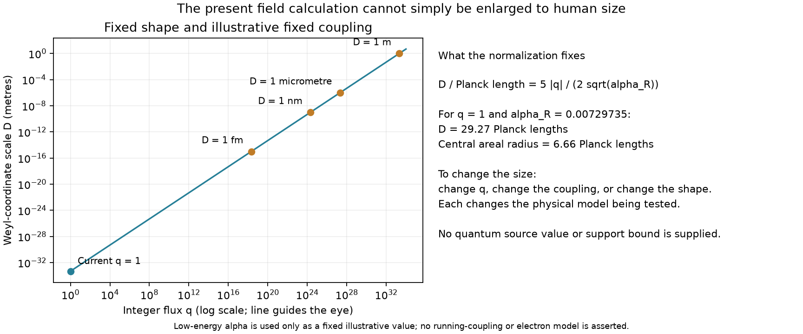

### Combine the subtraction before estimating its size

Keep checkpoint136's physical four-dimensional operator and fixed
heat/zeta prescription, including $\mu_H D_0=\sqrt2e^{-\gamma_E}$ and its
declared finite gravitational and Maxwell couplings. Define

$$
\delta K(s)=-s\,{\rm Tr}_{/T}(\dot P e^{-sP}),\qquad
H(s)=\frac{a_0/s^2+a_2/s+a_4}{16\pi^2}.
$$

Combining the finite anchor and its heat correction before taking absolute
values gives, for every $s_0>0$,

$$
Q_{\rm HK}=
\frac12\int_0^{s_0}\frac{\delta K-H}{s}\,ds
+\frac12\lim_{\eta\downarrow0}\int_{s_0}^{\infty}
 e^{-\eta s}\frac{\delta K}{s}\,ds+L(s_0;\mu_H),
$$

$$
L=\frac{-a_0/(2s_0^2)-a_2/s_0
+a_4[\log(\mu_H^2s_0)+\gamma_E]}{32\pi^2}.
$$

This is a reformulation of the existing scheme, not a newly assumed source.
The logarithmic Pauli-Villars moment contributes
$\gamma_E+\log(3/8)$; checkpoint136's counterterm removes $\log(3/8)$.
Dropping the remaining $+\gamma_E$ would change the physical prescription.
The identity $L'(s_0)=H(s_0)/(2s_0)$ cancels the cutoff dependence of the
two integrals. General heat/zeta background is discussed in
[Vassilevich's review](https://arxiv.org/pdf/hep-th/0306138);
the scheme-specific expression here is checked against the existing
finite-mass prescription by an independent auxiliary kernel.

The actual saved local coefficients are $a_0=0$,
$a_2=0.11400999281577749D_0$ and
$a_4=7.706927314195081/D_0$. At $s_0/D_0^2=0.01$,
$LD_0/(\hbar c)=-0.14564678057411926$. This is a subtraction term,
not the total physical stress. Its variation or sign change with cutoff
does not diagnose support.

The infrared integral is an Abel limit in the established ordered
prescription. Existence of that limit does not imply an ordinary or
absolutely convergent integral. The auxiliary function
$\delta K=s\sin s$, $H=0$, has $|\delta K|\le s$ and Abel integral1,
but its ordinary truncated integral is $1-\cos T$ and has no limit.
It is a control of the inference, not an alleged heat kernel of this
geometry. Checkpoint154's growth estimate alone cannot supply an absolute
infrared bound.

Suppose $U$ bounds the magnitude of the short-scale integral, $V$ bounds
the magnitude of the infrared Abel limit, and $\epsilon_L$ bounds error
in a numerical local term $\widehat L$. Then

$$
Q_{\rm HK}\ge \widehat L-\epsilon_L-\tfrac12(U+V).
$$

All terms must use the same units and scheme. For the illustrative $q=1$
case, expressed in $\hbar c/D_0$, the specific supporting-source target
would be excluded if

$$
\epsilon_L+\tfrac12(U+V)<5.682224185152354.
$$

This is an allowed error budget, not an achieved bound. Both actual
integrals and their bounds remain null in the result file. The helper
conditional_absolute_bound requires supplied finite nonnegative bounds on
the two absolute integrals, a stronger sufficient condition; it does not
certify the inputs or numerical rounding. A direct bound on the Abel value
could also support the one-sided argument without absolute integrability.

### Scope of the checks and the next physical calculation

Eleven flux-scale checks and seven cutoff checks pass. The latter compare
independent 70-digit quadratures with an exactly integrable auxiliary
kernel at three cutoffs and two finite regulator masses (errors below
$10^{-50}$), and reject missing bounds. They validate algebra, normalization
and implementation; they do not validate a physical source value.

Published energy inequalities cannot be inserted without matching their
field and observable. [Dawson--Fewster](https://arxiv.org/pdf/gr-qc/0604106)
and [Smith](https://arxiv.org/pdf/0705.2203) treat timelike Dirac energy
density without this external magnetic connection; the relevant
null-contracted theorem of
[Fewster--Roman](https://arxiv.org/pdf/gr-qc/0209036) concerns a scalar field.
Our insertion is a spatially smeared null stress of a charged Dirac field.
Stationarity alone does not repair either mismatch. This rejects those
direct substitutions, not every possible charged-field inequality.

The next useful result is a quantitative bound on the complete source:
either bound the actual subtracted heat integrals above or quantify a
common-regulator Hamiltonian trace bound in regular, buffered local charts.
For the latter route the fixed-Hilbert-space variation is

$$
H_m=W^{-1}(F+\mathcal A_m),\quad F=-i\Sigma\partial_s,\quad
\mathcal A_m=\mathcal A+mP\beta,\qquad
V_m=W^{-1}(2fF+f\mathcal A_m-if'\Sigma).
$$

The Hamiltonian Hilbert map is $J_H=e^{\epsilon f}$, distinct from the
Euclidean map. Proper mass is held fixed but the lapse-dependent mass term
still varies. With common Pauli-Villars coefficients $c_j$ and
$m_j=\sqrt j M$, the full frequency-integrated anchor is formally

$$
Q_M=-\tfrac14\sum_{j,\sigma=\pm}c_j
 {\rm Tr}\,[V_{\sigma m_j}\operatorname{sgn}H_{\sigma m_j}].
$$

Only the common sum has the ultraviolet cancellation required here.
A possible quantitative route uses a smooth bounded-energy spectral
cutoff $\Theta_m=\theta(H_m)$ and a partition $\sum_i\chi_i^2=1$
near the insertion. In regular buffered coordinate boxes let
$J_i=(1-\ell_i^2\Delta_{D,\Omega_i})^{1/2}$. For four spinor components,

$$
S_i={\rm Tr}J_i^{-4}
=4\sum_{\mathbf n\in\mathbb N^3}
 \left(1+\pi^2\ell_i^2\sum_a n_a^2/L_{ia}^2\right)^{-2}
\le\frac{{\rm Vol}(\Omega_i)}{2\pi\ell_i^3}.
$$

If actual elliptic estimates supply
$C_{0,im}\ge\|J_i^2\chi_i\Theta_m\|$ and
$C_{1,im}\ge\|J_i^2\chi_iV_m\Theta_m\|$, two Hilbert-Schmidt factors give

$$
|Q_{\rm low}|\le\tfrac14\sum_{j,\sigma}|c_j|
 \sum_i S_i C_{0,i,\sigma m_j}C_{1,i,\sigma m_j}.
$$

No spectral gap is assumed. These constants require coefficient and cutoff
derivative bounds in regular axis and gauge charts; they have not been
evaluated. The complementary high-energy common-regulator trace and
heat-remainder constants also remain unevaluated. Bounding separate
regulator masses before their cancellation is not an admissible shortcut.

Stop automatic enlargement of checkpoint159's exhausted finite field pool.
Further numerical work must bound an actual omitted contribution to this
physical source budget. Even a successful necessary source test would
leave other field equations, induced current, formation and stability
unresolved. The current static metric has a global time coordinate and
no backward-time loop. Travel from13September2027 to12September2027
remains unproved.

## Atomic target and quantitative heat-coefficient work

The first transport target is now explicitly one hydrogen atom, with human
transport deferred. The [atomic target and its actual first checks](ATOMIC_TRANSPORT_TARGET.md)
define support, stability, internal-state transport and clock comparison
as separate requirements. The nominal1nm areal diameter is a candidate,
not an established feasible size. It requires a different flux sector from
the old illustrative $q=1$ calculation.

### Physical scales and local-coupling sensitivity

The [physical-control calculation](../scripts/dihole_physical_control.py)
samples both varied collars through64/128 quadrature orders. For160's
illustrative $q=1$ coupling, the largest sampled values are

$$
|R|\ell_P^2=0.04505919,\qquad
\max_{\hat a,\hat b}|R_{\hat a\hat b}|\ell_P^2=0.03747797,\qquad
|F_{\rm charge}|\ell_P^2=0.01130416.
$$

The charge-included magnetic magnitude means $\sqrt{F^2/2}$.
These are static-frame and scalar diagnostics, not a global curvature
enclosure, a bound on all Riemann components, or a percentage error in the
semiclassical approximation. Higher derivatives, nonlocal effects and
backreaction still matter. This is consistent with the scope of
[Donoghue's effective-gravity discussion, section6](https://arxiv.org/pdf/2211.09902);
it is not a newly identified validity theorem.

For the fixed local action basis
$S_{\rm loc}=\int\sqrt{-g}(c_1R^2+c_2R_{ab}R^{ab})$, the saved compact
energy responses imply

$$
\delta C_{\rm required}
=-636.8446804260368\,\delta c_1
-289.35080303598477\,\delta c_2.
$$

A change of0.0091511653 in $c_1$ alone, or0.0201411951 in $c_2$ alone,
would shift the condition by the magnitude5.8278709657 of the illustrative
$q=1$ target. This states physical sensitivity in the specified field
basis; no uncertainty is assigned and the declared coefficients remain
zero. Matching a scheme change on both sides does not change a physical
prediction. A field redefinition must also change the matter terms and
observables. Eight [checks](../results/dihole_physical_control_results.json)
pass, including reproduction of the existing local action derivatives.

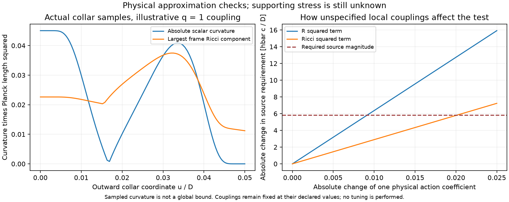

### An exact cancellation reduces the ultraviolet calculation

For the pointwise volume-preserving paired metric variation, the principal
second-order coefficients of $\dot P$ in a physical Euclidean frame are
$+2fI_4$ temporally and $-2fI_4$ radially. Their metric contraction is zero.
Writing

$$
K_P(s;x,y)=(4\pi s)^{-2}e^{-d(x,y)^2/(4s)}
 \left[u_0+s u_1+s^2u_2+\mathcal R_2(s;x,y)\right],
$$

the Gaussian gradient vanishes at coincidence and its Hessian is
$-g_{ij}/(2s)$ times the Gaussian. The latter drops out when contracted
against $\dot P$'s principal coefficient. With $u_j=\Phi_j/j!$, this gives

$$
a_2=-\int{\rm tr}[\dot P_xu_0]_{y=x},\quad
a_4=-\int{\rm tr}[\dot P_xu_1]_{y=x},\quad
a_6=-\int{\rm tr}[\dot P_xu_2]_{y=x}.
$$

All integrals use the physical four-volume per unit Killing time. No
metric derivative of an unspecified remainder constant is needed.
If the actual normalized remainder satisfies

$$
C_*\ge\sup_{0<s\le s_0}s^{-3}
 \int\left|{\rm tr}[\dot P_x\mathcal R_2]_{y=x}\right|,
$$

then the short-scale integral obeys

$$
U\le\frac{|a_6|s_0}{16\pi^2}
+\frac{C_*s_0^2}{32\pi^2}.
$$

[Ludewig's Theorem3.1](https://arxiv.org/pdf/1607.05152) supplies the
relevant normalized heat remainder estimates with spatial derivatives
on compact sets, but not numerical values for these constants on our
geometry. The saved second-order metric jets and $a_2,a_4$ do not supply
$C_*$.

The integrated $A_6$ functional can nevertheless be evaluated using only
third metric jets after integration by parts. One varies the integrated
functional with heat smearing1; inserting the collar mask as the heat
smearing would compute a different observable. Compact smooth variation
removes total-divergence variations. Cubic curvature and first covariant
derivatives of curvature, $E$ and $\Omega$ suffice in
[Vassilevich's equation4.29](https://arxiv.org/pdf/hep-th/0306138).
Static coordinate independence does not remove the time-direction
covariant tensor derivatives.

### A finite-time heat norm replaces the infrared pole

Let $A=\widehat{\mathcal D}_E$, $P=-A^2$, $C=\sqrt N$ and
$E=e^{-s_0P}$. At $\eta>0$, the long-scale integral is exactly

$$
I_\eta=-{\rm Tr}_{/T}
 [\dot P(P+\eta)^{-1}e^{-s_0(P+\eta)}]
=-e^{-\eta s_0}\sum_{\sigma=\pm}{\rm Tr}_{/T}
 [\dot A(A+\sigma\sqrt\eta)^{-1}E].
$$

Using151's proper-mass congruence, define

$$
K_\kappa=C\beta E_\kappa\dot A_\kappa C,\qquad
K(t)=\int e^{i\kappa t}K_\kappa\,\frac{d\kappa}{2\pi}.
$$

The self-adjoint Hamiltonian Euclidean propagators have norm at most1.
Consequently, if the indicated kernel norm is finite,

$$
V=\left|\lim_{\eta\downarrow0}I_\eta\right|
\le2\int_{\mathbb R}\|K(t)\|_1\,dt.
$$

This bounds the signed, frequency-integrated Abel value. It does not
bound the integral of the absolute frequency integrand, or establish
absolute convergence of the original proper-time integral. The factor2
counts the signed proper masses only. The massless zero-state convention
remains the established paired prescription for this metric probe.
Moving $\beta$ through the proper heat kernel is generally incorrect.

For a compact partition of the insertion into regular input boxes
$\Omega_i$, define $J_i=(1-\ell_i^2\Delta_{D,\Omega_i})^{1/2}$ and
$S_i={\rm Tr}_4J_i^{-4}\le{\rm Vol}(\Omega_i)/(2\pi\ell_i^3)$.
For any $T>0$, a sufficient numerical datum is

$$
B_i^2=\int(1+t^2/T^2)\|K_i(t)J_i^2\|_{\rm HS}^2\,dt
=\frac1{2\pi}\int
 \left(\|K_{i,\kappa}J_i^2\|_{\rm HS}^2+
 T^{-2}\|\partial_\kappa K_{i,\kappa}J_i^2\|_{\rm HS}^2\right)d\kappa,
$$

which gives $V\le2\sum_i\sqrt{\pi T S_i}B_i$.
The output Hilbert norm covers the whole spatial exterior and all sectors;
the input box uses unitary conversion to ordinary coordinate measure.
The $B_i$ are not evaluated. They need weighted heat estimates with
source-side derivatives through order3 and the unbounded output factor
$\sqrt N$. An undifferentiated scalar heat bound alone does not suffice.

Uniform fixed-radius volume noncollapse also cannot be assumed globally.
In the Melvin end $N=1+b\rho^2$, the azimuthal circumference behaves as
$2\pi/(b\rho)$ and fixed proper-radius four-ball volumes tend to zero.
Source-ball volume lower bounds and weighted off-diagonal control could
replace a uniform noncollapse assumption, but must be quantified.

An independent54-case noncommuting-lapse algebra audit at positive shifts
checks the heat identity to $1.99\times10^{-14}$, congruence inverse to
$3.26\times10^{-16}$ and cycled trace to $1.98\times10^{-14}$. It detects
the incorrect beta/kernel exchange with a0.2527 trace discrepancy. These
are finite algebra checks, not a computed physical $V$.

### Numerical A6 reference and its remaining error

The [A6 calculation](../scripts/dihole_uv_bound.py) now evaluates the compact
variation of the integrated local coefficient on the prescribed geometry:

$$
\delta A_6 D_0^3=-1204.72809423935-3.2096919527759757q^2.
$$

The coefficients exclude the overall $(4\pi)^{-2}$ heat prefactor. This
polynomial describes a local heat coefficient at fixed shape, not the full
renormalized quantum source. At $q=1$, the formal leading contribution to
the subtracted short-time integral with $s_0/D_0^2=.01$ is
$-0.07649355391455707$. Its omitted remainder is unknown. Neither this
number nor its absolute value is an achieved bound on $U$.

Twelve [checks](../results/dihole_uv_bound_results.json) pass. They include
the exact sphere coefficient, a constant magnetic field, a product-space
metric, direct Clifford traces versus the traced scalar polynomial,
covariant Bianchi identities, the saved lower heat coefficients, and an
independent finite metric variation. The96/128 quadrature difference is
$1.36\times10^{-11}$ relative; changing the third-jet difference step gives
$8.72\times10^{-12}$. These are numerical sensitivity checks, not rigorous
interval enclosures. Covariant time derivatives are retained even though
the coordinate coefficients are static. The integrated gauge coefficients
also reproduce [Shore's equation4.10](https://arxiv.org/pdf/gr-qc/0203034)
after the stated charge and effective-action conversion.

### Atomic flux requires a different approximation

The one-atom target is not obtained by applying the $q=1$ source unchanged.
Combining the atomic flux estimate with the sampled field peak gives

$$
(s_0/D_0^2)q\,(\mathcal B_{q=1}D_0^2)
=.01(4.6428759050\times10^{24})(9.6817266176)
\simeq4.4951\times10^{23}.
$$

Thus a weak-field heat truncation at the old cutoff cannot be justified
for this atomic flux sector. These inputs are saved in the
[atomic calculation](../results/atomic_aperture_budget_results.json) and
[physical-control calculation](../results/dihole_physical_control_results.json).
Shrinking the heat cutoff alone still leaves the intermediate and infrared
contributions to be calculated.

For a covariantly constant magnetic field, [Fucci, equations3.13--3.14](https://arxiv.org/pdf/0906.2430)
gives the rank-four leading density. Separating it algebraically yields

$$
\Theta_0(s)=\frac{4s\mathcal B\coth(s\mathcal B)}{(4\pi s)^2}
=\frac{\mathcal B}{4\pi^2s}
+\frac{\mathcal B}{2\pi^2s(e^{2s\mathcal B}-1)}.
$$

The first term is the local lowest Landau sector; it survives at large
proper time. The paper's massless curvature coefficients contain infrared
singularities, so a large magnetic field does not remove the entire
low-energy problem. Applying this density to the varying collar is a local
approximation, not an exact heat kernel for our geometry.

The next bounded calculation is the compact variation of
$\int N\sqrt h\,\Theta_0\,d^3x$, keeping the charge-included gauge one-form
fixed and reporting those two pieces separately. It must accompany
curvature and field-gradient diagnostics, including
$|{\rm Riem}|/\mathcal B$ and $|\nabla F|^2/\mathcal B^3$;
any magnetic zeros require separate treatment. Actual field derivatives,
longitudinal propagation, the global vacuum state and the remainder still
need control. This is a proposed next calculation, not a computed source.
It does not establish a supporting material, atomic survival or a time shift.

## Strong-field response at the atomic target

The [new calculation](../scripts/dihole_strong_field_response.py) evaluates
the leading constant-field approximation on the actual compact collars.
It retains arbitrary $s\mathcal B$ and analytically integrates the combined
magnetic heat response in the declared subtraction convention. It does not
compute the full inhomogeneous quantum source.

Let $\mathcal B=\sqrt{F_{ab}F^{ab}/2}$ include the charge and let
$C_\perp=\sum_aF_{\hat u\hat a}^2$. In the actual axisymmetric geometry,
$C_\perp=F_{u\phi}^2/(g_{uu}g_{\phi\phi})$. The compact paired variation
changes the lapse by $\delta\log N=f$ and $\delta\log g_{uu}=-2f$,
leaving the physical volume and the charge-included gauge one-form fixed.
Consequently,

$$
\delta\mathcal B=fC_\perp/\mathcal B,\qquad
\delta\Theta_0(s)=\frac{\delta\mathcal B}{4\pi^2s}g(s\mathcal B),
\quad g(x)=\coth x-x\operatorname{csch}^2x.
$$

The lowest Landau term replaces $g$ by1, and the gapped tower replaces it
by $g-1$. For this nonnegative mask, their signs are respectively positive
and negative. Their opposite short-time singularities cancel; the combined
response must be subtracted before any separate physical interpretation.
The full leading local response is positive at finite proper time, but
that does not fix the sign after renormalization.

The corresponding local energy density and compact response are

$$
\mathcal E_{\rm loc}=\frac{\mathcal B^2}{24\pi^2}
 [12\log A_G-\log(2\mathcal B/\mu_H^2)],
$$
$$
\mathcal Q_{\rm loc}=\int N\sqrt h\,\frac{fC_\perp}{12\pi^2}
 [12\log A_G-\tfrac12-\log(2\mathcal B/\mu_H^2)],
$$

where $A_G$ is Glaisher's constant. This is consistent with the massless
constant-magnetic-field result of
[Fucci, equations6.16 and7.28](https://arxiv.org/pdf/0906.2430), using our
rank-four Dirac determinant normalization. Applying it pointwise to our
varying geometry is an approximation. The same paper's massless curvature
terms have infrared singularities, so the displayed local density cannot
justify omitting the global low-energy contribution.

An independent65-digit subtracted proper-time quadrature recovers the
constant

$$
\int_0^1\left[\frac{g(x)}{x^2}-\frac{2}{3x}\right]dx
 +\int_1^\infty\frac{g(x)}{x^2}dx
=\frac23[12\log A_G-\tfrac12-\log2-\gamma_E]
=0.809793919295955320362194474249
$$

within $2.60\times10^{-36}$ in the numerical control. Three split points
give the same result. This is an independent constant-field check, not an
error estimate for the approximation on the actual geometry.

### Keep the physical reference fixed while changing the size

[Scheme136](DIRAC_SCHEME_MATCHING.md) fixes a physical subtraction length.
Denote it here by $D_{\rm ref}$ to distinguish it from the present Weyl
scale $D$. For comparison, take $D_{\rm ref}$ to be checkpoint160's
illustrative $q=1$ physical size. With that reference and the declared
coupling fixed, $D=qD_{\rm ref}$ and
$\mu_HD=q\sqrt2e^{-\gamma_E}$. The numerical coupling remains an
illustration, not a measured high-energy or hydrogen interaction.

The actual collar integrals give

$$
\frac{D\mathcal Q_{\rm loc}}{\hbar c\,q^2}
=-8.0617368762\times10^{-9}
 +(9.5773780159\times10^{-9})\log q.
$$

At the nominal atomic flux estimate $q=4.6428759050\times10^{24}$,

| Compact response divided by $q^2$ | Value in $\hbar c/D$ |
| --- | ---: |
| Leading local approximation, fixed physical reference | $+5.3590820543\times10^{-7}$ |
| Required supporting response | $-5.8278709657$ |

The computed magnitude is $9.1956086\times10^{-8}$ of the required one.
The omitted contribution would need to supply approximately
$-5.8278715016q^2\hbar c/D$ to meet this necessary condition. Its magnitude
is not bounded here. These numbers therefore do not exclude the full
candidate or establish any support.

Holding $\mu_HD=0.7940236164$ instead would change the loop component to
$-5.5203167918\times10^{-7}q^2\hbar c/D$. This is not a physical sign
improvement: a matched Maxwell-coupling change of
$+1.0879398846\times10^{-6}q^2\hbar c/D$ cancels it. The massless Dirac
scale dependence gives
$\Delta(e_R^{-2})=-\log(\mu_2/\mu_1)/(6\pi^2)$.
A change of subtraction convention must change the renormalized couplings
on the other side consistently; it cannot be used to obtain support.

Twelve [saved checks](../results/dihole_strong_field_response_results.json)
pass, including the actual paired complex variation, the previously saved
magnetic heat coefficient, quadrature refinement and matched scale
cancellation. The64/128 full local response changes by at most
$9.28\times10^{-13}$ relative on the sampled proper-time grid.
A [failed small-argument numerical pilot](../results/dihole_strong_field_response_small_x_trial.json)
and its [exact source](../provenance/dihole_strong_field_response_small_x_trial.py)
are preserved: subtraction near $x=.01$ exceeded the accuracy target.
Extending the existing small-$x$ series to $x<.1$ fixes that cancellation;
the physical result and the tolerance were not altered to hide the error.

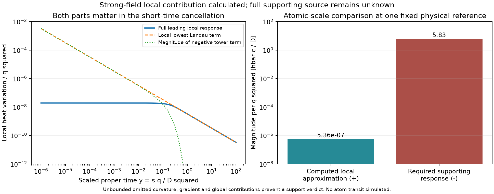

### The field is nonzero throughout the prescribed collar closure

The independent [geometry calculation](../scripts/dihole_strong_field_geometry.py)
reuses the full Euclidean curvature and covariant field derivative, including
the time-direction connection terms. Its32/64/128 samples give:

| Largest sampled local indicator | $q=1$ | Nominal atomic flux |
| --- | ---: | ---: |
| $\|\mathrm{Riem}\|/\mathcal B$ | $6.6133634091$ | $1.4244109781\times10^{-24}$ |
| $\|\nabla F\|^2/\mathcal B^3$ | $1.1615225399$ | $2.5017307456\times10^{-25}$ |

Both indicators scale exactly as $1/|q|$ at fixed shape. The largest
64/128 sensitivity of these sampled upper indicators is0.0692%.
The weighted means are well resolved numerically. These small ratios
support investigating a local strong-field expansion, but do not bound
its remainder or the global massless sector. No second covariant field
derivative bound has been computed. In the geometry JSON, $D_0$ labels
the numerical shape unit, denoted $D$ here; it is not the physical
subtraction reference $D_{\rm ref}$ introduced above.

A separate directed interval calculation covers the entire closed
rectangle $R/D\in[1/40,1/20]$, $\cos\theta\in[-1,1]$ using the exact linked
balanced parameters. Its16 by32 tiles enclose the pole-safe derivative
of the charge-included $q=1$ potential as

$$
-0.83088345391\le\partial_{\cos\theta}A_\phi
\le-0.25473589752,
\qquad \mathcal B D^2\ge4.74460439748.
$$

The lower bound uses the angular field component alone and includes both
polar limits and the central boundary where $R'=0$. Positive denominators
are enclosed in the same calculation. An8 by16 cover already proves the
sign with a looser field bound. This excludes magnetic zeros on these
prescribed collars for nonzero flux; it does not cover the full exterior.
The separately sampled field minimum7.63789 is not promoted to an enclosure.

Eight [checks](../results/dihole_strong_field_geometry_results.json) pass.
An initial relative-convergence guard for every minimum failed because
the sampled gradient minimum tends to zero near the poles. The result
retains that failed diagnostic and its values; the final gate tests the
requested upper indicators and the strictly positive magnetic minimum.
No positive gradient minimum is claimed. The source and reconstruction
provenance are recorded in the result. This correction does not relax the
upper-indicator checks or change the interval proof.

### A bound for ideal closed channels, and the next global object

For a fixed coordinate flux contour that threads the bridge, let
$L=\oint d\ell_h/N$ be its full optical length. The paired variation gives

$$
\delta L=-J_f,\qquad
J_f=\int_{\rm collars} f(1+w_u)\,\frac{d\ell_h}{N},
\quad 0\le w_u\le1,
$$

where $w_u$ is the squared radial component of its spatial unit tangent.
Thus $J_f\le2L$ because the actual mask obeys $0\le f\le1$.
Using $2f$ throughout a tilted collar would be incorrect. Nine independent
finite-symbol variations of the optical line element check the factor
$1+w_u$ exactly at the reported floating precision.

Every such returning contour crosses both complete collars. There,
$P/N=\Sigma^2/(R\,d)^2$, $R/D\le.05$, $d/D\le1.05$ and the interval cover
gives $\Sigma/D^2\ge0.22033474370227862$. Hence the two crossings alone give

$$
L/D\ge2(.05)\frac{(0.22033474370227862)^2}{(.05\cdot1.05)^2}
\ge1.7613568900625416.
$$

This is a geometric lower bound, independent of sampled field-line lengths.
For a decoupled massless complex Dirac circle of fixed holonomy, the most
negative flat-circle Casimir coefficient is $-\pi/(6L)$. Therefore

$$
\mathcal Q_{\rm Cas}\ge-\frac{\pi J_f}{6L^2}
\ge-\frac{\pi}{3L_{\min}}
$$

per ideal channel. Assuming at most $|q|$ such mouth channels bounds their
negative contribution by $0.594540241733414|q|\hbar c/D$. At the nominal
atomic flux this is only $2.1972742\times10^{-26}$ of the required source
magnitude. **The assumptions defining these ideal channels have not been
proved for the full Dirac operator.** Conformal-anomaly terms, varying
holonomy, projector/mode mixing and the noncompact exterior are excluded
from this conditional bound. It must not be added to the local result as
an exact total without matching their two- and four-dimensional subtraction.

[Maldacena--Milekhin--Popov, section5.5](https://arxiv.org/pdf/1807.04726)
uses a field-line-length integral for the Casimir contribution in its own
wormhole construction and treats the conformal anomaly separately. That
supports this direction of approximation; their geometry and control
assumptions are not established for ours.

The existing [return-topology results](../results/dihole_return_geometry_results.json)
and [null-ring calculation](../results/dihole_null_scaling_results.json)
remain the starting data, with historical source/input provenance checked.
They locate the exterior separatrix at $A_\phi/q=0.7790141348$ and a
returning classical flux fraction0.2209858652. Saved exterior optical lengths
at labels0.8,0.9,0.98 are5.71969,5.17046,4.91434 times $D$; they stop at the
two outer cuts and do not include the sewn bridge. They are not a complete
optical-length distribution or quantum state calculation.

The source-weighted moment $\int_{\rm return}J_f(a)/L(a)^2\,da$ would give
the ideal-channel response, rather than the returning fraction alone.
However, the inexpensive lower-length bound already makes this ideal
contribution far too small by itself. More precise optical lengths are
not the limiting uncertainty and are deferred.

The next bounded calculation is a normalized transverse ground-state map
$U_q$ on a regular actual flux tube, checking both its full Dirac residual
$(H_q+i\kappa)U_q-U_q(h_\parallel+i\kappa)$ and its metric variation.
A separate band around the known exterior null ring must be retained;
it persists as flux increases and prevents a global gap argument.
The null-band mode conversion, open/bypass channels, global vacuum state
and two-/four-dimensional subtraction matching need their own source-error
budgets. A small residual for a single trial state alone would not bound
the full trace. This targets the missing reduction error instead of
refining an already negligible ideal term or restarting broad basis growth.
No atom transit, stable medium or chronology change is established.

## Exact slice channels and their radial coupling

The [slice-channel calculation](../scripts/dihole_slice_channel.py) tests the
actual prescribed collar operator at integer fluxes $q=5,25,105,1005,10005$,
with one regular azimuthal sector $\mu/q=0.9$ at each flux. It constructs the
exact transverse zero profile, normalizes it in the Hamiltonian measure,
and evaluates the radial coupling and its actual metric variation. All
**14 checks pass**; [results](../results/dihole_slice_channel_results.json)
and a [figure](../figures/dihole_slice_channel_progress.png) are saved.
This is a supporting-field calculation, not propagation of a hydrogen atom.

### Exact transverse profile and projection

Write $a=A_\phi/q$, $W=P/N$ and

$$
H=W^{-1/2}\left[-i\sigma_3\partial_s+K_\mu/R\right]W^{-1/2},\qquad
K_\mu=-i\sigma_1\partial_\theta+\sigma_2 V,\qquad
V=NP\frac{\mu-qa}{\sin\theta}.
$$

For positive integer $q$, the upper transverse component obeys
$f_\theta=Vf$. Its regular polar powers are $\theta^\mu$ and
$(\pi-\theta)^{q-\mu}$ for $\mu=1/2,3/2,\ldots,q-1/2$; the opposite
component has no regular zero mode. These are $q$ states on each slice,
not an assertion of $q$ independent channels of the full operator.
The familiar spherical counting is discussed in
[Maldacena--Milekhin--Popov, appendix C](https://arxiv.org/pdf/1807.04726);
here the actual angle-dependent collar fields are retained.

Normalize $\int_0^\pi Wf^2d\theta=1$ and define
$\chi=\sqrt W f\,(1,0)^T$, $U\psi=\chi\psi$,
$v=\int f^2d\theta$. Direct projection gives

$$
h=U^*HU=-i(v\partial_s+v_s/2),\qquad
(HU-Uh)\psi=-i(r_1\psi_s+r_0\psi),
$$

$$
r_1=\chi(1/W-v),\qquad
r_0=\chi\left(\frac{f_s}{Wf}-\frac{v_s}{2}\right).
$$

Thus even an exact slice zero mode is not automatically an invariant
travelling channel. Its packet center and normalization change with $s$.
The diagonal Berry phase of this real positive profile vanishes, but the
orthogonal residual need not vanish. Axial symmetry separates different
$\mu$ values, while excited transverse states of the same $\mu$ can still mix.
The scalar resolvent shift cancels identically from
$(H+i\zeta)U-U(h+i\zeta)$, leaving the same residual.

The known polar powers are integrated analytically in the logarithm;
Gauss quadrature evaluates only their regular correction and the final
normalization integrals. No Gaussian replaces the profile in these data.
The512/1024 angular and48/80 inner-order comparison changes the reported
norms by at most $1.56\times10^{-10}$ relatively. This is numerical
sensitivity, not a rigorous enclosure. The original central $q=1$ cylinder
speed is recovered to $2.23\times10^{-16}$ relatively.

### Differentiate the actual geometry as well

Let $F(s)$ denote the existing compact mask. Under
$N_\epsilon=e^{\epsilon F}N$ and radial $P_\epsilon=e^{-\epsilon F}P$,
with angular metric and charge one-form fixed, $W_\epsilon=e^{-2\epsilon F}W$.
The normalized flux profile is $f_\epsilon=e^{\epsilon F}f$ and the common
canonical vector $\chi$ is unchanged. The full common-space Hamiltonian is
$H_\epsilon=e^{\epsilon F}H_{\rm rad}e^{\epsilon F}
+e^{\epsilon F}H_{\rm ang}$, so

$$
\dot r_1=2F r_1,\qquad \dot r_0=2F r_0+F_s r_1.
$$

The connection coefficient here is $F_s$, not the $F_s/2$ of the different
proper Euclidean representation used earlier. The direct complex metric
variation agrees within $2.95\times10^{-16}$ in the saved control. The
incorrect half factor leaves a discrepancy $3.68\times10^{-5}$; testing only
the collar midpoint would miss it because $F_s$ vanishes there. Independent
radial finite differences converge by a factor of four when their step is
halved, with final relative errors below $2.44\times10^{-7}$.

### Large flux does not remove the frozen-profile tilt

For an interior label $\nu=\mu/q$, let $a(s,\theta_0)=\nu$. The previously
proved collar field sign gives a nondegenerate localization maximum. Set

$$
\theta_{0,s}=-a_s/a_\theta,\qquad
\kappa=NP\frac{a_\theta}{\sin\theta_0}>0.
$$

Local Laplace expansion then gives

$$
\frac{\|r_0\|}{\sqrt q}\longrightarrow
\frac{|\theta_{0,s}|\sqrt{\kappa/2}}{W_0},\qquad
\Delta_\perp\sim\frac{\sqrt{2q\kappa}}{RW_0},\qquad
\frac{\|r_0\|}{\Delta_\perp}\longrightarrow\frac{|R\theta_{0,s}|}{2}.
$$

$\Delta_\perp$ is the local oscillator gap approximation; no finite-flux
gap enclosure or uniform remainder is claimed. The limiting ratios are
small but nonzero for these three slices:

| Collar $s/D$ | $D\|r_0\|$ at $q=10005$ | Local limiting leakage/gap ratio |
| --- | ---: | ---: |
| 0.0125 | 0.0007605402 | 0.00001569874 |
| 0.0250 | 0.007246336 | 0.0001364941 |
| 0.0375 | 0.02184742 | 0.0003391590 |

The sampled $D\|r_0\|/\sqrt q$ differs from its limit by at most0.0189%
at $q=10005$. That does not supply an error bound at the nominal atomic
flux $4.64\times10^{24}$ or over all flux labels and the exterior.
These norms use $D=1$. In the fixed-coupling physical family, $D\propto q$;
the physical $r_0$ then decreases as $q^{-1/2}$ while its ratio to the local
gap stays nonzero. The plot does not claim an increasing physical force
while enlarging the opening.

### A concrete correction, with its remaining test

Put $t=R\theta_{0,s}$, $\beta=\arctan t$,
$G=\kappa/\sqrt{1+t^2}$ and
$\eta=(\cos(\beta/2),\sin(\beta/2))^T$. A Gaussian with exponent
$-qG(\theta-\theta_0)^2/2$ satisfies the leading local identity

$$
\left[iG(\sigma_1-t\sigma_3)-\kappa\sigma_2\right]\eta=0.
$$

Both the spin rotation and changed width are needed. Under the paired
variation, $t_\epsilon=e^{\epsilon F}t$,
$\dot\beta=Ft/(1+t^2)$ and
$\dot G=-F\kappa t^2/(1+t^2)^{3/2}$.
Independent algebra and the saved signed-tilt matrix controls confirm the
cancellation and its derivative. **This cancels only the leading local
term; a normalized finite-flux aligned trial has not been evaluated.**
Width/spin derivatives, nonlinear potential terms, polar behavior and
metric connections must all remain in that calculation. Merely changing
to a coordinate that follows $a$ does not remove the operator residual.

A tempting uncut extension, raising the exact slice profile to
$\lambda=1/\sqrt{1+t^2}$ and rotating its spin everywhere, has a specific
domain failure: at $q=5$, $\nu=.9$, its south-pole power is
$\alpha=\lambda/2<1/2$ for nonzero tilt. The noncancelled angular action
behaves as $(\pi-\theta)^{\alpha-1}$ and is not square integrable.
Finite quadrature could hide this divergence. Use a smooth polar cutoff
or return the profile and spin to their regular forms near the poles,
retaining the cutoff derivative in the residual. This failed proposed
extension was rejected algebraically before simulation; it does not affect
the exact unmodified profiles used in the saved results.

For a scalar cutoff $C(s,\theta)$ the added term is exactly
$[H,C]\chi=-iW^{-1}(\sigma_3C_s+\sigma_1C_\theta/R)\chi$.
Renormalize after applying it; shrinking the cutoff at $q=5$ does not
justify dropping this term.

The next bounded calculation is that regular field-aligned trial and its
full metric-dependent residual. It must eventually be uniform over a
regular flux band and matched to the separate exterior-null and open-channel
contributions before it can control a stress trace. A small one-state
residual is insufficient. No source bound, supported opening, stability,
atom survival, new law, or backward/future clock advantage follows here.

## Pole-regular field-following channels and a uniform profile envelope

The [field-following calculation](../scripts/dihole_aligned_channel.py) now
implements a regular finite-flux trial and its full collar action, rather
than stopping at the leading matrix cancellation. All **16 checks pass**.
The [saved results](../results/dihole_aligned_channel_results.json) retain
both improvements and cases where this trial is worse; the
[figure](../figures/dihole_aligned_channel_progress.png) explicitly displays
the $k=0$ residual. The scope remains one supporting-field state per flux,
at three collar slices, with no hydrogen propagation or source trace.

### A normalized trial that remains in the operator domain

Anchor the exact primitive by $L(s,\theta_0(s))=0$, where
$a(s,\theta_0)=\nu=\mu/q$. With the existing smooth step $S$, use

$$
C(\theta)=S((\theta-.15)/.2)S((\pi-.15-\theta)/.2),\qquad
\lambda_c=1+C(\lambda-1),\quad \beta_c=C\beta,
$$

$$
t=R\theta_{0,s},\quad \lambda=(1+t^2)^{-1/2},\quad
\beta=\arctan t,\qquad
g=Z^{-1/2}e^{q\lambda_cL},\quad Z=\int We^{2q\lambda_cL}d\theta,
\quad \chi=\sqrt Wg\eta,\quad
\eta=\begin{pmatrix}\cos(\beta_c/2)\\\sin(\beta_c/2)\end{pmatrix}.
$$

The plateau must contain the field-line center; the implementation checks
this. Since $C$ and its derivatives vanish on neighborhoods of both poles,
the original regular powers and spin orientation are restored there,
including the $q=5$ sector that invalidated the uncut proposal. The
angle-dependent width makes the additive constant of $L$ consequential;
anchoring and differentiating it consistently is essential.

Let $\ell=g_s/g$ and $p=g_\theta/g$. The actual derivatives include

$$
\ell=q(\lambda_{c,s}L+\lambda_cL_s)-Z_s/(2Z),\qquad
p=\lambda_cV+qC_\theta(\lambda-1)L,\qquad
\eta_i=\frac{\beta_{c,i}}2
\begin{pmatrix}-\sin(\beta_c/2)\\\cos(\beta_c/2)\end{pmatrix}.
$$

Both the window derivative in $p$ and the spin derivative $\eta_\theta$
remain in the angular action. No tail probability is used to drop them.

For the finite paired variation write $c=e^{\epsilon F}$ and replace
$t$ by $t_\epsilon=ct$, including
$t_{\epsilon,s}=c(t_s+\epsilon F_st)$. Normalize $g_\epsilon$ in the
original $W$ measure so all trial vectors live in the same canonical space.
With $v_\epsilon=c^2\int g_\epsilon^2\cos\beta_c\,d\theta$, direct action gives

$$
(H_\epsilon U_\epsilon-U_\epsilon h_\epsilon)\psi
=-i(r_1\psi_s+r_0\psi),\qquad
h_\epsilon=-i(v_\epsilon\partial_s+v_{\epsilon,s}/2),
$$

$$
\frac{r_1}{\sqrt Wg}=\frac{c^2\sigma_3\eta}{W}-v_\epsilon\eta,
$$

$$
\frac{r_0}{\sqrt Wg}=
\frac{c^2\sigma_3[(\ell+\epsilon F_s)\eta+\eta_s]}{W}
+\frac{c[\sigma_1(p\eta+\eta_\theta)+i\sigma_2V\eta]}{RW}
-\frac{v_{\epsilon,s}}2\eta.
$$

The angular scalar projection is the boundary term
$[g^2\sin\beta_c]_0^\pi/2=0$, so it introduces no extra scalar potential.
The metric derivative differentiates the operator, trial and projected
operator together. It is not obtained by keeping the trial frozen.

### Measured improvement and its limitations

The same fluxes $5,25,105,1005,10005$ and label $\nu=.9$ are retained.
At $q=10005$:

| Collar $s/D$ | $D\|r_0\|$ | Ratio to frozen $\|r_0\|$ | Ratio of metric-derivative norms |
| --- | ---: | ---: | ---: |
| .0125 | $6.691657\times10^{-5}$ | .087986 | .195421 |
| .0250 | $3.050727\times10^{-4}$ | .042100 | .058485 |
| .0375 | $8.591902\times10^{-4}$ | .039327 | .049634 |

The $r_0$ reduction is91.2--96.1%. Its sampled norm approaches a plateau as
flux increases, replacing the frozen profile's observed square-root growth.
This trend is not a uniform asymptotic error bound at atomic flux.
All norms use $D=1$; physical dimensions and wavelengths must be restored
consistently when $D$ changes with flux.

The derivative coefficient $\|r_1\|$ **increases** by factors4.77,31.97,46.34
at those points. For a local carrier $\psi=e^{iks}$, real residual vectors
give exactly $\|r_0\|^2+k^2\|r_1\|^2$. All tested carriers
$kD=0,1,10,100$ improve at $q=10005$, both for the action and its metric
variation. At $kD=100$ their full local residual ratios are0.10187,0.07074,
0.08486. These plane-wave checks are not normalizable global packets or
bounds for all longitudinal momenta. A general envelope needs both
coefficients, and the full vacuum trace includes more than these carriers.

At $q=5$, $r_0$ is2.61--4.71 times worse. At $q=105$, $s/D=.0125$, its
metric derivative is15.95 times worse despite the smaller $r_0$ itself.
These are retained physical approximation outcomes, not numerical failures.
The fraction of trial norm in the pole-restoring region is roughly14%
at $q=5$ and below $7.1\times10^{-240}$ in the sampled $q=10005$ states.
That numerical tail mass alone is not a bound on the derivative terms.

Independent radial and angular action differences are below
$6.67\times10^{-9}$ and $1.38\times10^{-8}$ in $D=1$ units. Metric finite
differences agree with the complex derivative to $1.60\times10^{-8}$
relatively. Angular/inner quadrature refinement changes the reported
norms by at most $5.77\times10^{-9}$ relatively. The smallest derivative
steps reach floating-point noise; monotone convergence at every step is
not claimed. The central $q=1$, zero-tilt cylinder is recovered.

### A uniform bound that starts the next error estimate

Reuse the recorded directed interval bounds on the entire closed collar.
Writing the positive potential denominator of the geometry as $\mathcal V$,

$$
NP=\frac{\mathcal V^2}{(Rd)^2}\ge n=0.17645235686832322,\qquad
\frac{a_\theta}{\sin\theta}\ge m=0.25473589752726683.
$$

Here $R\le1/20$, $d\le21/20$ and
$\mathcal V\ge0.022053272061495002$. Directed arithmetic rounds the new
bounds outward; the exact source and input hashes of the interval
calculation are checked before reuse.

Concavity of $\sin\theta$ on $[0,\pi]$ gives
$|\cos\theta-\cos\theta_0|\ge\sin\theta|\theta-\theta_0|/2$.
Using $L_\theta=NP(\nu-a)/\sin\theta$ on both sides of the center and
integrating with $L(\theta_0)=0$ proves

$$
L(s,\theta)\le-\gamma(\theta-\theta_0)^2,\qquad
\gamma=0.011237187374413473.
$$

This logarithmic envelope applies throughout the collar for any interior
flux center, not just the three sampled slices. It bounds the unnormalized
profile; normalization still needs a lower estimate.

Specifically, suppose a regular band additionally has uniform
$0<w_-\le W\le w_+$, plateau clearance $r>0$,
$L\ge-M(\theta-\theta_0)^2$ within that clearance and
$\lambda_{\min}\le\lambda_c\le1$. For $q\ge q_{\min}>0$, put
$b=\gamma\lambda_{\min}$ and

$$
C_Z=w_-\sqrt{\frac{\pi}{2M}}\operatorname{erf}
\left(r\sqrt{2Mq_{\min}}\right).
$$

Then $Z\ge C_Zq^{-1/2}$ and

$$
\left\langle|\theta-\theta_0|^{2j}\right\rangle
\le\frac{w_+}{C_Z}\frac{\Gamma(j+1/2)}{(2b)^{j+1/2}}q^{-j}.
$$

On the plateau, the combined leading coefficient
$A=\lambda_sL+\lambda L_s+(\sin\beta/R)L_\theta$ obeys
$A(\theta_0)=A_\theta(\theta_0)=0$. A uniform second-derivative bound
therefore controls $qA$ through the fourth-moment estimate. At nonzero
$\epsilon$, after factoring out $c^2$, the last coefficient becomes
$c^{-1}\sin\beta_\epsilon/R$, preserving the cancellation.

The next step is to evaluate these remaining constants on a regular band
and bound normalization derivatives and pole-transition terms. This
replaces further selected-point sampling with a finite-flux error estimate.
The exterior magnetic null, open channels, global state and subtraction
matching remain separate requirements for a source trace. No stable
opening, obtainable medium, atomic survival, transport or clock advantage
has been established; the current static metric still excludes backward
causal passage.

A reporting-rounding pilot is preserved as an exact [source](../provenance/dihole_aligned_channel_rounding_trial.py) and [result](../results/dihole_aligned_channel_rounding_trial.json). Its reported envelope coefficient exceeded the product of its two reported rounded bounds divided by four by3.03e-18. The coefficient is now composed after rounding both factors outward, with an independent80-digit Decimal check. No residual values or test tolerances changed.

## Uniform collar errors and a frozen transverse gap

The [uniform calculation](../scripts/dihole_channel_bounds.py) now bounds
normalized profile moments, the complete trial residual and its first
paired metric derivative for every allowed sector in

$$
q\ge1000,\qquad .85\le\nu=\mu/q\le.95,\qquad .025\le R/D\le.05.
$$

Here $q$ is a positive integer and $\mu$ is a half-integer. All derivations
below use $D=1$; frequency eigenvalues recover units $c/D$. The
[saved result](../results/dihole_channel_bounds_results.json) has **19 passing
controls**, including independent original-field derivatives. A separate
argument bounds the actual frozen transverse spectral gap. Neither result
is a full supporting-stress calculation or an atomic-transport simulation.

### Geometry and normalized moments

The exact balanced parameters are evaluated with directed 60-digit interval
arithmetic. Symbolic derivatives are taken before evaluation. With
$x=\cos\theta$, $d=\sqrt{R^2+4k^2+4kRx}$ and the existing prolate $r,c$,
use the cancellation-resistant expressions

$$
S=\frac{d-R-2kx}{2k^2}=\frac{1-c^2}{R},\qquad
\widehat\Delta=\frac{R+d+2kx}{2}=\frac{\Delta}{R},
$$

$$
w=(r^2-a_g^2)^2+R^2\widehat\Delta a_g^2S,\quad
h=2Mra_g+Bw/2,\quad z=a_g^2+2BMra_g+B^2w/4,
$$

$$
\widehat{\mathcal V}=\widehat\Delta+Sz,\qquad
NP=(\widehat{\mathcal V}/d)^2,\qquad
W=(\Sigma/(Rd))^2,\qquad a=Sh/(2Q\widehat{\mathcal V}).
$$

The symbol $a_g$ denotes the geometry parameter, distinct from the unit
flux potential $a$. Each region uses 16 radial by 32 angular interval tiles;
all value, first and second $(R,x)$ derivatives are enclosed. Independent
point comparisons use the original unfactored geometry, not this expression
as its own reference. These point comparisons are implementation controls;
the tile coverage and analytic inequalities provide the uniform bounds.

At $\theta=2.2$ the potential lies in $[.7925094,.7954739]$, and at
$\theta=2.75$ in $[.9599376,.9640722]$ (display ranges rounded outward).
Together with the earlier strict monotonicity enclosure this places every
center in $(2.2,2.75)$. The polar-window plateau has clearance greater than
$.04$. Within radius $.02$ of every center,
$L\ge-M\delta^2$, $\delta=\theta-\theta_0$, with $M<.588680$.
The full collar has $W>25.019078$, $W<85.761590$ and
$\lambda_c>.999887668$. Exact directed values are in the JSON.

Reuse $L\le-\gamma\delta^2$ from the preceding section. To avoid requiring
a numerical error-function enclosure, choose

$$
\ell=\min\{.02\sqrt{1000},(2M)^{-1/2}\},\qquad
C_Z=2W_{\mathrm{center},-}\ell e^{-2M\ell^2}.
$$

Rounding $\ell$ downward preserves the integration neighborhood. Then
$Z\ge C_Zq^{-1/2}$, with $C_Z>20.163497$. For the normalized probability
$p=Wg^2$ and $b=2\gamma\lambda_{\min}$,

$$
\mathbb E_p\delta^{2j}\le C_jq^{-j},\qquad
C_j=\frac{W_+}{C_Z}\frac{\Gamma(j+1/2)}{b^{j+1/2}},\qquad j=1,2,3,4.
$$

Conservative display bounds are
$C_1<1118.958$, $C_2<74690.623$, $C_3<8309353.935$ and
$C_4<1294185327.305$. These are normalized finite-flux bounds, including
polar tails, rather than extrapolated Gaussian fits.

### Keeping normalization and transition terms

Write $\Lambda=\lambda_c$, $P=(\Lambda L)_s$, $T=(\Lambda L)_\theta$,
$\zeta=C\theta_{0,s}$ and

$$
A=P+\zeta T,\qquad
d=(\log W)_s+\zeta_\theta+\zeta(\log W)_\theta.
$$

Since $\zeta$ vanishes near the poles, integration by parts gives the exact
normalization identity

$$
b_0=\frac{Z_s}{2Z}=\mathbb E_p[qP+(\log W)_s/2]
=\mathbb E_p[qA+d/2].
$$

On the plateau $A=A_\theta=0$ at the center. The same cancellation holds
for its first paired metric derivative, keeping $\theta_{0,s}$ fixed in
that variation. Taylor bounds therefore control these quantities by
$\delta^2$. Outside the plateau, $|\delta|\ge.04$ turns finite supremum
bounds into conservative quadratic bounds. No small tail probability is
used to discard a singular derivative.

The individual raw derivatives $L_{\theta\theta}$,
$L_{\theta\theta\theta}$ and $L_{s\theta\theta}$ are singular at the poles:
the global table explicitly exports `null` for them. The finite combined
radial derivative is bounded using exact $NP_R=a_R=0$ at both poles:

$$
|L_s|\le2\left(\|NP_{Rx}\|_\infty+
\|NP\|_\infty\|a_{Rx}\|_\infty\right).
$$

Here $0\le a\le1$ follows from the exact polar values and monotonicity.
The factor 2 bounds the integral of
$\min(1-\cos\theta,1+\cos\theta)/\sin\theta$, which equals $2\log2$.
The smooth-step estimates $S'\le8$, $|S''|<120$ give
$|F|\le4$, $|F_s|\le1200$, $|C_\theta|\le40$ and $|R_{ss}|\le160$.
These loose inequalities follow directly from differentiating the logistic
representation of the existing step; they are not fitted maxima.

With $J=\dot\Lambda L$, the probability variation is
$\dot p=2q(J-\mathbb E_pJ)p$. The constants $a_2,\dot a_2,j_2,d_0$ in
the JSON bound $|A|,|\dot A|,|J|$ by their coefficient times $\delta^2$,
and $|d|$ by $d_0$. Sufficient normalization bounds are

$$
B=a_2C_1+d_0/2,\qquad
\dot B=\dot a_2C_1+2j_2a_2(C_2+C_1^2)+2d_0j_2C_1,
\qquad H_g=j_2(\sqrt{C_2}+C_1).
$$

Thus $|b_0|\le B$, $|\dot b_0|\le\dot B$ and
$\|\dot g/g\|_{L^2(p)}\le H_g$. The radial profile derivative, window
terms and spin derivatives are retained in the actual Pauli action.
In particular the angular transition vector is

$$
E_1=(\Lambda\sigma_1+i\sigma_2-Ct\Lambda\sigma_3)\eta
=[\sin(C\beta)-Ct\Lambda]\sigma_3\eta
+[\Lambda-\cos(C\beta)]\sigma_1\eta.
$$

Interpolation gives $\|E_1\|\le t_*^2/8+t_*^3/4$. Its derivative bound
includes the rotating spin basis:

$$
\|\dot E_1\|\le F_*[(17/8)t_*^3+2t_*^2]
+\|\dot\eta\|_*\|E_1\|_*.
$$

The exact pre-audit [source](../provenance/dihole_channel_bounds_derivative_trial.py)
and [result](../results/dihole_channel_bounds_derivative_trial.json) are
preserved. The audit added that last term and stopped exporting incomplete
endpoint derivative ranges as global enclosures. Neither correction changes
the normalized moments; no tolerance or physical requirement was weakened.

Let $\chi_0=\sqrt Wg$, $\Pi=|\chi\rangle\langle\chi|$. Direct action,
with its scalar projection removed, has the form

$$
r_0=(1-\Pi)\chi_0(qK+D_0-b_0B_0),\qquad
r_1=(1-\Pi)\chi_0B_0.
$$

The JSON supplies constants bounding $|K|\le k_2\delta^2$,
$|\dot K|\le\dot k_2\delta^2$, and $D_0,B_0$ and their derivatives.
Using the fourth and eighth moments, and
$\|\dot\Pi\|\le2(H_g+\|\dot\eta\|_*)$, yields the following
outward-rounded sufficient bounds:

| Quantity | Uniform upper bound |
| --- | ---: |
| $D\|r_0\|$ | $197385$ |
| $D\|\dot r_0\|$ | $1.5010475\times10^{10}$ |
| $\|r_1\|$ | $.039969497$ |
| $\|\dot r_1\|$ | $2204.425$ |

For a collar-supported envelope, in dimensionless $s/D$ coordinates,
$\|(HU-Uh)\psi\|\le R_1\|\psi_s\|+R_0\|\psi\|$, with the analogous
first metric derivative inequality. These bounds are deliberately very
loose relative to sampled residuals. They do not establish a useful
supporting-stress error interval or a finite-deformation stability range.

### A gap for the actual frozen transverse operator

This separate statement uses the exact frozen zero mode, not the aligned
trial. Put $f=NP$ and $x=\cos\theta$. Algebraically,

$$
(1-x^2)L_{\theta\theta}
=(1-x^2)[-f_x(\nu-a)+fa_x]-f(\nu-a)x=\mathcal N.
$$

The expression is finite at both poles. The full interval cover gives
$\mathcal N\le-.027248651910161972$, so
$L_{\theta\theta}\le-\kappa$, with
$\kappa=.02724865191016197$. The same cover encloses

$$
(\log W)_{\theta\theta}
=-xW_x/W+(1-x^2)[W_{xx}/W-(W_x/W)^2]
\le M_W=.01761171050415938.
$$

For $f_q=Z_f^{-1/2}e^{qL}$, $p_f=Wf_q^2$ and $U=-\log p_f$, this implies
$U''\ge c_q=2q\kappa-M_W>0$. The variance inequality is the one-dimensional
strong-convexity consequence of the published
[Brascamp--Lieb inequality, equation (1.3)](https://arxiv.org/pdf/1106.0709).
That paper states it on Euclidean space. For this interval we also give the
endpoint argument, rather than assume the same domain without checking it.

For a bounded smooth mean-zero $h$, set
$v(\theta)=p_f(\theta)^{-1}\int_0^\theta hp_f$. Then
$h=v'-U'v$. The polar powers
$p_f\sim\theta^{2\mu}$ and
$p_f\sim(\pi-\theta)^{2(q-\mu)}$ make boundary terms vanish. Integration
by parts and Cauchy--Schwarz give

$$
\int h^2p_f=\int[(v')^2+U''v^2]p_f\ge c_q\int v^2p_f,
\qquad \int h^2p_f=-\int h'vp_f,
$$

$$
\operatorname{Var}_{p_f}(h)\le c_q^{-1}\mathbb E_{p_f}|h'|^2.
$$

The inequality extends by form closure, with real and imaginary parts
handled separately. For the actual frozen angular operator

$$
H_\perp=W^{-1/2}[-i\sigma_1\partial_\theta+
\sigma_2qNP(\nu-a)/\sin\theta]W^{-1/2}/R,
$$

write its upper-to-lower block as $D_\perp$. Its normalized zero is
$\chi_f=\sqrt W f_q$ and

$$
\|D_\perp(\chi_fh)\|^2
=\mathbb E_{p_f}\frac{|h'|^2}{R^2W^2}
\ge\frac{c_q}{R_{\max}^2W_{\max}^2}\|\chi_fh\|^2
\quad(\mathbb E_{p_f}h=0).
$$

Both polar exponents $\mu,q-\mu$ are at least 50 in the stated range.
The Dirac endpoints are limit-point; the opposite formal zero
$\sqrt W e^{-qL}$ is not square integrable. The positive spectra of the
closed products $D_\perp^*D_\perp$ and $D_\perp D_\perp^*$ pair. Therefore

$$
D\,\operatorname{gap}(H_\perp)\ge
\frac{\sqrt{2q\kappa-M_W}}{4.288079450100342},\qquad
D\,\operatorname{gap}(H_\perp)\big|_{q=1000}>1.721291795.
$$

Here the gap excludes the single zero state in each declared angular
sector. It is an actual frozen-slice inequality, stronger than an oscillator
approximation. It does **not** directly bound the aligned-trial complement,
radial evolution, the exterior or the full Hamiltonian. In particular the
exterior magnetic null previously found still obstructs a global uniform
gap argument. Dividing the aligned residual by this different operator's
gap is not a proved leakage probability.

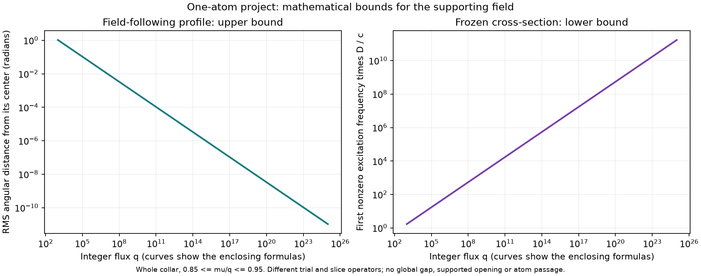

The next source task is to turn these local inequalities into a controlled
regular-band reduction with longitudinal momentum, projector differences
and first metric variation retained, then combine its error with the
separate null/open-channel and subtraction terms. More pointwise refinement
alone does not meet that requirement. One hydrogen atom remains the target;
no stable opening, admissible material, survival, passage, new law or clock
advantage is established. The current static metric excludes backward
causal transport, including 13 September 2027 to 12 September 2027.

## Aligned complement gap and its metric response

The [projector comparison](../scripts/dihole_projected_gap.py) closes the
specific mismatch left by the preceding frozen-slice result. It bounds the
angle between the exact slice zero and the field-following trial, then
transfers the gap to the trial's actual orthogonal complement. It also
bounds the complementary resolvent and its first metric variation for
specified longitudinal carriers. The [results](../results/dihole_projected_gap_results.json)
have **13 passing controls**. All statements retain the same collar,
$.85\le\mu/q\le.95$, $q\ge1000$, and $D=1$ conventions as above.

### Comparing normalized states without extrapolating samples

Let $T_*\ge|t|$ be the recorded tilt bound. Along the normalized path

$$
\Lambda_\tau=1+\tau C(\lambda-1),\quad
\beta_\tau=\tau C\arctan t,\quad
\chi_\tau=\sqrt W Z_\tau^{-1/2}e^{q\Lambda_\tau L}
\begin{pmatrix}\cos(\beta_\tau/2)\\\sin(\beta_\tau/2)\end{pmatrix},
\qquad0\le\tau\le1,
$$

$\chi_0=\chi_f$ is the frozen zero and $\chi_1=\chi_a$ the aligned trial.
Since $\lambda_{\min}\le\Lambda_\tau\le1$, the previous normalization and
moment bounds hold uniformly along the whole path.

A new directed 16 by 32 tile cover of the entire window
$[.15,\pi-.15]$ gives $|L|\le M_w\delta^2$ there with
$M_w<21.823011$, where $\delta=\theta-\theta_0$. This follows by integrating
the bounded $L_{\theta\theta}$ twice from its stationary center. In the
smaller region $|\delta|\le r=.02$, reuse $M_0<.588680$.
The window makes $CL=0$ outside its support, so no polar singularity is
estimated as if it were bounded.

Let $b$ denote the preceding Gaussian exponent coefficient and $C_2$ its
fourth-moment constant. Splitting the exponent in half on $|\delta|\ge r$
gives the uniform tail bound

$$
\mathbb E_\tau[\delta^4\mathbf1_{|\delta|\ge r}]
\le\frac{C_2}{q^2}\rho(q),\qquad
\rho(q)=\min\{1,2^{5/2}e^{-bqr^2/2}\}.
$$

Consequently

$$
q\|CL\|_{L^2(p_\tau)}\le
S(q):=\sqrt{C_2[M_0^2+(M_w^2-M_0^2)\rho(q)]}.
$$

The normalized amplitude derivative is centered: its scalar factor is
$(\lambda-1)[qCL-\mathbb E_\tau(qCL)]$. The spin derivative is pointwise
orthogonal to it. Integrating the resulting path-length bound proves

$$
d:=\|P_a-P_f\|\le\|\chi_a-\chi_f\|
\le d_*(q):=\sqrt{[T_*^2S(q)/2]^2+[\arctan(T_*)/2]^2},
$$

where $P_a=|\chi_a\rangle\langle\chi_a|$ and likewise $P_f$.
This is a finite-flux bound, not a fit to sampled overlaps. The same
statistic bounds the first paired metric derivative at a fixed slice:

$$
\|\dot\chi_a\|\le M_*(q):=
\sqrt{[F_*T_*^2S(q)]^2+[F_*T_*/2]^2}.
$$

Here $\dot\lambda=-Ft^2/(1+t^2)^{3/2}$ and
$\dot\beta=Ft/(1+t^2)$. There is no $F_s$ term in this fixed-slice state
derivative; radial operator derivatives still contain it. The fixed
canonical measure $W$ is not varied a second time.

At $q=1000$, $d_*<.670115$ and $M_*<5.360666$. Both decrease monotonically
with $q$. At the continuous atomic flux estimate,

$$
d_*<.019568,\qquad M_*<.147678,\qquad1-d_*^2>.9996171.
$$

The saved entry at $q\simeq4.6428759050\times10^{24}$ evaluates the bounding
formula at the size estimate; it does not instantiate an admissible
quantized global flux sector or simulate its wave function.

### Transferring an indefinite Dirac gap

Set $Q_a=1-P_a$, $C_a=Q_aH_\perp Q_a$ on its natural complement domain.
Write $c=\langle\chi_a,\chi_f\rangle>0$. For $\psi\perp\chi_a$,

$$
\|H_\perp\psi\|\ge g c\|\psi\|,\qquad
H_\perp\psi\perp\chi_f,\qquad
\|Q_aH_\perp\psi\|\ge c\|H_\perp\psi\|.
$$

Since $\chi_a$ belongs to the polar Dirac domain, deleting its off-diagonal
blocks is a bounded finite-rank perturbation of the self-adjoint operator.
The resulting restriction $C_a$ is self-adjoint. Thus

$$
\operatorname{gap}(C_a)\ge g c^2\ge g[1-d_*^2]=:\Delta_a.
$$

This argument retains both signs of the Dirac spectrum. It proves an
actual **compressed first-order** gap, not merely a bound on
$\|H_\perp\psi\|$ before projection. The transferred bound is
$D\Delta_a>.9483395$ at $q=1000$, and
$D\Delta_a>1.17260544\times10^{11}$ at the continuous atomic estimate.
The latter is dimensionless; at fixed physical coupling $D$ changes with
flux. It is not evidence that increasing the opening size raises its
physical excitation frequency.

### Longitudinal carriers and the moving complement

Freeze the radial coefficients at the slice and add the carrier symbol

$$
H_k=H_\perp+kA,\qquad A=\sigma_3/W,\quad
b_k=|k|/W_{\min},\quad\alpha=b_k/\Delta_a<1.
$$

For $C_k=Q_aH_kQ_a$, bounded self-adjoint perturbation gives
$\operatorname{gap}(C_k)\ge\Delta_k:=\Delta_a-b_k>0$. At imaginary
frequency $i\omega$,

$$
\|(C_k-i\omega)^{-1}\|\le(\Delta_k^2+\omega^2)^{-1/2}.
$$

The data evaluate ranges corresponding to momentum fractions
$0,.25,.5,.9$, and frequencies near $0,\Delta_a,10\Delta_a$.
Each `k_D_limit` is an explicit conservative binary limit for
$|kD|$; each `omega_D` is the exact chosen binary parameter for the bound.
The result does not replace $-i\partial_s$ with $k$ in a varying global
operator: radial derivatives, connections and exterior matching are
still separate work.

To differentiate the inverse, identify the moving complements by the
unitary transport generated by $K=[\dot P_a,P_a]$. This geometric
intertwining construction is described by
[Avron, Seiler and Yaffe, sections 1--2](https://phsites.technion.ac.il/avron/wp-content/uploads/sites/3/2013/05/commun_math_phys_110_33-49_1987.pdf).
We use the change of subspace only; no adiabatic passage theorem is assumed.

Let $b_a=Q_aH_\perp\chi_a$ and $v=Q_a\chi_f$. The exact zero equation gives
$C_a^{-1}b_a=-v/c$, so $\|C_a^{-1}b_a\|\le d_*/\sqrt{1-d_*^2}$.
This avoids bounding the two terms separately and losing their cancellation.
Writing $w=Q_a\dot\chi_a$, the derivative in the transported complement is

$$
\dot C_k=F C_k+FkQ_aAQ_a-b_{a,k}w^*-wb_{a,k}^*,\qquad
b_{a,k}=Q_aH_k\chi_a.
$$

The Neumann bound implies

$$
\|C_k^{-1}b_{a,k}\|\le
\beta_k:=\frac{d_*/\sqrt{1-d_*^2}+\alpha}{1-\alpha}.
$$

Put $s_\omega=\sqrt{\Delta_k^2+\omega^2}$. Differentiating the resolvent
and using $\|C_k(C_k-i\omega)^{-1}\|\le1$ gives

$$
\|\dot G_k\|\le
\frac{F_*+2\beta_kM_*}{s_\omega}
+\frac{F_*b_k}{s_\omega^2}.
$$

This derivative is in Kato-identified complement spaces. Embedding back
into the full angular space differentiates both outer projectors and adds
at most $2M_*/s_\omega$. Both versions are saved. For example, at the
continuous atomic estimate and $k=\omega=0$,

$$
\|G_0\|/D<8.528018\times10^{-12},\quad
\|\dot G_0\|_{\mathrm{Kato}}/D<3.416137\times10^{-11},\quad
\|\dot G_0\|_{\mathrm{embedded}}/D<3.668017\times10^{-11}.
$$

Actual normalized profile checks at six regular sectors agree under
512-to-1024 angular refinement within $1.83\times10^{-11}$ absolutely.
Separate indefinite Hermitian matrix controls check the inverse-mixing
identity, commutator sign and embedded derivative; their largest derivative
error is below $8.4\times10^{-10}$. These controls verify implementation;
the domain and interval arguments above supply the stated uniform scope.

A parameter-reporting [pilot source](../provenance/dihole_projected_gap_parameter_trial.py)
and [result](../results/dihole_projected_gap_parameter_trial.json) are
preserved. They exported rounded upper enclosures of carrier parameters,
including tiny positive upper bounds for exact zero. The final version
chooses explicit conservative parameters before evaluation and composes
the retained gap from the exported projector distance. This removes an
ambiguity in reproducing the declared carrier range; no tolerance changed.

### The remaining route to a full source estimate

The transverse inverse does not control the global Hamiltonian resolvent
by itself. For any specified self-adjoint global $H$ agreeing with the
collar, $G_H(z)=(H-z)^{-1}$, and $\psi\in C_c^\infty(I)$, the existing
local residual $R=HU-Uh$ gives the exact prepared-source identity

$$
G_H(z)U(h-z)\psi-U\psi=-G_H(z)R\psi,\qquad
\|\text{error}\|\le\frac{R_1\|\psi'\|+R_0\|\psi\|}{|\operatorname{Im}z|}.
$$

For a full operator comparison, specify a self-adjoint longitudinal $h$
and a fixed smooth cutoff $\eta\Subset I$. Then

$$
J=\eta U,\quad T=HJ-Jh=\eta R-i\eta' A U,\qquad
E_z:=G_HJ-JG_h=-G_HTG_h.
$$

The cutoff commutator cannot be dropped. If
$P_E=\mathbf1_{[-E,E]}(h)$ and
$m_z=\sup_{|\lambda|\le E}|\lambda-z|^{-1}$, then

$$
\|E_zP_E\|\le\frac{m_z}{|\operatorname{Im}z|}
\left[R_1\left(E\|\eta/v\|_\infty+
\tfrac12\|\eta v'/v\|_\infty\right)+R_0\|\eta\|_\infty+
\frac{\|\eta'\|_\infty}{W_{\min}}\right].
$$

The present $R_0$ upper bound is too loose to establish a small global
comparison error at $|\operatorname{Im}z|D$ of order one. For differentiable
families on compatible graph domains,

$$
\dot E_z=G_H\dot H G_HTG_h-G_H\dot T G_h+G_HTG_h\dot hG_h,
\qquad\dot T=\eta\dot R-i\eta'(\dot A U+A\dot U).
$$

Here $\dot A=2FA$. Bounds on $\dot R$ alone leave graph/resolvent bounds
for $\dot H$ and $\dot h$ missing. Moving frequency conventions, cutoffs
or spectral windows also need their own derivatives. A bounded selected
observable is still not the vacuum stress: derivative-weighted trace-ideal
estimates and the omitted angular/frequency tails are required.

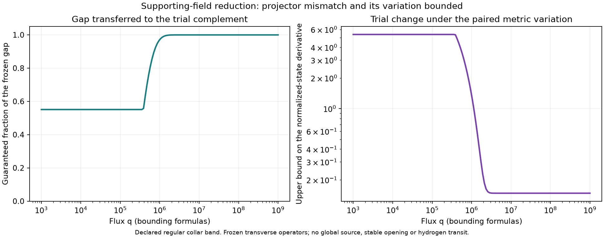

The next target is the radial coupling and derivative-weighted resolvent
error needed to turn this local channel reduction into a regular-band
contribution to the source. The exterior magnetic null and open channels
still prevent a whole-space gap shortcut. One hydrogen atom remains the
payload; no total supporting stress, stable opening, survival, atom passage,
new law or clock advantage is established. The current static geometry
still excludes backward causal travel from 13 to 12 September 2027.

## Full collar resolvent comparison and a finite filtered trace

The [collar resolvent calculation](../scripts/dihole_collar_resolvent.py)
now retains the actual radial derivative in a comparison with the global
Hamiltonian. It does not use the frozen transverse gap as a global gap.
A sharper momentum-residual bound makes the resulting estimate nontrivial
at the atomic-flux reference. The
[saved results](../results/dihole_collar_resolvent_results.json) contain
**12 passing controls** and an error bound for a genuinely trace-class,
Gaussian-filtered channel observable. That observable is not the vacuum
stress or a supporting-source verdict.

### A smaller coefficient for radial momentum

Use the same normalized aligned state and probability $p=Wg^2$ as above,
with $f=\cos\beta_c/W$, $v=\mathbb E_p f$. Its radial derivative coefficient
has the exact identity

$$
\|r_1\|^2=\mathbb E_p(W^{-2})-v^2
=\operatorname{Var}_p(f)+\mathbb E_p(\sin^2\beta_c/W^2).
$$

Let $T,T_s$ bound the tilt and its radial derivative, $C_t$ bound the
window derivative, and $L_{W\theta},L_{Ws}$ bound the corresponding
logarithmic derivatives of $W$. The previous interval tables imply

$$
|f_\theta|\le L_f:=\frac{C_tT^2+L_{W\theta}}{w_-},\qquad
R_1(q):=\sqrt{\frac{L_f^2C_1}{q}+\frac{T^2}{w_-^2}},\qquad
v\ge v_-:=\frac1{\sqrt{1+T^2}\,w_+}.
$$

These use the actual normalized moment bound
$\mathbb E_p(\theta-\theta_0)^2\le C_1/q$. They retain the spin term,
which need not vanish when flux increases.

The derivative of $v$ also needs normalization transport. With the
preceding $A,d$ and $\zeta=C\theta_{0,s}$, integration by parts gives

$$
v_s=\mathbb E_p(f_s+\zeta f_\theta)
+2q\operatorname{Cov}_p(A,f)+\operatorname{Cov}_p(d,f).
$$

The advection sign is positive. Its boundary terms vanish because $\zeta$
vanishes near both poles. Applying Cauchy--Schwarz to the centered
covariances gives the sufficient bound

$$
V_s(q):=\frac{T_sT+L_{Ws}}{w_-}+|\theta_{0,s}|_*L_f
+\frac{L_f\sqrt{C_1}\,[2A_2\sqrt{C_2}+d_0]}{\sqrt q}
\ge |v_s|.
$$

No interpolation in flux or new numerical geometry approximation is used.
At the integer near the atomic-flux estimate,

$$
R_1<.000599144,\quad v_->.0116589219,\quad
V_s<3.434574.
$$

The former generic $R_1<.039969497$ bound was too loose for a useful
radial graph comparison. The $R_0$ bound from165 remains unchanged;
this calculation does not pretend its large constant has disappeared.

### Comparing actual radial operators with their edge terms

Let $H$ be a self-adjoint global realization of the prescribed geometry
agreeing with the collar operator and containing its regular compact core.
Complete the positive collar velocity smoothly to a bounded positive
velocity on the real line. The auxiliary operator
$h=-i(v\partial_s+v_s/2)$ is then self-adjoint through the optical coordinate
$x(s)=\int^s du/v(u)$ and the unitary map
$\psi(s)\mapsto\sqrt{v(s)}\psi(s)$ to $L^2(dx)$.

Choose the same smooth step $S$ as before and define

$$
\chi(s)=S((s-.005)/.01)S((.045-s)/.01),\qquad
\eta(s)=S((s-.015)/.005)S((.035-s)/.005).
$$

The outer cutoff is one on the support of the inner cutoff. Its transition
regions are disjoint, so $S'\le8$ gives $\|\chi'\|_\infty\le800$ in
$D=1$ units. The sampled maximum of200 is only a control; it does not
replace this analytic upper bound.

Set $J=\chi U$, $A_s=\sigma_3/W$ and $R=HU-Uh$. Compact support and the
regular polar trial imply $J\operatorname{Dom}h\subset\operatorname{Dom}H$.
The exact defect is

$$
T=HJ-Jh=\chi R-i\chi'A_sU.
$$

Thus, for $G_H=(H-iy)^{-1}$ and $G_h=(h-iy)^{-1}$, $y>0$,

$$
E_y:=G_HJ-JG_h=-G_HTG_h.
$$

The cutoff term is essential even when the internal residual vanishes:
it then becomes the reduced-resolvent cutoff commutator. The frozen
transverse gap is not used to estimate $\|G_H\|$.

Since $\partial_s=i v^{-1}h-v_s/(2v)$ locally,

$$
\|T\psi\|\le a\|h\psi\|+b\|\psi\|,\qquad
a=R_1/v_-,\quad
b=R_1V_s/(2v_-)+R_0+800/w_-.
$$

The spectral theorem gives the exact identity
$\|hG_hu\|^2+y^2\|G_hu\|^2=\|u\|^2$. Combining it with
$\|G_H\|\le1/y$ yields

$$
\boxed{\|E_y\|\le\frac1y\sqrt{a^2+(b/y)^2}.}
$$

This comparison includes arbitrary longitudinal momenta and the full radial
operator; no longitudinal energy cutoff or assumed global angular gap
enters the norm estimate. It is uniform over the stated global
self-adjoint realizations. It is not a proof that such a geometry is
self-consistently sourced.

For the chosen atomic-reference integer,
$a<.051389264$ and $Db<197416.219$. With $yD=\sqrt q$,

$$
y\|E_y\|<.051389264,\qquad \|E_y\|/D<2.384948\times10^{-14}.
$$

The quantity $.051389264$ is measured against the universal norm scale
$1/y$. It is **not** a measured relative error, transmission probability,
percentage of the required support, or finite-time transport fidelity.
At $q=1000$ the corresponding bound exceeds6247, so this estimate gives
no useful small-error conclusion there. The failure at low flux is retained.

### A trace-class selected observable

The cutoff comparison can be used inside a finite quantum observable
without claiming an unfiltered stress trace. Put

$$
X=\eta e^{-h^2/(2\Lambda^2)},\qquad \Lambda>0.
$$

In the optical coordinate $h$ is $-i\partial_x$. Fourier normalization
$dp/(2\pi)$ gives the exact Hilbert--Schmidt norm

$$
\|X\|_{\rm HS}^2=\frac{\Lambda}{2\sqrt\pi}
\int\frac{\eta(s)^2}{v(s)}ds
\le\frac{\Lambda}{2\sqrt\pi}\frac{.02}{v_-}.
$$

Both terms in the following difference are trace-class. Since
$J^*JX=X$, their difference has the exact form

$$
\Delta\mathcal O_y=
\operatorname{Tr}[(JX)^*G_H(JX)-X^*G_hX]
=\operatorname{Tr}(X^*J^*E_yX),
$$

$$
|\Delta\mathcal O_y|
\le\|E_y\|\,\|X\|_{\rm HS}^2.
$$

Within the stated complete-line velocity extensions, the localized
reference is independent of the continuation outside the window. Indeed

$$
(XX^*)(s,t)=\frac{\eta(s)\eta(t)\Lambda}
{2\sqrt{\pi v(s)v(t)}}
\exp[-\Lambda^2(x(s)-x(t))^2/4],
$$

and, for $y>0$,

$$
G_h(s,t)=\frac{i\mathbf1_{s>t}}{\sqrt{v(s)v(t)}}
\exp[-y(x(s)-x(t))].
$$

When both arguments are in the inner window, only collar values of $v$
enter their coordinate difference. This argument does not apply to a
circle or reflecting endpoint completion.

Choose the explicit integer
$q=4642875905017627791065088$ near the prior continuous size estimate.
This instantiates the bound's integer parameter; it does not calculate a
wave function at that flux. For $yD=\Lambda D=\sqrt q$,

$$
|\Delta\mathcal O_y|/D<.024867898\quad\text{per sector}.
$$

The exact count of allowed half-integer sectors in the regular band is

$$
N_q=\left\lfloor\frac{19q-10}{20}\right\rfloor
-\left\lceil\frac{17q-10}{20}\right\rceil+1.
$$

Multiplying the uniform bound by this finite count gives the saved band
trace-error bound. This can be formulated with a joint direct-sum $J,X$,
so exterior mixing of sectors does not invalidate the bound; independent
global blocks would require global axial symmetry. The band error itself
is about $1.154586\times10^{22}D$ at the selected reference. It is the
error of this resolvent observable, with different dimensions and weights
from stress; comparing that number directly to the required energy would
be invalid.

### Checks and remaining physical work

The actual normalized states satisfy the $r_1$ variance identity to
$1.04\times10^{-25}$ absolutely and the transported velocity derivative
to $2.23\times10^{-16}$. All six field cases are enclosed. Independent
momentum-space and position-space Gaussian integrals check the trace
normalization; sector counts are checked by exact finite enumeration at
three smaller fluxes. The full results retain all bounds, parameters and
source hashes. The initial report writer rejected NumPy Boolean values
before creating an artifact; explicit Boolean conversion fixed the output
without changing calculations or tolerances.

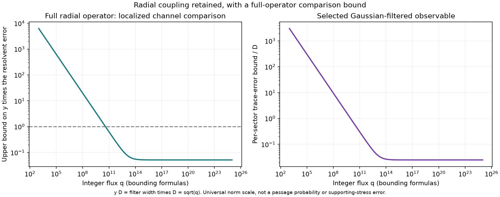

The next source requirement is a derivative-weighted version: evaluated
bounds for the localized $\dot H G_H$ and longitudinal metric terms,
including changes to the windows/filter if they are varied. Removing the
filter and controlling omitted frequencies, null/open channels and the
renormalized subtraction remain necessary. This checkpoint supplies no
stress value, source sign, stable opening, hydrogen survival or clock
advantage. One hydrogen atom remains the target. The current static
geometry still excludes backward causal passage, including travel from
13 to 12 September 2027.

## Metric response of the full collar resolvent

The [metric-resolvent calculation](../scripts/dihole_metric_resolvent.py)
closes the preceding finite-observable calculation's missing first metric
variation. All **13 controls pass** in the
[saved results](../results/dihole_metric_resolvent_results.json).
The output bounds a finite trace containing the actual geometry-variation
operator. It does not determine the vacuum stress, supporting-source sign,
stability, or hydrogen propagation.

This increment uses a self-adjoint global realization preserving axial
symmetry and the declared half-integer sector. This is the symmetry of the
prescribed geometry. Unlike167's unvaried comparison, the new graph estimate
does not cover arbitrary exterior mixing of sectors. The complete-line
reference velocity is varied only inside the collars; its continuation is
held fixed outside. Frequencies, the Gaussian scale and spatial windows are
held fixed under the virtual metric variation unless explicitly stated.

### A graph bound without a global spectral gap

Write the actual canonical Hamiltonian as

$$
H=W^{-1/2}(P+B)W^{-1/2},\quad P=-i\sigma_3\partial_s,\quad
B=K/R,\quad K=-i\sigma_1\partial_\theta+\sigma_2 V,\quad
V=q\,NP(\nu-a)/\sin\theta.
$$

On the regular compact core,

$$
\{P,B\}=-i\sigma_3B_s,\qquad
B_s=-\frac{R_s}{R}B+\sigma_2\frac{V_s}{R}.
$$

The cross term is bounded by
$\|R_s/R\|_\infty\|\phi\|\|B\phi\|
+\|V_s/R\|_\infty\|\phi\|^2$.
Completing the square in $\|B\phi\|$ gives

$$
\|P\phi\|^2\le\|(P+B)\phi\|^2+C_g\|\phi\|^2,\qquad
C_g=\frac14\|R_s/R\|_\infty^2+\|V_s/R\|_\infty.
$$

The apparent polar singularity in $V_s$ is removable. At both axes,
$(NP)_R=a_R=0$. With $x=\cos\theta$, the mean-value theorem bounds each
radial derivative by its mixed $Rx$ bound times $1-|x|$; dividing by
$\sin\theta$ costs at most one. The saved165 interval table therefore gives

$$
\left\|\frac{V_s}{qR}\right\|_\infty
\le40\left(\|(NP)_{Rx}\|_\infty\|\nu-a\|_\infty
+\|NP\|_\infty\|a_{Rx}\|_\infty\right)<30.727337<31.
$$

The implementation uses the actual interval enclosure of $a$, including
its small overhang past zero and one; it needs no numerical clipping.
Since $|R_s|\le1$ and $R\ge1/40$, $C_g\le400+31q$ in $D=1$ units.
The regular polar domain and graph closure extend the estimate to the
localized resolvent range.

For the original compact variation mask $F$, let $c=e^{\epsilon F}$.
The specified family is $H_\epsilon=cH_{\rm rad}c+cH_{\rm ang}$.
Its full connection term has a useful exact rearrangement:

$$
\boxed{\dot H\psi=FH\psi+W^{-1/2}P(FW^{-1/2}\psi).}
$$

Thus $F$ itself localizes the graph estimate. Its flat endpoints justify
zero extension; no larger unknown collar or omitted cutoff is introduced.
The scalar commutator already contains the required $F_s$ term. Writing
$F_*=4$, $F_{s*}=1200$, $w_-=\inf W$, $w_+=\sup W$, one obtains

$$
C_H(y):=F_*+\frac1{\sqrt{w_-}}
\sqrt{\left(F_*\sqrt{w_+}+\frac{F_{s*}}{\sqrt{w_-}y}\right)^2
+\frac{(400+31q)F_*^2}{w_-y^2}}
\ \ge\ \|\dot H(H-iy)^{-1}\|.
$$

This uses only $\|H(H-iy)^{-1}\|\le1$ and $\|(H-iy)^{-1}\|\le1/y$.
Both collars obey the same direct-sum estimate without an extra factor two.
No frozen angular gap is substituted for a full-space gap.

### Controlling the moving effective channel

Let $M$ denote166's bound on $\|\dot U\|$ in the real normalized gauge,
so $U^*\dot U=0$. Differentiating $r_1=(A_s-v)U$, with
$\dot A_s=2FA_s$, gives the sharper bounds

$$
|\dot v-2Fv|\le2MR_1,\qquad
\|\dot r_1\|\le2F_*R_1+2MR_1+2M/w_-=:\dot R_1,
$$

$$
|\dot v/v|\le\alpha:=2F_*+2MR_1/v_-.
$$

This avoids the much larger165 generic $\dot r_1$ estimate while preserving
its $\dot R_0$ bound. At the atomic-reference integer,
$M<.147678$, $\dot R_1<.016775315$, and $\alpha<8.015179$.

The mixed derivative $\dot v_s$ includes normalization and the mask's
radial derivative. Use167's $f,A,d,\zeta$ and put
$g=f_s+\zeta f_\theta$, $J_0=\dot\Lambda L$,
$j=qJ_0-\mathbb E(qJ_0)$. The canonical weight $W$, $\zeta$ and $d$
are unchanged under this interpolation; $\dot p=2jp$. Differentiation yields

$$
\begin{aligned}
\dot v_s={}&2Fv_s+2F_sv+\mathbb E\dot g+2\operatorname{Cov}(j,g)\\
&+2q\{\operatorname{Cov}(\dot A,f)+\operatorname{Cov}(A,\dot f)
+2\mathbb E[(A-\mathbb EA)(f-\mathbb Ef)j]\}\\
&+\operatorname{Cov}(d,\dot f)
+2\mathbb E[(d-\mathbb Ed)(f-\mathbb Ef)j].
\end{aligned}
$$

All constants below come from165/167. Define $L_{\dot f}=F_*T^2(2C_t+L_{W\theta})/w_-$,
$G=(T_sT+L_{Ws})/w_-+|\theta_{0,s}|_*L_f$, and

$$
\dot G=\frac{F_*T_sT+T(F_{s*}T+F_*T_s+2F_*T^2T_s)+F_*T^2L_{Ws}}{w_-}
+|\theta_{0,s}|_*L_{\dot f},
$$

$$
K_5=\sqrt{C_2C_3}+2C_1\sqrt{C_1C_2}+\sqrt{C_1}C_2+4C_1^{5/2}.
$$

Centered moment bounds and Cauchy--Schwarz give the explicit sufficient bound

$$
\begin{aligned}
\dot V_s={}&2F_*V_s+2F_{s*}/w_-+\dot G+2J_2\sqrt{C_2}G\\
&+\frac{2(\dot A_2L_f+A_2L_{\dot f})\sqrt{C_1C_2}
+d_0L_{\dot f}\sqrt{C_1}}{\sqrt q}\\
&+\frac{4A_2L_fJ_2K_5
+4d_0L_fJ_2[\sqrt{C_1C_2}+3C_1^{3/2}]}{\sqrt q}
\ \ge|\dot v_s|.
\end{aligned}
$$

For example, the first triple uses
$\mathbb E[(\delta^2+m_2)^2(|\delta|+m_1)]
=m_5+m_1m_4+2m_2m_3+4m_1m_2^2$,
where $m_j=\mathbb E|\delta|^j$.
This derivation retains $2F_sv$ and the $F_s$ part of $\dot g$.
The bound is loose: $D\dot V_s<24909.031$ at the atomic reference.

Since $\dot h=(\dot v/v)h-i(\dot v_s-\dot vv_s/v)/2$, the exact spectral
graph identity yields

$$
\|\dot hG_h\|\le C_h(y):=\sqrt{\alpha^2+(\beta/y)^2},\qquad
\beta=(\dot V_s+\alpha V_s)/2.
$$

For $T=HJ-Jh$ with $J=\chi U$, retain
$\dot T=\chi\dot R-i\chi'(2FA_sU+A_s\dot U)$.
With $a_d=\dot R_1/v_-$ and
$b_d=\dot R_1V_s/(2v_-)+\dot R_0+800(2F_*+M)/w_-$,

$$
\|\dot T G_h\|\le C_T(y):=\sqrt{a_d^2+(b_d/y)^2}.
$$

### A finite trace containing the physical metric insertion

Let $e_y$ be167's bound for $E_y=G_HJ-JG_h$. Resolvent differentiation gives

$$
\dot E_y=G_H\dot H G_HTG_h-G_H\dot T G_h+G_HTG_h\dot hG_h,
\qquad
\|\dot E_y\|\le(C_H+C_h)e_y+C_T/y.
$$

At fixed $X=\eta e^{-h^2/(2\Lambda^2)}$ evaluated at the baseline, define

$$
Q_X=\operatorname{Tr}X^*
[J^*G_H\dot H G_HJ-G_h\dot hG_h]X.
$$

All products are trace-class after the stated filtering and graph estimates.
Let $E_-=(H+iy)^{-1}J-J(h+iy)^{-1}$. The real normalized gauge and
$X^*\chi^2=X^*$ give the exact insertion identity

$$
Q_X=\operatorname{Tr}X^*[-J^*\dot E_y+E_-^*\dot J]X.
$$

The same graph estimate holds at both frequency signs. Therefore

$$
\boxed{|Q_X|,\ |\dot\Delta_X|
\le\|X\|_{\rm HS}^2[(M+C_H+C_h)e_y+C_T/y].}
$$

Here $\dot\Delta_X$ is the derivative of167's selected trace with $X$
fixed and $J,h$ varied. **It is not generally $-Q_X$**: moving-embedding
terms remain. The effective $\dot h$ also contains the changing channel
state, so this comparison is not a full vacuum-stress formula.

If the effective Gaussian is varied as well, with fixed $\eta,\Lambda$,
its complete-line kernel obeys

$$
|\dot K(s,t)|\le\alpha[1+\Lambda^2(x(s)-x(t))^2]|K(s,t)|,
\quad
\|\dot X\|_{\rm HS}\le\frac{\sqrt{11}}2\alpha\|X\|_{\rm HS}.
$$

The outside velocity continuation is frozen, making $\alpha$ a global
bound for this chosen reference. Gaussian integration of $(1+z^2)^2$
against $e^{-z^2}/\sqrt\pi$ gives $11/4$. The two filter-derivative terms
add at most $\sqrt{11}\alpha e_y\|X\|_{\rm HS}^2$. They must be kept
separately; at $iy$ they are not generally a twice-real-part pair.

### Result, checks, and the next obstruction

At the same integer $q=4642875905017627791065088$ and fixed
$yD=\Lambda D=\sqrt q$,

$$
C_H<11.459086,\quad C_h<8.015179,\quad C_T<1.438857,\quad
y\|\dot E_y\|<2.439625.
$$

The per-sector fixed-filter insertion-error bound is **$1.184237D$**.
The varying-effective-filter derivative-error bound is **$1.845309D$**.
The finite-band insertion-error bound is below $5.498264\times10^{23}D$.
These are absolute upper bounds for the declared observable, not measured
relative errors, probabilities or percentages of the required support.
At $q=1000$ the fixed-filter bound exceeds $6.08\times10^{10}D$;
the uninformative low-flux case is retained. No huge-flux state is simulated.

Actual profile controls reproduce the momentum-derivative identity within
$5.8\times10^{-18}$ and the transported mixed velocity derivative within
$8.9\times10^{-16}$. Noncommuting finite matrices check both trace derivatives,
the resolvent derivative, insertion ordering, parallel phase and the bound;
the largest derivative discrepancy is $6.46\times10^{-11}$.
Independent Gaussian integrals give $11/4$ and the uniform-velocity special
case $3/4$. The source and all34 inherited input hashes are recorded exactly.

There is a concrete next obstruction: at fixed $q,\Lambda$, the present
positive error envelope decays only as $1/y$. Its coefficient divided by
$\|X\|_{\rm HS}^2$ approaches a value bounded above by
$2.444458$ at the atomic reference. Thus this *error bound* cannot be
integrated absolutely to infinite frequency. This does not prove that the
actual renormalized response diverges. The next reduction must preserve
paired-frequency/subtraction cancellations before taking absolute values,
then address filter removal, omitted angular sectors and null/open channels.

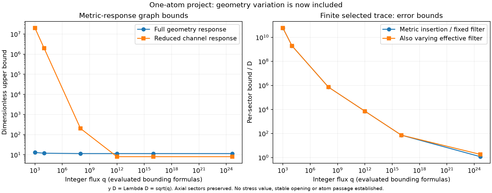

One neutral hydrogen atom remains the payload. No supporting medium,
stable opening, survival probability, new physical law or exterior-clock
advantage is established. The current static geometry still excludes
backward causal passage, including 13 to 12 September 2027.

## Paired frequencies and a finite selected sign insertion

The [paired-frequency calculation](../scripts/dihole_paired_frequency.py)
uses the actual collar constants to control the high-frequency remainder
that168's single-sign absolute estimate could not integrate. All **14
checks pass** in the [results](../results/dihole_paired_frequency_results.json).
It also bounds a separate finite massless sign insertion, closer to the
Hamiltonian source formula. Neither number is the full renormalized stress.

Throughout this increment, $Y=JX$ and $X=\eta e^{-h^2/(2\Lambda^2)}$ are
**fixed at the baseline** when differentiating the selected energy. This
is not the moving-embedding or moving-filter energy derivative. The full
axial-sector and canonical-domain assumptions of168 remain in force.
The bounds below refer to one Weyl field, one collar selection and one
allowed half-integer sector; the saved band value multiplies only the
previous exact sector count.

### Evaluated first graph moments

In the optical coordinate, Fourier normalization gives the exact identities

$$
\|X\|_{\rm HS}^2=\frac\Lambda{2\sqrt\pi}\int\eta^2\frac{ds}{v},\qquad
\|hX\|_{\rm HS}^2=\frac{\Lambda^3}{4\sqrt\pi}\int\eta^2\frac{ds}{v}
+\frac\Lambda{2\sqrt\pi}\int v(\eta')^2ds.
$$

The cross term vanishes by oddness of the Fourier momentum. The actual
inner cutoff has two disjoint ramps, each of width$.005D$, with
$|\eta'|\le1600/D$. Thus, in $D=1$ units,

$$
\int\eta^2 ds/v\le.02/v_-,\qquad
\int v(\eta')^2ds\le25600/w_-.
$$

Let $A,B$ bound these two Hilbert--Schmidt norms. From $HJ=Jh+T$ and167's
graph estimate, $B_H=(1+a)B+bA$ bounds $\|HY\|_{\rm HS}$.
The original compact metric variation obeys the full graph inequality

$$
\|\dot H\psi\|\le a_H\|H\psi\|+b_H\|\psi\|,\quad
a_H=4(1+\sqrt{w_+/w_-}),\quad
b_H=\frac{1200+4\sqrt{400+31q}}{w_-}.
$$

Therefore $D_H=a_HB_H+b_HA$ bounds $\|\dot H Y\|_{\rm HS}$, while
$D_h=\alpha B+\beta A$ bounds $\|\dot hX\|_{\rm HS}$.
The outer cutoff part of167's $b$ is retained conservatively. These
estimates establish first graph moments, not $H^2Y$ or a global gap.
At the atomic-reference integer with $\Lambda D=\sqrt q$:

| Evaluated upper bound | Value in $D=1$ units |
| --- | ---: |
| $A^2$ | $1.042702005\times10^{12}$ |
| $B^2$ | $2.420568007\times10^{36}$ |
| $B_H$ | $1.635769988\times10^{18}$ |
| $D_H$ | $2.061581915\times10^{19}$ |
| $D_h$ | $1.247015414\times10^{19}$ |

### Pair before taking an absolute value

For a self-adjoint $H$ and its symmetric metric derivative $V=\dot H$,
put $G_\pm=(H\mp iy)^{-1}$ and $S_y=(H^2+y^2)^{-1}$. The exact identity is

$$
\operatorname{Tr}Y^*(G_+VG_+-G_-VG_-)Y
=4iy\,\operatorname{Re}\operatorname{Tr}[(HS_yY)^*VS_yY].
$$

It follows from $G_\pm=(H\pm iy)S_y$ without commuting $V$ through $H$.
The leading real term cancels in the pair. Since
$\|HS_yY\|_{\rm HS}\le B_H/y^2$ and
$\|VS_yY\|_{\rm HS}\le D_H/y^2$,

$$
|\operatorname{Im}\operatorname{Tr}Y^*G_+VG_+Y|
\le\frac{2B_HD_H}{y^3}.
$$

For168's full-minus-reduced insertion, set $C=B_HD_H+BD_h$.
Its imaginary part is bounded by $2C/y^3$. Thus the high-frequency
obstruction from the old positive $1/y$ error envelope was a limitation
of that envelope, not a divergence of this paired selected observable.

### Which energy integral this controls

Introduce an explicit **spectral** infrared smoothing $\delta>0$,
$f_\delta(H)=\sqrt{H^2+\delta^2}$, and
$\kappa=\sqrt{\omega^2+\delta^2}$. For fixed $Y$,

$$
\frac{d}{d\epsilon}\operatorname{Tr}Y^*f_\delta(H_\epsilon)Y
=\frac2\pi\int_0^\infty\frac{\omega^2}{\kappa}
\operatorname{Im}\operatorname{Tr}Y^*G_+(\kappa)V G_+(\kappa)Y\,d\omega.
$$

The positive smoothing avoids assuming differentiability through a zero
crossing. It is not a physical proper mass. The paired comparison tail is

$$
|\mathrm{tail}_{\omega>\Omega}|
\le\frac{4C}{\pi}\left[
\frac{\arctan(\delta/\Omega)}{2\delta}
+\frac{\Omega}{2(\Omega^2+\delta^2)}\right]
\le\frac{4C}{\pi\Omega}.
$$

The same formula over the full half-line gives the coarse bound $C/\delta$.
For a sharper finite window, triangle bounds in168 give

$$
|Q_\kappa|\le A^2(K_1/\kappa+K_2/\kappa^2+K_3/\kappa^3),
$$

$$
K_1=(M+a_H+\alpha)a+a_d,\quad
K_2=(M+a_H+\alpha)b+(b_H+\beta)a+b_d,\quad
K_3=(b_H+\beta)b.
$$

Integrating the weighted imaginary-part upper bound over$[0,\Omega]$
uses the following exact integrals:

$$
I_1=\Omega-\delta\arctan(\Omega/\delta),\quad
I_2=\operatorname{arsinh}(\Omega/\delta)-\frac\Omega{\sqrt{\Omega^2+\delta^2}},
$$

$$
I_3=\frac{\arctan(\Omega/\delta)}{2\delta}
-\frac\Omega{2(\Omega^2+\delta^2)}.
$$

The middle error is at most $2A^2(K_1I_1+K_2I_2+K_3I_3)/\pi$.
Add the paired tail, and take the smallest of these valid bounds and
$C/\delta$. The reported split is selected from four explicit frequencies;
it is not claimed to be a continuous optimum.

At the atomic reference and $\delta D=1$, the paired tail falls from
$3.139118\times10^{25}/D$ above$\Lambda$ to
$4.904871\times10^{23}/D$ above$64\Lambda$. The complete selected derivative
error bound is still loose: below$1.974373\times10^{29}/D$, with the best
saved split$4\Lambda$. The separate trial$\delta=.1\Lambda$ gives a bound
below$2.154453\times10^{25}/D$. It is a different smoothed observable,
not evidence that changing a physical material or subtraction improves
support. The limit$\delta\downarrow0$ remains unproved here.

### A distinct bound on a finite massless source selection

For the source-oriented observable, retain the actual sign insertion:

$$
s_Y=\operatorname{Re}\operatorname{Tr}Y^*\dot H\operatorname{sgn}(H)Y,
\qquad \operatorname{sgn}(0)=0.
$$

It equals the selected trace of the symmetrized operator
$\{\dot H,\operatorname{sgn}H\}/2$. The sign operator is a contraction
preserving the Hamiltonian graph domain, so

$$
\boxed{|s_Y|\le A(a_HB_H+b_HA)=AD_H.}
$$

This bound needs no spectral infrared smoothing or frequency integral.
A different zero-state occupation would require its additional contribution.
At the atomic reference the per-sector bound is below
$2.105139\times10^{25}/D$, or$4.534127q/D$. Multiplying by the exact finite
regular-band count gives less than$9.773898\times10^{48}/D$, or
$.453413q^2/D$. These are absolute bounds, not a measured sign. No fermionic
$-1/2$, second Weyl component, second collar or physical factor$\hbar c$
is included. Comparing this selected massless quantity directly with the
complete renormalized supporting-source requirement is not justified.

The energy derivative above is generally **different** from$s_Y$ because
$YY^*$ need not commute with$H$. An exact noncommuting control makes the
distinction visible: for $H=\mathrm{diag}(1,-2)$, $V=\sigma_x$ and
$Y=(1,1)^T/\sqrt2$, the selected unsmoothed energy derivative is$-1/3$,
$s_Y=0$, and the selected derivative of$\operatorname{sgn}H$ is$2/3$.
The corresponding smoothed energy derivative is
$[\sqrt{1+\delta^2}-\sqrt{4+\delta^2}]/3$.
Neither the frequency weight nor this filter-commutator distinction can
be discarded when matching a physical source.

### Checks and the remaining physical prescription

Independent quadratures reproduce the four closed frequency integrals to
$1.47\times10^{-16}$ relatively and the Fourier/position first Gaussian
moments to$2.23\times10^{-16}$. Noncommuting matrix controls reproduce the
paired identity to$2.78\times10^{-17}$ and the weighted energy derivative
to$1.56\times10^{-15}$; all tested absolute tails lie below their bounds.
The script records its source and all38 input hashes, including the
[preserved unit-label pilot source](../provenance/dihole_paired_frequency_units_trial.py)
and [pilot results](../results/dihole_paired_frequency_units_trial.json).
The saved label for $C=B_HD_H+BD_h$ was corrected from $D^3$ to $D^2$:
$C$ has units $D^{-2}$. All numerical formulas, values and tolerances
are unchanged; the exact pre-correction artifacts remain available. An initial
NumPy Boolean serialization failure occurred before any result was written;
explicit conversion corrected reporting without changing calculations or
tolerances. No scientific failed case was discarded.

The physical proper-mass prescription from136--161 is still

$$
Q_M=-\frac14\sum_{j,\sigma=\pm}c_j
\operatorname{Tr}[V_{\sigma m_j}\operatorname{sgn}H_{\sigma m_j}],\qquad
H_m=H_0+mN\beta.
$$

In particular,

$$
H_m^2=H_0^2+m[H_0,N]\beta+m^2N^2,
$$

which is not$H_0^2+\delta^2$. The independent finite-matrix check reproduces
this identity to$1.34\times10^{-15}$ and rejects the scalar-mass shortcut.
The lapse-dependent mass term also varies; its derivative must be retained.
The next source step is to extend the channel comparison to these actual
four-component massive operators, including off-channel lapse variation,
and preserve the common signed-mass regulator sum. Omitted angular and
null/open channels, filter removal and the fixed counterterms remain.
The finite-selected bounds do not settle their contributions.

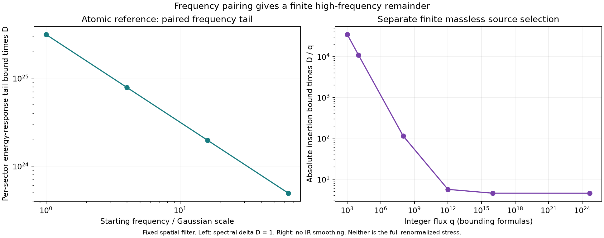

One hydrogen atom remains the payload. No stable supporting medium,
atom survival or passage, new physical law, or future clock advantage is
established. The current static geometry excludes backward causal travel,
including 13 to 12 September 2027.

## Proper-mass channel comparison at fixed regulator

The [calculation](../scripts/dihole_massive_channel.py) and
[results](../results/dihole_massive_channel_results.json) extend the retained
channel to the actual four-component auxiliary regulator fields. These are
supporting-field calculations, not a hydrogen Hamiltonian. All 16 checks pass;
40 exact prior input hashes are retained. The following estimates are our
conditional derivation on the prescribed geometry, not a published proof
that this geometry has a physical source. The published
[Maldacena--Milekhin--Popov construction](https://arxiv.org/abs/1807.04726)
provides relevant negative-energy wormhole context but explicitly does not
produce ambient causality violation. Its solution cannot be transferred to
our different geometry merely by choosing similar field content.

### Lapse variance and the moving channel

Let $\tau_i$ act on the two Weyl blocks, leaving the earlier $\sigma_i$
for Weyl spin. With the same charge and axial sector in both blocks,

$$
H_m=\tau_3\otimes H+m\tau_1\otimes N,\qquad
h_m=\tau_3\otimes h+m\tau_1 n,\qquad
U_4=I_2\otimes U,\quad n=\langle U,NU\rangle=\mathbb E_pN.
$$

Here $N=\sqrt{NP/W}$ is the physical lapse. On the compact regular core,
$r_N=(N-n)U$ and $J_4=\chi U_4$ give

$$
R_m=H_mU_4-U_4h_m=\tau_3\otimes R+m\tau_1\otimes r_N,\qquad
T_m=H_mJ_4-J_4h_m=\tau_3\otimes T+m\tau_1\otimes\chi r_N.
$$

The exported collar bounds are $0.1022740140<N<0.2113876703$ and
$L_N:=\sup|N_\theta|<0.005422164$. They are not global exterior bounds.
Using the earlier normalized moment coefficients,

$$
\|r_N\|\le R_N=L_N\sqrt{C_1/q}.
$$

At fixed proper mass, $\dot N=FN$ and

$$
\dot n=Fn+2\operatorname{Re}\langle\dot U,r_N\rangle,\qquad
\dot r_N=(FN-\dot n)U+(N-n)\dot U.
$$

The changing normalization must not be dropped. In the real parallel gauge,
subtracting the normalization term is a reflection, so exactly

$$
\|\dot r_N\|=\|Fr_N+(N-n)\dot U\|.
$$

Writing $T$ for the earlier tilt bound, the whole-window logarithmic
coefficient gives $J_2=F_*T^2M_{\rm window}<0.019614574$. With

$$
K_6=C_3+2\sqrt{C_1C_2C_3}+3C_1C_2+4C_1^2\sqrt{C_2}+6C_1^3,
$$

amplitude/spin orthogonality and the sixth moment give

$$
\dot R_N=F_*R_N+\frac{L_N}{\sqrt q}
\sqrt{J_2^2K_6+F_*^2T^2C_1/4}\ \ge\ \|\dot r_N\|.
$$

The independently checked radial transport identity is

$$
n_s=\mathbb E_p(N_s+\zeta N_\theta)
 +2q\operatorname{Cov}_p(A,N)+\operatorname{Cov}_p(d,N).
$$

Its bound retains all three terms. At the exact atomic reference,
$R_N<8.417554\times10^{-14}$ and
$\dot R_N<5.293817\times10^{-12}$. These are dimensionless bounds on
normalized field-channel leakage coefficients; multiplying by $|m|$ is
still necessary. They are not atom losses or material tolerances.

### A full massive graph bound using only compact collar data

Set $L=WN=\sqrt{NP\,W}$,
$D_m=\tau_3P+B_m$, $B_m=\tau_3B+mL\tau_1$, and
$\Gamma=\tau_3\sigma_3$. Since $\{\Gamma,B_m\}=0$,

$$
(B_m)_s=-\frac{R_s}{R}B_m+\tau_3\sigma_2\frac{V_s}{R}
 +m\left(L_s+\frac{R_s}{R}L\right)\tau_1.
$$

Completing the square while retaining the entire nonnegative
$\|B_m\phi\|^2$ yields

$$
\|\tau_3P\phi\|^2\le\|D_m\phi\|^2+C_{g,m}\|\phi\|^2,
\qquad C_{g,m}=400+31q+|m|C_L,
$$

in $D=1$ units. Here

$$
C_L=\sqrt{NP_+W_+}
\left[\frac12\left(\frac{\|NP_R\|}{NP_-}+L_{W,s}\right)+40\right]
<814.397910.
$$

The angular mass commutator is included in $B_m^2$; replacing that square
by $B^2+m^2L^2$ would lose it. The exact compact-mask metric identity is

$$
\dot H_m\psi=FH_m\psi+
 W^{-1/2}\tau_3P(FW^{-1/2}\psi).
$$

It gives

$$
C_{H,m}=F_*+w_-^{-1/2}
\sqrt{\left(F_*\sqrt{w_+}+\frac{F_{s,*}}{\sqrt{w_-}y}\right)^2
 +\frac{C_{g,m}F_*^2}{w_-y^2}}
\ \ge\ \|\dot H_m(H_m-iy)^{-1}\|.
$$

The full self-adjoint realization must preserve the axial sector as in168.
Local regularity is used on the compact mask; neither a globally bounded
lapse nor identical maximal domains for all masses is assumed.

Choose a bounded positive complete-line continuation of $n$ inside the
exported interval. Continue its metric variation with the bound
$|\dot n|\le F_*n_++2M_pR_N$, where $M_p=\|\dot U\|$ is bounded by166.
These are auxiliary reduced coefficients; no exterior lapse is replaced.
No bound on the radial derivative of the continuation is needed here.
From $h_0=h_m-m\tau_1n$, the earlier graph constants give

$$
b_m=b+|m|(a n_++R_N),\qquad
b_{d,m}=b_d+|m|(a_d n_++\dot R_N),
$$

$$
\beta_m=\beta+|m|(\alpha n_++F_*n_++2M_pR_N).
$$

The self-adjoint spectral identity
$\|h_mG_{h_m}u\|^2+y^2\|G_{h_m}u\|^2=\|u\|^2$ then gives

$$
C_{T,m}=\sqrt{a^2+(b_m/y)^2},\quad
C_{\dot T,m}=\sqrt{a_d^2+(b_{d,m}/y)^2},\quad
C_{h,m}=\sqrt{\alpha^2+(\beta_m/y)^2}.
$$

Thus $\|E_m\|\le e_m=C_{T,m}/y$ and
$\|\dot E_m\|\le(C_{H,m}+C_{h,m})e_m+C_{\dot T,m}/y$.
For the same frozen, mass-independent Gaussian $X_4=I_2\otimes X$, the
finite metric-insertion trace error is bounded by

$$
\boxed{2\|X\|_{\rm HS}^2
\left[(M_p+C_{H,m}+C_{h,m})e_m+\frac{C_{\dot T,m}}y\right].}
$$

At $yD=\Lambda D=\sqrt q$ as represented by the declared saved frequency,
and $m=M=y$, the atomic-reference resolvent bound is
$y e_m<0.052524894$. The corresponding finite insertion error is below
$2.442174D$ per sector and collar, including both Weyl blocks. It is an
error bound for a filtered resolvent observable, not a stress value,
percentage transmission, or physical accuracy percentage.

### What the common regulator sum does and does not establish

The saved finite choices are $M/y=0.1,1,10$, with declared binary values
of $MD$ and outward intervals for the exact masses $\sqrt jM$.
The negative masses are unitarily related by $\tau_3$. Their sign-source
insertions are equal, not opposite. At each fixed $M,y$, the triangle
bound for $\frac14\sum_{j,\sigma}c_j$ times the selected trace errors is
$\frac12\sum_j|c_j|e^{\rm trace}_{m_j}$. At the atomic reference these
bounds are $9.478908D$, $9.910403D$, and $38.689963D$ respectively.
No frequency integration or regulator removal follows from these numbers.

For the *same* positive proper Euclidean operator $P$, and $\eta>0$, the
separate exact rational identity is

$$
\sum_{j=0}^3c_j(P+\eta+jM^2)^{-1}
=6M^6\prod_{j=0}^3(P+\eta+jM^2)^{-1},
\qquad(c_0,c_1,c_2,c_3)=(1,-3,3,-1).
$$

It survives a common conforming form compression of $P$. It does not
justify squaring a compressed Hamiltonian: on the isometric core,

$$
U_4^*H_m^2U_4=h_m^2+R_m^*R_m.
$$

The last term includes mixed mass/channel residuals as well as lapse
variance. Noncommuting matrix controls verify both identities.
Even polynomial regulator moments do not control an arbitrary finite
selection as $M\to\infty$: with $H_0=0$, $N=1$ and $\dot N=1$ in two
components, the signed-pair average of the sign insertion equals

$$
M[-3+3\sqrt2-\sqrt3]=-0.4894101204\,M.
$$

This counterexample does not disprove the physical renormalization scheme;
it prevents passing from a finite selection to its removal without the
omitted modes and prescribed counterterms. The general heat-coefficient
framework remains the one described by
[Vassilevich](https://arxiv.org/abs/hep-th/0306138), with the physical
subtraction fixed in136.

The six actual-profile checks reproduce the normalized metric identity
to $2.78\times10^{-17}$ and radial transport to $4.45\times10^{-16}$.
Matrix checks reproduce square compression to $4.04\times10^{-15}$ and
the differentiated resolvent to $3.92\times10^{-10}$; signed-mass source
values agree. These controls check algebra and implementation, not the
existence of an opening. An independent110-digit scalar audit also encloses
all798 directed inequalities over7 fluxes,21 regulator cases and84 mass
rows, including exact binary input values and the common finite weights.

**Next:** transfer the retained/omitted comparison to the common proper
Euclidean form before estimating the combined regulator contribution.
Taking separate absolute mass bounds to infinite regulator is not valid.
The total supporting source, stability and atom transport remain unknown.
The present static geometry still excludes backward causal travel and has
no established future clock advantage.

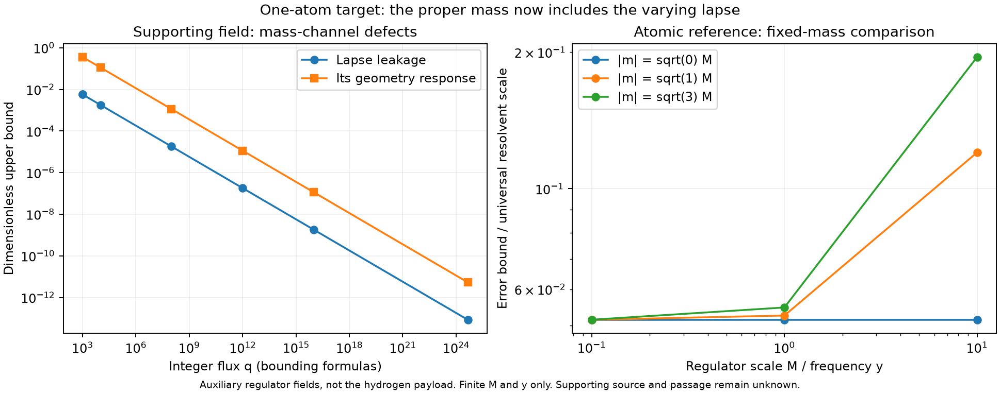

## Proper Euclidean channel and a common metric insertion

The [calculation](../scripts/dihole_proper_channel.py) and
[results](../results/dihole_proper_channel_results.json) now compare the
actual collar channel through the common proper regulator, including a
finite metric insertion. All 17 checks pass, using42 exact prior hashes.
This is a conditional calculation on the prescribed geometry. It supplies
neither the full source nor a new physical law. It reuses156's common-product
identity with165--170's actual channel bounds, rather than rerunning the
previous low-flux least-squares experiment. General conforming residual
estimation is established numerical analysis; see
[Repin--Sauter](https://www.numdam.org/articles/10.1016/j.crma.2006.06.024/).
The particular Dirac-channel identities below are derived here; that paper
does not establish this geometry or its physical support.

### The correct isometry and the omitted positive form

Write $B=N^{-1/2}$, $\beta=\tau_1$, $H_0=\tau_3H$ and
$A=B\beta(i\kappa+H_0)B$, with $A^*=-A$ and $P=A^*A$.
For the same two-block channel and scalar $n=U_4^*NU_4$,

$$
V=N^{1/2}U_4n^{-1/2},\qquad V^*V=1,\qquad
\mathfrak a=V^*AV=n^{-1/2}\beta(i\kappa+h_0)n^{-1/2}.
$$

On compact smooth collar tests, keeping the displayed operator order,

$$
R_A=AV-V\mathfrak a
=B\beta[R_0-r_Nn^{-1}(i\kappa+h_0)]n^{-1/2},\qquad V^*R_A=0.
$$

The derivative in $h_0$ acts on the final $n^{-1/2}$ as well as the test
function. Therefore the exact form compression is

$$
\langle V\phi,PV\psi\rangle
=\langle\mathfrak a\phi,\mathfrak a\psi\rangle
+\langle R_A\phi,R_A\psi\rangle.
$$

No strong $PV$ domain is needed. Dropping the last, positive term is not
justified. The actual global comparison uses $J=\chi V$, which is a
contraction, not an isometry. Its corresponding form is
$\|AJ\psi\|^2=\|\mathfrak a(\chi\psi)\|^2+\|R_A(\chi\psi)\|^2$,
with the cutoff derivative included.

For $T_0=H_0\chi U_4-\chi U_4h_0$,

$$
T_A=AJ-J\mathfrak a
=B\beta T_0n^{-1/2}-B\chi r_Nn^{-1/2}\mathfrak a.
$$

Use167's cutoff graph constants $a_0,b_0$ and170's lapse variance $R_N$.
The exact squared-sum identity

$$
\|h_0n^{-1/2}\psi\|^2+\kappa^2\|n^{-1/2}\psi\|^2
=\|\sqrt n\,\beta\mathfrak a\psi\|^2
$$

eliminates a spurious extra $|\kappa|$ term. It gives

$$
\|T_A\psi\|\le c\|\mathfrak a\psi\|+d\|\psi\|,\qquad
c=a_0\sqrt{n_+/N_-}+\frac{R_N}{\sqrt{N_-n_-}},\quad
d=\frac{b_0}{\sqrt{N_-n_-}}.
$$

Choose the auxiliary complete-line coefficients $n,v$ positive and bounded,
with complete optical coordinate and the stated collar bounds. Then
$\mathfrak a=-i[\tau_2\bar h-\tau_1\kappa/n]$,
$\bar h=-i[(v/n)\partial_s+(v/n)_s/2]$, and its anticommutator with
$\tau_1$ proves $\|\mathfrak a\psi\|\ge g\|\psi\|$,
$g=|\kappa|/n_+$. This is an **auxiliary** gap; the full exterior lapse is
unbounded and the full proper operator has no such established gap.

### Keeping the common product and its first graph error

For $\eta>0$, $M>0$, $m_j=\sqrt{\eta+jM^2}$ and
$\alpha=\sqrt6M^3$, set

$$
\mathcal T_A=\alpha\prod_{j=0}^3(A+m_j)^{-1},\qquad
\mathcal T_{\mathfrak a}=\alpha\prod_{j=0}^3(\mathfrak a+m_j)^{-1}.
$$

Exactly $\mathcal T_A^*\mathcal T_A=
6M^6\prod_j(P+\eta+jM^2)^{-1}$, the common PV filter. The first-order
resolvent norm circle, restricted by the auxiliary gap, gives

$$
C_m=\begin{cases}
\sqrt{c^2+d^2/m^2},&cm^2\ge dg,\\
(cg+d)/\sqrt{g^2+m^2},&cm^2<dg.
\end{cases}
$$

It bounds $\|T_A(\mathfrak a+m)^{-1}\|$. For factors applied in a chosen
order, start $e_0=0,r_0=1$ and propagate

$$
e_{i+1}=\frac{e_i+C_{m_i}r_i}{m_i},\qquad
r_{i+1}=\frac{r_i}{\sqrt{g^2+m_i^2}}.
$$

Then $\delta=\alpha e_4$ bounds
$\|\mathcal T_AJ-J\mathcal T_{\mathfrak a}\|$.
Because $\|A(A+m)^{-1}\|\le1$, the same final numerator gives
$\delta_A=\alpha m_{\rm last}e_4$ for the first-action error.
All24 factor orders represent the same exact operators. Ordinary and
first-action bounds can therefore be minimized independently; no mass
prescription is changed by choosing their order.

Let $r_F$ bound $\|\mathcal T_{\mathfrak a}\|$ and

$$
a_F=\min_j\alpha\prod_{k\ne j}(g^2+m_k^2)^{-1/2}
\ \ge\ \|\mathfrak a\mathcal T_{\mathfrak a}\|,\qquad
L=(1+c)a_F+dr_F\ \ge\ \|AJ\mathcal T_{\mathfrak a}\|.
$$

For the frozen Gaussian $X_4=I_2\otimes X$ from167, the positive-filter
trace compares $\|\mathcal T_AJX_4\|_{\rm HS}^2$ with
$\|J\mathcal T_{\mathfrak a}X_4\|_{\rm HS}^2$ and has error at most
$\delta(2r_F+\delta)\|X_4\|_{\rm HS}^2$.
Removing $J$ from that expression, or replacing it with the common filter
of $V^*PV$, would add an unaccounted error.

### A proper metric graph bound and a finite source insertion

Here the physical mask satisfies $\dot B=-FB/2$. The exact identity is

$$
\dot A=-i\kappa F\beta/N+\tfrac12[F,A]
+B\beta W^{-1/2}\tau_3P_s(FW^{-1/2}B\,\cdot),\qquad
P_s=-i\sigma_3\partial_s.
$$

Equivalently $\dot A=-i\kappa F\beta/N+\{F,A_{\rm rad}\}/2$;
the proper angular term is unchanged by this particular variation.
For $w=FB\psi$, use

$$
\|H_0w\|^2+\kappa^2\|w\|^2
\le\left[F_*\sqrt{N_+}\|A\psi\|
+\frac{F_{s,*}}{W_-\sqrt{N_-}}\|\psi\|\right]^2
$$

and168's radial graph bound $C_g=400+31q$. Combining the squared terms
before a triangle bound gives

$$
\|\dot A\psi\|\le c_\delta\|A\psi\|+d_\delta\|\psi\|,
\quad c_\delta=F_*\sqrt{N_+/N_-}\sqrt{1+W_+/W_-},
$$

$$
d_\delta=\frac{F_{s,*}\sqrt{1+W_+/W_-}+F_{s,*}/2+F_*\sqrt{C_g}}
{W_-N_-}.
$$

All geometry extrema are used only on the compact mask/derivative support.
Regular-axis and axial-sector assumptions remain in force. No global lapse
upper bound or full frequency gap is introduced.

Freeze the selection at the baseline geometry and write
$u=\mathcal T_AJX_4$, $v=J\mathcal T_{\mathfrak a}X_4$.
The finite proper insertion is

$$
I(u)=-\tfrac12\operatorname{Tr}\dot p[u,u]
=-\operatorname{Re}\operatorname{Tr}(Au)^*\dot Au.
$$

The form is differentiated with these test columns fixed at the evaluation
point; this is not the derivative of a norm with a varying regulator filter.
This uses only the first-order domain. The full physical $\dot A$ acts on
both $u$ and $v$; no derivative of a moving reduced channel is substituted.
The graph errors imply the explicit comparison bound

$$
\boxed{|I(u)-I(v)|\le\|X_4\|_{\rm HS}^2
\left[\delta_A(c_\delta L+d_\delta r_F)
+(L+\delta_A)(c_\delta\delta_A+d_\delta\delta)\right].}
$$

A separate absolute bound is
$|I(u)|\le\|X_4\|_{\rm HS}^2(L+\delta_A)
[c_\delta(L+\delta_A)+d_\delta(r_F+\delta)]$.
Both Weyl blocks and the $-1/2$ proper-form factor are included. The
second collar, other sectors, frequency measure and counterterms are not.
This is one declared finite selection, not the full renormalized source.

At the exact atomic flux, $\kappa D=\Lambda D=$ the saved $\sqrt q$,
$M=\kappa$, $\eta=.01\kappa^2$ (declared binary values), the bounds are:

| Quantity | Upper bound |
| --- | ---: |
| Proper channel graph coefficient $c$ | $0.073880457$ |
| Ordinary product error $\delta/D$ | $3.488590\times10^{-13}$ |
| First-action error $\delta_A$ | $0.094293028$ |
| Error / universal full filter norm scale | $0.075859462$ |
| Finite metric-insertion comparison error | $1.920500\times10^{12}$ |
| Finite metric-insertion absolute value | $1.934263\times10^{12}$ |

The last two are dimensionless at one frequency, not energies in joules.
The norm-scale ratio is not relative error in a computed physical source.
No central insertion value or supporting sign is measured. In particular,
these deliberately finite regulator choices do not establish either removal
limit or how much actual matter could pass through an opening.

Eighteen actual-profile/carrier checks reproduce the weighted compression
to $2.28\times10^{-13}$, the form identity to $8.92\times10^{-16}$ relatively,
and the proper metric derivative to $2.02\times10^{-11}$ relatively.
Noncommuting matrix controls retain the cutoff and omitted positive form;
the common-filter identity agrees to $4.76\times10^{-14}$. A frozen
metric finite difference agrees to $1.10\times10^{-12}$ relatively.
Independent110-digit evaluation encloses all1,552 exported inequalities
and checks1,512 orderings. No false enclosure occurs.
An initial NumPy Boolean serialization failure occurred before a result
write; explicit Boolean conversion changed reporting only.

**Next:** the global $1/m_0$ estimate still grows as $\eta\downarrow0$.
The actual metric insertion is compact, so use151's compact Green identity
to seek local output/first-action bounds before taking that limit. Merely
adding more regulator samples will not remove this obstruction. Low
frequency, omitted source selections, all sectors, regulator removal and
counterterm matching remain. One-atom support, stability, propagation and
clock advantage remain unproved; the current static geometry still excludes
backward causal travel.

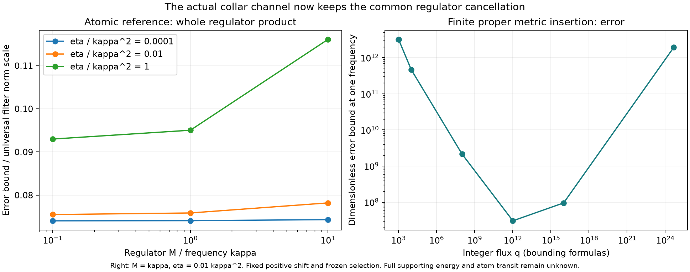

## Compact zero-shift insertion and integrated frequency tail

The [calculation](../scripts/dihole_local_zero_shift.py) and
[results](../results/dihole_local_zero_shift_results.json) remove the
artificial positive infrared shift from the compact proper metric insertion
at fixed nonzero frequency and fixed regulator. A uniform majorant also
permits that removal under the frequency integral away from zero.
This extends checkpoint171's selected supporting-field observable; it
does not determine the complete supporting source.

### Localize before removing the shift

Retain the full and auxiliary skew-adjoint operators $A,\mathfrak a$,
cutoff contraction $J$, defect $T=AJ-J\mathfrak a$ and graph constants
$c,d$ from171. Let $S$ contain the physical mask and its first derivative,
and $K\subset S$ contain the cutoff and its derivative, hence the defect.
The lapse upper bound $N_+$ is certified on both compact supports.
The auxiliary gap is $g=|\kappa|/n_+$; no full proper-operator gap is assumed.

For $\eta\ge0$, set $m_j=\sqrt{\eta+jM^2}$, $\alpha=\sqrt6M^3$ and
$\mathcal T_A=\alpha\prod_j(A+m_j)^{-1}$. For positive shift,
partial fractions give

$$
\mathcal T_A=\sum_{j=0}^3d_j(A+m_j)^{-1},\qquad
d_j=\frac{\alpha}{\prod_{k\ne j}(m_k-m_j)}
=\alpha\prod_{k\ne j}\frac{m_k+m_j}{(k-j)M^2}.
$$

The last expression avoids subtracting nearly equal masses. At zero shift,
$(d_0,d_1,d_2,d_3)=(1,-t,2t-3,2-t)$ with
$t=3+\sqrt3+\tfrac32\sqrt2+\tfrac12\sqrt6$.
The exact moments are $\sum_jd_jm_j^r=0$ for $r=0,1,2$ and
$\sum_jd_jm_j^3=-\alpha$. The magnitudes $|d_j|$ increase with $\eta$.

Checkpoint151's full Hamiltonian identity implies

$$
1_S(A+m)^{-1}1_K
=1_S\sqrt N(H_m+i\kappa)^{-1}\beta\sqrt N\,1_K,\qquad
\|1_S(A+m)^{-1}1_K\|\le\Gamma=\frac{N_+}{|\kappa|}.
$$

This retains the full exterior Hamiltonian. At $m=0$, the expression
denotes its localized limit. It is not a bounded global $A^{-1}$.
The same bound holds with either compact support on either side.

For $E=\mathcal T_AJ-J\mathcal T_{\mathfrak a}$ and checkpoint171's
$C_m$ (with $C_0=c+d/g$), partial fractions yield

$$
\|1_SE\|\le e_0=\Gamma\sum_j|d_j|C_{m_j}.
$$

The cancellation identity

$$
AE=-T\mathcal T_{\mathfrak a}
+\sum_jd_jm_j(A+m_j)^{-1}T(\mathfrak a+m_j)^{-1}
$$

bounds the localized first-action error by

$$
e_{1,\mathrm{cancel}}=c a_F+d r_F
+\Gamma\sum_j|d_j|m_jC_{m_j}.
$$

Two other bounds remain valid. The global contraction
$\|A(A+m)^{-1}\|\le1$ gives
$e_{1,\mathrm{sum}}=\sum_j|d_j|C_{m_j}$ for positive $m$.
For the product bound, apply masses $m_1,m_2,m_3$ first, starting
$e=0,r=1$ and updating $e\leftarrow(e+C_mr)/m$ and
$r\leftarrow r/\sqrt{g^2+m^2}$. Apply $m_0$ last, obtaining

$$
e_{1,\mathrm{prod}}=\alpha(e_3+C_{m_0}r_3).
$$

This graph numerator does not divide by $m_0$. Its localized endpoint
therefore remains finite. All products commute at positive shift and
have the same localized limit, so their bounds can be minimized
independently of the ordinary error:
$e_1=\min(e_{1,\mathrm{sum}},e_{1,\mathrm{cancel}},e_{1,\mathrm{prod}})$.

The proof of171's metric graph estimate also gives

$$
\|\dot A\psi\|\le c_\delta\|1_SA\psi\|+d_\delta\|1_S\psi\|.
$$

No derivative acts on the characteristic function. The constants are
unchanged because every mask and mask derivative is supported in $S$.
For frozen input $JX_4$, write
$u=\mathcal T_AJX_4$, $v=J\mathcal T_{\mathfrak a}X_4$ and
$L=(1+c)a_F+d r_F$. The selected insertion
$I(u)=-\operatorname{Re}\operatorname{Tr}(Au)^*\dot Au$ has

$$
|I(u)-I(v)|\le\|X_4\|_{\rm HS}^2
\left[e_1(c_\delta L+d_\delta r_F)
+(L+e_1)(c_\delta e_1+d_\delta e_0)\right],
$$

$$
|I(u)|\le\|X_4\|_{\rm HS}^2(L+e_1)
\left[c_\delta(L+e_1)+d_\delta(r_F+e_0)\right].
$$

Both Weyl blocks and the proper $-1/2$ form prefactor are already included.
This is one frozen selection in one sector and collar.

### The whole shift interval and its endpoint

For $0\le\eta\le\eta_{\max}$, use residue magnitudes and any explicit
mass factors at $\eta_{\max}$, and $C_{m_j}$, $r_F$, $a_F$ and the
product graph estimate at zero. The former increase and the latter
decrease with the shift. Their positive combinations bound the entire
interval; sampling supplements this proof rather than replacing it.

The common Hamiltonian core from151 gives strong resolvent convergence
$H_m\to H_0$. The compact bounds above promote the finite partial-fraction
sum to local Hilbert-Schmidt convergence after composition with fixed
$X_4$. The identity $A(A+m)^{-1}=1-m(A+m)^{-1}$ gives local first-action
convergence as well. The localized metric graph estimate then gives
convergence of the insertion, without claiming convergence of the
whole-space positive-filter trace.

There is no quantitative shift-convergence rate here. A resolvent-identity
rate would require global-output norms such as

$$
K_C=\|\sqrt N(H_0+i\kappa)^{-1}\beta\sqrt N\,1_C\|.
$$

If suitable such norms were bounded, a localized difference estimate
proportional to $|m-n|K_CK_D$ could be used. The compact $\Gamma$ bound
does not establish these global-output norms; no such rate is exported.

At the atomic reference, $\kappa=M$, $\eta=0$, and fixed
$MD=\Lambda D=2154733372140.8845$, the bounds are

| Quantity | Upper bound |
| --- | ---: |
| Local ordinary error $e_0/D$ | $2.052076\times10^{-13}$ |
| Local first-action error $e_1$ | $0.095041380$ |
| Selected insertion comparison error | $1.278585\times10^{12}$ |
| Selected insertion absolute value | $1.292365\times10^{12}$ |

The insertion bounds are dimensionless at one frequency. They are not
transmission probabilities, measured source values, or energies in joules.
The exact atomic flux is $4642875905017627791065088$.

### An integrable high-frequency majorant at fixed regulator

Hold $M$ and the Gaussian scale $\Lambda$ fixed while varying
$k=|\kappa|>0$. Put $n=N_+$,
$W_0=\sum_j|d_j|$, $W_1=\sum_j|d_j|m_j$,
$A_3=\alpha n^3$ and $A_4=\alpha n^4$.
Since $g\ge k/n$, the following positive polynomials bound the
zero-shift quantities:

$$
r_F\le A_4/k^4,\quad a_F\le A_3/k^3,\quad C_m\le c+dn/k,
$$

$$
e_0\le nW_0(c/k+dn/k^2),\qquad
e_1\le nW_1(c/k+dn/k^2)+cA_3/k^3+dA_4/k^4,
$$

$$
L\le(1+c)A_3/k^3+dA_4/k^4.
$$

Substitute these polynomials in the two insertion bounds above. Each
becomes $\sum_{p=2}^8a_pk^{-p}$ with nonnegative coefficients. Thus

$$
\int_K^\infty\sum_{p=2}^8a_pk^{-p}\,dk
=\sum_{p=2}^8\frac{a_p}{(p-1)K^{p-1}},\qquad K>0.
$$

For both frequency signs and measure $d\kappa/(2\pi)$, divide this
positive-frequency majorant by $\pi$. This uses a common majorant for
both signs; it does not assume that the actual insertion is even.
There is no additional form factor of $1/2$. Coefficients multiplying
$k^{-p}$ have units $D^{-p}$; integrated bounds have units $D^{-1}$.

Evaluate $W_0,W_1$ at $\eta_{\max}$ to cover the entire shift interval.
The same $A_3,A_4$ are upper bounds at positive shift. The resulting
majorant is integrable on $|\kappa|\ge K>0$, uniformly in $\eta$.
Dominated convergence therefore removes $\eta$ under this restricted
frequency integral. Neither $M$ nor $\Lambda$ is taken to infinity.

For the atomic reference and $\eta_{\max}=.01M^2$:

| $K/M$ | Zero-shift absolute tail, multiplied by $D$ | Uniform-shift absolute tail, multiplied by $D$ |
| --- | ---: | ---: |
| 0.1 | $9.193380\times10^{26}$ | $9.642837\times10^{26}$ |
| 1 | $9.282821\times10^{24}$ | $1.098895\times10^{25}$ |
| 10 | $9.046716\times10^{23}$ | $1.073201\times10^{24}$ |
| 100 | $9.044460\times10^{22}$ | $1.072955\times10^{23}$ |

These loose absolute bounds need no cancellation in the unknown insertion
value. They are not a central value or a support sign.

### Checks, limits and next calculation

All 18 saved controls pass, using 44 exact input hashes. They include
stable residues at large shift, moment cancellation, noncommuting
finite Hamiltonians with full exterior coupling, compact metric and defect
supports, endpoint and whole-interval enclosures, independent quadrature
of the positive tail polynomial and an exactly solvable commuting model.
The test lapse reaches 100 outside the collar, whose local bound is only
1.5; this checks that no global upper lapse is silently substituted.
The old scientific inputs are reused without rerunning their simulations.

Independent 110-digit evaluation encloses 2,716 inequalities: the
unchanged 2,352 local bounds and 364 tail additions. Independent polynomial
integration agrees within $1.67\times10^{-111}$; the closed-form control
agrees with saved quadrature within $5.65\times10^{-15}$ relatively.
An independent algebra audit confirms the uniform majorant and its measure.
Numerical interval caps and scale values are the saved binary inputs;
$.01M^2$ and the other decimal ratios denote their nominal values.

The remaining immediate problem is a quantitative bound near
$\kappa=0$. The present majorant diverges there, so it must not be
integrated through zero. Isolate the massless term and control the actual
localized low-energy spectral weight; the earlier qualitative zero-state
and limit results do not supply the required numerical constants.
Omitted selections and angular sectors, the regulator limit and physical
counterterms still follow. None of the above proves total support,
stability, one-atom propagation or a clock gain. The static geometry still
excludes backward causal passage.

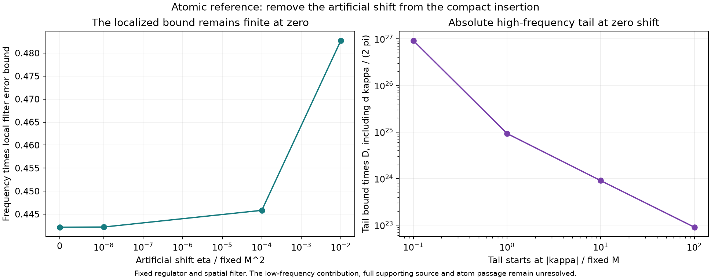

## Paired low-frequency bound with zero states retained

The [calculation](../scripts/dihole_paired_low_frequency.py) and
[results](../results/dihole_paired_low_frequency_results.json) close the
low-frequency bound for the fixed supporting-field selection used in172.
Pairing the two frequency signs is essential. This avoids introducing
an unproved spectral gap, absence of zero states, or a threshold-density
constant. Combined with172's tail, it bounds the complete paired frequency
integral at a fixed regulator and Gaussian selection, uniformly over a
specified artificial-shift interval. The total supporting stress is still
not calculated.

### A global lower lapse bound from the actual geometry

To distinguish the geometric parameter from regulator $M$, call the
dihole mass parameter $M_g$. Let $d_\pm$ be focal distances,
$R=(d_++d_-)/2\ge k$, $s=1-\cos^2\theta$, $\Delta=R^2-k^2$, and
$h=d_+d_-=\Delta+k^2s$. The nonnegative magnetizing terms in the numerator
and $a_g^2\le k^2$ give

$$
N\ge\frac{\Delta+a_g^2s}{\Delta+2M_g(M_g+R)+a_g^2s}
\ge\frac{a_g^2}{k^2}\frac{h}{h+2M_g(M_g+R)}.
$$

All original exterior points and all points copied into the collars and
cylinder have $d_\pm\ge\epsilon=D/40$. Therefore
$h\ge\epsilon(2R-\epsilon)$. The function
$(M_g+R)/(2R-\epsilon)$ decreases for $R\ge k$, so

$$
N\ge c_N=\frac{a_g^2}{k^2}
\frac{\epsilon(2k-\epsilon)}
{\epsilon(2k-\epsilon)+2M_g(M_g+k)}
=\frac{39}{359}\frac{a_g^2}{k^2}.
$$

The last equality uses the existing exact calibration $k=D/2$ and
$2M_g(M_g+k)=D^2/5$. Directed interval evaluation gives

$$
N\ge0.09844792539934355,\qquad
\nu=\|N^{-1}\|\le10.157654373554406.
$$

This is a global lower bound. No global upper lapse or full spectral gap
is inferred. It justifies the bounded perturbation
$A_\kappa-A_0=i\kappa\beta/N$ on the chosen common skew-adjoint domain.

### Keep the bounded first-action filter

For $m_j=\sqrt{\eta+jM^2}$ and $\alpha=\sqrt6M^3$, write

$$
\mathcal K_{\eta,\kappa}
=\alpha\prod_{j=1}^3(A_\kappa+m_j)^{-1},\qquad
\mathcal T_{\eta,\kappa}=(A_\kappa+m_0)^{-1}\mathcal K_{\eta,\kappa}.
$$

The three positive masses give
$\|\mathcal K\|\le1$ and $\|A_\kappa\mathcal K\|\le M$, uniformly for
$\eta\ge0$. In particular, the full first-action norm does not need the
reduced channel's inverse-frequency bound.

For $f=JX_4$, $u=\mathcal T f$, the identity
$A_\kappa u=\mathcal Kf-m_0u$ implies

$$
I_{\eta,\kappa}
=-\operatorname{Re}\operatorname{Tr}(\mathcal Kf)^*\dot A_\kappa u
=\operatorname{Re}\operatorname{Tr}p_\kappa^*u,\qquad
p_\kappa=\dot A_\kappa\mathcal Kf.
$$

The real $m_0$ term vanishes because $\dot A_\kappa$ is skew. At positive
shift, these vectors are in the global graph domain. At zero shift,
compact-support weak integration by parts and the local limits from172
suffice. A globally square-integrable massless inverse is not asserted.

Put $P_*=c_\delta M+d_\delta$ and
$t_*=1+1/\sqrt2+1/\sqrt3$. Then
$\|p_\kappa\|_{\rm HS}\le P_*\|f\|_{\rm HS}$.
Telescope the three resolvents with increasing masses. The
$\kappa$-dependent prefix always contains the smallest mass, so

$$
\|\mathcal K_{\eta,\kappa}-\mathcal K_{\eta,0}\|
\le|\kappa|\nu t_*/M,\qquad
\|A_\kappa(\mathcal K_{\eta,\kappa}-\mathcal K_{\eta,0})\|
\le|\kappa|\nu t_*.
$$

Since $\dot A_\kappa-\dot A_0=-i\kappa F\beta/N$, its compact coefficient
uses the collar minimum. Therefore

$$
\|p_\kappa-p_0\|_{\rm HS}\le|\kappa|L_p\|f\|_{\rm HS},\qquad
L_p=\nu t_*(c_\delta+d_\delta/M)+F_*/N_{C,-},
$$

with $F_*=4$. The global $\nu$ and compact $N_{C,-}$ are distinct inputs.

### Pair the only potentially singular term

The stable residues from172 give

$$
\mathcal T_{\eta,\kappa}
=d_0(\eta)(A_\kappa+m_0)^{-1}+\mathcal L_{\eta,\kappa},\qquad
\|\mathcal L_{\eta,\kappa}\|\le
B_{\max}=\sum_{j=1}^3\frac{|d_j(\eta_{\max})|}{\sqrt j M}.
$$

Here $d_0(\eta)>0$ increases with $\eta$.
The singular insertion has the Hamiltonian form

$$
d_0(\eta)\operatorname{Re}\operatorname{Tr}
\ell_\kappa^*(H_{m_0}+i\kappa)^{-1}Y,\qquad
\ell_\kappa=\sqrt N\,p_\kappa,\quad Y=\beta\sqrt N\,f.
$$

Both external legs have compact support. Freeze the left leg at
$\kappa=0$. For any self-adjoint $H_{m_0}$,

$$
(H_{m_0}+i\kappa)^{-1}+(H_{m_0}-i\kappa)^{-1}
=\frac{2H_{m_0}}{H_{m_0}^2+\kappa^2}.
$$

The scalar complex spectral measure
$\mu(E)=\operatorname{Tr}\ell_0^*E_{H_{m_0}}(E)Y$ has total variation
at most $\|\ell_0\|_{\rm HS}\|Y\|_{\rm HS}$. For every real $\lambda$,

$$
\int_0^K\left|\frac{2\lambda}{\lambda^2+\kappa^2}\right|d\kappa
\le\pi.
$$

At $\lambda=0$ the paired multiplier is identically zero. Integrating
against the total variation proves the bound even with exact zero states.
The difference $\ell_\kappa-\ell_0$ is $O(|\kappa|)$; this cancels the
resolvent norm $1/|\kappa|$. The regular remainder contributes
$P_*B_{\max}\|f\|_{\rm HS}^2$ for each frequency sign.

Using the same compact upper lapse $N_+$ on both supports and
$\|f\|_{\rm HS}\le\|X_4\|_{\rm HS}$, the resulting uniform bound is

$$
\boxed{
\frac1{2\pi}\int_0^K|I_{\eta,\kappa}+I_{\eta,-\kappa}|\,d\kappa
\le\|X_4\|_{\rm HS}^2
\left[\frac{d_{0,\max}N_+P_*}{2}
+\frac K\pi(d_{0,\max}N_+L_p+P_*B_{\max})\right].
}
$$

Here $0\le\eta\le\eta_{\max}$ and
$d_{0,\max}=d_0(\eta_{\max})$. At zero shift alone, use $d_{0,\max}=1$
and residues at zero. If the compact supports have different lapse
upper bounds, replace the cross-leg $N_+$ by their geometric mean.
The proper form factor and both Weyl blocks are already included.

### Complete-frequency bound and the limit that remains

Add172's absolute high-frequency tail evaluated at the same $\eta$ cap.
This bounds the selected signed frequency integral, and indeed the
integral of the absolute paired contribution, over the whole axis.
For the exact atomic flux, fixed $MD=\Lambda D=2154733372140.8845$ and
the chosen split $K/M=0.2157466325253198$:

| Quantity | Upper bound multiplied by $D$ |
| --- | ---: |
| Zero-shift paired low-frequency part | $1.780383\times10^{26}$ |
| Zero-shift absolute high-frequency tail | $7.648522\times10^{25}$ |
| Zero-shift complete selected integral | $2.545235\times10^{26}$ |
| Complete integral, uniform over the saved shift interval | $2.879695\times10^{26}$ |

The interval cap is the saved binary value nominally equal to $.01M^2$.
The frequency split minimizes an upper envelope numerically and is then
re-evaluated with interval arithmetic. It is not a physical design
optimization. These bounds have units $D^{-1}$; no source value, sign,
energy in joules or atom-transmission probability is calculated.

Uniform integral boundedness is not uniform integrability near zero.
For example, $2\lambda/(\lambda^2+\kappa^2)$ tends pointwise to zero as
$\lambda\downarrow0$, yet its integral on $(0,K)$ tends to $\pi$.
Accordingly this result does not identify the integrated $\eta\to0$
limit with the integral of the $\eta=0$ expression. The zero-state
prescription must remain explicit. Neither separate unsigned frequency
integrability nor a quantitative vanishing rate as $K\downarrow0$ is claimed.

All 20 controls pass, using 47 exact input hashes. The 72 finite operator
cases and 24 integral controls include the existing benchmark's exact
zero states and positive proper masses, a noncommuting lapse, both
frequency signs, the product telescope, local integration by parts,
spectral pairing and direct quadrature of the absolute pair.
The pair identity agrees within $5.72\times10^{-13}$ relatively, and
local integration by parts within $2.29\times10^{-14}$.
These are algebra and bound controls, not simulations of an atom.

Independent 110-digit evaluation verifies all 179 exported directed bounds,
including 56 uniform-shift additions; all 47 input hashes match. A separate
code and derivation audit confirms the paired signs, the global lapse input,
and the distinction between bounded integrals and interchange of limits.

**Next:** replace the fixed channel/Gaussian selection by a controlled
accounting of the omitted spatial and angular contributions. A compact
smoothing trace bound must retain the common regulator cancellation.
Limit matching and counterterms remain separate requirements. More
optimization of this frequency split cannot supply the missing full stress.
Support and current, stability, atomic quantum evolution and a comparison
of exterior clocks remain unestablished. The first payload remains one
hydrogen atom; the present static geometry excludes backward causal travel.

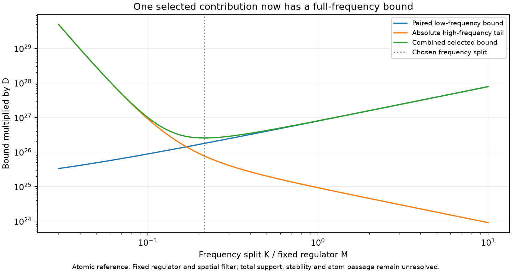

## Full-source completion and a global lapse-weight bound

The [calculation](../scripts/dihole_source_completion.py) and
[results](../results/dihole_source_completion_results.json) identify the
exact omitted contributions and retain the common regulator in a full-field
source factorization. They also evaluate a new global geometric weight bound.
The remaining full-field smoothing norms are explicitly unknown. This
increment does not turn the selected bound from173 into a total source.

### Complete the field selection in the correct order

Write $\mathcal F=\sqrt6M^3\prod_{j=0}^3(A_\kappa+m_j)^{-1}$,
$P=A_\kappa^*A_\kappa$, $m_j=\sqrt{\eta+jM^2}$, and
$Y=JX_4$. The frozen input selection is $Q=YY^*\le I$.
For one complete four-component field, the selected source is

$$
I_\kappa[Q]=-\operatorname{Re}\operatorname{Tr}
(A_\kappa\mathcal FQ^{1/2})^*\dot A_\kappa\mathcal FQ^{1/2}.
$$

There is no additional Weyl multiplicity. At positive shift the full
source and the omitted part obey
$I_\kappa[I]=I_\kappa[Q]+I_\kappa[I-Q]$.
The source operator is
$-\tfrac12\mathcal F^*\dot P\mathcal F$, which need not be positive.
Although $\mathcal F(I-Q)\mathcal F^*$ is positive, its stress contribution
can have either sign. Moving $Q$ past $\mathcal F$ is generally wrong.

Let $V$ be the retained transverse isometry, $\Pi=VV^*$,
$w=\chi\eta_{\rm window}$, and $E_\Lambda=e^{-h^2/\Lambda^2}$ in the
chosen complete-line auxiliary space. On a finite tube use the compression
of this positive contraction, extending the tube projection by zero.
Then $Q=VwE_\Lambda wV^*$ and

$$
\boxed{I-Q=(I-\Pi)+V(1-w^2)V^*+Vw(1-E_\Lambda)wV^*.}
$$

All three terms are positive. They represent transverse/outside-tube,
spatial-window, and Gaussian omissions. Increasing $\Lambda$ removes only
the last term. Orthogonal angular sectors can be summed; overlapping
selections in one sector cannot be added unless their sum stays below $I$.
Every contribution is propagated by the same full $\mathcal F(A)$.
Replacing it with a filter of a compressed operator would change the model.

For $\mathcal R=I-Q$, metric support $S$, and $r=0,1$, define

$$
e_r=\|1_SA^r\mathcal F\mathcal R^{1/2}\|_{\rm HS}^2.
$$

The established local graph estimate gives

$$
|I_\kappa[\mathcal R]|\le c_\delta e_1+d_\delta\sqrt{e_0e_1}.
$$

The two required full-field quantities are exactly

$$
e_r=\operatorname{Tr}[1_SP^r r_{\eta,M}(P)1_S]
-\|1_SA^r\mathcal FJX_4\|_{\rm HS}^2,\qquad
r_{\eta,M}(P)=\mathcal F\mathcal F^*,
$$

$$
r_{\eta,M}(P)=\int_0^\infty
e^{-\eta t}(1-e^{-M^2t})^3e^{-tP}\,dt.
$$

This common positive kernel retains the regulator cancellation. Four
separately bounded mass resolvents would not retain that cancellation.
Uniform control of $e_0$ can fail at zero frequency, so this absolute
estimate cannot silently replace173's paired argument.

### A global bound for the unbounded lapse weight

Set lengths in units of $D$ for this calculation.
In Weyl coordinates the exterior meridian factor is $N/v$, where

$$
v=(h/\Sigma)^2\le1,\qquad
h=R^2-k^2+k^2(1-c^2),\quad \Sigma=(R+M_g)^2-a_g^2c^2.
$$

Here $R=(d_++d_-)/2$ is the prolate radius and $c$ the prolate angle
coordinate; $M_g$ denotes the geometric mass, distinct from regulator $M$.
The scalar commutator of the proper Dirac operator satisfies

$$
\|[A_\kappa,\sqrt N]\|
=\sup|\nabla_h\sqrt N|
=\sup\frac{v|\nabla_{\rho,z}N|}{2N^{3/2}}.
$$

It is independent of frequency, magnetic charge and angular sector.
The gauge and frequency terms commute with a scalar multiplication.

On $k\le R\le1$, 256 interval boxes cover the complete angular range
$-1\le c\le1$. They enclose
$|N_R|\le5.365671756262071$ and
$|N_c|\le2.514098382202391$.
For the actual excised domain,
$h\ge h_0=\epsilon(2k-\epsilon)$, $\epsilon=1/40$.
Orthogonal Weyl gradients give

$$
|\nabla_{\rho,z}N|^2
=\frac{R^2-k^2}{h}N_R^2+\frac{1-c^2}{h}N_c^2
\le N_R^2+N_c^2/h_0.
$$

Combine this with173's global $N\ge c_N$. Derivative boxes may include
excluded focal points; their suprema still bound derivatives on the
physical subset. The lower lapse and $h_0$ bounds are used only there.

For $R\ge1$, put $s=1-c^2$, $\Delta=R^2-k^2$,
$b=B^2/4$, $u=2M_g(R+M_g)/\Delta$, $t=a_g^2s/\Delta$. The exact lapse is

$$
N=L+b\rho^2G,\qquad
L=\frac{1+t+Ba_gus}{1+u+t},\quad
G=\frac{(1+u)^2+t}{1+u+t},\quad \rho^2=\Delta s.
$$

The exact calibration has
$Ba_g\in[0.11433284908848468,0.1143328490884847]\subset[0,1]$.
Consequently $L\ge0$, $1\le G\le1+u$ and
$N\ge\max(c_N,b\rho^2)$.
Let $e=1-k^2$ and

$$
U_0=\frac{2M_g(1+M_g)}e,\quad
U_1=\frac{2M_g(1+2M_g+k^2)}{e^2},\quad
T=\frac{2a_g^2}{e\sqrt e}+\frac{2a_g^2}{e^2}.
$$

The Weyl-coordinate estimates are
$u\le U_0/R$, $|\nabla u|\le U_1/R^2$,
$|\nabla t|\le T/R^3$ and $|\nabla s|\le2/(\sqrt eR)$.
Differentiating the rational $L,G$ gives

$$
|\nabla L|\le C_L/R^2,\quad
C_L=U_1+U_0T+2Ba_gU_0/\sqrt e,
$$

$$
|\nabla G|\le C_G/R^2,\quad
C_G=(1+2U_0)U_1+U_0(1+U_0)T.
$$

Since $\rho\le R$, define $A_0=C_L+bC_G$, $A_1=2b(1+U_0)$ to obtain
$|\nabla N|\le A_0+A_1\rho$.
The upper envelope
$(A_0+A_1\rho)/(2\max(c_N,b\rho^2)^{3/2})$
increases up to $\rho_*=\sqrt{c_N/b}$ and decreases afterward.
Its maximum bounds the entire far exterior, including axial escape.

| Region | Upper bound for $D|\nabla_h\sqrt N|$ |
| --- | ---: |
| $k\le R\le D$, outside the excised foci | 274.7466454823995 |
| $R\ge D$ | 29.6028298306828 |

The sewn collar copies $N$ with $0\le r'(s)\le1$. This reduces its radial
gradient contribution and leaves its angular contribution unchanged.
The constant-radius central section has $r'=0$.
Thus the global result is

$$
\boxed{\|[A_\kappa,\sqrt N]\|\le274.7466454823995/D.}
$$

This is a geometric operator bound, not a stress or stability criterion.
For a compact set $C$ and $m>0$, the resolvent commutator identity yields

$$
1_C(A+m)^{-1}\sqrt N
=1_C\sqrt N(A+m)^{-1}
+1_C(A+m)^{-1}[\sqrt N,A](A+m)^{-1},
$$

$$
\|1_C(A+m)^{-1}\sqrt N\|
\le\frac{\sqrt{N_{C,+}}}{m}+\frac{C_{\rm weight}}{m^2}.
$$

One can first use bounded truncations of $\sqrt N$ and then extend the
identity from compact test fields. This does not assert a globally
bounded lapse or a Hilbert-Schmidt estimate.

### Preserve the full filter in a radial form factorization

In the canonical collar measure,

$$
A_{\rm rad}=C\partial_s+C_s/2,\qquad
C=-\tau_2\otimes\sigma_3/(NW),\quad C^*=C.
$$

The actual metric insertion is
$\dot A_\kappa=-i\kappa F\beta/N+(FC)\partial_s+(FC)_s/2$.
Choose a smooth real cutoff $\chi=1$ near the closed physical collar,
supported in the slightly larger sewn buffer
$(-.005,.055)D$, and auxiliary length $\ell=.01D$.
Set

$$
L_{\rm jet}\psi=(\chi\psi,\ell\chi\partial_s\psi),\qquad
J_{\rm mid,\kappa}=
\begin{pmatrix}
-i\kappa F\beta/N&FC/(2\ell)\\
-FC/(2\ell)&0
\end{pmatrix}.
$$

Weak radial integration by parts gives
$\dot A_\kappa=L_{\rm jet}^*J_{\rm mid,\kappa}L_{\rm jet}$ exactly.
The adjoint retains both $F_s$ and $C_s$. The buffered cutoff must extend
past the collar endpoints because $F$ is nonzero throughout the open
collar and only flat at its endpoints.
The matrix coefficients vanish outside the physical support, so the
existing whole-angle collar bounds suffice for

$$
\|J_{\rm mid,\kappa}\|
\le78.16158844179671/D+39.11061904290383|\kappa|,\qquad
\|\partial_\kappa J_{\rm mid,\kappa}\|\le39.11061904290383.
$$

These bounds do not use a selected angular band or frozen angular gap.
The future smoothing estimate for $L_{\rm jet}$ must cover its larger
buffer, not merely the support of $J_{\rm mid}$.

### A full-field paired source target

Keep the three positive factors together:

$$
\mathcal K_{\eta,\kappa}
=\sqrt6M^3\prod_{j=1}^3(A_\kappa+m_j)^{-1},\qquad
\mathcal F=(A_\kappa+m_0)^{-1}\mathcal K.
$$

For the full source, the real $m_0\mathcal F^*\dot A\mathcal F$ term
vanishes by skew-adjointness. Commuting the massless/lowest-mass resolvent
only with $\mathcal K$, and not with $\dot A$, gives the cyclic form

$$
I_\kappa=-\operatorname{Re}\operatorname{Tr}
(H_{m_0}+i\kappa)^{-1}\mathcal B_\kappa,\qquad
\mathcal B_\kappa=\beta\sqrt N\,\mathcal K^*\dot A_\kappa\mathcal K\sqrt N.
$$

The full spatial operator order stays $-6$. Splitting off a single
massless inverse before completing the field sum could instead produce
individual order-$-3$ terms in three dimensions, losing trace control.

Define $Z_\kappa=L_{\rm jet}\mathcal K_\kappa\sqrt N$.
If this weighted operator is Hilbert-Schmidt, the preceding full trace
and cyclic manipulation are justified by

$$
\mathcal B_\kappa=\beta Z_\kappa^*J_{\rm mid,\kappa}Z_\kappa,\qquad
\|\mathcal B_\kappa\|_1\le
\|J_{\rm mid,\kappa}\|\|Z_\kappa\|_{\rm HS}^2,
$$

$$
\|\partial_\kappa\mathcal B_\kappa\|_1
\le\|\partial_\kappa J_{\rm mid,\kappa}\|\|Z_\kappa\|_{\rm HS}^2
+2\|J_{\rm mid,\kappa}\|\|Z_\kappa\|_{\rm HS}
 \|\partial_\kappa Z_\kappa\|_{\rm HS}.
$$

The beta matrix stays on the left; $\mathcal B_\kappa$ need not be
self-adjoint. The weighted Hilbert-Schmidt condition cannot be dropped
merely because the unweighted $\mathcal K^*\dot A\mathcal K$ is trace class.

If $\|\mathcal B_\kappa-\mathcal B_0\|_1\le L_{\mathcal B}|\kappa|$
for $|\kappa|\le K_{\rm split}$, the same zero-state-safe spectral pairing
used in173 yields the conditional full-field inequality

$$
\frac1{2\pi}\int_0^{K_{\rm split}}|I_\kappa+I_{-\kappa}|\,d\kappa
\le\frac{\|\mathcal B_0\|_1}{2}
+\frac{K_{\rm split}L_{\mathcal B}}{\pi}.
$$

No finite field selection remains in this formula. Its numerical inputs
$\|Z\|_{\rm HS}$ and $\|\partial_\kappa Z\|_{\rm HS}$ have **not** been
evaluated. The selected norm from173, a matrix dimension, or the compact
lapse maximum cannot substitute for them.

### Verification and the next physical calculation

All 23 checks pass. The global bound combines interval enclosures with an
analytic far-region estimate; sampled geometry points are independent
formula checks, not the proof of global coverage.
Seventy-two finite source cases retain noncommuting window/filter matrices,
both frequency signs, proper masses and the unbounded-lapse algebra control.
The full-source cyclic identity agrees within $7.78\times10^{-15}$.
An incorrectly moved projector changes one selected response by more
than 81 in the finite control, confirming that its position matters.

An initial derivative check failed because the implemented product
derivative repeated one resolvent in its prefix. Its
[source](../provenance/dihole_source_completion_derivative_trial.py) and
[results](../results/dihole_source_completion_derivative_trial.json)
are preserved byte-for-byte. The corrected derivative agrees with an
independent finite difference within $8.75\times10^{-10}$ relatively.
No physical candidate was rejected by this implementation error.

Two independent audits verify the scalar enclosures, all 51 input hashes,
and the full-source ordering. A separate 110-digit interval cover also
confirms the near-region derivative bounds. Layout verification passes
169 module imports, 1508 links, 8 source guards and 14 frozen hashes.

**Next:** evaluate the two weighted full-field smoothing quantities in
the buffered geometry, and their high-frequency remainder, while retaining
the three positive mass factors. The new global weight and local insertion
constants are available for that estimate. Total stress and induced current,
regulator/counterterm matching, stability, atomic propagation and a clock
difference remain unresolved. No one-atom opening or new physical law has
been established.

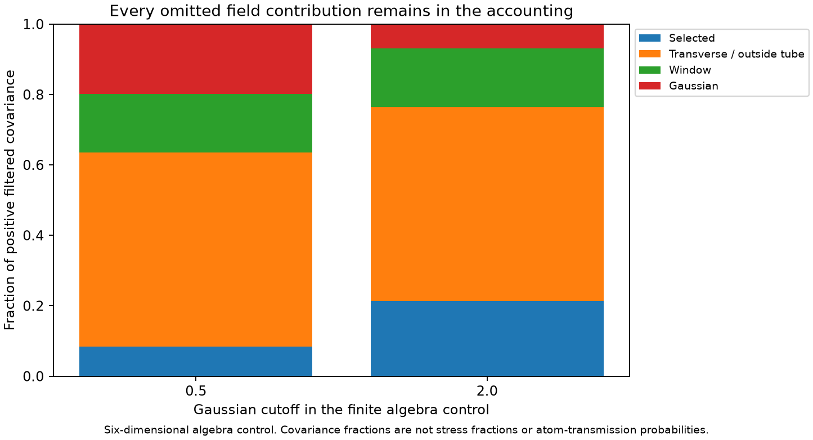

## Full-field smoothing on buffered collars

Checkpoint175 evaluates the two quantities left open in174:
$\|Z_\kappa\|_{\rm HS}$ and $\|\partial_\kappa Z_\kappa\|_{\rm HS}$,
where $Z=L_{\rm jet}\mathcal K\sqrt N$. The
[calculation](../scripts/dihole_buffer_smoothing.py) uses the complete spatial
operator, both collars and every angular state. Its
[geometry helper](../scripts/dihole_buffer_geometry.py) supplies explicit
compact constants. The [saved bounds](../results/dihole_buffer_smoothing_results.json)
are conservative finite-regulator estimates, not a renormalized stress value.

### Local geometry with no angular selection

Use two disjoint collar buffers $\Omega=(-.020,.070)D\times S^2$.
The sewn radius is $R=D/40$ for $s\le0$, follows the existing smooth
profile on $[0,.05]D$, and is $R=s$ for $s\ge.05D$. Thus
$R/D\in[.025,.070]$, $0\le R'\le1$, and $0\le R''D\le160$.
The fixed central coordinate length is .1D, so the two inward extensions
of .020D remain disjoint. The physical metric is

$$
h=P^2(ds^2+R^2d\theta^2)+R^2\sin^2\theta\,N^{-2}d\phi^2,
\qquad P=NW.
$$

A directed cover of 768 $(R,\cos\theta)$ boxes gives

$$
.1036696721908604\le N\le.26866006856285296,\quad
3.7182246398069747\le P\le9.635570203725964,
$$

$$
\mathcal R_hD^2\ge-191.58932348898966,\quad
|B_{\rm charge}|D^2\le12.010815582697589|q|,\quad
|\nabla_h\log N|^2D^2\le19.41663812694027.
$$

The magnetic connection contains $q$ once. With $x=\cos\theta$, its
polar regularity is exact: $a(R,1)=0$, $a(R,-1)=1$ for every buffer
radius, hence $a_R=0$ at both poles. Integration to the nearer pole
bounds $|a_R|/\sin\theta$ by $\sup|a_{Rx}|$. No singular gauge potential
or selected azimuthal label enters this estimate.

For the curvature calculation set $n_0=\log(N/R)$ and
$L_0=\log(N/P)-2\log R$. Subscripts $R,x$ below denote ordinary
coordinate derivatives. Cancellation before interval evaluation gives

$$
\mathcal R_h=\frac2{P^2}\left[
\frac{1-x(2n_{0,x}+L_{0,x})+(1-x^2)(L_{0,xx}-n_{0,x}^2)}{R^2}
+(R')^2\left(L_{0,RR}+\frac{L_{0,R}}R-n_{0,R}^2\right)
+R''L_{0,R}\right].
$$

The physical fibre in spatial measure is $A_\kappa=D_h+i\kappa\beta/N$.
The Dirac square has the usual covariant Laplacian, scalar curvature and
magnetic endomorphism; see [Vassilevich, equations3.26--3.28](https://arxiv.org/pdf/hep-th/0306138).
The additional frequency terms are $\kappa^2/N^2$ and a zeroth-order
term of norm at most $|\kappa||\nabla_h(N^{-1})|$.
Completing that scalar square yields, for every real $\kappa$,

$$
P_\kappa=-A_\kappa^2\ge\nabla_h^*\nabla_h-C_q,\qquad
C_qD^2\le52.75149040398249+12.010815582697589|q|.
$$

This form inequality is used only on the actual compact buffer. It does
not assert a global curvature floor or a global heat-kernel upper bound.

### An auxiliary trace bound with every angular state included

Compare the scalar Dirichlet Laplacian with
$g_0=ds^2+r_0^2d\Omega_2^2$, $r_0=D/40$. Its density ratio is
$w=P^2R^2/(Nr_0^2)$. If

$$
a_0=\min\{P_+^{-2},r_0^2/(P_+^2R_+^2),r_0^2N_-^2/R_+^2\},
\qquad c=a_0w_-/w_+,
$$

Rayleigh quotients and min--max give
$\lambda_n(-\Delta_{h,\Omega})\ge c\lambda_n(-\Delta_{g_0,\Omega})$.
Direct interval density bounds give $c\ge.0005061374651171810$.
The apparent polar coordinate degeneracy cancels against the same one in
$g_0$, so this comparison covers the whole sphere.

Let $P_{\kappa,\Omega}$ be the Friedrichs square on the *open* buffer,
and choose $a^2>C_q$, $b=a^2-C_q$. Covariant heat domination bounds its
rank-four heat trace by four times the scalar trace, multiplied by
$e^{C_qt}$. The Friedrichs construction on an arbitrary open manifold is
supported by [Güneysu, equation10 and Corollary2.5](https://arxiv.org/pdf/1105.0532);
adding the bounded endomorphism floor follows from the form/Trotter
argument. The source field still lives on the entire sewn manifold.

For a sphere the counting function obeys
$\mathcal N(\lambda)\le1+2\sqrt\lambda+\lambda$, hence
$\operatorname{Tr}e^{t\Delta_{S^2}}\le1+\sqrt{\pi/t}+1/t$.
The interval Dirichlet trace is at most $L/(2\sqrt{\pi t})$.
Integrating their product against $t e^{-bt}$ gives, with $L=.09D$,

$$
S:=\|(P_{\kappa,\Omega}+a^2)^{-1}\|_{\rm HS}^2
\le2\left[\frac{L}{\sqrt c\,b^{3/2}}
+\frac{2Lr_0}{cb}+\frac{2Lr_0^2}{c^{3/2}\sqrt b}\right].
$$

The factor four for the spinor is already included; the displayed factor
two counts the two disjoint collars. This is an infinite spectral sum,
not a finite angular calculation or an estimate from a matrix dimension.

### Weighted local graph norms retain the exterior

Write $\nu=\|N^{-1}\|$, $C_w=\|[A,\sqrt N]\|$, using174's global bounds.
For $m_j=\sqrt{\eta+jM^2}$, $j=1,2,3$, and $\alpha=\sqrt6M^3$, keep
$\mathcal K_z=\alpha\prod_j(A_z+m_j)^{-1}$ unsplit in the physical source.
Partial fractions are used only to estimate its local graph norms:

$$
b_{rj}=\frac{\alpha(-m_j)^r}{\prod_{k\ne j}(m_k-m_j)},\qquad
z^r\frac{\alpha}{\prod_j(z+m_j)}
=\mathbf1_{r=3}\alpha+\sum_j\frac{b_{rj}}{z+m_j},
\quad r=0,1,2,3.
$$

On a complex frequency disk $|z-\kappa|\le d<M/\nu$, bounded
perturbation gives resolvent norm at most $(m_j-d\nu)^{-1}$.
The weight commutator is unchanged, since $i\beta/N$ commutes with
$\sqrt N$. Therefore

$$
\|1_\Omega A_z^r\mathcal K_z\sqrt N\|\le G_r:=
\mathbf1_{r=3}\alpha\sqrt{N_+}
+\sum_j|b_{rj}|\left[
\frac{\sqrt{N_+}}{m_j-d\nu}+\frac{C_w}{(m_j-d\nu)^2}\right].
$$

Here the symbol $G_r$ denotes the right-hand side. These are local output
norms for inputs on the *whole* manifold, initially on the dense domain
of $\sqrt N$ and then extended by the bound. No exterior truncation or
global upper bound on $N$ is assumed. Mass differences are rationalized
before interval evaluation. For the uniform artificial-shift interval,
the actual $\eta/M^2\in[0,.01]$ is retained throughout the coefficients.

### From those graph norms to the full smoothing quantities

Use radial cutoffs $\chi,\zeta,\theta$ with nested plateaus/supports:
$\chi=1$ on $[0,.05]D$, supported in $(-.005,.055)D$;
$\zeta=1$ on that latter closed interval, supported in $(-.010,.060)D$;
$\theta=1$ on the support of $\zeta$, supported in $(-.015,.065)D$.
Each ramp has width $.005D$. The saved smooth step gives
$|f'|\le1600/D$, $|f''|\le4.8\times10^6/D^2$.
Thus every cutoff satisfies

$$
|\nabla_h f|\le g=430.3128925752752/D,\quad
|\Delta_h f|\le\Delta_c=352440.5426878167/D^2,
$$

using the exact radial formula
$\Delta_h f=P^{-2}[f''+(2R'/R-\partial_s\log N)f']$.
For $|\kappa|\le K_{\rm split}$ the analytic complex square obeys

$$
\|-A_z^2-P_\kappa\|\le V_d
=dC_N+(2K_{\rm split}d+d^2)\nu^2,
\qquad C_N\le2C_w\nu^{3/2}.
$$

Only the real-frequency $P_\kappa$ is used as a positive operator.
For $r=0,1$, expand $(P_{\kappa,\Omega}+a^2)\zeta A_z^r\mathcal K_z\sqrt N$.
Its commutator with $\zeta$ is
$-2\nabla\zeta\cdot\nabla-\Delta\zeta$.
Apply the local Lichnerowicz bound with the larger cutoff $\theta$;
$A_\kappa=A_z-i(z-\kappa)\beta/N$ supplies the $d\nu$ term. This gives

$$
H_r=G_{r+2}+[a^2+V_d+\Delta_c+2g(2g+\sqrt{C_q}+d\nu)]G_r
+2gG_{r+1},\qquad
\|\zeta A_z^r\mathcal K_z\sqrt N\|_{\rm HS}\le B_r=\sqrt S H_r.
$$

Compact support of $\zeta$ places these fields in the auxiliary operator
domain. Applying its inverse is an exact localization identity. The
physical field has not been replaced by a Dirichlet solution. The estimates
extend from smooth compact inputs by density and lower semicontinuity.

Converting to the canonical flux measure requires the half-density
$Q=PR\sqrt{\sin\theta/N}$. Its radial derivative and the spin connection give

$$
C_{\rm rad}\ge\sup_\Omega\left(
|\partial_s\log P+R'/R-\tfrac12\partial_s\log N|
+|\partial_\theta\log P|/(2R)\right),
\qquad C_{\rm rad}=14.034021152494184/D.
$$

Consequently the *complete* jet $L_{\rm jet}=(\chi,\ell\chi\partial_s)$,
$\ell=.01D$, satisfies

$$
\|Z_z\|_{\rm HS}^2\le Z_d^2:=
B_0^2+\ell^2\{P_+[B_1+(2g+\sqrt{C_q}+d\nu)B_0]
+C_{\rm rad}B_0\}^2.
$$

Use $d=0,V_d=0$ for the real-frequency bound and $d=M/(2\nu)$
for Cauchy's derivative bound $\|Z'_\kappa\|_{\rm HS}\le Z_d/d$.
One can apply Cauchy to finite input projections and pass to their
increasing limit using the uniform squared-norm bound. This does not
assume that the unbounded input weight is a bounded global operator.
The choice of auxiliary $b$ is a finite comparison over $.1,1,10$ times
$\max(M^2,C_q)$, not a claim of optimality.

### Actual atomic bounds and what they establish

At the saved atomic charge and fixed $MD=2154733372140.8845$,
$K_{\rm split}D=464876469029.3226$, the zero-shift result is

$$
\|Z\|_{\rm HS}^2\le7.768681960564308\times10^{66},\qquad
\|Z'\|_{\rm HS}\le5.177433384840746\times10^{22}D.
$$

Combining these with174's full insertion factor gives

$$
\frac1{2\pi}\int_0^{K_{\rm split}}|I_\kappa+I_{-\kappa}|\,d\kappa
\le8.214544027895555\times10^{80}/D.
$$

Uniformly on the declared $\eta/M^2\in[0,.01]$ interval, that last
ceiling is $8.326773556537753\times10^{80}/D$.
This is a very loose absolute bound, not an energy prediction, source
sign or support margin. It cannot be compared directly with the required
renormalized support. No zero-state gap is assumed, and a uniform bound
alone does not prove uniform integrability in a joint infrared limit.

The original auxiliary geometry report omitted $R'$ from three reported
intervals, although every upper/absolute ceiling used in the smoothing
calculation was valid. A constant-radius cylinder exposes the incorrect
lower endpoints. The [original result](../results/dihole_buffer_smoothing_prerate_trial.json),
[geometry source](../provenance/dihole_buffer_geometry_prerate.py) and
[driver](../provenance/dihole_buffer_smoothing_prerate.py) are preserved.
The corrected intervals include $R'=0$, with an explicit regression check.
No physical candidate is rejected by that reporting correction.

**Next:** obtain an integrable full-frequency envelope while retaining the
common regulator and the frequency-dependent positive local potential.
Do not integrate this coarse bounded-frequency estimate to infinity or
reuse173's selected-field tail for the full source. Regulator/counterterm
matching, total stress/current, stability, atom survival and an exterior-clock
advantage remain unresolved. The static geometry still excludes a journey
from13September2027 to12September2027. No new physical law is claimed.

All 18 saved checks pass, including the constant-radius regression. An
independent mathematical audit checked the geometry and localization
argument. A separate 115-digit recomposition verifies 176 scalar enclosures
across all four records and all 57 input hashes. Layout verification passes
171 imports, 1522 links, 8 source guards and 14 frozen hashes. The corrected
figure has been inspected. No simulation is running.

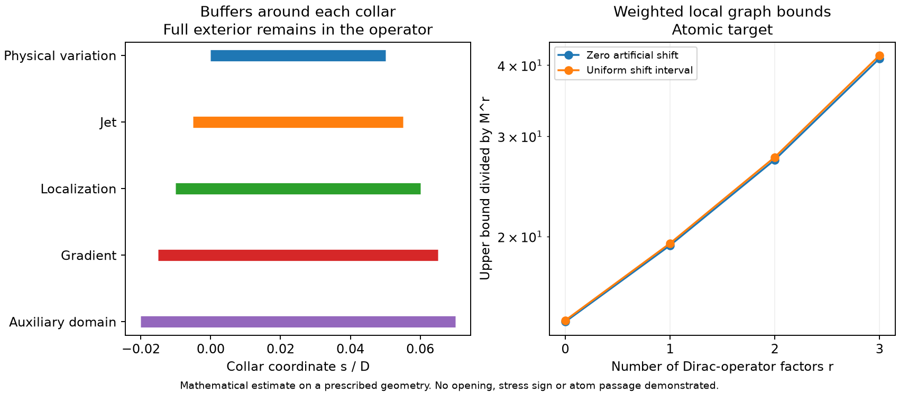

## Complete frequency bound at fixed common regulator

The [calculation](../scripts/dihole_full_frequency.py) and [saved results](../results/dihole_full_frequency_results.json) bound the full compact geometry response across the complete frequency axis at a **fixed finite common regulator**. All angular states, both collars and the global exterior remain included. The result is a conservative ceiling, not a renormalized source value or evidence of a supported opening.

### Preserve the first-order source

Use the canonical flux measure, $P=NW$, $C=-\tau_2\otimes\sigma_3/P$, and the compact metric mask $F$ of 174, with $\|F\|_\infty\le4$. Put

$$
X_\kappa=\chi\mathcal K_\kappa\sqrt N,\qquad
Y_\kappa=\chi\partial_s\mathcal K_\kappa\sqrt N,\qquad
x_0=\|X_\kappa\|_{\rm HS},\quad x_s=\|Y_\kappa\|_{\rm HS}.
$$

Since $\chi=1$ on the support of the insertion, its exact weak form is

$$
\mathcal B_\kappa=\beta\left[-i\kappa X_\kappa^*(F\beta/N)X_\kappa
+\frac{X_\kappa^*FCY_\kappa-Y_\kappa^*FCX_\kappa}{2}\right].
$$

Integration by parts retains both $F_s$ and $C_s$. The leftmost $\beta$ is not commuted through $\mathcal K$. Schatten Hölder and $\|\beta\|=1$ give

$$
\|\mathcal B_\kappa\|_1\le|\kappa|f_Nx_0^2+f_Px_0x_s,
\qquad f_N=4/N_-,\quad f_P=4/P_-.
$$

The mixed value/derivative term matters: replacing it by a bound involving two derivatives created an avoidable extra large-regulator factor in 175. No extra spin multiplicity is added here.

For $|\kappa|\le K$, reuse 175's separate localized norms $B_0,B_A$, on the real axis and its complex disk of radius $d=M/(2\nu)$. They imply

$$
x_0\le B_0,\qquad
x_s\le P_+[B_A+(2g+\sqrt{C_q}+d\nu)B_0]+C_{\rm rad}B_0,
$$

with $d=0$ on the real axis. Cauchy supplies $x'_0\le x_{0,\rm disk}/d$ and $x'_s\le x_{s,\rm disk}/d$, where primes denote upper bounds on derivative norms. Thus

$$
\|\mathcal B_0\|_1\le f_Px_0x_s,\quad
L_{\mathcal B}\le f_Nx_0^2+2f_NKx_0x'_0
+f_P(x'_0x_s+x_0x'_s).
$$

The zero-state-preserving paired argument of 173--175 gives

$$
\frac1{2\pi}\int_0^K|I_\kappa+I_{-\kappa}|\,d\kappa
\le\frac{f_Px_0x_s}{2}+\frac{K L_{\mathcal B}}{\pi}.
$$

This is a paired integral at the possible zero-frequency singularity, not an assertion of separate absolute integrability there.

### Local high-frequency coercivity and three nested estimates

Keeping half the frequency square instead of discarding it gives on the same buffers

$$
P_\kappa=-A_\kappa^2\ge\nabla_h^*\nabla_h+
\frac{\kappa^2}{2N_+^2}-C_{q,2},\qquad
C_{q,2}=\frac{(R_h)_-}{4}+|q|B_{\rm unit}
+\frac{|\nabla_h\log N|^2}{2}.
$$

This uses the same Dirac-square identity and covariant heat domination as 175; see [Vassilevich](https://arxiv.org/pdf/hep-th/0306138) and [Güneysu](https://arxiv.org/pdf/1105.0532). The particular cutoffs and estimates below are this project's derivation, not claims from those papers.

Set $h=2N_+$ and $K_{\min}=h\sqrt{C_{q,2}}$. For $|\kappa|\ge K_{\min}$ the auxiliary Dirichlet square satisfies $P_{\kappa,\Omega}\ge\kappa^2/h^2>0$. Its **unshifted** inverse is valid here; it is never used at $\kappa=0$. No global proper-field gap or global $1/|\kappa|$ resolvent estimate is assumed.

Inside each existing buffer $(-.020,.070)D$, use the six successive support intervals

$$
(-.005,.055),\ (-.0075,.0575),\ (-.010,.060),
(-.0125,.0625),\ (-.015,.065),\ (-.0175,.0675),
$$

in units $D$. The first three are $\chi,\zeta,\theta$. Each outer cutoff equals one on the previous support. Ramps of width $.0025D$ have uniform bounds

$$
g=3200/(DP_-),\qquad
\Delta_c=[1.92\times10^7/D^2+(3200/D)\,b_s]/P_-^2,
$$

where $b_s$ is 175's radial Laplacian drift bound. No buffer touches the other collar because the central section has length $.1D$.

For $U_r=A_\kappa^r\mathcal K_\kappa\sqrt N$, the compact coercivity estimate is

$$
\|fU_r\|\le\frac h{|\kappa|}
\big(\|1_{\operatorname{supp}f}U_{r+1}\|
+g\|1_{\operatorname{supp}df}U_r\|\big).
$$

Start with 175's global-input/local-output bounds $G_0,\ldots,G_3$ and iterate inward three times. All norms needed on $\operatorname{supp}\theta$ obey, with $t=|\kappa|^{-1}$,

$$
u_0=h^3(G_3+3gG_2+3g^2G_1+g^3G_0)t^3,\quad
u_1=h^2(G_3+2gG_2+g^2G_1)t^2,\quad
u_2=h(G_3+gG_2)t,\quad u_3=G_3.
$$

Here $u_r$ are norm ceilings, not new fields; no fourth graph power is needed. Define

$$
D_\zeta=\Delta_c+2g(2g+\sqrt{C_q}),\quad
H_0=u_2+2gu_1+D_\zeta u_0,\quad
H_1=u_3+2gu_2+D_\zeta u_1.
$$

The same auxiliary inverse factorization as 175 gives $x_0\le\sqrt S H_0$ and

$$
x_s\le\sqrt S(P_+H_1+J_{\rm rad}H_0),\qquad
J_{\rm rad}=P_+(2g+\sqrt{C_q})+C_{\rm rad}.
$$

The physical field continues through the openings and exterior. Dirichlet boundaries occur only in the estimate, and no physical reflecting boundary has been introduced.

### Integrable full tail

Substitute $b=\kappa^2/h^2$ in 175's infinite scalar spectral estimate. With $L=.09D$, $r_0=.025D$ and the saved scalar factor $c$, the rank-four, two-collar inverse Hilbert--Schmidt norm squared is bounded by

$$
S(t)=\frac{4Lr_0^2h}{c^{3/2}}t+
\frac{4Lr_0h^2}{c}t^2+\frac{2Lh^3}{\sqrt c}t^3.
$$

The physical Hamiltonian is self-adjoint, so $\|(H_{m_0}+i\kappa)^{-1}\|\le1/|\kappa|$. Combining this with the exact first-order insertion yields

$$
|I_\kappa|\le S(t)\left[f_NH_0^2+
f_PtH_0(P_+H_1+J_{\rm rad}H_0)\right]
=\sum_{p=3}^{10}a_p|\kappa|^{-p},\qquad a_p\ge0.
$$

Thus both frequency signs are absolutely integrable at infinity, without requiring parity of $I_\kappa$:

$$
\frac1{2\pi}\int_{|\kappa|\ge K}|I_\kappa|\,d\kappa
\le\frac1\pi\sum_{p=3}^{10}\frac{a_p K^{1-p}}{p-1},\qquad K\ge K_{\min}.
$$

### Actual bounds and physical limits

At $q=4642875905017627791065088$, fixed $MD=2154733372140.8845$, the saved finite search selects $KD=4012480217806.92$. It is a valid split, not a claim of global optimality.

| Bound, in units $1/D$ | $\eta=0$ | Uniform $\eta/M^2\in[0,.01]$ |
| --- | ---: | ---: |
| Paired low frequencies | $1.4297415419527994\times10^{59}$ | $1.4474296462941527\times10^{59}$ |
| Both absolute high tails | $3.6263440168995854\times10^{53}$ | $3.71622161378337\times10^{53}$ |
| Complete frequency bound | $1.4297451682968164\times10^{59}$ | $1.4474333625157666\times10^{59}$ |

At the **same split used in 175**, the improved zero-shift low bound is $5.526822116023921\times10^{57}/D$, compared with $8.214544027895555\times10^{80}/D$. This roughly $1.49\times10^{23}$ reduction concerns the ceiling alone; it is not a measured reduction in required matter or energy.

All 16 saved checks pass, with 59 exact input hashes. Twelve noncommuting finite controls test the insertion and its derivative; the largest finite-difference discrepancy is $1.13\times10^{-9}$. A 90-digit unexpanded polynomial integral agrees with the expanded tail within $1.13\times10^{-16}$ relative difference. The figure was inspected. An independent mathematical audit found no implementation defect. A separate 115-digit reconstruction verifies 548 scalar inequalities, 238 structural/provenance checks, all 68 grid-tail integrals and all 59 exact input hashes. Its unexpanded quadrature and analytic integral agree within $1.35\times10^{-116}$ relative difference; every saved upward bound encloses the independent value. Layout verification passes 172 imports, 1532 links, 8 source guards and 14 frozen hashes.

**Next:** quantitative matching to the physical regulator limit and local counterterms. A finite-$M$ absolute upper bound does not justify sending $M$ to infinity, establish the finite renormalized stress, determine its sign, or prove convergence uniform in a simultaneous infrared limit. The required total stress/current, stability, hydrogen transmission and internal-state survival, and exterior-clock comparison remain open. The trial aperture is still 1 nm in areal diameter. The static geometry excludes 13 September 2027 to 12 September 2027; no future clock gain is established.

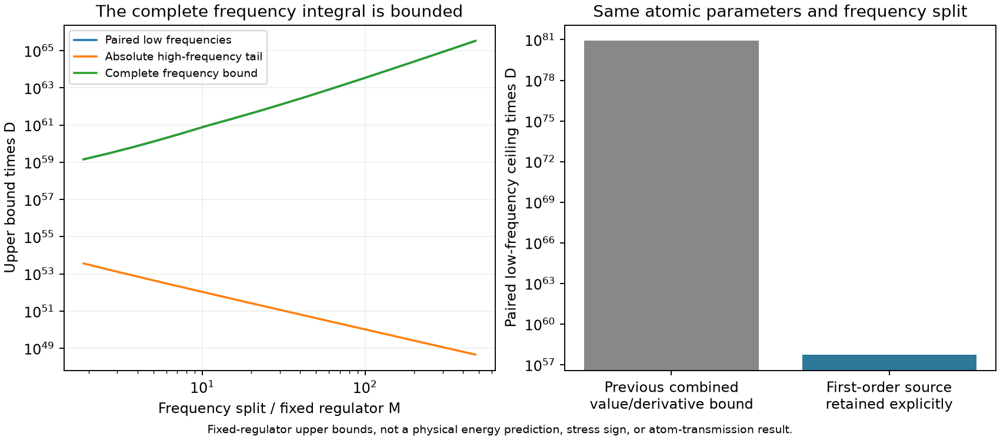

## Full-field heat variation and a regulator matching tail

The [calculation](../scripts/dihole_regulator_heat_tail.py) and [results](../results/dihole_regulator_heat_tail_results.json) convert 176's full-field first-order source estimate into an explicit proper-time heat bound. This controls the long-time part of the correction from a finite regulator to the declared physical scheme. The short-time differentiated remainder and the full source at the required target regulator remain unknown.

### Integrate the insertion before the Hamiltonian resolvent

Write $\Lambda$ for the **comparison filter** used in 176, reserving $M$ for the **target regulator** to be removed. At zero infrared shift, keep

$$
\mathcal K_{\Lambda,\kappa}=\sqrt6\Lambda^3\prod_{j=1}^3(A_\kappa+\sqrt j\Lambda)^{-1},\qquad
\mathcal B_\kappa=\beta\sqrt N\mathcal K^*\dot A_\kappa\mathcal K\sqrt N.
$$

The positive polynomial in 176 was constructed from the direct trace-norm ceiling

$$
\|\mathcal B_\kappa\|_1\le\sum_{p=3}^{10}a_p|\kappa|^{1-p},\qquad |\kappa|\ge K.
$$

This is not inferred by reversing its subsequent bound on $|I_\kappa|$. Its integral therefore gives

$$
\mathcal W_\Lambda:=\int_{\mathbb R}\|\mathcal B_\kappa\|_1\frac{d\kappa}{2\pi}
\le\frac{f_Nx_0^2K^2/2+f_Px_0x_sK}{\pi}
+\frac1\pi\sum_{p=3}^{10}\frac{a_pK^{2-p}}{p-2}.
$$

The low-frequency part uses the direct first-order norm and has no singular resolvent. Both frequency signs are included. At the atomic charge and saved comparison filter, outward interval arithmetic gives

$$
\mathcal W_\Lambda\le1.8262413629229484\times10^{69}/D^2.
$$

Every angular state and the full exterior remain included, as in 176.

### A full heat-variation bound with the correct lapse weights

For each real frequency let $P=-A^2$, $E_s=e^{-sP/2}=\mathcal KJ_s(A)$, and

$$
D_\kappa=\mathcal K^*\dot A\mathcal K
=N^{-1/2}\beta\mathcal B_\kappa N^{-1/2},\qquad
\|D_\kappa\|_1\le\nu\|\mathcal B_\kappa\|_1.
$$

Here $\nu=\|N^{-1}\|$ is the existing global bound. The beta matrix is not moved through $\mathcal K$. The full physical heat variation per unit Killing time obeys

$$
\delta K(s)=-2s\operatorname{Re}\int
\operatorname{Tr}(AE_s)^*\dot A E_s\frac{d\kappa}{2\pi}.
$$

Since $J_s$ and $A$ commute, cyclicity yields
$\operatorname{Tr}(AJ_s)^*D_\kappa J_s=-\operatorname{Tr}D_\kappa A J_sJ_s^*$.
Consequently

$$
|\delta K(s)|\le2s\nu\mathcal W_\Lambda L_\Lambda(s),\qquad
L_\Lambda(s)=\sup_{x\ge0}
\frac{\sqrt{x}e^{-sx}\prod_{j=1}^3(x+j\Lambda^2)}{6\Lambda^6}.
$$

A single spectral multiplier retains the cyclic cancellation. This does not multiply independent maxima for $J_s$ and $AJ_s$, identify the spectra of $H$ and $P$, or assume a positive global gap. The trace-class bound justifies frequency integration of the compact heat variation. In particular it bounds the full response rather than a finite angular heat kernel.

For $p=(1,11/6,1,1/6)$, maximize each positive power separately to obtain

$$
L_\Lambda(s)\le\overline L_\Lambda(s):=
\Lambda\sum_{n=0}^3p_n
\left[\frac{n+\tfrac12}{e\Lambda^2s}\right]^{n+1/2}.
$$

This elementary ceiling is decreasing for all $s>0$. The exact scalar maximum is unique: in $z=x/\Lambda^2$ it solves
$1/(2z)+\sum_{j=1}^3(z+j)^{-1}=\Lambda^2s$. Five independent scalar maximizations and 36 noncommuting-lapse matrix controls check the ceiling and the cyclic identity. Their role is validation of the formula; the continuum bound follows from the preceding operator inequalities and176's full-field estimates.

### Match the same target regulator and physical reference

Use the existing physical four-dimensional subtraction
$H(s)=(a_0/s^2+a_2/s+a_4)/(16\pi^2)$, with $a_0=0$ for this volume-preserving variation. After taking the established infrared limit first, 160's exact identity is

$$
Q_{\rm HK}=Q_M-\mathcal C_M+
\frac12\int_0^\infty r_M(s)[\delta K(s)-H(s)]\frac{ds}{s},
\qquad r_M(s)=3e^{-M^2s}-3e^{-2M^2s}+e^{-3M^2s}.
$$

The counterterm is unchanged:

$$
\mathcal C_M=\frac{(6\log2-3\log3)a_2M^2+
 a_4[\log(M^2/\mu_H^2)+\log(3/8)]}{32\pi^2}.
$$

Keep the fixed physical reference of 162, $\mu_HD=q\sqrt2e^{-\gamma_E}$. The source required here is $Q_M$ at the **target** mass. The bound used to construct $\mathcal W_\Lambda$ cannot be relabeled as a bound on $Q_M$ when $M\ne\Lambda$.

For a proper-time split $s_0>0$, define

$$
T_0=\int_{s_0}^\infty r_M(s)ds
=\frac{3e^{-z}-\tfrac32e^{-2z}+\tfrac13e^{-3z}}{M^2},\qquad z=M^2s_0.
$$

Positivity of $r_M$ and monotonicity of $\overline L$ now give a fully explicit bound

$$
\left|\frac12\int_{s_0}^\infty r_M(s)\delta K(s)\frac{ds}{s}\right|
\le E_{\rm heat}:=\nu\mathcal W_\Lambda\overline L_\Lambda(s_0)T_0.
$$

This closes the previously unknown long-time heat contribution to this matching correction. It is not a bound on the unweighted absolute infrared heat integral.

To state the remaining uncertainty exactly, suppose the actual short-time remainder satisfies

$$
\left|\delta K(s)-H(s)-\frac{a_6s}{16\pi^2}\right|
\le\frac{C_*s^2}{16\pi^2},\qquad0<s\le s_0.
$$

Then

$$
Q_{\rm HK}=Q_M-\mathcal C_M+
\frac{a_6J_0-a_2I_2-a_4I_1}{32\pi^2}+\epsilon,\qquad
|\epsilon|\le\frac{C_*J_1}{32\pi^2}+E_{\rm heat},
$$

where $J_j=\int_0^{s_0}s^jr_M(s)ds$ and $I_j=\int_{s_0}^\infty s^{-j}r_M(s)ds$. The elementary weights are

$$
J_0=\frac{11}{6M^2}-T_0,\qquad
J_1=\frac1{M^4}\sum_{j=1}^3\frac{c_j}{j^2}
[1-(1+jz)e^{-jz}],\quad(c_1,c_2,c_3)=(3,-3,1).
$$

Thus $J_1\le85/(36M^4)$. With $E_1$ the exponential integral,
$I_1=\sum c_j E_1(jz)$ and $I_2=\sum c_j[e^{-jz}/s_0-jM^2E_1(jz)]$.
Local coefficients retain the saved numerical values

$$
a_2/D=0.11400999281577749,\quad
a_4D=7.70692428939725005+(3.02479783094743508\times10^{-6})q^2,
$$
$$
a_6D^3=-1204.72809423935-3.2096919527759757q^2.
$$

These are numerical geometry coefficients, not interval enclosures; their uncertainty is additional to $\epsilon$. The numerical counterterm and correction center saved by the code must not be presented as a certified interval for the physical source.

### Atomic results and the next missing calculation

For the atomic $q=4642875905017627791065088$, choose
$s_0/D^2=1.7932482895815272\times10^{-28}$, rounded downward from $.01/(qB_{\rm unit})$. This ensures $s_0|q|B_{\rm unit}\le.01$ on the buffers. It is a scale choice, not proof of a local heat remainder estimate. The comparison filter stays $\Lambda D=2154733372140.8845$ and
$\overline L_\Lambda(s_0)D\le5.23214788880016\times10^{22}$.

| Nominal $M^2s_0$ | Target $MD$ | $E_{\rm heat}D/q^2$ upper bound |
| ---: | ---: | ---: |
| 30 | $4.0901611069192706\times10^{14}$ | $75.55503890633399$ |
| 50 | $5.280375283467876\times10^{14}$ | $9.343832528117022\times10^{-8}$ |
| 100 | $7.467578340299948\times10^{14}$ | $9.010957784002824\times10^{-30}$ |
| 200 | $1.0560750566935752\times10^{15}$ | $1.6760723786603616\times10^{-73}$ |

At the $z\simeq50$ row, the coefficient multiplying $C_*$ is at most
$9.616289804453093\times10^{-62}D^4$. Its small size is not an error estimate until $C_*$ is bounded. The target regulator is mathematical; none of these masses is a material-production requirement.

All 14 checks pass with 61 exact input hashes. The 36 finite matrix controls have maximum scaled cyclic-identity error $1.84\times10^{-15}$; independent proper-time weight quadrature agrees within $8.0\times10^{-85}$ relative error. The generated figure has been inspected. An independent mathematical audit passes, including a 90-digit recomposition of 62 scalar enclosures. A separate 125-digit audit verifies 122 directed bounds, all 120 nearest-float local coefficient/center fields, all 12 target-mass rows and all 61 input hashes. The smallest relative directed margin is $1.43\times10^{-18}$; local estimate rounding is below 0.490 ulp. These rounding checks do not bound the original geometry-quadrature uncertainty. Layout verification passes 173 imports, 1542 links, 8 source guards and 14 frozen hashes.

The next calculation must bound the differentiated short-time remainder $C_*$, or directly bound its weighted integral, and compute or tightly bound the full source at the same target regulator. [Ludewig's Theorem 3.1](https://arxiv.org/pdf/1607.05152) addresses heat asymptotics with derivatives on compact subsets under its extension assumptions; it does not supply our numerical remainder constant. The saved low-order heat coefficients and a small magnetic proper-time product alone cannot provide it. [Vassilevich](https://arxiv.org/pdf/hep-th/0306138) supplies the heat-coefficient framework; the evaluated matching-tail bound above is our derivation within the prescribed model.

At positive fixed $\eta$, an additional term involving $(1-e^{-\eta s})w_M(s)\delta K(s)/s$ would remain. Its absolute integral is not controlled by the exponentially weighted bound above. The calculation uses $\eta=0$ after the established ordered infrared prescription, not an unsupported interchange of limits.

No physical source sign, supported opening, stability, atom passage or clock advantage has been established. One hydrogen atom and the trial 1 nm areal diameter remain the target. The current static geometry excludes 13 September 2027 to 12 September 2027; human transport is deferred.

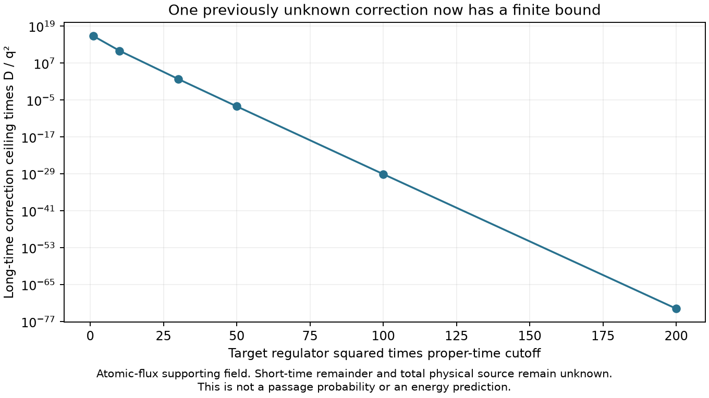

## Signed all-order magnetic remainder on the actual collars

The [calculation](../scripts/dihole_magnetic_remainder.py) and [results](../results/dihole_magnetic_remainder_results.json) separate one controlled part of 177's short-time error: the locally constant magnetic reference from 162. The new bound retains its sign and all powers of $s\mathcal B$. Its prefactor uses the certified geometry of the actual collars. The difference between this reference and the true curved, varying-field heat response remains unknown.

### A magnetic inequality valid at every proper time

Let $g(x)=\coth x-x\operatorname{csch}^2x$. Differentiating the [NIST partial-fraction formula 4.36.3](https://dlmf.nist.gov/4.36.E3) gives

$$
g(x)=4x\sum_{n\ge1}\frac{\pi^2n^2}{(x^2+\pi^2n^2)^2}.
$$

All terms are positive for $x>0$, and

$$
\frac{2x}{3}-g(x)=4x^3\sum_{n\ge1}
\frac{2\pi^2n^2+x^2}{\pi^2n^2(\pi^2n^2+x^2)^2}.
$$

Using $(2a+x^2)/(a+x^2)^2\le2/a$ and
$\sum_{n\ge1}(\pi^2n^2)^{-2}=1/90$ proves

$$
0\le\frac{2x}{3}-g(x)\le\frac{4x^3}{45},\qquad x\ge0.
$$

This inequality is not a truncated small-$x$ approximation. For the pointwise reference

$$
\delta\Theta_0(s)=\int dV\,\frac{\delta\mathcal B}{4\pi^2s}g(s\mathcal B),
\qquad \delta\mathcal B=fC_\perp/\mathcal B,
$$

it gives the signed bound

$$
-\frac{C_{\rm mag}s^2}{16\pi^2}
\le\delta\Theta_0(s)-\frac{a_{4,\rm mag}}{16\pi^2}\le0,
\qquad C_{\rm mag}=\frac{16}{45}\int fC_\perp\mathcal B^2dV,
$$

where $a_{4,\rm mag}=(8/3)\int fC_\perp dV$. The reference has no $a_6s$ term. Its full proper-time response is still a reference function, not the actual global heat kernel. The original constant-field source calculation and its approximation scope remain as stated in 162.

### Use the exact mask and polar regularity

On either physical collar, let $L_c=.05D$, $\chi=R'$, and $f=S'(s/L_c)/2$, where $\chi=S(s/L_c)$ is the saved smooth step. Then

$$
f=\frac{L_c}{2}\frac{d\chi}{ds},\qquad
\int_0^{L_c}f\chi^2ds=\frac{L_c}{6}.
$$

The actual charge-normalized potential is $q\,a(R,x)d\phi$, $x=\cos\theta$. The radial magnetic component and physical volume per unit Killing time satisfy

$$
C_\perp=\frac{q^2\chi^2a_R^2}{R^2(1-x^2)W^2},\qquad
N\sqrt h=P^2R^2\sin\theta,\quad P=NW.
$$

Thus the $P,R,W$ factors cancel in the required integral, leaving
$q^2 f\chi^2N^2a_R^2/(1-x^2)$ in the $ds\,dx\,d\phi$ measure. Balanced polar regularity gives $a_R(\pm1)=0$. With 175's verified $A_{Rx}\ge\sup|a_{Rx}|$,

$$
\frac{a_R^2}{1-x^2}\le A_{Rx}^2\frac{1-|x|}{1+|x|},\qquad
\int_{-1}^{1}\frac{1-|x|}{1+|x|}dx=4\log2-2.
$$

Both collars and the full azimuth therefore give

$$
V_\perp:=4\pi\frac{L_c}{6}N_+^2A_{Rx}^2(4\log2-2),
$$
$$
a_{4,\rm mag}\le\frac83 V_\perp q^2,\qquad
C_{\rm mag}\le\frac{16}{45}V_\perp B_{1,+}^2q^4.
$$

Here $B_{1,+}$ bounds the charge-one field throughout the larger certified buffer, so it also bounds the physical insertion support. The saved constants yield

$$
V_\perp\le0.0006865532042079938/D,\qquad
a_{4,\rm mag}/q^2\le0.00183080854455465/D,
$$
$$
C_{\rm mag}/q^4\le0.035214916646301046/D^5.
$$

The previous numerical $a_{4,\rm mag}/q^2$ estimate lies inside this ceiling, but is not used as a certified bound. No geometry solve or quadrature of the actual field was rerun. The proof uses the existing directed field bounds and exact integrals above.

### Signed contribution to the same matching identity

Keep 177's target mass $M$, cutoff $s_0$, weights $r_M,J_1$, and counterterms unchanged. Since $r_M\ge0$, the pure magnetic short correction lies in

$$
\epsilon_{\rm mag}:=\frac12\int_0^{s_0}r_M(s)
\left[\delta\Theta_0(s)-\frac{a_{4,\rm mag}}{16\pi^2}\right]\frac{ds}{s}
\ \in\ \left[-\frac{C_{\rm mag}J_1}{32\pi^2},\,0\right].
$$

Define the remaining exact function

$$
R_{\rm geom}(s)=\delta K(s)-\delta\Theta_0(s)
-\frac{a_2/s+a_{4,\rm grav}+a_6s}{16\pi^2}.
$$

If $|R_{\rm geom}(s)|\le C_{\rm geom}s^2/(16\pi^2)$ on $(0,s_0]$,177's original matching formula becomes

$$
Q_{\rm HK}=Q_M-\mathcal C_M+
\frac{a_6J_0-a_2I_2-a_4I_1}{32\pi^2}
+\epsilon_{\rm mag}+\epsilon_{\rm geom}+\epsilon_{\rm heat},
$$

with $|\epsilon_{\rm geom}|\le C_{\rm geom}J_1/(32\pi^2)$ and
$|\epsilon_{\rm heat}|\le E_{\rm heat}$. This only subdivides the short integral. The full $a_4$ remains in the long local subtraction and counterterm; there is no double subtraction or change of scheme.

For the saved atomic charge and actual target masses from 177:

| Nominal $M^2s_0$ | $|\epsilon_{\rm mag}|D/q^2$ upper bound | $E_{\rm heat}D/q^2$ upper bound |
| ---: | ---: | ---: |
| 50 | $7.299756270521545\times10^{-14}$ | $9.343832528117022\times10^{-8}$ |
| 100 | $1.8249390676303856\times10^{-14}$ | $9.010957784002824\times10^{-30}$ |
| 200 | $4.5623476690759655\times10^{-15}$ | $1.6760723786603616\times10^{-73}$ |

At the $z\simeq100$ row, the two **known** error pieces together, multiplied by $D/q^2$, lie in
$[-1.8249390676303865\times10^{-14},\ 9.010957784002826\times10^{-30}]$.
This interval omits the unknown $\epsilon_{\rm geom}$ and the source $Q_M$. It is not a renormalized supporting-source interval or a rejection of the model.

All 12 checks pass with 63 exact input hashes. Nine high-precision scalar controls test the sign, cubic bound and partial fractions; the exact radial mask/rate integral agrees with 64/128-point quadratures within $5.21\times10^{-17}$. The independent angular integral agrees within $7.15\times10^{-102}$. These controls accompany the analytic all-$x$ argument, rather than replacing it with sampling. The figure was inspected. Independent artifact audits pass: a 100-digit recomposition and 36 signed-bound checks; a separate 125-digit audit checks 79 directed inequalities, 183 scope/equality statements, nine nearest-float ratios, all 63 hashes and all 12 mass rows. Layout verification passes 174 imports, 1552 Markdown links, eight source guards and 14 frozen pilot hashes.

### What remains in the curved-field error

Removing the reference removes its pure constant-field powers, including the pure $F^4$ term in $a_8$. It does not establish a uniform $q^2$ bound on $R_{\rm geom}$: higher mixed terms such as $RF^4$ remain, and the exterior still contributes. The resummed formulas of [Avramidi--Fucci, equation 2.20](https://arxiv.org/pdf/0810.4889) explicitly assume $\nabla F=0$, unlike these collars. They cannot supply the missing error by direct substitution.

A useful next certificate must bound a differentiated local heat-parametrix defect, including its cutoff terms and the source insertion. In particular, $-s\operatorname{Tr}(\dot P Q_s)$ for a reference kernel need not equal the metric variation of that kernel's trace; their mismatch must be retained. Certified higher geometry/connection jets, normal-coordinate transport data and local graph-norm evaluation constants are still missing. Finite propagation can control leaving a buffer but does not bound the local differential defect. The full source at the same target $M$ also remains to be evaluated or tightly bounded.

### A concrete residual certificate to evaluate next

The following is a derived, unevaluated route to a numerical remainder bound. Work in $D=1$ units and construct the actual charged-Dirac local parametrix

$$
Q_4(t;x,y)=\chi(d)(4\pi t)^{-2}e^{-d^2/(4t)}
\sum_{j=0}^4t^j u_j(x,y),\qquad E_4=(\partial_t+P_x)Q_4.
$$

The $u_j$ must solve the transport recursions for the actual $P$, with its density and parallel transport included in $u_0$. The smooth cutoff must lie inside a verified normal neighbourhood of each source point. For the nonnegative self-adjoint physical operator, Duhamel's identity gives

$$
K(t)-Q_4(t)=-\int_0^t e^{-(t-r)P}E_4(r)\,dr.
$$

Suppose verified local evaluation constants obey
$|e_a^*\dot P u(x)|\le C_{\rm ev}(x)\|(1+P)^3u\|_2$ for the full fixed-space insertion. With physical four-dimensional column norms and diagonal volume per unit Killing time, define

$$
B_4(r)=\int_{\rm mask}\sum_{a=1}^4 C_{\rm ev}(x)
\|(1+P)^3E_4(r;\cdot,x)e_a\|_2\,d\mu_{/T}(x).
$$

Semigroup contraction and commutation with $(1+P)^3$ imply

$$
|\delta K(t)-\delta K_{Q_4}(t)|\le t\int_0^t B_4(r)dr,
\qquad \delta K_{Q_4}:=-t\operatorname{Tr}_{/T}(\dot P Q_4).
$$

This definition is not replaced by the metric variation of $\operatorname{Tr}Q_4$. The pointwise volume-preserving cancellation then gives the prospective original-remainder certificate

$$
C_*\le|a_8|+s_0|a_{10}|+
16\pi^2\sup_{0<t\le s_0}\frac1t\int_0^t B_4(r)dr.
$$

In four dimensions, away from cutoff derivatives,
$E_4=t^4(4\pi t)^{-2}e^{-d^2/(4t)}P_xu_4$.
Its column $L^2$ norm has order $t^3$; three applications of $P$ cost at most $t^{-3}$. Thus the needed graph norm is bounded at zero under the required smooth coefficient and transport bounds. Cutoff derivatives lie away from the diagonal and carry exponential suppression. This power count explains finiteness, but supplies no numerical constant.

For the magnetic-subtracted remainder, the appropriate prospective bound instead is

$$
C_{\rm geom}\le|a_8-a_{8,\rm mag}|+s_0|a_{10}|+
C_{F^6}s_0^2+16\pi^2\sup_{0<t\le s_0}\frac1t\int_0^t B_4(r)dr,
$$

where $a_{8,\rm mag}=-(16/45)\int fC_\perp\mathcal B^2dV$ and
$C_{F^6}=(16/315)\int fC_\perp\mathcal B^4dV$. A second positive partial-fraction remainder gives
$0\le16\pi^2\delta\Theta_0-a_{4,\rm mag}-a_{8,\rm mag}t^2\le C_{F^6}t^4$.
There is no pure magnetic $a_{10}$ term. Simply reusing the original $C_*$ formula with a renamed constant would lose this distinction.

Neither certificate has been evaluated. Both need certified transport and normal-coordinate data, higher derivatives in $P^3E_4$, explicit local elliptic evaluation constants, and enclosures of the relevant exact heat coefficients. Existing third jets do not provide them. [Ludewig's differentiated heat-asymptotic framework](https://arxiv.org/pdf/1607.05152) supports the local construction; it does not provide these numerical constants for our geometry. This is the next concrete calculation, not a claim that the curved remainder is already bounded.

The target remains one neutral hydrogen atom through a trial 1 nm areal diameter. Support, stability, atomic transmission and survival, and an exterior-clock advantage remain unproved. The current static geometry excludes 13 September 2027 to 12 September 2027; no new physical law or obtainable material is established.

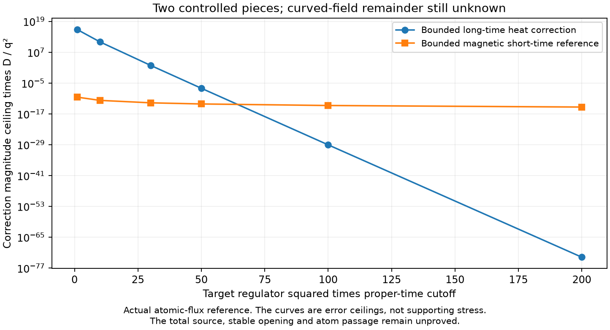

## Regular collar geometry and full operator high-derivative bounds

Checkpoint179 evaluates missing inputs to the previous residual certificate: finite bounds on the actual geometry and operator derivatives. It does not evaluate the heat defect itself. The [calculation](../scripts/dihole_regular_jets.py), [results](../results/dihole_regular_jets_results.json) and [figure](../figures/dihole_regular_jets_progress.png) use exact balanced parameters, the actual sewn profile, and both polar regions. All lengths and coordinate components below use $D=1$.

### The sewn profile is smooth, not analytic

For the actual step $S(t)=(1+e^{-h(t)})^{-1}$, $h(t)=-1/t+1/(1-t)$, extended by zero and one, define

$$
C=\frac{e^{5/3}}{1-e^{-5/6}},\qquad B_0=1,\qquad
B_n=n!\max\{10^n,C(2n/e)^n\}\quad(n\ge1).
$$

Then $\sup_{\mathbb R}|S^{(n)}|\le B_n$. For $0<t\le1/5$, the open disk $|z-t|<t$ has $\Re h(z)\le-1/(2t)+5/3\le-5/6$. Thus $|S(z)|\le C e^{-1/(2t)}$ and Cauchy's derivative formula, with the disk radius increasing to $t$, gives $Cn!t^{-n}e^{-1/(2t)}$. Its supremum over positive $t$ is $Cn!(2n/e)^n$.

For $1/5\le t\le1/2$, use radius $1/10$. In its enclosing rectangle $z=x+iy$, at $x\le1/4$ one has $\Re h\le4/3-100/29=-184/87<-\log2$, hence $|S|<1$. For $x\ge1/4$, monotonicity in $|y|\le1/10$ and convexity in $x\in[1/4,3/4]$ give $|\Im h|\le40/29+40/229<\pi/2$. Consequently $\Re(e^h)\ge0$ and $|S|\le1$, giving $n!10^n$. Reflection covers the other half. The endpoint estimates tend to zero for every derivative and prove the flat smooth extension. This uses [Cauchy's derivative formula](https://dlmf.nist.gov/1.9.E31); the disks and constants are our derivation.

For $L=.05$, $R'=S(s/L)$ and the actual mask $f=S'(s/L)/2$ therefore obey

$$
|R'|\le1,\quad |R^{(n)}|\le L^{1-n}B_{n-1}\ (n\ge2),\quad
|f^{(n)}|\le B_{n+1}/(2L^n).
$$

Saved directed ceilings include $B_{20}\le5.162995679801647\times10^{42}$ and $B_{21}\le4.4448984799522566\times10^{45}$. These are real derivative bounds. No fixed complex neighbourhood across a flat join is assumed.

### Complex exterior coefficients and regular polar frames

Reuse the exact balanced exterior expressions for $N,P,a$. A $24\times32$ directed interval cover encloses complex polydiscs of radii $\rho_R=1/1000$, $\rho_x=1/100$ around every real $R\in[.025,.070]$, $x\in[-1,1]$. Required root radicands have positive real part; $NP$ and $W=P/N$ stay away from zero. The principal square-root enclosure is

$$
u=\sqrt{\frac{\sqrt{(\Re z)^2+(\Im z)^2}+\Re z}{2}},\qquad
\sqrt z=u+i\frac{\Im z}{2u}.
$$

This bypasses an unavailable interval-complex square-root routine without changing the analytic branch. The resulting uniform complex moduli are:

| Coefficient | Upper bound |
| --- | ---: |
| $N$ | 0.3978856071998948 |
| $P$ | 12.272829715643118 |
| $1/N$ | 120.73778570364021 |
| $1/P$ | 0.4582700970462865 |
| $a$ | 1.193794987581448 |

These are complex-domain enclosures, not extrema of the real physical fields.

For pole sign $p=\pm1$, use the oriented stereographic disk $t=y_1^2+y_2^2\le2$, $x=p(1-t)/(1+t)$, $\phi=p\arg(y_1+iy_2)$. The disks overlap and cover the sphere. The angular coframe and inverse are

$$
E=\frac{2R}{1+t}\left[N^{-1}I+\frac{P-N^{-1}}{t}yy^T\right],\qquad
E^{-1}=\frac{1+t}{2R}\left[NI+\frac{P^{-1}-N}{t}yy^T\right].
$$

Exact balance gives $NP(R,\pm1)=1$, $a(R,+1)=0$ and $a(R,-1)=1$, also holomorphically in $R$. At the negative pole, $r=r_+=M+k$, $a_{\rm geom}+BM r_+=k$ and $M r_+=Qk$ reduce the exact exterior expressions to these identities. Independently rounded parameters are not used here.

For $F=P-N^{-1}$ or $P^{-1}-N$, the apparently singular quotient is

$$
\frac{F(R,x)}{t}=\frac{2}{1+t}\frac{F(R,x)-F(R,p)}{1-px}.
$$

Its numerator vanishes on the entire complex polar locus, so this is a holomorphic divided difference, including when complex $y_1^2+y_2^2=0$. The regular local gauge potential is

$$
\mathcal A_p=pq\frac{a(R,x)-a(R,p)}{t}(-y_2dy_1+y_1dy_2).
$$

Its transition function retains the magnetic flux; no single global potential is assumed. The physical volume density is $4P^2R^2/(1+t)^2$ and its square root, the canonical half-density, is $v=2PR/(1+t)$.

For complex increments $|\delta y_i|\le\eta=1/2000$, set $d=4\eta+2\eta^2$. Then $|\delta t|\le d$ and

$$
|\delta x|\le\frac{2d}{1-d}\le0.004009020044599221<\rho_x/2.
$$

A residual Cauchy disk of radius $\rho_x/2$ bounds the divided differences. For scalar modulus $M_F$ the bound is $2M_F/\rho_x$. Set $Y=\sqrt2+\eta$, $l=1-d$, $R_+=.071$, $R_-=.024$, and denote the five scalar moduli by $n,p_0,n_i,p_i,a_0$. Angular component ceilings are

$$
M_E=\frac{2R_+}{l}\left[n_i+\frac{4(p_0+n_i)Y^2}{l\rho_x}\right],\quad
M_{E^{-1}}=\frac{3+d}{2R_-}\left[n+\frac{4(p_i+n)Y^2}{l\rho_x}\right],
$$
$$
M_{\mathcal A}/|q|=\frac{4a_0Y}{l\rho_x}.
$$

The full coframe includes $N\,d\tau$ and $P\,ds$. Metric ceilings sum the two angular-frame products; density bounds use the explicit formulas. Saved coframe and inverse-frame moduli are 15198.551234374496 and 42977.43709976694. Their large size records conservative estimates, not physical field amplitudes.

### Finite mixed composition and the physical operator

Let $r_j$ bound $|R^{(j)}|$, and define

$$
b_0=1,\qquad b_n=\sum_{j=1}^n\frac{r_j}{j!\rho_R}b_{n-j}.
$$

These majorize coefficients of $(1-\sum_{j\ge1}r_jz^j/(j!\rho_R))^{-1}$. Finite Faà di Bruno composition gives

$$
|\partial_s^n\partial_{y_1}^j\partial_{y_2}^k F|
\le n!j!k!M_Fb_n\eta^{-j-k},\qquad n+j+k\le20.
$$

Only finite real jets of $R$ are used. Saved total-order ceilings maximize over $n$ and use $j!k!\le(j+k)!$. All time derivatives vanish.

The operator coefficients below use canonical coordinate $L^2$. If $P_g$ acts with physical measure $v^2dx$, then $P_c=vP_gv^{-1}$ and $\dot P_c=v\dot P_gv^{-1}$ for this volume-preserving probe. Physical kernels are recovered as $K_g(x,y)=v(x)^{-1}K_c(x,y)v(y)^{-1}$. The saved density and inverse-density jets allow this conversion; a physical-measure parametrix must retain these endpoint factors.

The bounds propagate to the complete canonical Dirac expression $D=C^\mu\partial_\mu+C_0$, $P=-D^2$, and the full fixed-space variation. Let $E,I,A,V,V^{-1}$ denote derivative-bound sequences for coframe, inverse frame, gauge per $|q|$, half-density and inverse half-density. Products below mean total-order binomial convolution; primes shift derivative order. Euclidean gamma matrices have norm one. Then

$$
a=4I,\quad J=|q|A+V'V^{-1},\quad b=768I^2E'+16IJ
$$

bound $C^\mu$ and $C_0$. Cartan structure coefficients have at most 32 terms of size $I^2E'$, connection coefficients are bounded by $48I^2E'$, and 64 Clifford products with factor $1/4$ give 768. Gauge and density pieces have at most 16 terms each.

For the actual probe $e^0\mapsto e^{\epsilon f}e^0$, $e^1\mapsto e^{-\epsilon f}e^1$, angular coframe and gauge remain fixed; $\dot v=0$ exactly. Set $dE=fE$, $dI=fI$, $da=4dI$ as bounds. Then

$$
db=1536I(dI)E'+768I^2(dE)'+16(dI)J.
$$

Here $(dE)'$ includes $f'E$. For $P=\sum_{\mu,\nu}P_2^{\mu\nu}\partial_\mu\partial_\nu+\sum_\mu P_1^\mu\partial_\mu+P_0$, using **ordered second-derivative pairs**, the component operator-norm bounds are

$$
|P_2|\le a^2,\qquad |P_1|\le4aa'+2ab,\qquad |P_0|\le4ab'+b^2.
$$

Their product-rule variations give the saved $\dot P$ bounds. All derivatives through order18 are enclosed at $q=1000$ and exact atomic $q=4642875905017627791065088$. Combining two mixed second derivatives into a single coefficient would require its extra factor; the saved convention does not combine them.

At atomic flux, zeroth-derivative ceilings for $(P_2,P_1,P_0)$ are approximately $(2.956\times10^{10},7.431\times10^{38},4.671\times10^{66})$; their variations have ceilings $(2.956\times10^{11},7.431\times10^{39},4.671\times10^{67})$. These rounded summaries are not the directed artifact values and are not stress, energy or material requirements.

### Verification and remaining work

All 13 checks pass with 65 exact input hashes. Direct 85-digit step differentiation through order21 lies below the bounds. Frame/inverse and metric identities agree within $2.29\times10^{-86}$ and $5.69\times10^{-87}$; balanced pole identities agree within $4.83\times10^{-86}$. A rational-series control checks the composition recurrence. These controls accompany the analytic disk and interval proofs, rather than replacing uniform bounds with sampling. The figure was inspected.

Independent audits pass: 501 directed comparisons at 160 digits check the step, composition, mask, mixed jets and operator arrays, using power-series and dual-number product rules. A separate 125-digit audit recomposes 512 exported ceilings and checks complex metric/chart formulas against the original dihole expressions; four complex metric comparisons agree within $2.66\times10^{-110}$. Both audits verify all 65 hashes. Final layout PASS:175 imports,1563 Markdown links,8 source guards,14 frozen pilot hashes.

These are regular-atlas input jets for the Q4 method. A quantified normal-coordinate neighbourhood, transport-coefficient bounds, graph-norm point-evaluation constant and the actual $B_4$ defect still need evaluation. The [differentiated heat-asymptotic framework](https://arxiv.org/abs/1607.05152) does not supply those numerical constants for this geometry. The curved heat correction and full source at the same target regulator remain unknown.

One neutral hydrogen atom and a trial 1 nm areal opening remain the target. No self-consistent support, stability, atomic passage or exterior-clock advantage is established. The static geometry excludes 13 September 2027 to 12 September 2027.

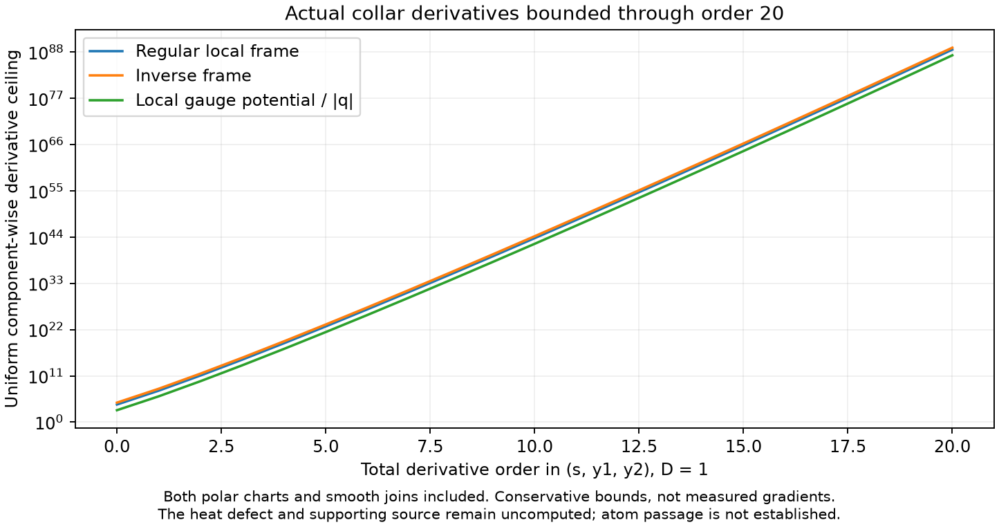

## Explicit normal neighbourhood, heat transport and graph evaluation

Checkpoint180 evaluates three missing inputs to the Q4 remainder calculation: a normal neighbourhood, bounds for the physical heat coefficients $u_0,\ldots,u_4$, and a graph-norm point-evaluation constant. The [calculation](../scripts/dihole_local_transport.py) has **16 passing checks** and retains **67 exact input hashes** in the [results](../results/dihole_local_transport_results.json). All lengths and operator bounds here use the existing $D=1$ normalization. These are mathematical bounds on a prescribed geometry, not a newly supported geometry or an atom-transport calculation.

### Sharper real metric bounds

Use the oriented stereographic charts from checkpoint179, with $t=|y|^2\le2$, $x=p(1-t)/(1+t)$ and $p=\pm1$. Set $U=N^{-2}=W/f$, $V=P^2=fW$, $c=4R^2/(1+t)^2$ and $\Pi=yy^T/t$. Then

$$
g_{\rm ang}=c[U(I-\Pi)+V\Pi].
$$

The exact polar identity $f=NP=1$ makes $F=V-U$ vanish at the pole. Consequently $|F|\le2tM_{F_x}/(1+t)$ and $\|\partial_{y_j}\Pi\|\le t^{-1/2}$ give the regular bound

$$
\|\partial_{y_j}g_{\rm ang}\|\le
\frac{16R^2\sqrt t}{(1+t)^3}M_0+
\frac{16R^2\sqrt t}{(1+t)^4}M_x+
\frac{8R^2\sqrt t}{(1+t)^3}M_{F_x},
$$

where $M_0=\max(U,V)$ and $M_x=\max(|U_x|,|V_x|)$. Radial angular eigenvalue derivatives are $4(2RU+R^2U_R)/(1+t)^2$ and the corresponding expression for $V$, with $|R'|\le1$. Derivatives of $g_{\tau\tau}=f/W$ and $g_{ss}=fW$ are included. The maxima of $\sqrt t/(1+t)^j$ occur at $t=1/(2j-1)$; for $j=2,3,4$ they are $3\sqrt3/16$, $25\sqrt5/216$, $343\sqrt7/4096$.

The exact balanced calibration is enclosed on 768 real interval boxes. The resulting directed bounds include

| Quantity | Bound |
| --- | ---: |
| Metric operator norm $M$ | $\le92.84421315093161$ |
| Inverse metric norm $H$ | $\le260.3941671325786$ |
| Metric lower bound $m=H^{-1}$ | $\ge0.0038403317977965847$ |
| First metric component derivative | $\le6746.143644310957$ |
| Angular first derivative | $\le3.773835405681557$ |
| Physical volume density | $[0.0038403317977965847,1.8197465777582595]$ |

For clarity, the sharper spectral bounds use the previously certified real $N,P$ intervals, not the large complex component moduli:

$$
M=\max(N_+^2,P_+^2,4R_+^2\max(P_+^2,N_-^{-2})),
$$
$$
H=\max(N_-^{-2},P_-^{-2},\tfrac9{4R_-^2}\max(P_-^{-2},N_+^2)).
$$

### A quantified normal neighbourhood

Start with the saved metric derivative sequence, replacing orders zero and one by the real bounds above. Improve the inverse derivatives using $g^{-1}g=I$:

$$
H_n\le H_0\sum_{j=1}^n {n\choose j}4g_jH_{n-j}.
$$

At each order the smaller of this ceiling and the saved inverse-component ceiling remains valid. Binomial products give Christoffel component ceilings $G_n=6(h*g')_n$ and Euclidean multilinear ceilings $C_n=2^{n+3}G_n$.

Source points use a chart with $|y|\le1$. The larger disk $|y|\le\sqrt2$, and the buffered radial interval $[-.02,.07]$ around $[0,.05]$, supply coordinate clearance $\delta=.02$. Put $A=\log(3/2)$ and round the following radius downward:

$$
r=\min\left(\frac{\delta}{4},
\frac{A}{2C_0+\sqrt{4C_0^2+2C_1A}}\right).
$$

The geodesic speed and displacement are bounded by $2r$, while

$$
\|D\exp_y-I\|\le \exp(4C_0r+2C_1r^2)-1\le\tfrac12.
$$

Integrating this Jacobian estimate on the convex initial-velocity ball proves injectivity. Its singular values lie in $[1/2,3/2]$, so the inverse Jacobian norm is at most 2. With $\rho=\sqrt m\,r$, a path leaving the coordinate clearance ball has length at least $\sqrt m\,\delta>\rho$. Minimizing sequences of length below $\rho$ therefore stay in a compact interior region. Their minimizing geodesic has initial coordinate velocity below $r$ and is unique by the injectivity estimate. This supplies a normal metric neighbourhood, not merely a nonzero local Jacobian, and does not assert strong convexity for arbitrary pairs in a larger ball. See the geometric background in [Calegari's Riemannian geometry notes, section 4](https://math.uchicago.edu/~dannyc/courses/riem_geo_2013/riem_geo_notes.pdf); the explicit estimates here are this project's calculation.

The saved lower bounds are

$$
r\ge4.593934749973308\,10^{-11},\qquad
\rho\ge2.8468802301693738\,10^{-12}.
$$

Use $\rho/2\ge1.4234401150846869\,10^{-12}$ for closed cutoff support. These tiny conservative coordinate neighbourhoods are **not throat diameters**. In orthonormal initial coordinates the normal volume density is bounded by the physical endpoint-volume ratio times the determinant bounds $1/16$ and $81/16$. The exported interval is $[0.00013189789188007008,2398.872684695344]$.

### Higher exponential-map and inverse derivatives

For scaled initial velocity $w=v/r$, define the phase variables $Q=(\gamma-y)/r$, $U=\dot\gamma/r$. Use the maximum of their Euclidean norms, with $|Q|,|U|\le2$. The acceleration's order-$k$ derivative is bounded by

$$
H_k^{\rm flow}=r\sum_{j=0}^{\min(2,k)}{k\choose j}
\frac{2!}{(2-j)!}\,2^{2-j}r^{k-j}C_{k-j}.
$$

The first bound is at most $0.7954358831566978$; the full phase-vector-field Lipschitz constant is therefore at most 1. Let $Z_1=3/2$ and use normalized derivatives (order-$n$ norm divided by $n!$):

$$
Z_n=e\sum_{k=2}^n\frac{H_k^{\rm flow}}{k!}[z^n]Z(z)^k,\quad
E_n=r^{1-n}Z_n,
$$
$$
Y_1=2,\qquad Y_n=2\sum_{k=2}^nE_k[z^n]Y(z)^k.
$$

The series used inside each recurrence have zero constant term and use only already computed lower orders. Finite chain rules and Gronwall's inequality bound the exponential map by $E$ and its time-one inverse by $Y$ through order17. No uniform inverse of the time-$t$ map at $t=0$ is assumed.

### Physical heat coefficients through $u_4$

The physical-volume kernel convention is

$$
K_g(t;x,y)\sim(4\pi t)^{-2}e^{-d(x,y)^2/(4t)}
\sum_{j\ge0}t^ju_j(x,y).
$$

Write $v=(\det g)^{1/4}$ for the canonical half-density and $J=D_v\exp_y$ for the coordinate initial-velocity Jacobian (the derivative subscript here denotes velocity, not half-density). The leading coefficient is

$$
u_0(x,y)=v(y)v(x)^{-1}(\det J)^{-1/2}\mathcal U(x,y).
$$

The physical spin and $U(1)$ connection gives unitary parallel transport $\mathcal U$. Its coordinate component derivative bounds obey

$$
\Omega\le768EI^2E'+|q|\mathcal A.
$$

Here $E,I,\mathcal A$ in this connection formula denote coframe, inverse coframe and gauge-per-unit-charge sequences from179; they are distinct from the exponential-map sequence $E_n$ above. Products of ordinary derivative sequences use binomial convolution. Convert order-$n$ component bounds to Euclidean Frechet bounds with $2^n$, including an additional factor2 for the connection's one-form index.

Along the scaled path, compose this connection with $[0,rZ_1,rZ_2,\ldots]$ and multiply by the velocity series $[2r,rZ_1,rZ_2,\ldots]$, obtaining $K_n$. Unitarity gives the normalized bounds

$$
\mathcal U_0=1,\qquad
\mathcal U_n\le\sum_{j=1}^nK_j\mathcal U_{n-j}.
$$

There is no artificial factor $\exp K_0$. The Jacobian series has constant $3/2$ and order-$n$ coefficient $(n+1)Z_{n+1}$. The positive-order determinant coefficients are bounded by $24[J(z)^4]_n$. Expand the inverse square root about its true determinant lower bound $1/16$, rather than using that crude determinant series' constant term. Half-density composition, multiplication and composition with $Y/r$ then bound $u_0$ as a function of the endpoint. Its inverse has zeroth ceiling

$$
\|u_0^{-1}\|\le\frac94\sqrt{\frac{\mathrm{vol}_+}{\mathrm{vol}_-}},
$$

and higher inverse derivatives follow from differentiating $u_0^{-1}u_0=I$.

Convert the saved canonical operator to physical volume before applying the transport recursion. For ordered second-derivative pairs, binomial sequence bounds are

$$
P_{2,g}=P_{2,c},\quad
|P_{1,g}|\le |P_{1,c}|+8|P_{2,c}|v'v^{-1},
$$
$$
|P_{0,g}|\le |P_{0,c}|+4|P_{1,c}|v'v^{-1}
+16|P_{2,c}|v''v^{-1}.
$$

For $X_\tau(x)=\exp_y(\tau\exp_y^{-1}(x))$, composition of the exponential and inverse sequences bounds all endpoint derivatives uniformly in $0\le\tau\le1$. The actual recursion is

$$
u_j(x,y)=-u_0(x,y)\int_0^1\tau^{j-1}u_0(X_\tau(x),y)^{-1}
[P_gu_{j-1}](X_\tau(x),y)\,d\tau.
$$

The integral contributes at most $1/j$ after uniform majorization. Applying $P_g$ uses $16P_2u''+4P_1u'+P_0u$, with full normalized-series convolutions. This gives derivative orders **16,14,12,10,8** for $u_0,\ldots,u_4$. They are upper bounds, not evaluated signed coefficients.

At the exact atomic reference $q=4642875905017627791065088$, the logarithmic upper ceilings for $\|D_x^nu_4\|/n!$, $n=0,\ldots,8$, are approximately

$$
(321.584,\ 356.509,\ 391.187,\ 425.738,\ 460.207,\
494.620,\ 528.990,\ 563.327,\ 597.638).
$$

The displayed rounded values are summaries only. The enormous ceilings expose the conservatism of the estimate and do not show that the heat remainder is small.

### Explicit graph-norm point evaluation

In canonical coordinate $L^2$, use the prior Dirac bounds

$$
a_j=4I_j,\qquad
b_j=768(I^2E')_j+16[I(|q|\mathcal A+v'v^{-1})]_j.
$$

The real metric upper bound is below100. Choose $\sigma=1/10$, coordinate cube half-width $r_c=2^{-36}$ and $h=r_c/8$. The computed inequality $16a_1r_c\le\sigma$ controls principal-symbol freezing. Clifford ellipticity and perturbation absorption give

$$
\|\nabla w\|_2\le L(\|Dw\|_2+b_0\|w\|_2),\qquad L=2/\sigma.
$$

Six nested product cutoffs $\chi_j=\prod_iS(j+1-|x_i-x_{0i}|/h)$ have gradient bound $20/h$ and Dirac commutator bound $40a_0/h$. Put $A_\chi=L(b_0+40a_0/h)+20/h$ and $U_0=1$. Ordered derivative commutation and nested cubes give

$$
U_\ell=(L+A_\chi)U_{\ell-1}
+L\sum_{j=1}^{\ell-1}{\ell-1\choose j}
\left(2^{j+1}a_jU_{\ell-j}+2^jb_jU_{\ell-1-j}\right).
$$

All required $\|D^pu\|_2$, $p\le6$, are bounded by $\|(1+P)^3u\|_2$ because $P=-D^2$ is nonnegative in this convention. A final cutoff $\zeta=\prod_iS(2-2|x_i-x_{0i}|/h)$ equals1 on the half cube and is supported in the full cube. The absolute values introduce no cusp where the cutoff changes: it is constant near each coordinate centre and flat at its joins. Set $\kappa_j=j!(20/h)^j$ for $j\le6$ and

$$
W_j=\sum_{a=0}^j{j\choose a}2^a\kappa_aU_{j-a},\qquad
C_6=W_0+3W_2+3W_4+W_6.
$$

Fourier evaluation constants in dimension4 are $E_0=E_2=1/(4\pi\sqrt{20})$ and $E_1=1/(4\pi\sqrt{30})$, from the radial [beta integral](https://dlmf.nist.gov/5.12.E1). The rational ceilings $E_0,E_2<1/48$, $E_1<1/60$ and tensor Cauchy-Schwarz yield

$$
\|\dot P_cu(x)\|\le C_{\rm ev}\|(1+P_c)^3u\|_{L^2(dx)},\qquad
C_{\rm ev}=C_6\left(\frac{d_2}{12}+\frac{d_1}{30}+\frac{d_0}{48}\right),
$$

where $d_i$ are the saved zeroth derivative bounds for the three orders of $\dot P_c$. The results give $C_{\rm ev}<10^{165}$ for $q=1000$ and $C_{\rm ev}<10^{274}$ at atomic $q$. Physical-frame evaluation additionally has the factor $v(x)^{-1}$; physical kernel columns require their endpoint half-density conversions. These large constants are now explicit, but cannot alone establish support.

### Verification and exact bound storage

Every packed endpoint in the JSON is the exact number represented by its integer mantissa times two to its integer binary exponent. Its upward-rounded logarithm is for display only. This prevents large constants becoming floating-point infinity or tiny quantities silently becoming zero.

All 16 checks pass and all 67 input hashes match. Controls cover binomial products, finite composition, a Catalan inverse series and a constant unitary connection. An independent exact-geodesic control uses $g=e^{2x}dx^2+dy^2+dz^2+d\tau^2$, for which $\exp_0(v)_x=\log(1+v_x)$ and the inverse is $\exp(x)-1$. Through order17 the largest true-to-bound ratios are below0.668 and0.501. Direct Fourier integration gives a largest ratio below0.872.

Independent audits pass:
- Real geometry: all 768 boxes and exported metric bounds reproduced at65 and100 interval digits.
- Point evaluation and algebra: 102 exact-rational directed comparisons and285 packed/logarithmic checks at180 digits; the smallest positive relative margin is $3.98\,10^{-81}$.
- Normal geometry and heat transport: 275 directed comparisons and267 logarithmic enclosure checks at170 digits; the smallest positive relative margin is $9.75\,10^{-82}$. The exact production dyadic radius is used, avoiding a different float-conversion rounding path in the audit.
- All audits confirm the same 67 input hashes and final source/result hashes. The figure was visually inspected.
Final layout PASS:176 imports,1573 Markdown links,8 source guards,14 frozen pilot hashes.

Source SHA256: bf74297137c17b8b8273ee4212b230a843e861ff43712cfacf570042728443c4.
Result SHA256: 0be31a41b16c37b41cc16d9f8ea5dc4a25200731e7a8d29ec330754fb464b5ee.

### Remaining physical test

The [heat-asymptotic framework](https://arxiv.org/abs/1607.05152) supplies context for the expansion, not a numerical support certificate for this model. The **full defect $B_4$ is still unevaluated**. Next, form the cutoff parametrix with $\chi(d)=S(2-4d/\rho)$, bound $(1+P)^3(\partial_t+P)Q_4$ including all cutoff, Gaussian, density and column factors, and combine it with $C_{\rm ev}$. The signed diagonal coefficients and the curved correction still need consistent evaluation and matching at the same target regulator.

For orientation only, the proposed cutoff transition has $d\ge\rho/4$. At the atomic upper time from177, the Gaussian factor alone is bounded by

$$
e^{-d^2/(4t)}\le e^{-\rho^2/(64s_0)}
\le2.03282817991905\,10^{-307},\qquad0<t\le s_0.
$$

This independently checked factor is **not a bound on the full defect**: its derivative and operator prefactors can be enormous. For a term $t^{-p}e^{-b/t}$, checking $p\le b/s_0$ is needed before replacing its time supremum by its endpoint value. Squared norms must retain arbitrary-precision or exact packed values.

One neutral hydrogen atom and a trial **1 nm areal diameter** remain the first target. A successful physical model must establish self-consistent support, dynamical stability, atom transmission and internal-state survival, and an operational comparison with exterior clocks. None has been established by these bounds. Human transport is deferred and enlargement would require new calculations. The present static geometry excludes 13 September 2027 to 12 September 2027.

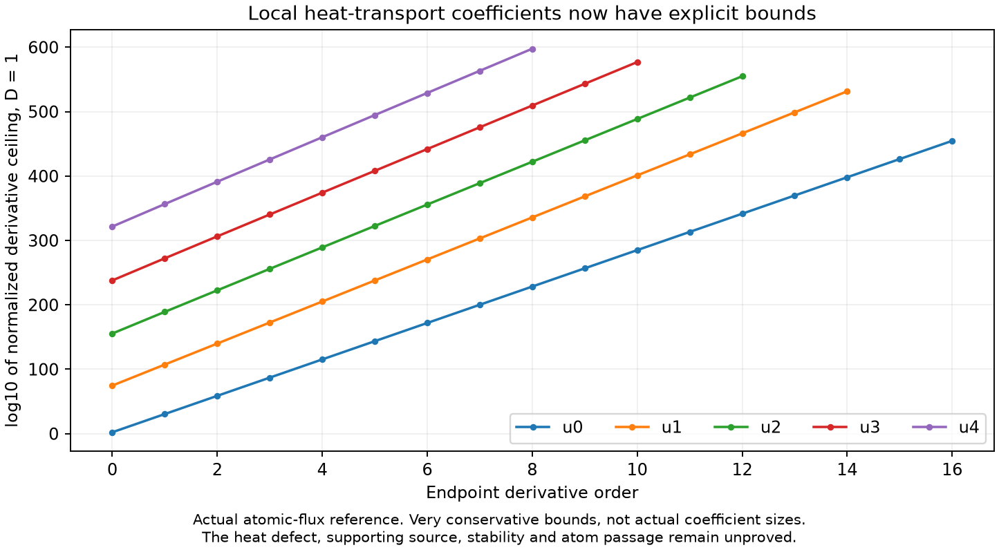

## Full Gaussian and cutoff heat-defect bound

Checkpoint181 evaluates the previously missing $B_4$ and a conservative short-time remainder ceiling. The [script](../scripts/dihole_heat_defect.py) reuses the saved179/180 constants; its [results](../results/dihole_heat_defect_results.json) retain **69 exact input hashes** and **14 passing checks**. No old geometry simulation was rerun. All formulas below use $D=1$ and endpoint derivatives holding the kernel's source fixed.

**Outcome:** the bound is finite but far too large to establish the supporting stress. At atomic flux, $B_4<10^{841}$ and $C_*<10^{843}$. These are conservative mathematical error ceilings, not physical energies, actual error sizes or evidence that a field exists.

### Exact cancellation before estimation

Let $G_t=(4\pi t)^{-2}\exp[-d^2/(4t)]$, $\chi(d)=S(2-4d/\rho)$ and $Q_4=\chi G_t\sum_{j=0}^4t^ju_j$. Transport cancellation gives the exact physical-volume identity

$$
E_{4,g}=(\partial_t+P_g)Q_4
=t^4\chi G_tP_gu_4+[P_g,\chi]\left(G_t\sum_{j=0}^4t^ju_j\right).
$$

For component operator-norm bounds on ordered second-derivative pairs, the commutator is majorized by

$$
16p_2\chi''G_tu+32p_2\chi'(G_t'u+G_tu')+4p_1\chi'G_tu.
$$

Every product is differentiated by normalized Frechet-jet convolution. The cutoff needs derivatives through8, $u_4$ through8, other heat coefficients through at least7, the Gaussian through7, and physical operator coefficients through6. All are available. The cutoff and its positive-order derivatives vanish outside the normal support; its derivatives are confined to $\rho/4\le d\le\rho/2$.

### Distance and cutoff derivatives without a diagonal singularity

Let $Y_n$ be the saved normalized inverse-exponential derivatives and $M$ the real metric upper bound. Since $d^2=v^Tg_yv$ in initial-velocity coordinates,

$$
\frac{\|D^n(d^2)\|}{n!}\le A_n+B_nd,\qquad
A_n=M\sum_{j=1}^{n-1}Y_jY_{n-j},\quad B_n=2\sqrt M\,Y_n.
$$

In particular $A_1=0$. Replacing the linear $d$ term by a constant too early would create an artificial small-time divergence.

For cutoff derivatives only, put $d_0=\rho/4$, $d_1=\rho/2$, and use the squared-distance increment series $Z(z)=\sum_{n=1}^8(A_n+B_nd_1)z^n$. The distance-increment majorant is

$$
D(z)=\sum_{k=1}^8\left|{1/2\choose k}\right|d_0^{1-2k}Z(z)^k.
$$

If $S_k$ denotes the saved ordinary step-derivative bound, the normalized cutoff ceiling of order $n\ge1$ is

$$
[z^n]\sum_{k=1}^8\frac{S_k}{k!}(4/\rho)^kD(z)^k,\qquad \chi_0\le1.
$$

This calculation is confined to the annulus, so it never differentiates the distance function at coincidence. The actual cutoff is constant there.

### Gaussian moments preserve the small-time powers

Strip off the Gaussian exponential and write its normalized derivative bound as a positive polynomial $H_n(d,t^{-1})$:

$$
H_0=1,\qquad
H_n=\frac1{4nt}\sum_{k=1}^n k(A_k+B_kd)H_{n-k}.
$$

Every monomial $d^at^{-b}$ satisfies $2b-a\le n$. With the saved normal-volume density ceiling $\theta_{\max}$, four-dimensional radial integration gives

$$
\|d^ae^{-d^2/(4t)}\|_{L^2(dV_g)}
\le\pi\sqrt{\theta_{\max}(a+1)!}\,(2t)^{(a+2)/2}.
$$

This includes the Euclidean time-difference direction. Extending the radial integral beyond the normal support only increases the bound. Including $t^4(4\pi t)^{-2}$ from the interior defect leaves the time power

$$
t^{3+a/2-b}.
$$

It is nonnegative through derivative order6, so every interior term is bounded uniformly by its value at $s_0$. The saved twice-powers are $0,1,\ldots,6$. This is why the column graph norm remains bounded at arbitrarily small positive times.

For the annulus, substitute $d\le d_1$ in $H_n$, retain $\exp(-\beta/t)$ with $\beta=\rho^2/64$, and multiply the pointwise bound by

$$
\sqrt{\operatorname{Vol}}\le\pi\sqrt{\theta_{\max}/2}\,d_1^2.
$$

Each time factor is $t^{-p}e^{-\beta/t}$ with $p\le9$. Its supremum is at $s_0$ when $p\le0$ or $s_0\le\beta/p$; otherwise it is $(p/(e\beta))^p$. At atomic flux $\beta/s_0\ge706.1841955336314$, so all annular terms peak at $s_0$. At $q=1000$ some peak inside the interval; the code includes those critical points and does not apply the atomic endpoint shortcut.

### The full graph norm and source trace

Convert canonical coefficients to physical volume exactly as in180. For normalized derivative bounds $F_n$, one application of $1+P_g$ is bounded by

$$
(\mathcal TF)_n=F_n+\sum_{j=0}^n\left[
16p_{2,j}(n-j+2)(n-j+1)F_{n-j+2}
+4p_{1,j}(n-j+1)F_{n-j+1}
+p_{0,j}F_{n-j}\right].
$$

Apply this three times, reducing derivative orders $6\to4\to2\to0$, separately to interior and annular column bounds.

The physical half-density must also remain in the source integral:

$$
E_{4,c}(z,y)=v(z)E_{4,g}(z,y)v(y),\qquad
\|(1+P_c)^3E_{4,c}(\cdot,y)\|_{L^2(dz)}
=v(y)\|(1+P_g)^3E_{4,g}(\cdot,y)\|_{L^2(dV_g)}.
$$

Two collars of coordinate length $1/20$ and two radius-one hemisphere disks give coordinate source volume $\pi/5$ per unit Killing time. Thus

$$
B_4(t)\le4C_{{\rm ev},c}\sqrt{\mu_{\max}}\,\frac{\pi}{5}
\sup_y\|(1+P_g)^3E_{4,g}(\cdot,y)e_a\|_2.
$$

The rank4, both collars and both hemispheres are included. The prefactor excluding $C_{\rm ev}$ is bounded by approximately3.390356095299510. There is no extra lapse or Weyl multiplier. The source partition introduces no derivatives because it only partitions the final pointwise trace integral.

### A finite remainder ceiling, with exact lower coefficients

At coincidence, $\partial_iG_t=0$ and $\partial_i\partial_jG_t=-g_{ij}G_t/(2t)$. The paired metric probe preserves four-volume pointwise, so $\dot P_2^{ij}g_{ij}=0$. The Gaussian Hessian contribution therefore cancels exactly, while $\chi=1$ locally. Define the Q4 coefficients

$$
b_{8,Q4}=-\int\operatorname{tr}(\dot P_gu_3)(x,x)\,dV/T,\qquad
b_{10,Q4}=-\int\operatorname{tr}(\dot P_gu_4)(x,x)\,dV/T.
$$

For $j=3,4$, the explicit bound is

$$
|b_{2j+2,Q4}|\le4V_{\rm coord}\mu_{\max}
\left(32d_2u_{j,2}+4d_1u_{j,1}+d_0u_{j,0}\right),
$$

where $d_i$ are the converted physical $\dot P$ coefficient bounds and $u_{j,n}$ are normalized endpoint ceilings. This uses first-slot derivatives before setting the two points equal. It does not differentiate both slots along the diagonal.

The Duhamel estimate from178 now gives

$$
C_*\le |b_{8,Q4}|+s_0|b_{10,Q4}|+16\pi^2\sup_{0<t\le s_0}B_4(t).
$$

This bounds the remainder after subtracting the **exact** lower coefficients $a_2,a_4,a_6$. Old numerical quadratures for those coefficients have not been substituted into the certificate. Any nonzero low-order coefficient error would need a separate term and cannot silently be treated as $O(t^2)$. The current defect estimate alone is also not used to identify the higher full heat-asymptotic coefficients.

Using178's all-time magnetic reference bound gives the valid triangle estimate $C_{\rm geom}\le C_*+C_{\rm mag}$. It deliberately sacrifices magnetic cancellation; a sharper bound remains necessary.

### Evaluated result and its limitation

Logarithmic upper ceilings are:

| Quantity | $q=1000$ | Exact atomic $q$ |
| --- | ---: | ---: |
| Physical interior graph-column bound | 572.02620 | 565.99275 |
| Physical annular graph-column bound | 537.46281 | 242.72332 |
| Full $B_4$ | 737.48292 | 840.32534 |
| $|b_{8,Q4}|$ | 290.44703 | 319.96652 |
| $|b_{10,Q4}|$ | 367.94178 | 404.82313 |
| $C_*$ and $C_{\rm geom}$ | 739.68133 | 842.52376 |

The table rounds upward for display; the artifact retains exact dyadic endpoints. At the atomic target with nominal $M^2s_0=100$, the resulting curved-remainder envelope divided by $q^2$ is below $10^{732}/D$, an enormous upper bound. It cannot determine the sign or useful magnitude of the total source. It does not show that the actual remainder is large or that the proposed geometry is impossible.

This closes the previously unevaluated generic defect bound and reveals that its current implementation is quantitatively insufficient for support. The interior estimate dominates the annular estimate by more than323 logarithmic orders in the atomic case. Further work should target the interior/canonical point-evaluation overestimates, cancellations and direct source enclosures; tightening only the already negligible cutoff contribution cannot solve the observed problem. Exact lower-coefficient enclosures and the complete source at the same regulator remain unresolved. This is a calculation within existing physics, not a new physical law.

### Verification and status

All14 native checks pass. Controls compare Gaussian derivatives to direct high-precision differentiation, time suprema to their critical points, graph-operator composition to an exact constant-coefficient example, and the four-dimensional Gaussian integral to direct quadrature. The paired diagonal cancellation is also checked. All69 exact input hashes match. Independent audits PASS:122 directed bounds and114 log enclosures at170-190 digits;120 directed coefficient/graph/source comparisons at600 digits. Both verify69 exact input hashes and final source/result hashes. Smallest positive margin in the latter audit:4.00469e-92. Figure inspected. Final layout PASS:177 imports,1583 Markdown links,8 source guards,14 frozen pilot hashes.

The heat-kernel construction uses established parametrix ideas, with [Ludewig's short-time heat-kernel paper](https://arxiv.org/abs/1607.05152) as background. That paper's abstract states compact-manifold results; it is not being used as an automatic global numerical certificate for this exterior geometry. The local cutoff calculation, source integration and the already specified global nonnegative operator are explicit here.

Source SHA256: ff32753c8c84b68794b542a7f427963b28ad37d2cd893779610de9e0ae64a1d2.
Result SHA256: bb0af04d14108fe79d5658b3a08e4e6611355a8d4d18bb606780c64a09b3ce2b.

The payload remains one neutral hydrogen atom through a trial1nm areal opening. No self-consistent supporting source, stable opening, atom transmission, internal-state survival or clock advantage has been established. The present static geometry excludes13September2027 to12September2027; humans remain deferred.

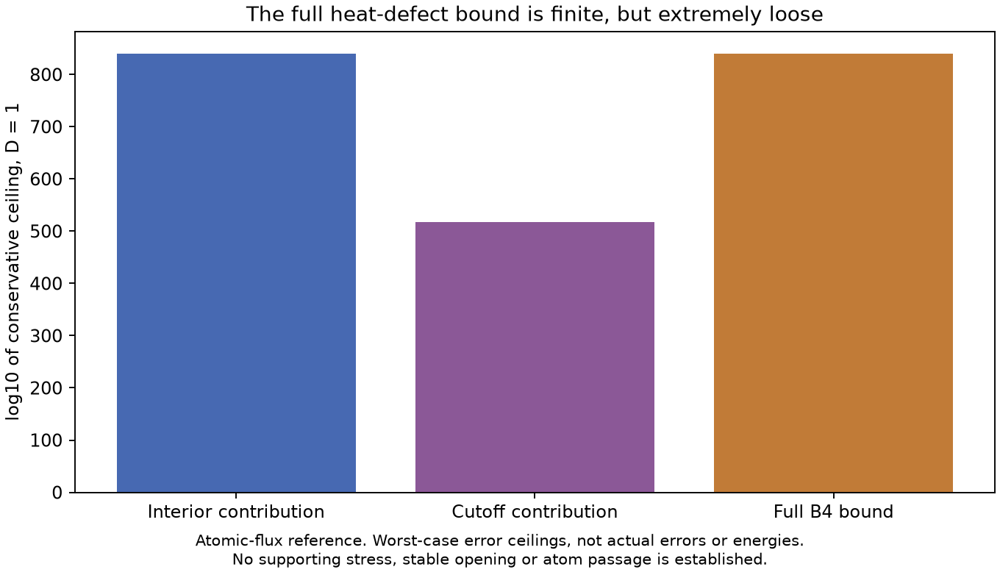

## Adjustable graph and Fourier scales for the full defect

Checkpoint182 tightens the same full-defect certificate by changing two **auxiliary proof scales**. The physical geometry, magnetic field, Q4 cutoff, time interval, target regulator and atomic payload are unchanged. The [calculation](../scripts/dihole_scaled_graph.py) has 12 passing checks and 71 exact input hashes in its [results](../results/dihole_scaled_graph_results.json).

At atomic flux the logarithmic $B_4$ ceiling falls from840.32534 to501.39981, a reduction of more than338.92553 decimal orders in the **ceiling**. This is not a measured reduction in the actual field error. The remaining bound is still far too large to decide physical support.

### Spectral graph scale

For $\mu>0$, use the graph norm $\|(\mu^2+P_c)^3u\|_2$. Because $P_c=-D^2\ge0$,

$$
\|D^pu\|_2\le c_p\mu^{p-6}\|(\mu^2+P_c)^3u\|_2,\qquad0\le p\le6,
$$

where

$$
c_p=\sup_{x\ge0}\frac{x^{p/2}}{(1+x)^3},\qquad
(c_0,\ldots,c_6)=
\left(1,\frac{25\sqrt5}{216},\frac4{27},\frac18,
\frac4{27},\frac{25\sqrt5}{216},1\right).
$$

For $0<p<6$ the maximum occurs at $x=p/(6-p)$. Keep the same local cube, cutoffs, $L=20$ and $A_\chi$ from180. The mixed derivative bounds, for $\ell+p\le6$, now obey

$$
U_{0,p}=c_p\mu^{p-6},
$$
$$
U_{\ell,p}=L U_{\ell-1,p+1}+A_\chi U_{\ell-1,p}
+L\sum_{j=1}^{\ell-1}{\ell-1\choose j}
\left[2^{j+1}a_jU_{\ell-j,p}+2^jb_jU_{\ell-1-j,p}\right].
$$

The two indices retain the powers of $D$ instead of replacing all of them by a common unit-scale bound. The final cutoff convolution is

$$
W_n(\mu)=\sum_{k=0}^n{n\choose k}2^k k!(20/h)^kU_{n-k,0}.
$$

These are ordinary derivative bounds, not normalized Taylor coefficients. In code, each polynomial coefficient at index $p$ multiplies $\mu^{p-6}$; shifting the second index in the recurrence already changes the power. No additional factor of $\mu$ belongs in that representation.

### Independent Fourier evaluation scale

For $\lambda>0$, Fourier Cauchy-Schwarz in dimension4 gives

$$
\|D^k f(x)\|\le E_k\lambda^{k-4}\|(\lambda^2-\Delta)^3f\|_2,
$$

with $E_0=E_2=1/(4\pi\sqrt{20})$ and $E_1=1/(4\pi\sqrt{30})$. This follows by substituting $\xi=\lambda\eta$ in the same integrals used in180. Applying it to the localized section gives

$$
C_{\rm ev}(\mu,\lambda)=
\left(\frac{d_2}{12\lambda^2}+\frac{d_1}{30\lambda^3}
+\frac{d_0}{48\lambda^4}\right)
\left[\lambda^6W_0+3\lambda^4W_2+3\lambda^2W_4+W_6\right].
$$

The rational factors retain the established tensor contraction bounds and upward Fourier constants. Here the $d_i$ are canonical $\dot P_c$ coefficient bounds; physical-volume conversion is still used for the defect column.

For the physical column, compute $C_j\ge\|P_g^jE_{4,g}\|_2$, $0\le j\le3$, using the saved181 interior and annular derivative bounds. Then

$$
G(\mu)=\mu^6C_0+3\mu^4C_1+3\mu^2C_2+C_3
$$

bounds $\|(\mu^2+P_g)^3E_{4,g}\|_2$. The same physical half-density and source trace factors give

$$
B_4(\mu,\lambda)=4V_{\rm coord}\sqrt{\mu_{\rm vol,max}}\,
C_{\rm ev}(\mu,\lambda)G(\mu).
$$

Here $\mu_{\rm vol,max}$ denotes the saved physical volume-density ceiling and is unrelated to the auxiliary graph scale $\mu$. The shifted graph operator commutes with the heat semigroup, so its contraction in the Duhamel argument is unchanged.

Neither $\mu$ nor $\lambda$ is the target physical regulator $M$, the earlier comparison filter $\Lambda$, an added matter mass, a physical field strength or an opening size. Both have auxiliary inverse-length units in the $D=1$ calculation.

### Finite search and rigorous evaluation

All coefficients of $B_4(\mu,\lambda)$ are positive. The implementation stores 39 point-evaluation monomials and 87 combined-defect monomials for each flux. Their logarithmic sum is convex in $(\log\mu,\log\lambda)$.

A finite log-space search proposes powers of two: exponents from-32 to224 at spacing8, followed by a unit-spacing search within8 of the selected pair. The selected powers are then evaluated with100-digit interval arithmetic using the exact input bounds. **The outward evaluation certifies the selected ceiling; the search does not certify a global optimum.** No physics result depends on calling its selected pair optimal.

| Quantity | $q=1000$ | Exact atomic $q$ |
| --- | ---: | ---: |
| Selected graph scale $\mu$ | $2^{123}$ | $2^{136}$ |
| Selected Fourier scale $\lambda$ | $2^{127}$ | $2^{140}$ |
| $\log_{10} C_{\rm ev}$ upper ceiling | -58.02631 | -65.85309 |
| $\log_{10} G$ upper ceiling | 572.30344 | 566.72266 |
| Previous $\log_{10} B_4$ upper ceiling | 737.48292 | 840.32534 |
| New $\log_{10} B_4$ upper ceiling | 514.80737 | 501.39981 |
| $\log_{10} C_*$ and $C_{\rm geom}$ upper ceiling | 517.00579 | 503.59823 |

The rounded table gives display ceilings; stored dyadic endpoints are authoritative. The certified decrease in the atomic ceiling exceeds338.9255321509277 decimal orders. The decrease at $q=1000$ exceeds222.67554903555398 orders.

The Q4 diagonal bounds from181 are retained, and

$$
C_*=|b_{8,Q4}|_{\rm bound}+s_0|b_{10,Q4}|_{\rm bound}
+16\pi^2 B_{4,\rm bound},\qquad
C_{\rm geom}=C_*+C_{\rm mag}
$$

are conservative ceilings. Exact lower coefficients are still required in the definition of the remainder. At atomic flux and nominal $M^2s_0=100$, the curved-remainder envelope divided by $q^2$ now has logarithmic ceiling392.64560, compared with731.57114 before. It remains uninformative for the source sign; it is not a bound on the whole supporting source.

### Verification and next physical question

All 12 native checks pass. Spectral extrema match their closed forms within $8.05\,10^{-87}$; direct radial quadrature checks Fourier scaling at three distinct scales within $1.61\,10^{-86}$. A separate positive-polynomial example has its known search minimum at $(\mu,\lambda)=(1,1)$. Direct factorized evaluation agrees with the combined polynomial. Both evaluated ceilings improve on181 with interval separation. All 71 exact input hashes match, and the figure was inspected. Independent audit PASS:300 directed comparisons at500-650 digits, including every polynomial coefficient, a separate scalar recurrence, physical graph powers, both remainder ceilings and all12 matching diagnostics. All 71 hashes match; the smallest positive relative margin is6.54312e-103. Final layout PASS:178 imports,1593 Markdown links,8 source guards,14 frozen pilot hashes.

Source SHA256: 8f4684f02f16404ba1615e29b67e7f8e1de4964e8ffb90c4a8b9a956388cf6d9.
Result SHA256: 2f29e4149326fdb5ba22b5561cbd0643e3adadf235762f731cd4890cebc420c4.

The large reduction shows that the former certificate paid heavily for arbitrary unit proof scales. It does not establish a stable field or support. The next specific improvement to evaluate is a source-centred gauge, keeping the physical curvature and flux unchanged.

On a fixed convex coordinate ball, a phase
$\alpha_y(x)=\int_0^1(x-y)^iA_i(y+t(x-y))dt$ gives

$$
A_i^y=A_i-\partial_i\alpha_y
=\int_0^1t(x-y)^jF_{ji}(y+t(x-y))dt.
$$

If $a_n$ bounds the original ordinary component derivatives of $A/|q|$, then on a ball of radius$r$ the new component derivatives obey

$$
|\partial^n A_i^y|\le |q|
\left[\frac{4r\,a_{n+1}}{n+2}+\frac{2n\,a_n}{n+1}\right],
$$

with the second term absent at$n=0$. The saved gauge jets through20 suffice for order19, needed to retain the operator's order18 derivatives. An inner spatial radius$2^{-32}$ contains the point-evaluation cube and normal support, with an outer cutoff radius$2^{-31}$ inside the existing coordinate clearance. A time-independent phase extension gives a global unitary transformation. Hold the phase fixed during metric variation; otherwise an extra commutator would appear. This preserves the global graph norm, physical source and flux.

That gauge proposal has been derived but **has not yet been numerically applied to the coefficient, transport or defect bounds**. Ordinary coordinate radial gauge does not eliminate transport along curved geodesics. Its effect must be recomputed rather than assumed.

One neutral hydrogen atom and the trial 1 nm areal opening remain the target. Supporting stress, stability, atom transmission, internal-state survival and clock advantage remain unproved. The static geometry still excludes13September2027 to12September2027; human enlargement remains deferred.

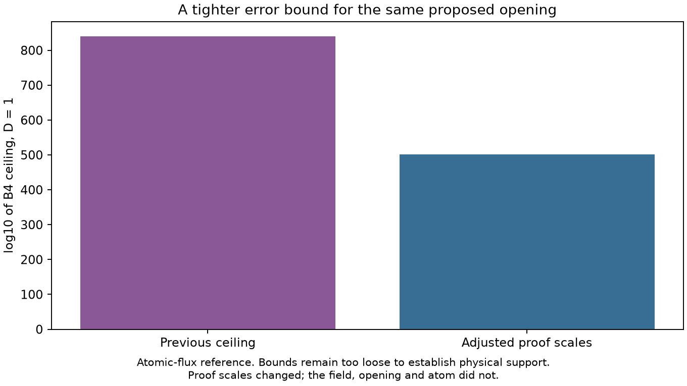

## Source-centred gauge for the complete field-error certificate

Checkpoint183 applies the gauge proposed in182 and recomputes the full operator, heat transport and defect bounds. The [script](../scripts/dihole_centered_gauge.py) uses the saved geometry without rerunning its interval cover. Its [results](../results/dihole_centered_gauge_results.json) retain 73 exact input hashes and 12 passing checks.

At the atomic reference, the logarithmic $B_4$ ceiling falls from501.39981 to449.81832, a reduction of at least51.58149348139301 decimal orders. The residual ceiling remains far too loose to establish support. This improves a mathematical certificate for the same field; it does not generate a new field, material or opening.

### Fixed local gauge and global unitary equivalence

For each fixed source point$y$, use a convex ordinary-coordinate ball of radius$r=2^{-32}$. Define

$$
\alpha_y(x)=\int_0^1(x-y)^iA_i(y+t(x-y))\,dt,\qquad
A_i^y=A_i-\partial_i\alpha_y
=\int_0^1t(x-y)^jF_{ji}(y+t(x-y))\,dt.
$$

The potential vanishes at the source while the curvature$F=dA$ is unchanged. This is an ordinary-coordinate radial gauge, so electromagnetic transport along curved geodesics is still included.

The new gauge must hold on the entire point-evaluation cube and normal support. The point cube's Euclidean radius is at most$2^{-35}<r$. The saved geodesic-displacement ceiling$2r_{\rm velocity}<r$ also fits. An outer spatial cutoff at radius$2^{-31}$ lies within the existing coordinate clearance$.02$. Thus a smooth cutoff can equal one on the inner ball and vanish outside the larger chart ball.

Extend the cutoff phase by zero to obtain a globally defined, time-independent phase. For the convention$\nabla=\partial-iA$, multiplication by$U_y=e^{-i\alpha_y}$ on the inner ball gives

$$
P^y=U_yPU_y^*,\qquad
(\mu^2+P^y)^3U_y=U_y(\mu^2+P)^3.
$$

The global cutoff does not alter these unitary identities. Its derivatives outside the inner ball are not needed in the local estimates, while global graph norms are preserved exactly. Hold this phase fixed during the metric variation; then$\dot P^y=U_y\dot P U_y^*$ with no extra variation commutator.

A separate gauge may be chosen for each kernel source because the trace estimate differentiates only the first kernel argument, with the source fixed, before taking coincidence. It never differentiates the gauge centre along the diagonal. The physical measure, source support, magnetic flux, magnetic reference and exact lower subtraction coefficients remain unchanged.

### Explicit derivative replacement

Let$a_n$ be the old ordinary component-derivative ceiling for$A/|q|$. From$F_{ji}=\partial_jA_i-\partial_iA_j$, its order$n$ component bound is$2|q|a_{n+1}$. Differentiating the radial-gauge integral gives

$$
|\partial^n A_i^y|\le |q|
\left(\frac{4r\,a_{n+1}}{n+2}+\frac{2n\,a_n}{n+1}\right).
$$

The first term uses$\sum_j|x^j-y^j|\le2r$ in four dimensions; differentiating the displacement supplies the second term. That term is absent for$n=0$, but for$n=1$ it retains the unsuppressed field-curvature contribution. Shrinking the coordinate ball does not make all derivatives small.

A sharper zeroth-order ceiling follows from the saved full-buffer physical magnetic bound$B_{\rm unit}\le12.010815582697589$. The Euclidean field is purely magnetic, with orthonormal bilinear norm$|q|B_{\rm unit}$. The real coordinate metric upper bound$M$ therefore gives

$$
\|A^y\|_{\rm Euclidean}\le \frac r2 M|q|B_{\rm unit}.
$$

Charge enters once. The smaller valid zeroth-order ceiling is used. It falls from676.9053329684016 to$1.2981876755092596\,10^{-7}$ per unit$|q|$, a ceiling ratio exceeding$5.214233240\,10^9$.

The replacement array has **orders0 through19 only**. Original jet20 supplies new jet19; no new order20 gauge bound is claimed, since that would require original jet21. These orders suffice for the full operator and variation through18 and for all retained heat-transport derivatives.

### Recomputed certificate

The existing179 operator routine accepts the new radial component of the potential and retains the fixed gauge one-form during variation. The180 point and transport routines retain the spin connection, physical half-density and unitary transport. The original normal radius and packed exponential-map derivative ceilings remain valid because the metric is unchanged. The181 complete defect assembly and182 adjustable graph/Fourier bounds are then recomputed without dropping any contribution.

| Quantity | $q=1000$ | Exact atomic $q$ |
| --- | ---: | ---: |
| Selected graph scale$\mu$ | $2^{123}$ | $2^{123}$ |
| Selected Fourier scale$\lambda$ | $2^{127}$ | $2^{127}$ |
| New$\log_{10}B_4$ ceiling | 514.80737 | 449.81832 |
| New$\log_{10}C_*$ and$C_{\rm geom}$ ceiling | 517.00579 | 452.01674 |
| Curved-remainder envelope/$q^2$, nominal$M^2s_0=100$, log ceiling | 492.72031 | 341.06411 |

The low-flux bound barely changes: its decrease is only about$6.7\,10^{-18}$ decimal orders, with no significant displayed improvement. The atomic ceiling decreases by51.58149 orders. All comparisons concern conservative ceilings, not actual physical errors. Exact dyadic endpoints are retained in the artifact.

At atomic flux, the normalized zeroth and eighth derivatives of$u_4$ now have logarithmic ceilings292.07020 and538.68299, close to the low-flux ceilings292.06408 and538.67075. This suggests that the remaining general geometry and spin estimates deserve attention; it does not establish that the actual electromagnetic contribution is negligible.

### Controls, audits and next calculation

Independent polynomial examples cover both a pure gauge and constant magnetic curvature with an added gradient potential. Direct line integration and differentiation reproduce the radial-gauge identity within$1.94\,10^{-75}$. Curvature is preserved in the control to the working precision, and the covariant-derivative identity agrees within$3.02\,10^{-74}$. Domain containment, derivative schedules and all 73 input hashes pass. All 12 native checks pass, and the figure was inspected. Independent numerical audit PASS:495 directed comparisons at500-550 digits, including gauge/operator arrays, point/transport estimates and all12 matching rows. All73 hashes and final source/result hashes match. Domain/gauge audit also PASS. Final layout PASS:179 imports,1603 Markdown links,8 source guards,14 frozen pilot hashes.

Source SHA256: bc1c52a5be65971eeaa6adae00519c04e631588c82e4cb224a03d5059a756ae8.
Result SHA256: a98634878eb8604219e0a1bf3cfe38c311210df5ff0ad7dc0d0928c919dfe6af.

A focused diagnostic evaluates the zeroth physical-connection majorants already used by the transport code:

$$
\Omega_{\rm spin,0}\le768E_0I_0^2E_1,\qquad
\Omega_{\rm gauge,0}\le |q|a^y_0.
$$

Their logarithmic ceilings are23.81648 and17.78013. The spin ceiling is more than six decimal orders larger. This is a comparison of estimates, not the actual two contributions, but it identifies a concrete remaining overestimate to target.

The next calculation should sharpen the **same positive symmetric coframe**$E=\sqrt g$ using the real spectral bounds, before repeating the field calculation. In particular$E_0\le\sqrt M$ and$I_0\le\sqrt H$. Differentiating$E^2=g$ gives a Sylvester equation and the operator-norm recurrence

$$
E_n\le\frac{4g_n+\sum_{j=1}^{n-1}{n\choose j}E_jE_{n-j}}{2\sqrt m},
$$

where$g_n$ is the saved metric **component** ceiling, explaining the factor4. The inverse frame can similarly be bounded from$g^{-1}$, using its spectral lower bound$1/M$. This possible improvement has not yet been evaluated; the old frame estimates remain the ones used in the present certificate.

The first target remains one neutral hydrogen atom through a trial 1 nm areal opening. No self-consistent supporting stress, stable opening, atom transmission, internal-state survival or clock advantage is established. The current static geometry excludes13September2027 to12September2027; human enlargement remains deferred.

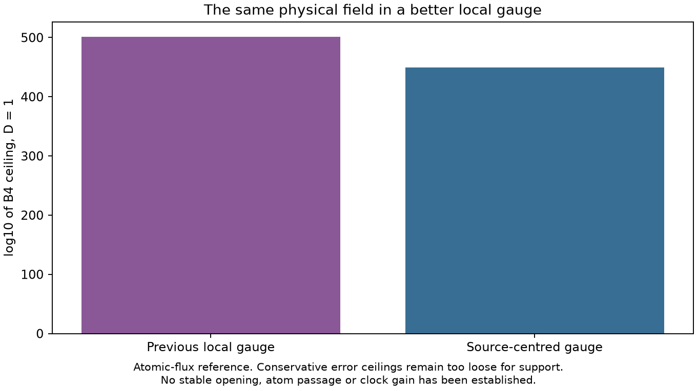

## Positive-frame bounds from the real metric

Checkpoint184 sharpens the same positive symmetric coframe using saved real metric bounds. The [calculation](../scripts/dihole_positive_frame.py) and [results](../results/dihole_positive_frame_results.json) retain 77 exact input hashes and 13 passing controls. Geometry, physical field, ordinary-coordinate radial gauge, regulator, normal neighbourhood and one-atom target are unchanged.

At atomic flux, the conservative $\log_{10}B_4$ ceiling decreases from449.81832 to356.39908, by at least93.41923770240045 decimal orders. This is a tighter estimate, not a measured error reduction or a physical advance of that magnitude. The remaining bound cannot determine the supporting stress.

### Noncommuting matrix bounds

The existing coframe has positive temporal/radial entries and a positive symmetric angular block. It is therefore already $E=\sqrt g$; no frame rotation is introduced. Write $I=E^{-1}$ and use the saved real spectral bounds

$$
m\,1\le g\le M\,1,\qquad \|g^{-1}\|\le H,
$$

with $M=92.84421315093161$, $H=260.3941671325786$ and $m=0.0038403317977965847$. These supply $e_0=\sqrt M$, $i_0=\sqrt H$. Lowercase $e_n,i_n,\gamma_n,\eta_n$ below are uniform operator-norm derivative ceilings, not component bounds.

Differentiating $E^2=g$ gives the Sylvester equation

$$
E\,\partial^\alpha E+(\partial^\alpha E)E
=\partial^\alpha g-
\sum_{0<\beta<\alpha}{\alpha\choose\beta}
(\partial^\beta E)(\partial^{\alpha-\beta}E).
$$

No matrices are commuted. The solution of $EX+XE=C$ is
$X=\int_0^\infty e^{-tE}Ce^{-tE}\,dt$, so its norm is at most
$\|C\|/(2\sqrt m)$. Grouping multiindices by total order gives

$$
e_n\le\frac{\gamma_n+
\sum_{j=1}^{n-1}{n\choose j}e_je_{n-j}}{2\sqrt m}.
$$

Here $\gamma_0=M$, $\gamma_1$ is four times the sharper saved real first-component bound, and $\gamma_n$ for $n\ge2$ is four times the old metric-component ceiling. The factor four is necessary for a general $4\times4$ matrix.

The inverse-metric and inverse-frame identities give

$$
\eta_n\le H\sum_{j=1}^n{n\choose j}\gamma_j\eta_{n-j},
$$

$$
i_n\le
\min\left\{
\frac{\sqrt M}{2}\left(\eta_n+
\sum_{j=1}^{n-1}{n\choose j}i_ji_{n-j}\right),
\quad i_0\sum_{j=1}^n{n\choose j}e_ji_{n-j}
\right\}.
$$

The first inverse-frame bound follows from $I^2=g^{-1}$ and the spectral lower bound $g^{-1}\ge1/M$; the second follows directly from $EI=1$. Each internal sequence may also take the smaller of this new operator bound and **four times** its corresponding old component bound.

Only after all internal recurrences are evaluated does the code export the minimum of each new operator ceiling and the old component ceiling. Those exported minima are component bounds. Feeding them back into an operator-norm recurrence without conversion would be invalid.

The paired probe remains $\dot E=F\,\mathrm{diag}(1,-1,0,0)E$ and $\dot I=-F\,\mathrm{diag}(1,-1,0,0)I$ for the existing block frame, so the prior product estimates for the operator variation still apply. Only real derivative ceilings are replaced; the saved complex-domain moduli are not replaced by real bounds.

| Component ceiling | Previous | New |
| --- | ---: | ---: |
| $E_0$ | 15198.55124 | 9.635571 |
| $E_1$ | 30397102.46875 | 217721.44390 |
| $I_0$ | 42977.43710 | 16.136734 |
| $I_1$ | 85954874.19954 | 56693394.05083 |

Displayed ceilings are rounded upward; exact stored endpoints govern the calculation. All exported derivative bounds through20 are no larger than their old counterparts.

### Recomputed full certificate

The existing operator/variation, point-evaluation, heat-transport, whole-defect and adjustable-scale routines are reused. The saved normal-coordinate estimates remain conservative because the metric is unchanged. No field or defect contribution is removed.

| Quantity | $q=1000$ | Atomic $q=4642875905017627791065088$ |
| --- | ---: | ---: |
| Graph scale $\mu$ | $2^{80}$ | $2^{103}$ |
| Fourier scale $\lambda$ | $2^{84}$ | $2^{107}$ |
| $\log_{10}B_4$ ceiling | 326.32087 | 356.39908 |
| Ceiling reduction, decimal orders (lower bound) | 188.48649 | 93.41923 |
| $\log_{10}C_*$ and $C_{\rm geom}$ ceiling | 328.51929 | 358.59750 |
| Curved envelope/$q^2$ at nominal $M_{\rm reg}^2s_0=100$, log ceiling | 304.23381 | 247.64487 |

$M_{\rm reg}$ in the last row is the regulator mass, distinct from the metric upper bound $M$ above. The scales $\mu,\lambda$ are auxiliary proof choices. The physical regulator, source and field are unchanged. The bound still assumes subtraction of the exact lower heat coefficients; earlier numerical quadratures have not been promoted to certified enclosures.

### Verification and retained failure

A genuinely noncommuting polynomial frame checks derivatives through order6. The independent diagonal-basis Sylvester solve agrees with the first derivative to about $5.1\times10^{-171}$; the largest tested actual-to-bound ratio is below0.833334. This is a finite control of the implementation, alongside the analytic recurrence, not a proof by numerical sampling.

The initial export applied an outward-rounding helper to an already valid saved float ceiling. That increased some unchanged ceilings by one binary64 ulp and failed the nonincrease control. The [original failed source](../provenance/dihole_positive_frame_rounding_trial.py) and [failed result](../results/dihole_positive_frame_rounding_trial.json) are preserved and authenticated by the final run. The fix takes the original float cap directly; it does not weaken the check or alter the internal operator recurrence.

All13 controls pass. An independent 550-digit recomposition passed600 directed comparisons across frame, operator, point, transport, defect, matching and scale results. A separate actual-code proof audit confirmed the matrix recurrences, norm conversions and unchanged real/gauge domain. The figure was inspected. Final layout PASS:180 imports,1615 Markdown links,8 historical source guards,14 frozen pilot hashes.

Source SHA256: 823df8b95089f2036991618c9ec7b65c0b92425394063f2f93487b5872d8ad8d.
Result SHA256: 765cc0cc9989e238ba630082f27bcb83afba55d57a977cda5d7d87bcd94f32cc.

### Next discriminating calculation

The same zeroth-connection diagnostic now has approximate ceiling logs11.62277 for spin and17.78013 for the electromagnetic connection. This compares estimates, not the actual contributions. It suggests testing a covariant heat estimate that retains cancellations between the connection and parallel transport, instead of repeatedly bounding those terms separately.

A geodesic-radial gauge is a candidate formulation, not an implemented result. It must transform both $P$ and $\dot P$, retain the density and fixed-variation convention, and preserve the local domain and global unitary extension. The current ordinary-coordinate radial gauge does not make curved-geodesic transport the identity. Simply setting transport equal to one in the current formula would be invalid.

The first success criterion remains a self-consistent supporting source for a trial1nm opening, followed by stability, transmission and internal-state survival of one neutral hydrogen atom, and an operational exterior-clock comparison. None has been established. The present static geometry excludes13September2027 to12September2027; future clock gain is unproved. Human transport is deferred and would require new calculations.

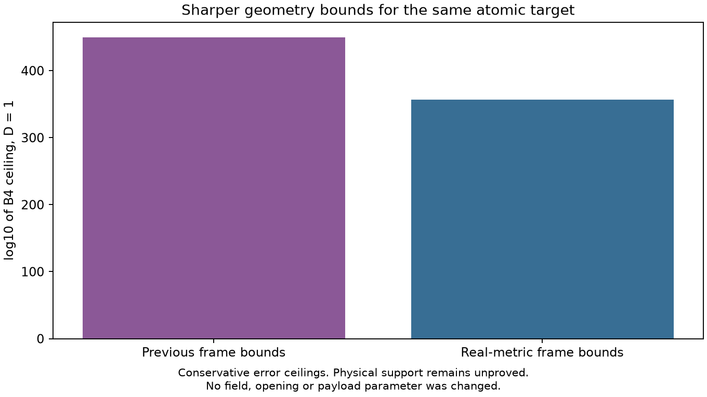

## Ordered transport and a direct unitary inverse

Checkpoint185 retains two pieces of exact propagation structure that the previous absolute-value estimates discarded. The [script](../scripts/dihole_ordered_transport.py) and [results](../results/dihole_ordered_transport_results.json) keep the physical geometry, source-centred gauge, operator, point-evaluation bound, regulator and atomic target unchanged. All14 controls pass, with83 exact inputs.

The atomic $\log_{10}B_4$ ceiling falls from356.39908 to306.26060. This is at least50.13847895020724 decimal orders tighter, but remains far too loose to determine a supporting source. No field, atom or opening has been created.

### Ordered time integrals

Let $U(t,w)$ be unitary parallel transport along the existing real geodesics, with $U(0,w)=1$. The code already has uniform normalized parameter-derivative bounds $K_j$ for its anti-Hermitian generator through order16.

At any fixed real parameter $w_0$, factor out the exact unitary solution $U(t,w_0)$. The interaction generator then has zero constant parameter jet. Unitary conjugation preserves the norm of each positive-order jet. An iterated contribution containing $m$ positive-order insertions is integrated over an ordered time simplex of volume $1/m!$ at $t=1$.

Consequently, normalized derivative ceilings are the finite-order coefficients

$$
\mathcal U_n=[z^n]\exp\left(\sum_{j\ge1}K_jz^j\right),\qquad
\mathcal U_0=1,\qquad
\mathcal U_n=\frac1n\sum_{j=1}^n jK_j\mathcal U_{n-j}.
$$

This does not commute any matrices. Only jets through $n$ contribute to degree $n$, so smooth finite jets suffice; convergence of an analytic Taylor expansion is not assumed. The old geometric recurrence omitted the simplex factors.

For the exact control $U(t,w)=\exp(ic\,t\,w)$, the new bound gives $|c|^n/n!$, matching the normalized derivative. A separate polynomial-time matrix control uses two noncommuting anti-Hermitian generators and checks orders1 through10 by direct integration of polynomial coefficients.

### Why the first trial was insufficient

The [simplex-only pilot](../results/dihole_ordered_transport_simplex_trial.json) improved atomic parallel-transport order16 by13.32062 decimal orders, but the final $B_4$ ceiling by only0.30140547 orders, about a factor of two. The inverse leading-coefficient estimate still inverted a matrix majorant geometrically. Its repeated first-derivative contribution accounted for approximately99.9% of the pilot's order16 inverse ceiling.

The [pilot source](../provenance/dihole_ordered_transport_simplex_trial.py), [PNG](../figures/dihole_ordered_transport_simplex_trial_progress.png) and [PDF](../figures/dihole_ordered_transport_simplex_trial_progress.pdf) are retained. This was a passing but weak intermediate result, not a failed physical experiment.

### Preserve unitarity in the inverse

Write $V$ for the physical half-density, and $J=D\exp_y$ for the Jacobian with respect to **unscaled** initial velocity. The leading physical heat coefficient and its inverse are

$$
u_0(x,y)=\frac{V(y)}{V(x)\sqrt{\det J}}\,U,\qquad
u_0(x,y)^{-1}=\frac{V(x)}{V(y)}\sqrt{\det J}\,U^*.
$$

Adjunction preserves every real-parameter derivative norm. The same $\mathcal U_n$ therefore bounds $U^*$ without reconstructing an inverse through a geometric series.

The saved normal-coordinate proof gives $1/16\le\det J\le81/16$. If $D_n$ bounds the positive-order normalized determinant derivatives, set $\delta(z)=16\sum_{n\ge1}D_nz^n$. A square-root majorant is

$$
S(z)=\frac94+\frac14\sum_{k\ge1}
\left|\binom{1/2}{k}\right|\delta(z)^k.
$$

The zero coefficient uses the determinant upper bound; each positive-order coefficient uses its lower bound. The already saved Jacobian derivative series gives $D_n\le24[J(z)^4]_n$ for $n\ge1$.

Multiply $S$, the composed $V(x)$ jets and the ordered $\mathcal U$ jets, then divide by $\sqrt{\mathrm{volume}_{\min}}$ to bound $1/V(y)$. Finally apply the same inverse-coordinate composition $Y/R$ as before. No additional power of the scaling radius belongs in $\det J$. Each resulting bound is minimized against the independently valid old geometric inverse bound.

The scalar density, inverse-coordinate composition and all subsequent heat recursions remain present. The common physical-operator conversion and application helpers are reused. Historical sources are byte-preserved because their hashes are part of previous certificates.

### Complete recomputation

| Quantity | $q=1000$ | Atomic $q=4642875905017627791065088$ |
| --- | ---: | ---: |
| Selected graph scale $\mu$ | $2^{68}$ | $2^{88}$ |
| Selected Fourier scale $\lambda$ | $2^{72}$ | $2^{92}$ |
| $\log_{10}B_4$ ceiling | 284.95801 | 306.26060 |
| Improvement in decimal orders, lower bound | 41.36285 | 50.13847 |
| $\log_{10}C_*$ and $C_{\rm geom}$ ceiling | 287.15643 | 308.45902 |
| Curved envelope/$q^2$, nominal $M_{\rm reg}^2s_0=100$, log ceiling | 262.87096 | 197.50639 |

All logarithmic ceilings in the table are rounded upward. The exact dyadic endpoints are saved. Neither the auxiliary scales nor the interval ceilings are measured physical quantities. Exact lower heat-coefficient enclosures and the full source remain unresolved.

The physical heat-coefficient derivative schedule remains16,14,12,10,8. Every displayed transport and heat-coefficient bound is no larger than before. The canonical operator and point-evaluation records are unchanged byte-for-value in the result.

The constant-phase test agrees within $7.3\times10^{-101}$ relative error; an independent sum of powers divided by factorials agrees within $1.8\times10^{-161}$. The noncommuting time-order test has maximum actual-to-bound ratio1, attained at the first derivative. An independent analytic density/determinant/unitary inverse control through order10 has maximum ratio0.451106.

All14 controls and83 exact inputs pass. The actual-code proof audit confirms the finite-jet argument, determinant normalization, density factors, adjoint inverse and unchanged domains. The figure was inspected. Independent numerical audit PASS:330 directed comparisons at550 digits, all83 exact inputs and14 controls, including exponential coefficients, direct inverse, full heat/defect bounds and preserved-pilot equality. The next radial-cancellation identity also passed a separate derivation audit; it remains unevaluated. Final layout PASS:181 imports,1629 Markdown links,8 historical source guards,14 frozen pilot hashes.

Source SHA256: 10efc4ab92539f88934f3702ab932b015c5bcbdaae907f78dc7285724435af85.
Result SHA256: 586e9dfceaca138d163a4ca4e37cf54e7e67be78eddd43ce66a5f1fb83e54627.

### A smaller next calculation than changing the whole gauge

Covariant heat-coefficient methods are established background; see [Avramidi, Covariant techniques for computation of the heat kernel](https://arxiv.org/abs/hep-th/9704166). That source motivates curvature-based organization; it does not certify this noncompact geometry or the numerical bounds derived here.

A proposed geodesic-radial gauge was examined but not applied. In a variable-lapse metric, the spatial projection of a four-dimensional Euclidean geodesic depends on its time velocity, so the required phase generally depends on time. A globally extended unitary phase would preserve the full operator, but individual static Fourier fibres could not silently be reused. Moreover, retaining gauge jets through19 requires exponential/inverse-map jets through20, while only17 are saved. A spin radial gauge would also change the coframe and invalidate direct reuse of184's positive-frame estimates.

A more direct candidate retains radial cancellation in the **existing** gauge. With $\gamma(0)=y$ and the source held fixed,

$$
A(\gamma(t))\cdot(\gamma(t)-y)=0,
$$

so

$$
A(\gamma)\cdot\dot\gamma=A(\gamma)\cdot W,\qquad
W=\dot\gamma-\frac{\gamma-y}{t}
=\frac1t\int_0^t s\,\ddot\gamma(s)\,ds.
$$

Uniform normalized initial-velocity jets of $W$ are bounded by half the corresponding acceleration jets. Acceleration can be bounded from the saved Christoffel jets and two velocity factors. The zero-order ratio of this new magnetic-generator estimate to the old one is bounded by $C_0R\approx0.00387358326$ using the saved geometry. Higher derivatives and the downstream improvement have **not** been evaluated. Spin transport remains present, and the new magnetic bounds would be minimized against the old ones order by order.

This is the next discriminating calculation, not an implemented result. The scientific target remains support and stability of a trial1nm opening, followed by one neutral hydrogen atom's transmission, internal-state survival and exterior-clock comparison. No such success is established. The current static geometry excludes13September2027 to12September2027; a future clock advantage remains unproved.

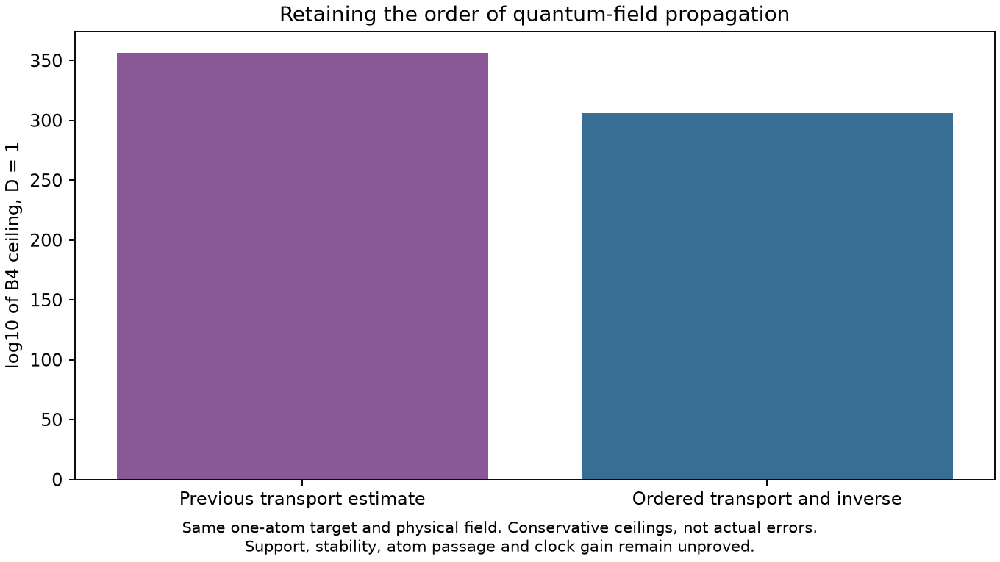

## Radial-gauge cancellation along curved geodesics

Checkpoint186 uses a cancellation already present in the chosen magnetic gauge. The [calculation](../scripts/dihole_radial_cancellation.py) and [results](../results/dihole_radial_cancellation_results.json) retain85 exact inputs and14 passing controls. No geometry, field, gauge, regulator or atom parameter changes.

The atomic $\log_{10}B_4$ ceiling falls from306.26060 to272.83205, a reduction of at least33.42854566543112 decimal orders. The low-flux change is only about $8.98\times10^{-16}$ decimal orders and is not a meaningful displayed improvement. Neither ceiling determines the supporting source.

### Remove the radial velocity before taking norms

Fix the source $y$ and use the existing source-centred gauge. Its spatial radial condition, together with $A_\tau=0$, gives the full four-dimensional identity

$$
A(\gamma(t))\cdot(\gamma(t)-y)=0.
$$

Thus

$$
A(\gamma)\cdot\dot\gamma=A(\gamma)\cdot W,\qquad
W=\dot\gamma-\frac{\gamma-y}{t}
=\frac1t\int_0^t s\,\ddot\gamma(s)\,ds.
$$

The integral expression extends smoothly to $t=0$. The source stays fixed under differentiation in initial velocity. For every normalized real parameter jet through16,

$$
\frac{\|D_w^nW(t,w)\|}{n!}
\le\frac t2\sup_{0\le s\le t}
\frac{\|D_w^n\ddot\gamma(s,w)\|}{n!}.
$$

Replacing $t$ by1 is conservative. The cancellation is applied algebraically, before taking positive norms; no subtraction of nearly equal large numerical quantities is performed.

All normal paths lie within coordinate displacement $2R<2^{-32}$, where the global phase extension equals the exact local radial gauge. Its time-independent phase remains fixed during the paired metric variation. The physical field, source measure and magnetic reference are unchanged.

### Explicit generator jets

Let $p(z)=\sum_{k=1}^{16}RZ_kz^k$ be the saved path-increment series and $v(z)=2R+p(z)$ the velocity series. From the geodesic equation and saved Christoffel component ceilings $\gamma_n$, define

$$
c(z)=\sum_{n=0}^{16}\frac{2^{n+3}\gamma_n}{n!}z^n,\qquad
a_{\rm acc}(z)=c(p(z))v(z)^2.
$$

The factor $2^{n+3}$ converts a four-dimensional rank-$(n+3)$ contracted component estimate to the required Euclidean norm. The path and velocity already carry their radius factors; no additional $R$ is inserted.

For the magnetic one-form, the conversion remains $2^{n+1}|q|a_n/n!$. Compose that series with $p$ to obtain $\mathcal A(z)$. The old and new magnetic generator bounds are

$$
K_{\rm mag,old}(z)=\mathcal A(z)v(z),\qquad
K_{\rm mag,rad}(z)=\frac12\mathcal A(z)a_{\rm acc}(z).
$$

Select the smaller valid coefficient at every order. Add the unchanged spin generator and minimize again against the previously saved total-generator ceiling. Charge is included once. All magnetic orders0 through16 improve for both flux records.

At order zero, the ratio of the two magnetic estimates is $C_0R$, enclosed by
$[0.003873583264907661,\ 0.0038735832649076617]$, about one part in258. Higher-order effects are evaluated rather than assumed to have the same ratio.

The ordered-time transport and direct adjoint inverse from185 are retained. The heat assembly is factored to accept the generator explicitly; replaying it with the historical generator reproduces the saved185 heat-coefficient and inverse arrays exactly.

### Exact curved-path control

A useful independent example is

$$
g=dx^2+(dy-2x\,dx)^2,\quad
\gamma(t)=(w_1t,w_2t+w_1^2t^2),\quad
A=\frac B2(-y\,dx+x\,dy).
$$

The metric is flat in coordinates $(x,y-x^2)$, but its coordinate geodesic is nonstraight. Its only nonzero Christoffel component is $\Gamma^y_{xx}=-2$. Direct substitution gives

$$
W=(0,w_1^2t),\qquad
A\cdot\dot\gamma=A\cdot W=\frac B2w_1^3t^2,\qquad
\int_0^1A\cdot\dot\gamma\,dt=\frac B6w_1^3.
$$

The native control checks the identities and parameter derivatives through6, including the smooth zero-time endpoint and a separate straight-path case. An independent symbolic calculation adds two flat coordinates and verifies the identities through16. The native radial, acceleration-integral and derivative errors are below $2\times10^{-113}$, $1.7\times10^{-114}$ and $6.4\times10^{-117}$ respectively; the exact geodesic residual is zero.

### Full recomputation and limits

| Quantity | $q=1000$ | Atomic $q=4642875905017627791065088$ |
| --- | ---: | ---: |
| Graph scale $\mu$ | $2^{68}$ | $2^{80}$ |
| Fourier scale $\lambda$ | $2^{72}$ | $2^{84}$ |
| $\log_{10}B_4$ ceiling | 284.95801 | 272.83205 |
| $\log_{10}C_*$ and $C_{\rm geom}$ ceiling | 287.15643 | 275.03047 |
| Curved envelope/$q^2$, nominal $M_{\rm reg}^2s_0=100$, log ceiling | 262.87096 | 164.07785 |

Table ceilings are rounded upward; saved dyadic endpoints govern the result. These are conservative mathematical bounds, not energies, actual errors or measured improvements. The atomic normalized $u_4$ order0/8 ceilings have logarithms199.70026 and369.85102. All transport and heat bounds tested are no larger than before. The physical operator and point records remain unchanged, and the derivative schedule remains16,14,12,10,8.

All14 controls and85 exact inputs pass. The figure was inspected. Independent numerical audit PASS:592 directed comparisons at550 digits, no ceiling undershoot, all85 input hashes and14 controls. Actual-source proof audit PASS, including domain, charge/tensor factors and unchanged density/inverse conventions; the curved-geodesic identity also passed an independent symbolic check through16. Final layout PASS:182 imports,1639 Markdown links,8 historical source guards,14 frozen pilot hashes.

Source SHA256: 7640ac0810a1ce649eebec38ea8e3631b2d4a4649ba8f9cb4f7135cd1b882aed.
Result SHA256: 597afc60ed89ea9c26116159e94b7a4abd64a718ad3aa3d0509e711bcfba457f.

### Choose the next calculation by its effect on the remaining bound

A source-point gauge simplification was screened as a possible next step. The point-evaluation factor at fixed scale contains
$\delta P_2/12+\delta P_1/(30\lambda)+\delta P_0/(48\lambda^2)$.
At the current atomic $\lambda=2^{84}$, the first- and zeroth-order contributions relative to the second-order term are approximately $9.97137\times10^{-8}$ and $3.88398\times10^{-15}$. Even deleting both would reduce this fixed-scale factor by only $4.33052\times10^{-8}$ decimal orders. This diagnostic is not a modification of the physical operator; it rules out a low-impact next calculation.

The next test instead uses an exact **frozen constant-magnetic reference** in the existing regular chart. At each source $y$, freeze $g_y$ and the charge-included $F_y$, set
$A_{0,i}(x)=F_{ji}(y)(x-y)^j/2$, and use

$$
P_{0,y}=-g_y^{ij}D_{0,i}D_{0,j}+V_{\rm Pauli}(y),\qquad
D_0=\partial-iA_0.
$$

Its exact kernel $K_{0,y}$ includes the frozen field to all orders. In canonical Lebesgue coordinates its normalization includes $\sqrt{\det g_y}$. For $Q_0=\chi_yK_{0,y}$, the first defect is exactly

$$
E_0=(\partial_t+P)Q_0
=\chi_y(P-P_{0,y})K_{0,y}+[P,\chi_y]K_{0,y}.
$$

The operator difference must be rewritten in $D_0$ before norms are taken; this keeps the frozen $q^2A_0^2$ contribution inside the exact kernel. That term currently supplies approximately99.99827% of the atomic zeroth-order operator ceiling, so this targets a demonstrated source of overestimation.

The field is not uniform. The radial-gauge formula retains

$$
\delta A_i(x)=\int_0^1 t\,z^j[F_{ji}(y+tz)-F_{ji}(y)]\,dt,\qquad z=x-y,
$$

giving $\|\delta A\|\le\|DF\||z|^2/3$ and $\|D\delta A\|\le2\|DF\||z|/3$ with the appropriate tensor norms. Actual spin, density, metric-gradient and Pauli-curvature terms also remain in the difference. The paired physical insertion must be preserved; differentiating only a scalar magnetic magnitude is insufficient.

The first implementation should verify vanishing **interior** defect for arbitrary constant metric and uniform field, and retain the field-gradient contribution in a varying-field control. The cutoff commutator still exists. Then evaluate a Gaussian-weighted Schur/L1 defect estimate, retaining radius powers, on the existing $|q|B_{\rm unit}t\le.01$ interval. A first uncorrected column-L2 graph estimate is not time-integrable, so the old181 remainder order and derivative schedule cannot be imported. Higher Duhamel corrections are justified only if that first weighted estimate is useful.

[Avramidi and Fucci's published resummed heat expansion](https://arxiv.org/abs/0810.4889) is relevant background, but it assumes parallel electromagnetic curvature. The actual varying field does not satisfy that assumption. The new first-defect construction and its needed enclosures remain **unimplemented**; the current result continues to use the verified186 certificate.

The target remains one neutral hydrogen atom through a trial1nm opening. Self-consistent support, stability, atomic transmission, internal-state survival and an operational clock comparison remain unproved. The present static geometry excludes13September2027 to12September2027; no future clock advantage is established.

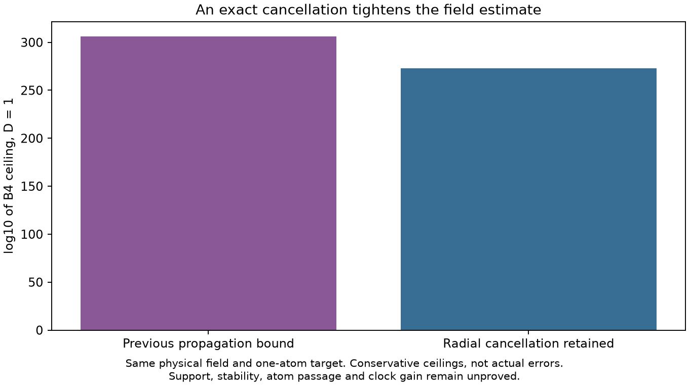

## Frozen magnetic kernel and its first column defect

This checkpoint implements the first test proposed in186. It solves the frozen
constant-magnetic part exactly and bounds the actual varying-field difference.
The result is a **local first-defect column estimate**, not the completed
quantum source, an atom propagation, or a replacement for the existing $B_4$
certificate. All16 native controls pass; input provenance retains87 exact hashes.

Calculation: [source](../scripts/dihole_frozen_magnetic.py),
[results](../results/dihole_frozen_magnetic_results.json),
[figure](../figures/dihole_frozen_magnetic_progress.png).

### Exact reference and difference

At a fixed source $y$, use $z=E_y(x-y)$ with $E_y=\sqrt{g_y}$ and the canonical
Lebesgue-space Dirac operator. In these whitened coordinates the frozen metric
is the identity, the frozen charge-included magnetic two-form has rank two,
and $A_{0,i}=F_{ji}(y)z^j/2$. Let $b$ be its nonzero singular value. Then

$$
P_0=-\sum_iD_{0,i}^2+V_{\rm P}(y),\qquad D_{0,i}=\partial_i-iA_{0,i},
\qquad V_{\rm P}(y)=\frac{i}{4}\sum_{ij}[\gamma_i,\gamma_j]F_{ij}(y).
$$

With $Q=t^{-1}\Pi_\parallel+b\coth(bt)\Pi_\perp$, the whitened kernel is

$$
K_0(t,z)=(4\pi t)^{-2}\frac{bt}{\sinh(bt)}
 \exp(-z^TQz/4)\exp(-tV_{\rm P}(y)).
$$

The canonical kernel in the original coordinates has the additional factor
$\sqrt{\det g_y}$. It cancels the whitening Jacobian when integrating a column.
The Pauli eigenvalues are $\pm b$, each twice. For $bt\le u=0.01$,
$\|K_0(t,z)\|\le e^u(4\pi t)^{-2}e^{-|z|^2/(4t)}$.
This is a bundle operator norm, so no spin-rank factor4 is inserted.

The constant-field resummation has published precedents, including
[Avramidi and Fucci](https://arxiv.org/abs/0810.4889), whose expansion assumes
parallel electromagnetic curvature. Our actual field varies: the estimates
below explicitly retain its derivatives and do not apply that assumption to it.

Write the actual Dirac operator as $\mathcal D=a^iD_{0,i}+B$, with
$B=b_{\rm geom}-ia^i\delta A_i$. The exact difference, before taking norms, is

$$
P-P_0=-(\widetilde g^{ij}-\delta^{ij})D_{0,i}D_{0,j}
       +L^kD_{0,k}+V,
$$

$$
L^k=-\sum_i a^i\partial_i a^k-\{a^k,B\},\qquad
V=\frac{i}{4}\sum_{ij}([a^i,a^j]-[\gamma_i,\gamma_j])F_{ij}(y)
  -\sum_i a^i\partial_iB-B^2.
$$

Thus the frozen $q^2A_0^2$ part stays inside the exact reference. Spin, density,
metric derivatives and field gradients remain in the difference.
The physical source insertion is unchanged; it is not yet evaluated using
this new reference.

### Coefficient bounds in the actual source neighbourhood

Use the existing radial gauge on the coordinate ball of radius
$r_{\rm cut}=2^{-32}$, inside the saved chart. The saved real metric ceilings
are $M,H$ for $g,g^{-1}$, and $G_1=8g_1$ bounds the metric directional derivative.
Set

$$
\epsilon=HG_1r_{\rm cut}<1,\quad
a=(1-\epsilon)^{-1/2},\quad
G=\frac{H^{3/2}G_1}{1-\epsilon},\quad
\alpha=2\sqrt{MH}\,I_{1,\rm op}.
$$

Here $\|\widetilde g^{-1}-I\|\le G|z|$ and
$\|a(\xi)\|\le a|\xi|$ for real $\xi$.
The bound $\alpha$ is valid for arbitrary unit real directions, using the
original-coordinate directional $\ell^1$ factor2. The transformed coefficients
are $a_z=a_xE_y^T$, not $a_xE_y^{-1}$.

The geometry-only Dirac sequence comes from the unchanged positive frame
and canonical density:
$b_{\rm geom}=768(I I E')+16(I V'V^{-1})$ with full derivative product rules.
Let $b_0$ be its zeroth bound and $b_1$ its first bound times $2\sqrt H$.
From the original potential second derivative ceiling $A_2$,

$$
L_F=16|q|H^{3/2}A_2,\qquad
\|\delta A\|\le L_F|z|^2/3,\qquad
\|\partial\delta A\|\le2L_F|z|/3.
$$

The factor16 converts the component derivatives of $dA$ to the real
three-tensor norm. Charge appears once. Define

$$
b_2=aL_F/3,\quad b_{11}=2aL_F/3,\quad b_{12}=\alpha L_F/3,
\quad p_1=2b(a+1)\alpha.
$$

Then $\|B\|\le b_0+b_2r^2$ and each
$\|\partial B\|\le b_1+b_{11}r+b_{12}r^2$.
For the Pauli difference, write $a(\xi)=\gamma(T\xi)$ and use
$\|S(F)\|\le2\|F\|_{\rm op}$ in four dimensions;
$\|TF_0T^T-F_0\|\le b(a+1)\alpha r$ proves the $p_1r$ bound.
The remaining polynomial is

$$
\|V\|\le V_0+V_1r+V_2r^2+V_4r^4,
$$

$$
V_0=b_0^2+4ab_1,\quad V_1=p_1+4ab_{11},\quad
V_2=2b_0b_2+4ab_{12},\quad V_4=b_2^2.
$$

### Gaussian moments and integrable first defect

Let $c=1+u^2/3\ge bt\coth(bt)$ and $\ell=c+u$.
The exact covariant derivatives are
$D_iK_0=-(Q-iF)_{ij}z_jK_0/2$ and
$D_iD_jK_0=[((Q-iF)z)_i((Q-iF)z)_j/4-(Q-iF)_{ji}/2]K_0$.
Retaining the Clifford contraction of the complex gradient gives

$$
\|\text{principal defect}\|
 \le G\left[(c^2+u^2)\frac{r^3}{4t^2}+2c\frac r t\right]\|K_0\|,
$$

$$
\|L^kD_{0,k}K_0\|
 \le a\ell(2\alpha+b_0+b_2r^2)\frac r t\|K_0\|.
$$

Four-dimensional free Gaussian moments are
$M_1=3\sqrt{\pi t}/2$, $M_2=8t$,
$M_3=15\sqrt\pi t^{3/2}$ and $M_4=96t^2$. Consequently,

$$
\sup_y\int \|\chi_y(P-P_{0,y})K_{0,y}\|\,dx
 \le e^u(C_-t^{-1/2}+V_0+C_{1/2}t^{1/2}+8V_2t+96V_4t^2),
$$

$$
C_-=\sqrt\pi\left[G\left(\frac{15}{4}(c^2+u^2)+3c\right)
       +\frac32 a\ell(2\alpha+b_0)\right],
\quad
C_{1/2}=15\sqrt\pi a\ell b_2+\frac32\sqrt\pi V_1.
$$

Every term is integrable at zero. The interior time integral is bounded by

$$
e^u\left[2C_-\sqrt{s_0}+V_0s_0+
 \frac23C_{1/2}s_0^{3/2}+4V_2s_0^2+32V_4s_0^3\right].
$$

### The local cutoff remains included

Use $\chi_y=\mathrm{step}(2-2|x-y|/r_{\rm cut})$, equal to1 on the inner half-ball.
From the existing smooth-step ceilings $S_1,S_2$,
$G_\chi=2\sqrt H S_1/r_{\rm cut}$ and
$H_\chi=4H(S_2+S_1)/r_{\rm cut}^2$ bound its whitened gradient and Hessian.
The exact commutator is

$$
[P,\chi]K_0=-2\widetilde g^{ij}\chi_iD_{0,j}K_0+
 (-\widetilde g^{ij}\chi_{ij}+L^i\chi_i)K_0.
$$

It is supported at $r\ge d=r_{\rm cut}/(2\sqrt H)$ and has the majorant

$$
[A_1r/t+A_0+A_2r^2]\|K_0\|,\quad
A_1=a^2G_\chi\ell,\quad
A_0=4a^2H_\chi+2aG_\chi(2\alpha+b_0),\quad
A_2=2aG_\chi b_2.
$$

Gaussian splitting yields the tail factor $e^{-\beta/t}$ with
$\beta=d^2/8$. The widened Gaussian adds $4\,2^{k/2}$ to moment $k$.
The implemented simple bound is

$$
e^{u-\beta/s_0}\left[
 2A_1\,4\sqrt2\,\frac{3\sqrt\pi}{2}\sqrt{s_0}
 +4A_0s_0+32A_2s_0^2\right].
$$

This uses $e^{-\beta/t}\le e^{-\beta/s_0}$ and integrates only integrable powers;
it does not drop the cutoff or assume a small tail at the low-flux record.

### Results and limits

| Quantity | $q=1000$ | Atomic saved flux |
| --- | ---: | ---: |
| $s_0/D^2$ (display approximation) | $8.3258293\times10^{-7}$ | $1.7932483\times10^{-28}$ |
| Total first-defect column time integral, upper ceiling | $6.309814\times10^{19}$ | $0.049885941789$ |
| Cutoff contribution, logarithmic upper ceiling | $19.797733$ | $-15756.122605$ |

For the atomic record, the interior contributions are approximately
$0.00580925$ leading, $3.5152\times10^{-7}$ constant, $0.04400541$ varying-field,
$1.15598\times10^{-5}$ quadratic and $5.93661\times10^{-5}$ quartic.
The field-gradient contribution dominates. The small quantity is dimensionless
and is **not a transit probability or a percentage confidence**.

Native verification includes exact symbolic factorization with a varying frame
and linearly varying field, a nonzero cutoff commutator, vanishing constant
interior defect, covariant kernel derivatives, the frozen heat equation, and
a nondiagonal constant-metric heat-equation/normalization check. Differential
errors are below $6.5\times10^{-86}$ at90-digit working precision.
Exact hashes and directed interval arithmetic protect the saved ceilings.

The low-flux bound fails the less-than-one test and is retained. These are
uniform **local column bounds** for a source-centred construction. No row bound,
global chart assembly, convergent correction series, differentiated diagonal
kernel estimate or physical-source error follows automatically.
The full186 $B_4$ certificate remains unchanged.

**Next:** prove the required global/row bounds and control the corrections and
source insertion, or identify precisely why this local gain cannot be used.
Do not import the old $O(t^2)$ remainder schedule. Support, stability,
one-atom transmission and survival, and operational clock gain remain unproved.
The static geometry excludes13September2027 to12September2027.

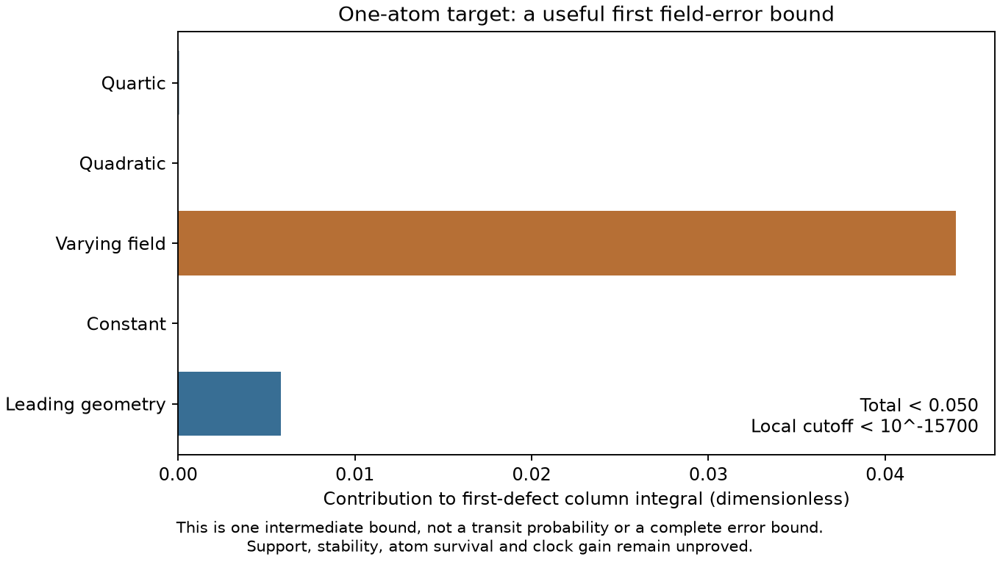

Independent numerical audit PASS:56 packed ceilings and4 metadata ceilings checked at550digits, no undershoot, all87 hashes and16 controls. The upward total endpoint covers the extremely small positive cutoff.
Source SHA256 b462a120ad837756315506882418f79252046ccbc807f6e7d379d56685347d9f
Results SHA256 6bf34332ff1bfb485ce81bda96452503606afefdca59b11301bda15097b764ee
Actual-source proof audit PASS for the stated local column scope: whitening, Clifford/Pauli factors, exact radial-gauge domain and cutoff integration checked. Final layout PASS:183 imports,1650 Markdown links,8 historical source guards,14 frozen pilot hashes.

## Localized data and a global heat-operator error

This checkpoint converts187's first column estimate into a comparison with the
**actual global heat operator** of the prescribed geometry, for initial data
supported in the two collar cores. Exterior propagation is retained.
This is an operator-norm result; differentiated diagonal kernels, trace norms,
supporting stress and atom propagation remain outside its scope.

[Calculation](../scripts/dihole_localized_heat_error.py),
[results](../results/dihole_localized_heat_error_results.json),
[figure](../figures/dihole_localized_heat_error_progress.png).
All12 native checks pass;89 exact input hashes preserve187 and the earlier $B_4$
certificate.

### Row estimates without discarding the variable source metric

Let $\epsilon=HG_1r_{\rm cut}<1$ be the saved187 comparison constant.
For $|x-y|\le r_{\rm cut}$, freeze coordinates at the output:
$w=E_x(x-y)$, while the kernel uses $z_y=E_y(x-y)$. Then

$$
(1-\epsilon)g_x\le g_y\le(1+\epsilon)g_x,\qquad
(1-\epsilon)|w|^2\le|z_y|^2\le(1+\epsilon)|w|^2,
$$

$$
\frac{\sqrt{\det g_y}}{\sqrt{\det g_x}}\le(1+\epsilon)^2.
$$

Consequently, replacing a column Gaussian moment of radial degree $k$ by
a row integral costs at most

$$
R_k=\left(\frac{1+\epsilon}{1-\epsilon}\right)^{2+k/2}.
$$

The determinant supplies power2, the radial monomial supplies $k/2$, and
rescaling the Gaussian supplies the denominator. These are four-dimensional
canonical-coordinate estimates, not an assumption that the varying map
$y\mapsto z_y$ has a constant Jacobian.

The187 grouped leading and varying-field contributions each mix degrees1
and3. Their entire groups therefore use the larger $R_3$.
The constant, quadratic and quartic groups use $R_0,R_2,R_4$.
The cutoff gradient, constant and quadratic groups use $R_1,R_0,R_2$.
On the cutoff annulus, $|z_y|\ge r_{\rm cut}/(2\sqrt H)$ uniformly.
Splitting the Gaussian there **before** the row comparison preserves the
original exponential factor $e^{-\beta/t}$; no weakened exponent is needed.

The frozen approximation has column norm at most $e^{0.01}$ and row norm at
most $e^{0.01}R_0$, hence a per-chart $L^2$ operator ceiling
$\kappa=e^{0.01}\sqrt{R_0}$.

If $c(t),r(t)$ bound the column and row integrals of the defect, the Schur test
and Cauchy--Schwarz in time give

$$
\int_0^T\|E_j(t)\|_{2\to2}\,dt
 \le\int_0^T\sqrt{c(t)r(t)}\,dt
 \le\sqrt{C_{\rm col}(T)C_{\rm row}(T)}
 =:\eta(T).
$$

The code also evaluates $T/s_0=1/2,1/4,1/16$ using the actual positive time
powers of187. Extra cutoff decay uses the original saved $H$ and $s_0$,
not an upward-rounded exponent incorrectly treated as a decay lower bound.

### Source projections, chart isometries and the initial limit

Let $\Pi$ project onto the two spatial collar cores, with the whole Euclidean
time axis retained. Each core has radial coordinate $u\in[0,.05]$ and is split
into disjoint measurable northern and southern hemispheres. Assign the equator
arbitrarily; it has zero volume. In each chosen chart the source satisfies
$|y|\le1$.

These sharp multipliers act only in the **source** variable.
The differential operator $P_x$ does not differentiate them. Smooth source
partitions would require extra overlap coverage, which is unnecessary here.

For each chart $j$, let $U_j$ be the isometry from physical spinor $L^2$ to
canonical-coordinate $L^2$, including the regular bundle frame and half-density
$v=2PR/(1+|y|^2)$. The local kernel must undo its source-specific radial gauge;
it is not a single common global gauge conjugation. Write

$$
Q_j(t)=U_j^{-1}q_j(t)U_j\Pi_j,\qquad
E_j(t)=(\partial_t+P)Q_j(t).
$$

The output cutoff has radius $2^{-32}$ and lies inside the buffered chart
$u\in[-.02,.07]$, $|y|<\sqrt2$. It is smooth and flat at its support boundary.
Zero extension of the output therefore adds no boundary distribution.
Canonical Schur estimates transfer by the isometries without another crude
physical-volume ratio. Different collar output neighborhoods are disjoint.

For compact smooth input away from the source partition boundaries, the frozen
Gaussian is an approximate identity as $t\downarrow0$:
$bt\to0$, its spin factor tends to identity, its source-dependent gauge phase
vanishes on the diagonal, and the half-densities have the correct normalization.
Uniform column/row bounds extend this convergence by density to every $L^2$
input. Thus $Q_j(t)\to\Pi_j$ strongly. Positive-time smoothing and the interior
output support place $Q_j(t)$ in the global $P$ domain; the defect has an
integrable operator-norm majorant at zero.

### Compare with the full global semigroup

Use the already specified self-adjoint nonnegative physical Euclidean operator
$P=\mathcal D_E^\dagger\mathcal D_E$ and $H(t)=e^{-tP}$, so $\|H(t)\|\le1$.
On an interval bounded away from zero, differentiate
$H(t-s)Q_j(s)$ and then take its lower endpoint to zero. The result is

$$
H(t)\Pi_j-Q_j(t)=-\int_0^t H(t-s)E_j(s)\,ds.
$$

This is Duhamel's principle; see
[Grieser's notes, section2.3](https://web.math.ku.dk/grubb/notes/heat.pdf)
for the parametrix background. The explicit domain, atlas and numerical bounds
here are this project's calculation, not an automatic application of that
compact-manifold discussion.

Since the two hemisphere source projections are orthogonal in physical $L^2$,

$$
\|E_+\Pi_+f+E_-\Pi_-f\|
 \le e(t)(\|\Pi_+f\|+\|\Pi_-f\|)
 \le\sqrt2\,e(t)\|f\|.
$$

The two collars form a direct sum before $H$ acts, so they add no further
factor. The common global semigroup can propagate into the exterior and between
regions; its contraction bound applies to that full action. Therefore,

$$
\boxed{
\sup_{0<t\le T}\|H(t)\Pi-Q_{\rm loc}(t)\|_{2\to2}
 \le\sqrt2\,\eta(T).}
$$

No artificial boundary condition or global Volterra inverse has been assumed.
A restriction of a local kernel to a finite chart would not by itself justify
either claim.

### Numerical ceilings and checks

For the saved atomic flux:

| $T/s_0$ | Column integral ceiling | Row integral ceiling | Global operator-error ceiling |
| --- | ---: | ---: | ---: |
| 1 | 0.049885941789 | 0.051041885753 | 0.071362070338 |
| 1/2 | 0.019676511573 | 0.020132402114 | 0.028147306912 |
| 1/4 | 0.008407041435 | 0.008601820567 | 0.012026293022 |
| 1/16 | 0.002139979767 | 0.002189559764 | 0.003061246019 |

The full-window per-chart integrated $L^2$ defect ceiling is
$0.050460603856$. Table ceilings are rounded upward; saved dyadic endpoints
are authoritative. These are **absolute operator-norm error ceilings**, not
relative errors, confidence percentages, atom survival probabilities or
physical travel times. The heat parameter is an auxiliary Euclidean parameter.

At $q=1000$, the computed Duhamel estimates are still loose. The independent
triangle bound $1+\sqrt2\kappa\le2.437805034205$ is tighter, and that record is
retained without claiming a useful approximation.

The native controls integrate a genuinely source-varying Gaussian metric and
verify the row bound for degrees0 through4. A separate noncommuting matrix
control couples two source states to an exterior state: the global Duhamel
identity holds to $5.2\times10^{-81}$, while the nonzero exterior leakage would
invalidate a truncated exterior. Orthogonal source projections with overlapping
outputs check the necessary $\sqrt2$ factor. Smaller heat-time windows improve
all saved bounds.

### What remains before a supporting-source conclusion

The next step must control the **actual physical insertion** on the diagonal,
with the required local smoothing and trace estimates. A small $L^2$ operator
error does not bound an unbounded derivative insertion or point evaluation.
In particular, the previous fourth-order parametrix derivative schedule cannot
be transplanted into this zeroth reference.

Support, stability, transmission and survival of one neutral hydrogen atom,
and an operational clock comparison remain unproved. The trial1nm opening
is still a test parameter. The static geometry excludes13September2027 to
12September2027; future clock gain is unproved.

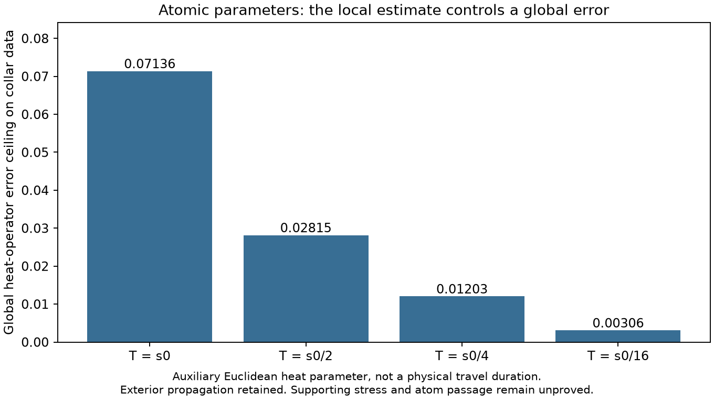

Independent numerical audit PASS:160 upward ceiling comparisons at550digits and32 separate tiny-cutoff checks; all89 input hashes and12 native controls. Actual-source proof audit PASS, including row factors, time scaling, the original-input cutoff exponent, chart/physical isometries, strong initial convergence and global Duhamel scope.
Source SHA256 ade9fe492b36c40c847fc48d7e0849a8070ebe53cd6e6dc5aa7014a32dd08712
Results SHA256 fcb2e1e7191c48c38e1b57d563d0667dac556c6a470d2932d185dc65def0b2b7
Final layout PASS:184 imports,1661 Markdown links,8 historical source guards,14 frozen pilot hashes.

## One Dirac derivative and an absolute heat-source bound

Checkpoint189 is implemented in [dihole_heat_source_graph.py](../scripts/dihole_heat_source_graph.py), with [saved results](../results/dihole_heat_source_graph_results.json). It uses the unchanged global physical operator and the compact volume-preserving metric probe. It supplies an absolute positive-time heat-response bound. It does not evaluate the signed, renormalized stress or prove support.

### Derivative estimate and the saved comparison filter

Let $D=\mathcal D_E$ be skew-adjoint, $P=-D^2\ge0$, $H(t)=e^{-tP}$, and retain188's $R(t)=H(t)\Pi-Q(t)$ and $E(t)=(\partial_t+P)Q(t)$. Spectral calculus and the global Duhamel identity give

$$
\|DH(r)\|\le(2er)^{-1/2},\qquad
\|DR(t)\|\le(2e)^{-1/2}\int_0^t(t-s)^{-1/2}\|E(s)\|\,ds.
$$

The leading $s^{-1/2}$ defect is integrable in this expression. For an integrated monomial $I_p(t)=a_pt^{p+1}/(p+1)$, the contribution to $\sqrt t\|DR(t)\|$ uses $(p+1)B(p+1,1/2)$. For $p=-1/2,0,1/2,1,2$, the weights are $\pi/2,2,3\pi/4,8/3,16/5$. A uniform row factor $\sqrt{R_4}$ and the hemisphere factor $\sqrt2$ give the total prefactor $\sqrt{R_4/e}$. Cutoff terms retain their original exponential, reconstructed from the saved geometric inputs.

The Duhamel/parametrix background is described in [Grieser's notes, section 2.3](https://web.math.ku.dk/grubb/notes/heat.pdf). The localization, full exterior and explicit constants here are this project's derivation.

All Hilbert-Schmidt (HS) quantities below use the static trace per unit Euclidean time. A compact time window may be applied after output derivatives; no derivative is commuted through it.

Saved176 bounds the weighted comparison filter. If $S(z)H_0(z)^2=\sum_pc_pz^p$, its full-frequency localized HS square obeys

$$
V_\Lambda\le \frac{KB_0^2}{\pi}
+\frac1\pi\sum_p\frac{c_pK^{1-p}}{p-1}.
$$

Every nonzero power is at least3, so the frequency tail is integrable. Both frequency signs, both collars and rank four are already included. Choose the smooth cutoff $\chi$ supported in $(-.005,.055)$, equal to one on $[-.0025,.0525]$, with ramps of width $.0025$. Saved176's derivative ceilings cover these ramps, and175's larger low-frequency cutoff equals one on this support. The plateau contains188's defect outputs.

For $a=0,1$ and $\nu=\|N^{-1}\|$,

$$
B_a(r)^2:=\|D^aH(r)\Pi_b\|_{\mathrm{HS},\tau}^2
\le \nu V_\Lambda\sup_{x\ge0}
x^ae^{-2rx}\frac{\prod_{j=1}^3(x+j\Lambda^2)}{6\Lambda^6}.
$$

The inverse lapse occurs once in the squared norm; it is not commuted through the spectral multiplier. Expanding the positive polynomial gives coefficients $1,11/6,1,1/6$ in $x/\Lambda^2$. The code bounds each term using $\sup_{x\ge0}x^pe^{-2rx}=(p/(2er))^p$, with the zero-power maximum set to1.

### Gaussian HS defect and the split at half time

For $G_s(z)=(4\pi s)^{-2}e^{-|z|^2/(4s)}$ in four whitened dimensions,

$$
M_k(s):=\||z|^kG_s\|_2
=\frac{2^{k/2-3}\sqrt{(k+1)!}}{\pi}s^{k/2-1}.
$$

Use187's saved constants, $u_0=.01$, $c=1+u_0^2/3$ and $\ell=c+u_0$. The interior defect is bounded by $e^{u_0}G_s$ times

$$
A\frac{r^3}{s^2}+B\frac r s+V_0+C\frac{r^3}{s}
+V_1r+V_2r^2+V_4r^4,
$$

where $A=G(c^2+u_0^2)/4$, $B=2Gc+a\ell(2\alpha+b_0)$, and $C=a\ell b_2$. Here $G$ is187's metric-difference constant, not the Gaussian kernel.

The source-coordinate spatial volume across the two collars and hemisphere disks is $\pi/5$. The rank-four Frobenius factor is2. The canonical kernel determinant and the whitened output integral leave a single volume-density ceiling $V_{\max}$ in the squared norm. Thus the common HS multiplier is $C_{\rm vol}=2\sqrt{(\pi/5)V_{\max}}e^{u_0}$. Orthogonal source columns require no additional hemisphere factor in this HS sum.

The cutoff polynomial is $A_1r/s+A_0+A_2r^2$, with
$A_1=a^2G_\chi\ell$,
$A_0=4a^2H_\chi+2aG_\chi(2\alpha+b_0)$,
and $A_2=2aG_\chi b_2$.
Its annular $L^2$ widening factor is $2^{k/2+1}e^{-\beta/s}$, where $\beta=r_{\rm cut}^2/(32H)$ uses the original inverse-metric ceiling $H$. Taking an upward-rounded decay exponent as a lower bound would be invalid and is avoided.

The resulting defect HS terms have time powers $-3/2,-1,-1/2,0,1$. For $h_*(t)\ge\sup_{t/2\le s\le t}\|E(s)\|_{\mathrm{HS},\tau}$, bound negative powers at $t/2$, nonnegative powers at $t$, and cutoff exponentials at $t$. Splitting Duhamel avoids integrating the singular HS estimate at zero:

$$
F_0(t)=B_0(t/2)\eta_{\rm global}(t/2)+\frac t2 h_*(t),\qquad
F_1(t)=B_1(t/2)\eta_{\rm global}(t/2)+\sqrt{t/e}\,h_*(t).
$$

These bound $\|R(t)\|_{\mathrm{HS},\tau}$ and $\|DR(t)\|_{\mathrm{HS},\tau}$. The early half uses the integrable operator defect and localized heat smoothing; the late half uses the HS defect and the spectral derivative estimate.

Direct frozen-kernel bounds are

$$
Q_0(t)=C_{\rm vol}M_0(t),\qquad
Q_1(t)=C_{\rm vol}\left[
\frac{a\ell}{2t}M_1(t)+b_0M_0(t)+b_2M_2(t)
+2aG_\chi e^{-\beta/t}M_0(t)\right].
$$

The last term retains the output-cutoff derivative. Define $X_a(t)=\min(B_a(t),Q_a(t)+F_a(t))$. By adjoints, $(D^aH(t)\Pi)^*=(-1)^a\Pi D^aH(t)$. Hence the same ceilings bound the output-localized heat factors required below, without differentiating sharp source projectors or discarding exterior input states.

### Actual compact metric variation

Use $h=2F(e^0\otimes e^0-e^1\otimes e^1)$, with fixed gauge and the symmetric spinor identification. The metric variation is trace free and preserves the volume of the existing probe family. The Dirac variation formula specializes to

$$
\dot D=-\tfrac12h_{ij}\gamma^i\nabla_j
-\tfrac14\gamma(\operatorname{div}h).
$$

This uses the metric identification in [Bär, Gauduchon and Moroianu, Theorem5.1/equation23](https://arxiv.org/pdf/math/0303095), translated to the project's skew-adjoint convention. Its flat-coordinate limit retains $F_s\gamma^1/2$, agreeing with the saved radial insertion.

Apply the twisted Lichnerowicz identity to $Fu$, using the metric probe itself as the compact cutoff. With $g_F=\|\nabla F\|_\infty$,

$$
\|F\nabla u\|\le F_{\max}\|\Pi Du\|
+(2g_F+F_{\max}\sqrt{C_4})\|\Pi u\|.
$$

The saved geometric ceilings give
$R_{\rm abs}=128H\gamma_1+512H\gamma_0^2$,
$\Omega=48HE_1$,
$C_4=R_{\rm abs}/4+|q|B_{\rm unit}$,
and $\|\operatorname{div}h\|_\infty\le2g_F+16F_{\max}\Omega$.
Here $R_{\rm abs}$ bounds the **Euclidean** scalar curvature; $\gamma_0,\gamma_1$ are180's Christoffel component/derivative ceilings, $E_1$ is184's first coframe component-derivative ceiling, and $g_F=F'_{\max}/P_{\min}$.

Consequently

$$
\|\dot Du\|\le a_\delta\|\Pi Du\|+b_\delta\|\Pi u\|,\qquad
a_\delta=\sqrt2F_{\max},\qquad
b_\delta=2\sqrt2g_F+a_\delta\sqrt{C_4}+\tfrac12g_F+4F_{\max}\Omega.
$$

The response at full heat time $T$ has two legs of time $t=T/2$:

$$
\delta K(T)=-2T\,\Re\operatorname{Tr}_{/\tau}
[(DH(t))^\dagger\dot DH(t)],\qquad
\boxed{|\delta K(T)|\le
2T X_1(t)[a_\delta X_1(t)+b_\delta X_0(t)].}
$$

The compact support of $\dot D$ permits output localization. This is a bound for the actual full-field compact insertion. Since $\dot D$ does not commute with $H$, it is not a signed error relative to a frozen source.

### Numerical result and remaining decision

At the saved atomic flux, the logarithms of the absolute ceilings are:

| $T/s_0$ | Previous177 ceiling, $\log_{10}$ | New ceiling, $\log_{10}$ |
| --- | ---: | ---: |
| 1 | 65.541702039 | 63.662675304 |
| 1/2 | 66.293913785 | 63.915586223 |
| 1/4 | 67.046307144 | 64.272211092 |
| 1/16 | 68.551320896 | 65.232728892 |

The displayed values are rounded upward; exact dyadic endpoints are saved. The full-window improvement is about76 times. All four low-flux cases are worse with the new estimate, so the selected result retains177's earlier ceiling. These are dimensionless auxiliary bounds in the saved $D=1$ length convention, not physical energy-density measurements.

All10 native controls pass, including independent Gaussian moments, Beta weights, split-HS and actual-insertion matrix controls with nonzero exterior coupling. An independent550-digit audit passes248 packed directed ceilings,244 display ceilings and32 separate nonzero-cutoff checks, with all91 input hashes verified. This numerical audit does not independently establish the continuum model's assumptions.

The worst new short-time magnitude envelope is $O(T^{-2})$. The common regulator weight makes this contribution integrable at fixed regulator scale, but does not evaluate the subtracted remainder $C_*$ or justify substituting this magnitude for the renormalized source. The next required advance is a useful signed/subtracted source enclosure in the declared scheme. More magnitude tightening alone cannot determine whether the source has the sign and size required by the geometry.

Support, stability, one-atom transmission/survival and clock comparison remain unproved. The static geometry excludes13September2027 to12September2027; future clock gain is unproved.

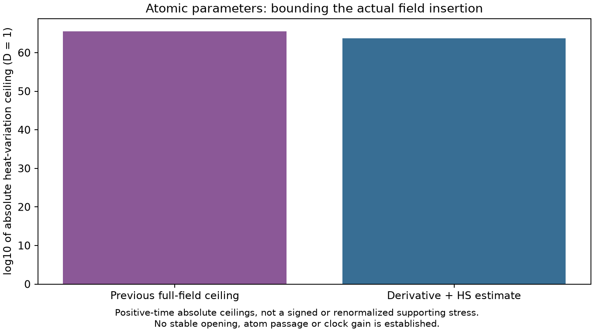

Source SHA256: a96c427cd2c14118813898e99ea66de7044463b8d44790eb10a00e8d6de44cce
Results SHA256: 94abf22be8c1054fa7770e7c0915cc76930793e7c778849a76cc803640b7131d

Actual-code proof audit PASS: per-time normalization, filter/support coverage, split times, Gaussian powers, Q1 cutoff, Euclidean constants and adjoint localization. These are project/agent audits, not external peer review.

Layout verification PASS: 185 imports, 1671 Markdown links, 8 historical source guards and 14 frozen pilot hashes. Historical documentation and audited scientific bytes are preserved.

## Signed enclosure of the local magnetic reference

Checkpoint190 gives162's local magnetic reference a continuum sign enclosure using saved geometric bounds. The [script](../scripts/dihole_signed_local_source.py) and [results](../results/dihole_signed_local_source_results.json) retain97 exact input hashes and pass9 native checks. No sampled geometry integral is promoted to a certified value.

### Fixed reference and positive weight

Retain the physical reference and illustrative coupling used in162. The size family has $\mu_HD=q\sqrt2e^{-\gamma_E}$; holding $\mu_HD$ constant instead would change the problem. For positive integer $q$, define the dimensionless local response

$$
C_{\rm loc}(q)=\frac{D Q_{\rm loc}}{\hbar c\,q^2}
=\frac1{12\pi^2}\int w(x)\,[c+\log(q/B_1(x))]\,dx,\qquad
c=12\log A_G-\tfrac12-2\gamma_E.
$$

Here $w(x)\,dx=dV\,fC_{\perp,1}\ge0$ is the actual collar weight per unit charge squared. This is the already defined local constant-magnetic-field approximation. The underlying constant-field effective action is given in [Fucci, equations6.16 and7.28](https://arxiv.org/pdf/0906.2430). Its application pointwise to the varying collars remains a reference functional; the paper does not identify it with the full global source.

Saved161 encloses the whole closed collar field from below, and175/178 bound it above and bound the positive integral:

$$
4.7446043974880245\le B_1(x)\le12.010815582697589,\qquad
0\le\int w(x)\,dx\le V_\perp=0.0006865532042079938.
$$

The upper field bound covers the larger buffer and hence the insertion support. The lower bound uses the nonvanishing angular field over the closed collar, including polar limits. The positive-weight bound uses178's exact mask integral and polar regularity, not the sampled integral from162.

Let $b_-=c+\log(q/B_{1,+})$ and $b_+=c+\log(q/B_{1,-})$. Since the bracket decreases with $B_1$,

$$
\boxed{\frac{V_\perp}{12\pi^2}\min(0,b_-)
\le C_{\rm loc}(q)\le
\frac{V_\perp}{12\pi^2}\max(0,b_+).}
$$

The zero endpoints are necessary because no positive lower bound on the integrated weight has been supplied. Outward interval arithmetic encloses all constants, logarithms and final endpoints.

### Signed numerical enclosure

| Flux | Bracket interval | Local response interval $C_{\rm loc}$ |
| --- | --- | --- |
| 1000 | [5.752570131164005, 6.681369617498161] | [0, 0.000038730999516091696] |
| 4642875905017627791065088 | [55.64219106539189, 56.570990551726055] | [0, 0.0003279344106252527] |

The bracket is nonnegative for every collar point whenever $q\ge B_{1,+}e^{-c}$, whose interval is [3.1746111354437154,3.1746111354437163]. Thus every integer$q\ge4$ in this prescribed size/reference family has a nonnegative local reference. Conversely, the sufficient nonpositive threshold is enclosed by [1.2540592143666704,1.254059214366671]. The$q=1$ reference is nonpositive, while the coarse$q=2,3$ bracket intervals contain both signs. Those mixed intervals do not determine the integral's sign.

The previous atomic numerical local value, $5.359082054317507\times10^{-7}$, lies within the new enclosure. It remains a numerical diagnostic, not its center with a newly inferred quadrature error.

### What the missing contribution must supply

Write $C_{\rm full}=C_{\rm loc}+C_{\rm omitted}$. The earlier numerical necessary supporting target is $C_{\rm req}\simeq-5.827870965726473$. **Its geometry-quadrature uncertainty is not certified.** Conditional on treating that value as exact, equality would require

$$
C_{\rm omitted}\in
[-5.828198900137099,\,-5.827870965726472].
$$

This is an interval of **required values**, not an enclosure of the actual omitted contribution. If a future certified target is $[r_-,r_+]$, the corresponding required interval becomes $[r_- - C_{\rm loc,+},r_+ - C_{\rm loc,-}]$. Nothing here bounds the full quantum source, rejects the complete candidate, or establishes self-consistency.

The next calculation must quantify the signed actual-minus-reference contribution. The existing absolute positive-time bound cannot give this by subtracting a reference value: that would at best yield another interval containing a large negative and positive range. The output-Dirac error in189 also does not control source-variable derivatives of the adjoint frozen kernel. The enlarged-input construction below avoids needing those derivatives, while retaining a bound for the full exterior contribution. Subtracted short-time control remains necessary.

### Verification and scope

The independent constant control uses

$$
c=\log(2\pi)-\gamma_E-\tfrac12-\frac{\zeta'(2)}{\zeta(2)}
$$

from the zeta functional equation. Another control reuses162's implemented local-source formula at a constant-field test value. Sign-transition cases$q=1,2,3,4$ test both positive and negative endpoint logic. None of these finite checks is substituted for the monotonicity proof.

An independent380-digit audit passes all32 directed endpoints,97 input hashes and9 native controls. It uses the zeta formula independently of the producer's Glaisher constant. These are internal project/agent checks, not external peer review.

One neutral hydrogen atom and a trial1nm opening remain the target. Support, stability, transmission, survival and operational clock gain remain unproved. The static geometry excludes13September2027 to12September2027.

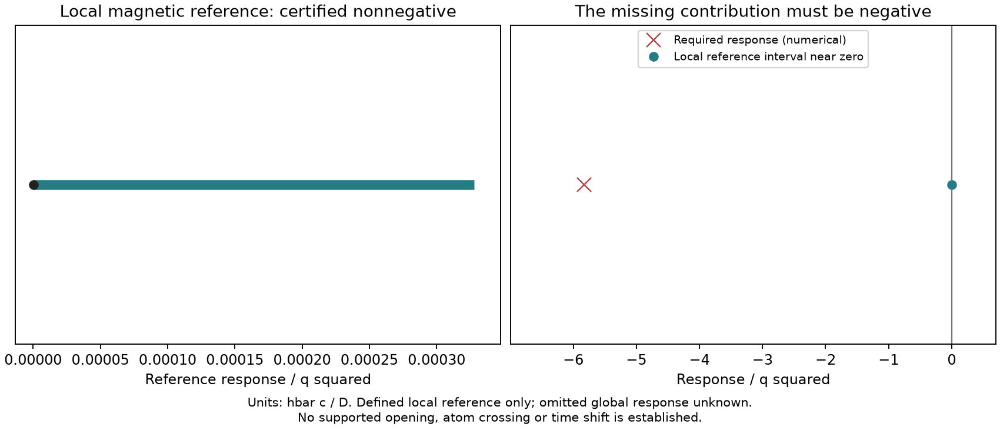

Source SHA256 cc0cdc3f84bb05d258cfa129d0e0d8b64b388eae441241edcbe41bf6f2405fb8
Results SHA256 ecc9277c8edec32b34761c88ff43de88cee9490f2bdf41e98fd72d8a872936dd

### Why changing the old proper-time split is insufficient

The following screen concerns the **interval produced by the saved ceilings**, not the actual source or true approximation error. It rules out spending further work optimizing that split in the saved target-mass range.

Let $B(T)$ be the better of177's and189's absolute heat-response ceilings. Their explicit positive terms imply $B(T)\ge0.85/T^2$ on $0<T\le s_0$ at the atomic parameters. This floor follows for all times, not by interpolating four sampled values.

To reproduce it, use189's actual filter integral $V$,177's $\nu,\Lambda,W,s_0$,187's $a$,180's volume ceiling $V_g$, and179's $F_{\max}$. Set
$C=2e^{.01}\sqrt{\pi V_g/5}$,
$\ell=1+.01+.0001/3$,
$q_1=Ca\ell/(8\pi)$,
$d_1=\sqrt{\nu V/(6\Lambda^6)}(2/e)^2$,
and $a_\delta=\sqrt2F_{\max}$.
The corrected derivative-HS ceiling contains $q_1t^{-3/2}$ and the direct ceiling contains $d_1t^{-2}$, where$t=T/2$. The ratio $d_1/(q_1\sqrt{s_0/2})>268185$, so their minimum still exceeds$q_1t^{-3/2}$. Therefore the new ceiling has coefficient $16a_\delta q_1^2>0.855375$ in front of$T^{-2}$. The old ceiling's positive highest-power term has coefficient
$\nu W(3.5/e)^{3.5}/(3\Lambda^6\sqrt{s_0})>1.1175\times10^{10}$.
Their minimum consequently retains the stated0.85 floor. Raw producer expressions for$V$ and$a_\delta$ were used for lower comparisons, avoiding an upward-packed surrogate.

Let $C_*$ be186's saved exact-low-order-remainder ceiling, with $\log_{10}C_*=275.03046942414861$, and let $S=M_{\max}^{-2}$, where the largest saved target mass is $M_{\max}D=1056075056693575.2$. Put $r_1=1-(1-e^{-1})^3$. Every smaller saved target mass has $r_M(s)\ge r_1$ on $0<s\le S$.

For a split$0<\epsilon\le S$, the normalized sum of the UV and absolute-heat radii is at least

$$
\frac{r_1}{q^2}
\left[\frac{C_*\epsilon^2}{64\pi^2}
+\frac{0.85}{4}(\epsilon^{-2}-S^{-2})\right]
\ge
\frac{r_1}{q^2}
\left[\frac{\sqrt{0.85C_*}}{8\pi}
-\frac{0.85}{4S^2}\right]
>4.16\times10^{86}.
$$

For$\epsilon\ge S$, the UV radius alone exceeds
$C_*r_1S^2/(64\pi^2q^2)>4.73\times10^{162}$.
These calculations were independently reproduced at150-digit interval precision after the90-digit route screen. The supporting target has magnitude about5.83. The certificate cannot decide its sign, even if its old numerical center were exact.

Increasing the target regulator beyond the saved range is not a substitute for computing the new finite-regulator source and its counterterm cancellation. The comparison-filter bound is not that missing signed source.

### Next signed comparison: enlarge input support, retain the exterior

A derived route avoids differentiating the kernel in its source variable. It is not yet an evaluated source result.

Let $\Pi$ project onto the collar cores and $r=2^{-32}$. On both collars choose an input projection $B$ covering $u\in[-2r,.05+2r]$ and the full sphere. It contains the output supports of $Q_{\rm core}(t)$ and $DQ_{\rm core}(t)$. Source hemispheres still use$|y|\le1$. All outputs of the enlarged approximation $Q_B(t)$ and its defect lie inside$[-3r,.05+3r]$, within176's existing cutoff plateau and the179/180/187 coefficient bounds.

The source-coordinate volume changes from$\pi/5$ to$4\pi(.05+4r)$. Thus $\gamma=\sqrt{1+80r}$ gives conservative bounds
$Q_a^B\le\gamma Q_a$ and$F_a^B\le\gamma F_a$.
The early operator/filter terms are unchanged; only the explicit Gaussian and late HS terms require the volume factor. Scaling the entire$F_a$ is conservative.

At$t=T/2$, define the new **positive-time** signed center

$$
S_B(T)=-2T\,\Re\langle\Pi DQ_B(t),\,\dot DQ_B(t)\rangle_{\mathrm{HS},\tau}.
$$

This center is not190's integrated local magnetic functional. Let$X_\delta=a_\delta X_1+b_\delta X_0$ and$e_\delta=a_\delta F_1+b_\delta F_0$, using189's bounds. Input-space orthogonality and the metric graph estimate give

$$
\boxed{|\delta K(T)-S_B(T)|
\le2T\,[\gamma F_1X_\delta+\gamma^2Q_1e_\delta+F_1e_\delta].}
$$

The first two terms bound the error on inputs$B$. For all complementary inputs, adjoints and$(1-B)D^aQ_{\rm core}=0$ give
$\|\Pi D^aH(t)(1-B)\|_{\mathrm{HS},\tau}\le F_a$.
This proves the last term and retains the entire exterior; it does not impose a boundary condition there.

Both$D$ and$\dot D$ act on kernel outputs. Sharp source projections introduce no differentiated interfaces, and no commutation of$\dot D$ with the heat operator is used. The next concrete work is to enclose the signed output-derivative kernel integral$S_B$, then assess its error. A positive-time signed interval alone would still not supply the subtracted short-time remainder or a renormalized supporting source.

Local-reference proof/scope audit PASS. The input-buffer signed inequality and its domain coverage were separately checked; its center remains unevaluated. Layout PASS:186 imports,1681 Markdown links,8 historical source guards,14 frozen pilot hashes. Historical documentation and audited scientific bytes are preserved.

## Signed frozen-kernel pilot with actual output coefficients

Checkpoint191 implements [the regular pointwise operator](../scripts/dihole_pointwise_dirac.py) and [the signed kernel quadrature](../scripts/dihole_signed_kernel.py). This is a positive-time reference calculation, **not** the renormalized supporting stress. Its numerical integration has no certified error enclosure. The prior scientific sources and results remain unchanged.

### Actual regular-frame operator

Use coordinates $(\tau,u,y_1,y_2)$ and the positive symmetric coframe $E$ from179. Put $I=E^{-1}$ and $C^i=\gamma^a I_{ai}$. In the fixed canonical coordinate measure,

$$
D=C^i(\partial_i-iA_i)+\tfrac12\partial_iC^i.
$$

The triple-Clifford spin term vanishes here: the temporal and radial scalar-coordinate forms have zero $e^a\wedge de^a$; the angular forms have only two angular directions; their radial contribution vanishes because $E_{\rm ang}$ and $\partial_uE_{\rm ang}$ are combinations of the same commuting identity and $yy^T$ projectors. Conjugation by the physical half-density yields the displayed divergence term. This simplification is specific to this coframe, not a general omission of spin connection.

For the unchanged paired variation $E_{00}\mapsto e^{\epsilon f}E_{00}$, $E_{11}\mapsto e^{-\epsilon f}E_{11}$, the angular frame, gauge and volume are fixed. Thus

$$
\dot D=-fC^\tau\partial_\tau+fC^u(\partial_u-iA_u)
+\tfrac12(f_uC^u+f\partial_u C^u).
$$

The point evaluator retains the smooth radius extension: $R=.025$ to the left, $R=u$ to the right, with the prescribed transition inside. Polar quotients use their removable limits and guard precision. Finite checks independently assemble Christoffel/spin coefficients, differentiate the curvature and gauge potential, and verify the paired variation. They are checks of the implementation, not interval proofs over the entire domain.

### A declared change of reference cutoff

This calculation uses $\chi(|x_{\rm sp}-y_{\rm sp}|)$ with radius $r=2^{-32}$, inner radius $r/2$, and the existing smooth step. The historical four-dimensional reference is not silently reused or overwritten. All coefficients are static, so their differences depend only on spatial displacement. Temporal cutoff derivatives now vanish; spatial derivative bounds remain valid. The cutoff annulus implies the same full whitened Gaussian-distance lower bound used in187--189. Their majorants already integrate over all four Gaussian coordinates. Consequently the saved conservative norm bounds still apply to this new reference. The input buffer and output support bounds from190 are unchanged.

For a source $y$, write $d=x-y$, $z=E_y d$ and

$$
\widehat F=E_y^{-T}F(y)E_y^{-1},\quad
b^2=-\tfrac12\operatorname{tr}\widehat F^2,\quad
P_\perp=-\widehat F^2/b^2,\quad
Z=t^{-1}[1+(bt\coth(bt)-1)P_\perp].
$$

The charge is included once in $F$. The scalar frozen kernel amplitude is

$$
k=\det E_y(4\pi t)^{-2}\frac{bt}{\sinh(bt)}\exp(-z^TZz/4).
$$

The exact difference between the actual source-centred radial gauge potential and the frozen one is

$$
\Delta A_i=\tfrac12d^j d^k\int_0^1(1-v^2)\partial_k F_{ji}(y+vd)\,dv.
$$

This removes subtraction of two large gauge potentials. Define

$$
p_i=\partial_i\chi-\tfrac\chi2[E_y^T(Z-i\widehat F)z]_i-i\chi\Delta A_i,
\qquad v=I_xp+\tfrac\chi2\operatorname{div}I_x.
$$

The coefficient of $\dot DQ$ has $w_0=-fv_0$ and only one nonzero spatial component,

$$
w_1=f p_u/P_x+\tfrac\chi2(f_u/P_x+f\partial_uP_x^{-1}).
$$

The source gauge phase cancels in the bilinear. The positive coframe already equals $\sqrt g$, so no unaccounted source spin rotation is introduced. The independent Clifford identity is

$$
\operatorname{tr}[\gamma(v)^*\gamma(w)e^{-2tV}]
=4\cosh(2tb)v^*w+4i\frac{\sinh(2tb)}b v^*\widehat Fw,
\quad V=\tfrac i4[\gamma^a,\gamma^b]\widehat F_{ab}.
$$

### Exact time integration and numerical spatial integral

Set $c=bt\coth(bt)$. The squared-kernel spatial Gaussian has covariance
$\Sigma=t[1+(c^{-1}-1)P_{\perp,\rm sp}]$; the independent temporal variance is $t$. Integrating the temporal coordinate exactly gives the prefactor

$$
A_y=\frac{\det E_y}{64\pi^2t^2}
\frac{(bt/\sinh bt)^2}{c}.
$$

With $\widetilde v=\sqrt t\,v_{\rm sp}$ and $\widetilde w=\sqrt t\,w_{\rm sp}$, the signed reference at $T=2t$ is

$$
S_B(T)=-16\int_Bd^3y\, A_y\,\mathbb E\!\left[1_{\rm core}(x)
\left\{\cosh(2tb)\left[\Re(\widetilde v^*\widetilde w)
-\frac{f\chi^2N_y^2}{4N_x^2}\right]
+\Re\left(i\sinh(2tb)\widetilde v^*\frac{\widehat F_{\rm sp}}b\widetilde w\right)\right\}\right].
$$

The indicator appears once and is never differentiated. Both input collars, both source hemispheres and the enlarged radial buffer are retained. Axisymmetry permits source azimuth zero; the canonical angular Jacobian is $d\mu\,d\phi/(1+\mu)^2$. Integration over azimuth and the two reflected collars gives $4\pi/(1+\mu)^2$ for each pole. This has total core coordinate volume $\pi/5$, as in189.

The production pilot uses Gauss--Hermite rules in the three spatial Gaussian directions and Gauss--Legendre rules for source coordinates and the curvature line integral. The short displacement in $R$ is integrated directly rather than silently Taylor approximated. All output geometry evaluations lie within the core and spatial cutoff. Off-support Gaussian samples contribute zero before geometry evaluation. Unsampled Gaussian tails and quadrature error are **not** certified by this procedure.

A uniform-field source reference is integrated analytically over the Gaussian coordinates, subtracted at each numerical Gaussian node, then added back exactly. A second, inexpensive source-coordinate refinement evaluates that uniform reference on denser grids, while retaining the actual-minus-uniform residual from each original grid. This control variate improves the numerical estimate; it does not turn refinement agreement into a rigorous error bound.

For a constant metric, unrestricted source integration, $\chi=1$ and constant $f$, the exact control is

$$
\delta\Theta(T)=\frac{\delta b}{4\pi^2T}
[\coth(bT)-bT\,\operatorname{csch}^2(bT)],
\qquad \delta b=f\frac{\widehat F_{12}^2+\widehat F_{13}^2}{b}.
$$

It vanishes for a magnetic vector along the radial direction. Finite buffer and cutoff terms are present in production and are not claimed to obey this unrestricted control. A separate variable-field/pure-gauge check verifies the curvature-line sign and indices.

### Scope of the numerical result

The [saved result](../results/dihole_signed_kernel_results.json) separates direct quadrature, source control-variate refinement, pointwise precision/rule checks, and the inherited error radius about the **exact** reference. There is no certified interval for the full signed response: such an interval would require both a reference quadrature enclosure and a useful physical-field comparison. The heat parameter is a Euclidean calculation variable, not a transit time or a clock advantage.

The exact-reference error is the190 two-leg bound, retaining all exterior inputs. Its value is normalized by the same $q^2$ as the numerical reference. It must not be confused with an actual error measurement or with the renormalized supporting-energy target of190; those are different quantities. Reducing the reference's quadrature error alone cannot reduce this inherited comparison ceiling.

No self-consistent supporting source, stable opening, atom passage, survival, operational time shift, obtainable material or new physical law is demonstrated. The static geometry still excludes13September2027 to12September2027. The next research decision must address the unresolved signed and subtracted full-field remainder rather than repeat source-grid refinement as a substitute for that calculation.

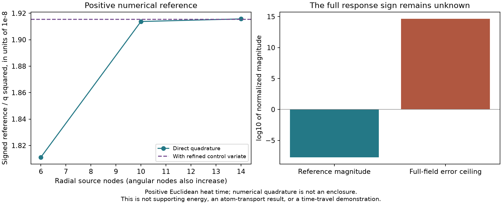

### Checkpoint191 numerical record and independent review

At the saved atomic flux and $T=s_0$, direct source grids give:

| Radial x angular nodes | Direct $S_B(T)/q^2$ | Actual minus uniform reference |
| --- | ---: | ---: |
| 6 x4 | 1.811111495845388e-8 | 9.06049e-24 |
| 10 x6 | 1.913747104269121e-8 | 8.49081e-24 |
| 14 x8 | 1.915713604899990e-8 | 8.39518e-24 |

All use3 spatial Gaussian nodes per direction,4 line nodes and60-digit arithmetic. The uniform source integral is refined independently at16x12,32x24 and64x48; the last two differ by8.16569e-17. Combining the64x48 uniform estimate with the14x8 actual-minus-uniform residual gives approximately **+1.91546e-8**. The corrected coarse-grid centers share the same fine uniform value; their agreement must not be read as independent convergence of the entire integral. Neither the integral error nor unsampled Gaussian tails are certified.

The190 comparison ceiling about the exact reference, divided by$q^2$, is **4.2667469798854073e14**. This is about2.23e22 times the computed reference magnitude. It remains compatible with both signs for the full response, even if the reference quadrature were made exact. It is an upper error bound, not a measurement of error and not an impossibility theorem.

All8 native checks pass with94 exact inputs. A separate350-digit evaluation reproduces the comparison ceiling; a100-digit non-diagonal-frame Clifford calculation, with nonzero cutoff gradient and curvature correction and an independently differentiated metric variation, agrees with the implemented density to2.86e-101. These are internal project/agent checks, not external peer review. The figure was rendered and visually inspected.

Pointwise source SHA256 38c425de7982e83c539abc593ce507a93fb888a9d3cb3b0f5ddea6307b1bba16
Signed-kernel source SHA256 be89a46eed487c3eea21ccc5f1c12deef13a604599e065970cebbf4568791d80
Results SHA256 092bfcef2fb9eb4a7a0762f5bac92474abe309efdc0fd5a4f233236805407922

### Where the comparison ceiling is lost

An independent110-digit route screen, reproduced by the coordinator at120 digits, decomposes the saved radius. The inside actual-leg term contributes50.00005990%, the inside frozen-leg term0.003884506%, and the exterior-input term49.99605560%. Within189's Dirac error,

$$
F_{1,\mathrm{early}}=1.32173019649\times10^{45},\qquad
F_{1,\mathrm{late}}=1.51655200468\times10^{39}.
$$

The early part is99.99988526% of$F_1$. Its current estimate is

$$
F_{1,\mathrm{early}}\le B_1(t/2)\,\eta(t/2),\quad
B_1(t/2)=1.09903375393\times10^{47},\quad
\eta(t/2)=0.012026293021159.
$$

Here$B_1$ is the global comparison-filter Hilbert--Schmidt ceiling, not an observed norm. It is the next specific inequality to replace with a local magnetic smoothing estimate that still controls the exterior. Improving the reference quadrature cannot alter these terms. Setting the explicit frozen-leg term to zero would remove only0.003884506% of this radius.

As a deliberately hypothetical screen, remove both early error terms and replace$X_j$ by$Q_j+F_{j,\mathrm{late}}$. The same formula still gives39566.110733603 per$q^2$. These removed terms are **not actually zero**, and this altered expression is not a valid improved certificate. It shows why fixing the early estimate alone must not be presented as resolving the sign. Better coefficient estimates and preservation of signed cancellation remain relevant; the physical subtraction and complete supporting source are still required.

To reproduce the screen, use189's exact packed atomic$T/s_0=1$ record: `HS_error_terms`, `early_defect_operator_integral_upper`, `frozen_value_HS_upper`, `frozen_Dirac_HS_upper`, `selected_heat_HS_upper` and `geometry.insertion_graph_a/b`, with177's saved$s_0$. Substitute into190's displayed three-term inequality; no new simulation or geometry fitting is involved.

Final layout PASS:188 imported modules,1692 Markdown links,8 historical source guards,14 frozen pilot hashes. All94 current scientific input hashes and both new source hashes are verified. The six historical document bodies and all previously tracked scientific artifacts are preserved. No calculation remains running.
