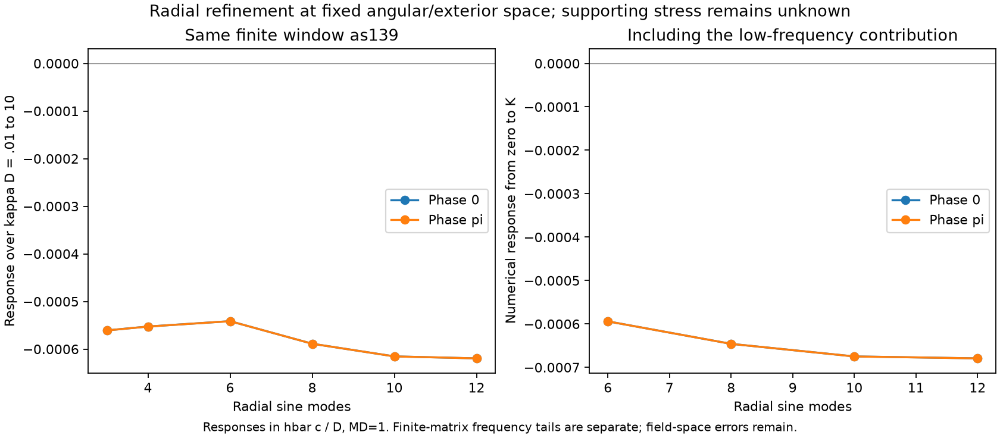

# Radial refinement of the finite common-form source

Increment 140 isolates the radial sensitivity identified in 139. At fixed proper
regulator $MD=1$, azimuthal sector $\mu=1/2$, three paired angular modes and
48 global exterior columns, increasing the independent bridge radial cutoff
from 10 to 12 changes the frequency-integrated finite response by about 0.659%.
The 3-to-12 correction at low frequency is predominantly feedback into the
retained modes. These results do not establish a continuum source sign or
supporting material.

[Calculation](../scripts/dihole_radial_refinement.py) ·
[saved results](../results/dihole_radial_refinement_results.json) ·
[raw and canonical matrices](../data/dihole_radial_refinement_state.npz) ·
[figure](../figures/dihole_radial_refinement_progress.png).

## Model and assembly

The geometry, metric-variation probe, proper-mass prescription, angular family
and exterior family are inherited unchanged from 139. The tested radial cutoffs
are $N_r=3,4,6,8,10,12$. For this sector the compact angular labels are
$\ell=0,1,2,3$ in the upper spin component and $\ell=1,2,3$ in the lower,
in both chiralities. The total dimension is $48+14N_r$, reaching 216.
The radial sines vanish at both bridge cuts, so adding them preserves the
existing global trace matching.

The [streaming adapter](../scripts/dihole_radial_stream.py) keeps the original
$N_r=1$ pointwise data resident and expands higher sines in chunks of four
radial slices. At production quadrature order 64 each chunk contains at most
768 points. It avoids materializing all 216-column fields on the whole grid;
this is an assembly strategy, not a measured peak-memory bound. Global and
compact fields share quadrature before their differential actions are squared,
retaining their mixed Gram, form and source terms. This is the positive
physical quadratic form, not the square of a compressed first-order matrix.

The raw cross-chirality blocks of $G,Q_\kappa,\dot Q_\kappa$ are exactly zero
as stored; the code rejects a nonzero block rather than discarding it.
The $\beta$ exchange of the two chiralities is reflected in the checked pairing

$$
P_L(\kappa)=P_R(-\kappa),\qquad
\dot P_L(\kappa)=\dot P_R(-\kappa),
$$

after canonical normalization. Equivalently the constant/quadratic coefficients
agree and the linear coefficients have opposite signs. All saved cases satisfy
this pairing bitwise. Both chiralities are retained once. With
$c_j=(1,-3,3,-1)$ and fixed $\dot G=0$, the fibre response is

$$
\mathcal F(\kappa)=-\frac12\sum_{j=0}^3c_j
\operatorname{Tr}[(Q_\kappa+jM^2G)^{-1}\dot Q_\kappa].
$$

There is no frequency factor in this definition. The full-line integral is
$\int_{\mathbb R}\mathcal F(\kappa)d\kappa/(2\pi)$; the verified pairing
permits $\pi^{-1}\int_0^\infty[\mathcal F_R+\mathcal F_L]d\kappa$.
If the stored pairing is not exact, the implementation explicitly averages
positive and negative frequencies instead of imposing it.

## Frequency-integrated results

The table gives the numerical integral from $\kappa D=0$ to 160, in
$\hbar c/D$, with a separate upper bound on the remaining frequency tail
of each saved finite matrix model. The tail column is the larger of the
two phase bounds. It is **not** an error bar on the whole calculation.

| $N_r$ | Dimension | Phase 0 | Phase $\pi$ | Finite-matrix tail bound |
| ---: | ---: | ---: | ---: | ---: |
| 6 | 132 | $-5.94020778255\times10^{-4}$ | $-5.94079457557\times10^{-4}$ | $4.921\times10^{-9}$ |
| 8 | 160 | $-6.45824669113\times10^{-4}$ | $-6.45878229114\times10^{-4}$ | $7.745\times10^{-9}$ |
| 10 | 188 | $-6.74777829325\times10^{-4}$ | $-6.74837887282\times10^{-4}$ | $1.195\times10^{-8}$ |
| 12 | 216 | $-6.79225419487\times10^{-4}$ | $-6.79287321149\times10^{-4}$ | $1.718\times10^{-8}$ |

The absolute 10-to-12 changes are $4.44759016\times10^{-6}$ and
$4.44943387\times10^{-6}$, or 0.659119% and 0.659334% of the respective
$N_r=10$ magnitudes. They are observed refinement differences, not bounds on
$N_r>12$. The common-window sequence initially becomes less negative from 3
through 6, then more negative through 12. No asymptotic monotonicity or
extrapolation remainder is established.

The [frequency-tail helper](../scripts/dihole_finite_frequency_tail.py)
uses outward arithmetic on the supplied canonical binary64 matrices, treated
as exact dyadic inputs. A positive large-frequency lower bound on $P_\kappa$
and norm bounds on $\dot P_\kappa$ control the common-P PV rational function.
The source and both chiral tails are summed with the same normalization as the
middle integral. This certificate does not enclose assembly or whitening
roundoff, the numerical middle quadrature, or any omitted field-space modes.
Orders 16 and 24 agree within $6.09\times10^{-13}$ for the displayed middle
integrals; that agreement is a numerical control, not an interval enclosure.

## What the added modes change

The [Schur helper](../scripts/dihole_radial_schur.py) partitions the same raw
216-column model into retained $N_r=3$ columns $L$ and added columns $H$,
before whitening. At each PV shift define

$$
A_j=Q_{LL}+jM^2G_{LL},\quad
V_j=Q_{LH}+jM^2G_{LH},\quad
H_j=Q_{HH}+jM^2G_{HH},\quad
S_j=A_j-V_jH_j^{-1}V_j^\dagger.
$$

The $jM^2G_{LH}$ term is essential: compact modes and global trace lifts are
not orthogonal in the physical norm. Writing
$a=\dot Q_{LL},v=\dot Q_{LH},d=\dot Q_{HH}$ gives

$$
\dot S_j=a-vH_j^{-1}V_j^\dagger-V_jH_j^{-1}v^\dagger
          +V_jH_j^{-1}dH_j^{-1}V_j^\dagger.
$$

Differentiating the block determinant yields the exact finite decomposition

$$
\mathcal F_{\rm full}-\mathcal F_L
=\underbrace{-\frac12\sum_jc_j\operatorname{Tr}(H_j^{-1}d)}_{\text{direct high}}
+\underbrace{-\frac12\sum_jc_j\operatorname{Tr}
 (S_j^{-1}\dot S_j-A_j^{-1}a)}_{\text{feedback}}.
$$

| Phase | $\kappa D$ | Direct high | Feedback | Added response |
| --- | ---: | ---: | ---: | ---: |
| 0 | 0.1 | $-2.69081733\times10^{-5}$ | $-8.36207757\times10^{-4}$ | $-8.63115930\times10^{-4}$ |
| $\pi$ | 0.1 | $-2.69081733\times10^{-5}$ | $-8.35567869\times10^{-4}$ | $-8.62476042\times10^{-4}$ |
| 0 | 0.7 | $-3.83447641\times10^{-6}$ | $-1.70451487\times10^{-6}$ | $-5.53899128\times10^{-6}$ |
| $\pi$ | 0.7 | $-3.83447641\times10^{-6}$ | $-1.67962682\times10^{-6}$ | $-5.51410324\times10^{-6}$ |

These are fibre values, without $1/\pi$. Feedback accounts for 96.88% of the
low-frequency correction, and about 30.5–30.8% at 0.7. Independent full-minus-low
canonical calculations agree with the decomposition within
$2.56\times10^{-16}$. A large omitted-mode eigenvalue alone therefore does not
bound the source change: coupling and source cross terms also matter.

## Verification, limits and next decision

All seven saved checks pass: global sewing, recovery at the frozen radial cutoff 3,
chirality splitting, Schur accounting, coupled spatial quadrature,
finite-matrix frequency tails and middle-frequency quadrature. The largest
weak sewing skew defect is $5.47\times10^{-13}$; recovery at radial cutoff 3 is
$4.17\times10^{-10}$ relative. Splitting agrees with the full response within
$5.04\times10^{-16}$. Increasing bridge/exterior quadrature from 64/24 to 80/32
changes the form, norm and variation by at most $3.35\times10^{-13}$ relative
and the tested 0.1 fibre by $1.13\times10^{-13}$. Source, dependency, baseline
and saved-matrix SHA256 values are recorded in the results. The production
run took 100.5 seconds; this report uses those saved results without rerunning it.

The next targeted challenge is an **exterior-only extension** at fixed
$MD=1,\mu=1/2,N_r=12$ and angular cutoff 3. Add a small reflection-symmetric, chirally
paired compact family extending beyond the current $z=\pm0.85D$ rectangle,
overlapping the retained exterior support and vanishing near both mouth cuts.
Reuse the saved matrices and assemble only new exterior blocks and their
cross terms. Since the metric probe is confined to the bridge, derivative
blocks involving these new fields vanish: the added response is entirely
Schur feedback, including the mass-weighted Gram coupling.

Compare its frequency-integrated change with the last radial change,
approximately $4.45\times10^{-6}$ for each phase. A larger change prioritizes
exterior completion; a smaller change passes only this specified finite
challenge. A radial remainder would still require bounds on the omitted
Schur coupling and inserted source, not just a Poincare gap or monotone Ritz
levels. Neither result would certify a complete angular sum, the physical
exterior, or a supporting stress tensor. **Regulator removal on this fixed
finite space is not allowed as a physical inference.** Stable backward
passage, including 13 September 2027 to 12 September 2027, remains unproved.
