# Authoritative checkpoint184 - real positive-frame bounds tighten the same field certificate

Previous checkpoint183 published b4d4420e7a0f910883e4ca355bf6c8b6310f664a.
Previous goal turn PROGRESS:183 verified and privately published.
Goal ACTIVE, unachieved. Browser/Downloads import COMPLETE; do not reopen.
One neutral hydrogen atom; trial 1 nm areal diameter; humans deferred.
No stable opening, obtainable source, atom transit or clock gain established.

- scripts/dihole_positive_frame.py: 13 checks PASS, 77 exact inputs.
  Same positive coframe E=sqrt(g), inverse frame I=E^-1, geometry,
  source-centred gauge, regulator, normal support and atom target.
- Real metric spectral bounds sharpen E0 to 9.635570203725965,
  I0 to 16.13673347157282; E1 to 217721.44389838178,
  I1 to 56693394.050821565. Derivative arrays retain orders0..20.
- Noncommuting Sylvester recurrences use OPERATOR norms internally.
  Old component caps enter with factor4. Exported component minima are
  taken only after the recurrences; never fed back without conversion.
  Real bounds do not replace the saved complex-domain moduli.
- Recomputed operator/variation18, transport schedule16,14,12,10,8,
  whole heat defect and scaled graph/Fourier bounds. No term dropped.
- Atomic log10 B4 <=356.3990743117428, reduction >=93.41923770240045
  decimal orders vs183. mu=2^103, lambda=2^107.
  Cstar/Cgeometry log <=358.597494039787.
  Curved envelope/q² at nominal M²s0=100 log <=247.64486743961194.
- q1000 log10 B4 <=326.3208676831092, reduction >=188.48649335147786
  orders. mu=2^80, lambda=2^84. These remain conservative ceilings,
  not actual errors, supporting energies or evidence of physical support.
- Initial export rounded unchanged float ceilings upward by one ulp.
  Nonincrease check caught this; original source and failed result kept:
  provenance/dihole_positive_frame_rounding_trial.py and
  results/dihole_positive_frame_rounding_trial.json.
  Fix keeps the original exact float cap; internal mathematics unchanged.
- NEXT: test a covariant/geodesic-radial heat estimate that retains
  connection/parallel-transport cancellations. Current physical-connection
  ceiling logs: spin about11.62277, electromagnetic about17.78013.
  This diagnoses estimates only; it does not establish actual dominance.
  Ordinary-coordinate radial gauge does NOT make curved-geodesic
  transport identity. Any new gauge must transform P and dotP, preserve
  the fixed-variation convention, density, domain and global extension.
  This next formulation is NOT yet derived or implemented.
- Exact lower-coefficient enclosures and full source remain unresolved.
  Static geometry excludes13Sep2027->12Sep2027. A future clock advantage
  has not been established. Enlargement needs new source/stability work.

Source SHA256 823df8b95089f2036991618c9ec7b65c0b92425394063f2f93487b5872d8ad8d
Results SHA256 765cc0cc9989e238ba630082f27bcb83afba55d57a977cda5d7d87bcd94f32cc
Verification: all13 controls and77 exact inputs pass; figure inspected.
Independent numerical audit:600 directed comparisons at550 digits, covering
frame/operator/transport/defect arrays and12 matching diagnostics.
Actual-code proof audit PASS: norm conversion, matrix identities, unchanged
gauge and real domain. Frozen rounding trial authenticates.
Final layout PASS:180 imports,1615 Markdown links,8 historical source guards,14 frozen pilot hashes.
No simulation is running. Publication follows completed verification.

--- Preserved checkpoint183 and earlier history ---

# Authoritative checkpoint183 - source-centred gauge reduces the full error ceiling

Previous checkpoint182 published 7391aceea8d8b44a1ad36d84e027a345cf996e87.
Previous goal turn PROGRESS:182 verified and privately published.
Goal ACTIVE, unachieved. Browser/Downloads import COMPLETE; do not reopen.
One neutral hydrogen atom; trial 1 nm areal diameter; humans deferred.
No stable opening, obtainable source, atom transit or clock gain established.

- scripts/dihole_centered_gauge.py:12 checks PASS,73 exact input hashes.
  Saved geometry reused; no old interval geometry solve rerun or edited.
- Source-specific ordinary-coordinate radial gauge implemented:
  A_i^y=int0^1 t(x-y)^j Fji(y+t(x-y))dt.
  Fixed spatial inner radius2^-32, global phase extension outside2^-31;
  normal support, point cube and extension fit existing chart clearance.
  Time-independent phase held fixed under metric variation. Physical
  curvature, magnetic flux, regulator, exact lower coefficients unchanged.
- New ordinary gauge bound through19:
  4r*a_(n+1)/(n+2)+2n*a_n/(n+1); order20 not claimed.
  Physical magnetic bound gives zerojet<=r*Mmetric*Bunit/2 per|q|.
  New zerojet1.2981876755092596e-7 vs old676.9053329684016.
- Recomputed canonical operator/variation through18, physical transport
  derivative schedule16,14,12,10,8, whole181defect and182proofscales.
  New radial gauge component retained; curved-geodesic transport retained.
- Atomic logB4<=449.8183120141433, reduction>=51.58149348139301
  decimal orders from182. New mu2^123,lambda2^127.
  Cstar/Cgeometry log<=452.0167317421875; curved envelope/q² at
  nominalM²s0=100 log<=341.0641051420124. Still too loose for support.
- q1000 bound barely changes (6.7e-18 decimal orders). This is retained,
  not exaggerated as a meaningful low-flux improvement.
- Current atomic u4 order0/8 log ceilings292.07020/538.68299 are near
  low-flux baseline. Zeroth physical spin-connection ceiling log23.81648
  exceeds electromagnetic ceiling log17.78013 by6.03635orders.
  These compare estimates, not actual physical terms.
- NEXT: sharpen the SAME positive symmetric coframe E=sqrt(g).
  E0<=sqrt(M), inverseE0<=sqrt(H). Sylvester recurrence:
  En<=(4*g_n+sum_j1..n-1 binom(n,j)Ej E(n-j))/(2sqrt(m)).
  Saved metric jets are COMPONENT bounds: factor4 required.
  Inverse-frame recurrence fromg^-1 uses lower spectral bound1/M.
  These new frame bounds are derived but NOT evaluated yet. Reuse the
  fixed radial gauge and recompute transport/defect after evaluating them.
- Exact lower-coefficient enclosures and full source remain unresolved.
  Static geometry excludes13Sep2027->12Sep2027; humans remain deferred.

Source SHA256 bc1c52a5be65971eeaa6adae00519c04e631588c82e4cb224a03d5059a756ae8
Results SHA256 a98634878eb8604219e0a1bf3cfe38c311210df5ff0ad7dc0d0928c919dfe6af
Verification:12 native true checks,73 exact inputs, figure inspected.
Domain/gauge audit PASS including normal-radius reconstruction and all73 hashes.
Independent numerical audit PASS:495 directed comparisons at500-550 digits, including gauge/operator arrays, point/transport estimates and all12 matching rows. All73 hashes and final source/result hashes match. Domain/gauge audit also PASS. Final layout PASS:179 imports,1603 Markdown links,8 source guards,14 frozen pilot hashes.
No simulation is running. Publication follows completed verification.

--- Preserved checkpoint182 and earlier history ---

# Authoritative checkpoint182 - auxiliary proof scales tighten the full defect

Previous checkpoint181 published deb32f3c47fe0128fca1520bdab4280c934b422e.
Previous goal turn PROGRESS:181 verified and privately published.
Goal ACTIVE, unachieved. Browser/Downloads import COMPLETE; do not reopen.
One neutral hydrogen atom; trial 1 nm areal diameter; humans deferred.
No stable opening, obtainable source, atom transit or clock gain established.

- scripts/dihole_scaled_graph.py:12 checks PASS,71 exact input hashes.
  Saved181 defect reused. Geometry, field, physical target regulator,
  normal support, cutoff and time interval unchanged.
- Replace fixed graph(1+P)^3 by(mu²+P)^3 and introduce an independent
  Fourier evaluation scale lambda. Both are auxiliary inverse lengths.
  Neither is a matter mass, regulator M, physical field or opening size.
- Exact spectral constants cp bound ||D^p u|| by cp mu^(p-6) graphnorm.
  Mixed U_(ell,p) recursion preserves every spectral power, ell+p<=6.
  Fourier scaling is E_k(lambda)=E_k(1)*lambda^(k-4), dimension4.
- Full B4 is a positive Laurent polynomial:39 point terms,87 defect
  terms per flux. A finite grid selects exact powers of two; interval
  evaluation certifies those choices, not their global optimality.
- q1000:mu2^123,lambda2^127; logB4<=514.8073610345871,
  a ceiling reduction of at least222.67554903555398 decimal orders.
- Atomic:mu2^136,lambda2^140; logB4<=501.3998054955363,
  a ceiling reduction of at least338.9255321509277 decimal orders.
  Cev log<=-65.8530962573379; physical graph log<=566.722656437532.
- Atomic Cstar/Cgeometry log<=503.5982252235805. Curved-remainder
  envelope/q² at nominalM²s0=100 has log<=392.6455986234054.
  These ceilings remain too loose for source sign or physical support.
  Exact lower coefficients required; no numerical quadrature promoted.
- NEXT: evaluate the derived source-centred ordinary-coordinate gauge.
  A^y_i=int0^1 t(x-y)^j Fji(y+t(x-y))dt on a fixed convex ball.
  New ordinary component jet bound per|q|:
  4r*a_(n+1)/(n+2)+2n*a_n/(n+1), second term absent atn0.
  Original20jets suffice through19 for operator18. Inner spatial radius
  2^-32, outer time-independent cutoff radius2^-31 fit the old clearance.
  Globally extend the phase, fixed during metric variation. Flux and
  graph norms invariant. Curved-geodesic transport still retained.
  This gauge has NOT yet been applied to operator/transport/defect bounds.
- No broad context/geometry rerun absent a specific defect. One-atom
  support, stability, survival and clock comparison remain required.
  Static geometry excludes13Sep2027->12Sep2027; humans remain deferred.

Source SHA256 8f4684f02f16404ba1615e29b67e7f8e1de4964e8ffb90c4a8b9a956388cf6d9
Results SHA256 2f29e4149326fdb5ba22b5561cbd0643e3adadf235762f731cd4890cebc420c4
Verification:12 native true checks,71 exact inputs, figure inspected.
Independent audit PASS:300 directed comparisons at500-650 digits;
smallest positive relative ceiling margin6.54312e-103.
Final layout PASS:178 imports,1593 Markdown links,8 source guards,14 frozen pilot hashes.
No simulation is running. Publication follows completed verification.

--- Preserved checkpoint181 and earlier history ---

# Authoritative checkpoint181 - full heat defect evaluated, ceiling too loose for support

Previous checkpoint180 published fcdf8d85eee01e268e0796114c2e6e35afd02a8e.
Goal ACTIVE, unachieved. Browser/Downloads import COMPLETE; do not reopen.
One neutral hydrogen atom; trial 1 nm areal diameter; humans deferred.
No stable opening, obtainable source, atom transit or clock gain established.

- scripts/dihole_heat_defect.py:14 checks PASS,69 exact input hashes.
  No old geometry simulation rerun; historical sources/results unchanged.
- Full physical Q4 defect now bounded: interior t4*chi*G*P*u4 plus
  the complete cutoff commutator. Gaussian derivatives preserve d powers
  before 4D L2 integration. Normalized derivative schedules suffice.
- Interior time exponents are nonnegative half-integers0..3. Annular
  powers range-9..2 with exp(-rho²/(64t)); exact critical-time suprema
  included forq1000. Atomic terms all peak at the saved cutoff.
- Apply(1+Pg)^3 by derivative orders6->4->2->0. Physical/canonical
  density conversion and full source integration included: rank4,
  both collars, two hemispheres, per unit Killing time. No missing lapse.
- Atomic log10B4 ceiling840.3253376464642. Interior contribution
  log840.32534 dominates annular contribution log517.05591.
  q1000 log10B4 ceiling737.4829100701412.
- Diagonal Gaussian Hessian cancels for the exact volume-preserving
  probe. Q4 coefficients b8/b10 have atomic log absolute ceilings
  319.9665151674619 and404.8231204032095. Not asserted to be higher
  full asymptotic coefficients based on the O(t²) defect alone.
- Cstar<=|b8_Q4|+s0|b10_Q4|+16pi²B4, and Cgeometry<=Cstar+Cmag.
  Both atomic log ceilings842.5237573745084. These subtract EXACT
  a2/a4/a6; old numerical lower coefficients are not treated as certified.
- At nominalM²s0=100 the curved-remainder envelope/q² has log ceiling
  731.5711307743333. This is not the full source or its actual error.
- Scientific result: generic bound now finite but quantitatively
  insufficient to decide support. It does not establish impossibility.
  Refining only the cutoff cannot resolve the dominant interior ceiling.
- NEXT: target the interior/point-evaluation overestimates and retained
  cancellations for a useful source enclosure at the same regulator.
  Exact lower-coefficient enclosures and full source still unresolved.
  Do not rerun settled scope, broad context or geometry without a defect.
- One-atom support, stability, transmission/survival and clock comparison
  are all required. Static geometry excludes13Sep2027->12Sep2027.
  Human enlargement is deferred; no automatic scaling is claimed.

Source SHA256 ff32753c8c84b68794b542a7f427963b28ad37d2cd893779610de9e0ae64a1d2
Results SHA256 bb0af04d14108fe79d5658b3a08e4e6611355a8d4d18bb606780c64a09b3ce2b
Verification:14 native true checks,69 exact inputs. Gaussian/remainder audit
PASS:122 directed bounds+114 log enclosures at170-190 digits.
Independent audits PASS:122 directed bounds and114 log enclosures at170-190 digits;120 directed coefficient/graph/source comparisons at600 digits. Both verify69 exact input hashes and final source/result hashes. Smallest positive margin in the latter audit:4.00469e-92. Figure inspected. Final layout PASS:177 imports,1583 Markdown links,8 source guards,14 frozen pilot hashes.
No simulation is running. Publication follows completed verification.

--- Preserved checkpoint180 and earlier history ---

# Authoritative checkpoint180 - local normal geometry and heat transport bounded

Previous checkpoint179 published 41736dab5c92ded0db7ef9935734abaf2ce7934a.
Previous goal turn PROGRESS:179 verified and privately published.
Goal ACTIVE, unachieved. Browser/Downloads import COMPLETE; do not reopen.
One neutral hydrogen atom; trial 1 nm areal diameter; humans deferred.
No stable opening, obtainable source, atom transit or clock gain established.

- scripts/dihole_local_transport.py:16 checks PASS,67 exact input hashes.
  All historical source/results unchanged; no historical geometry solve rerun.
- 768 real interval boxes sharpen first metric component derivatives to
  6746.143644310957. Real metric upper92.84421315093161,
  inverse upper260.3941671325786, lower.0038403317977965847.
- Quantified normal metric radius >=2.8468802301693738e-12, D=1.
  Coordinate velocity radius >=4.593934749973308e-11; Jacobian singular
  values[.5,1.5], inverse norm<=2. These are local estimates, not throat sizes.
  Clearance plus exp-map injectivity establishes unique minimizing geodesics.
- Explicit exp/inverse endpoint derivatives through17, with scaled phase
  Lipschitz bound<1. Physical spin+U(1) transport uses unitarity.
- Physical heat coefficients u0..u4 derivative ceilings now evaluated
  through orders16,14,12,10,8 at q1000 and exact atomic
  q=4642875905017627791065088. Physical-volume and canonical densities
  remain distinct. These are not signed coefficients or atom trajectories.
- Graph-to-point Cev<10^165 atq1000 and <10^274 at atomicq.
  Atomic log10 ceiling for normalized eighth derivative ofu4 is597.63766.
  These conservative ceilings do not establish a small remainder.
- Saved constants use exact dyadic packed endpoints; logs are display only.
- Three independent audits PASS: real geometry repeated at65/100digits;
  102 exact-rational comparisons+285 packing/log checks at180digits;
  275 directed bounds+267 log enclosures at170digits. All67 hashes match.
  Exact-geodesic and Fourier controls also pass. Figure inspected.
- NEXT: combine cutoff, Gaussian, physical density, transport and Cev
  into the actual B4 heat-defect norm. It is still null. Then bound the
  curved correction and determine the full source at the SAME regulator.
  Signed diagonal coefficients/matching still need evaluation.
- A prospective cutoff Gaussian factor alone is <=2.03282817991905e-307;
  this is NOT a full defect estimate, and large prefactors remain.
- One-atom support, stability, transmission/survival and clock comparison
  are all required. Human enlargement is deferred and not automatic.
  The fixed static geometry excludes13Sep2027->12Sep2027.

Source SHA256 bf74297137c17b8b8273ee4212b230a843e861ff43712cfacf570042728443c4
Results SHA256 0be31a41b16c37b41cc16d9f8ea5dc4a25200731e7a8d29ec330754fb464b5ee
Verification:16 native true checks,67 exact inputs, independent audits PASS.
Final layout PASS:176 imports,1573 Markdown links,8 source guards,14 frozen pilot hashes.
No simulation is running. Publication follows completed verification.

--- Preserved checkpoint179 and earlier history ---

# Authoritative checkpoint179 - regular geometry and full operator high jets bounded

Previous checkpoint178 published 68e3f0fa4d387d291f9aa86a072ff5d9b85bde5a.
Previous goal turn PROGRESS:178 verified and privately published.
Goal ACTIVE, unachieved. Browser/Downloads import COMPLETE; do not reopen.
One neutral hydrogen atom; trial 1 nm areal diameter; humans deferred.
No stable opening, obtainable source, atom transit or clock gain established.

- scripts/dihole_regular_jets.py:13 checks PASS,65 exact input hashes.
  No historical geometry solve rerun and no old source/result modified.
- Actual base N,P,1/N,1/P,a enclosed on768 complex interval boxes:
  R in[.025,.070], x in[-1,1], complex radii .001 and .01.
  Exact balanced calibration; principal roots and denominators separated.
- Actual sewn profile is C-infinity but not analytic at the joins.
  Endpoint-safe Cauchy bound Bn=n! max(10^n,C(2n/e)^n), n>=1,
  C=exp(5/3)/(1-exp(-5/6)); B0=1. Values through21 certified.
  Rn=L^(1-n)B(n-1), f_n=B(n+1)/(2L^n), L=.05.
- Two oriented stereographic disks |y|^2<=2 remove polar singularities.
  Complex y radii1/2000 give |delta x|<=.004009020044599221<.005.
  Exact NP=1 and a=0/1 at the two poles make divided differences regular.
  Local gauge patches retained; no single global monopole potential asserted.
- Finite composition gives all mixed regular coframe, inverse coframe,
  metric, inverse metric, gauge and (half-)density derivatives through20.
  The scalar majorant recursion is b0=1, bn=sum_j Rj/(j!*.001)*b(n-j).
  |d_s^n d_y1^j d_y2^k F| <= n!j!k! M bn 2000^(j+k), total<=20.
- Explicit canonical Dirac coefficient bounds now yield physical P=-D^2
  and the full fixed-space dotP coefficient derivatives through18.
  Includes spin connection, gauge, physical half-density and probe mask.
  Second-order coefficients use ordered coordinate pairs (not collected).
  Atomic q=4642875905017627791065088 retained; no small-flux substitution.
- These are conservative component-wise coefficient ceilings, not heat,
  energy, a source sign, or a claimed physically achievable field.
- NEXT: evaluate a verified normal neighbourhood and transport bounds
  for Q4, and graph-norm point-evaluation constants. High input jets are
  now available; actual u_j, B4 and Cgeometry remain uncomputed.
  The full source at the SAME target regulator also remains unknown.
  The fixed static geometry excludes13Sep2027->12Sep2027.

Source SHA256 5369eab9d86a109fe5542d790bdeeba3fc6f19024384d469d75f543e1931f311
Results SHA256 e25dd81f979eca7fa6839f1850f19cced5be7065045626d2efccc66405ef3d06
Verification:13 checks pass,65 exact inputs, figure inspected.
Independent179 audits PASS:501 directed comparisons at160 digits;512 scalar
ceilings and complex-chart identities at125 digits. All65 hashes match.
Final layout PASS:175 imports,1563 Markdown links,8 source guards,14 frozen pilot hashes.
No simulation is running. Publication follows completed verification.

--- Preserved checkpoint178 and earlier history ---

# Authoritative checkpoint178 - signed all-order magnetic remainder bounded

Previous checkpoint177 published 105778ac68349b36fc58a0990d17a5e3cc65a360.
Previous goal turn PROGRESS:177 completed and privately published.
Goal ACTIVE, unachieved. Browser/Downloads import COMPLETE; do not reopen.
One neutral hydrogen atom; trial 1 nm areal diameter; humans deferred.
No new law, supporting material, stable opening, atom transit or clock gain.

- scripts/dihole_magnetic_remainder.py:12 checks PASS,63 exact input hashes.
  Existing geometry bounds reused; no old geometry or physical solves rerun.
- NEW all-x reference inequality: for g=coth(x)-x*csch²(x),
  0<=2x/3-g(x)<=4x³/45, from positive partial fractions.
  Hence local constant-field reference deltaTheta0-a4mag/(16pi²)
  lies between -Cmag*s²/(16pi²) and0, for every s>=0.
  This does not identify deltaTheta0 with the actual inhomogeneous heat.
- Cmag=(16/45)int f*Cperp*B² dV. Actual radial profile gives
  f=(Lc/2)dchi/ds, chi=R', Lc=.05D, so int f chi²ds=Lc/6 exactly.
  Physical volume cancels P,R,W factors, leaving N² a_R²/(1-x²).
  Polar a_R(+/-1)=0 and saved arx bound give angular factor4log2-2.
- Both collars and full sphere: Cmag/q4 <=.035214916646301046/D5,
  a4mag/q²<=.00183080854455465/D. These are directed bounds,
  not the old numerical quadrature promoted to an enclosure.
- Signed magnetic short correction lies in[-Cmag*J1/(32pi²),0].
  At atomic q and177's target z=M²s0 about50, its magnitude/q² is
  <=7.299756270521545e-14/D; atz100 <=1.8249390676303856e-14/D.
  Combined KNOWN correction pieces atz100, divided byq², lie in
  [-1.8249390676303865e-14,+9.010957784002826e-30]/D.
  This excludes the UNKNOWN curved short remainder and is not a source interval.
- Remaining exact short error is deltaK-deltaTheta0-Hgravity-a6*s/(16pi²).
  Its Cgeometry is null; it contains curvature, gradients and nonlocal effects.
  Removing pureF4 does not prove uniformq² scaling: mixedRF4 terms remain.
- NEXT: construct/certify an insertion-sensitive local heat-parametrix defect,
  retaining its mismatch with the variation of the reference heat trace.
  A conditional Q4 Duhamel certificate is now derived in the physical report:
  Cstar<=|a8|+s0|a10|+16pi2 sup_t (int_0^t B4)/t. Cgeometry needs
  a8-a8mag and the remaining magnetic F6 tail as well. No value is evaluated.
  Existing third jets and existential heat theorems do not evaluate the defect.
  Need higher verified geometry/transport derivatives and local graph bounds.
  The full source at the SAME targetM also remains unknown; do not substitute
  the comparison-filter Lambda source. Counterterms/reference stay fixed.
  Static geometry excludes13Sep2027->12Sep2027; no future clock gain proved.

Source SHA256 fa4b9c89dafa5782573646a9c721e990b5a09200e58bfba1f2930a670a3e2795
Results SHA256 368c51d0b025a4f31628e65666796c059a28c25f188bdcebff20202c2778f5ed

Verification:12 checks pass,63 exact inputs, figure inspected.
Independent178 audits PASS: mass_audit (100-digit recomposition, 36 signed bounds)
and connected_domain (125 digits, 79 directed inequalities, 183 scope/equality checks).
Layout PASS: 174 imports, 1552 Markdown links, 8 source guards, 14 frozen hashes.
No simulation is running. Publication follows completed verification.

--- Preserved checkpoint177 and earlier history ---

# Authoritative checkpoint177 - full-field heat bound and regulator matching tail

Previous checkpoint176 published d24ed93d2ee4eef928921a3b130f5b766d713e15.
Previous goal turn PROGRESS:176 completed and privately published.
Goal ACTIVE, unachieved. Browser/Downloads import COMPLETE; do not reopen.
One neutral hydrogen atom; trial 1 nm areal diameter; humans deferred.
No new law, supporting material, stable opening, atom transit or clock gain.

- scripts/dihole_regulator_heat_tail.py:14 checks PASS,61 exact input hashes.
  No historical geometry or physical solves rerun. Existing176 bounds reused.
- NEW integrated first-order insertion W_Lambda=int||B_kappa||1 dκ/(2pi).
  This uses176's direct B envelope, not the converse of the source I bound.
  Atomic W<=1.8262413629229484e69/D², full angular and exterior content.
- For E=exp(-sP/2)=K_Lambda J, D=K*dotA K=N^-1/2 beta B N^-1/2.
  Cyclicity gives |deltaK(s)|<=2s*nu*W_Lambda*L_Lambda(s),
  L_Lambda=sup_x sqrt(x)exp(-sx)prod(x+jLambda²)/(6Lambda6).
  A positive four-term spectral ceiling evaluates L for every s>0.
  Beta is not commuted through K; no global spectral gap is assumed.
- Set r_M=3exp(-M²s)-3exp(-2M²s)+exp(-3M²s), after eta->0 first.
  Half-weighted long-time correction <=nu*W*L(s0)*int_s0^infinity r_M ds.
  All factors are now explicit; no unknown long-time heat constant remains.
- Atomic cutoff s0/D²=1.7932482895815272e-28 is chosen so
  q*Bunit*s0<=.01 across the buffers. This does NOT certify a heat remainder.
  Lambda D=2154733372140.8845 is a comparison filter, distinct from target M.
  At nominal M²s0=50, MD=528037528346787.6:
  long heat correction/q² <=9.343832528117022e-8/D.
  At nominal M²s0=100, MD=746757834029994.8:
  long heat correction/q² <=9.010957784002824e-30/D.
- Exact matching: Q_HK=Q_M-C_M+(a6*J0-a2*I2-a4*I1)/(32pi²)+epsilon,
  |epsilon|<=Cstar*J1/(32pi²)+Eheat, if the actual short remainder obeys
  |deltaK-H-a6*s/(16pi²)|<=Cstar*s²/(16pi²) on(0,s0].
  Jj=int_0^s0 s^j r_M ds; Ij=int_s0^infinity s^-j r_M ds; a0=0.
  The unknown Cstar is explicitly null; local a2/a4/a6 remain numerical.
- Physical reference remains fixed: mu_H D=q*sqrt(2)*exp(-gamma_E).
  The required anchor is Q at TARGET M. The saved Lambda source ceiling
  cannot replace it. No source value/sign or total renormalized bound obtained.
- NEXT: evaluate a quantitative differentiated short-time remainder Cstar,
  or its weighted integral directly, and the full source at the same target M.
  Neither local heat coefficients nor magnetic-scale smallness supplies Cstar.
  Then total stress/current, stability and atomic transport must agree.
  Static geometry excludes13Sep2027->12Sep2027; no future clock gain proved.

Source SHA256 16517fa214d719c61030a29663c9b632806a729d9129f1e1918b0f8bda01d51b
Results SHA256 7fb8de096ffe0181ca548455a48bd7fc361e9fb423176a5dc544aae50f782005

Verification:14 checks pass,61 exact inputs, figure inspected.
Independent mathematical audit passes; its90-digit recomposition verifies62
scalar enclosures. A separate125-digit audit verifies122 directed bounds,
120 nearest-float local estimates, all12 target-mass rows and61 input hashes.
No defects found. Layout passes173 imports,1542 links,8 source guards
and14 frozen hashes. All prior documentation bytes are preserved.
No simulation is running. Publication follows completed verification.

--- Preserved checkpoint176 and earlier history ---

# Authoritative checkpoint176 - complete fixed-regulator frequency bound

Previous checkpoint175 published 9ae74fbf5941dad1f15587f1807293f46e2b6566.
Previous goal turn PROGRESS:175 published with independent audits.
Goal ACTIVE, unachieved. Browser/Downloads import COMPLETE; do not reopen.
One neutral hydrogen atom; trial 1 nm areal diameter; humans deferred.
No new law, supporting material, stable opening, atom transit or clock gain.

- scripts/dihole_full_frequency.py:16 checks PASS, 59 exact input hashes.
  No old geometry, physical solves or selected-state simulations rerun.
- NEW complete full-field frequency bound at fixed common regulator:
  every angular state, both collars and all exterior propagation retained.
  Low frequencies are paired; both high-frequency signs are absolutely bounded.
- Exact first-order insertion uses X=chi K sqrtN, Y=chi d_s K sqrtN:
  B=beta[-i*kappa X*(F beta/N)X+(X*FCY-Y*FCX)/2]. Beta stays left.
  ||B||1 <= |kappa|fN*x0²+fP*x0*xs, fN=4/Nmin,fP=4/Pmin.
  Retaining this mixed term avoids the old combined-jet overestimate.
- Local high-frequency floor: P_kappa >= covariant Laplacian
  +kappa²/(2Nmax²)-Cq2, Cq2=Rhnegative/4+abs(q)Bunit+gradlogN²/2.
  h=2Nmax, Kmin=h*sqrt(Cq2); above Kmin use unshifted auxiliary inverse.
  This is compact output localization, not a physical wall or global gap.
- Nested cutoffs inside the existing (-.020,.070)D buffer:
  chi(-.005,.055), zeta(-.0075,.0575), theta(-.010,.060), then
  (-.0125,.0625),(-.015,.065),(-.0175,.0675); ramps .0025D.
  Three local coercivity steps use only existing graph powers G0..G3.
- Infinite angular/spatial heat bound times the localized first-order source
  gives sum(a_p/|kappa|^p), p=3..10, all a_p positive.
  Two-sided high tail/(2pi) <= sum[a_p*K^(1-p)/(p-1)]/pi.
- Atomic q=4642875905017627791065088, fixed MD=2154733372140.8845,
  selected K D=4012480217806.92. At eta=0, in units 1/D:
  paired low <=1.4297415419527994e59;
  absolute high <=3.6263440168995854e53;
  complete bound <=1.4297451682968164e59.
  Uniform eta/M² in[0,.01]: complete <=1.4474333625157666e59/D.
- At the SAME old175 split, sharp low <=5.526822116023921e57/D,
  previously8.214544027895555e80/D. This is a tighter ceiling, not stress.
- NEXT: quantitative physical regulator/counterterm matching. This bound
  holds at finite M; it does not determine a renormalized value or sign.
  Then total stress/current, stability and atomic transport must agree.
  Static geometry excludes13Sep2027->12Sep2027; no future clock gain proved.

Source SHA256 7bfe224bd521b3793364410a1989d22834331a83c5ec225bbbea60f86d0b660c
Results SHA256 5974c84faea4438ee3d78051fa3d42a912fa3d2dd8d17d3c77c62e42a96e4d71

Verification:16 checks pass, 59 exact inputs, generated figure inspected.
Independent mathematical audit passes. A separate115-digit reconstruction
verifies548 scalar inequalities,238 structural/provenance checks, all68
frequency-tail grid integrals and all59 exact input hashes. No defects found.
Layout passes172 imports,1532 links,8 source guards and14 frozen hashes.
No simulation is running. Publication follows completed verification.

--- Preserved checkpoint175 and earlier history ---

# Authoritative checkpoint175 - full-field buffered smoothing evaluated

Previous checkpoint174 published 954f5cf8b865cf123399e89c51bef1db0082063e.
Previous goal turn PROGRESS:174 published with independent audits.
Goal ACTIVE, unachieved. Browser/Downloads import COMPLETE; do not reopen.
One neutral hydrogen atom; trial 1 nm areal diameter; humans deferred.
No new law, supporting material, stable opening, atom transit or clock gain.

- scripts/dihole_buffer_smoothing.py: 18 checks PASS, 57 exact inputs.
  scripts/dihole_buffer_geometry.py:768 interval boxes across the entire sphere.
  No old physical solves or finite selected-source simulations were rerun.
- NEW actual full-field weighted HS norms Z=Ljet K sqrtN and Z' are bounded.
  Both collars, every angular state and global exterior propagation retained.
  Local Dirichlet inverse factors compact outputs; no physical wall is imposed.
- Auxiliary domains per collar s/D=(-.020,.070), length .09D; central length
  .1D makes the two buffers disjoint. Nested chi/zeta/theta support endpoints
  (-.005,.055),(-.010,.060),(-.015,.065); all ramps .005D.
- All-real-frequency Lichnerowicz floor on buffer:
  P_kappa >= covariant Laplacian - Cq,
  Cq D² <=52.75149040398249+12.010815582697589*abs(q).
  Magnetic q is counted once; polar cancellations are exact.
- Whole-sphere scalar comparison c>=.0005061374651171810 relative to
  ds²+(D/40)²dOmega². Both-collar rank4 Dirichlet squared-resolvent trace:
  S<=2[L/(sqrt(c)b^1.5)+2L*r0/(c*b)+2L*r0²/(c^1.5*sqrt(b))], b=a²-Cq>0.
  This uses an infinite sphere/interval spectral bound, not matrix dimension.
- For r=0..3, local ||1_Omega A_z^r K_z sqrtN|| is bounded explicitly by
  partial fractions and174's global lapse commutator. r3 includes alpha.
  Complex disk d=M/(2nu), nu=10.157654373554406, stays in the resolvent set.
- Localize A_z^r K_z sqrtN with zeta and real P_kappa; r0,1 need only graph
  powers through3 plus scalar cutoff gradient/Laplacian bounds.
  Complex square differs by Vd<=d*CN+(2Ksplit*d+d²)nu²; CN<=2Cw*nu^1.5.
  It is NOT asserted positive. Cauchy supplies Z'<=Zdisk/d.
- Canonical derivative pays both half-density and radial spin connection:
  Crad<=14.034021152494184/D. Cutoff gradient<=430.3128925752752/D;
  Laplacian<=352440.5426878167/D².
- Atomic q=4642875905017627791065088, fixed MD=2154733372140.8845,
  Ksplit D=464876469029.3226. At eta=0:
  full ||Z||HS²<=7.768681960564308e66;
  full ||Z'||HS<=5.177433384840746e22 D;
  complete paired LOW-frequency absolute source bound<=8.214544027895555e80/D.
  Uniform eta/M² in[0,.01]: low bound<=8.326773556537753e80/D.
  The ceiling is very loose, NOT a source value or a renormalized support margin.
- Preserved reporting diagnostic: earlier geometry intervals omitted R' in
  three fields, incorrectly excluding the constant-radius zero value. Their
  used upper/absolute bounds were valid and are unchanged after correction.
  Both original sources and result retained as *_prerate*; new regression
  check requires zero in all three actual sewn intervals.
- NEXT: bound the FULL high-frequency contribution with the same common
  regulator. Retain frequency-dependent positive local potential and source
  cancellation; the present coarse estimate is NOT integrable to infinity.
  Never reuse173's selected high tail as the full tail. Then physical regulator/
  counterterm matching and total support/current, stability and atom transport.
  Static geometry excludes13Sep2027->12Sep2027; no future clock gain established.

Source SHA256 0862683252bf01a8d3dce372a44087bad4501eafa1e032e5e9c63969f23e46a8
Geometry SHA256 b15dfafe789e07e106575258b33591e9241d4978f64889d01f44fe5ff4d45d56
Results SHA256 51fb304256cbd139b2acc1b59a280473082b729f4540700107ddb3c1ffc8cbdb

Verification:18 checks pass, 57 exact inputs, corrected figure inspected.
Independent mathematical audit passes. Independent 115-digit recomposition
verifies 176 scalar enclosures and 57 exact input hashes; all four records pass.
Layout passes 171 imports, 1522 links, 8 source guards and 14 frozen hashes.
No simulation is running. Publication follows these completed checks.

--- Preserved checkpoint174 and earlier history ---

# Authoritative checkpoint174 - full-source completion and global lapse weight

Previous checkpoint173 published 583fb1668ffe80582dd17ebf3439279a983d027d.
Previous goal turn PROGRESS: paired selected source across all frequencies.
Goal ACTIVE, unachieved. Browser/Downloads import COMPLETE; do not reopen.
One neutral hydrogen atom; trial 1 nm areal diameter; humans deferred.
No new law, supporting material, stable opening, atom transit or clock gain.

- scripts/dihole_source_completion.py: 23 checks PASS, 51 exact input hashes.
  Reuses 173's global lapse floor and exact geometry calibration. No old solves rerun.
- Exact completion: Q=V w E_Lambda w V*, Pi=VV*,
  I-Q=(I-Pi)+V(1-w^2)V*+Vw(1-E_Lambda)wV*.
  Gaussian removal restores only the last contribution. Every component uses
  the same full proper operator and common regulator. Stress is not positive.
- For omitted covariance R=I-Q and common filter F_A,
  e_r=||1_S A^r F_A sqrtR||HS^2 =
  Tr[1_S P^r r_eta,M(P)1_S]-||1_S A^r F_A JX||HS^2.
  |I_R|<=c_delta e1+d_delta sqrt(e0 e1). This positive-shift absolute bound
  must not replace the paired zero-frequency argument with an unproved premise.
- NEW actual global weight bound:
  ||[A_kappa,sqrtN]||=sup|grad_h sqrtN| <=274.7466454823995 /D.
  Near prolate R/D in[.5,1]: 256 interval boxes; far R/D>=1: analytic bound
  29.6028298306828 /D. All angular states, all q, all kappa.
  Uses N>=cN, h>=epsilon(2k-epsilon), epsilon=D/40, v=(h/Sigma)^2<=1.
  Ba in[.11433284908848468,.1143328490884847] satisfies the needed [0,1] gate.
  Sewn radius derivative in[0,1] decreases the radial gradient contribution.
- The weighted resolvent identity gives, for compact C and m>0,
  ||1_C(A+m)^-1 sqrtN||<=sqrt(N_C+)/m+C_weight/m^2.
  This is an operator bound, not a Hilbert-Schmidt or source bound.
- NEW full-angular insertion factor: dotA=L* Jmid L,
  L=(chi,ell chi d_s), ell=.01D; chi=1 on the closed physical collar
  and supported in the slightly larger sewn buffer (-.005,.055)D.
  Jmid=[[-i kappa F beta/N, FC/(2ell)],[-FC/(2ell),0]],
  C=-tau2 sigma3/(NW). Full F_s and C_s terms are retained by the adjoint.
  ||Jmid||<=78.16158844179671/D+39.11061904290383 |kappa|;
  ||d_kappa Jmid||<=39.11061904290383.
- Keep K=alpha product_(j=1..3)(A+mj)^-1 unsplit. Full source is
  I_kappa=-ReTr (H_m0+i kappa)^-1 B_kappa,
  B=beta sqrtN K* dotA K sqrtN=beta Z* Jmid Z, Z=L K sqrtN.
  This trace/cyclic representation requires the weighted HS smoothing condition.
  ||B||1<=||Jmid|| ||Z||HS^2;
  ||B'||1<=||Jmid'|| ||Z||HS^2+2||Jmid|| ||Z||HS ||Z'||HS.
  If trace bounds B0 and L_B hold, full paired low-frequency integral
  <=||B0||1/2+K_split L_B/pi. No field selection remains in this identity.
- Numerical full-field ||Z||HS and ||Z'||HS are NOT known. They and the full
  high-frequency remainder are the next quantitative target. Do not substitute
  the old selected HS norm, a finite matrix dimension, or collar Nmax for them.
- Preserved failed derivative pilot: duplicated R_j in the product-derivative
  prefix failed one check (error3.74344). Corrected R[1:j] prefix passes
  with error8.75e-10. Original source/result bytes retained under provenance/
  and results/dihole_source_completion_derivative_trial.json.
- NEXT: evaluate a buffered, full-angular local smoothing trace bound for
  Z and its frequency derivative, using the new lapse-weight and insertion
  constants while preserving the positive-mass product. Then the full frequency
  remainder, regulator/counterterm matching and total support/current.
  Static geometry excludes 13 Sep 2027 -> 12 Sep 2027; no future clock gain.

Source SHA256 deb95497874e34e9f7f02a52465422b421c7ace669710db91b10a9855848d23c
Results SHA256 dcd24ab0a676289da962656e02296532e2fbc0535d8e7ef9b82643c4a825db27

Verification: 23 saved checks pass, 51 exact inputs, figure inspected.
72 noncommuting finite source cases; full cyclic identity error<7.78e-15.
Two independent audits pass: 110-digit scalar enclosures, an independent
near-region interval cover, exact hashes, source signs and factor ordering.
Layout passes: 169 imports, 1508 links, 8 source guards, 14 frozen hashes.
No simulation is running. Publication follows these final checks.

--- Preserved checkpoint173 and earlier history ---

# Authoritative checkpoint173 - paired complete-frequency selection bound

Previous checkpoint172 published 5aa52138066e61ea4f32275d6596fbb56ae4baf4.
Goal ACTIVE, unachieved. Browser/Downloads import COMPLETE; do not reopen.
One neutral hydrogen atom; trial 1 nm areal diameter; humans deferred.
No new law, supporting material, stable opening, atom transit or clock gain.

- scripts/dihole_paired_low_frequency.py: 20 checks PASS, 47 exact input hashes.
  Reuses 172's high-frequency tail, 171's metric bounds, and the existing
  noncommuting-lapse algebra benchmark. No historical geometry solve rerun.
- NEW global lapse floor: N>=0.09844792539934355 and
  ||N^-1||<=10.157654373554406. Exact calibration and minimum focal distance
  D/40 give cN=(39/359)(a_g/k)^2, on exterior, collars and cylinder.
  This is not a global upper lapse bound or a spectral gap.
- K_eta=alpha product_(j=1..3)(A+sqrt(eta+jM^2))^-1.
  ||K_eta||<=1, ||A K_eta||<=M for every eta>=0.
  A F_eta=K_eta-m0 F_eta; skew dotA removes the real m0 self-insertion.
  Thus I_eta=Re<dotA K_eta f,F_eta f>, with fixed f=JX4.
- Split F_eta=d0(eta)(A+m0)^-1+L_eta, ||L_eta||<=Bcap,
  Bcap=sum_(j=1..3)|dj(eta_cap)|/(sqrt(j)M).
- Compact p_k=dotA_k K_eta,k f obeys ||p_k||<=P||f||, P=c_delta M+d_delta.
  Its frequency Lipschitz constant is
  Lp=nu(1+1/sqrt2+1/sqrt3)(c_delta+d_delta/M)+4/Ncollar_min.
  The product telescope cancels A against the first (smallest) mass factor.
- Freeze sqrtN p_k at kappa=0 and pair resolvents of H_m0:
  R_k+R_-k=2H_m0/(H_m0^2+k^2). Its scalar spectral measure has total
  variation <=||sqrtN p0||HS ||beta sqrtN f||HS. The integrated absolute
  scalar multiplier is <=pi and is zero on exact zero states.
- NEW uniform low-frequency bound, with d0=d0(eta_cap):
  (1/(2pi)) int_0^K |I_k+I_-k| dk
  <=HS^2[d0 Nplus P/2+K(d0 Nplus Lp+P Bcap)/pi].
  No absent-zero assumption or quantitative threshold density is needed.
  Local weak integration by parts suffices at eta=0; do not assert global u.
- Combining 172's matching tail gives an entire-frequency paired bound.
  Atomic eta=0: <2.545235e26 /D at K/M=0.2157466325253198.
  Uniform nominal eta interval [0,.01M^2]: <2.879695e26 /D at the same split.
  These are absolute upper bounds for one selection at fixed M and Lambda,
  not source values, stress signs, energies in joules or atom probabilities.
- Uniform integral boundedness DOES NOT prove uniform integrability near
  kappa=0 or eta/frequency interchange. A spectral atom approaching zero
  can retain finite integrated weight despite a vanishing pointwise pair.
  No regulator removal, omitted-selection sum or counterterm match is done.
- NEXT: control omitted spatial/channel selections and all angular sectors
  with a compact smoothing trace bound that preserves the common filter.
  Keep the zero-state prescription and eta/frequency limit matching explicit.
  Avoid more cutoff optimization or human scaling: those do not supply full stress.
  Then total support/current, stability, atomic evolution and exterior clocks.
  Static geometry excludes 13 Sep 2027 -> 12 Sep 2027; no future clock gain.

Source SHA256 cbe6669ec7851bcc251e47017af13ca3febd6dcdc75a4f9313af0f6d01d93f93
Results SHA256 73641db16789394adc109dfb5b5088e375f1c68bb608e24e5e72396f2fd47e7a

Verification: 20 saved controls pass, 47 exact inputs, figure inspected.
72 finite operator cases and 24 integral controls retain zero and massive states.
Pair identity agrees within 5.72e-13; local integration by parts within 2.29e-14.
Independent 110-digit audit PASS: 179 directed bounds, including 56 new
uniform-eta inequalities, no false enclosure. All 47 exact input hashes match.
Separate 85-digit code/derivation audits enclose 56 endpoint and 42 added relations.
Layout PASS: 168 imports, 1496 links, 8 historical guards, 14 frozen hashes,
operator identity. All six previous document byte sequences preserved.
Git diff check passes. Publication follows. No simulation is running.

--- Preserved checkpoint172 and earlier history ---

# Authoritative checkpoint172 - local zero-shift insertion and frequency tail

Previous checkpoint171 published 7f96a467af7f8fe331c62926ee9c14592b030600.
Previous goal turn PROGRESS: common proper-field metric insertion, 17 checks.
Goal ACTIVE, unachieved. Browser/Downloads import COMPLETE; do not reopen.
One neutral hydrogen atom; trial 1 nm areal diameter; humans deferred.
No new law, supporting material, stable opening, atom transit or clock gain.

- scripts/dihole_local_zero_shift.py: 18 checks PASS, 44 exact input hashes.
  Reuses 171's graph helper and authenticated inputs; no historical solves rerun.
- At fixed M>0 and kappa!=0, expand the common first-order filter into
  resolvents. Stable residues d_j=alpha*product_(k!=j)(m_k+m_j)/((k-j)M^2)
  retain their signs and remain finite as eta goes to zero.
- Certified compact Green bound Gamma=N_+/|kappa| applies between the
  defect and physical metric supports. It is not a global inverse bound.
  The m0=0 endpoint is a localized strong/HS limit, not bounded global A^-1.
- Local ordinary error e0=Gamma*sum|d_j|C_j. First-action error is the
  minimum of the triangle, cancellation and m0-last product bounds.
  The last product's graph numerator has no division by m0.
- 171's metric graph proof localizes to support(F,F_s) with unchanged
  constants. It bounds the selected insertion using local e0/e1 and fixed JX4.
- Atomic kappa=M, eta=0: e0/D<2.052076e-13; e1<0.095041380.
  Selected insertion error<1.278585e12 and absolute value<1.292365e12.
  These dimensionless bounds are not a physical source or atom probability.
- Whole eta interval [0,.01M^2]: residue magnitudes at the upper endpoint,
  C_j and reduced/filter/product norms at zero, give a monotone envelope.
  A quantitative eta convergence rate would need unevaluated global-output
  weighted Green norms; do not substitute the compact Gamma bound for them.
- NEW high-frequency tail: hold M and Gaussian Lambda fixed as kappa varies.
  e0 <= N W0(c/k+dN/k^2);
  e1 <= N W1(c/k+dN/k^2)+c A3/k^3+d A4/k^4,
  L <= (1+c)A3/k^3+d A4/k^4, rF <= A4/k^4,
  k=|kappa|, A3=sqrt6 M^3 N^3, A4=A3 N.
  The insertion has a positive polynomial majorant with powers k^-2..k^-8.
  Integrate each term exactly above K>0. Both signs with d kappa/(2 pi)
  give the positive tail divided by pi; no evenness assumption on I needed.
- W0=sum|d_j| and W1=sum|d_j|m_j evaluated at eta_max give an integrable
  whole-eta-interval majorant. Thus eta removal commutes with the selected
  frequency integral on |kappa|>=K>0, at fixed M and fixed spatial filter.
  This does not control kappa=0, omitted selections/sectors, M infinity,
  counterterms, or the whole-space positive-filter trace.
- Atomic K=M: zero-shift two-sided absolute tail <9.282821e24 /D;
  uniform eta tail <1.098895e25 /D. Loose bounds, not central source values.
- NEXT: bound the low-frequency contribution quantitatively, isolating the
  massless term and using actual local spectral weight near zero. Existing
  qualitative zero-state/limit results do not supply numerical constants.
  Then account for omitted selections, sectors and regulator/counterterm limits.
  Do not restart atom evolution on an assumed supported geometry.
  Static geometry excludes 13 Sep 2027 -> 12 Sep 2027; no future clock gain.

Source SHA256 f95cde7f9510dc82cfe9e5f1a44e937c45662ad3d385c1ddd15afb41c911abf2
Results SHA256 c6abf68b4d44f18d6f0b97016a0275a8a195aab2d306bcd6de77f7bdd17177a3

Verification PASS: 18 controls, 44 exact inputs, figure inspected.
Independent 110-digit audit: 2,716 inequalities enclosed, comprising the
unchanged 2,352 earlier bounds and 364 tail additions. Analytic tail audit passes.
Polynomial quadrature agrees within 1.67e-111; closed-form control within
5.65e-15 relatively. Whole-interval caps use the recorded binary endpoints.
Layout PASS: 167 imports, 1486 links, 8 historical guards, 14 frozen hashes,
operator identity. All six previous document byte sequences preserved.
Git diff check passes. Publication follows. No simulation is running.

--- Preserved checkpoint171 and earlier history ---

# Authoritative checkpoint171 - common proper-field metric insertion

Previous checkpoint170 published 0c15dae1b1b3852eb168aca2b34a1018613d6bff.
Previous goal turn PROGRESS: proper-mass lapse leakage,16 checks.
Goal ACTIVE, unachieved. Browser/Downloads import COMPLETE; do not reopen.
One neutral hydrogen atom, trial1nm areal diameter; humans deferred.
No new law, supporting material, stable opening, atom transit or clock gain.

- scripts/dihole_proper_channel.py:17 controls PASS,42 exact input hashes.
  Reuses165--170;156 commonproduct identity reused, no oldsolves rerun.
- ProperA=B beta(iκ+H0)B, B=N^-1/2. V=sqrtN U4/sqrtn isisometric.
  a=V*AV=n^-1/2 beta(iκ+h0)n^-1/2. Exact form V*P V=a*a+RA*RA.
  Do not square compression or silently treatJ=chi V asisometric.
- TA=AJ-Ja=B beta T0 n^-1/2 -B chi rN n^-1/2 a.
  ||TAψ||<=c||aψ||+d||ψ||; c=a167 sqrt(nmax/Nmin)+RN/sqrt(Nmin nmin),
  d=b167/sqrt(Nmin nmin). Squared-sum identity removes spuriousκterm.
  Auxiliarycomplete-line gapg=|κ|/nmax, notfullproperA gap.
- CommonfilterF_A=√6 M³ product(A+sqrt(eta+jM²))^-1, F_A*F_A=PV(P).
  Normcircle C_m=sqrt(c²+d²/m²) ifcm²>=dg, else(cg+d)/sqrt(g²+m²).
  Recurrencee'=(e+C_m r)/m,r'=r/sqrt(g²+m²). FullA-grapherror
  afterlastfactor<=m_last*e. Minimize24 ordersindependently forbothnorms.
- KeepJ output: exactu=F_A J X4, trialv=J F_a X4. Positivefiltertrace
  error<=delta(2rF+delta)HS². Noidentificationwith f(V*P V).
- NEWfullproper metricgraph: dotA=−iκF beta/N+{F,A_rad}/2.
  cδ=4sqrt(Nmax/Nmin)sqrt(1+Wmax/Wmin);
  dδ=[1200sqrt(1+Wmax/Wmin)+600+4sqrt(400+31q)]/(Wmin Nmin).
  Localmaskcoefficients only; no globalNmax/fullκgap.
- Finiteproperinsertion I(u)=−ReTr(Au)*dotA u, frozenbaselineinputJX4.
  Sourceerror<=HS²[deltaA(cδ L+dδ rF)+(L+deltaA)(cδ deltaA+dδ delta)],
  L=(1+c)aF+d rF; aF=min_j√6 M³ product_(k!=j)(g²+m_k²)^−1/2.
  IncludesbothWeylblocks andproper−1/2formfactor, onecollar/sector/frequency.
- AtomicatM=κ,eta=.01κ²: delta/D<3.488590e-13,deltaA<.094293028,
  normerror/universalscale<.075859462. Finiteinsertionerror<1.920500e12;
  absolutevalue<1.934263e12 dimensionless, notphysicalenergyorsign.
- Alllimitsremain: eta0,κintegral,othersectors/insertions,M∞,counterterms.
  InitialNumPyboolserialization failedbeforewritingresults; reportingfixonly.
- NEXT: usecompactphysicalmetricinsertion toavoidglobal1/m0 blowup.
 151 compactGreenidentity and partialfractionsofcommonfirst-orderproduct
  maygive local norm/grapherror ateta0,κ!=0,fixedM. Do notclaimM∞uniformity.
  Thenfrequency/omittedsource andcounterterms. No atom evolutionyet.
  Staticgeometryexcludes13Sep2027->12Sep2027; nofutureclockadvantage.

Source SHA256 75c9e49ef29fd379d24e8246e357052334b21870000abf8972dd7ebf141120c5
Results SHA256 9d4b9e91dddc7b37e8f075e47a0e75b1b400d7102fa03385ab061c06efbfe967

Verification PASS:17 controls,42 exact input hashes, figure inspected.
Independent derivation/code audits and110-digit numerical audit pass:
1,552 inequalities and1,512 factor orderings; no false enclosure.
Prior1,286 bounds reconstruct byte-for-byte;266 additions separately checked.
Layout PASS:166 imports,1476 links,8 historical guards,14 frozen hashes,
operator identity. All six previous document byte sequences preserved.
Git diff check passes. Publication follows. No simulation is running.

Audited next-step lemma (not yet implemented): for compact C,D and kappa!=0,
||1_C(A+m)^-1 1_D||<=sqrt(N_C+ N_D+)/|kappa| using151.
At m0=0 use the localized strong/HS limit, not global A^-1.
Partial fractions F_A=sum d_j(A+m_j)^-1 have
d_j=sqrt6 M^3/product_(k!=j)(m_k-m_j). Local error bounds:
e0<=Nmax/|kappa| sum|d_j| C_mj;
e1<=sum|d_j|(1+m_j Nmax/|kappa|) C_mj, C_0=c+d/g.
The proper metric graph proof also has local collar norms on its RHS.
This can bound the compact insertion at eta0, fixed nonzero kappa and M.
It does not remove the positive whole-space filter cutoff or prove kappa0/M∞.

--- Preserved checkpoint170 and earlier history ---

# Authoritative checkpoint170 - proper-mass channel comparison

Previous checkpoint169 published 2fb6a832e6185fc20076d63b1921850a849ef3ec.
Previous goal turn PROGRESS: paired-frequency tail and finite sign bound.
Goal ACTIVE, unachieved. Browser/Downloads import COMPLETE; do not reopen.
One neutral hydrogen atom, trial 1 nm areal diameter; humans deferred.
No new law, supporting material, stable opening, atom transit or clock gain.

- Implemented scripts/dihole_massive_channel.py; all 16 checks PASS.
  Reuses exact165--169 inputs,40 hashes; no historical solves rerun.
- Actual Hm=tau3 H +m tau1 N; hm=tau3 h +m tau1 n, n=E_p N.
  Mass defect rN=(N-n)U retained; Tm=tau3 T+m tau1 chi rN.
- Collar lapse [.1022740140,.2113876703], angular Lipschitz<.005422164.
  RN<=LN sqrt(C1/q); dotRN includes amplitude/spin sixth moments.
  Reflection identity removes spurious2Mprofile RN from dotrN norm.
  dotn=F n+2 Re<dotU,rN> still retains normalization term.
- Exact atomic flux4642875905017627791065088: RN<8.417554e-14,
  dotRN<5.293817e-12. Dimensionless coefficients, not atom losses.
- Full massive radial graph Cg,m=400+31q+|m|CL, CL<814.397910/D.
  Keep full nonnegative ||Bm phi||², including angular mass commutator.
  Exact compact-mask dotHm identity gives square-root CH,m.
  No global upper lapse bound or identical maximal domains assumed.
- Auxiliary n has bounded positive complete-line continuation; its
  metric continuation preserves dotn bound. No n_s extension bound used.
  bm=b+|m|(a nmax+RN); analogous dotT/reduced metric estimates.
- Atomic at m=M=y, yD=LambdaD=saved sqrtq: y||E_m||<.052524894.
  Finite metric-insertion error<2.442174D, two Weyl blocks/one collar/sector.
  Not a stress value, transmission or relative physical accuracy.
- Finite M/y=.1,1,10 weighted trace error bounds9.478908D,9.910403D,
  38.689963D. No frequency integral or regulator-removal conclusion.
- Signed masses have equal sign insertions under tau3 conjugation.
  Common-P identity sum c_j(P+eta+jM²)^-1=6M^6/product factors.
  Common form projection preserves identity, squared compressed H does not:
  U4* Hm² U4=hm²+Rm*Rm, including mixed residual terms.
- Finite-selection counterexample H0=0,N=dotN=1 has signed-pair
  sign insertion M(-3+3sqrt2-sqrt3)=-.4894101204M despite PV moments.
  Do not extrapolate separate fixed-mass bounds to infinite regulator.
- NEXT: common proper Euclidean form comparison, preserving combined
  regulator cancellation and bounding omitted modes with fixed counterterms.
  Full source/sign, stability, atomic state propagation remain unknown.
  Current static geometry excludes13Sep2027->12Sep2027; no future clock gain.

Source SHA256 b614c9a37d8a84c845f8138df226afece042faebe5b27bf9f7d09beef7f81789
Results SHA256 f61f079f61a3db75c1549d1250128839985fba5b03b44141d4d591460412595b

Verification PASS:16 controls, exact source/result and40 input hashes; figure
inspected. Independent derivation/code audits pass, with metric continuation
scope made explicit.110-digit independent audit encloses all798 inequalities
over7 fluxes,21 regulator cases and84 mass rows. No false enclosure.
Layout PASS:165 imports,1466 Markdown links,8 historical guards,14 frozen
hashes and operator identity. Prior document bytes preserved; diff check passes.
Publication follows. No simulation is running.

--- Preserved checkpoint169 and earlier history ---

# Authoritative checkpoint169 - paired frequency tail and finite sign insertion

Previous checkpoint168 published ba5a46d348119b6887c6b85219143a66c0492694.
Previous goal turn classified PROGRESS: finite metric insertion,13 checks.
Goal ACTIVE, unachieved. Browser/Downloads import COMPLETE; do not reopen.
One neutral hydrogen atom, trial1nm areal diameter; humans deferred.
No new law, supporting medium, stable opening, atom transit or clock advantage.

- Implemented scripts/dihole_paired_frequency.py; all14 controls PASS.
  Exact165--168 inputs reused; no historical solves rerun.
- Actual Gaussian first graph moments: A²=Lambda/(2sqrtpi) inteta²ds/v;
  B²=Lambda³/(4sqrtpi) inteta²ds/v +Lambda/(2sqrtpi) intv eta'^2 ds.
  Odd Fourier cross term vanishes. Two inner ramps imply derivative
  integral<=25600/wmin (D=1). BH=(1+a)B+bA bounds ||HJX||HS.
- Full graph coefficients aH=4(1+sqrt(wmax/wmin)),
  bH=(1200+4sqrt(400+31q))/wmin. DH=aH BH+bH A;
  Dh=alpha B+beta A. Axial-sector assumptions retained, no global gap.
- Exact +/- pair: TrY*(G+ V G+ -G- V G-)Y
  =4iy ReTr[(H S_y Y)* V S_y Y], S_y=(H²+y²)^-1.
  Therefore |ImTrY*G+ V G+Y|<=2 BH DH/y³. No H²Y required.
  This removes168's nonintegrable single-sign absolute-envelope obstruction
  for this selected observable, not the whole physical source.
- Freeze baseline Y=JX and X. For spectral delta>0, kappa=sqrt(omega²+delta²),
  dTrY*sqrt(H²+delta²)Y = (2/pi)int omega²/kappa ImQ_kappa d omega.
  NOT an unweighted Q integral. C=BH DH+B Dh has units D^-2.
  Paired tail<=4C/pi [atan(delta/Omega)/(2delta)+Omega/(2(Omega²+delta²))]
  <=4C/(pi Omega). Total coarse bound C/delta; no delta-removal claimed.
- Finite frequency-window bound integrates168's triangle envelope exactly;
  four declared split choices. At atomic q=4642875905017627791065088,
  LambdaD=sqrtq and deltaD=1: tail aboveLambda<3.139118e25/D,
  above64Lambda<4.904871e23/D; best complete error<1.974373e29/D.
  Separate delta=.1Lambda observable bound<2.154453e25/D.
  Loose error bounds, not measured values or optimized physical materials.
- Separate source-oriented massless finite selection:
  sY=ReTrY*dotH sign(H)Y, sign(0)=0, |sY|<=A DH without IR smoothing.
  Atomic one-Weyl/one-collar/one-mu bound<2.105139e25/D=4.534127q/D;
  exactband bound<9.773898e48/D=.453413q²/D. No fermionic -1/2,
  second Weyl/collar, hbar*c factor, omitted modes or PV terms included.
  Cannot compare directly to the full required renormalized support.
- Noncommuting control H=diag(1,-2), V=sigma_x, Y=(1,1)/sqrt2:
  selected energy derivative=-1/3; symmetrized sign insertion=0;
  derivative of signH=2/3. These are different filtered observables.
- Proper mass Hm=H0+m N beta obeys Hm²=H0²+m[H0,N]beta+m²N².
  Spectral delta is NOT proper mass. Common physical PV sum, varying
  mass/lapse term and counterterms cannot be replaced by scalar smoothing.
- Independent integrals relative error<1.47e-16; Gaussian moments<2.23e-16;
  matrix paired identity<2.78e-17; energy derivative<1.56e-15;
  proper-mass identity<1.34e-15. All tested absolute tails enclosed.
- Preserved exact units_trial source/results: renamed C's stored dimensional
  label D3 -> D2. All numerical records exactly unchanged. Current hashes
  include both pilot artifacts (38 inputs). Initial NumPy Boolean report
  error occurred before any result write; explicitbool fixed only output.
- NEXT: extend channel comparison to actual four-component H_m and V_m,
  including off-channel lapse/mass term, preserve common signed-mass PV
  cancellation. Then omitted angular and null/open channels, filter removal,
  and physical counterterm matching. Total source and sign remain unknown.
  Current static geometry excludes13Sep2027->12Sep2027; no future clock gain.

Source SHA256 c118af9191e5f371de9320d134a454d02f6180444ca5be57ecd07caca2520044
Results SHA256 e2de59a035d0874484a857164a1ff93a0d0e6155a8307a7493f3d7c2e21ce429

Verification PASS:14 saved controls, exact source/result and38 input hashes;
independent derivation/code audits and80-digit directed bound checks
for every saved flux/smoothing/frequency split. Figure inspected.
All six prior document byte sequences preserved; pilot numerical records
exactly unchanged after dimensional-key rename. Layout PASS:164 imports,
1456 Markdown links,8 historical guards,14 frozen hashes, operator identity.
Git diff check passes. Publication follows; no simulation is running.

--- Preserved checkpoint168 and earlier history ---

# Authoritative checkpoint168 - metric-inserted finite collar trace

Previous checkpoint167 published 794bb0da5618e34c1ea0d55c877522250b7f53a6.
Previous goal turn classified PROGRESS: full radial comparison, 12 checks.
Goal ACTIVE, unachieved. Browser/Downloads import COMPLETE; do not reopen.
One neutral hydrogen atom, trial 1 nm areal diameter; humans deferred.
No new law, supporting medium, stable opening, atom transit or clock advantage.

- Implemented scripts/dihole_metric_resolvent.py; all 13 controls PASS.
  Reuses exact165/166/167 inputs; no prior solves rerun. Graph unindexed.
- Full radial graph: H=W^-1/2(P+B)W^-1/2, {P,B}=-i sigma3 B_s.
  B_s=-(R_s/R)B+sigma2 V_s/R. Completing the square gives
  ||P phi||² <= ||(P+B)phi||² + Cg||phi||², Cg<=400+31q.
  Pole-safe coefficient from saved interval data <30.727337; no clipping a.
- Original compact mask gives exact dotH psi=FH psi+W^-1/2 P(FW^-1/2 psi).
  No enlarged cutoff, extra F_s omission, or assumed full spectral gap.
  Evaluated square-root CH bounds ||dotH(H-iy)^-1||.
- New graph estimate REQUIRES axial-symmetry-preserving global realization
  reducing each declared mu sector.167's broader exterior-mixing class
  is not covered. Both collars use same direct-sum bound, no factor2.
- Normalized profile variation M from166 improves dotR1 <=2F R1+2M R1+2M/wmin.
  |dotv/v|<=alpha=2F+2M R1/vmin. Full transported dot(v_s) covariance
  formula retains 2F_s v and derivative of g; independent audit PASS.
  At atomic reference: M<.147678, dotR1<.016775315, alpha<8.015179,
  D|dot(v_s)|<24909.031 (loose bound). Old dotR0 retained unchanged.
- Ch=sqrt(alpha²+(beta/y)²), beta=(dotVs+alpha Vs)/2.
  CT bounds dotT Gh with moving spin/profile and outer cutoff derivative.
  ||dotE||<=(CH+Ch)e+CT/y. Frequency and Gaussian scale fixed when varied.
- Fixed baseline X=eta Gaussian and parallel phase J*dotJ=0 give exact
  Q=Tr X*[J*GH dotH GHJ-Gh doth Gh]X=Tr X*[-J*dotE+E_-*dotJ]X.
  Q and fixed-X derivative of prior trace have SAME error upper bound,
  HS²[(M+CH+Ch)e+CT/y], but Q != minus that derivative in general.
  Effective doth includes moving trial; no vacuum-stress equivalence.
- Varying effective Gaussian: ||dotX||HS <=sqrt(11)/2 alpha ||X||HS.
  Complete-line velocity variation frozen outside collar (global alpha).
  Add sqrt(11) alpha e HS²; two derivative terms not a 2Re pair at iy.
- At q=4642875905017627791065088, yD=LambdaD=sqrt(q):
  CH<11.459086, Ch<8.015179, CT<1.438857, y||dotE||<2.439625.
  Per-sector finite insertion error/D<1.184237; moving filter<1.845309.
  Band insertion error/D<5.498264e23. Not relative errors/probabilities
  or energy; no direct comparison to required source is valid.
- At q1000 fixed-filter bound>6.08e10D; uninformative case retained.
  Atomic entries evaluate bounding formulas only, not huge-flux states.
- Actual profile identities: dotr1 error<5.8e-18, mixed velocity<8.9e-16.
  Noncommuting matrix derivative errors<6.46e-11, insertion<8.24e-16.
  Gaussian moment coefficients11/4 and3/4 independently integrated.
- Concrete next obstruction: fixed q,Lambda error envelope has positive
  1/y tail (coefficient/HS²<2.444458 at atomic reference), so its absolute
  frequency integral diverges. NOT proof actual renormalized response diverges.
  NEXT: preserve paired-frequency/subtraction cancellations before absolute
  bounds; then filter removal, omitted angular sectors, null/open channels.
  Total supporting source and sign unknown. Survival/stability/time shift unproved.
  Static geometry excludes13Sep2027->12Sep2027; no future clock gain calculated.

Source SHA256 b97ea7110ce7a0db5f815ce806ae70ba9026b42f99d36f449b644269098644cc
Results SHA256 f15f1402458e8ee43b222d3ea40b665f2bc33315230436eda7887be941e9ce97

Verification PASS: all13 saved controls; exact source/result and34 input hashes;
independent math/code audits and80-digit graph/trace arithmetic checks.
Figure inspected; all six prior document byte sequences preserved.
Layout PASS:163 imports,1444 Markdown links,8 historical guards,
14 frozen hashes and operator identity. Git diff check passes.
Publication follows. No simulation is running.

--- Preserved checkpoint167 and earlier history ---

# Research increment167 - full radial resolvent and finite trace error

Previous checkpoint166 published fa73f953c6b93e05b56c99ba62007aa3124d2ff9.
Previous goal turn classified PROGRESS: aligned complement and13 checks.
Goal ACTIVE, unachieved. Browser/Downloads import COMPLETE; do not reopen.
One hydrogen atom, nominal1nm areal diameter remains target; humans deferred.
No new law, supporting medium, stable opening, atom transit or clock advantage.

- Implemented scripts/dihole_collar_resolvent.py; all12 controls PASS.
  Reuses exact165 interval bounds and166 inputs; no prior solves rerun.
  Same regular collar/band; q integer>=1000. Graph lookup confirmed unindexed.
- Exact r1²=Var(cos beta/W)+E(sin²beta/W²). Global Lipschitz bound Lf
  gives r1<=sqrt(Lf² C1/q+T²/wmin²), much tighter than generic1/wmin.
  v>=1/(sqrt(1+T²)wmax). Transported v_s has +E[zeta ftheta].
  Covariance Cauchy-Schwarz yields Vs=(TsT+logWs)/wmin+drift Lf
  +Lf sqrt(C1)(2 A2 sqrt(C2)+d0)/sqrt(q). All factors independently audited.
- Atomic-reference r1<.000599144, vmin>.0116589219, Vs<3.434574.
  R0 remains197384.155...; no unproved improvement claimed.
- J=chi U with smooth outercutoff support[.005,.045], plateau[.015,.035],
  ramps.01 and analytic derivativebound800. Inner eta support[.015,.035],
  ramps.005; chi²eta=eta. Cutoff commutator retained exactly.
- H any selfadjoint global realization agreeing with collar/regular core;
  h=-i(v partial+v_s/2) a positive complete-line extension. Optical x
  and sqrt(v) unitary identify h with free -i partial_x.
  T=HJ-Jh=chi R-i chi' A U, A=sigma3/W.
  E=GH J-J Gh=-GH T Gh, imaginary z=iy>0.
- ||Tpsi||<=a||hpsi||+b||psi||; a=R1/vmin,
  b=R1 Vs/(2vmin)+R0+800/wmin. Exact spectral identity gives
  ||E||<=[a²+(b/y)²]^1/2/y. Full radial operator, all longitudinalmomentum;
  no assumed global gap. Uniform over stated completions, not selfsupport.
- Chosen integernear atomicestimate:4642875905017627791065088.
  Bounds/sectorcounts only, no hugeflux wavefunction simulation.
  atyD=sqrt(q): y||E||<.051389264, ||E||/D<2.384948e-14.
  This normalizes to universal1/y, NOTactualrelativeerror/probability.
  Atq1000 yD=sqrt(q), bound>6247: retained uninformative lowfluxcase.
- X=eta exp(-h²/(2Lambda²)) isHS; HS²=Lambda/(2sqrt(pi))inteta² ds/v.
  True trace-class selectedobservable difference
  Tr[(JX)*GH(JX)-X*GhX]=Tr X*J*E X, boundedby ||E||HS².
  AtyD=LambdaD=sqrt(q), persectorerror/D<.024867898.
  Exactregularsectorcount floor((19q-10)/20)-ceil((17q-10)/20)+1.
  Jointdirectsumcoverspossibleexteriormixing. This is NOTstresstrace.
- Localizedcomplete-line kernels depend onlyoncollarvelocity, so the
  selectedreference is independentofoutsidevelocitycontinuation in that
  class; circle/reflecting completions notcovered. No edge term dropped.
- Actualfield identities: r1variance1.04e-25absolute, v_s transport2.23e-16.
  Six fieldcases enclosed; FourierGaussian normalization andexactcounts pass.
  InitialNumPy-bool serialization error fixed beforeanyresultwrite; no
  calculation/testtolerance changed. No scientificfailedresultwaslost.
- NEXT: bound localized dotH GH and longitudinal metric graph terms to
  obtain derivative-weighted finite traceerror. Then filter/frequencytails,
  null/openchannels and subtraction. No supportsign/atompassage followsyet.
  Staticgeometryexcludes13Sep2027->12Sep2027; no futureclockgaincalculated.

Source SHA256 79eb363f62bf3a279db58ec62b4de722c3ee02e27ee8bcd2cab218eacba63531
Results SHA256 df3be3ccb1b184aa4e02ddcadad33ebe28edfa5bf876f3e91e555315b6569d17

Verification PASS: 12 saved controls, 32 exact input hashes, exact source
and result hashes; independent mathematical and code audits complete.
80-digit Decimal checks validate the graph and resolvent bounds; exact
integer sector endpoints and all six prior document byte sequences pass.
Figure inspected. Layout PASS: 162 imports, 1434 Markdown links,
8 historical guards, 14 frozen hashes and operator identity.
Git diff check passes. Publication follows; no simulation is running.

--- Preserved checkpoint166 and earlier history ---

# Research increment166 - aligned complement gap and metric response

Previous checkpoint165 published 726f160cf887e7e023b53b054f52ca40fac15951.
Previous goal turn classified PROGRESS: uniform collar bounds and19 checks.
Goal ACTIVE, unachieved. Browser/Downloads import COMPLETE; do not reopen.
One hydrogen atom, nominal1nm areal diameter remains target; humans deferred.
No new law, supporting medium, stable opening, atom transit or clock advantage.

- Implemented scripts/dihole_projected_gap.py; all13 controls PASS.
  Same collar, nu in[.85,.95], q>=1000. New16x32 interval cover ofwhole
  polar window gives |L|<=Mw delta², Mw<21.823011; localM0<.588680.
- Interpolate NORMALIZED width Lambda_tau=1+tau C(lambda-1) and spin
  beta_tau=tau C atan(t). Previous normalization/moments hold foralltau.
  Tail4<=C2/q² min(1,2^(5/2)exp(-b q r²/2)), r=.02.
  S(q)=sqrt(C2[M0²+(Mw²-M0²)tail]) bounds q||CL|| uniformly.
- Projector distance d<=sqrt([(T²/2)S]²+[atanT/2]²).
  Fixedslice metric derivative Mdot<=sqrt([F T² S]²+[FT/2]²), no F_s.
  Atq1000 d<.670115, Mdot<5.360666. Atcontinuousatomicestimate
  d<.019568, Mdot<.147678, retainedfraction> .9996171.
- ACTUAL compressed firstorder Ca=Qa Hperp Qa gap>=g(1-d²).
  Proof uses both angle projections and selfadjoint finite-rank deletion.
  This closes165's frozen-versus-aligned complement mismatch.
  gap_D>.9483395 atq1000; >1.17260544e11 atcontinuousatomicestimate.
  This is dimensionless; physicalD varies withq. Not a global H gap.
- Withfrozenradialcarrier Hk=Hperp+k sigma3/W, gap>=Delta_a-|k|/Wmin.
  Saved exact conservative |kD| limits correspond tofractions0,.25,.5,.9;
  fixed imaginaryfrequency choices0,Delta_a,10Delta_a. No radial evolution.
- Kato-transported complement: dotCk=F Ck+FkQaAQa-bk w*-w bk*.
  Exact Ca^-1 b=-Qa chif/<chia,chif> avoidsseparatinglargecancelingterms.
  ||Ck^-1 bk||<=(d/sqrt(1-d²)+alpha)/(1-alpha).
  Resolvent derivativebound includesmetricoperator ANDmovingcomplement.
  Embedded fullangular derivative adds2Mdot/sqrt(Delta_k²+omega²).
- Atatomicestimate,k=omega=0: inverse/D<8.528018e-12,
  Katoderivative/D<3.416137e-11; embeddedderivative/D<3.668017e-11.
  Actualprofiles6sectors,2orders, refinement1.8271e-11absolute;
  indefinite matrix derivativechecks<8.4e-10. MathandcodeauditsPASS.
- Preservedparameterreportingpilot: explicit rounded-down carrierlimits
  and chosenbinaryfrequencies replaceambiguous rounded-up inputenclosures;
  zeroisexactzero. Gapcomposedfromexportedprojectordistance. No weakenedtest.
- Local-to-global lemma supplied withcutoff J=eta U and
  T=eta R-i eta' A U; E=GH J-J Gh=-GH T Gh. Cutofftermindispensable.
  CurrentR0boundtoo looseatIm(z)D~1; frozen gapcannotreplaceglobal1/|Imz|.
  Firstvariationneedsadditionalgraphnormsfor dotH G_H anddot h G_h.
- NEXT: radial coupling andderivative-weighted resolventerror for actual
  regular-band source reduction. Mustretain cutoff/connection, spectral
  andfrequencytails; boundedselectedobservable doesnotestablishstresstrace.
  Nullband/openchannels/state/subtractionstillopen. No extra pointrefinement
  withoutthissourcebudget. Atomicfluxentryiscontinuousboundestimate only.
- Atomicsupport/survival/transitunproved. Staticgeometryexcludesbackward
  causalpassage;13Sep2027->12Sep2027remainsunestablished. No futureclockgain.

Source SHA256 da7359973a1c14573b53e08cbac1e31ff0d8f8552e2b06cf458c5c901d0f0948
Results SHA256 875b11475e6d8ad5843db4fb31faf6c5676cff7fd933283a1cb7994752b88a46

Verification PASS:13 saved checks,30 exact input hashes, exact source/result
and parameter-pilot hashes; pilot profile/matrix controls unchanged.
80digit Decimal checks validate exported projector, gap and carrier limits.
161 imports,1424 Markdown links,8 historical guards,14 frozen hashes and
operator identity pass. Figure inspected; six previous document byte
sequences preserved. All calculations and delegated audits finished; no
worker, simulation or background job remains live.

--- Preserved checkpoint165 and earlier history ---

# Research increment165 - uniform collar errors and a frozen slice gap

Previous checkpoint164 published 5d5d8ed543ea20641394a7abf9720e62d49307ff.
Previous goal turn classified PROGRESS: regular trial and16 checks.
Goal ACTIVE, unachieved. Browser/Downloads import COMPLETE; do not reopen.
One hydrogen atom, nominal1nm areal diameter remains target; humans deferred.
No new law, supporting medium, stable opening, atom transit or clock advantage.

- Implemented scripts/dihole_channel_bounds.py; all19 controls PASS.
  q>=1000, nu=mu/q in[.85,.95], R/D in[.025,.05]; actual q integer, mu halfinteger.
  Directed60digit16x32 geometry covers plus32tile center brackets.
- Centers uniformly in(2.2,2.75); plateau clearance>.04, local radius.02.
  Exact symbolic NP,W,a jets use factored geometry; independent original
  field derivative comparisons pass. Global singular raw angular L
  derivatives explicitly None; pole-safe combinations evaluated instead.
- Uniform normalization Z>=20.1634973462/sqrt(q), even moments
  E(delta^(2j))<=Cj/q^j, j1..4. Approximate Cj:1118.95765432,74690.6226526,
  8309353.934153,1294185327.303916; exact directed bounds inJSON.
- Normalization transport includes zeta=Ctheta0_s and its divergence.
  Combined A=(Lambda L)_s+zeta(Lambda L)_theta and dotA vanish to second
  order atcenter. Outsideplateau use clearance, not discarded tailmass.
  All Ctheta, spin and normalization derivatives retained.
- Conservative uniform bounds D||r0||<=197384.15501662745,
  D||dotr0||<=15010467413.306374, ||r1||<=.03996949695736316,
  ||dotr1||<=2204.42459098881. These are loose upper bounds, not measured
  residual values, finite-epsilon stability or a useful source error yet.
- Separate NEW frozen-slice finite-q gap proof: N=sin²theta Ltheta,theta
  <=-.027248651910161972 onclosedcollar; logWtheta,theta<=.01761171050415938.
  kappa=.02724865191016197, RmaxWmax<=4.288079450100342.
  gap_D>=sqrt(2qkappa-Mw)/(RmaxWmax); atq1000>=1.7212917960077967.
  Strong-log-concavity Poincare proof supplied on the actual polar interval;
  pole exponents>=50, opposite zero notL2; closed block spectra pair.
  This is NOT aligned-trial complement, radial/full/exterior gap or stability.
- Independent math and actual-code audits PASS for normalization,
  projector/transition factors and the frozen-slice proof. The published
  variance inequality is cited with an explicit interval endpoint argument.
- Exact pre-audit source/results preserved: missing eta_dot*E1 in angular
  transition derivative was restored; incomplete global singular derivative
  ranges nowNone. No moment result or test tolerance was weakened.
- NEXT: convert local residual/gap tools into a controlled regular-band
  source reduction retaining longitudinal momentum, projector differences
  and metric variation. Nullband/open channels/state/subtraction still open.
  Do not divide aligned residual by a different frozen operator gap and
  label it a leakage probability. No extra point refinement without source budget.
- Atomic1nm target still fails unchanged weakly perturbed1s diagnostic;
  support, survival and transit remain uncomputed. Static geometry excludes
  backward causal passage:13Sep2027->12Sep2027 remains unestablished.

Source SHA256 435334843754c38b941001667b74f3f1490eabef7488b02d2e41dd0b82decaf5
Results SHA256 612d28b4f9203fe57f2532ad830806e9a9975d85a91b78900b56385932b23664

Verification PASS:19 saved checks,28 exact input hashes, current source and
result hashes, exact audit archives and unchanged normalized moments.
Displayed gap bound passes an independent80digit Decimal composition check.
160 imports,1412 Markdown links,8 historical guards,14 frozen hashes and
operator identity pass. Figure inspected; six prior document byte sequences
preserved. Calculation and delegated audits finished; no live background job.

--- Preserved checkpoint164 and earlier history ---

# Research increment164 - regular aligned trial and profile envelope

Previous checkpoint163 published 5ef80df3e57ddd630d40d4d0eb5a0deaa8698659.
Previous goal turn classified PROGRESS: exact slice residual and14 checks.
Goal ACTIVE, unachieved. Browser/Downloads import COMPLETE; do not reopen.
One hydrogen atom, nominal1nm areal diameter remains target; humans deferred.
No new law, supporting medium, stable opening, atom transit or clock advantage.

- IMPLEMENTED full finite-q field-following trial with C-infinity pole window.
  lambda_c=1+C(lambda-1), beta_c=C atan(t), lambda=1/sqrt(1+t²), t=Rtheta0_s.
  g=normalizedexp(q lambda_c L), chi=sqrt(W)g eta. Anchor L(theta0)=0;
  unlike a uniform width, theta-dependent lambda makes additive constants matter.
- C=S((theta-.15)/.2)S((pi-.15-theta)/.2), plateau contains theta0 (checked).
  Restores exact original polar profile/spin, so q5 is in the operator domain.
  Both q C_theta(lambda-1)L and spin_theta terms retained, not tail-discarded.
- Full r1/r0 evaluated atq5,25,105,1005,10005, nu=.9, u=.0125,.025,.0375.
  Finite-epsilon common-H family c=exp(epsilon F), t_e=c t,
  t_e,s=c(t_s+epsilon F_s t). Differentiate H_e,U_e,h_e consistently.
  Angular projection is exact boundary term[g²sin(beta_c)]/2=0.
- q10005 r0/frozen=.0879856,.0421003,.0393268 (91.2--96.1% reduction).
  dotr0 ratios=.195421,.058485,.049634. r0 approaches a sampled plateau,
  not a proved uniform/atomic-flux remainder. Units are D=1.
- IMPORTANT: r1 increases4.77,31.97,46.34 times; dotr1 increases too.
  Local carriers exp(ik s) have norm²=r0²+k²r1². All tested kD=0,1,10,100
  improve atq10005 in both residual and variation. Not arbitrary envelopes,
  normalizable global packets, all longitudinal momenta or a source trace.
- Retained worse cases: q5 r0 is2.61--4.71 times worse; q105,u=.0125
  dotr0 is15.95 times worse. Polar-window mass~14% atq5; <7.1e-240 atq10005
  is sampled probability, not a bound on derivative contributions.
-16 controls PASS. Radial actionFD6.67e-9, angularFD1.38e-8 absolute;
  metric derivativeFD1.60e-8 relative; quadrature512/48->1024/80 change5.77e-9.
  Fine derivative steps reach noise; no monotone convergence claim. Existing
  centralq1 zero-tilt cylinder recovered. Figure explicitly labels k=0.
- NEW UNIFORM GEOMETRY RESULT: source-verified162 interval cover implies
  NP=V²/(R d)²>=.17645235686832322; a_theta/sin(theta)>=.25473589752726683.
  Concavitysin and anchoredL give L<=-.011237187374413473*(theta-theta0)²
  over the WHOLE CLOSED COLLAR for any interior flux center. Directed bounds.
  This bounds the unnormalized log profile only, not its normalized residual.
- Conditional next lemma independently checked: given local L>=-M delta²,
  W bounds, positive lambda_min and plateau clearance, Z>=C_Z q^-1/2 and
  moments E[delta^(2j)]<=C_j q^-j. On C=1 combined leading coefficient
  A=lambda_s L+lambda L_s+(sin(beta)/R)L_theta has A=A_theta=0 atcenter.
  At finiteepsilon last coefficient becomes exp(-epsilonF)sin(beta_e)/R
  after factoringc². Uniform A_theta,theta and fourthmoment can bound qA.
- NEXT: evaluate uniform normalization/moment constants on a REGULAR BAND,
  then full residual and metric derivative including cutoff transitions and
  normalization derivatives. No more selected-point refinement without this
  error budget. Nullband, open/bypass, state and subtraction remain separate.
- No full quantum source or gap enclosure, no atomic-flux simulation. Current
  static geometry excludes backward causal passage:13Sep2027->12Sep2027 not
  established. Hydrogen propagation/survival/clock calculation still undone.

- Preserved exact rounding pilot source/result: reported envelope coefficient
  exceeded the product of reported rounded bounds by3.03e-18. Compose bounds
  after outward rounding, now independently Decimal-checked. Residuals and
  tolerances unchanged; paths and hashes are in the final results.

Source SHA256 adfb256e519bccb15f6fdab349aa599e54d88be15eb1785c4df5ff9a19b3aaf7
Results SHA256 fca66a92cfda1f1bceed5028778652b0ab1d668e04ca91504c531260849a4fe7

Verification PASS:16 saved checks,26 exact input hashes, current source/result
hashes and exact rounding archives; unchanged pilot residual records.
Independent carrier/algebra checks pass.159 imports,1399 Markdown links,
8 historical guards,14 frozen hashes and operator identity pass. Figure
inspected; six prior document byte sequences preserved. All delegated work
finished; no simulation, worker or background job remains live.

--- Preserved checkpoint163 and earlier history ---

# Research increment163 - exact slice channels and radial coupling

Previous checkpoint162 published 8a01f1ea1f24b1043e8933b5799c1d2fd435b036.
Previous turn classified PROGRESS: atomic local response and geometry checks.
Goal ACTIVE, unachieved. Browser/Downloads import COMPLETE; do not reopen.
One hydrogen atom remains the payload; nominal1nm areal diameter is a trial,
not a feasible minimum. Human transport deferred. No discovery deadline.

- Exact upper slice-zero profiles in the actual collar, mu/q=.9, q=5,25,105,
  1005,10005 at u/D=.0125,.025,.0375. Hamiltonian normalization integral Wf²=1.
  Angular powers integrated analytically; no Gaussian approximation in data.
- H=W^-1/2[-i sigma3 d_s+K/R]W^-1/2; chi=sqrt(W)f e_plus.
  Projected h=-i(v d_s+v_s/2), v=integral f². Residual(HU-Uh)psi
  =-i(r1 psi_s+r0 psi), r1=chi(1/W-v), r0=chi[(f_s/f)/W-v_s/2].
  Zero diagonal Berry phase does not imply zero leakage. Different mu sectors
  separate but transverse excited states in the same mu can mix.
- ACTUAL common-H metric derivative: dotr1=2F r1; dotr0=2F r0+F_s r1.
  Common canonical chi unchanged. Hamiltonian connection is F_s, not the
  earlier proper-Euclidean F_s/2. Offmidpoint check detects wronghalf3.68e-5;
  direct complex variation agrees below2.95e-16. Profile radial FD2.34e-7.
- Angular/inner512/48 vs1024/80 sensitivity at most1.56e-10. Existing q1
  cylinder speed recovered2.23e-16. All14 controls PASS. Figure inspected.
- Local large-q coefficients: a(theta0)=nu; theta0_s=-a_s/a_theta;
  kappa=NP a_theta/sin(theta0). r0/sqrt(q)->|theta0_s|sqrt(kappa/2)/W0;
  local gap~sqrt(2qkappa)/(RW0). Ratio->|R theta0_s|/2, here1.57e-5,
  1.36e-4,3.39e-4. Small but not suppressed by more flux alone. These are
  local asymptotic coefficients, not finite-q or atomic-flux error bounds.
- IMPORTANT units: plotted D*r0 grows sqrt(q), but fixed physical coupling
  implies D proportionalq, so physical r0 decreases q^-1/2; gap ratio stays.
- Leading correction: t=Rtheta0_s, beta=atan(t), width G=kappa/sqrt(1+t²),
  eta=(cos(beta/2),sin(beta/2)); [iG(sigma1-t sigma3)-kappa sigma2]eta=0.
  t_dot=Ft, beta_dot=Ft/(1+t²), G_dot=-Fkappa t²/(1+t²)^1.5.
  Independent algebra and matrix controls verify leading cancellation only.
- DOMAIN WARNING for NEXT trial: uncut f^lambda rotated everywhere atq5,
  nu=.9 has southpowerlambda/2<.5; Htrial notL2 for nonzero tilt. Do not
  trust quadrature hiding that pole divergence. Smoothly cut off or restore
  regular profile/spin near poles and retain all cutoff derivatives.
- NEXT: evaluate normalized regular field-aligned trial with actual full
  finite-q residual AND metric variation; include spin/width derivatives,
  nonlinear potential, normalization and cutoff errors. Then uniform regular
  band, nullband, open/bypass and state/subtraction errors for full trace.
  No further ideal length refinement or broad q1 basis expansion now.
- No full source bound or finite-q gap enclosure; no atomic flux simulated.
  Supporting-field states are not hydrogen payload states. Stability, atom
  survival, actual propagation and exterior-clock comparison remain undone.
  Present static metric excludes backward causal passage.13Sep2027->12Sep2027
  remains unproved. No new physical law or obtainable medium established.
- Initial JSON serialization needed NumPy bool->Python bool conversion;
  no scientific check failed and no failed result was written.

Source SHA256 6cd38f39bd8227a4bbd66068f4ef358bd771615f63741ac63e51e2e50c5200f0
Results SHA256 57032695048f98d14b096929b9907ea1dfcc6e91ae10f9680453ab76beb43c6b

Verification PASS:14 saved controls, exact current source/input hashes,
independent metric-norm reconstruction,158 imports,1387 Markdown links,
8 historical guards,14 frozen hashes and operator identity. Figure inspected;
six historical document byte sequences retained. Read-only algebra audit PASS.
No live worker, simulation or background job remains.

--- Preserved checkpoint162 and earlier history ---

# Research increment162 - atomic strong-field response and reduction error

Previous checkpoint161 published 49fc5db04a9f6601e75b417de75daabcc38c4732.
Previous goal turn classified PROGRESS: atomic target and28 checks published.
Goal ACTIVE, unachieved. Browser/Downloads import COMPLETE; do not reopen.
No new physical law, obtainable medium, supported/stable bridge or atom transit.
One hydrogen atom remains the target; humans deferred. No discovery deadline.

- Completed leading constant-magnetic-field heat variation on actual collars,
  with all sB retained. Full local response=(deltaB)/(4pi²s)*(coth(sB)-sB*csch²(sB)).
  Paired volume fixed, charge one-form fixed; deltaB=f F_u-frame,a²/B.
  Lowest local Landau term and tower cancel at short times; never renormalize
  them separately or relabel them as exact global sectors.
- Analytic local energy density B²/(24pi²)*(12log(A_G)-log(2B/mu_H²)).
  Independent65-digit proper-time integral agrees2.60e-36; full-collar
  complex variation and saved magnetic a4 agree.64/128 sensitivity9.28e-13.
- IMPORTANT scale distinction: subtraction length D_ref stays physically fixed.
  Take D_ref=old illustrativeq1 size for this comparison. Fixed coupling then
  gives D=q D_ref and mu_H D=q*.7940236164. The coupling is a declared
  illustration, not a measured high-energy/hydrogen interaction.
- Local response/q²=-8.0617368762e-9+9.5773780159e-9 log(q).
  Nominal atomic flux4.6428759050e24 gives +5.3590820543e-7, vs required
  -5.8278709657 in hbar*c/D perq². Magnitude ratio9.1956086e-8. Omitted
  contribution would need -5.8278715016 perq². Actual remainder unknown.
- Holding mu_H D=.794 instead gives loop component-5.5203167918e-7;
  matched Maxwell change+1.0879398846e-6 cancels that apparent sign change.
  Do not tune subtraction scale or keep incompatible couplings to claim support.
- Geometry sampled maxima at atomic flux: ||Riem||/B=1.4244109781e-24,
  ||covariant gradF||²/B³=2.5017307456e-25; both scale1/|q|. Largest upper
 64/128 sensitivity0.0692%. Not certified maxima or approximation errors.
- Directed interval proof on ENTIRE CLOSED collars R/D in[.025,.05],mu in[-1,1]:
  A_mu lies[-.83088345391,-.25473589752], q1 B D²>=4.74460439748. Includes
  central boundary R'=0 and polar limits. No collar magnetic zeros; no
  claim about the full exterior. Exact linked calibration used.
- Conditional closed-channel bound: optical length>=1.76135689006D for any
  loop threading both complete collars. Actual variation deltaL=-J_f with
  J_f=integral f*(1+radial_tangent_fraction) dl/N <=2L, not always2f.
  At most |q| decoupled complex1+1 Dirac circles of fixed holonomy imply
  Q_Casimir>=-.594540241733414 |q| hbar*c/D. Atomic ratio to required
  magnitude2.1972742e-26. This is NOT an exact global LLL/source bound.
  Conformal anomaly, changing holonomy, projector/mode mixing excluded;
  combining this with local result needs2D/4D subtraction matching.
- Existing exterior return topology reused, not rerun: null-ring label
  a*=.7790141348, returning fraction.2209858652. Source/input provenance PASS.
  Old exterior lengths exclude bridge. The null persists for all q and
  prevents a global transverse gap argument; mouthq is not all Melvin modes.
- DECISION: do not refine ideal optical lengths; their crude bound already
  makes that ideal term negligible. NEXT: construct normalized transverse
  ground-state map U_q on a regular actual flux tube; calculate actual Dirac
  residual (H_q+i kappa)U_q-U_q(h_parallel+i kappa) AND its metric variation.
  Isolate a band around the known null. Source errors from that band,
  open/bypass channels and global state must be bounded. One small trial
  residual alone does not bound the full stress trace. No broad basis growth.
- Two numerical failures retained: root small-x cancellation pilot has exact
  source+failedJSON; corrected by extending series region with fixed tolerance.
  Geometry's relative minimum guard failed at gradient minimum tendingzero;
  measured values and reconstructed pre-correction source retained, explicitly
  marked reconstructed, no failedJSON existed. Upper tests unchanged.
- Twelve response checks and8 geometry checks PASS. Figure inspected.
  All delegated work finished; no simulations or background jobs remain.
- Original atom support/stability/transit/clock requirements remain unmet.
  Current static metric excludes backward causal passage.13Sep2027->12Sep2027
  remains unproved; no future clock advantage has been calculated.

dihole_strong_field_response source 1a53665df353076d4aac74b6dea354489a20baf37450c3040bfcb81c670614b6
Results c2eb432077204aaa479a3e461e7de3ed180cf5526597f390ca8ef6a079e64801
dihole_strong_field_geometry source 3f83f54b73bad056621078e92ec23490d12170a84dbf70b66c247337d42c9544
Results cc4e896b8e8972b998c07f53790295535324c3ca72f2abbc617817318f18da04

Verification PASS: all20 saved checks, exact source/input hashes and both
failure archives; 157 imports,1377 links,8 historical guards,14 older frozen
hashes and operator identity. Figure inspected; six historical document
byte sequences retained. No live worker or simulation remains.

--- Preserved checkpoint161 and earlier history ---

# Research increment161 - one atom before larger payloads

Previous checkpoint160 published 1776ee352447f5e29b2c77886e563eed6aeacdf1.
Goal ACTIVE, unachieved. Browser/Downloads import COMPLETE; do not reopen.
No new physical law, obtainable medium, stable bridge or atom transit.
No discovery deadline. Human transport is deferred.

- TARGET: one neutral hydrogen atom, initially isolated nonrelativistic1s;
  nominal central throat AREAL DIAMETER1nm, not a claimed feasible minimum.
  Success requires self-consistent stress/current, stability, propagated
  center and internal state with quantified survival/error, and an exterior
  clock comparison. None of the combined transport conditions is met.
- The current static metric has a global time function and excludes backward
  causal passage. 13Sep2027 -> 12Sep2027 remains unproved. A future clock
  advantage has not been calculated. Shrinking the payload does not change
  the causal character of the metric.
- The nominal1nm diameter means D=2.1961110716nm. At160's illustrative
  coupling, continuous flux q=4.6428759050e24; physical flux is integer and
  its source must be recomputed. Oldq1 diameter2.15383745e-34m was far below
  atomic size. U(1) field content/coupling to hydrogen remain unspecified.
- Flat1s relative-coordinate probability outside0.5nm=1.2436413e-6;
  this is not wavepacket transmission through the actual geometry.
- Actual collar tidal trace matches independent Ricci to1.78e-14. Sampled
  first-order shift / ordinary binding peaks at279.8979534 for1nm. This
  rejects a small perturbation of unchanged1s at those samples, not survival
  or destruction. Transit needs its own moving frame and internal evolution.
  Sampled64/128 sensitivity0.0488% is not a global enclosure. The1% diameter
 167nm is NOT a safe minimum. Keep atom payload fixed if revising size/shape.
- Physical-control calculation reproduces saved local responses and shows
  sensitivity to specified physical curvature-squared couplings; declared
  coefficients remain zero, no uncertainty/tuning assigned. Sampled Ricci
  and scalar curvature do not certify the semiclassical approximation.
- Numerical local A6 at fixed shape: gravity=-1204.72809423935,
  gauge=-3.2096919527759757 q^2, excluding(4pi)^-2. q1 sum=-1207.937786192126.
  Relative96/128 difference1.36e-11. Formal leading UV integral at s0=.01
  is-.07649355391455707, NOT full source or achieved remainder bound.
  Exact sphere/product/magnetic, direct Clifford, Bianchi, lower-coefficient
  and independent metric-variation controls pass. Numerical A6 not enclosed.
- UV paired-principal cancellation reduces the needed remainder to a
  normalized second-derivative heat estimate. Actual Cstar and U unknown.
  IR can be bounded conditionally by a fixed-time heat trace norm; its
  constants and V remain unknown.54 independent finite-lapse algebra cases
  check beta ordering and signed-mass factor2, not actual physical traces.
  Uniform fixed-radius noncollapse fails in the asymptotic Melvin end.
- At the atomic flux, sampled s0*B~4.4951e23. The old weak-field truncation
  at s0=.01 is not justified. Strong-field resummation is the next local
  approximation to assess. Large B leaves a massless lowest Landau sector;
  it does not remove the global infrared contribution.
- NEXT bounded calculation: vary the actual compact-collar integral of
 4sB*coth(sB)/(4pi*s)^2 at fixed charge one-form, separately retaining the
  local lowest sector and gapped tower. Evaluate curvature/field-gradient
  diagnostics and identify zero-field regions requiring separate treatment.
  It is a local approximation, not a full source bound. Global lowest-sector
  response and an inhomogeneous remainder remain essential. Do not resume
 159's exhausted basis growth without a physical omitted-source budget.
- Other field equations/current, formation, stability and atomic evolution
  remain missing. No material-production recipe is established.

All28 saved checks pass: atomic8, physical-control8, A6 twelve.
Both new figures inspected. All delegated work finished; no jobs running.

atomic_aperture_budget source 1b38240e8051fdbd6bf264093627a01ad3933f021ef3d50aa240bc2e714ca7ab
Results c1ea3dca1ef9e1a0f896434f7f0d56f426347d4521f658d2080d1ccda53c6f33
dihole_physical_control source 1372387ce52a834fe0f3695863295ac2801d9d921d085e1e678d7c5b40343658
Results f27c482654dbc546c2cd338d3324388b210e08eb3c4a293d7a18e63109fc5924
dihole_uv_bound source 19802f8cc95d67e9bd127254ec98d2fcfb8ce863f1acdc17312f14cb5f4dffd0
Results bf36064e5b95401faf1abc2cf0eb5d39a9946bdd822ed7e5765c797d86cfba6c

Verification PASS: 28 saved checks, exact current source/input hashes,
155 imports, 1358 links, 8 historical guards, 14 frozen hashes and the
operator identity. Both figures inspected; all historical document bytes
retained. No new simulation remains running.

--- Preserved checkpoint160 and earlier history ---

# Research increment160 - physical scaling and full-source budget

Previous checkpoint159 published d69a97c93655cc70796bde6ab80ad034596ba063.
Goal ACTIVE, unachieved. Browser/Downloads import COMPLETE; do not reopen.
No new physical law, supported medium, stable bridge or backward passage.
No discovery date can be estimated. New hypotheses are not established new physics.

- Physical normalization gives D/lP=5|q|/(2 sqrt(alpha_R)) at fixed Q/D=1/5.
  This applies an existing constraint, not a new law. q is integer flux,
  not species count; changing q needs a new charged-field calculation.
- For the expressly illustrative fixed low-energy alpha value and q=1:
  D=29.26559405 lP; central AREAL radius=6.66304961 lP.
  D is a Weyl-coordinate scale, not proper separation or opening radius.
  No physical fermion species or high-energy running coupling is supplied.
- Required dimensionless source=-0.042528029136153604 q^2/alpha_R;
  illustrative q=1 target=-5.827870965726473. Actual source remains unknown.
- Exact heat-cutoff formula combines the full anchor/correction before
  estimates. Its local term retains +Euler gamma in136's fixed scheme.
  At s0/D0^2=.01, L=-.14564678057411926 hbar*c/D0; this is NOT total stress.
- UV and IR integrals and their actual bounds remain null. IR has an Abel
  prescription; its existence does not establish absolute integrability.
  An auxiliary oscillatory counterexample checks that distinction.
- One-sided source rejection could follow if eps_L+(U+V)/2<5.682224185152354
  in the illustrative q=1 case. This is a permitted budget, not achieved.
- Eleven normalization checks and seven independent cutoff checks PASS.
  Auxiliary 70-digit integral checks are not an actual geometry heat kernel.
- Direct use of the reviewed Dirac energy-density/scalar null QEIs fails
  to match this charged-field spatial null-stress insertion. No blanket
  exclusion of all charged-field inequalities is claimed.
- NEXT: quantify complete source bounds, via actual subtracted heat
  integrals or common-regulator Hamiltonian estimates in regular buffered
  charts. Conditional all-sector trace construction is recorded in the
  physical operator report; its elliptic/high-energy constants are unknown.
  Do not grow159's finite basis without a physical omitted-source budget.
- Other field equations, current, formation, stability and chronology
  remain unresolved. Static background has global time/no backward loop.
  13Sep2027 -> 12Sep2027 remains unproved.

dihole_flux_scale source ae1fc88aa5be9516f450eee0f591db5d1b6c59d8f94537f0d209ad321aafb05a
Results 27303fa54f6273dfd97419480ab78d1874925096a7ef3e98d4a9d952c30999fb
dihole_heat_cutoff source f55d064e0f4b0b6ad0f9d2cd0327bb83d8f9e0d0a7799c75714152169cf16fe8
Results d6c9f974bb2f018f984f6d7007d1d1a5af12ecaa7775ec3097b30b91b9436619

All delegated calculations finished; no simulation remains running.

Verification PASS: all18 saved checks and exact current source/input hashes;
figure inspected; layout verifies152 imports,1339 links,8 historical guards,
14 frozen hashes and the operator identity. Historical document bytes retained.

--- Preserved checkpoint159 and earlier history ---

# Research increment159 — collar comparison and physical decision target

Previous checkpoint158 published 64529f3b71a2b075ed13830a8bd2e578a08272da.
Goal ACTIVE, unachieved. Browser/Downloads import COMPLETE; do not reopen.
No new law, physical supporting stress, obtainable medium, stable bridge,
or backward passage is established. No discovery deadline.

- Compared 132 localized zero-trace collar fields with 132 global radial
  sines n21..26, using the same22 angular profiles. Old596 local fields and
  scalar geometry arrays remain bitwise unchanged. Provider18 checks PASS.
- Kept old628 full fields, exterior and source216 fixed at kappa=.7, m=.1,
  phase0, mu=.5. Assembled ONLY new/cross Gram, full-action Gram and weak
  action at this frequency. Saved892-field cache is explicitly NOT a
  frequency polynomial; retained insertion stored separately. Assembly and
  solve185.73s; no geometry or old-core reassembly.
- Squared first residual: 1187.043113173 baseline; +8=1159.023177535;
  +16=1135.334854272; +32=1114.627815653; +64=1114.611410818;
  full264 pool=1114.611109921. Selected64 reduces6.10185945% and misses
  only0.000300897 of this pool's available gain. This is auxiliary solver
  error, NOT Einstein-equation error or percentage toward time travel.
- Separate gains: collars72.304278598, global41.016379722, coupled72.432003252.
  Groups do not add. Selected64 bridge residual967.985859405 and exterior
  146.625551413. No new spatial-profile pass justified by this modest gain.
- New-block quadrature64/80 differences <=1.09e-13; selected residual
  refinement7.77e-13 relative. Old628 fixed: not a whole-domain enclosure.
  Driver13 checks PASS. Measured weak skew retained, no silent antisymmetry.
- Independent cached audit13 checks PASS, no reassembly: raw residuals
  agree within6.64e-11, gain eigenvalues1.51e-14. Adapter reproduces both
  baseline filter chains exactly. Old628/source/insertion bitwise fixed.
  Balanced Schur min3.47913e-5, max3.55281, condition1.02118e5; no dropped
  modes. Floating conditioning checks are not certified error bars.
- Selected64 retained-source interval eta=.01 is
  [-52446.984643770,2884.965150923], trial response2.990782066e-6.
  At eta=.0001 interval[-5288490.427216,289850.317285].
  Neither bounds the physical renormalized coefficient C. Missing source
  insertion, sectors, frequency/IR limits and heat correction remain.
- All44 provider/driver/audit checks PASS. Figure inspected. Saved source,
  input and state hashes verified; no failed pilot this increment.
- DECISION: stop automatic growth of this exhausted finite candidate pool.
  Further numerical enlargement needs a predicted contribution to a total
  PHYSICAL source-error budget. The next target is a coarse absolute bound
  |C(D)|<=B(D), sufficient to reject one-field support if
  B(D)<0.006804484661784583*(D/lP)^2. Sign/high relative accuracy are not
  needed for that rejection. We do NOT yet have B(D).
- Reuse154's finite-anchor plus heat-remainder formula; quantify the full
  anchor/omitted-insertion and heat-remainder errors. No finite-source
  interval may be relabeled as B. Keep renormalization scheme/couplings,
  physical charge/flux and allowed scaling family consistent.
- Passing this necessary masked stress test would still not prove all
  field equations, stability, formation, or a chronology extension.
  Current static geometry has a global time and no backward-time loop.
  13Sep2027 -> 12Sep2027 remains unproved.

Producer source317779a02311707c19c2afc724842b388779ec63a690974cf04f1ce920b9e83f
Results a69c7da57a0a8f4eeadf14f619a760c0602fc25c35fafb5bb87be72ec3377a8a
State8a631525fa61ebe49d1ae10b178bc1fdf9db4e244c6ead38998f851ecd142620
Audit source7133a35901cd2cb8c3beadaa0e487fccef0068a3bf88681f9c87077cc1faed47
Audit results3992c009c8bc270a9a3fb6e939c1ae4405a866b6a6dfbce9389031f57a25597f

All delegated calculations finished; no simulation remains running.

Layout/navigation/provenance verification PASS:150 imports,1326 links,
8 historical guards,14 frozen hashes and operator identity. All44 saved
checks and exact source/input/state hashes pass; historical bytes preserved.

--- Preserved checkpoint158 and earlier history ---

# Research increment158 — residual-selected radial improvement

Previous goal turn: PROGRESS; checkpoint157 published
 ead333184737bebea91e85790c8ea570e0a8d9f5. Goal ACTIVE, unachieved.
Browser/Downloads import COMPLETE. No new law, physical supporting source,
obtainable medium, stable bridge or backward passage. No discovery deadline.

- Fixed source216 and old356 at kappaD=.7,mD=.1,phase0,mu=.5. Direct pointwise
  first-action residual reproduces157 bridge3730.699786966 within7.8e-15rel.
  Before enrichment:81.1652% in two collars,18.8348% central,1.17334% inpolar
  caps. Peak radial error nearopenings;98.67% inpositivesource directions.
  These are nonnegative auxiliary error densities, NOT stress or Einstein
  equation residuals. Profile/coefficients/grids saved;9checksPASS.
- New provider adds176 radialfields n13..20 onexisting22 angularprofiles
  and96 angularfields l6,7 atn1..12 inbothspins/chiralities. Exactzerotraces,
  old324localfields/scalarsbitwiseunchanged.14helperchecksPASS.
- Assembled ONLY candidatecross/new blocks atbridgeorders64/80; exterior,
  old356/source216fixed. Newrawdimension628. Schurcomplement ofactionnormal
  matrix andweightedload givesoptimalrank-k candidate combinations bySVD.
  Thisoptimizes total FIRSTSTEPresidual, notsignedsource orfourfilterchain.
  BalancedSchureigenvalues .772088..1.214808; no dropped directions.
- Residuals:old356=3878.288121000; +8selected=2355.422143737;
  +16=1377.452056383; +32=1193.348958147; +64=1187.047071290;
  full272pool=1187.043113173. +64reduces69.3924991%. +32captures99.76569%
  offinitepool'savailablegain. +64missesonly.003958117 ofthatgain.
- Separategroupgains:radial2691.244615059,angular.000394150192;
  coupledpool2691.245007827,nested92pool2264.716241401. Groupsneednotadd.
  More oftestedangular6/7notuseful atthissource/frequency. Not an angular
  continuum/allsectorstatement. Changingbasisfunctions needed beyondpool.
-13driverchecksPASS. Predicted/direct gainsagreewithin2.73e-12;
  newblockquadraturechanges<2.21e-13; selected64refinement6.86e-14rel.
  Old356corekeptfixed, so notwhole-domain orcontinuumenclosure.
- +64conditionalretainedsourceinterval eta.01=[-56012.24022,2903.14948];
  eta.0001=[-5649053.25665,291677.61098]. Bothsignsunresolved; missing
  insertioncomplement,allsectors,IR/UVcompletionandphysicalrenormalizedstress.
- Saved19.7MB selectionarchive:nominalfull628 polynomialforms,refined
  candidateincrements,Schur/RHS,sourcecolumnsandtransform. Reusewithout
  reassembly. Storedload/Tspecifictokappa.7,m.1; recomputeinsertion/selection
  forotherfrequency. Fullpolynomialfieldformsremainavailable.
- Reportappended PHYSICAL_EUCLIDEAN_OPERATOR.md 'Residual localization and
  optimal candidate combinations'. SVD isestablishedlowrankmathematics
  (Eckart/Young1936publisherabstractverified); no noveltyclaim foralgorithm.

Driver source SHA256:a4623b5913a1b03dd40c71db7e5113e661764bd1db2329ecd48a2142c0fd9ed3
Results SHA256:3da8d3e020724d5b605bee047fd40224ae2725802abfcff07d0e427ab1853121
State SHA256:4977aa90e23fcf201d5fe91436e93520c481bc6ea42dca9fd0f04ff5bd9a04c0

- Post-selection directprofile/audit9checksPASS. Same source/grid, trial420
  lifted to628 chart/provider596 beforefullaction. Bridge1040.248475664
  reproduced5.90e-15rel. Left/rightcollarseach518.237534541; center3.773406582
  (was702.668990258). Collars99.6373% ofremainingbridgeerror,polar1.40015%.
  Radialpeaknear|s|=.096. Exteriorresidual146.798595625 remainsseparate.
- Independent rawsolvesagreewithin6.64e-11(fullpool),1.19e-11(selected);
  gain-eigenvalues ofQ*S^-1Q agree8.53e-13abs withSVDgains. All45newchecks
  PASS; source/dataset hashes preserved; bothfiguresinspected.
- Selectedprofilesource d2065ed03dd9dc716e8715e67bdfef5f99d785a62298e17f2030745d1fccaf67
  JSON244823c5282e0a24c42db284e341d337474bb443c129d25ccadba6bb225a6173
  NPZ294e176625c4861927457581965c61f5dd391e303e6ea83884d387dd06dad2b4

NEXT: test localized collar radial corrections preservingexactzerotraces
andtheexistingsewing, againstfurtherglobalradialmodes. The measuredpeak
atdistance~.004Dfromopeningscaninformwidths; useactualSchurgains, notonly
peakheight. Do notincrease same272pool'srank to chaseitsremaining1187floor.
Reuse628 forms, T64 andpostprofilecoefficientstoavoidoldassembly. Physical
source,insertioncomplement,allsectors,IR/UVcompletion,stabilityandchronology
remainseparateunachievedrequirements.13Sep2027->12Sep2027stillunproved.
All delegatedwork finished; no simulation remainsrunning.
Layout/navigation/provenance PASS:147 imports,1310 links,8 historical
guards,14 frozen hashes and operator identity. All45 checks and every new
source/input/state hash pass; historical byte preservation verified.

--- Preserved checkpoint157 and earlier history ---

# Research increment157 — opening fields reduce the auxiliary residual

Previous checkpoint156 published5609b20dd9621503fad793c89d05cab9446dea64.
Goal ACTIVE, unachieved. Import COMPLETE; do not reopen Browser/Downloads.
No new law, physical source value, obtainable medium, stable bridge or
backward passage. No scheduled jump from calculations to new physics.

- Located the first common-filter residual of156 geometrically using the
  same216-column source at kappaD=.7, mD=.1, phase0, mu=.5. In344 fields,
  squared residual4325.367065942 =4319.856019217 bridge+5.511046725 exterior.
  About99.87% is inside. Prior extra32 distant exterior fields reduced the
  total by only0.00101%. Regional weak forms retain all mass cross terms.
- Added4 zero-profile fields and8 first-angular-pair fields through both
  openings/chiralities. Their collars extend fromradius.05D to.10D, including
  regular polar caps; linear bridge lifts preserve the declared spin/gauge
  sewing. They are first-order form-domain trial functions, not new matter.
  They do not claim second-order operator-domain membership.
- Assembled only old-new and new-new forms. All old344 blocks/source216
  remain bitwise fixed. Newcollars and141extraexterior supports are disjoint.
  The first residual squared falls4325.36706594->4197.61474519(+4)->
  3878.28812100(+12), a10.33620819% reduction. Exterior error grows to147.5883
  while bridge error falls to3730.6998. This is an auxiliary resolvent
  equation's error, NOT Einstein-equation error or time-travel progress.
- Conditional retained-source interval eta.01 remains
  [-188536.43139459,3280.83638151]; eta.0001
  [-19072765.9938537,329780.4753696]. Signs unresolved. Floating integrations,
  no continuum enclosure, omitted insertion, angular sum or physical stress.
- Pilot exteriororders24/32 failed ONLY unchanged globalweakskew tolerance
  2e-8. Exactsource/result/state preserved with _quadrature_failure names.
  Boundary identity -2integral chi chi'=1 gives GL24=.999999973518265,
  reproducing mismatch2.64817e-8. No seam/gauge/sign defect found.
- Successful exteriororders48/64, bridge64/80: normalized weakskew
  3.0183e-9 nominal356,3.2663e-10 refined. Residual refinement4.43164e-10
  relative; maximum newblock quadraturechange8.31e-11. Old344 remainsfixed.
- --recover-quadrature authenticates exactfailedsource andinputs, reproduces
  exterior24 bitwise, reuses bridge64, recovers bridge80 from savedrefined
  total minusfrozencore minusreproducedexterior32. Recombination exact.
  No bridge reassembly. Both refined regional increments now saved separately.
-9 regional+15 field+10 driver checks PASS. Independent rawleast-squares
  reproduces all firstresiduals within2.1e-11. Independent boundary Gram
  agrees withbridge64 old-new terms within1.62e-11. Figures inspected.
- New sources: dihole_residual_regions.py, dihole_mouth_fields.py,
  dihole_mouth_enrichment.py. Successful/failure JSON,NPZ andPNG/PDF retained.
  Report appended PHYSICAL_EUCLIDEAN_OPERATOR.md section 'Fields crossing
  the openings and regional residuals'. Navigation updated.

NEXT: target the remaining first-order residual with the new opening space.
Use saved356 forms and residual columns to distinguish missing radial
profiles from further mouth/angular modes; do not blindly add distant
exterior fields. Preserve cancellations and the full action residual.
Still need controlled omitted insertion, short-scale heat correction and
all angular sectors before a physical source value. No regulator fitting,
finite-basis UV shortcut or repeated existence proof. Static prescribed
geometry has no demonstrated backward passage; support and stability alone
would not create chronology change.13Sep2027->12Sep2027 remains unproved.

Driver source SHA256:f3a4d0d6062e1793717e57bb8f642ce70295428fadb60b763c53faee7ebbfb42
Results SHA256:490a62e74e47edd9627f566cf7d00e72f5ecfade5ca32e7f4c07c9ecdc0fb423
State SHA256:9c7774e9ac746a520dcaa7fc82ba16cac4f51f815167d320245afccda14d0767

All delegated checks finished. No simulation remains running.
Layout/navigation/provenance PASS:143 imports,1289 links,8 historical
guards,14 frozen hashes and operator identity. All new source/state hashes
and historical byte-preservation checks pass. Figures inspected.

--- Preserved checkpoint156 and earlier history ---

# Research increment156 — proper heat response and common-filter residual

Previous goal turn: PROGRESS; checkpoint155 published
cb1cde8816cf41c93e991c7c84eb6fb0a81fbe0c. Goal ACTIVE, unachieved.
Browser/Downloads import COMPLETE. No new law, physical source value,
obtainable supporting matter, stable bridge or backward passage.

- Reused frozen140/141/142 forms; no geometry reassembly. Combined142's312
  angular fields with141's32 exterior-only fields ->344 (172/chirality).
  New exterior support |z|.6..1.2 is disjoint from bridge/mouths. Its
  cross blocks with ALL compact fields vanish; global48 cross terms reused.
  Old312 block exact. q80 control holds appended exterior matrices fixed.
- scripts/dihole_proper_heat.py computes actual proper heat derivative
  -s/pi integral_0^inf sum_b Tr(dotQ_b exp(-s Q_b)) dk. Both chiralities
  once; exact kappa polynomial inclmixed terms; shared spectra reused for57
  heat times1e-6..10. The parameter s is NOT elapsed travel time.
- Eight spaces: radial8/10/12 angular3 ext48; radial12 angular4/5 ext48;
  radial12 angular3/5 ext80; q80 combined. Positivefrequency cutoff8192,
  GL24/40 geometricpanels. Exact-dyadic Gaussian frequencytail<1.1e-31;
  middlechanges/(1+|heat|)<2.70e-9. These are not continuum error bounds.
- Finite MD1 phase0 mu.5 integral: old angular5/ext48=-.000679224323989;
  new angular5/ext80=-.000679166771814. Change~.00847 percent.
  Prior angular5 integral recovered to1.58e-15. Bothvaluesunrenormalized.
- Latest radial10->12/angular4->5/exterior48->80 heat changes<1percent at14
  SAMPLE points s=.133352..5.623413 with|heat|>1e-10. Not an interval or
  continuum certificate. Earlier radial8->10 still4.15percent at s1.
  At s.01 latest radial change41.66percent, angular.353percent.
  Short scales and full azimuthal sum remain unresolved. Finite small-s
  coefficient sqrt(s)*deltaK rises1.64604(216) to2.585918(344).
- Ten checksPASS, including exact noncommuting Gaussian integral, independent
  trace derivative, tailcontrol, strictprovenance, quadrature, UVlimit and
  frozenPV recovery. Spectra/canonicalpencils saved in data/ for reuse.
- Initial JSON save failed on NumPy boolean AFTER all high40 spectra saved.
  Exact source, failure record, and spectralstate preserved. Recovery checks
  hashes and exact canonical equality, reuses high40, reruns only unsaved24.
  Mathematical formulas/tolerances unchanged; all tests are nativebool now.
  Production OPENBLAS_NUM_THREADS=1,OMP_NUM_THREADS=1 before Python import.
- Plot uses unchanged plot() on a JSON copy with relative-change points masked
  when larger|heat|<1e-10. Saved JSON retains its1e-12 denominatorfloor.
  Report documents display recipe; no physics rerun for this presentation.
- scripts/dihole_common_pv_residual.py independently tests commonPV filter:
  T=sqrt6 M³ prod_j(A+mj)^-1, T*T=6M6/prod_j(P+eta+jM²), mj>0.
  Firstorderleast-squares uses FULL MY=(AY)*(AY), B=Y*AY, Delta=MY-B*B.
  Complete residual includes withinY and u*Delta u, no secondorderPphi.
  e_new=(e_old+residualnorm)/mj; positive/negative sourcecolumns squared
  norm intervals. Numericalnormalmatrixretains tinymeasuredskewdefect.
- Commonfilter at155caseV216/Y312,k.7: eta.01 interval
  [-208409.803276,5529.884613]; eta1e-4[-21081682.118895,557666.993731].
  Still uninformative, despite preservedPV cancellation. Firstresidualnorm
  ~65.768 vssourcenorm130.480; squared4325.4107=2579.859withinY+
  1745.552outsideY. Weak global smallmasscoercivity amplifies this error.
  Newfiltertrialcentre is NOT oldr(MV) orphysicalsignchange.
- Eight commonfilterchecksPASS, completeoperatorrecovery<1.35e-13relative.
  Allboundsforretainedinsertiononly, floatingintegralsnotcontinuumenclosures.
  Needomittedphysicalinsertion,sectors,IRcorrection,UVheatcontribution.
- Report appended PHYSICAL_EUCLIDEAN_OPERATOR.md section 'Proper heat response
  and a common-filter residual test'. No contact/countertermfit or M∞sweep.

NEXT: target the large FIRST-ORDER action residual, not another algebraic
regulator rearrangement. Quantify which retained-source/field directions and
regions dominate the first common-filter solve; use existing raw forms and
pointwise assembly APIs to design a conforming enrichment that captures them.
The new combined344 heat data can be reused without rediagonalization for
other heat parameters. Last radial step is not a continuum error certificate.
Keep short-scale heat/omitted insertion and all-sector sum explicit; no finite
source+counterterm shortcut. Do not repeat153/154 existence proofs,155loose
independent-shift bound, or old geometry assembly without a new requirement.

Heat source SHA256:30e6c5c6da12ceb3676454adebe34ee0a093439ac4413f8d508f11ac6b3f0fcb
Heat results SHA256:67d33fd2163216fab21243e5dfde7702bc8e4884ea44da7cdd37ccb64d8cae9a
Common-filter source SHA256:ab96d903a82cf431ced53031a6c24433c21dcd6a254d71e182eb62c0cfc9461b
Common-filter results SHA256:3ec88cd2261475a0f327c9fe164979e4a63fdf519588dc3c23aa372b9314c5d5

Verification PASS:140 imports,1271 Markdown links,8 historical guards,
14 frozen hashes, operator identity, all new source/input/state hashes,
failed-run provenance and historical byte suffixes. Independent heat audit
reproduces every canonical model/grid; figures inspected. All agents finished.
No simulation remains running.

--- Preserved checkpoint155 and earlier history ---

# Research increment155 — retained-source estimator is too wide

Previous goal turn: PROGRESS; checkpoint154 published
5c0e5656363eb3058921114d50fbc0865573a2eb. Goal ACTIVE, unachieved.
Import complete. No new law, physical source value, obtainable medium,
supported stable bridge or backward passage. No breakthrough deadline.

- Audited actual142 raw forms and reused them without reassembly. Their
  positive form is the differential norm square; saved weak is Phi* A_k Phi,
  including beta already. It flips chirality; no extra beta/i/degeneracy.
- For skew-adjoint A, P=A*A, form-conforming orthonormal V,Y and sigma>0:
  gV <= V*(P+sigma)^-1 V <= UY=(I-BY* gY BY)/sigma,
  BY=Y*A V, gV=(MV+sigma)^-1, MV=(AV)*(AV), similarly Y.
  Proof: variational lower bound plus (AV)*R(AV)=I-sigma V*R V.
  Does not apply pointwise P to lifts with unmatched normal derivatives.
- E=UY-gV>=0, DV=Dplus-Dminus gives error between -Tr(Dminus E)
  and Tr(Dplus E). Signed PV coefficients(-.5,1.5,-1.5,.5) combine
  the shift intervals. Central value keeps the common rational formula.
- Tested phase0,mu.5,kappaD.7,MD1,radial12,V216,Y216/264/312 from142.
  eta.01: finite fibre +1.4018145754e-5; Y312 interval
  [-214022.6142,12606.4757], radius/signal1.52675e10.
  eta1e-4: +1.4032775031e-5; interval[-21073397.5630,564263.4905],
  radius/signal1.50173e12. One-frequency positive sign is distinct from
  earlier negative integrated finite response; neither is physical Q_HK.
- EnlargingY216->312 reduces eta.01 radius only0.00004065 percent.
  The separated-shift bound loses PV cancellation and worsens as eta0.
  Reject THIS ESTIMATOR as a useful sign certificate, not the geometry.
  A large upper error bound does not prove actual error is large.
- The analytic bracket includes full-operator feedback for VD_VV* ONLY.
  Floating integral inputs are not enclosed. Omitted physical insertion,
  azimuthal sectors, infrared correction and heat remainder still missing.
  No nonzero-k global coercivity shortcut: lapse is unbounded.
- Seven runnable checks PASS, including independent complete skew-matrix
  comparison with a nullspace, provenance, overlap, PV rational identity,
  order, flux-space monotonicity and saved higher-quadrature sensitivity.
  Complete-space relative error1.13e-12; q80 intervalchange<6.4e-13relative.
  Independent analytic/code audit agrees and reconstructs saved intervals.
- Fixed spatial basis cannot be inserted into154 heat subtraction:
  deltaK_V(s)~-Tr(C^-3/2 dotC)/(4sqrt(pi*s)), C=Q2>0, whereas physical
  deltaK~deltaA2/(16pi²s), deltaA2=.11400999281577749D. The fixed-basis
  continuum-subtracted correction integral diverges. This is nonuniform
  truncation, not a physical divergence. No heat simulation was rerun.
- Files: scripts/dihole_retained_resolvent.py, matching results and figure.
  Report appended PHYSICAL_EUCLIDEAN_OPERATOR.md section 'Retained-source
  error test on the saved sewn forms'. Frozen evidence remains unchanged.

NEXT: pursue the finite-continuum anchor/heat correction of154 while preserving
common-PV cancellation. Do not keep enlarging angular Y for this useless
separated-shift estimator. Bounded next experiment: compute actual proper
heat variation from saved sewn pencils at positive heat times, with exact
frequency polynomial and both chiralities, then identify whether any time
window is resolved across saved radial/angular/exterior families. A finite
space alone cannot supply the continuum ultraviolet coefficient or remainder.
Use analytic high-energy subtraction or a common-PV residual bound to cover
omitted source insertions; full physical source sign remains the target.
Do not redo153/154 qualitative existence proofs or unrelated old simulations.
All delegated agents finished; no simulation remains running.

Source SHA256:8f0be07c290d51017300022f4e9fd43ba40e01c32f7bff22ec81f4babf2dee8c
Result SHA256:ea9fe66600e1b24ab3376ab258928edbdc0653c326fc1a9ed0a6419e98ccfff8

Verification PASS:138 imports,1253 Markdown links,8 historical guards,
14 frozen hashes, operator identity, exact source/input hashes and historical
byte preservation. Independent audit agrees. Figure inspected.

--- Preserved checkpoint154 and earlier history ---

# Checkpoint154 — the declared compact source prescription has a finite limit

The high-energy remainder and large-frequency tail are now controlled at
fixed regulator scale. The actual lapse-contact insertion is retained.
Together with153, this proves the compact first-variation massless limit.
A separate proper-heat scale derivative reproduces136's counterterms and
has an integrable remainder, establishing the ordered renormalized limit.

This supplies a finite definition with unevaluated error constants, not a
physical stress value. An exact formula now uses one finite-scale continuum
anchor plus a convergent heat correction; evaluating it with spatial and
angular error control is the next task. No new law or stable medium follows.

Thirteen algebra and scalar-integral controls pass. The initial finite
continuity trial and its source are preserved; smaller shifts resolve its
failed tolerance without changing the tolerance or earlier split check.

See [proof and numerical target](PHYSICAL_EUCLIDEAN_OPERATOR.md#frequency-and-regulator-limits-of-the-compact-response),
[calculation](../scripts/dirac_regulator_limits.py),
[results](../results/dirac_regulator_limits_results.json), and
[visual](../figures/dirac_regulator_limits_progress.png).

--- Preserved checkpoint153 and earlier research ---

# Checkpoint153 — weighted zero states controlled on the actual geometry

The outstanding zero-state condition is now proved for the specified sewn
background. Exact dihole coefficient identities and 70-digit interval
constants give an exterior confinement bound uniform in every position and
half-integer angular sector. A cutoff argument proves every square-integrable
zero state has the lapse weight required by152, including the full sum over
angular sectors. No assumption about whether zero states exist is needed.

Eight controls pass. Independent original-coordinate derivatives agree to
5.92e-14; sampled plots illustrate the analytic all-position bound. The new
proof closes the bounded-energy signed-mass corner, while high-energy
subtraction, the full physical source and supported stable geometry remain
unresolved. This is mathematical progress within established field theory,
not a new physical law or demonstrated backward passage.

See [derivation](PHYSICAL_EUCLIDEAN_OPERATOR.md#uniform-zero-state-confinement-on-the-sewn-geometry),
[calculation](../scripts/dihole_zero_tail.py),
[results](../results/dihole_zero_tail_results.json), and
[visual](../figures/dihole_zero_tail_progress.png).

--- Preserved checkpoint152 and earlier research ---

# Checkpoint152 — a conditional joint limit and a zero-state counterexample

Uniform local smoothing now upgrades bounded-energy resolvent limits to
trace norm and differentiated-kernel convergence. The joint mass/frequency
corner needs no spectral gap when exact zeros are absent. With zeros, a
precise weighted-zero density condition suffices for the signed-mass
average and this metric probe. That condition is not yet verified on the
actual sewn geometry; high-energy and full regulator limits remain open.

An exact abstract nonlocal counterexample satisfies the algebraic symmetries
but selects a different zero contribution, so symmetry alone cannot close
that gap. This is not a counterexample to the actual differential geometry
or an available negative-energy material. Eleven illustrative controls pass.
The151 isolated-cluster statement is qualified for unbounded lapse domains.

See [proof, counterexample and next physical test](PHYSICAL_EUCLIDEAN_OPERATOR.md#uniform-low-energy-limit-and-zero-state-test),
[controls](../scripts/dirac_infrared_corner.py),
[results](../results/dirac_infrared_corner_results.json), and
[visual](../figures/dirac_infrared_corner_progress.png).
No new law, physical source value, supported stable bridge or past passage.

--- Preserved checkpoint151 and earlier research ---

# Checkpoint151 — proper-mass Green identity on the actual static geometry

A compact-domain argument establishes the positive-mass Euclidean/Hamiltonian
Green correspondence without an upper lapse bound. Proper mass gives a
Hamiltonian gap; common-core convergence yields the localized massless Green
at fixed nonzero frequency. The Dirac-weighted proper-P inverse therefore has
the correct local limit in that order. The common positive-shift PV stress
trace can also be written with this first-order kernel without splitting
its divergent mass terms. These are analytic results, not a source value.

The joint infrared limit, stress coincidence, state selection at threshold,
spatial remainder and fixed-scheme regulator removal remain unresolved.
Ten finite algebra controls pass; they detect the incorrect frequency-shift
replacement and an exact-zero occupation mismatch. No new law, supported
stable bridge, obtainable material or backward passage is established.

See [proof and remaining physical decision](PHYSICAL_EUCLIDEAN_OPERATOR.md#localized-green-identity-and-proper-mass-limit),
[controls](../scripts/dirac_green_mass_limit.py),
[results](../results/dirac_green_mass_limit_results.json), and
[visual](../figures/dirac_green_mass_limit_progress.png).

--- Preserved checkpoint150 and earlier research ---

# Checkpoint150 — causal restriction and local coupled perturbations

The same smooth real single-valued timelike scalar is a temporal function:
it advances along every future metric-causal path and excludes a closed
such path wherever it exists. This known causal theorem changes the project
route: stop tuning this branch as a backward-time device. The reversing
continuation selects incoming horizon pieces; a future exit is not supplied.

The actual local throat passes eleven saved-state checks, including the
coupled kinetic and quartic principal terms with anisotropic tensor mixing.
No new evolution or failed distant states were used. This is not full
stability, an obtainable material, a new law or a route to yesterday.
The quantum-source alternative still needs its physical Green-kernel/state
identification; its current static geometry also excludes time loops.

See [derivation, clock definitions and next decision](TILTED_CLOCK_ADMISSIBILITY.md),
[results](../results/tilted_clock_admissibility_results.json),
[calculator](../scripts/tilted_clock_admissibility.py), and
[visual](../figures/tilted_clock_admissibility_progress.png).

--- Preserved checkpoint149 and earlier research ---

# Checkpoint149 — tilted-clock throat and regular horizon; global result unresolved

The same action with a radially flowing clock admits a local self-consistent
throat. Its derivative source cancels net radial energy flux. A conditional
through-flow obstruction is derived; a regular flow reversal lies outside it.
Fourteen finite-patch checks pass. Regular coordinates continue the field
and metric through a selected horizon, with separate short refinement checks.

The long reversing continuation FAILS its1e-6 accuracy target, and proper
field derivatives become large relative to nominalLambda. That failed result
is preserved and not replaced by the short checks. No global completeness,
stability, new physical law, obtainable material or backward passage follows.
The next test is causal access and perturbation dynamics of the actual throat,
not further integration of its uncontrolled distant tail.

See [derivation and limits](TILTED_CLOCK_THROAT.md),
[local results](../results/tilted_clock_throat_results.json),
[retained extension failure](../results/tilted_clock_extension_results.json),
[separate diagnostics](../results/tilted_clock_diagnostics_results.json), and
[near-horizon visual](../figures/tilted_clock_diagnostics_progress.png).

--- Preserved checkpoint148 and earlier research ---

# Checkpoint148 — source budget and global static-branch decision

The saved nonlinear source is 396,208 times weaker in negative radial null
stress than a specified Ellis throat at the packet width, and its full stress
pattern differs. A local weak-flare algebraic match does not provide a neck.
A global analytic check now rejects the strictly static, clock-aligned branch
for flat/AdS ends or regular cosmological horizons. It does not reject the
full action with a tilted clock or time dependence. No new law is claimed.

Eleven saved-state comparison checks pass; no simulation was rerun.
Physical scales for the chosen parameters are microscopic. True EFT validity,
material realization and backward passage remain unresolved. Next derive
whether derivative stress can cancel the radial flux of a tilted clock while
preserving a regular throat; do not solve the excluded static aligned branch.

See [derivation, published obstruction and limits](THROAT_SOURCE_BUDGET.md),
[calculator](../scripts/throat_source_budget.py),
[results](../results/throat_source_budget_results.json), and
[visual](../figures/throat_source_budget_progress.png).

--- Preserved checkpoint147 and earlier research ---

# Checkpoint147 — nonlinear evolution and total radial null stress

The same candidate action now evolves its nonlinear initial packet through
Ht=.5. Eighteen checks pass, including full matter-versus-geometry null stress,
basis/domain/quadrature/time refinement and the independent linear limit.
Central null stress stays negative, deepens to -1.00987e-5 Lambda4 at the
saved timeHt=.25, then eases to -7.68647e-6 atHt=.5. No spatial neck is
present in the saved finite-basis states. The nodal discretizations that
failed were diagnosed and preserved; they are not physical collapse evidence.
This is short numerical evolution, not a stability theorem or new-law claim.

See [derivation and limits](NONLINEAR_PACKET_EVOLUTION.md),
[calculation](../scripts/nonlinear_packet_evolution.py),
[results](../results/nonlinear_packet_evolution_results.json),
[saved states](../data/nonlinear_packet_evolution_state.npz), and
[visual](../figures/nonlinear_packet_evolution_progress.png).

--- Preserved checkpoint146 and earlier research ---

# Checkpoint146 — nonlinear constraint-compatible initial data

The full lapse and radial momentum constraints now solve for the fixed
Gaussian initial packet. Fourteen numerical checks pass, including original
constraint residuals, matter-versus-geometry density/flux, boundary controls
and the exact spherical mass identity. At epsilon=.001 the compactness
profile differs from its linear estimate by29.6% of the linear peak.
Central density deficit is -6.11049e-6 Lambda4; total density remains positive.
This does not determine null energy. The prescribed initial spatial geometry
has no neck. Full nonlinear evolution, stability, obtainable material and
chronology change remain unproved; there is no discovery/new-law claim.

See [derivation and limits](NONLINEAR_PACKET_CONSTRAINTS.md),
[calculation](../scripts/nonlinear_packet_constraints.py),
[results](../results/nonlinear_packet_constraints_results.json),
[saved initial fields](../data/nonlinear_packet_constraints_state.npz), and
[visual](../figures/nonlinear_packet_constraints_progress.png).

--- Preserved checkpoint145 and earlier research ---

## A localized packet exposes a nonlinear limitation — increment145

The [spherical packet](LOCALIZED_EXPANDING_PACKET.md) replaces the extended
Fourier disturbance with a smooth, finite-energy three-dimensional profile.
It uses the actual144 scalar equation and regular radial shift. Twelve linear
checks pass, including independent full radial curvature projections,
flux-corrected mass accounting and spectral/time refinement. See
[source](../scripts/localized_expanding_packet.py),
[results](../results/localized_expanding_packet_results.json),
[fields](../data/localized_expanding_packet_state.npz) and
[figure](../figures/localized_expanding_packet_progress.png).

The initial central total null stress is about-1.680e-5 Lambda^4 and both
null directions are negative. Positive surrounding energy compensates the
initial density integral. The physical packet expands and its central stress
dilutes; it is not a stationary medium. An analytic all-time derivative bound
excludes a spatial neck for this linear packet ansatz.

The decisive additional [geometry test](../scripts/localized_packet_geometry.py)
rejects a quantitatively controlled compactness prediction at amplitude0.001.
Its reconstructed geometric quadratic remainder is1.245 times the largest
linear signal, already failing in the initial subhorizon core. The four
companion checks confirm this rejection and expected quadratic scaling;
[results](../results/localized_packet_geometry_results.json) preserve it.
Reducing amplitude suppresses this remainder but weakens the source and does
not control missing second-order physical fields. Full nonlinear constraints
are now derived in the report, including the correct positive lapse branch
and regular-center conditions; solving them is the next physical calculation.
No stable source, bridge, new law or backward date passage has been established.

--- Preserved increment144 and earlier research ---

## The expanding action supplies coupled mode bounds — increment144

The [expanding completion](EXPANDING_FIELD_COMPLETION.md) includes its required
constant vacuum energy and derives the background and scalar constraints from
the same action. The exact geometric ADM expansion, background equations,
constraint elimination, expanding-measure integration by parts, and three
independent limits pass. All15 executable checks pass; see
[source](../scripts/expanding_field_completion.py),
[results](../results/expanding_field_completion_results.json), and
[figure](../figures/expanding_field_completion_progress.png).

An independent three-dimensional derivation confirms the reduced coefficients.
The theory retains an instantaneous negative-gradient band, but expansion
bounds growth from the specified band-entry data. In one illustrative case,
the analytic upper bound on fractional growth evaluates to0.020014%, with
added energy density0.499850 Lambda^4. The true strong-coupling cutoff and
physical availability of that energy are not established. The homogeneous
total null energy is zero, so this is not a localized supporting source.

A further analytic calculation obtains the total linear null stress of a
sinusoidal perturbation, including its higher-derivative contribution.
Independent direct four-dimensional curvature/frame expansion confirms the
projection signs. At the illustrative negative curvature trough, amplitude
0.001 gives Tnull/Lambda^4 about-5.596e-6 in both null directions, even though
the ordinary two-derivative clock coefficient remains positive. The source
has compensating positive lobes and is not spatially localized. This is the
starting observable for the next genuinely three-dimensional packet test,
not a supported wormhole, material blueprint or discovery of new physics.
The additional curvature identities are documented analytical checks, separate
from the15 checks in the saved numerical result. All earlier evidence remains.

--- Preserved increment143/142 and earlier research ---

## Hypothesis testing starts now; first completion rejected — increment143

The separate [matter hypothesis](LOCALIZED_FIELD_HYPOTHESIS.md) has an explicit
quadratic action and an executable [13-check calculation](../scripts/localized_field_hypothesis.py).
A prescribed negative-gradient slab has an exact width criterion including
all transverse modes. A different three-dimensional Hardy comparison gives
a sufficient compact-blob window even with zero exterior gradient coefficient.
These are conditional linear-form results, not a generated matter background.

The tested covariant completion has a decisive failure. Eliminating its lapse
and shift gives an exterior dispersion proportional to
$k^2(k^2-\Lambda^4/\bar M_{\rm Pl}^2)$ with a positive prefactor.
Every finite positive cutoff/Planck ratio therefore leaves long unstable
wavelengths. A smaller localized core cannot remove this distant instability.
The [saved result](../results/localized_field_hypothesis_results.json) and
[figure](../figures/localized_field_hypothesis_progress.png) retain the failure.
No new law or novelty claim follows; the Jeans mechanism is already present
in [ghost-condensate literature](https://arxiv.org/abs/hep-th/0312099).

A further algebraic test covers a specified regular static constraint class:
with positive kinetic coefficient and the retained wrong-sign leading spatial
term, finite higher-derivative changes do not remove its infrared instability.
This excludes neither singular constraints nor other fields/backgrounds.
The report therefore tests a changed assumption immediately. In a prescribed
expanding-mode toy, the total amplification is between $1+r^2/3$ and
$e^{r^2/3}$, where $r$ is peak static growth divided by expansion rate.
Yet the original bare action cannot generate that constant-clock, constant-H
expansion at all: its homogeneous background equations require a positive
quantity to equal $-\Lambda^4\mathcal P$, while $\mathcal P\ge0$.
Independent symbolic variations confirm this second obstruction. The report
states the extra positive vacuum-energy density a changed action would need.
Its actual coupled perturbations and localized source are the next test;
the redshifting toy must not be presented as a completed physical medium.
These are analytic extensions, separate from the saved executable's13 checks.

## Angular sensitivity is smaller than radial sensitivity — increment142

The [angular cross-check](../scripts/dihole_angular_crosscheck.py) increases
angular order3 to4 to5 at radial order12, retaining the original48 exterior
columns and two phases. All13 connected checks pass in155.23 seconds. Exact
frozen140 arrays are used for the baseline, with freshly recovered arrays
stored separately. Maximum dimension312; no missing modes are assumed zero.
The largest numerical angular change is $3.43\times10^{-9}$. Adding both
finite-matrix frequency-tail bounds gives at most $7.27\times10^{-8}$,
well below the tail-adjusted last radial change $4.42\times10^{-6}$.
These budgets do not enclose assembly, middle quadrature or the infinite
field space, and do not certify the signs of the tiny angular changes.
The coupled quadrature test changes sampled fibres by at most $4.26\times10^{-13}$.
See [results](../results/dihole_angular_crosscheck_results.json) and
[figure](../figures/dihole_angular_crosscheck_progress.png).

Root independently reloaded all eight new saved block certificates exactly
with the production thread environment and checked all recorded hashes.
An earlier exact-equality attempt at one OpenBLAS thread differed in the
numerical trial eigenvectors: for phase0/order4/block0 its tail was
1.383676868343866e-8 versus the stored1.3836768683438273e-8.
The agent reproduced this thread-dependent cause; default20 threads reproduce
the stored certificate. Interval congruence and Gram tests validate each trial
basis independently. This is not state drift or a failed scientific bound;
bitwise trial-basis reproducibility across runtimes is not promised. The
production artifacts remain unchanged. Future rechecks should certify their
own inequalities rather than weaken provenance or force endpoint equality.

A parallel [localized infrared lemma](PHYSICAL_EUCLIDEAN_OPERATOR.md#local-infrared-target-a-gap-is-not-needed-for-source-existence)
removes a spectral-gap premise for the compact Hamiltonian source target.
The proper Euclidean prescription still needs its localized Green-kernel
representation, including lapse factors and ordered limits. Physical source,
backreaction, stable material and backward date passage remain unproved.

--- Preserved increment141 and earlier research ---

## An exterior-only coupling challenge passes -- increment141

The [exterior calculation](../scripts/dihole_exterior_feedback.py) adds 32
compact field patterns on rho/D in(.005,.5), z/D in(.60,1.20) and its
reflection. They overlap the old exterior support, extend beyond its
z/D=+/- .85 boundary and vanish near both mouth cuts and the bridge probe.
Only their new/new and old/new matrices are assembled; all216 old columns
and matrix entries are preserved bitwise. The two phases share these new
exterior blocks. All eight checks pass in20.23 seconds.

For the common proper-mass pencil, let A_j=Q_LL+jM^2G_LL,
V_j=Q_LH+jM^2G_LH and H_j=Q_HH+jM^2G_HH. The support separation gives
zero source derivative in every block involving new fields. With
S_j=A_j-V_j H_j^{-1}V_j^dagger and c=(1,-3,3,-1), the exact finite identity is

$$
\Delta\mathcal F_\kappa=-\frac12\sum_{j=0}^3 c_j
\operatorname{Tr}[(S_j^{-1}-A_j^{-1})\dot Q_{LL}].
$$

Every change comes through coupling; the direct new-field term is exactly
zero. The code retains the mass-weighted Gram cross term. Independent
full-minus-old responses agree with the Schur calculation within4.22e-16.

| Phase | New numerical integral0..160 | Change from140 | Last radial change |
| --- | ---: | ---: | ---: |
| 0 | -0.000679166739393 | +5.86800938e-8 | 4.44759016e-6 |
| pi | -0.000679228328337 | +5.89928128e-8 | 4.44943387e-6 |

Units are hbar*c/D at MD=1, mu=.5, angular3/radial12. The numerical change
is about0.0086% of the total and1.32% of the last radial correction. The
absolute frequency-tail budget for each DIFFERENCE is the sum of its old
and new bounds, at most7.130e-8. This exceeds the small estimated change,
so the tail certificates alone do not certify that change's positive sign.
Even allowing that budget, this chosen challenge remains below the last
radial correction. Numerical middle/assembly errors are separate and are
not interval-enclosed; there is no complete exterior or physical-source bound.

Sampled canonical form gaps exceed3.478, the enlarged Gram minima exceed
9.408e-6, weak sewing skew is below5.87e-13, and independent chiral/full
responses agree within2.17e-16. Order24-to32 new/cross matrix changes are
below5.46e-16 and the checked fibre changes below1.34e-16. Four saved
canonical-block frequency certificates reproduce exactly after reloading;
the new-model tail is below5.413e-8 and middle quadrature change below6.10e-13.

See [trial helper](../scripts/dihole_exterior_extension.py),
[results](../results/dihole_exterior_feedback_results.json),
[state](../data/dihole_exterior_feedback_state.npz), and
[visual](../figures/dihole_exterior_feedback_progress.png).
Next calculation is already assigned in parallel: angular3-to4-to5 at fixed
radial12, to test whether the earlier small angular sensitivity survives
radial enrichment. No additional axial-extension sweep is justified by this
single result. Physical exterior/axis/IR completion, regulator removal,
support and stability remain open; no new physical law or13Sep2027-to12Sep2027
passage has been established.

## Radial modes remain negative; finite feedback matters -- increment140

The [radial calculation](RADIAL_REFINEMENT.md) increases the central-sector
independent sine modes from3 to12 while fixing angular3/exterior48 and MD=1.
Seven connected checks pass in100.47 seconds. Exact chiral blocks reduce
runtime without discarding cross terms or changing the full finite response.
The two-phase numerical frequency integrals at Nr12 are about
$-0.0006792254$ and $-0.0006792873$ in $\hbar c/D$. The last Nr10-to12 change
is0.659% in both phases, but earlier refinements are nonmonotone; this is
sensitivity evidence, not an infinite radial error bound.

The [finite Schur identity](../scripts/dihole_radial_schur.py) separates the
added radial modes' direct contribution from their effect on the retained
field. At $\kappa D=0.1$, about96.9% of the Nr3-to12 correction comes through
that feedback. Ignoring these mixed terms would miss the main low-frequency
correction. Independent full-minus-retained responses agree to2.56e-16.

The omitted frequency tails of the stored Nr6/8/10/12 finite models are
outward bounded below1.718e-8; all16 chiral-block certificates reproduce
exactly after reloading the saved arrays. Middle quadrature changes below
6.09e-13 and coupled field-quadrature changes below3.35e-13 are numerical
checks, not continuum certificates. Only the central azimuthal sector is
refined here; other sectors remain at139. Physical exterior/axis/angular/IR
limits and regulator removal remain unresolved.

See [driver](../scripts/dihole_radial_refinement.py),
[results](../results/dihole_radial_refinement_results.json),
[state](../data/dihole_radial_refinement_state.npz), and
[figure](../figures/dihole_radial_refinement_progress.png).
Next is one exterior-only feedback challenge: extend the trial fields beyond
current axial support while holding the radial12 bridge space fixed. The new
fields vanish near the mouths and the metric variation, so they contribute
through coupling alone. Compare the full-frequency correction with the last
radial change, approximately4.45e-6; a larger effect prioritizes exterior
completion. A smaller effect only passes this particular challenge.

There is no new physical law, obtainable supporting medium, stable passage,
or demonstrated13September2027-to12September2027 travel.

## Independent bridge modes identify the next dominant error -- increment139

The [coupled interior-field calculation](INDEPENDENT_BRIDGE_FIELDS.md) now
adds independent zero-trace monopole/sine fields to138's global trace lifts.
Both families share quadrature and all mixed matrix elements are retained.
One maximal matrix per sector and phase supplies nested trial comparisons;
seven connected checks pass in42.57 seconds, with frozen138 responses
recovered to5.55e-14 relative error.

Adding the interior fields reverses the sign of the finite-regulator response.
The central-sector old-window result changes from about $+1.9\times10^{-6}$
to $-5.6\times10^{-4}$ in $\hbar c/D$ at $MD=1$. This is a finite common-form
result, not physical renormalized supporting stress. Independent refinements
identify the current dominant sensitivity: radial2-to3 changes the response
by21.8%, while the tested angular2-to3 change is about0.0018% and the later
exterior24-to48 change is below0.016%. Radial enrichment is therefore the
next useful computation; these differences do not bound physical tails.

A new outward [frequency-tail helper](../scripts/dihole_finite_frequency_tail.py)
certifies the omitted tails of the exact stored canonical finite matrices.
The largest central-space numerical integral from0 to80 is about
$-0.00061484$ and $-0.00061497$ in the two phases; each remaining matrix tail
is below7.452e-8. The middle integral, geometry/whitening errors and physical
continuum remainders are not certified. Canonical arrays were reloaded and
all six tail certificates reproduced exactly.

See [driver](../scripts/dihole_bridge_enrichment.py),
[bridge helper](../scripts/dihole_enriched_bridge.py),
[results](../results/dihole_bridge_enrichment_results.json),
[matrix state](../data/dihole_bridge_enrichment_state.npz), and
[figure](../figures/dihole_bridge_enrichment_progress.png).
Next: increase radial sine order with the same exterior/angular families,
then control omitted radial and physical exterior/axis/angular/IR modes
before136's local subtraction and regulator removal. No new physical law,
obtainable supporting medium, stability or backward passage follows.

## Globally sewn physical trials and basis sensitivity -- increment138

The [new connected form](GLOBAL_SEWN_FORM.md) extends quantum trial fields
through both exact mouth cuts and into the actual exterior. Exact spin and
phase traces cancel the Green boundary terms. The
[calculation](../scripts/dihole_sewn_form.py) reuses137's common physical
Euclidean form and its fixed-measure derivative; the
[round-cut quadrature](../scripts/dihole_sewn_quadrature.py) replaces the
previous polygonal absorbing construction for this variational pilot.
Nine connected checks pass, including six geometry checks, in71.35 seconds.

The result changes the next priority: doubling the global trial dimension
from24 to48 changes the central-sector finite-window response by factors
4.17 and4.42 at the two handle phases. The larger values are about
$7.95\times10^{-6}$ and $8.10\times10^{-6}$ in $\hbar c/D$, with roughly1%
frequency-grid sensitivity. These are finite common-form responses, not a
renormalized physical sign or controlled source approximation. Accurate
sewing and quadrature do not compensate for missing field patterns.

One initial derivative test failed from cancellation when subtracting a
large unchanged exterior matrix. The unchanged strict tolerance passes
when finite-differencing only the compact varying bridge contribution;
all physical response records are unchanged. Exact failed source/results
are preserved and linked in the derivation. Higher quadrature changes the
form by1.23e-12, while basis enrichment changes the response several-fold.

See [results](../results/dihole_sewn_form_results.json) and
[figure](../figures/dihole_sewn_form_progress.png). Next: add independent
zero-trace bridge fields to the exact global lift, then control the
physical exterior/axis and spectral remainders before136's subtraction
and regulator removal. No new law, stable medium or backward passage is
established;13September2027-to-12September2027 remains unproved.

## Common physical Euclidean form and source test -- increment137

The [new operator derivation](PHYSICAL_EUCLIDEAN_OPERATOR.md) fixes the
physical Euclidean realization and its metric-dependent Hilbert measure.
Every proper regulator now has the same form pencil $Q+jM^2G$. The
[actual bridge implementation](../scripts/dihole_euclidean_form.py)
assembles the norm of the differential action before projecting its output.
It uses compact trial spinors that vanish at both mouth cuts; their zero
extensions are conforming local trial functions on the sewn geometry.
They do not approximate the full exterior at a fixed bridge-only domain.

For the existing paired metric variation, the Euclidean flux density is
$P_\epsilon=e^{-\epsilon f}P$, so a fixed-space trial is represented by
$v_\epsilon=e^{\epsilon f/2}v$. This gives the additional derivative term
$-if'\Sigma/2$. Ten focused checks pass in11.56 seconds in three actual
azimuthal sectors. Direct massive forms agree with $Q+m^2G$ to2.12e-15
relative error, and the analytic metric derivative agrees with centered
finite differences to4.77e-10. Radial/angular quadrature sensitivity is
below5.24e-13; these are numerical controls, not outward error enclosures.

Two concrete numerical shortcuts fail this check. Squaring the projected
first-order Dirac matrix misses7.84--8.41% of the form's matrix norm in the
chosen trial spaces; omitting the flux-density derivative changes the
variation by roughly its full matrix norm. These are local finite-space
diagnostics, not errors assigned to136's separately defined absorbing pilot.
The common-P PV identity and its finite derivative also pass, but their
restricted-form values do not constrain the physical source sign.

See [saved results](../results/dihole_euclidean_form_results.json) and
[figure](../figures/dihole_euclidean_form_progress.png). The operator note
records conditional spectral UV/IR error bounds and the actual necessary
source comparison. No constants for those bounds have been evaluated.
Next: extend this same physical form to globally conforming sewn trials or
a controlled exterior reduction, evaluate the fixed-M response with
remainders, then use136's local subtraction and regulator removal.
A fixed-cut bridge Dirichlet limit is not that calculation. No new law,
stable medium or13September2027-to-12September2027 passage is established.

# Reproduction and coupled-model iterations

## Complete finite angular multiplets and explicit action reference — increment136

The [azimuthal bridge helper](../scripts/dihole_azimuthal_bridge.py) and
[new connected driver](../scripts/dihole_pv_sectors.py) now include **all nine
azimuthal sectors at reference angular cutoff $l\leq4$**. This expands the
bridge from18 to98 full-Dirac angular components. The $\mu=1/2$ result is
reused from135; eight additional sectors are computed on the same R16
geometry,17 frequencies $0.01\leq\kappa D\leq10$ and proper regulator $MD=1$.
Here $M$ denotes regulator mass, not the classical dihole parameter.

### What the completed finite calculation says

| Response in $1/D$ | Phase 0 | Phase pi |
| --- | ---: | ---: |
| Previous single sector,17 points | +0.001055487053 | +0.007827225229 |
| Complete $l\leq4$ basis,17 points | +0.001059729733 | +0.007831471276 |
| Complete $l\leq4$ basis,9 points | +0.001008401504 | +0.008000583354 |

The eight added sectors change the17-point totals by about0.402% and0.0542%.
The9/17-point frequency-grid changes are4.84% and2.16%, respectively, and
are sensitivities rather than certified errors. The sampled totals remain
positive; they do not supply the negative null stress required by129.
Neither this sign nor the small added-sector response is a physical no-go
or a bound on modes beyond $l=4$.

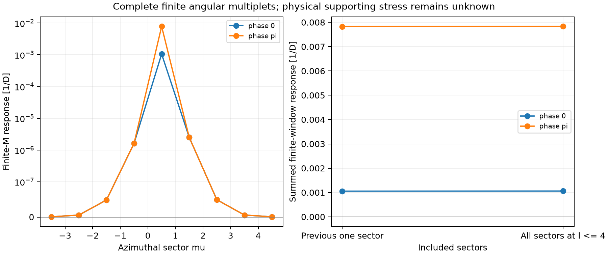

The [saved results](../results/dihole_pv_sectors_results.json) contain136 new
sector-frequency points and544 massive/massless response records. All12
connected checks pass; runtime1044 seconds. The new bridge's19 checks pass,
as do four local-subtraction checks described below. Maximum new exterior
linear residual is $2.64\times10^{-15}$; independent on/off-shell current
identities agree within $1.51\times10^{-14}$. Every sampled new return is
contractive, with largest singular value0.94215 and minimum remaining-loss
eigenvalue0.06455. These verify the finite equations and accounting.
They do not validate the physical absorbing-boundary replacement.

### Actual angular coefficients and faster differentiation

Write $a=\mu-1/2\in\mathbb Z$. The existing regular monopole profiles supply
normalized associated-Legendre $f_l$ and
$g_l=-(\partial_\theta-a\csc\theta)f_l/\sqrt{l(l+1)}$, with the physical
lower phase $ig_l$. Their isolated reference eigenvalues and multiplicities
are standard; see [Borokhov--Kapustin--Wu, section4.1](https://arxiv.org/pdf/hep-th/0206054).
Our coefficient compression and endpoint phases are the explicit model
construction, not a result quoted from that paper.

Retain $l=\max(1,|a|),\ldots,4$ for $a=-4,\ldots,4$, plus the sole upper
$l=0$ mode when $a=0$. The actual field correction is

$$
\Delta V=\frac{NP(\mu-A)-(a+\tfrac12\cos\theta)}{R\sin\theta}.
$$

The helper compresses this correction, $W=P/N$, and physical mass $mP$
in the same basis. It reuses existing pole-safe profiles; no spectrum is
substituted for the actual angular fields. The basis counts are upper
$(1,3,5,7,9)$ and lower$(0,3,5,7,9)$ for $l=0,\ldots,4$.
Equal numbers of paired modes in every sector would not produce this cutoff.
Actual angular coefficients mix $l$, so this is a complete *coordinate*
basis at one cutoff, not a spectral projector of the curved Hamiltonian.

At the lower cut, evaluate the scalar profiles at $\pi-\theta_L$ and the
fixed spin lift directly. This reproduces the old $\mu=1/2$ cut within
$8.53\times10^{-14}$ without guessing a parity for other sectors.
The generalized helper matches the old $\mu=1/2$ profiles and coefficients
exactly. Additional root checks cover the actual endpoint sectors$a=\pm4$:
Gram error$3.56\times10^{-15}$, differential partner error below
$6.69\times10^{-12}$, and exact endpoint limits.

The new driver differentiates all four Riccati scattering blocks in the
same ODE, alongside the direct determinant and its derivative. Sewing is
linear, and the loop derivative is
$-\Re\operatorname{Tr}[(I-BR)^{-1}B'R]$. This replaces three separate
scattering solves plus the direct solve. Small comparison cases take
0.60--0.61 seconds versus1.26--1.29 seconds for the old path; this is about
2.1x in that benchmark, not a claimed whole-run speedup. Tightening the ODE
tolerances changes the tested derivatives by at most$3.64\times10^{-13}$.

### A definite renormalization reference, not an extra support term

The [scheme analysis](DIRAC_SCHEME_MATCHING.md) identifies a real omission
in133's written normalization: its charged, Ward-corrected point-split
reference was not given explicitly. Consequently its full finite conversion
cannot be inferred simply by declaring later local additions zero.
The universal auxiliary-kernel scale matching *is* determined:

$$
\mu_H=\sqrt2e^{-\gamma_E}/D_0.
$$

For subsequent work, adopt the explicitly defined **physical four-dimensional
heat/zeta effective-action reference** in that note, with the same spectral
state, fixed renormalized couplings and no further finite invariant additions.
This is a declared research model; it is not a claim of equivalence to133
or a measurement of higher-curvature couplings. Its variational gauge and
diffeomorphism identities follow from the covariant vectorlike action when
the relative action and its derivatives exist, not from the absorbing pilot.

The [local subtraction calculator](../scripts/dihole_pv_counterterms.py)
reuses133's invariant variations. Its [results](../results/dihole_pv_counterterms_results.json)
give, in units$D_0=1$,

$$
\mathcal Q_{\rm loc}(M)=0.00031154963588733757M^2+
0.0244023436787409[\log M^2+2\gamma_E+\log(3/16)].
$$

The paired volume is unchanged, so the quartic$a_0$ variation is zero.
The desired response is the physical fixed-$M$ response minus this local
large-mass term, followed by regulator removal. **This subtraction was not
applied to the finite-$M$, finite-basis, absorbing data above.** The separate
scale-only shift$-0.01125641434/D_0$ is convention bookkeeping, not physical
negative energy to add to the model. A high-precision auxiliary Green-kernel
check agrees with the scale conversion to finite-radius error$1.12\times10^{-26}$;
it does not prove a charged point-split stress identity.

### Next physical calculation and provenance

The scheme note also gives the exact common-operator PV resolvent identity.
Its metric variation has ultraviolet order-6 in four dimensions, supplying
a cancellation mechanism. It does not give numerical angular-tail constants,
remove the massless infrared problem, or identify the current four absorbing
first-order determinants with one physical Euclidean realization.

The next step is that common physical realization and control of the
localized response's exterior, spectral/angular and frequency remainders.
Use the explicit136 action reference; do not repeatedly reopen133's missing
contact definition as a prerequisite. Merely increasing regulator mass on
the current truncation, applying the local polynomial to it, or fitting a
coupling cannot establish supporting stress. Stability, source current,
formation and any chronology-changing extension remain unresolved.
13 September 2027 to12 September 2027 remains UNPROVED.

All scientific sources stayed frozen while session17456 ran; it exited0.
The original135 source/results and133 state are unchanged. Reproduce with
OPENBLAS_NUM_THREADS=OMP_NUM_THREADS=1 and the repository Python:
`python -B -W error -X utf8 scripts/dihole_pv_sectors.py` (completed exact
source checkpoints are reused), plus the two new helper scripts for their
small checks. Sector driver SHA256
`1215bdaca3fa6c3ef888ea97c463382bf662b8d84d457475ac80e340d6f6fbb4`;
result`6bc2d1b2d2a6c54d56a04baf2abf11eba4cdf0ac4fb858f66549c425b5e2f2c8`.
Counterterm source`97142e656687d97df7d5a6248f3f917a1005b3ded611507d34ad867fb008b3d0`;
result`c62c5a7853592e7cd91ac990fd857fee6b0e1c269d1a6bd2aa168c64401e1e8e`.
The helper certificate additionally authenticates the transitive
complete_angular_modes and azimuthal_modes sources; both remain unchanged.

## Physical-mass regulator on the connected geometry — increment135

The [massive bridge](../scripts/dihole_massive_bridge.py) and
[connected regulator driver](../scripts/dihole_pv_source.py) now carry actual
proper Dirac masses through the same prescribed bridge and finite exterior.
The four-mass Pauli--Villars (PV) combination cancels134's flat bulk artifact
exactly. The [analytic derivation and primary sources](PHYSICAL_MASS_REGULATOR.md)
state the covariant candidate and remaining renormalization requirements.
The [saved pilot](../results/dihole_pv_source_results.json) is still a finite
approximation, not the physical renormalized source.

### New calculation and finite results

Use masses $m_j^2=jM^2$ with weights $(1,-3,3,-1)$, fixed proper $MD=1$,
$q=1$, $\mu=1/2$, four angular pairs, the existing R16 graded exterior,
and 17 logarithmic frequencies $0.01\leq\kappa D\leq10$. Both Weyls are
explicit, so the determinant prefactor is $-1/\pi$. Add the direct bridge
and loop terms for each mass and combine the masses before integrating.
The common leading-volume derivative cancels by $\sum c_j=0$; subtracting
it inside each term is only a numerical rearrangement, not a fitted finite
counterterm. No old scientific calculation was changed or re-certified.

| Finite-window PV response, units $1/D$ | Phase 0 | Phase pi |
| --- | ---: | ---: |
| Direct bridge | -0.001555602711 | -0.001555602711 |
| Connected loop | +0.002611089764 | +0.009382827940 |
| Combined, 17 points | +0.001055487053 | +0.007827225229 |
| Combined, 9 points | +0.001003073133 | +0.007995251698 |

The grid changes are 4.97% and 2.15%, respectively. They are sensitivities,
not error bounds; neither omitted frequency tail is bounded. The positive
sampled totals do not provide the negative null-source support required by129.
They also do not prove a physical no-go: finite $M$, one angular/azimuthal
sector, numerical exterior losses and local renormalization remain.
The numbers are not directly comparable as physical stresses to134's
leading-power-subtracted diagnostic. The regulator changes the calculation.

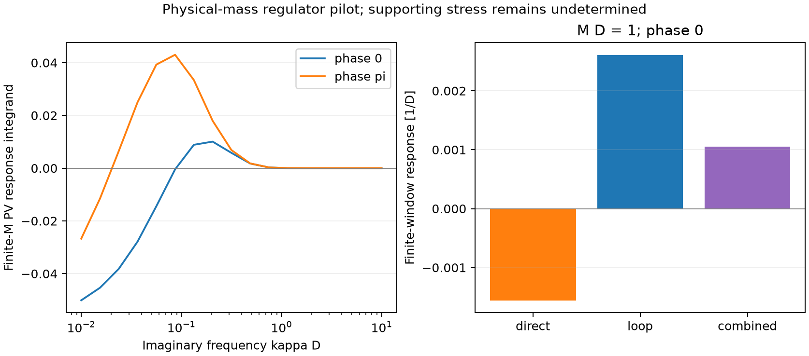

### Physical coupling and controls

The full Hamiltonian is $H_m=\bigl(\begin{smallmatrix}H_0&mN\\mN&-H_0\end{smallmatrix}\bigr)$.
Its square contains $m[H_0,N]$; a frequency shift would miss this term.
The bridge uses the actual angular compression of $mP$. The exterior uses
$\mathcal A_m=\bigl(\begin{smallmatrix}A_0+\kappa W&imP_w\\imP_w&A_0^\dagger+\kappa W\end{smallmatrix}\bigr)$,
where $P_w=\int\rho P\phi_a\phi_b$ and $W=\int\rho(P/N)\phi_a\phi_b$.
The mass coupling is skew-Hermitian in this Euclidean equation and cannot
create absorption. Dual input/output ports implement the opposite Weyl
without conjugating charge or changing the magnetic bundle or loop phase.

The bridge's12 controls pass, including physical constant-mass dispersion,
real-energy unitarity, imaginary-frequency passivity and direct variation.
The connected driver's16 controls pass in317 seconds. Maximum linear residual
is $6.40\times10^{-14}$; independently integrated boundary/jump/volume
identities, including off-shell trial fields, agree within
$8.89\times10^{-15}$. All sampled exterior returns are contractive, with
largest singular value0.96140 and smallest unassigned-loss eigenvalue0.02500.
The determinant derivative check differs by at most $6.51\times10^{-11}$.
These verify finite algebra and current accounting, not continuum stress.

At zero mass the exterior return is $\operatorname{diag}(R,R^\dagger)$
within $8.53\times10^{-16}$. Before polygon projection, the bridge likewise
has adjoint Weyl blocks. Polygon cut factors are not isometries:
$B_R=F_i B F_o^{-1}$ while $B_L=F_oB^\dagger F_i^{-1}$ need not equal
$B_R^\dagger$. The independent two-Weyl projected sewing agrees within
$8.88\times10^{-12}$, but its full loop log differs from twice the old
single-Weyl log by up to $1.02\times10^{-7}$ at $\kappa D=0.1$.
That difference is a cut-projection sensitivity, not an ODE tolerance.
The initial probe with a looser doubling check is preserved in
[results](../results/dihole_pv_probe_pre_cut_diagnostic_results.json) with
[its exact source](../provenance/dihole_pv_source_pre_cut_diagnostic.py).
The final driver uses strict raw-adjoint and independently projected checks.

The flat control gives $\sum c_j=\sum c_jj=\sum c_jj^2=0$ exactly and a
combined residue of $-8.9\times10^{-16}$ numerically. Its exact zero follows
from the analytic formula, not that floating-point residual. These signed
regulator weights describe neither exotic matter nor a physical quantum state.

### Remaining physical dependency and reproduction

The new note derives the physical four-dimensional heat coefficients and
large-$M$ local subtraction in a declared heat/zeta convention. Matching its
finite terms to133's fixed Hadamard prescription and charged Ward identity
is still unimplemented. Fixed-$M$ frequency/angular/all-$\mu$/spatial and
physical-exterior limits must precede the regulator-removal limit. Increasing
$M$ on this unchanged small numerical model would not resolve those limits.
The next work is that source completion, rather than another precision
certificate for a settled massless spectrum. No material, self-consistent
Einstein--Maxwell source, stability, formation or chronology change follows.
13 September 2027 to12 September 2027 remains UNPROVED.

Reproduce from the repository root with OPENBLAS_NUM_THREADS=OMP_NUM_THREADS=1:
`.\.venv\Scripts\python.exe -B -W error -X utf8 scripts/dihole_massive_bridge.py`
and `.\.venv\Scripts\python.exe -B -W error -X utf8 scripts/dihole_pv_source.py`.
The latter authenticates and reuses a completed exact-source checkpoint.
Final driver SHA256 `c391267f84a61bf4c8c65b496770cc976c747db766054d4458ed62483b9281c3`;
result `a34360778a44034271cd2fc6a42e66424a06851999331f845017d288a1224fc5`.
The bridge result records its own source and input hashes. Neither133's
state prescription nor earlier source/results were edited.

## Direct bridge determinant and regulator diagnostic — increment134

The [new direct-response driver](../scripts/dihole_direct_source.py),
[results](../results/dihole_direct_source_results.json), and
[plot](../figures/dihole_direct_source_progress.png) now include the bridge
factor omitted by132's loop determinant. The finite-window sign changes
under the specified finite-angular convention. An exact flat-space control
also proves that this convention alone is not a physical stress prescription.

### Recovering the omitted direct factor without unstable transmission inverses

For $[-iJ\partial_s+T]w=E Ww$, set
$K=iJ(EW-T)=\begin{pmatrix}A&B\\C&D\end{pmatrix}$ and let M be the transfer
matrix. Eliminating the left negative characteristic gives
$T_{rl}=M_{22}^{-1}$ and the secular determinant factorization into
$\det(M_{22})\det(I-B_{\rm bridge}R_{\rm ext})$, up to fixed sewing factors.
Here the block B in K and the full bridge scattering matrix are distinct.
The centered real first-order determinant is

$$
F_\kappa=\Re\left[-\log\det T_{rl}
-\frac12\int\operatorname{tr}K\,ds
+\log\det(I-B_{\rm bridge}R_{\rm ext})\right].
$$

The half-trace changes the one-sided Green diagonal to its symmetric value;
it cannot be omitted with p=m+1. With right reflection $R_r$, the direct
factor g can be accumulated through

$$
\partial_s g=\Re\operatorname{Tr}(C R_r)
 +\tfrac12\Re\operatorname{Tr}(D-A).
$$

No inverse of a vanishing transmission and no growing transfer matrix is
formed in the actual calculation. The first variation $Z=\partial_\epsilon R_r$
is integrated simultaneously from the differentiated Riccati equation,
using $\dot A=-2fA$, $\dot D=-2fD$, $\dot B=-fB$, $\dot C=-fC$.
This replaces three bridge solves per frequency by one sensitivity solve.

For canonical $u=W^{1/2}w$, $H=W^{-1/2}DW^{-1/2}$. Its transfer changes by
endpoint weights, and its generator trace gains
$\tfrac12\partial_s\log\det W$. The metric probe fixes those endpoints,
so these give no additional finite endpoint variation. This uses the
symmetric real spectral convention based on
$\tfrac12\log\det(H^2+\kappa^2)$. A raw finite matrix pencil instead obeys
$\log\det(H_h-E)=\log\det(D_h-EW_h)-\log\det W_h$; its mass-matrix
contact term cannot silently be omitted. The symmetric continuum
finite-part convention does not itself perform four-dimensional covariant
renormalization. The absorbing exterior remains a numerical approximation.

### The leading ultraviolet term can be removed analytically at fixed angular size

At E=i kappa, let $W_+Y+YW_-=X$, where X is the transverse off-diagonal block.
For fixed finite angular dimension, smooth coefficients and positive W,

$$
g_\kappa=\frac\kappa2\int\operatorname{tr}W\,ds
 +\frac1\kappa\int\Re\operatorname{Tr}(X^\dagger Y)\,ds+O(\kappa^{-2}).
$$

The actual variation sends $W\mapsto e^{-2\epsilon f}W$,
$X\mapsto e^{-\epsilon f}X$, and therefore $Y\mapsto e^{\epsilon f}Y$.
The inverse-frequency coefficient is exactly invariant. Consequently
$\dot g_\kappa+\kappa\int f\operatorname{tr}W\,ds$ is ultraviolet integrable
at this fixed angular size. The initial Riccati layer contributes only the
stated remainder; flat endpoint variation removes variable boundary terms.
This is an asymptotic statement, not a numerical tail enclosure or an
estimate uniform in the omitted angular modes.

The code accumulates the subtracted derivative directly as
$\Re\operatorname{Tr}[C(Z-fR_r)]$, avoiding cancellation of large numbers.
The actual volume factor is $\int f\operatorname{tr}W\,ds=28.93102786947$.

### New finite-window result and exact checks

Reuse132's R16 loop responses unchanged: q=1, mu=1/2, four angular pairs,
33 frequencies over .01<=kappa D<=10 and conditional paired-Weyl factor -2/pi.

| Quantity | Phase0 | Additional phase pi |
| --- | --- | --- |
| Previous loop contribution | -0.2134104494/D | -0.2052980347/D |
| Added direct contribution after leading-power subtraction | +11.6533893917/D | +11.6533893917/D |
| Sum in this subtraction convention | +11.4399789424/D | +11.4480913570/D |

The coarse/fine phase0 change is0.00270%; it is sensitivity, not an error
bound. The unsubtracted direct integral is932.7295685/D on the fine grid
and is divergent as the upper limit increases. Its coarse-grid change is
larger because Simpson integration must resolve the large leading power.
No unsubtracted value is interpreted as physical stress.

All nine controls pass. Constant scalar log/scattering checks agree below
8.1e-14 and their metric differences below3.7e-10. The exact periodic
matrix determinant agrees below4.0e-14. For $W=wI_2,T=t\sigma_x$, it is
$4\sinh^2[L\sqrt{(\kappa w)^2+t^2}/2]$; antiperiodic closure gives cosh.
Appending a chiral zero channel adds
$\kappa\tau/2+\log|1-e^{i\phi-\kappa\tau}|$, testing the unmatched-channel
half-trace explicitly. Actual bridge reflection agrees with130 below5.4e-12;
the actual metric-difference comparison is2.8e-8. The invariant UV coefficient
changes by at most1.14e-13 in the selected checks. No interval bounds are claimed.

The final run took44 seconds and reran no exterior solve. A final-output
NumPy-boolean serialization error in the first run was fixed by converting
test values to Python bool; all33 numerical records and controls reproduced
exactly. The [original checkpoint](../results/dihole_direct_source_pre_serialization_results.json)
and [source](../provenance/dihole_direct_source_pre_serialization.py) are retained.

### Why the new positive sign still does not decide physical support

There is a concrete regulator test, not merely an unspecified caution.
For the homogeneous massive bulk, put $h=\sqrt{(\kappa w)^2+t^2}$.
The same leading-power subtraction yields

$$
\int_0^\infty fL\left[2\kappa w-
\frac{2\kappa^2w^2+t^2}{h}\right]d\kappa
=-\frac{fLt^2}{2w}.
$$

With x=kappa w/t, an antiderivative is
$x^2-x\sqrt{x^2+1}$, whose limits differ by -1/2. Independently integrating
the stable equivalent $-1/[\sqrt{x^2+1}(\sqrt{x^2+1}+x)^2]$ gives -0.5.
The paired-Weyl factor would turn this into $+fLt^2/(\pi w)$.
But with $w=P/N$, $t=P m_0$, the physical flat vacuum is Lorentz invariant
and has $\rho+p_s=0$. The extensive positive term is the finite mismatch
between the Killing-frequency subtraction and the covariant measure/regulator,
not a physical flat-vacuum null source. Covariant flat cosmological terms
cannot fix it: their paired volume variation is zero.

The scale origin is explicit: with $c_1=LNPm_0^2/2$,
$\int_0^\Lambda L(h-\kappa w)d\kappa
=c_1[\log(2\Lambda/(Nm_0))+1/2]+o(1)$.
Holding the Killing-frequency cutoff fixed gives the residue above;
$\Lambda_\epsilon=N_\epsilon\Lambda_{\rm proper}$ adds the compensating
endpoint variation. This homogeneous example illustrates the required
scale conversion; it is not a general curved-space regulator prescription.

Thus neither132's negative loop term nor134's positive sum establishes the
physical source sign. Do not subtract all positive terms or transplant a
scalar correction into noncommuting angular matrices. NEXT: implement the
conversion to the declared charged covariant stress prescription, calibrated
to this flat massive check and the133 local geometric terms, then evaluate
the remaining source with angular/frequency and exterior limits controlled.
Current, backreaction, stability and chronology change remain unproved.
13 September2027 to12 September2027 remains unproved.

## Sewn quantum state and local source coefficients — increment133

The exact prescribed129 geometry now has an explicit
[sewn operator and ground-state construction](SEWN_SOURCE_STATE.md).
The new [local-source calculation](../scripts/dihole_local_source.py),
[results](../results/dihole_local_source_results.json), and
[response plot](../figures/dihole_local_source_progress.png) quantify local
terms omitted by132. These are new calculations for this prescribed model,
not a supporting material or a new law.

### The state is defined; its source is still to be evaluated

Replace both excised horizon balls by the smooth compact bridge with the
exact cut jets. Optical infinity is unchanged, and the compact bridge has a
smooth positive optical metric. Thus the entire sewn optical manifold is
complete. Choose the regular integer-charge magnetic bundle, the stated
spin lifts, and an independent flat loop holonomy. The massless Dirac
operator has its natural self-adjoint graph domain and an empty-zero-mode
Hadamard ground state. The linked note checks these hypotheses and cites
the relevant primary theorems. The finite absorbing DG boundary is still
an approximation to this continuum problem, not its operator domain.

Use the compactly smeared, locally subtracted stress as the primary source,
$\mathcal Q_\phi[f]=\int fN\sqrt h(\langle T_{00}\rangle+\langle T_{ss}\rangle)$,
with orthonormal components. An identification with a ground-state energy
derivative additionally needs infrared/differentiability control. In
particular, state existence alone does not justify taking derivatives
through a zero-energy crossing or tracing an infinite-volume energy.

For the next calculation the note declares a fixed subtraction length
$\ell_*=D_0$, held fixed during the metric variation, and zero remaining
finite local additions at that scale. Charged current/stress Ward
normalization must be implemented together. This is a chosen mathematical
model, not a determination of nature's gravitational or gauge couplings.

### Local response coefficients for the actual source direction

In four dimensions the familiar finite local curvature freedom includes
$R^2$ and $R_{ab}R^{ab}$; a gauge-background stress term is also allowed.
See [Zahn, equation38 and the following discussion](https://arxiv.org/pdf/1210.4031)
and the broader [heat-kernel treatment](https://arxiv.org/pdf/hep-th/0306138).
We now evaluate their actual compact variations on this bridge rather than
assigning unspecified coefficients a favorable sign.

For an added Lorentzian action $S_i=c_i\int\sqrt{-g}\,I_i\,d^4x$, define

$$
K_i=-\left.\partial_\epsilon\int N_\epsilon\sqrt{h_\epsilon}
 I_i[g_\epsilon,A],d^3x\right|_0,
\qquad \Delta E'=\sum_i c_i K_i.
$$

The minus sign follows from static $E=-S/T$. The130 paired variation keeps
$N\sqrt h$ invariant. Its smooth mask is supported on the two collars;
the unchanged central segment and exterior make no local contribution.
The extra flat holonomy has zero field strength, so these local coefficients
are identical for both phases.

| Local invariant | Compact energy-response coefficient |
| --- | --- |
| $R^2$ | $+636.844680426/D$ |
| $R_{ab}R^{ab}$ | $+289.350803036/D$ |
| Charge-included $F_{ab}F^{ab}$, q=1 | $-4.53719674642\times10^{-6}/D$ |

The script also retains the Einstein-Hilbert and classical-potential
Maxwell invariants as normalization controls. Their energy derivatives
before action prefactors are $+0.342029978447D$ and
$-7.25951479427\times10^{-7}D$. The charge-included potential is
$A=-qA_{\rm classical}/(2Q)$, so its square has an additional factor
$q^2/(4Q^2)$ and a different length scaling. They must not be interchanged.

For example, changing a physical $R^2$ coefficient by0.001 changes this
probe by0.636845/D, which exceeds the magnitude of the132 finite-window
contribution. This is sensitivity to a coefficient, not a proposed value.
A pure renormalization-scheme shift changes quantum and gravitational/gauge
bookkeeping with compensating signs; the total support equation is
unchanged. These coefficients cannot be fitted after the calculation to
manufacture exotic matter or a successful throat.

### Checks, failure retained, and the next physical calculation

The actual published field functions and smooth radius profile are reused.
Analytic first derivatives plus complex-step second derivatives generate
metric jets. The tensor contraction is batched from the existing diagonal
curvature calculation and checked against that original scalar routine.
A complex-step epsilon derivative is compared with two real finite
variations. The independent integrated identities are

$$
\partial_\epsilon\int\sqrt{-g}R/T
 =2\int fN\sqrt h\,G_{kk},\qquad
\partial_\epsilon\int\sqrt{-g}F_{\rm classical}^2/T
 =4\int fN\sqrt h\,g^{ss}g^{\varphi\varphi}F_{s\varphi}^2.
$$

All seven final checks pass at64/96/128 quadrature points in each direction.
The final Einstein-Hilbert identity discrepancy is1.85e-14; the largest
monitored 96-to128 change is4.41e-14 under the script's normalization.
The fine real-difference comparison is below4.61e-8. These are numerical
checks, not certified errors. The first32-point grid underresolved the
integrated Einstein-Hilbert identity, and its Maxwell check had an extra
factor2. The corrected control and higher grid orders resolve both without
changing the computed invariant formulas. The [failed pilot output](../results/dihole_local_source_pilot_results.json)
and its [exact source](../provenance/dihole_local_source_pilot.py) are retained.

NEXT: evaluate the compactly smeared differentiated two-point kernel of the
specified sewn ground state, with the local charged subtraction and joint
Ward normalization. The omitted one-pass reference contribution, all mu
sectors, frequency tails and continuum limit have not been supplied by this
local coefficient calculation. Keep the known coefficients in the source
budget and compute the missing state-dependent remainder; do not replace
it by a selectable local constant or another unrelated spectral exercise.
A physical current, Einstein--Maxwell backreaction and stability remain
necessary. The present static geometry has a global time function and no
backward-time path;13 September2027 to12 September2027 remains unproved.

## Connected frequency-window source contribution — increment132

[Driver](../scripts/dihole_source_window.py), [saved results](../results/dihole_source_window_results.json),
[plot](../figures/dihole_source_window_progress.png).
The actual130/131 bridge and curved exterior are now integrated over
$0.01\leq\kappa D\leq10$. This is a new connected-model calculation using
established field theory; it is not a new physical law or a support solution.

### Observable, normalization and the exact source comparison

Write $D_\phi=\det(I-B_\phi R_{\rm ext})$. Conditional on a common physical
self-adjoint sewn domain and vacuum prescription, the full massless Dirac
interaction and its compact metric derivative are

$$
E_{{\rm int},\phi}=-\frac{2}{\pi}\int_0^\infty\Re\log D_\phi\,d\kappa,
\qquad
E_{{\rm int},\phi}'=-\frac{2}{\pi}\int_0^\infty
\partial_\epsilon\Re\log D_\phi\,d\kappa.
$$

The opposite Weyl block contributes equally at fixed charge and mu; no
additional negative-frequency or mu multiplicity is inserted. The scalar
check $D_\phi=1-e^{i\phi-\kappa L}$ gives $E_D(\pi)=-\pi/(6L)$ and
$E_D(0)=+\pi/(3L)$. The physical exterior supplies its own phase, so the
additional phase pi need not minimize the actual model's energy.
The finite absorbing exterior used here does not establish this spectral
formula's common-domain premise; the computed quantities remain conditional.

The paired variation from130, $\delta\log N=f$ and
$\delta\log h_{ss}=-2f$, with angular metric and connection fixed, obeys

$$
E_{\rm matter}'=\int fN\sqrt h\,(\rho+p_s)\,d^3x,
\qquad I_{\rm req}=-0.171015352199415\,\frac{D}{8\pi G}.
$$

Here $N\sqrt h$ is unchanged. With nonzero radial energy flux the probe is
half the sum of the two directed radial null contractions. The geometric
target already subtracts Maxwell: $E_{\rm grav}'+E_{\rm EM}'=-I_{\rm req}$.
There is no extra Maxwell term to add to that right-hand side. A complete
extra-source calculation must also include any matter carrying the induced
current and any specified gravitational counterterms. Fixed A means this
variation has no separate $J\cdot\delta A$ term.

### New finite-window result

One q=1, mu=1/2 sector, four angular pairs, both Weyls through the stated
conditional prefactor. Units are hbar=c=1. Simpson integration uses log kappa
with its kappa Jacobian. Each exterior spatial assembly and physical mass is
reused at every frequency; no old box spectrum is recalculated.

| Outer radius / D | 17-point phase0 response | 33-point phase0 response | 17-point phase-pi response | 33-point phase-pi response |
| --- | --- | --- | --- | --- |
| 8 | -0.2134178087/D | -0.2134275232/D | -0.2052734717/D | -0.2052847038/D |
| 16 | -0.2134007314/D | -0.2134104494/D | -0.2052868067/D | -0.2052980347/D |

At R16, the phase0-minus-phase-pi response is -0.008112414674/D.
The outer-domain changes are 0.00800% and 0.00649%; quadrature changes are
0.00455% and 0.00547%. The smaller phase contrast changes by 0.3748% with
outer radius and 0.01861% with quadrature. These are observed sensitivities,
not certified errors. The corresponding finite-window interaction energies
are -4.204252862/D and -4.183279377/D; these are not total vacuum energies.

All eight checks pass. Shifted assemblies reproduce131; maximum relative
linear residual is 6.61e-14, determinant-derivative identity discrepancy
2.57e-11 and extreme-frequency flux discrepancy 5.48e-16. The derivative
check shares the same epsilon samples and does not bound finite-difference
truncation. The 33-frequency run took about269 seconds, with source/input
hashes saved and checkpointed. No field calculation remains running.

### What the sign and scale do, and do not, establish

Both finite-window responses have the required negative sign for this probe.
For a coefficient $C$ such that $E'_{\rm window}=C\hbar c/D$, its magnitude
relative to the required source is exactly the dimensional comparison

$$
\frac{|E'_{\rm window}|}{|I_{\rm req}|}
=\frac{8\pi|C|}{0.171015352199415}\left(\frac{\ell_P}{D}\right)^2.
$$

For the R16 values the coefficients are31.3632 and30.1710. Equating this
computed contribution alone with the target would give D about5.60 or5.49
Planck lengths; the present semiclassical calculation does not justify a
physical construction at that scale. This is bookkeeping for this one
contribution, not a bound on the full source, a universal no-go, or a
macroscopic material recipe. Changing field content or q needs its own
consistent charge, geometry and backreaction calculation.

The next critical step is the physical sewn-domain source functional:
reference contribution, local renormalized terms, other mu sectors and
frequency tails must be identified before equating total source with the
geometric target. The finite angular basis, polygonal cuts and distant
absorbing boundary also remain approximations. Do not import old flat-
geometry tail bounds into this calculation. A common-local-geometry phase
contrast can cancel common local terms, but cannot itself equal I_req:
the required geometric source is the same in both phases.

No supporting material, stability, formation or chronology-changing path is
proved. 13 September2027 to12 September2027 remains unproved. The next step
uses this result; no further box-spectrum certification is justified here.

## Curved exterior return and connected source diagnostic — increment131

This step connects the actual130 bridge to a finite-domain return problem
using the actual balanced-dihole metric and magnetic connection. The prior
flat exterior's numerical components are reused, not its physical fields.
The remote boundary and polygonal cut approximation remain explicit.

### Exact transformation reusing the conservative volume/flux structure

For the exterior canonical spinor f with measure drho dz, put
v=N/P, W=P/N and b=N^2/rho. The one-Weyl-block Hamiltonian is

$$
H=-i\sigma_x(v\partial_\rho+v_\rho/2)
  -i\sigma_z(v\partial_z+v_z/2)
  +\sigma_y b(\mu-qa).
$$

Set u=sqrt(v/rho) f. The stationary equation is exactly

$$
\left[\sigma_x\left(\partial_\rho+\frac1{2\rho}\right)
+\sigma_z\partial_z
+i\sigma_y\frac{NP(\mu-qa)}\rho-i E W\right]u=0.
$$

The physical norm is integral rho W |u|^2 drho dz and the meridional flux
is rho u^dagger sigma u. Thus the conservative weighted principal operator,
characteristic projectors and regular-axis branches of the existing DG
solver can be retained. Only two volume terms change: replace the old
azimuthal coefficient by NP(mu-qa), and replace the energy mass by rho W.
For E=i kappa the latter is a positive damping term. This removes no curved
physics and assumes neither N=1 nor a round cut. All actual coefficients
are evaluated from the same [balanced exterior](../scripts/balanced_dihole.py)
used129, based on [Emparan's metric](https://arxiv.org/abs/hep-th/9906160).

### Exact trace and spin normalization on the true spherical cuts

Let U_R=exp(-i theta sigma_y/2), U_L=exp(+i theta sigma_y/2). On
(rho,z)=(Rc sin(theta),k+Rc cos(theta)) and its lower reflection,

$$
w_{R,L}=\sqrt{R_c v}\,U_{R,L}^\dagger f,
\qquad u_{\rm cut}=\frac{U_{R,L}w}{R_c\sqrt{\sin\theta}}.
$$

The apparent lapse cancellation in the second formula is a result of the
flux transformation. The upper exterior outward normal becomes -sigma3,
and the lower becomes +sigma3; the bridge's corresponding outward normals
have the opposite signs. Their seam fluxes therefore cancel. Exterior
inputs [b_left,a_right] equal bridge outputs; exterior outputs
[a_left,b_right] equal bridge inputs.

Relative to the saved global-angle spherical bases, both lower degree-n
bases acquire (-1)^(n+1), including a minus on the n=0 zero mode. This
comes from the stated spin lift and Legendre parity, not a separately
inferred physical loop phase. Opposite outward magnetic fluxes require no
charge conjugation; the connection itself is reflection-even. The
additional gauge/spin sewing phase is varied separately in the calculation.

### Finite connected response and its scope

The finite exterior map R_ext sends incoming mouth coefficients to outgoing
ones. The bridge map B sends them back, after the explicit spin/port ordering
and separate incoming/outgoing facet Gram transformations. The sewn matrix
is I-B R_ext. Holding the exterior fixed, the compact source variation130
gives the finite algebraic diagnostic

$$
\partial_\epsilon\operatorname{Re}\log\det(I-BR_{\rm ext})
=-\operatorname{Re}\operatorname{Tr}
 [(I-BR_{\rm ext})^{-1}(\partial_\epsilon B)R_{\rm ext}].
$$

It is not an absolute vacuum-energy or null-stress calculation. In addition
to its frequency and angular completion, it needs a common self-adjoint
state/subtraction and the missing local terms. The zero-incoming remote
boundary is a finite approximation, not a transparent Melvin infinity.
The polygonal cuts also retain radial-displacement and cross-characteristic
projection errors. Those errors are assessed through the actual response;
passing a discrete flux identity alone does not remove them.

### Computed connected result and the exposed remote-boundary error

[Curved exterior helper](../scripts/dihole_curved_exterior.py),
[connected driver](../scripts/dihole_return_pilot.py),
[results and matrices](../results/dihole_return_pilot_results.json), and
[response plot](../figures/dihole_return_pilot_progress.png).
The retained calculation uses q=1, mu=1/2, four nonzero angular pairs,
and kappa D=.1. The derivative is the finite diagnostic defined above.

| Near mesh h/D | Outer radius R/D | Additional phase0 derivative | Additional phase pi derivative |
| --- | --- | --- | --- |
| .04 | 1.1 | .0831971860 | .0337979627 |
| .028 | 1.1 | .0859328493 | .0357304156 |
| .028 | 1.6 | .0944517454 | .0254536594 |
| .028 | 8, graded | .0947283880 | .0251106856 |
| .028 | 16, graded | .0946116924 | .0252485496 |

The first expansion from1.1 to1.6 has a substantial effect, so the initial
small-domain result was not treated as an exterior limit. To extend the
actual domain cheaply, reuse the Rbase=1.6 triangulation and radially move
vertices only beyond r0=.65 D:

$$
F(r)=r+(R_{\rm target}-R_{\rm base})
       \left(\frac{r-r_0}{R_{\rm base}-r_0}\right)^2.
$$

All entrance vertices and the near mesh remain byte-identical; every field
coefficient is evaluated at its new physical point, with no interpolation
or change to the metric. Positive triangle orientation and rebuilt outward
normals are checked rather than repaired by relabeling. Both extended
meshes have4184 triangles. Largest distant edges are1.43 D and3.09 D;
this explicitly limits far angular/axial resolution. The18 geometry controls
pass; it is still a finite-boundary approximation.

From R8 toR16, the phase0 diagnostic changes by about0.123% and the phase-pi
diagnostic by about0.549%. Their difference changes by about0.366%.
This is numerical sensitivity, not an enclosure or proof of the exterior
limit. Near-mesh error, coarse distant cells, polygonal mouth matching and
the omitted angular sectors remain. The monitored DG jump/mismatch loss
is about1.44% of the normalized input atR8 and1.82% atR16; it must not be
reported as physical escape. The projected zero-to-zero exterior return
atR16 is -0.22746110 in the explicitly declared spin/port convention;
its square is not an imaginary-frequency probability.

The connected driver passes nine focused algebraic controls, including
both maps' finite passivity, the actual curved absorption identity,
physical norm integration, linear residual and determinant-derivative
identity. The helper's nine small-model controls also pass; an off-shell
flux check tests more than a solved matrix's zero residual. The spin/port
sewing received one bounded independent read-only check. Five final field
cases complete in about14 seconds after bridge preparation, without any
old large simulation or spectrum-certification rerun.

### Next direct source calculation

The actual finite bridge/exterior interaction and its compact metric
variation are now computed together. Next evaluate its frequency-window
contribution, preserving phase conventions and separating the phase
difference from absolute source terms. Reuse this assembly and its mass
matrix across frequencies. Check sensitivity where it affects this source
observable; do not replace it with unrelated spectral certification.
A frequency-window interaction remains incomplete until its missing tails,
angular modes, global-state/subtraction requirements, local stress terms
and current are accounted for. These finite results do not establish a
material, a self-consistent throat, stability, new laws or backward travel.

## Actual bridge propagation and a specified source variation — increment130

The previous increment supplied a compatible prescribed geometry and its
required source. This step calculates the quantum propagation in that
geometry, rather than refining the old artificial-box spectrum.
[Central-cylinder driver](../scripts/dihole_cylinder_transfer.py),
[results](../results/dihole_cylinder_transfer_results.json), and
[figure](../figures/dihole_cylinder_transfer_progress.png).

### Actual zero profile and coupled central attenuation

Use q=1, mu=1/2 and R0=.025 D. The exact regular positive-chirality
transverse zero mode in the flux-canonical measure dtheta is

$$
f_0(\theta)=C\exp\!\int^\theta
 \frac{NP(\mu-qa)}{\sin t}\,dt.
$$

The driver factors out the known round sqrt(sin(theta)) endpoint profile
and quadratures only its smooth correction. It reuses the existing regular
monopole basis for the finite coupled calculation; that basis does not
replace the actual N, P or magnetic connection by round coefficients.
The computed optical moments are

$$
\langle W\rangle_0=82.93757936080308,\quad
\operatorname{Var}_0(W)=0.0016508279148814747,\qquad W=P/N.
$$

Thus the exact zero mode has imaginary-frequency leakage norm
kappa sqrt(Var(W))=0.040630381672850116 kappa. This is nonzero;
its size relative to the mean optical factor is about 0.0490%.
The moment quadrature changes by 1.43e-14 and 2.78e-15 respectively
between the two tested orders. These are sensitivities, not enclosures.

For propagation, diagonalize the finite Hermitian generator
K_kappa=-i sigma3 T-kappa sigma3 W, retaining both chiralities and the
nonzero angular modes. The q=1 zero branch has scalar estimate
lambda0=-kappa <W>0. With 20 regular pairs and the chiral zero, its positive
attenuation rate differs from kappa <W>0 by -8.5014e-8/D at kappa=.1/D
and -0.00228845/D at kappa=3/D. Over coordinate length .1 D these change
the log amplitude by +8.5014e-9 and +0.000228845 respectively.
The 12-to-20-pair rate change is below 2.85e-13/D at the sampled frequencies.
Eight focused controls pass, including regular-basis normalization,
Hermiticity and agreement between the directly integrated zero profile
and its finite spectral projection. No continuum eigenvalue enclosure or
full finite-segment scattering statement follows from these numbers alone.

### Conditional control of this propagation approximation

The following elementary Feshbach estimate explains the small correction
without treating a local leakage norm as a stress error. Put P0=|f0><f0|,
Q0=I-P0, h=Q0 Wf0, a=-kappa <W>0 and A=Q0 K_kappa Q0. The exact projected
resolvent, wherever defined, is

$$
P_0(K_\kappa-z)^{-1}P_0=
[a-z-\kappa^2\langle h,(A-z)^{-1}h\rangle]^{-1}P_0.
$$

Suppose the continuum transverse operator has a nonzero gap Delta and
0<wmin<=W<=wmax, with kappa wmax<Delta/2. Then the isolated small
longitudinal eigenvalue lies in [-kappa wmax,-kappa wmin]. Set
 delta=Delta-2 kappa wmax. Since the unperturbed complement inverse flips
chirality, its quadratic expectation in h vanishes. The resolvent identity
therefore gives the stronger cubic estimate

$$
|\lambda-a|\le
\frac{2\kappa^3w_{\max}\operatorname{Var}_0(W)}
 {\Delta(\Delta-2\kappa w_{\max})}.
$$

The eigenvector's complement relative to its unit P0 component has norm
at most kappa sqrt(Var(W))/delta. A chiral Schur complement gives
lambda>=a, consistent with the numerical attenuation decrease. This
controls one dressed decaying branch, not an unrestricted transfer initial
value problem: growing branches invalidate that shortcut. The numerical
transverse gap, about56.5733/D, is not a certified continuum premise.
The kappa=3/D example is outside this small-frequency condition. No extra
gap-certification campaign is started, because the next required observable
is the complete finite bridge response and its variation.

### A source variation with fixed exterior cuts

Choose f(s)=S'(u/delta)/2 in each collar, with delta=.05 D and the same flat
step S as129. Set f=0 on the central segment and outside the collars. Under

$$
N_\epsilon=e^{\epsilon f}N,\qquad
(h_{ss})_\epsilon=e^{-2\epsilon f}h_{ss},
$$

hold h_theta_theta, h_phi_phi and the magnetic connection fixed. This is a
smooth compact metric variation, not a change within the tied N-dependent
ansatz for every spatial component. Its energy derivative probes
integral N sqrt(h) f(rho+p_s). In flux-canonical propagation the exact
coefficient change is simply

$$
W_\epsilon=e^{-2\epsilon f}W,\qquad
T_\epsilon=e^{-\epsilon f}T.
$$

For the geometric extra source computed129, the required weighted target is

$$
\int fN\sqrt h\,Q_{kk}\,d^3x=-0.17101535219941505\,D,
\qquad Q_{kk}=8\pi G T_{{\rm extra},kk}.
$$

Divide by8pi G to obtain the required matter energy derivative in c=1
units. The coarse/fine quadrature change is1.2e-15 D, not an error enclosure.
A boundary-response derivative in this direction is an input to a vacuum
calculation; it is not itself the renormalized stress. Absolute local terms,
a common global state and the required Maxwell current remain necessary.

### Full two-collar characteristic response and its metric derivative

[Bridge-scattering driver](../scripts/dihole_bridge_scattering.py),
[results including matrices](../results/dihole_bridge_scattering_results.json),
and [figure](../figures/dihole_bridge_scattering_progress.png).
The calculation now propagates through both actual collars and the central
segment, on -.1 D<=s<=.1 D. It retains one q=1, mu=1/2 Weyl block.
The complete Dirac field requires the opposite block as well.

The angular basis stays fixed along s. The half-density and flux maps give
[-i J partial_s+T(s)]w=E W(s)w with no omitted moving-basis derivative.
Write its generator as [[A,B],[C,D]], where A=i E Wplus, D=-i E Wminus,
B=-i X and C=i X^dagger. A stable four-block embedding evolves the
characteristic scattering map, without forming a growing transfer matrix:

$$
R_r'=AR_r+B-R_rCR_r-R_rD,\quad
T_{lr}'=(A-R_rC)T_{lr},\quad
T_{rl}'=-T_{rl}(CR_r+D),\quad
R_l'=-T_{rl}CT_{lr}.
$$

Start with Rl=Rr=0 and identity transmissions. The output ordering is
[b_left,a_right], input ordering [a_left,b_right]. There are nmax+1 plus
and nmax minus basis states. The one chiral zero input comes from the
actual cut operator's kernel; no nonexistent opposite incoming zero
is added to this Weyl block.

| kappa D | Cut zero-to-zero transmission magnitude, nmax8 | Reflected characteristic norm |
| --- | --- | --- |
| 0 | 0.999999978256 | 0.000147462754 |
| .1 | 0.236530016933 | 0.000209039558 |
| 1 | 5.48110875617e-7 | 0.000223136670 |

These imaginary-frequency amplitudes are not probabilities. The .1/D
central-only dressed amplitude is about .436322; including both collars
produces the displayed .236530 full cut response. The core approximation
alone therefore does not supply the bridge response.

Eleven focused checks pass. Real-frequency E=.1/D flux conservation holds
to7.84e-12; the existing independent constant-mode benchmark agrees within
2.57e-13. A tighter ODE changes the matrix by at most5.25e-12 at kappa=.1/D.
Increasing nmax4 to8 changes the monitored zero-transmission amplitude by
at most1.88e-12, but the entire shared matrix block changes by up to5.64e-8
at kappa=1/D. These separate sensitivities must not be conflated or promoted
to continuum certificates. The calculation takes about5.6 seconds, excluding
plotting and startup.

For the compact paired variation above, a centered epsilon=1e-4 difference
at kappa=.1/D and nmax8 gives

$$
\partial_\epsilon t_{00}\ \mathrel{\simeq}\ 0.1520639825553092.
$$

The matrix-difference signal is3.04e-5, well above the tested ODE sensitivity.
Only one finite-difference step was used; its truncation error is not enclosed.
The saved driver reproduces the same geometric source target to the displayed
precision. This response derivative is now available for a vacuum determinant
variation, but its positive sign alone establishes neither the sign nor the
size of the required renormalized energy derivative.

### Next physical dependency

Connect this finite-cut response and its variation to the ACTUAL balanced
curved exterior, with consistent canonical trace normalization and spin/gauge
sewing. The old imaginary_exterior/curved_exterior_closure calculation uses
a different flat exterior and lapse-one round cuts, so its return matrix
cannot be substituted here. The certified compact exterior probe120 is also
not a complete finite-cut return map. These are reusable implementation
components, not missing physical data that can be assumed away.

A definite global spin holonomy, spectral state and common local subtraction
must accompany the connected determinant. Its full frequency/angular limits,
absolute local terms and Maxwell current are still required before comparing
with the geometric source. Do not return to unrelated box refinement or
certify the conditional central-gap estimate unless an error budget in this
source calculation specifically requires it. No stable physical support,
new law, chronology shift, or13 September2027 to12 September2027 passage
has been established.

## Phase-sensitive return bound and a common support geometry — increment129

[Return-force calculation](../scripts/quantum_return_support.py),
[results](../results/quantum_return_support_results.json), and
[figure](../figures/quantum_return_support_progress.png).
This calculation reuses the existing loop/reservoir normalization. It does
not repeat the box-spectrum program. The result is an analytic upper bound
on a specified return contribution, plus a concrete correction to the
geometry assumptions needed to use any support test.

### Return force with phases retained

Suppose a common self-adjoint system, state and relative subtraction justify

$$
E_{\rm ret}(\ell)=-\frac2\pi\int_0^\infty
\operatorname{Re}\log\det[I-e^{-\pi\ell\kappa}R(i\kappa)]\,d\kappa.
$$

Each matrix dimension counts one Dirac channel, including its two conjugate
chiral contributions. The spin/Wilson phase is inside R; an ideal
antiperiodic return is R=-I. Assume a fixed exterior under this length
variation, a canonical Euclidean contraction, and integrability sufficient
to differentiate. With U=e^{-pi ell kappa}R,

$$
\mathcal F_{\rm ret}=\ell^2E'_{\rm ret}
=-2\ell^2\int_0^\infty\kappa\operatorname{Re}
\operatorname{Tr}[U(I-U)^{-1}]\,d\kappa.
$$

This is a relative interaction force; the expression alone is not the
absolute four-dimensional stress. The earlier normalization checks and
[Dirac graph determinant foundation](https://arxiv.org/abs/1606.07834)
are reused. [Scattering determinants](https://arxiv.org/abs/0711.2395)
supply the general framework, not a theorem validating our dihole operator.

For any finite matrix with norm below one, including a nonnormal matrix,

$$
-\operatorname{Re}\operatorname{Tr}[U(I-U)^{-1}]
\le\sum_j\frac{\sigma_j(U)}{1+\sigma_j(U)}.
$$

For a scalar z of modulus a<1, the difference between the right side and
-Re[z/(1-z)] equals

$$
\frac{a(1-a)(1+\cos\arg z)}{(1+a)|1-z|^2}\ge0.
$$

The trace of this analytic matrix function is the sum over eigenvalues.
Eigenvalue moduli are log-majorized by singular values: the partial-product
inequalities follow by applying spectral radius <= operator norm to exterior
powers, with equality of full products from the determinant. Applying the
increasing convex function h(t)=e^t/(1+e^t), t<0, yields the stated bound.
Zero values follow by continuity. This uses the classical
[Weyl inequality](https://pmc.ncbi.nlm.nih.gov/articles/PMC1063049/), not a new
matrix law or a new physical principle.

If ordered singular values obey uniform envelopes
sigma_j(R(i kappa)) <= r_j exp(-kappa L_j), with 0<=r_j<=1 and L_j>=0, then

$$
\mathcal F_{\rm ret}(\ell)\le
\sum_j g(r_j)\left(\frac{\pi\ell}{\pi\ell+L_j}\right)^2,
\qquad g(r)=-\frac2{\pi^2}\operatorname{Li}_2(-r).
$$

Here g(1)=1/6. Plain contractivity for q channels gives only q/6, so it
cannot by itself exclude support at the ideal q/24 anomaly threshold.
A uniform rank bound r would give r/6, but open channels
need not have exactly zero return. Neither classical flux nor real-axis
return probabilities supplies the required Euclidean envelopes.
Infinite-channel use additionally needs trace-class/relative-determinant
control and uniformly summable bounds.

When the exterior changes with ell, an additional term is mandatory:

$$
\Delta\mathcal F=\frac{2\ell^2}{\pi}\int_0^\infty
 e^{-\pi\ell\kappa}\operatorname{Re}\operatorname{Tr}
 [(I-U)^{-1}\partial_\ell R]\,d\kappa.
$$

Its absolute value is bounded by replacing the trace with
||partial_ell R||_1/(1-e^{-pi ell kappa}||R||), when that integral exists.
Contractivity at each ell does not bound its ell derivative.

### A decision-relevant sensitivity, not a physical return measurement

Retain the unproved classical-flux proxy f=0.22098586521300168 solely to
compare with128. Give that fraction perfect antiperiodic returns and let
all nominally open channels have the same optimally phased amplitude r,
zero delay. The return-force coefficient is f/6+(1-f)g(r).
It crosses1/24 at r=0.030867512865701576, approximately3.087% amplitude.
The associated probability0.00095280335 belongs only to this specified
constant-vertex benchmark. General probabilities cannot be substituted.

At r=.04, the coefficient is0.04308338 with the favorable phase, but
0.03045223 with opposite residual-channel phase; the threshold is1/24.
Thus the channel deficit from128 cannot exclude support by itself. The
actual phase-dependent return matrix, its frequency dependence and delay
are decisive. Crossing this optimistic threshold does not establish the
actual source, a stable minimum, or a physical throat.

The strict driver passes48 nonnormal pointwise controls, a nilpotent
counterexample to interpreting singular values as actual force, and a
length-derivative check against the reused loop energy. Independent agent
checks cover480 additional nonnormal cases and a high-precision determinant
integral. Numerical diagnostics are not interval certificates. No actual
dihole scattering calculation is claimed.

### The support functional must use the same geometry

The saved round AdS2 x S2 throat cannot be directly attached to the current
finite dihole cut. At epsilon=.05, its actual inner and outer pole lapses are
0.19543647655576774 and0.19603355872976698. Their positive difference has the
exact form

$$
N_+-N_-=
\frac{M\epsilon^3(2+M\epsilon/k^2)}{\Sigma_+\Sigma_-},\quad
\Sigma_+=(M+k+\epsilon)^2-a_g^2,\quad
\Sigma_-=(M+k)^2-a_g^2(1-\epsilon/k)^2.
$$

A constant clock rescaling cannot remove this angular variation. Moreover,
[MMP sections5.2–5.3](https://arxiv.org/pdf/1807.04726) derive C/ell^2 from
a near-extremal mass family and q/(24ell) from the AdS2 anomaly. These are
not automatically the gravitational and anomaly energies of a fixed-exterior
cylinder stretch. Consequently the quarter threshold remains conditional;
it is not the complete support equation for our balanced dihole.

### Required null source on a bridge preserving the actual cuts

[Matched-germ geometry calculation](../scripts/dihole_stretched_collar.py),
[results](../results/dihole_stretched_collar_results.json), and
[profile and required source](../figures/dihole_stretched_collar_progress.png).

Keep the exact upper-mouth fields in local coordinates
rho=R sin(theta), z=k+R cos(theta), and use their reflected lower-mouth germ.
A smooth bridge metric and magnetic connection are prescribed by

$$
ds^2=-N(R,\theta)^2dt^2+P(R,\theta)^2
[ds^2+R(s)^2d\theta^2]
+\frac{R(s)^2\sin^2\theta}{N(R,\theta)^2}d\varphi^2,
\qquad A=A_\varphi(R(s),\theta)d\varphi.
$$

The two exterior cut neighborhoods remain fixed. Each outward collar joins
R0=.025 to Rc=.05 through a coordinate width delta=.05. Define the usual
flat smooth step S(t)=e^(-1/t)/(e^(-1/t)+e^(-1/(1-t))) for0<t<1, extended
by0 and1. Set R(u)=R0+delta integral_0^(u/delta) S(t)dt. Then R'=S,
R''=S'/delta, all derivatives vanish at the cylindrical end, and at u=delta
R=Rc, R'=1, with all higher derivatives zero. Reflection supplies the other
collar. Any nonnegative central coordinate length can be inserted. Balance
NP=1 at the poles preserves axis regularity; magnetic gauge patches and
opposite outward mouth orientations must be retained.

Put chi=R', L=log(N/P), and k=e_hat_t+e_hat_s. Subtract the Maxwell radial
null source of the pulled-back field from the Einstein radial null source.
The exact result is

$$
Q_{kk}=8\pi G T_{{\rm extra},kk}
=\frac{(1-\chi^2)\Delta_{S^2}L/R^2
-R''(2/R-\partial_RL)}{P^2}.
$$

This follows from the static lapse and spatial radial-curvature identities;
an independent warped-product derivation gives the same expression. The
Maxwell null term scales by chi^2 because F_sphi=chi F_Rphi. The unchanged
exterior germ therefore has Qkk=0. In the flat spherical limit the expression
reduces to -2R''/R. These are checks of the actual residual algebra.

Since N sqrt(h)=P^2 R^2 sin(theta), the angular divergence integrates out:

$$
\mathcal J(s):=\int N\sqrt h\,Q_{kk}\,d\theta d\varphi
=-4\pi R''[2R-R^2\langle\partial_RL\rangle_{S^2}].
$$

This gives a same-geometry target for the compact paired variation
 delta N=N f, delta h_ss=-2 f h_ss, whose energy derivative is
 integral N sqrt(h) f(rho+p_s). It is the two-null-direction average if a
state carries flux. The prescribed geometry is static and its required
geometric source has zero radial energy flux. To convert the geometric
integral to the required matter variation, divide by8pi G.

For D=1, Q=1/5 and the displayed collars, the numerical target is

$$
\int_{\rm both\ collars} N\sqrt h\,Q_{kk}\,d^3x
=-0.21438936305420647\,D.
$$

The coarse/fine quadrature change is 1.44e-15 D; this is sensitivity, not
an interval enclosure. Ten focused controls pass, including actual cut
values, smooth endpoint data, axis balance, independently differentiated
N/P and the angular divergence identity. The negative weighted total
requires negative extra energy-plus-longitudinal-pressure somewhere in the
collars. It is a necessary source target, not a total energy, a complete
null-geodesic ANEC integral, or a proof that a quantum state can supply it.
Both collars' target is independent of the inserted central coordinate
length; the pointwise central equations remain additional requirements.

The angularly integrated target vanishes on the central constant-R segment,
but its pointwise angular source need not vanish there. Its lapse and P
remain angle dependent. The inserted coordinate length is neither proper
distance nor a single optical length, and scalar propagation exp(-pi ell
kappa) is not supplied by this construction. A full Dirac bridge propagation
operator must replace that illustrative factor when calculating the actual
quantum return.

Maxwell consistency is also explicit. In either regular gauge patch, with
a=A_phi, the generally nonzero required current is proportional to

$$
\nabla_\mu F^{\mu\varphi}=
\frac{(\chi^2-1)\partial_R(N^2a_R)+R''N^2a_R}
 {P^2R^2\sin^2\theta}.
$$

No current or supporting matter has been supplied. A quantum calculation
must specify the spin/Wilson holonomy, global state and renormalization,
then compare its full null stress AND induced current on this geometry.
The relative return determinant alone omits local renormalized contributions.
The former uncut-exterior state cannot simply be reused as the new bridge state.

This is a prescribed regular static support target, with a global time
coordinate, not a self-consistent solution or a chronology-changing medium.
Stability, formation and13 September2027 to12 September2027 passage remain
unproved.

### Physical cylinder propagation, without a scalar optical-length assumption

For fixed R=R0 and a north gauge A_phi=q a(theta), choose longitudinal
Pauli matrix sigma3, meridional sigma1 and azimuthal sigma2. The spatial
half-density spinor u=P R0 sqrt(sin(theta)/N) Psi uses measure ds dtheta
in a fixed azimuthal sector mu. Its Hamiltonian is

$$
H_\mu=-i\sigma_3v\partial_s
-\frac{i\sigma_1}{R_0}(v\partial_\theta+v_\theta/2)
+\frac{\sigma_2 N^2(\mu-qa)}{R_0\sin\theta},\qquad v=N/P.
$$

The flux-normalized spinor w=sqrt(v)u instead obeys

$$
[-i\sigma_3\partial_s+T_\mu]w=E Ww,\qquad W=P/N,
\quad T_\mu=-\frac{i\sigma_1}{R_0}\partial_\theta
+\frac{\sigma_2 NP(\mu-qa)}{R_0\sin\theta}.
$$

Thus the exact constant-cylinder transfer generator is
K(E)=i sigma3(EW-T_mu). Smooth spinor/gauge-patch regularity at the poles
fixes its angular domain; arbitrary Dirichlet endpoint data would change
this problem. On that domain T_mu is symmetric and anticommutes with
sigma3. The identity K^dagger sigma3+sigma3 K=-2 Im(E) W checks both
real-energy flux conservation and the imaginary-frequency sign. For a
round cylinder with constant N and P this reduces to the ordinary separated
Dirac channels with propagation rate kappa P/N in a transverse zero mode.

For the actual angularly varying W, let P0 project onto ker(T_mu), and
Q0=I-P0. At E=i kappa the zero-mode leakage is
Q0 K P0=-kappa sigma3 Q0 W P0. Hence exact zero-mode separation generally
fails away from zero frequency. For a normalized single zero profile f,
its squared leakage norm is kappa^2[<W^2>_f-<W>_f^2]. This is a concrete
next calculation on the actual geometry, not an assumed scalar return.
A nonzero variance establishes coupling, not its importance for the
renormalized stress or a useful bound on the full determinant.

## Physical decision audit after the spectral certificate — increment128

The user's question about prolonged numerical work prompted a review of the
next calculation before writing another spectral driver. The increment 127 certificate
remains valid. No larger eigenvalue/heat-trace certification run was launched.

### What the certificate cannot decide

Even a complete heat trace in the central Dirichlet box would not determine
the local, metric-varied quantum kernel or renormalized null stress on a
throat. It also leaves the other angular sectors and natural exterior limit
open. The [stress bridge](EXTERIOR_STRESS_BRIDGE.md) explicitly records these
missing quantities. Three bounded agent assessments agree that an expanded
box-spectrum campaign is not the next physical priority.

Traversability and backward travel are separate requirements. The published
[Maldacena–Milekhin–Popov construction](https://arxiv.org/abs/1807.04726) is a
long traversable wormhole that preserves ambient causality. Reproducing one
of its ingredients would not establish chronology change in our geometry.

### A quantitative decision for the current support ansatz

Reuse the ideal energy functional and its assumptions from increment 111. With fixed
nonnegative exterior lengths d_i, N_c=fq closed Dirac channels, the anomaly
of all q channels and C>0, in units hbar=c=1,

$$
E_0(\ell)=\frac C{\ell^2}+\frac q{24\ell}
-\frac16\sum_{i=1}^{N_c}\frac1{\ell+d_i}.
$$

For f<1/4, its already derived derivative implies

$$
\ell^2 E_0'(\ell)
\le-\frac{2C}{\ell}-\frac q6(1/4-f).
$$

Define an additional contribution delta E only on a specified common
geometry/state family, with the same clock normalization and variation.
If throughout its admitted range

$$
\ell^2\delta E'(\ell)\le \frac q6(1/4-f),
$$

then (E_0+delta E)' remains strictly negative and this ansatz has no
stationary opening. Conversely a stationary point requires a correction
exceeding this threshold, plus the positive classical and finite-length
terms. This is a necessary support test, not a gravitational stability theorem.
The correction includes every term omitted from that consistently defined
energy; a real-frequency return probability alone is insufficient.

Using the classical flux fraction as an explicitly UNPROVED proxy for f gives
f=0.22098586521300168 and (1/4-f)/6 approximately 0.00483568913116639.
For q=512000 the corresponding correction threshold is approximately 2475.87284.
The gap is 2.9014135 percentage points, or 14855.237 ideal channel equivalents
to reach equality. These are algebraic sensitivity numbers, not measured
quantum channels or a rejection of the actual quantum geometry.

The saved increment 112 local null-ring scale is 53.5090 angular labels at this q; the
channel-equivalent deficit is approximately 277.62 such scales. Increment 112 does NOT
bound all scattering or vacuum-energy corrections to an order-one transition
band. That tempting inference is not used. Integer label counting, if the
same unproved classical membership rule is imposed, needs 14856 extra labels
to exceed the strict quarter threshold.

Numbers were recomputed from [111 results](../results/dihole_return_geometry_results.json)
and [112 results](../results/dihole_null_scaling_results.json), using Decimal
arithmetic on the saved values; no old simulations were rerun. The functional
inequality and its scope received an independent agent check. No novelty or
external peer review is claimed.

### Changed next action

Prioritize deriving a physical mouth-to-mouth quantum return response and
its contribution to the SAME energy variation, or a bound strong enough to
exclude support. First establish the common geometry/state and what is held
fixed; then include scattering phases, open channels and missing local terms.
Do not launch further precision work on box eigenvalues unless an error budget
for a named stress/support observable requires it. The proposed correction
bound is currently unproved. A successful variational test would still leave
full Einstein–Maxwell matching, formation, stability and chronology change open.

## Enclosed sine integrals for the central Schur certificate — increment127

[Certificate driver](../scripts/dihole_sine_certificate.py),
[analytic remainder helper](../scripts/dihole_sine_remainder.py),
[results](../results/dihole_sine_certificate_results.json),
[saved quadrature matrices and Rayleigh trial](../data/dihole_sine_certificate_state.npz),
and [figure](../figures/dihole_sine_certificate_progress.png).

The target is unchanged: the central angular sector mu=398855.5, q=512000,
of the exact A=4 Dirichlet Friedrichs square. The two input premises of126
are the operator error of the retained matrix M and an upper-order error
for the full residual Gram. No larger finite spatial basis substitutes for
an error bound.

The final run passes both premises. Under the documented arithmetic model,
a conservatively rounded decimal enclosure of the lowest squared-energy
level is

$$
\boxed{0.1799999999999999\le\lambda_1(A_0)
\le0.1897432318474620.}
$$

The lower endpoint in the saved result is the exact binary64 number written
as0.18; the displayed decimal interval above rounds outward. The figure's
five-decimal endpoint labels are rounded for display.

| Quantity | Enclosed total operator error | Required limit |
| --- | ---: | ---: |
| Retained M | 3.30315139595223e-6 | 1e-4 |
| Full residual Gram | 2.994185542340953e-4 | 1e-2 |

The integration premises are therefore discharged, rather than assumed.
The full run takes233.98 seconds. Two independent source/proof reviews
pass; an additional direct90-digit K(K psi) check confirms36 scalar
inclusions at independently reconstructed physical points and unequal
quadrature weights. No external peer review is claimed.

### Analytic error of the composite rule

Use four width-two panels on each coordinate, with64 Gauss nodes per panel:
256 nodes per axis and65536 spatial points. The existing complex geometry
box contains each one-coordinate Bernstein ellipse of parameter2 and a
polydisc of radius1/512. Positive real parts of the square-root radicands
fix analytic branches, and the denominators rho and Sigma do not vanish.
The mass is continued using its combined numerator, which has no spurious
pole at a zero of the lapse numerator F.

The exact balanced radicals and exact dyadic coordinate constants satisfy
the earlier conservative parameter boxes. Cauchy estimates applied in the
small polydisc give bounds for first speed/mass derivatives and the speed
Laplacian. Complex sine bounds include all648 spin/basis columns. The
analytic matrix integrands use transpose, not complex conjugation away
from the real domain. Their operator norms are bounded by squared row
Frobenius norms, so no extra matrix-dimension multiplier is needed.

The Chebyshev/positive Gauss argument follows the coefficient estimates in
[Trefethen, SIAM Review50(2008), sections4.2-4.3](https://people.maths.ox.ac.uk/~trefethen/publication/PDF/2008_127.pdf).
For ellipse parameter2, delta_n=4*2^(1-2n). Applying the one-coordinate
bound twice and summing the panel areas gives

$$
\|I-Q\|\le2\times64\times\delta_n\times B,
$$

where B is the whole-strip operator modulus of the relevant integrand.
The resulting analytic truncation allowances are at most
7.511405761091823e-19 for M and1.1492924158296362e-7 for the full residual Gram.
A separate GL2 rational/logarithmic example checks the implementation.
These bounds concern the exact composite rule, not the old single-panel
GL60/72 estimates.

### Enclosing the rule's values and arithmetic

Validated Legendre root brackets, positive weights and interval sine values
come from the existing quadrature machinery. The exact optical geometry is
differentiated symbolically. A restricted internal AST translation replaces
rational arithmetic and square roots by the existing outward interval
operations. Rounded floating literals and unsupported operations are
rejected. Independent90-digit differentiation checks all seven resulting
speed, mass and derivative quantities at three physical points.

The interval implementation applies both K and A=-K^2 to the same normalized
sine basis, using the exact rotated spin matrices. Positive square-root
weights are enclosed before constructing Gram matrices. For an interval
weighted field Y, select a dyadic midpoint Z and recompute a directed radius
R around that actual midpoint. Thus midpoint-rounding error is included.
Outward scalar bounds S>=||Z||F^2 and V>=||R||F^2 imply

$$
\|Y^TY-Z^TZ\|\le2\sqrt{SV}+V.
$$

The full residual uses a fixed frozen matrix, A Phi-Phi Mhat. The midpoint
projection Phi_mid Mhat receives a separate dot-product error allowance;
interval field errors, matrix multiplication and final subtraction errors
are combined in Frobenius norm. As established126, its exact Gram equals
G+(M-Mhat)^*(M-Mhat), and therefore upper-bounds the true complementary Gram.

Midpoint Gram products are formed in blocks of at most256 scalar rows,
including both spin components. Under conventional binary64 product/add or
FMA arithmetic, a conservative gamma_(2k+2) allowance bounds a length-k dot
product. Each block's operator rounding error is bounded by

$$
\gamma_{2k+2}\|Z_{\rm block}\|_F^2+\epsilon_{\rm underflow},
\qquad\gamma_n=\frac{nu}{1-nu},\quad u=2^{-53}.
$$

The symmetric dyadic Gram blocks are then summed with an explicit streaming
balanced tree of outward interval additions. A maximum row-sum bound on the
final radius controls summation error. Finally add the analytic quadrature
remainder and a directed Frobenius bound on the difference from the frozen
M/G matrices used by126.

The arithmetic model is explicit: standard IEEE754 interval operations,
correct mpmath interval transcendental evaluation, and a conventional
double-precision OpenBLAS DGEMM implementation with gradual underflow and
no overflow. The identified build is scipy-openblas0.3.30, configured for
Haswell with dynamic architecture support. Its public
[Haswell double-precision kernel](https://raw.githubusercontent.com/OpenMathLib/OpenBLAS/v0.3.30/kernel/x86_64/dgemm_kernel_4x8_haswell.S)
uses double multiplication/FMA instructions, consistent with this model.
This source inspection is not proof of the runtime dispatch or a formal
verification of the binary/library/hardware. A runtime underflow probe and
an exact-rational small matrix control supplement, rather than replace,
those assumptions.

### Scope and next step

The saved error budgets determine whether the two premises of126 hold.
Only when both pass does its existing interval matrix proof imply the
central continuum squared-energy lower bound0.18. A dyadic numerical trial
also supplies a separately interval-evaluated Rayleigh upper bound; the
trial need not be an exact eigenvector.

This is a Dirichlet-box spectral result. It does not certify other angular
sectors, higher levels, pointwise heat, the natural exterior, renormalized
stress, supporting matter, throat formation or physical stability.
A positive eigenvalue of H^*H is not a stability test for gravitational
perturbations. No13Sep2027->12Sep2027 trajectory follows.

## Positivity-compatible Schur spectrum — increment126

[Driver](../scripts/dihole_schur_spectrum.py),
[results](../results/dihole_schur_spectrum_results.json),
[saved residual Grams and certificate trials](../data/dihole_schur_spectrum_state.npz),
and [figure](../figures/dihole_schur_spectrum_progress.png).

The omitted-space energy bound125 alone gave an unusably large coupling
estimate. This increment uses the additional information that the *whole*
operator obeys the same positive-form comparison. It converts the large
coupling estimate into useful numerical bounds for low spectral levels,
without enlarging the spatial basis or discarding the infinite complement.
The analytic argument is valid, but the displayed spectral intervals remain
conditional on numerical integration errors that have not yet been enclosed.

### A sharper use of the same inequality

Use one fixed global comparison $A\ge D=\kappa(-\Delta_D)-V$ from125, with
N=18, the same exact dyadic epsilon and the same A=4 Dirichlet square. Let
$P=P_{18}$, $Q=1-P$, $M=PAP$, $R=QAP$, and $C=M-D_P$. The sine projection
reduces D. If $C>0$, positivity of the form A-D and completion of the square
in the finite retained component give

$$
A_Q\ge D_Q+RC^{-1}R^*.
$$

The sine basis belongs to D(A), making R a bounded finite-rank map. The
argument uses the restricted closed form on Q; it does not assume an
unproved operator domain for A-D.

For a real spectral parameter $\lambda<\gamma:=\inf\sigma(D_Q)$, put
$T=R^*(D_Q-\lambda)^{-1}R$ and $G=R^*R$. Inverse domination and the Woodbury
identity give

$$
\Sigma(\lambda)=R^*(A_Q-\lambda)^{-1}R
\le F_C(T),\qquad
F_C(T)=T-T(C+T)^{-1}T=C-C(C+T)^{-1}C.
$$

The last expression proves monotonicity in T, and the first proves
monotonicity in C. No commutation is assumed. Since $T\le G/(\gamma-\lambda)$,

$$
\boxed{\Sigma(\lambda)\le
C-C\left(C+\frac{G}{\gamma-\lambda}\right)^{-1}C.}
$$

This is matrix parallel addition, a standard operation introduced by
[Anderson and Duffin, *Series and parallel addition of matrices*](https://doi.org/10.1184/R1/6479477).
The repository record verifies that reference's identity and provenance;
the comparison used here is derived explicitly above, rather than inferred
from an inaccessible theorem statement. No new mathematical operation or
physical law is claimed.

A preliminary weighted Fourier-shell comparison was also tested. It improved
the central lowest bound only from about0.187571 to0.187678 when40 sine modes
per axis were used for the shell. The final driver uses the simpler G-only
bound, which already succeeds, and avoids a second large mode integration.
These preliminary shell figures are exploratory diagnostics, not certificates.

Define $L(\lambda)=M-\lambda I-F_C(G/(\gamma-\lambda))$. Schur inertia and
min-max imply

$$
n_-(M-\lambda)\le n_-(A-\lambda)\le n_-(L(\lambda)).
$$

A positive kth eigenvalue of L(lambda) therefore gives a lower bound on the
kth eigenvalue of A; the kth Ritz value is an upper bound. For z>0, if L(-z)>0,

$$
(M+z)^{-1}\le P(A+z)^{-1}P\le L(-z)^{-1}.
$$

The numerical driver uses these statements for the lowest eight levels in
angular offsets -128,0,+128. It also evaluates the corresponding eight-level
partial heat trace and retained Ritz-source resolvent brackets. These are
not the full heat trace, the pointwise heat diagonal, or a stress tensor.

### Numerical result and remaining premise

Reusing the frozen N=18 matrices, direct strong residual integration at Gauss
orders60 and72 changes the residual Gram by less than3.88e-8 in Frobenius norm.
That is a sensitivity check, not an upper bound on the integration error.
The lowest-level numerical brackets are

| Angular offset | Conditional lower value | Ritz upper value |
| --- | ---: | ---: |
| -128 | 0.2620376301082345 | 0.26426602383722386 |
| 0 | 0.18757106083535519 | 0.18973992869552414 |
| +128 | 0.2540670563997226 | 0.2578692766356073 |

These are dimensionless squared energies in the fixed Dirichlet box, not
clock offsets or calendar travel intervals. Numerical bisection margins
near the roots are tiny, so the conditional certification test below uses
the deliberately more conservative central threshold0.18.

### Explicit error budgets and matrix certificate

Suppose independent integration/evaluation bounds establish

$$
\|M-\widehat M\|\le e_M,\qquad
0\le G\le G_+:=\widehat G+e_GI,
\quad D_P^-\le D_P\le D_P^+.
$$

Let $C_-=\widehat M-e_MI-D_P^+$ and
$C_+=\widehat M+e_MI-D_P^-$. Require $C_->0$.
Monotonicity in both arguments gives the rigorous finite lower comparison

$$
L_{\rm cert}(\lambda)=\widehat M-e_MI-\lambda I
-F_{C_+}\left(\frac{G_+}{\gamma-\lambda}\right).
$$

There is no need for interval inversion. Set
$B_+=G_+/(\gamma-\lambda)$, $S=C_++B_+$ and choose any numerical X, interpreted
as exact dyadic entries. Completing a second square gives

$$
C_+S^{-1}C_+\ge C_+X+X^*C_+-X^*SX,
$$

so

$$
L_{\rm trial}=D_P^--(\lambda+2e_M)I+C_+X+X^*C_+-X^*SX
\le L_{\rm cert}.
$$

The driver checks this polynomial implication for central lambda0.18,
$e_M=10^{-4}$ and $e_G=0.01$ (stored binary64 inputs interpreted exactly).
Outward interval contractions verify C_->0, G_+>0 and L_trial>0. Numerical
eigenbases only supply trial matrices; their invertibility is independently
checked by $Q^*Q>0$, and interval congruence/Gershgorin checks establish
positivity. X needs no solve-error certificate: an inaccurate X weakens the
lower bound instead of invalidating the identity.

The final interval congruence lower bounds are14.467514386979841 for C_-,
0.009999995465732358 for G_+, and0.007154229181949808 for L_trial.
Every trial-basis Gram lower bound exceeds0.9999999999988. The strict final
run takes150.27 seconds and completes without a failed check.

**The two input error budgets are still unproved.** The resulting certificate
is an implication: *if those budgets hold, the central exact Dirichlet squared
energy is at least0.18*. It is not an unconditional continuum spectral bound.
This separates the remaining integration task from verified finite matrix
algebra.

A useful simplification for that next task is that the exact full residual
built with any fixed approximate matrix satisfies

$$
\widetilde R=A\Phi-\Phi\widehat M,
\qquad\widetilde R^*\widetilde R=G+(M-\widehat M)^2\ge G.
$$

Orthogonality of the retained and omitted parts proves the identity.
Thus a rigorously integrated upper bound for this full residual Gram is
sufficient; no subtraction of a large projected Gram is needed.

### Checks and next step

Thirty seeded noncommuting complex block controls check Woodbury, matrix
order and inertia against direct full eigensolves. Independent agents
verify the form-domain argument, the two-sided monotonicity and the
one-sided error inflation. These are internal checks, not peer review.

Next: enclose the coefficient evaluation and continuum integrals tightly
enough to meet the explicit M/G budgets. Then extend spectral control to
the required states/sectors and pointwise heat. Natural-exterior boundary
comparison, renormalized stress, self-consistent support and physical
stability remain unresolved. No supporting material, new law or
13Sep2027->12Sep2027 passage is established. Professor first-feedback
readiness is unchanged; no email or monitor action is taken.

## Spatial-complement gap and strong residual test — increment125

[Driver](../scripts/dihole_spatial_complement.py),
[results](../results/dihole_spatial_complement_results.json),
[saved Ritz vectors](../data/dihole_spatial_complement_state.npz),
and [figure](../figures/dihole_spatial_complement_progress.png).

This increment proves a continuum lower bound on the omitted sine subspace
of the exact A=4 Dirichlet square, uniformly in angular sector. A separate
floating calculation measures the actual strong differential residuals and
retained/omitted coupling. The latter remains too large for the simplest
uniform Schur estimate. This is a useful restriction on the numerical method,
not a heat-kernel certificate or a physical stability result.

### Domain and complementary-space bound

Let $A_j=H_{j,\min}^*H_{j,\min}$ be the operator associated with the closed
form $\|H_j\phi\|^2$ on $H_0^1((-4,4)^2;\mathbb C^2)$, in canonical flat
measure. This is the Friedrichs square; it is not the square of a separately
chosen self-adjoint first-order boundary condition. Let $P_N$ retain both
spin components of the normalized tensor sines with both indices at most N,
and $Q_N=1-P_N$. Both projections preserve the form domain.

Write $m=\alpha^2\beta$ and $w=(EL\alpha)^{-1}$. After the optical-to-canonical
map $\phi=\sqrt m\,\psi$, the horizontal part of the Lichnerowicz form is

$$
\int w^2\sum_{i=u,v}|\partial_i\phi+B_i\phi|^2\,du\,dv,
\quad
B_u=\frac{i\sigma_y}{2}\partial_v\log\alpha-\frac12\partial_u\log m,
\quad
B_v=-\frac{i\sigma_y}{2}\partial_u\log\alpha-\frac12\partial_v\log m.
$$

There is no meridional gauge component in this frame. The scalar half-density
terms have zero cross term with the anti-Hermitian spin connections, so

$$
\sum_i B_i^\dagger B_i=
\tfrac14(|\nabla_\xi\log m|^2+|\nabla_\xi\log\alpha|^2)I.
$$

The angular covariant square is nonnegative. The endomorphism bound from124
is $-C$, with $C=18.293772333300783$. Young's inequality gives, for any
$0<\epsilon<1$,

$$
A_j\ge (1-\epsilon)w_{\min}^2(-\Delta_D)
-\{C+(\epsilon^{-1}-1)w_{\max}^2B_*^2\}I.
$$

On the omitted subspace, the first excluded Dirichlet Laplacian value is
$\Lambda_N=\pi^2[(N+1)^2+1]/64$. The restricted form therefore satisfies

$$
A_{j,Q}\ge\gamma_N I,\qquad
\gamma_N=(1-\epsilon)w_{\min}^2\Lambda_N-C
-(\epsilon^{-1}-1)w_{\max}^2B_*^2.
$$

Calling this a form restriction avoids assuming an unbounded operator product
has a particular domain. Its gap is not the gap of the entire operator.
The continuous optimum, when $0<Y<X$, is $(\sqrt X-\sqrt Y)^2-C$,
where $X=w_{\min}^2\Lambda_N$ and $Y=w_{\max}^2B_*^2$.
The implementation instead chooses a nearby exact dyadic epsilon and verifies
that explicit inequality by outward interval arithmetic.

The exact balanced geometry and dyadic coordinates are unchanged. Closed
16x16,32x32,64x64 interval covers enclose first derivatives on containing
physical rectangles. The physical-to-scaled gradient conversion contributes
$L^2$ to $B_*^2$. The finest cover supplies

- $w_{\min}^2\ge0.8970347966321452$;
- $w_{\max}^2\le1.104105871391272$;
- $B_*^2\le4.810075381956858\times10^{-5}$.

| Retained modes per coordinate | Enclosed lower bound on $\gamma_N$ |
| --- | ---: |
| 10 | -1.4768427215062947 |
| 14 | 12.888279046358837 |
| 18 | 31.68006264085817 |
| 22 | 54.89852235047496 |

The negative N=10 estimate only means this inequality does not improve the
known nonnegativity of $A_j$ there. It does not imply negative energy.

### Actual coupling, rather than an invariant-subspace assumption

Set $J=\operatorname{Im}\sigma_y$, $D_i=w\partial_i+w_i/2$, and denote the
angular mass by U to distinguish it from the volume density. Directly
expanding $A_j=-K_j^2$ gives

$$
\begin{aligned}
A_j\phi={}&-w^2\Delta\phi-2w(w_u\partial_u+w_v\partial_v)\phi
+Jw(w_u\partial_v-w_v\partial_u)\phi\\
&+\left[U^2-\tfrac w2\Delta w-\tfrac14|\nabla w|^2\right]\phi
+w(A_U U_v-A_V U_u)\phi.
\end{aligned}
$$

Each finite sine trial is in the operator domain on the Dirichlet box.
Its zero extension generally is not in the natural exterior square domain:
a second application of the first-order operator can introduce boundary
distributions. Consequently the following residuals concern the box only.

For the exact Galerkin matrix $M_{ik}=\langle H\phi_i,H\phi_k\rangle$,
$R=Q_NA_jP_N$ has columns $A_j\phi_k-\sum_i\phi_iM_{ik}$. A Ritz vector c
with value nu obeys $r=(A_j-\nu)\phi_c=Rc$. The spectral theorem implies
$\operatorname{dist}(\nu,\sigma(A_j))\le\|r\|$ for normalized trials.
It does not identify an eigenvalue index, establish isolation, or give a
pointwise heat error. With $A_{j,Q}\ge\gamma_N$ and real $z<\gamma_N$,

$$
0\le R^*(A_{j,Q}-z)^{-1}R\le\frac{R^*R}{\gamma_N-z}.
$$

The pilot evaluates full strong residuals directly, avoiding subtraction of
large Gram matrices. It checks offsets -128,0,+128 and the lowest eight Ritz
states at N=14 and18. At N=18 it reuses the frozen123 matrices exactly.
Second-order integration agrees with the independently assembled first-order
form matrix to within $4.89\times10^{-11}$ per entry. Increasing quadrature
orders48/60 to60/72 changes residual norms by less than $3.61\times10^{-13}$;
this observed change does not bound the integration or rounding error.

At offset zero, the first Ritz value changes from0.20262789974984224 at N=14
to0.18973992869552414 at N=18; its full residual decreases from1.2184591529447233
to0.32159437104510064. This residual is still larger than the eigenvalue and
cannot supply a tight spectral enclosure by the basic residual inequality.
The numerical full coupling norm at N=18 is about245.526, giving the coarse
zero-shift Schur norm estimate $\|R\|^2/\gamma_N\approx1902.87$.
That uniform estimate is unhelpful for these low eigenvalues. Reporting only
the positive omitted-space gap would conceal this problem.

A more targeted future route is a residual correction or an energy-weighted
coupling estimate. For example, for an exact retained source h, $z>0$ and
$x=(M+z)^{-1}h$, Galerkin orthogonality gives the useful identity

$$
0\le\langle h,(A_j+z)^{-1}h\rangle-\langle h,(M+z)^{-1}h\rangle
=\langle r,(A_j+z)^{-1}r\rangle\le\|r\|^2/z,
\quad r=(A_j+z)x-h.
$$

This is a possible bound for a smeared response, not an already evaluated
heat-kernel or stress certificate. Quadrature defects must be included when
replacing the exact M by the stored matrix.

### Checks, interpretation and next calculation

Independent85-digit differentiation lies within the interval evaluator's
point enclosures. A nonconstant polynomial test checks the full square action
against successive first-order applications; a separate agent verifies the
identity and Green's formula exactly with symbolic polynomial integration.
The gap proof and Schur/residual implications received independent analytic
checks. These are internal checks, not external peer review.

Next: improve selected trial residuals and enclose their integrals, or find
an effective energy-weighted coupling bound. Pointwise heat reconstruction
and natural-exterior boundary comparison remain separate requirements.
No supporting stress, material production, self-consistent throat, physical
stability, new physical law or13Sep2027->12Sep2027 passage follows. The
first-feedback professor milestone remains reached; no email has been sent.

## Continuum-box angular heat bound with enclosed geometry — increment124

[Driver](../scripts/dihole_continuum_heat_tail.py),
[results and generated evaluator](../results/dihole_continuum_heat_tail_results.json),
and [figure](../figures/dihole_continuum_heat_tail_progress.png).

The conditional123 continuum estimate is now evaluated with whole-region
interval bounds in the exact balanced geometry. It covers **every spatial
mode in each omitted angular sector** of the A=4 Dirichlet-box Friedrichs
square. It does not use the finite evaluation norm or a Galerkin eigenvalue
as a continuum lower bound.

### First-derivative geometry bound

The exact static electrovac equations provide an economical curvature bound.
With h the physical spatial metric and n=log N,

$$
R[h]=2|\widehat B|_h^2,\qquad \Delta_hN=N|\widehat B|_h^2.
$$

Applying the three-dimensional conformal curvature formula to gopt=N^-2 h gives

$$
R_{\rm opt}=6\alpha^{-2}\left[
\left(\frac{2QN}{\rho}\right)^2|\nabla a|^2-|\nabla n|^2\right].
$$

These conventions follow from the classical R-Fhat^2 action and metric/gauge
in [Emparan, equations8-12,16 and23](https://arxiv.org/pdf/hep-th/9906160).
The classical connection is Ahat=-2Q a, whereas the quantum Dirac connection
is q a. Substituting q for 2Q in the curvature identity would be incorrect.
All gradients here use physical rho,z coordinates. Dropping the nonnegative
classical magnetic term supplies a lower curvature bound using first
derivatives only. Thus a tilewise upper bound for the negative Lichnerowicz
potential is

$$
C\le\sup_\Omega E^{-2}\left[
\frac{q|\nabla a|}{\alpha\beta}
+\frac{3|\nabla\log N|^2}{2\alpha^2}\right].
$$

The existing exact optical-field expressions are differentiated with Sympy.
Its mpmath printer emits exact integer/rational constants; every elementary
function is mapped to a 60-digit interval context. The generated evaluator
source and its hash are stored with the result. No approximate finite
difference is used in the coefficient enclosure.

Closed dyadic tiles cover [-4,4]^2 in scaled coordinates. Each rotated tile
is enclosed by a physical rho,z rectangle. To avoid a large cancellation
error in mu0-q a, intersect direct interval evaluation with

$$
a(x)\in a(x_c)+a_\rho(\Omega_c)(\rho-\rho_c)
+a_z(\Omega_c)(z-z_c).
$$

The derivative intervals cover the entire containing rectangle, so this
mean-value form encloses all its points. Three covers with 16,32 and 64
subdivisions per coordinate are independently valid. The finest has 4096
closed cells; its conservative constants are shown with outward rounding:

| Whole-box quantity | Bound |
| --- | --- |
| m=alpha^2 beta | 4.466364 <= m <= 5.101399 |
| beta | 1.144714 <= beta <= 1.321131 |
| D=sup abs(mu0-q a) | <=1784.375624 |
| C | <=18.293773 |
| Weighted Nash constant C_N | <=0.094162981 |
| cmin=inf1/(E beta) | >=0.0174737632091969 |

The direct gauge enclosure would give D<=5296.81557 at this same cover.
Mean-value tightening reduces it without assuming any sampled maximum is
a supremum. The minimum enclosed rho is above 0.60070265, safely off the axis.

### Continuum bound and a better time split

The123 weighted Nash/domain proof applies to the full Dirichlet Friedrichs
square. The reduced angular covariant derivative contains the Hermitian matrix
Q_mu=(mu-q a)I-(beta_rho sigma_z-beta_z sigma_x)/(2alpha); its square is
nonnegative. The remaining Lichnerowicz endomorphism has eigenvalues
(R/4+-|Bopt|)/E^2. This identifies the independent-of-angular-label potential
bound without dropping a spin-connection term. The underlying identities and
form-domination theorem are given in
[Vassilevich, equations3.26-3.27](https://arxiv.org/pdf/hep-th/0306138) and
[Lenz, Schmidt and Wirth, theorem3.5 and section4.2](https://arxiv.org/html/1711.07225).

For any fixed smoothing time 0<t<tau, spectral splitting improves the
rank-two canonical heat bound to

$$
\operatorname{tr}_2K_j^{\rm can}(\tau;x,x)
\le\frac{2m(x)C_N}{t}\exp[Ct-g_j(\tau-t)],
\qquad g_j=c_{\min}^2(|j|-D)^2.
$$

Set d0=J+1-D>0, g0=cmin^2 d0^2 and h0=cmin^2(2d0+1).
After summing both signs and applying the optical/chirality normalization,

$$
T_{\rm opt}^{|j|>J}(s;x)\le
\frac{4C_N}{\pi L^2t}
\frac{\exp[Ct-(\tau-t)g_0]}{1-\exp[-(\tau-t)h_0]},
\qquad \tau=sE^2.
$$

The code records both t=tau/2 and the inexpensive choice
min(tau/2,1/(C+g0)). The latter is not asserted to be optimal. Its floating
selection becomes an exact dyadic input; validity requires only 0<t<tau,
which is checked. All subsequent operations are outward interval evaluations.

The following upper bounds use the chosen split, multiplied by
(4pi*s)^(3/2), and hold uniformly throughout the box:

| Angular cutoff J | tau=0.5 | tau=1 | tau=2 |
| --- | --- | --- | --- |
| 2047 | 6.038e-3 | 2.135e-7 | 1.960e-16 |
| 2559 | 5.721e-38 | 1.168e-77 | 3.419e-157 |
| 3071 | 8.733e-108 | 1.741e-217 | below 1e-436 |

At J=2047,tau=0.5 the original half-time bound was 8.1784, too loose to be
useful. The different split reduces it to 0.00603704 without any new PDE solve.
The very small 123 finite-matrix tail cannot simply be substituted here:
the continuum operator contains additional spatial states. The larger
cutoff 2559 has a negligible rigorous tail, but this calculation does not
compute the continuum contributions in the intervening angular band.

Bounds below the binary64 subnormal range are exported with the positive
upper value 5e-324, never zero. Their separate outward logarithmic bounds
retain the stronger information and drive the plot.

### Verification and next task

The strict final calculation took 11.70s. Four independent 85-digit derivative
checks lie inside the interval point enclosures. The first-derivative curvature
identity agrees with the independent warped-curvature calculation below 1e-70
normalized error. A separate agent verified it at three other 75-digit points,
with absolute discrepancies below 1.74e-76. Whole-rectangle and mean-value
containment controls include off-center points. A Gaussian-series control
checks the geometric tail. Independent theorem, normalization and implementation
audits pass; no older scientific result was changed.

The missing-angular continuum component is now controlled for a stated box
and cutoff. It is not a full error bar on 122/123 heat values. Next, bound the
omitted sine-space contribution in retained angular sectors, including its
coupling to retained modes, and control the artificial boundary relative to
the natural exterior. Ultraviolet completion, renormalized stress and
self-consistent gravitational response are still required. No supporting
material, stable medium, new law or 13 September 2027 to 12 September 2027
passage is established.

## Infinite angular-tail certificate for the fixed spatial model — increment123

[Driver](../scripts/dihole_heat_angular.py), [results](../results/dihole_heat_angular_results.json),
[saved matrix family and added sectors](../data/dihole_heat_angular_state.npz),
and [figure](../figures/dihole_heat_angular_progress.png).

The122 model with N=18,A=4 now includes 4095 angular sectors and an
**interval-certified bound on every remaining angular sector** of its saved
finite matrix family. All 769 previously calculated sectors are reused. The
3326 added sectors cover j=+-385,...,+-2047. This removes the arbitrary angular
cutoff from this finite spatial model to a quantified tolerance; it does not
remove the spatial projection, coefficient quadrature or box boundary.

### Exact finite-family tail argument

Regard the saved symmetric binary64 matrices as exact dyadic inputs:

$$
M(j)=M_0+jM_1+j^2M_2,\qquad j\in\mathbb Z.
$$

For sign sigma=+-1, anchor J=2048 and integer n>=0,

$$
M(\sigma(J+n))=M(\sigma J)+nD_\sigma+n^2M_2,
\qquad D_\sigma=\sigma M_1+2JM_2.
$$

Outward interval arithmetic verifies the following common lower constants:
M(sigma J)>=160 I, D_sigma>=0.05 I and M2>=0.0003 I, with constants interpreted
as the specified dyadics in the executable certificate. There is ample margin:

| Verified lower quantity | Negative angular side | Positive angular side |
| --- | --- | --- |
| Gershgorin lower bound for D_sigma | 0.0567147130674603 | 0.149973923934639 |
| Gershgorin lower bound for Q transpose Q | 0.999999999999094 | 0.999999999998833 |
| Gershgorin lower bound for Q transpose (M(sigma J)-160 I) Q | 10.4100225171631 | 11.1952896272260 |

The direct interval Gershgorin bound for M2 is 0.0003098829655499639.
Each Q is a complete approximate eigenbasis supplied by LAPACK. The proof does
not assume that it is exactly orthogonal: the verified Gram bound proves it is
invertible, and positive congruence proves the anchor inequality. The anchor
matrix is assembled outwardly from M0,M1,M2, rather than certifying only an
already-rounded matrix sum. Interval products use the existing explicit
IEEE754 outer-product implementation, with no opaque BLAS products in the proof.

For the saved point-evaluation matrix V_x, spectral completeness gives

$$
\operatorname{tr}[V_x e^{-\tau M(j)}V_x^*]
\le\|V_x\|_F^2 e^{-\tau\lambda_{\min}(M(j))}.
$$

Since n^2>=n, both unsummed sides including the anchors obey

$$
T_{|j|\ge2048}(x)\le
2\|V_x\|_F^2\frac{e^{-160\tau}}
{1-e^{-\tau(0.05+0.0003)}}.
$$

The factor 2 here counts the two angular tails. It is separate from the
opposite-chirality factor already present in the122 optical normalization.
Evaluation weights, dyadic normalization and the final exponentials are all
bounded outwardly, with 75-digit mpmath interval exponentials. No operator
monotonicity of the matrix exponential is assumed; only the scalar spectral
minimum and completeness are used.

### Completed numerical sum and its separate error components

The normalized heat values for the fixed N=18,A=4 spatial model are:

| Scaled heat parameter tau | At the magnetic null | c=-1 | c=+1 |
| --- | --- | --- | --- |
| 0.5 | 4.148407699410 | 6.482046338648 | 6.377114956708 |
| 1 | 4.944430471697 | 11.606830982392 | 11.338883615946 |
| 2 | 7.832867314386 | 22.594496788293 | 21.939722955866 |

These are floating eigensolve results, not interval enclosures for the entire
sum. In the same normalized units, the largest certified infinite-angular
remainder over the three points is below 1.50e-33,3.88e-68 and1.83e-137 at the
respective three heat parameters. The separate positive-eigenvalue cutoff at 80
has a finite-matrix omission indicator below 1.80e-14 at tau=0.5; this indicator
does not enclose eigensolver roundoff or misclassification near the cutoff.
472 newly computed sectors have no retained eigenvalue below 80. Their retained
contribution is zero, with their spectrum covered by that separate omission
term under exact finite-matrix spectral evaluation.

Compared with the saved cutoff 384, the added normalized contribution at tau=0.5
is approximately 6.05643e-8 at the center,0.000514794 at c=-1 and0.000686427
at c=+1. The largest relative change across all nine sampled values is 0.010764%.
The earlier 1%-2% differences between cutoffs 256 and 384 were already included
in 122; they were not an estimate of its missing tail. The small central shell
contributions are not monotone, which also rules out treating a decreasing
last shell as an automatic geometric remainder bound.

The figure omits zero retained contributions from its logarithmic shell plot.
They are not assigned a fictitious tiny positive value. The tail bound is
reported separately from the sampled shell contributions.

### Checks, limitations and next physical step

Three reconstructed old sectors, j=-384,0,384, agree bit-for-bit with their
saved heat values. The old source and every prior input hash are checked.
A small noncommuting Gram family tests both angular signs, interval polynomial
assembly, the positive congruence and the complete-tail inequality. A negative
matrix direction is also correctly rejected by the lower-bound routine.
Independent analytic and implementation audits pass. The actual finite matrix
family, evaluation factors and newly computed sectors are saved for reuse.

This is a certificate for a specifically identified numerical family, not for
the continuum geometry. A Galerkin minimum eigenvalue does not lower-bound the
omitted spatial spectrum. The finite evaluation norm also grows with the
spatial basis size and cannot be used as a continuum point-evaluation bound.
The remaining 122 spatial and mixed boundary sensitivities therefore still
matter. The reference background is still the classical
[balanced black dihole](https://arxiv.org/abs/hep-th/9906160).

Next, obtain a spatial-continuum heat estimate and control the artificial
boundary. One possible route combines a continuum angular spectral gap with
a local heat-kernel estimate; neither follows from this finite certificate.
A fixed spatial projection also has the wrong small-heat-parameter asymptotics
for direct insertion into the full ultraviolet-subtracted energy integral.
Renormalized stress, gravitational response, formation and stability remain
open. No material, new physical law or 13 September 2027 to 12 September 2027
passage is established. Professor-first-feedback readiness is unchanged.

### Conditional continuum-box bound prepared for the next calculation

This is our application of standard form domination and a direct Nash estimate,
not a numerical certificate yet. It concerns the same Dirichlet box, with all
spatial modes retained. The relevant domination framework is
[Lenz, Schmidt and Wirth, theorem3.5 and section4.2](https://arxiv.org/html/1711.07225).
Its weighted bundle forms apply after shifting the bounded curvature/magnetic
potential to be nonnegative. On the off-axis box, positive smooth weights and
Dirichlet form domains supply the required modulus/domain compatibility.

Set m=alpha^2 beta, pmin=beta_min/(EL)^2 and

$$
C_N=\frac{(m_{\max}/m_{\min})^2}{\pi p_{\min}},\qquad
C=\max\left(0,\sup_\Omega\frac{\sqrt{F_{ij}F^{ij}/2}-R/4}{E^2}\right).
$$

The reduced optical Lichnerowicz form has horizontal covariant energy
(EL)^-2 integral beta |grad_spin psi|^2, a nonnegative angular covariant square
including its spin connection, and an endomorphism bounded below by -C.
F already includes charge. The scalar comparison form has measure m d^2xi
and energy (EL)^-2 integral beta |grad f|^2. Zero extension and Fourier splitting
give ||f||_2^4 <= ||grad f||_2^2 ||f||_1^2/pi; bounding the weights yields
||f||_(2,m)^4 <= C_N q_scalar[f] ||f||_(1,m)^2. Scalar L1 contraction and the
energy derivative therefore bound its heat diagonal by C_N/tau.

Form domination gives the rank-two canonical diagonal at most
2m(x) C_N exp(C tau)/tau. If the continuum squared operator in sector j has
spectral lower bound g_j, splitting its own heat semigroup into two equal time
steps improves this to

$$
\operatorname{tr}_2 K^{\rm can}_j(\tau;x,x)
\le\frac{4m(x)C_N}{\tau}\exp[(C-g_j)\tau/2].
$$

A gap follows directly from the mass sign. Write H_j=T+Gamma m_j with
Gamma=sigma_y, {T,Gamma}=0, and
m_j=(E beta)^-1(j+mu0-q a). Gamma preserves the zero-boundary form domain.
The identity Re <H_j psi,Gamma psi>=integral m_j |psi|^2, followed by
Cauchy-Schwarz, gives

$$
g_j=c_{\min}^2(|j|-D)^2\quad(|j|>D),\qquad
c_{\min}=\inf_\Omega(E\beta)^{-1},\qquad
D=\sup_\Omega|\mu_0-q a|.
$$

This argument needs no mass-gradient penalty. For a proposed cutoff J with
n0=J+1>D and a_tau=tau*cmin^2/2, geometric summation gives the full rank-four
optical continuum-box tail

$$
T_{\rm opt}^{|j|>J}(s;x)\le
\frac{8C_N}{\pi L^2\tau}
\frac{\exp[C\tau/2-a_\tau(n_0-D)^2]}
{1-\exp[-a_\tau(2(n_0-D)+1)]},\qquad \tau=sE^2.
$$

Both angular signs and both chiralities are included once; m(x) cancels in
the optical normalization. The next numerical task is to enclose all six
geometric constants (mmin,mmax,beta_min,cmin,D,C) on the full box and evaluate
the bound. It may be too loose; no useful numerical value is assumed here.
Even a successful bound would cover only the omitted angular sectors of the
continuum box. The retained spatial-mode error and natural-exterior boundary
comparison would still need their own estimates.

## Finite curved heat diagonal and angular sums — increment122

[Driver](../scripts/dihole_finite_heat.py), [results](../results/dihole_finite_heat_results.json),
and [figure](../figures/dihole_finite_heat_progress.png).

The actual curved exterior now has a numerical **finite-box heat diagonal**,
including769 half-integer angular sectors, both chiralities, three spatial
points and three heat parameters. This is the first finite-kernel pilot after
the121 local subtraction calculation. It does not yet supply an exterior
continuum kernel, a proper-time energy integral or renormalized stress.
The heat parameter is Schwinger's spectral parameter, with dimensions of
length squared in natural units; it is not elapsed travel or calendar time.

### Operator, projection and normalization

Reuse the exact balanced geometry of [Emparan](https://arxiv.org/abs/hep-th/9906160),
the119 dyadic center and length, and q=512000. The angular interval is
mu=398855.5+j, j=-384,...,384, centered near q*a(rho*,0). This is different
from the119 single-probe sector. Scaled coordinates satisfy
rho=rho*+L(u+v)/sqrt(2), z=L(u-v)/sqrt(2), E=v*/L. Set tau=s E^2.
For the one-chirality scaled operator Hq=iK and normalized tensor-product
sines on [-A,A]^2, form the positive matrix

$$
M_{ij}(\mu)=\langle H_{q,\mu}\phi_i,H_{q,\mu}\phi_j\rangle.
$$

It is quadratic in j and is **not** the square of the projected first-order
matrix. Zero-extended sines lie in the first-order graph/form domain; their
normal-derivative jumps generally prevent membership in the square's operator
domain. The limiting box operator is the Friedrichs square Hmin* Hmin.
It is not a specified self-adjoint first-order Dirac wall.

With optical volume density Jopt=alpha^2 beta=P^2 rho/N^4, point evaluation
of the finite eigenvectors gives

$$
K_{\rm opt}(s;x,x)=\frac{2}{2\pi L^2 J_{\rm opt}(x)}
\sum_\mu \operatorname{tr}_2 K_{q,\mu}(\tau;\xi,\xi).
$$

The trace already counts two spin components; the additional2 counts the
opposite chirality once. Fourier normalization is1/(2pi). A constant optical
cylinder recovers the full-rank leading term4/(4pi*s)^(3/2).
Only finite sums are evaluated here. Fixed spatial/angular truncations cannot
be taken to s=0 to recover the full ultraviolet asymptotics.

### Numerical results and remaining sensitivities

At (u,v)=(c,c), the widest tested box (N=22,A=5) gives the dimensionless
quantity (4pi*s)^(3/2) Kopt below. Values are rounded numerical outputs,
not certified enclosures. The three s values in D=1 units are approximately
0.000266462,0.000532923 and0.001065846.

| Scaled heat parameter tau | At the magnetic null | c=-1 | c=+1 |
| --- | --- | --- | --- |
| 0.5 | 4.148407 | 6.481614 | 6.376561 |
| 1 | 4.944359 | 11.608429 | 11.341620 |
| 2 | 7.846049 | 22.931226 | 22.373956 |

The flat local leading value is4. Differences from it measure the finite
heat response in this approximation, not negative energy or throat support.
The [local coefficients](OPTICAL_HEAT_SUBTRACTION.md) remain subtraction data;
as emphasized by [Fulling](https://arxiv.org/abs/quant-ph/0302117), they do not
determine the finite nonlocal energy.

- At fixed A=4, N=14 to18 changes the central tau=0.5 value by3.00e-6
  (0.0000724% of the latter value). At c=-1,tau=2 the change is0.2123,
  approximately0.9395%: that part is still sensitive to the spatial basis.
- Comparing N=18,A=4 with N=22,A=5 changes the central values by about
  -1.03e-6,-7.18e-5,+0.01318. The largest relative change is1.949% at
  c=+1,tau=2. N/A changes from4.5 to4.4, so this mixes spatial resolution
  and boundary effects; it is not a clean boundary-error measurement.
- In the widest box, angular cutoff256 to384 adds only1.39e-5 at the
  center,tau=0.5, but adds about1.65%-1.95% at the off-center points
  for tau=0.5 and1. The uncomputed angular tail is therefore important.
  These last-band contributions do not upper-bound the remaining tail.

The smallest-heat-parameter spatial comparisons are encouraging, while the
longer-range and off-center values need further work. Agreement alone does
not prove the uncut exterior limit. These off-axis centered boxes cannot
exhaust the full exterior without hitting the axis. Pointwise Galerkin heat
diagonals are not claimed to be lower bounds for the exact diagonal.

### Verification and next calculation

All four runs use769 sectors: (N,A)=(10,4),(14,4),(18,4),(22,5).
Gauss orders36,48,60,72 are compared with orders12 higher. The maximum
measured matrix change, including the largest retained angular offset, is
1.174e-10; this is a quadrature sensitivity, not a quadrature remainder bound.
The largest omitted-eigenpair bound for the **finite numerical matrices**,
in the displayed normalized units, is below3.12e-15. It does not include
rounding, quadrature, spatial, boundary or omitted-angular errors.

Exact free-sine controls include a noninteger gauge offset and three angular
values; heat errors are below2.4e-15. A65-digit angular Poisson identity and
optical-volume/spin normalization check pass. Actual coefficients agree with
75-digit exact-geometry derivatives at four points to below5.70e-13 normalized
error. An independent small variable-coefficient assembly agrees to4.0e-15,
and its point heat diagonal agrees to3.1e-16. The strict driver took275.27s.
All actual source/input hashes are saved; no older simulations were rerun.

Next, separate the spatial and boundary sensitivities and control the
omitted angular contribution before using a kernel in an energy integral.
The full state, covariant subtraction/anomaly and metric variation are still
needed for physical stress. No material, stable throat, new physical law or
13 September2027 to12 September2027 passage has been established. The existing
professor brief remains suitable for initial methodological feedback; this
finite pilot does not turn it into a supporting-medium claim.

## Optical ultraviolet subtraction and its lapse variation — increment121

[Driver](../scripts/dihole_optical_heat.py), [results](../results/dihole_optical_heat_results.json),
[figure](../figures/dihole_optical_heat_progress.png), and
[derivation and regulator conventions](OPTICAL_HEAT_SUBTRACTION.md).

The next required ingredient toward stress is now evaluated in the same exact
balanced dihole: the local ultraviolet coefficients of the **full rank-four**
charged Dirac heat diagonal, and their variation under the120 lapse perturbation.
The result is a subtraction prescription component. It is not a calculation of
the finite vacuum energy, stress tensor, or supporting matter.

### Full-field coefficients, normalization and geometry

For optical metric ghat=alpha^2(d_rho^2+d_z^2)+beta^2 d_phi^2, alpha=P/N,
beta=rho/N^2, and charge-included A_phi=q*aunit with q=512000, use

$$
\operatorname{tr}_4 K(s;x,x)\sim(4\pi s)^{-3/2}
[a_0+s a_2+s^2 a_4+\cdots],
$$

$$
a_0=4,\qquad a_2=-R/3,\qquad
 a_4=\frac{R^2-3|\mathrm{Ric}|^2-\Delta R}{30}+\frac23 F_{ij}F^{ij}.
$$

These follow from the standard Laplace-type coefficients and Dirac traces,
specialized to three spatial dimensions, as derived in the companion note.
Both chiralities are included once; there is no extra antiparticle factor.
F includes q already; no second charge/coupling factor is inserted. Curvature is
positive on spheres and Delta=div grad. The local Laplacian term must remain.
These are coefficients of the full operator, not of the single-mu packet.

The implementation differentiates the exact radical Weyl formulas with isolated
60-digit mpmath contexts. A conformal two-dimensional base plus a warped circle
gives R and Ricci; differentiating R gives the full optical Laplacian, including
the beta-volume term. F^2=2q^2[(a_rho)^2+(a_z)^2]/(alpha^2 beta^2).
The calculation samples13 equatorial points through the magnetic-null region,
plus two off-equatorial points. It reuses the exact coordinate center and scale
of119. The background is still the known uncut classical exterior.

At the saved center rho*=0.667235466041523395..., z=0, in D=1 units:

| Quantity | Numerical value (rounded) |
| --- | --- |
| Optical scalar curvature R | -0.175115427325055 |
| Optical Ricci norm squared | 0.071760655670821 |
| Optical Laplacian of R | 0.532084053956823 |
| Charge-included F squared | 4.84995633746553e-24 |
| a2 | 0.058371809108352 |
| Curvature part of a4 | -0.023890020269402 |
| Magnetic part of a4 | 3.23330422497702e-24 |

The tiny central F is consistent with the dyadic center being extremely close
to the exact magnetic null; it is not asserted to vanish exactly. At the nearby
c=-2 and c=2 points, the magnetic a4 contributions are approximately1.57733e8
and1.42994e8. All are subtraction coefficients, not renormalized energies.
Even at the null the curvature subtraction remains nonzero. Higher coefficients
can contain field gradients: a small local F alone does not certify a useful
finite-proper-time expansion or bound its omitted terms.

### Direct connection to the lapse response

For the fixed physical spatial metric and gauge, N_e=N(1+e f) gives
optical ghat_e=(1+e f)^-2 ghat. The local density variations are

$$
\frac{\delta(dV a_0)}{dV}=-3f a_0,\qquad
\frac{\delta(dV a_2)}{dV}=-f a_2-\frac43\Delta f,
$$

$$
\frac{\delta(dV a_4)}{dV}=f a_4-
\frac{6\mathrm{Ric}^{ij}\nabla_i\nabla_jf
+3\nabla f\cdot\nabla R+4\Delta^2f}{30}.
$$

For compact f, integrating the **variation of the full coefficient density**
cancels these derivative terms by integration by parts and the contracted
Bianchi identity. The respective integrated weights are(-3,-1,+1):

$$
\delta\!\int a_{2j}dV=(2j-3)\int f a_{2j}dV.
$$

The left side denotes the finite integral of the local compactly supported
variation, not a subtraction of two divergent global integrals. An additional
independent observation window introduces derivative/window terms and must not
be silently inserted into this identity. The proper-time finite-cutoff boundary
term is also retained in the companion derivation.

The code directly perturbs alpha and beta by(1+e f)^-1 while holding A fixed,
then recomputes all fourth-derivative invariants. Its actual density derivative
is compared with the formulas above at the center and(rho,z)=(.64,.03), using
120's central Gaussian within the untapered patch. Two independent five-point
steps1e-5 and5e-6 agree in every a0/a2/a4 component, with maximum normalized
error below2.585e-19. Local derivative terms are large and are not dropped.

### Checks and scope of the subtraction

The final strict run took5.40s. Three exact geometric controls cover flat space
with a uniform field, S^2 times a line, and a nonconstant-curvature warp. The
last gives a4=(1-rho^4)/15, detecting the Laplacian sign. Independent direct
Christoffel evaluation using the existing generic geometry routine agrees for
R, Ricci norm and Riemann norm at four dihole points to below2e-16 normalized
error. A separate agent's symbolic Christoffel calculation verified all nine
warped Ricci components. Four60/90-digit comparisons change by less than1.4e-60
(normalized). This numerical agreement is **not** an interval certificate.

Exact Landau heat data give4sB*coth(sB). Flat subtraction alone leaves a1/s
term in the normalized proper-time energy integrand; including the magnetic
coefficient cancels that logarithmic divergence. The remaining integrand tends
to zero in this exact constant-field benchmark. A separate S^2 Dirac-spectrum
sum checks the nonzero curved a2 and a4 normalization. These controls do not
assert a finite-time heat-kernel remainder bound for the dihole.

The next substantive task is the finite, nonlocal kernel with controlled mode
and proper-time limits, using the specified exterior state. The physical stress
also needs a consistent covariant renormalization scheme, conformal anomaly and
metric variation. Multiplying an optical answer by N^-4 alone is insufficient.
No stable throat, obtainable material, new physical law, or passage from
13 September2027 to12 September2027 has been established. Professor-feedback
readiness remains unchanged; no message has been sent.

## Local lapse susceptibility in the exact exterior — increment120

[Calculation](../scripts/dihole_lapse_susceptibility.py), [results](../results/dihole_lapse_susceptibility_results.json),
[figure](../figures/dihole_lapse_susceptibility_progress.png), and
[state and stress bridge](EXTERIOR_STRESS_BRIDGE.md).

This increment computes three **metric derivatives** of the certified119
compact response. It reuses the certified fields and their continuum error;
no new PDE solve, residual certification or supporting-energy claim is made.
The companion note now specifies the full exterior Dirac spectral ground state,
with empty zero modes, and checks its local Hadamard applicability using the
published charged ultrastatic construction. This is a state prescription on the
open classical exterior, not a statement of regularity across the horizons.
The susceptibility itself does not depend on choosing that quantum state.

### What is varied

Keep the physical spatial metric, magnetic connection, source, canonical
Hilbert map and baseline energy E fixed. Change only the lapse:

$$
N_\epsilon=N(1+\epsilon f),\qquad
H_\epsilon=\sqrt{1+\epsilon f}\,H\sqrt{1+\epsilon f}
=H+\tfrac\epsilon2\{f,H\}.
$$

The last equality is exact for this first-order differential operator.
Smooth compact f with bounded commutator preserves the graph domain; for
|epsilon|<1 the positive lapse and common-domain self-adjoint family are valid.
This is an off-shell gravitational perturbation, not a new solution of Einstein's
field equations. Merely replacing N in the Weyl metric formula would incorrectly
vary spatial metric components as well.

Use f_c=zeta(u)zeta(v) exp(-((u-c)^2+(v-c)^2)/8), c=-2,0,2.
The explicit smoothstep in the companion note has 0<=zeta<=1, equals1 on[-9,9],
and vanishes outside[-11,11]. The larger support stays at rho>.484, away from
axis and horizons. All trial/source overlap integrals see only the analytic
Gaussian because the trials vanish outside[-9,9]^2. Its one-variable ellipse
modulus is bounded by exp(9/128)<1.073. The taper still matters for the global
operator and for bounding unknown exact fields outside the trial square.

### Bounded derivative and complete error propagation

Let psi=(H-i kappa)^-1 h, chi=(H+i kappa)^-1 h with kappa=1.
With inner products conjugate-linear in the first slot,

$$
G'(0)=-\tfrac12\bigl(\langle\chi,fh\rangle+\langle h,f\psi\rangle\bigr)
-i\kappa\langle\chi,f\psi\rangle.
$$

The resolvent equations remove all unbounded derivatives from these overlaps.
For the saved compact trials psi_t=iA and chi_t=iB, the imaginary trial center is

$$
D=-\int f\left[\tfrac12h^T(A-B)+\kappa B^T A\right].
$$

Use the119 certified field error e<=0.0016689827803814264 for both solutions.
The reflection-even masks and B=-sigma_z A(v,u) give ||fB||=||fA|| exactly. Thus

$$
|G'(0)-iD|\le \|fh\|e+2\|fA\|e+e^2.
$$

This bound includes the exact-field response outside the compact trials.
The combined D integral and both weighted squared norms use648-by648 validated
nodes, interval Hermite contractions, interval Gaussian exponentials, and
outward sums. The analytic moduli of all three integrands are below the119
budget3e25; the GL72 remainder6.973757989497458e-15 is added to **each** integral.
Square roots and the final error-radius combination are outward-enclosed too.
The input certificate, its source and all recorded inputs must match exact hashes.

| Gaussian center (u,v) | Enclosure of Im G'(0) | Disk radius upper bound |
| --- | --- | --- |
| (-2,-2) | [-0.11138030963226019, -0.10878828459020409] | 0.0012960125210077797 |
| (0,0) | [-0.28412582935984143, -0.2776399945399686] | 0.0032429174098885043 |
| (2,2) | [-0.12209239644886032, -0.11837600858133387] | 0.0018581939337332398 |

These are projections of certified complex disks, with their center integration
uncertainty included. The source is the same unnormalized119 source; separate
unit-source and physical-response enclosures are saved in JSON. Physical values
divide by the fixed exact E, not a perturbed or independently rounded energy.
All three signs are resolved. They are **not** signs of energy density, radial
pressure, null energy or an ability to keep a throat open.

### Verification and next physics step

The strict run took12.80 seconds. Seven driver gates pass, including provenance,
support and source normalization. An independent finite-matrix congruence control
checks derivative signs and adjoint pairings in four cases, including a
noncommuting mask. H=sigma_y, h=(1,0), f=diag(1,0), kappa=1 gives -i/4 exactly.
The uniform-mask kappa1 central-difference leading error cancels; its two errors
are below1e-12, rather than being required to exhibit a meaningless fourfold
reduction at roundoff. The other three cases show the expected convergence.
Independent analytic and implementation reviews pass. The figure was inspected.
No previously tracked scientific result or source was rewritten.

The [companion note](EXTERIOR_STRESS_BRIDGE.md) supplies a regulated resolvent
formula for the full ground-state covariance and primary sources for the charged
Hadamard subtraction. The next task is to implement the relevant differentiated
matrix kernel and controlled subtracted spatial/angular/frequency sums. More
single-frequency scalar samples alone cannot close that gap. The chosen exterior
state must not be silently transferred to a replacement throat.

This is progress in calculating a geometry-dependent quantum response, not a
new physical law or a stable medium. A self-consistent supporting stress,
formation, stability and13 September2027 ->12 September2027 passage remain open.
The first professor-feedback milestone was already reached and notified;
no email is authorized or sent, and its completed milestone monitor stays paused.

## Complete compact-probe enclosure in the exact balanced exterior — increment119

[Driver](../scripts/dihole_probe_certificate.py), [results](../results/dihole_probe_certificate_results.json),
[interval arithmetic](../scripts/dihole_interval_arithmetic.py), [validated GL/Hermite tables](../scripts/dihole_interval_quadrature.py),
and [figure](../figures/dihole_probe_certificate_progress.png).

The curved117 estimate is now an a posteriori response enclosure in the
**exact** balanced classical exterior. The natural domain is the one proved
in [increment118](DIHOLE_DIRAC_DOMAIN.md). No new PDE solve was needed: the
saved corrected primal trial is reused, while its residual is enclosed in
the exact operator. This changes the status of one compact resolvent probe;
it does not provide a vacuum stress or a traversable throat.

### Target, exact scaling, and the dual trial

Use Q=1/5, D=1 and the linked radical geometry parameters from the domain note.
The coordinate center rho*, length L and normalization v* are specified as the
exact dyadics stored in117. They define the coordinate map, so they need not
be the exact geometric null or exact value of the metric speed. Crucially,

$$
E_q=v_*/L=\frac{4589002739438825}{105937722701699}
$$

is an **exact ratio**, not the separately rounded117 energy. Thus the canonical
map Tphi=L^-1 phi has exactly Hq=T^-1 Hphysical T/Eq. Its full transformed
half-plane is rho*+L(u+v)/sqrt2>0; it is not all of R^2. Both compact trials
and the source lie inside it, with minimum rho>0.5175366484878597.

The case remains q=512000, mu=398908.5, kappa=1, with unnormalized
h=chi_s pi^-1/2 exp[-(u^2+v^2)/2](1,0), source cutoff5/7 and trial cutoff7/9.
Use the saved128-by128-by2 primal coefficients as exact dyadics.
For S=sigma_z Pz, reflection z->-z becomes u<->v. The exact coefficients obey
SKS=-K and Sh=h, where Hq=iK. Define the **new exact dual** b=-Sa by coefficient
transpose and signs. Its coefficient distance from the saved numerical dual
is1.982e-16, but the proof uses the exact construction, not this smallness.

Writing $A=\chi_t a$, $B=\chi_t b$ and $r=h+(K-\kappa)A$ gives

$$
s=h+(K+\kappa)B=Sr,\qquad \|s\|=\|r\|.
$$

Both trials are admissible compact sections. No extra global-domain symmetry
assumption is needed. The dual-corrected center is iC, where

$$
C=\int(h^T A-B^T r),\qquad |G-iC|\le\|r\|^2/\kappa,
\quad G=\langle h,(H_q-i\kappa)^{-1}h\rangle.
$$

This identity halves the costly interval contractions without altering the
source or the physical operator.

### Complete integration and arithmetic bounds

Each of the72 normalized Gauss roots has a distinct interval-verified sign
bracket. Degree72 proves completeness of the root list. Positive weights
are enclosed by the exact derivative formula. The nine width-two panels
cover[-9,9] and split every cutoff change. Normalized Hermite functions and
ladder derivatives are enclosed at the high-precision root intervals before
outward binary64 export. The full tensor grid has648-by648 nodes.

Matrix contractions use explicit fixed-index interval outer products, not
BLAS. Elementary operations round both endpoints outward; reductions use a
pairwise interval tree. Square-root endpoints are verified by directed division,
so the initial library square-root approximation does not supply the proof.
The contract is IEEE754 binary64 elementary operations with gradual underflow,
plus mpmath interval arithmetic. These assumptions are explicit and checked
with independent rational/subnormal controls; this is not a formal verification
of the hardware or libraries.

The actual balanced radical constants are enclosed directly, so there is no
omitted perturbation from independently rounded geometry parameters. Evaluating
v, both connections, and the combined angular-mass numerator with intervals
also includes cancellation error. All exact targets lie inside118's analytic
complex boxes. The same modulus3e25 bounds the squared residual, the **combined**
center integrand h^T A-B^T r, and h^T h. Hence the GL72 analytic remainder
<=6.973757989497458e-15 is added separately to each of those three enclosed sums.
This extends118's bound to the exact target; it is no longer an uncomputed rule.

### Result and checks

| Quantity | Certified enclosure |
| --- | --- |
| Full residual norm squared | [2.7855035012315845e-6, 2.785503521209716e-6] |
| Corrected imaginary center C | [0.41900462964219193, 0.41900462966929264] |
| Source norm squared | [0.9999999999999585, 0.9999999999999833] |
| Imaginary part of G | [0.41900184413867064, 0.4190074151728139] |
| Physical imaginary response for source Th | [0.00967271184965365, 0.009672840457698529] |

The scalar disk radius is at most2.785503521209716e-6; the solution L2 error is
at most0.0016689827803814264. The response enclosure is the imaginary-axis
projection of the rigorously bounded disk; no real-axis scattering probability
is inferred. Source normalization, if wanted, is separately enclosed by dividing
by the displayed source norm squared. Physical responses divide by Eq.

The final strict run took23.04s. Ten driver checks, eight arithmetic checks,
the quadrature helper's exact GL2/Hermite controls, and a100-digit independent
geometry control pass. The latter checks10 parameters,24 coefficients and four
Pauli rotations at four points using the original separate N/P and gauge
formulas and numerical differentiation; it supports the implementation, while
the interval/analytic argument supplies the global bound. Independent agents
reviewed the complete pipeline, primitive arithmetic, geometric correspondence,
and exact dual identity. No external expert review is implied. Figure inspected.
All earlier scientific artifacts and history are preserved.

This is progress toward controlled quantum-field input in a known
[black-dihole exterior](https://arxiv.org/abs/hep-th/9906160). One source, one
angular sector, and one imaginary frequency cannot determine a renormalized
stress tensor. The next physics work must specify the quantum state and the
additional spatial, angular and frequency responses required for a stress or
return calculation, with ultraviolet subtraction. No negative supporting
stress, self-consistent backreaction, stable replacement throat, obtainable
material, or13Sep2027->12Sep2027 passage is established.

## Natural quantum domain of the exact exterior — increment118

[Domain proof](DIHOLE_DIRAC_DOMAIN.md), [consistency calculation](../scripts/dihole_domain_check.py),
[results](../results/dihole_domain_check_results.json), and [figure](../figures/dihole_domain_progress.png).

The117 compact probe now belongs to a specified global self-adjoint operator.
This is the exact **uncut balanced black-hole exterior**, not a replacement throat.
The proof includes the regular axis, both horizon ends, and the magnetic bundle;
independent review found no remaining operator-domain gap for these conventions.

The optical metric is

$$
\widehat h=(P/N)^2(d\rho^2+dz^2)+\rho^2N^{-4}d\varphi^2.
$$

Since P/N=Sigma^2/h^2>=1, spatial infinity is at infinite optical distance.
At either horizon, with coordinate distance epsilon, (P/N)epsilon^2 tends to Q^2;
its optical distance diverges. Balance removes the conical defect on every
axis segment. These give a complete smooth optical manifold. The unitary
conformal spinor map N^(3/2) converts the massless Hamiltonian to its twisted
Dirac operator. The [complete Dirac-bundle theorem](https://arxiv.org/pdf/1606.06190)
therefore establishes essential self-adjointness; the note also gives the
cutoff proof and the maximal distributional graph domain.

Integer q permits regular magnetic gauge patches. The global lifted rotation
has half-integer eigenvalue mu, represented as mu-q on the central patch.
Its reducing sector reproduces exactly the canonical operator used in117,
including the half-derivative terms and flat d-rho-d-z norm. Compact C2 trials
lie in that domain. No arbitrary axis or horizon boundary condition is added.

The exact target is D=1,Q=1/5, with M,a,B derived by linked radical formulas.
Treating all stored floating parameters as independently exact could break
balance. The eventual residual certificate must enclose their evaluation error
as well as the integral and sum arithmetic. Calibration coordinates may be
specified independently, provided that their chosen values and scales are
used consistently in the unitary map and target coefficients.

Five sampled consistency checks pass: the optical formula matches the actual
published-metric evaluator to 1.34e-15 relative error; NP=1 on the regular axis
to 3.34e-16; both regular gauge limits agree; the horizon asymptotic holds in
five sampled directions; and the sampled optical lower bound holds. These
checks support the implementation correspondence. The global result comes from
the analytic argument, not from sampling. The figure was inspected.

The117 corrected response and 2.786e-6 radius remain **numerical estimates**.
Completing the domain removes one conditional assumption; it does not certify
those integrals or provide a quantum state, renormalized stress, backreaction,
a material recipe, a stable throat, or travel from13Sep2027 to12Sep2027.

### Analytic integration remainder, separated from the numerical sum

The [remainder helper](../scripts/dihole_quadrature_remainder.py) and
[interval results](../results/dihole_quadrature_remainder_results.json) bound a
second component needed for certification. They concern the exact real
integrand defined by the saved117 **dyadic** coefficients and parameters.
They do not silently replace those constants by the exactly balanced geometry.

Partition each coordinate into nine width-two panels with endpoints
-9,-7,-5,-3,-1,1,3,5,7,9. Every source and trial cutoff knot is a boundary.
Continue each panel's cutoff polynomial analytically; never apply complex
absolute-value or clipping. For either residual define F=sum_j r_j^2, the
holomorphic continuation of its real squared norm. On an ellipse of parameter2
in either coordinate, with the other coordinate real, a uniform bound suffices.

[Mehler's formula](https://dlmf.nist.gov/18.18.E28) gives finite Hermite bounds
by weighting the positive squared-modulus series. With129 functions, the
complex-coordinate sum is below4.2e10 for |Im u|<=.75, while the real-coordinate
sum is below15. The exact saved coefficient norms are below.65. A derivative
raises the Hermite index by one and increases the coefficient norm by at most16.
The factored cutoff polynomial has modulus below18 and derivative below25.

The ellipse maps inside Re(rho) in[.515,.820], |Re(z)|<=.152, with imaginary
parts bounded by.0063. Triangle inequalities enclose all square-root branches
and denominators away from zero. The normalized speed, each connection term,
and angular mass are bounded respectively by8,1.1,500000. The mass numerator
is combined before bounding, removing the apparent lapse denominator. These
conservative bounds give |F|<3e25. All constants are checked by isolated
60-digit interval arithmetic and exported with outward binary64 endpoints.

The [Chebyshev coefficient estimate](https://people.maths.ox.ac.uk/~trefethen/publication/PDF/2008_127.pdf),
combined with positivity and polynomial exactness of Gauss--Legendre quadrature,
gives our tensor bound

$$
|I-Q_n|\le 8A M\,2^{1-2n},\qquad A=324,\quad M=3\times10^{25}.
$$

For **72 nodes on each width-two panel**, this is below6.974e-15 for each
squared-residual integral. Ten implementation checks pass, including independent
small tensor-quadrature and finite-Mehler normalization controls.

This is an analytic truncation bound for a specified integration rule, **not a
certified residual norm or Green-response disk**. The new rule has not been
evaluated here. The old117 five-panel numerical sum does not inherit this
bound. Node/weight evaluation, Hermite contractions, coefficient arithmetic,
quadrature summation, and conversion to the exact balanced target remain to be
enclosed. The result makes the next calculation finite and concrete without
claiming that these missing error terms have vanished.

## Compact response in the actual curved coefficients — increment117

[Calculation and correction](../scripts/dihole_probe_residual.py),
[results](../results/dihole_probe_residual_results.json),
[corrected fields](../data/dihole_probe_residual_fields.npz), and
[figure](../figures/dihole_probe_residual_progress.png).

The116 interval certificate applies to the ideal saddle plane. Here its trial
is embedded in the actual [Emparan dihole](https://arxiv.org/abs/hep-th/9906160)
coefficients, and corrected using the resulting differential-equation residual.
The known geometry still contains extremal horizons; this is a local resolvent
probe near the magnetic null, not a passage through a traversable throat.
The curved norms below are quadrature estimates, not interval certificates.

### Exact local embedding and the source that stays fixed

Let L=Lq, Eq=v*/L, and

$$
\rho=\rho_*+L(u+v)/\sqrt2,\qquad z=L(u-v)/\sqrt2.
$$

The canonical flat-measure map is Tphi=L^-1 phi(u,v). With w=vphysical/v*,
M=bphysical(mu-q a)/Eq, the exact scaled local operator is

$$
H_q=T^{-1}H_{\rm physical}T/E_q
=-iA_U(w\partial_u+w_u/2)-iA_V(w\partial_v+w_v/2)+\sigma_y M.
$$

Here w_u=L(v_rho+v_z)/(sqrt2 v*) and w_v=L(v_rho-v_z)/(sqrt2 v*).
The existing unit-q gauge is retained: physical_coefficients returns a, so
mu-q a is correct. Rescaling that gauge by q as well would double count it.

For integer q, choose the nearest allowed half-integer
mu=floor(q a*+Eq/b*)+1/2. Its eta_q=b*(mu-q a*)/Eq is not exactly1; that
mismatch remains in M-(1-2uv). The trials use the116 eta1,kappa1,N128 fields.
A C² quintic cutoff equals1 for |x|<=R1 and0 for |x|>=R2. On the transition,
it is 1-10t³+15t⁴-6t⁵, t=(|x|-R1)/(R2-R1).

The **source** is always h=chi_s f0, with product cutoff R1/R2=5/7. Its measured
norm is reported; no exact unit normalization is imposed. Trial cutoffs are
5/7 or7/9. All support must satisfy rho*-sqrt2 L R2>0; q=1 fails this guard.
Quadrature panels split at the union of source and trial cutoff knots.

Write Hq=iKq and H0=iK0 in the real global-spin basis. For the trial
psi_t=i chi_t a, the full real residual is

$$
\begin{aligned}
\rho_q=h-(H_q-i\kappa)\psi_t
={}&\chi_t[f_0+(K_0-\kappa)a]
+\chi_t(K_q-K_0)a\\
&-w(A_U\chi_{t,u}+A_V\chi_{t,v})a
+(\chi_s-\chi_t)f_0.
\end{aligned}
$$

The final source-difference term must remain when the trial is widened.
The adjoint uses +kappa with the same spatial operator. A direct independent
action in rho,z agrees with this rotated residual decomposition.

### Correct the field, then test the actual equations again

Project the current compact residual onto the global Hermite basis. With
B0=P(K0-kappa)P, apply two defect corrections:

$$
a\leftarrow a-B_0^{-1}P\rho_q,\qquad
b\leftarrow b+B_0^{-T}P\sigma_q.
$$

The ideal saddle inverse is only a numerical preconditioner. Every new trial
is cut off again and tested with the actual curved coefficients. No general
contraction or convergence theorem is assumed. After correction, the saddle
residual and curvature-mismatch terms can be individually large and cancel;
the original116 residual certificate does not apply to the changed trial.

| Case | Initial curved residual norm | After two corrections | Estimated scalar radius |
| --- | --- | --- | --- |
| q=8,000; trial cutoff5/7 | 0.1424952 | 0.02951628 | 0.000871211 |
| q=512,000; trial cutoff5/7 | 0.03938446 | 0.005966798 | 0.0000356027 |
| q=512,000; trial cutoff7/9 | 0.03977640 | 0.001668983 | 0.00000278550 |

The final row is about a24-fold reduction with the same compact source.
Its corrected imaginary scalar estimate is0.419004629656373. This is not
presented as a certified interval. Its support has rho_min/D=0.51753665,
Lq/D=0.01176145, Eq D=43.31793 and physical label mu=398908.5. The remaining
cutoff-derivative norm is0.00144830, so the trial's outer transition still
contributes substantially to the residual. q is quantized magnetic flux,
not an amount of obtainable material.

For any self-adjoint exterior realization agreeing with the local expression
on this compact support, the exact conditional bound is

$$
|G_q-G_{\rm trial}-\langle\psi_{\rm dual},\rho_q\rangle|
\le \|\rho_q\|\,\|\sigma_q\|/\kappa.
$$

The table evaluates its right-hand side by numerical quadrature. Establishing
that algebraic inequality does not enclose these numerical integrals. With
unitary-transformed physical source T h and frequency i Eq kappa, the physical
response/radius divides by Eq. If h is normalized, both scalar values/radii
also divide by ||h||². The implementation keeps its declared unnormalized h.

### Verification and what remains

Ten check groups pass, including the cutoff's exact C² endpoints, rejection
of an axis-crossing patch, quantized labels/detuning, direct physical action,
fixed source under widening and corrected-field quadrature refinement.
Order96→144 changes the widest trial's residual norm by1.08e-12 and scalar
estimate by2.60e-14. These are sensitivities, not error bounds.

An independent70-digit audit at64 interior points found maximum absolute
normalized-mass discrepancies1.61e-13,9.43e-13,2.43e-12 and1.43e-11 for
q=8,000,64,000,512,000 and4,096,000. Speed discrepancy was below3.87e-16.
This checks arithmetic and half-integer selection at those points; it does
not certify the whole support or the integrals.

The natural exterior domain still needs an explicit global spin/gauge
identification; the reduced half-plane expression alone does not prove it.
A candidate route uses the complete optical metric
(P/N)²(dρ²+dz²)+ρ²/N⁴ dphi², regular axis and integer-q gauge transitions,
then the Dirac-bundle result of
[Bandara and Saratchandran, Theorem3.5](https://arxiv.org/pdf/1606.06190).
That route has not been completed here and cannot be transferred to an
unspecified throat replacement or artificial finite cuts.

Q/D=.2 is fixed. Varying q also changes the calibration
4piG/g_R²=(2Q/q)²; keeping physical couplings fixed requires rescaling Q and D.
No matter-preparation recipe follows. The next work is to enclose the curved
integrals and establish the physical operator domain before using these local
responses in a full quantum-stress calculation. Supporting stress, gravitational
backreaction, stability and13 September2027→12 September2027 remain unproved.

## Whole-plane Gaussian response with a continuum error enclosure — increment116

[Global Hermite solver](../scripts/null_saddle_resolvent.py),
[independent interval residual](../scripts/null_saddle_residual_interval.py),
[results](../results/null_saddle_resolvent_results.json),
[actual trial coefficients](../data/null_saddle_resolvent_fields.npz), and
[figure](../figures/null_saddle_resolvent_progress.png).

This removes the overlapping-arm construction for a specified imaginary-frequency
problem in the ideal saddle plane. One globally smooth field replaces the square
and separate exterior arms. It changes the observable: a fixed Gaussian probe's
resolvent response, not the earlier incoming-channel scattering matrix. It does
not extend the local Taylor approximation's validity to the physical exterior.

### Operator, domain and fixed probe

Use the same dimensionless differential expression on all of R²:

$$
H=-iA_U\partial_u-iA_V\partial_v+\sigma_y(\eta-2uv),\quad
\psi=(H-i\kappa)^{-1}f,\qquad \kappa>0,
$$

with eta=1 and the fixed, normalized width-one source

$$
f(u,v)=\pi^{-1/2}e^{-(u^2+v^2)/2}\binom10,
\qquad G(\kappa)=\langle f,(H-i\kappa)^{-1}f\rangle.
$$

Starting on compact smooth spinors, H is essentially self-adjoint. This fits
[Nenciu and Nenciu, Theorem 2.1(i)](https://arxiv.org/pdf/1803.08106): E=I,
constant principal matrices AU,AV, velocity matrix M=2I (choose comparison
matrix 3I), a complete constant metric, and a smooth Hermitian potential.
The closure has the maximal distributional domain {psi in L²:Hpsi in L²};
a separate global H¹ intersection characterization is not assumed.

A direct check specific to this operator is also available. A deficiency
vector H*psi=±iκ psi has local H¹ regularity. For smooth cutoffs chi_R tending
to1 with |grad chi_R|<=C/R, the mass commutes with the cutoff and
[H,chi_R]=-i(AU chi_u+AV chi_v). Symmetry gives
κ||chi_R psi||<=||(H∓iκ)chi_R psi||<=C||psi||/R. The limit removes both
deficiency spaces. Finite tensor Hermite fields are Schwartz and admissible.
Here H* denotes the Hilbert-space adjoint. Separately, **entrywise complex
conjugation** sends H to -H; these two operations must not be confused.

### Full residual and a stronger scalar bound

Let psi_N=i a and chi_N=i b be the primal and adjoint trial fields. Define

$$
\rho=f-(H-i\kappa)\psi_N,\qquad
\sigma=f-(H+i\kappa)\chi_N.
$$

Self-adjointness implies ||(H±iκ)^-1||<=1/κ, hence

$$
\|\psi-\psi_N\|\le\frac{\|\rho\|}{\kappa}.
$$

For the scalar response, apply the same bound to the adjoint solution:

$$
\left|G-G_N-\langle\chi_N,\rho\rangle\right|
\le\frac{\|\rho\|\,\|\sigma\|}{\kappa},\qquad
G_N=\langle f,\psi_N\rangle.
$$

The correction retains floating solve defects rather than assuming an exactly
orthogonal residual. With the present real source, uniqueness and conjugation
make psi and G purely imaginary. The corrected imaginary center is
$a_{000}-\sum b\rho$. Also ImG=κ||psi||²>=0. This positivity concerns a
resolvent response, not positive energy density or throat stability.

For indices0,...,N-1 per coordinate, multiplication by u or v and one
derivative shift each corresponding Hermite index by at most one. Thus
(H-iκ)psi_N-f has support only through indexN in each coordinate. Padding
into (N+1)² captures **every** continuum residual coefficient, including the
raised corner (N,N). There is no unknown residual tail. The fixed source is
the exact ground Gaussian in every basis, so there is no source projection
tail either. Changing the basis width would change this source and is not
used as a convergence test.

The independent checker constructs these coefficients with35-digit mpmath
interval arithmetic from exact dyadic trial coefficients, exact integer
square roots and exact Pauli factors. It encloses retained and omitted norms,
the dual correction, and the final interval; endpoint conversion to binary64
is outward. The certificate relies on those interval operations and the
self-adjointness argument, not on the sparse solver being exact.

### Verified numerical outcome

| Imaginary frequency κ | Functions per coordinate N | Whole-field L² error upper bound | Certified ImG interval (rounded outwards here) |
| --- | --- | --- | --- |
| 1 | 128 | 0.000207758 | [0.41708396534779, 0.41708405167387] |
| 0.5 | 256 | 0.002858335 | [0.47148520145204, 0.47149337152891] |

The corresponding scalar error radii are below4.317e-8 and4.086e-6. These
bounds cover the infinite-dimensional saddle response to this probe. They
do not cover replacing the true curved operator by its saddle approximation.

Seven solves include N32/64/128 atκ1, N64/128/256 atκ.5, and a deliberately
exposed lower-frequency limitation atκ.25,N128. In that last case the numerical
residual is1.97987 and the scalar radius15.6795: it does not give useful
precision. No uniform κ→0 result is claimed. Atκ.5,N256 the retained solve
residual is about5.4e-15 but the omitted shell is0.00142917. Reporting only the
sparse solve residual would grossly overstate the accuracy.

Ten check groups pass. Independent direct Hermite-polynomial differentiation
and Gaussian quadrature match the full coefficient action to4.45e-15 and
6.10e-15, respectively. A manufactured Schwartz field is recovered to3.47e-16.
A separate arbitrary-trial complex-matrix audit checks the nonzero dual
correction identity to2.23e-16. The interval helper checks exact small radical
cases, explicit Pauli/shift action, the raised corner and a zero trial.

This is a mathematical/numerical milestone within the ideal model. It supplies
neither a pointwise Green kernel nor the renormalized stress tensor. The next
work is to control low-frequency response where needed and connect localized
resolvent data to the actual curved operator, including the local-model error.
Full stress, gravitational support, stability, an obtainable medium and
13 September2027→12 September2027 remain unproved.

## Frequency response, cap-phase sensitivity and a corner estimate — increment115

[Frequency-dependent arm helper](../scripts/null_saddle_frequency_tail.py),
[node calculation](../scripts/null_saddle_spectrum.py),
[spectral results](../results/null_saddle_spectrum_results.json),
[corner proof/checker](../scripts/null_saddle_corner.py),
[corner results](../results/null_saddle_corner_results.json), and
[combined figure](../figures/null_saddle_spectrum_progress.png).
The114 model supplied only real zero-energy routing. This increment computes
finite-model real and upper-half-plane responses, and supplies a local corner
estimate with its missing interface data stated explicitly. Neither the
quantum source nor a complete common exterior is thereby constructed.

### Analytic outgoing branch and a fixed amplitude reference

At E=xi+i kappa, kappa>=0, retain the same instantaneous Hermite/spin basis.
For each massive cap channel use the outgoing branch

$$
\gamma_j(E)=\frac{\lambda_j}{E+i\sqrt{\lambda_j^2-E^2}},\qquad
\operatorname{Re}\sqrt{\lambda_j^2-E^2}>0.
$$

This is algebraically (E-i sqrt(lambda_j^2-E^2))/lambda_j, evaluated without
subtractive cancellation on the positive imaginary axis. Real energies are
restricted below the first near-plane massive threshold. No above-threshold
channel-count continuation is implemented.

With the114 moving-basis matrices, the projected generator is

$$
\binom{a}{b}'=\mathcal G\binom{a}{b},\quad
\mathcal G=\begin{pmatrix}iEI-K_+&-i\Lambda\\i\Lambda^T&-iEI-K_-\end{pmatrix},
\quad \mathcal G^\dagger\Sigma+\Sigma\mathcal G=-2\kappa I,
\quad\Sigma=\operatorname{diag}(I,-I).
$$

The homogeneous impedance satisfies

$$
Z'=i\Lambda^T-2iEZ-K_-Z+ZK_++iZ\Lambda Z.
$$

A cap amplitude carries the arbitrary free propagation factor exp[iE(L-R)]
on each incoming/outgoing arm. Divide that factor out to reference the zero
amplitudes to the near planes. The anchored source/readout equations become

$$
g'=(-K_-+iZ\Lambda)g,\qquad t'=t(K_++i\Lambda Z).
$$

They are integrated directly; no exponentially small/large factors are
multiplied numerically. The matrix at radius R is related to remote-cap
amplitudes by S_R=exp[-2iE(L-R)] S_remote. Consequently changing the near
radius also requires a reference correction: compare
exp[-2iE(R2-R1)] S_R2 with S_R1. This is an amplitude correction at imaginary
energy as well as a phase correction on the real axis.

The canonical homogeneous Z is contractive for ImE>0. Real-energy source/
output flux identities remain valid, but their unchanged use on the imaginary
axis would be incorrect. Anchored S(i kappa), or its squared modulus, is not
a particle transmission probability or physical far flux.

### Absorption bookkeeping and actual frequency calculations

The existing complex H-E volume assembly is reused. Its current ledger must
include 2 kappa integral|psi|^2 over the node:

$$
\|P_+\psi\|^2-\|b_{\rm full}\|^2+L_{\rm DG}
+2\kappa\|\psi\|_\Omega^2=2\operatorname{Re}(\psi^\dagger r).
$$

The source/readout and finite-face Gram transformations are unchanged in
form. The saved anchored-tail current difference on ImE>0 is not expected to
vanish; it includes the effects of complex-frequency continuation and the
amplitude reference. The node absorption ledger and the algebraic amplitude
ledger are checked separately. No artificial unit normalization is applied.

For eta1,R2.5,p4,L12, the finer h=.0625 real E1 result is

$$
S(1)\simeq
\begin{pmatrix}-.6091935411&.1196232804\\.1196232804&.6091935411\end{pmatrix}
+i\begin{pmatrix}.7690948367&-.1510231164\\-.1510231164&-.7690948367\end{pmatrix}.
$$

One input gives raw flux fractions .962623638319008 and .0371177108939955,
summing to .999741349213004. At the same fine geometry and E=.5i,

$$
S(.5i)\simeq i\begin{pmatrix}-.152413632363325&.021869567243260\\
.021869567243260&.152413632363325\end{pmatrix}.
$$

The latter is an anchored response, not a 2.3% physical transmission claim.
On the common h=.125 grid, response norms at kappa0,.2,.5,1 are approximately
.9993204,.4718675,.1538927,.0244929. These are sampled frequencies of the
finite model, not a complete vacuum integral.

Ten coupled check groups pass across15 cases. H*=−H with the actual real
outgoing/imaginary incoming basis gives S(-E*)=-S(E)*; the saved real +/-.5
matrices satisfy this exactly in floating arithmetic, and S(i kappa) is
purely imaginary. E0 reproduces114 within6.67e-16. A manufactured damped
plane wave has relative L2 error .00194821→.000501087 under mesh halving;
its bulk norm approaches the exact4.44052991094. An independent20-case
arm audit on all four faces and five real/complex energies reproduces
impedance within1.12e-15 and anchored source/readout within2.23e-16;
the integrated absorption identity agrees within2.23e-15.

### A limitation hidden by zero-frequency and power-only checks

Complex amplitudes reveal non-negligible distant-cap sensitivity even when
real-energy output powers have stabilized. Relative to L12, the E1 matrices
at L6 and L24 differ almost entirely by common phases:

| Cap comparison | Common scalar ratio | Maximum non-scalar remainder |
| --- | --- | --- |
| S_6(1) / S_12(1) | phase -0.00104989295 radians; modulus nearly1 | 6.57e-11 |
| S_24(1) / S_12(1) | phase +0.000208805731 radians; modulus nearly1 | 3.52e-16 |
| S_6(.5i) / S_12(.5i) | real scalar1.00052646541 | 2.88e-11 |
| S_24(.5i) / S_12(.5i) | real scalar0.999895571195 | 2.78e-17 |

Each scalar is the Frobenius least-squares projection
c=Tr(S12^dagger SL)/Tr(S12^dagger S12); the remainder is SL-c S12.
All matrices needed to reproduce this table are in the saved results.
This residual effect is not the already removed free propagation phase.
It principally changes the remote zero-channel normalization. It must not
be confused with an error of the homogeneous physical-cut impedance Z.
A separate small helper calculation, without rerunning the DG solve, uses
frequency_port(face,2.5,1.,E,pairs=4,Rfar=L,rtol=2e-12) for both u+ and v+:

| Energy | Maximum entry change in Z, L6 versus12 | L24 versus12 |
| --- | --- | --- |
| 1 | 6.07e-9 | 1.49e-15 |
| .5i | 4.97e-10 | 8.89e-16 |

At L24 versus12, the real-energy source/readout scalar on each arm is
approximately 0.99999999455002+0.000104402865103i; at E=.5i it is
0.99994778423450. Their non-scalar remainder is below2.23e-16.
Thus the tested physical-cut boundary response is stable while the remote
normalization still changes. These are ordinary floating-point sensitivities,
not an infinite-cap enclosure. In a consistently normalized local Green
function or sewn operator, changing channel coordinates has compensating
source, readout and connection transformations. A common remote phase alone
is not a universal obstacle to a local stress calculation. At complex energy
the normalization/Wronskian factors must also be retained.

For fixed E and large L, formal adiabatic elimination gives a useful
explanation of the slow common scalar. The zero-to-massive couplings have
squares k_1^2=eta^2/(4r^3), k_2^2=1/(8r^2), with lambda_j^2=4rj. Therefore
chi=sum(k_j/lambda_j)^2=eta^2/(16r^4)+1/(64r^3). The leading phase rate on
one arm is 2E chi, yielding the two-arm missing phase

$$
\delta_0(E,L)=4E\int_L^\infty\chi(r)\,dr
=\frac{E}{32L^2}+\frac{E\eta^2}{12L^3}.
$$

Derivative terms also change normalization; matching to the frozen cap
introduces additional endpoint corrections. This formal leading expression
has no proved remainder bound and is not substituted into the saved matrices.
It explains a channel-reference effect, not a new force or a time delay
measured by an observer. The114 zero-energy agreement does not establish
convergence of every frequency-dependent, remotely normalized amplitude.

Other maximum amplitude sensitivities are: mesh.125→.0625 gives8.73344e-4
at E1 and8.10078e-5 at E=.5i; four→six pairs changes the latter by1.68226e-8.
After the required reference correction, R2.5→3 changes S(.5i) by7.48109e-6.
These are measured sensitivities, not error bounds.

### All-distance local corner estimate, without imposing a boundary wall

For the local mass m=eta-2uv,

$$
H^2=-\Delta+m^2+G,\quad G=2i(vA_u+uA_v)\sigma_y,
\qquad G^2=4(u^2+v^2)I.
$$

In one corner set x=|u|, y=|v| and e=eta sign(uv). For R>=1, |eta|<=1,
the scalar comparison F=(2xy-e)^2-2 sqrt(x^2+y^2) is increasing in both
coordinates on x,y>=R: each derivative is at least4R(2R^2-e)-2>=2.
Its unbounded-domain infimum is therefore F(R,R), without numerical sampling.
Uniformly over all four corners,

$$
\|H\phi\|^2\ge\|\nabla\phi\|^2+g^2\|\phi\|^2,
\qquad g^2=(2R^2-|\eta|)^2-2\sqrt2R,
$$

for compactly supported corner fields and their graph closure. R>=6/5 makes
g positive uniformly for |eta|<=1. At R2.5,|eta|1, g^2=125.1789321881345
and g=11.1883391166042 in local units. This is a coercivity comparison,
not the exact spectrum of a selected corner boundary problem.

For a cutoff chi supported in the corner and E=xi+i kappa with |xi|<g,

$$
\sqrt{(g-|\xi|)^2+\kappa^2}\,\|\chi\psi\|
\le\|\chi(H-E)\psi\|+\||\nabla\chi|\psi\|.
$$

A width-ell product ramp bounds the last term by sqrt(2)/ell times the
transition-strip norm, subject to the finite-norm/residual infinity limit.
That strip norm or corresponding interface data is still needed. Separate
arm fields have not supplied one globally conforming field; a jump produces
an additional distributional residual. Large corner mass alone does not
certify their overlap error. Five corner checks pass, including symbolic
operator squaring,70-digit interval constants and direct compact-spinor
identities on all four corners (maximum discrepancy2.13e-16).

The next critical work is a common exterior field with interface/residual
control, together with omitted-mode control and matching to the actual curved
geometry. Remote-channel normalization must be consistent wherever it is
used, but its common phase is not by itself a failure of the local response.
The present sampled spectrum does not yet supply the required quantum stress.
No supporting matter, stable throat or backwards passage is established.
13 September2027 to12 September2027 remains unproved.

## Varying bilinear arms and physical channel amplitudes — increment114

[Moving-arm helper](../scripts/null_saddle_tail.py),
[matched calculation](../scripts/null_saddle_matched.py),
[results](../results/null_saddle_matched_results.json), and
[comparison figure](../figures/null_saddle_matched_progress.png).
The113 square used translation-invariant leads at its faces. This increment
propagates the actual bilinear mass along each arm, including the changing
channel widths and centers. It also transports the remote incoming source
and outgoing measurement. The remaining far endpoint is capped by a frozen
lead; every arm still has a finite Hermite expansion on a full transverse line.

### Exact moving-basis connection

Use outward coordinate r and counterclockwise transverse coordinate tau on
each arm. The mass is eta+2 epsilon r tau, with epsilon=-1 on u arms and+1
on v arms. The normalized Hermite basis has frequency omega=2r and center
c=-eta/(2 epsilon r). Let K_ij=<phi_i,partial_r phi_j>. Differentiating both
the width and center gives the exact full-line connection

$$
K_{ij}=\frac{\sqrt{j(j-1)}\delta_{i,j-2}-\sqrt{(j+1)(j+2)}\delta_{i,j+2}}{4r}
-\frac{\eta}{2\epsilon r^{3/2}}
\left[\sqrt j\delta_{i,j-1}-\sqrt{j+1}\delta_{i,j+1}\right].
$$

The delta-n=2 terms change width; delta-n=1 terms translate the center.
Selected finite blocks Kplus and Kminus remain skew-symmetric. Using the
existing characteristic Hermite ordering and the positive pair coupling
Lambda_j=2 sqrt(r j), the exact finite projected E=0 equations are

$$
a'=-K_+a-i\Lambda b,\qquad b'=i\Lambda^Ta-K_-b.
$$

Their generator preserves the indefinite current |a|^2-|b|^2. They contain
all projected moving-basis terms; omitted Hermite modes remain a separate
error. The finite projection is not an invariant subspace of the full PDE.

### Stable inward evolution, including source and detector

Write the homogeneous outgoing graph b=Za=-iYa. At a v arm include a
prescribed remote incoming zero amplitude A_in: b=-iYa+g A_in. At a u arm,
the remote outgoing zero amplitude is t a(r), where t is a row. The inward
ODEs from the frozen cap r=Rfar are

$$
Y'=-\Lambda^T-K_-Y+YK_++Y\Lambda Y,\qquad
 g'=(-K_-+Y\Lambda)g,\qquad
 t'=t(K_++\Lambda Y).
$$

At the cap Y has paired identity entries, g=e0 on v arms, and t=e0^T on
u arms. The irrelevant g/t is zero. At real zero energy, current conservation
implies the exact finite-channel relations

$$
Z_v^\dagger Z_v=I,\quad Z_v^\dagger g=0,\quad g^\dagger g=1,
\qquad I-Z_u^\dagger Z_u=t^\dagger t.
$$

Thus changing only Z while retaining a bare e0 source or simply reading the
near-face zero coefficient would be incorrect. With the113 Cholesky Gram
factors, the actual DG drive is Rminus g, the response map is
Rminus Z Rplus^-1, and the remote detector is t Rplus^-1. No same-arm
zero input-to-output term exists for the chiral orientation used here.
At eta1,R2.5,p4,Rfar12 the analytic-coordinate Frobenius change in Z is
.0490974 and the outgoing functional changes by.0432926 in Euclidean norm.
These are boundary-map changes, not probabilities or uniform error bounds.

The root driver reuses one node factorization for all distant-cap and ODE
comparisons at fixed geometry/basis. Powers refer to channels at the remote
caps. Let e_tail be summed near raw current minus remote output-minus-input
current. The retained numerical ledger is

$$
1-P_{\rm out}=L_{\rm DG}+L_{\rm omitted}+\Delta_{\rm Gram}+e_{\rm tail}.
$$

All four terms are saved; the last two can be signed. Current conservation
within this model does not prove its exterior-domain approximation.

### Calculated transport and controls

For eta1,R2.5,h=.0625,p4,Rfar12, the matched remote matrix is

$$
S\simeq i\begin{pmatrix}
-.988627098960722&.149811830170466\\
 .149811830170466&.988627098960719
\end{pmatrix}.
$$

One top input gives raw powers .977383540799492 and .0224435844590245,
summing to .999827125258517. The DG loss is .000170690358638;
omitted outgoing face norm is .000002184382840. The signed Gram correction
is about1.07e-14 and tail-current error about-7.77e-16. No renormalization
or physical absorption claim is made. At identical fine mesh and four pairs,
the113 frozen powers are .977446418588740 and .0223840869418859.

| Single changed feature | Maximum power change from matched baseline |
| --- | --- |
| Frozen near-face leads instead of propagated arms | 6.28778e-5 |
| Mesh h=.125 instead of.0625 | .00115889403 |
| Remote cap Rfar6 instead of12 | 6.58906e-12 |
| Remote cap Rfar24 instead of12 | 1.33227e-15 |
| ODE relative tolerance1e-12 instead of1e-10 | 2.44249e-15 |
| Node radius R3 instead of2.5 at fixed fine h | .000104829691 |
| Six massive pairs instead of four | .00000101636351 |

These measurements are sensitivities, not rigorous error bars. The cap24
and tighter-ODE differences are at rounding level. Mesh loss dominates the
current deficit, and the larger-node comparison also changes numerical
propagation distance. The dominant routing survives the tested replacement;
its quoted decimal digits are not certified physical precision.

Ten coupled check groups pass. The frozen regression reproduces113's saved
matrix within1.12e-16 and the eta reflection within2.00e-15. Helper
finite-difference Hermite-connection/reconstruction checks are below2.26e-12.
A separate agent assembled its own complex coefficient generator and
integrated a short R2.5-to2.7 transfer matrix on all four arms. Independent
block elimination agrees with Z,g,t to3.56e-16,3.33e-16,1.11e-16 respectively;
transfer-current discrepancy is4.66e-15. No historical DG calculation or
source was rewritten. Source/input hashes are included in the new result.

### Domain limitation and literature comparison

A full-line u arm includes points also covered by a full-line v arm in the
outer corners. Attaching four independent arms to finite square faces is
therefore not yet an exact decomposition of the plane. Small finite-face
Gram corrections and convergence over tested p/Rfar values do not bound
corner coupling or the infinite Hermite remainder. This is an improved
finite exterior model, not a certified infinite-plane scattering matrix.
The local normal form also still needs matching to the actual curved dihole.

A closer primary comparison is [Anglin and Schulz, *Analytical solutions of
the two-dimensional Dirac equation for a topological channel intersection*](https://arxiv.org/abs/1612.05126),
Phys. Rev. B95,045430(2017). Their checkerboard step-mass model has an
analytic coherent equal splitter. That is a different mass profile from
eta-2uv, but confirms that channel splitting itself is established physics.
No novelty claim is made for our routing observation.

Next: control the shared corner/domain approximation or construct one
consistent exterior, and obtain the frequency-dependent response needed for
matching and vacuum stress. Real E=0 routing alone cannot supply the Casimir
source. No supported throat, stability, material recipe or backward passage
is established;13 September2027 to12 September2027 remains unproved.

## Local two-dimensional quantum scattering — increment113

[Calculation](../scripts/null_saddle_scattering.py), [analytic frozen leads](../scripts/null_saddle_leads.py),
[saved results](../results/null_saddle_scattering_results.json),
[computed field](../data/null_saddle_fields.npz), and [figure](../figures/null_saddle_scattering_progress.png).
The large-q local equation from112 now has an actual two-dimensional numerical
scattering calculation. This is a finite square with specified frozen leads;
it is not yet the infinite-plane saddle or the curved two-mouth exterior.

### Equation, arms and boundary prescription

Rotate the local coordinates by u=(s+t)/sqrt(2), v=(s-t)/sqrt(2), where this v
is a coordinate, not the earlier metric speed. Define

$$
A_u=(\sigma_x+\sigma_z)/\sqrt2,\qquad
A_v=(\sigma_x-\sigma_z)/\sqrt2,\qquad
H_\eta=-i A_u\partial_u-i A_v\partial_v+\sigma_y(\eta-2uv).
$$

All calculated cases have dimensionless real energy E=0. The local square is
[-R,R]^2 with flat spinor measure du dv. There are incoming zero channels on
v=+R and v=-R, and outgoing zero channels on u=+R and u=-R. For example,
the v-face incoming transverse profile is proportional to
exp[-|v|(u-eta/(2v))^2]. This is a stationary quantum field, not a particle
trajectory, new material, or chronology-changing region.

On each face choose outward normal n and counterclockwise tangent t.
Continue the mass by freezing the normal coordinate at the face. Its
transverse slope is a=-2R on the u faces and a=+2R on the v faces; its
center is tau0=-eta/a. With frequency |a|=2R, use normalized full-line
Hermite functions. The paired transverse masses are
lambda_j=2 sqrt(R j). Choose the +1 eigenvector chi+ of A_n real, with its
largest component positive, and chi-=i sign(a) A_t chi+. This fixes the
transverse pair coupling to +lambda_j. On a u face the plus basis contains
oscillator indices0 through p and minus0 through p-1; on a v face the
roles reverse. The unpaired mode is thus outgoing or incoming respectively.
For each massive pair the outward-decaying continuation gives

$$
b_j=\gamma_j a_j,\qquad
\gamma_j=\frac{E-i\sqrt{\lambda_j^2-E^2}}{\lambda_j};
\quad \gamma_j=-i\ \text{at }E=0.
$$

The zero channel is a limiting-absorption scattering state, not an L2 mode
along the entire arm. Freezing the lead discards the true bilinear arm's
normal variation. The calculations do not bound this approximation.

### Finite-face Gram matrices and current accounting

Full-line Hermite normalization is not finite-face normalization. For each
sign form the measured face Gram Gplus/minus=Rplus/minus^dagger Rplus/minus,
with upper triangular Cholesky R. The orthonormal face basis is B R^-1;
therefore the analytic incoming/outgoing relation becomes
Zfacet=Rminus Zraw Rplus^-1. A full-line incoming zero amplitude one is
Rminus e0 in these coordinates. Separate transformations preserve both the
analytic lead equation and the actual boundary norm.

The interior uses a reflection-symmetric checkerboard triangular mesh and
strong upwind P1 discontinuous Galerkin (DG). Exact polynomial volume
quadrature retains the full two-dimensional bilinear mass. Reused trace and
boundary-lift routines have flat face measure; no cylindrical weight remains.
For the computed field, the DG identity is

$$
\|P_+\psi\|_{\partial\Omega}^2+L_{\rm jump}+L_{\rm incoming\ mismatch}
-\|b_{\rm full}\|_{\partial\Omega}^2
=2\operatorname{Re}(\psi^\dagger r),
$$

where r is the assembled linear residual. The full incoming trace includes
the prescribed zero input and all retained evanescent feedback. It can have
norm greater than one; it is not just the injected zero-mode norm.
For raw full-line zero-output amplitudes S, the exact numerical bookkeeping is

$$
1-\sum_\alpha|S_{\alpha j}|^2=L_{\rm DG}+L_{\rm omitted}
+\sum_{\rm faces}\left[a^\dagger(G_+-I)a-b^\dagger(G_--I)b\right].
$$

The final term is signed. Omitted outgoing face modes and DG loss are retained;
powers are never rescaled to force unitarity. This identity checks arithmetic
and discretization bookkeeping, not the neglected exterior physics.

### Exact symmetry and measured scattering

Reflection Rop=A_v P_u obeys Rop H_eta Rop^-1=H_-eta at the same energy.
With output order(u+,u-) and input(v+,v-), the actual helper phases give

$$
S(E,-\eta)=\begin{pmatrix}0&1\\1&0\end{pmatrix}
S(E,\eta)\operatorname{diag}(-1,+1).
$$

At eta=0 each input has equal outgoing powers. Exact one-half follows only
if scattering is complete and unitary. At the tested finite mesh h=.125,
both powers are .499353825538092; the deficit is reported, not removed.

For eta=1,R=2.5,h=.0625,p=3, the retained raw matrix is

$$
S\simeq i\begin{pmatrix}
-0.988650955324194&0.149611923086691\\
0.149611923086691&0.988650955324192
\end{pmatrix}.
$$

For a unit top input its right/left powers are .977430711463441 and
.022383727529698. Their sum is .999814438993139. DG loss is
.000167391612828, omitted outgoing norm .000018169394038, and the signed
Gram term is about1.15e-15. The loss is numerical/port truncation; it is
not physical absorption proved for the actual geometry.

| Comparison at eta=1 | Observed change |
| --- | --- |
| Mesh h=.25,.125,.0625 | DG losses .00998371335,.00131486839,.000167391613 |
| Mesh .125 to .0625, R=2.5,p=3 | Maximum zero-power change .00113608167 |
| R=2.5 to3, fixed h=.0625,p=3 | Maximum zero-power change .000143829647 |
| p=3 to4, fixed R=2.5,h=.0625 | Maximum zero-power change .0000157071253 |

These are sensitivities, not certified continuum error bars. Increasing R
also changes the numerical propagation distance, so the R comparison mixes
boundary and spatial-discretization effects. A small finite change does not
prove convergence to the true infinite bilinear-arm scattering matrix.

Nine check groups pass. A constant-mass exact plane-wave control has relative
L2 errors .00229479382 and .000583723047 when h halves. The reflection
amplitude discrepancy is2.11e-15; flux/zero-power ledgers close below7.53e-15;
the largest linear residual is1.80e-14. The frozen-lead helper passes24
independent full-line/differential cases. An independent agent checked lead
pairing, decay signs, reflection phases and Gram conversion, and supplied the
signed Gram correction. An initial JSON write failed on a NumPy boolean;
that serialization defect was fixed, then the complete bounded run passed.
The source, input and field hashes are recorded in the results.

### Interpretation and next decision

[Emparan's dihole](https://arxiv.org/abs/hep-th/9906160) supplies the known
classical background. [Maldacena, Milekhin and Popov](https://arxiv.org/abs/1807.04726)
study quantum-supported traversable wormholes with a different exterior
construction. [Tudorovskiy and Katsnelson](https://arxiv.org/abs/1206.2244)
study Dirac transport along zero-mass lines, including tunneling; quantum
mixing near such lines is not a discovery claimed here. Our recorded work
is a checked local reduction and a finite frozen-lead calculation in this
research branch. Its novelty relative to all literature is unestablished.

Next: derive bilinear-arm continuation and match the node to the actual
curved exterior, preserving complex amplitudes, travel phases and feedback.
Only then can a physical returning-channel source be assessed. No
renormalized supporting stress, self-consistent throat, dynamical stability,
material-production recipe, or backward passage follows from this result.
The date example13 September2027 to12 September2027 remains unproved.

## A full meridional slab bound and the magnetic-null scaling — increment112

The111 barrier was a statement about one transverse slice. This increment
obtains a genuine two-dimensional **intrinsic slab transmission bound** in
the fixed q=1, μ=1/2 sector, and identifies the two-dimensional local
operator needed near the magnetic-null ring at large q. Neither result is
the dressed upper-mouth to lower-mouth scattering matrix.

### An all-radius, finite-width positive barrier

[Slab certificate and algebra checks](../scripts/dihole_slab_bound.py),
[saved results](../results/dihole_slab_bound_results.json). In the exact
Q/D=1/5 exterior, define U=N²(Aφ−1/2)/ρ. The new interval calculation proves

$$
U(\rho,z)>\frac{0.18}{D}\quad
\text{for every }\rho>0,\quad |z|\le D/4.
$$

This is not inferred from sampled minima. Set y=sin²θ and use the exact
relations Δ=ρ²/y, r=M+√(k²+Δ), z²=(k²+Δ)(1−y). Since |z|≤D/4 and k=D/2,
y≥3/4. On .05≤ρ/D≤8, adaptive40-digit interval arithmetic accepts2224
rectangles with lower bound above.18;151 rectangles are rigorously outside
the slab. The smallest accepted interval lower endpoint exceeds.18000698.
The partition is reproducible and hashed; shared subdivision endpoints
cover the initial rectangle without gaps.

For 0<ρ≤.05D, partition3/4≤y≤1 into32 intervals and bound the nonsingular
quantity Uρ, then divide by.05D. Every resulting lower bound exceeds2.347/D.
For ρ≥8D, put R=8D, w0=(1−a²/R²)² and y0=3/4. With J=NΣ and
K=J(Aφ−1/2),

$$
J\ge j_0r^4,\quad K\ge k_0r^4,\quad
j_0=\frac{B^2y_0w_0}{4},\quad
k_0=\frac{y_0B(2-BQ)w_0}{8Q}-\frac1{2R^2}-\frac{a^2}{2R^4}>0.
$$

Here r≥ρ≥R, Σ≤r² and ρ≤r, so U=JK/(Σ²ρ)≥j0k0R³>1.157/D.
The positive Mra(1/Q−B) term was dropped conservatively in the K bound.
These inner and outer estimates complete the unbounded radial domain.
Also v=N/P=h²/Σ²<1, because Σ−h=2Mr−M²(1−cos²θ)>0.

### Intrinsic quantum transmission without decoupling radial modes

Let w=√v u be the canonical current trace, V=U/v and E=ξ+iκ, κ≥0.
The exact equation in the slab is

$$
\partial_z w=-i\sigma_y\partial_\rho w+\sigma_x Vw
+\frac{i\xi-\kappa}{v}\sigma_z w.
$$

Define n=||w||², j=⟨w,σz w⟩ and s=⟨w,σx w⟩ in L²(dρ).
Integration by parts on the regular inner-axis and radial graph domain gives

$$
j'=-2\kappa\int\frac{|w|^2}{v}\,d\rho,\qquad
s'=2\int\left[V|w|^2+\frac\xi v w^\dagger\sigma_yw\right]d\rho
\ge2m_\xi(z)n,
\quad m_\xi=\inf_\rho\frac{U-|\xi|}{v}.
$$

The radial boundary terms −[w†σxw] and +[w†σzw] vanish by regularity
and cutoff closure. The Pauli matrices also give n²≥j²+s². No radial
eigenbasis, derivative-of-U estimate, or channel truncation enters.

For incidence from the left slab plane with **zero incoming data at the
right plane**, let I,R,T denote incoming, reflected and transmitted squared
norms. At the right plane s=0 and j=T; throughout the slab j≥T. Integrating
(asinh(s/T))'≥2mξ gives −sleft≥T sinh(2S), S=∫mξ dz. At the left plane
|sleft|≤2√(IR) and R≤I−T. Consequently, with t=T/I,

$$
t^2\sinh^2(2S)\le4(1-t),\qquad
\|T_{\rm slab}(E)\|\le\operatorname{sech}S.
$$

For reverse incidence, sleft=0, j≤−T and sright≥T sinh(2S), yielding
the same bound. Zero transmission is the trivial limiting case. The
all-radius certificate and v<1 imply, for |ξ|D<.18,

$$
\|T_{\rm slab}(\xi+i\kappa)\|
\le\operatorname{sech}\!\left[\tfrac12(.18-|\xi|D)\right].
$$

On the imaginary-frequency axis this gives amplitude norm≤.99596362387252,
squared norm≤.99194354007728. At imaginary frequency the latter is **not
a probability**. The bound is weak and does not show that the barrier is
opaque. A constant scalar barrier at zero real energy saturates the sech
inequality; five noncommuting finite-channel controls check the Stokes
identities and matrix transmission bounds independently. These controls
are algebra tests, not simulated dihole scattering.

Exterior reflection can inject incoming data at both slab faces and change
the loaded transmission, including resonances. Thus this result cannot be
substituted for the mouth-to-mouth return amplitude in a vacuum-energy
formula. It covers only q=1, μ=1/2, not every azimuthal sector.
This is an a priori estimate for regular solutions with the stated traces;
it does not construct or prove existence of the full infinite-channel map.

A separate estimate applies to a regular **raw exterior** solution at E=iκ,
with only upper-mouth incoming data and genuine passive/decaying infinity.
For f supported in the certified slab, the Γ=−σy identity implies
||(H−iκ)f||≥δ||f||, δ=√(m²+κ²), m=.18/D. A cutoff χ vanishing at
z=±a and equal to1 on |z|≤a−h, with |χ'|≤1/h, combined with weight
exp[α(a−|z|)], gives

$$
\|u\|_{|z|\le d}\le
\frac{v_*e^{-\alpha(a-d-h)}}{h(\delta-\alpha v_*)}\|u\|,
\qquad d,h>0,\ d+h<a,\ 0<\alpha v_*<\delta.
$$

Here a=D/4 and v*=1 is a speed upper bound (not the null-ring value
used below). The passive Green identity bounds ||u|| by the incoming norm
divided by√(2κ). A second cutoff changing from1 below−d to0 above+d
creates a source of norm at most v*||u||strip/(2d); applying the forced
Green identity bounds its outgoing trace by that source norm divided by
√(2κ). Consequently,

$$
\|S_{\rm lower,upper}(i\kappa)\|\le
\min\!\left\{1,
\frac{v_*^2e^{-\alpha(a-d-h)}}{4\kappa d h(\delta-\alpha v_*)}\right\}.
$$

The cutoffs avoid the mouths and preserve the global regular/passive
domain; an arbitrary finite-box nonlocal boundary map is not enough.
This still excludes additional sewn-throat feedback. At κD=.2 every
admissible cutoff candidate exceeds exp(−δa)/(κa²δ)=277.9755, so the
estimate gives only1. At κD=64, d=h=.025D and α=48/D give2.64562e−5;
setting m=0 barely changes that number. The improvement is almost entirely
imaginary-frequency absorption. This failure to obtain a useful low-frequency
return bound is recorded, rather than interpreted as evidence of opacity.

### The null ring has a two-dimensional mixing region

[Local scaling calculation](../scripts/dihole_null_scaling.py),
[results](../results/dihole_null_scaling_results.json), and
[figure](../figures/dihole_null_scaling_progress.png). Write a=Aφ/q and
expand at (ρ*,z=0), where a*=.7790141347869983. Define
a2=aρρ/2>0, v*=N*/P* and b*=N*²/ρ*. The exact source-free Maxwell
equation is ∂ρ[(N²/ρ)aρ]+∂z[(N²/ρ)az]=0. Since both first derivatives
vanish at the null ring, azz=−aρρ there. Therefore

$$
a=a_*+a_2[(\rho-\rho_*)^2-z^2]+O(|\rho-\rho_*|+|z|)^3.
$$

The independently differentiated full field gives a2=.75550178545449/D²,
v*=.50948165013929 and b*=.80954408282602/D. Balancing both kinetic
derivatives with the quadratic angular term defines

$$
L_q=\left(\frac{v_*}{qb_*a_2}\right)^{1/3}
=.94091599135825Dq^{-1/3},\qquad
E_q=\frac{v_*}{L_q}=.54147411120501q^{1/3}/D,\qquad
M_q=E_q/b_*=.66886303376438q^{1/3}.
$$

With s=(ρ−ρ*)/Lq, t=z/Lq and η=(μ−qa*)/Mq, the physical operator obeys
the local expansion

$$
H/E_q=-i\sigma_x\partial_s-i\sigma_z\partial_t
+\sigma_y(\eta-s^2+t^2)+O(q^{-1/3}).
$$

The remainder describes coefficient convergence on bounded local boxes
(or compactly supported H1 tests); it is not a global scattering-error
bound. The axial derivative has the same leading order as the radial one:
freezing z cannot resolve the scattering at this saddle. Kinetic connection
terms from derivatives of v are retained in the actual comparison.

Eleven focused checks pass. At q=1000,8000,64000, using actual nearest
half-integer labels, sampled leading angular-mass errors are.167678,
.0778952,.0371849. Including the first-order Taylor terms reduces these
to.0188018,.00448759,.00108618. The81×81 and161×161 local grids are
compared separately; neither establishes a continuum supremum. Independent
70-digit differentiation checks the null Hessian and weighted Maxwell
equation; finite differences check the kinetic connection coefficients.

The mixing width is O(q^(1/3)) in μ and O(q^(−2/3)) in μ/q. This is a
shrinking fraction of large-q labels, not a rigorously bounded correction
to total return. The local scattering problem still needs its incoming and
outgoing arms matched to the exterior. At q=1, Lq is comparable toD, so the
large-q normal form is not a controlled replacement for the exact problem.
At fixed G and gauge coupling, changing q also requires rescaling the
physical charge radius; dimensionless fixed-Q/D comparisons are not a
material-production prescription.

Tunneling between Dirac zero-mass lines and failure to follow a single
line are already studied in [Tudorovskiy and Katsnelson](https://arxiv.org/abs/1206.2244).
That supports the relevance of mixing, not the numerical scattering matrix
for this curved saddle. We do not claim discovery of that general mechanism.

The next concrete missing object is the two-dimensional local scattering
matrix and its connection to the actual exterior response. The slab bound
provides a check for that calculation, not a substitute. Self-consistent
vacuum stress, throat sewing and stability remain open; backward travel
from13 September2027 to12 September2027 remains unproved.

## Actual return paths and a conditional support threshold — increment111

[Calculation](../scripts/dihole_return_geometry.py), [saved checks](../results/dihole_return_geometry_results.json),
and [figure](../figures/dihole_return_progress.png). This increment separates
three statements: an exact classical flux calculation, a physical transverse
operator bound on one slice, and a conditional channel-energy theorem. None
is a constructed throat, a material recipe, or a backward-time trajectory.

### Only part of the classical mouth flux returns

Use the same balanced [Emparan exterior](https://arxiv.org/abs/hep-th/9906160)
and conventions as109–110: D=2k=1, Q=1/5, q=1, r+=M+k,
Q=M r+/k, a²=k²−M², B=M/[(k+a)r+]. On the equator,

$$
r=M+\sqrt{\rho^2+k^2},\quad L=r^3-a^2r-2Ma^2,\quad
D_0=r-2M+2BMa+\frac{B^2L}{4},\qquad
\frac{A_\phi}{q}=\frac{2Ma+BL/2}{2QD_0}.
$$

Its derivative has the sign of

$$
F(r)=r^3-3hr^2+(M+h)a^2-\frac{2Ma}{B},\qquad h=M(1-Ba/2).
$$

For this balanced branch F(r+)<0 and F'(r)=3r(r−2h)>0 for r≥r+.
There is exactly one equatorial minimum. Off the equator put y=sin²θ,
Δ=r²−2Mr−a², U=2Mra+B(r²−a²)²/2, V=BΔa²/2,
d=a²+2BMra+B²(r²−a²)²/4 and e=B²Δa²/4. Then
Aφ=(q/2Q)(Uy+Vy²)/(Δ+dy+ey²). The numerator of its y derivative is
UΔ+2VΔy+V(a²+BMra)y²>0 in the exterior. Thus the equatorial critical
circle is the only off-axis stationary set; it is a magnetic null ring
and a saddle of the full flux function.

Numerically r*=0.986901330093074D, ρ*=0.667235466041523D and
A*/q=0.7790141347869983. The connecting flux fraction is therefore

$$
f_{\rm flux}=1-A_*/q=0.2209858652130017.
$$

Below A*, a mouth's field lines escape to its own Melvin end. Between A*
and q there are **two disconnected components with the same flux value**:
an inner upper-to-lower connection and an outer infinity-to-infinity bypass.
Above q only the bypass remains. This is a flux fraction, not a quantum
return probability, transmitted payload fraction, or finite-q channel count.

Six actual field-line integrations start on the ε=.05D upper cut. Levels
A/q=.2,.5,.75 reach z=4D; levels .8,.9,.98 reach the lower cut, as predicted.
The latter have finite-cut optical lengths ∫(P/N)ds of 5.7196879677,
5.1704558184 and 4.9143407153D. These are lengths along prescribed magnetic
curves, not calculated quantum travel times. Maximum flux drift is4.49e−12;
two tighter integrations change optical time by at most2.25e−10D. Independent
fourth-order differences check the Weyl gradient to1.36e−11. The extension
from the finite plane to infinity uses the analytic topology, not the event
termination alone. Guiding along field lines fails at the null ring itself.

### The physical central-slice operator has a barrier

At z=0, write v=N/P=[√(ρ²+k²)/(M+√(ρ²+k²))]^4. The canonical trace
operator from110 is Dtr=−iσx∂ρ+σy NP(μ−Aφ)/ρ; the physical transverse
Hamiltonian in L²(dρ) is **H=√v Dtr√v**. Using Dtr alone would omit the
frequency weight and give the wrong energy bound.

For q=1, μ=1/2, Aφ>A*>1/2 everywhere on this slice. Define

$$
U(\rho)=\frac{N^2(A_\phi-1/2)}{\rho}>0,\qquad \Gamma=-\sigma_y.
$$

On the compact smooth core, Re⟨Γψ,Hψ⟩=∫U|ψ|²dρ, hence
||Hψ||≥inf(U)||ψ||. At the axis μ−q=−1/2 is the limit-point endpoint:
the admissible component is O(√ρ). A logarithmic cutoff over ε²<ρ<ε
has commutator norm squared O(1/|log ε|), which tends to zero; the
confining infinite endpoint is also limit-point. The inequality extends by
graph closure. It does **not** require Γ to preserve the operator domain.

An interval certificate uses x=r−r+, Δ=x(x+2k) and
T=D0[(2Ma+BL/2)/(2Q)−D0/2]. Then U=T/(r²√Δ). Its stationary polynomial
is 2rΔT'−(4Δ+rΔ')T. At70 digits the nine ascending coefficient signs
are −−−++++++, so Descartes' rule gives exactly one positive root.
Endpoint divergence makes it the global minimum. The root is enclosed by
x/D∈[.4502557132414467,.4502557132414469], giving

$$
\inf(UD)\in[0.2138190523643542961,\;0.2138190523643545757],
\qquad |E_\perp|>0.2138\,\hbar c/D.
$$

This is a frozen-slice spectral gap, **not a full two-dimensional transmission
or tunneling bound**. The slice has20 upper zero modes (μ=1.5,…,20.5),
versus21 asymptotically. The μ=.5 upper zero behaves asρ^−1/2 at the
inner axis and is excluded. A smaller classical returning fraction alone
does not determine how that quantum channel scatters.

### A precise theorem for the ideal channel energy

Motivated by [MMP, §§5.2–5.5 and AppendixF](https://arxiv.org/html/1807.04726v3),
**assume** q core Dirac channels, Nc=fq closed antiperiodic ground-state
channels with fixed finite exterior optical lengths Li≥0, transparent open
channels in their infinite-line optical vacuum, and classical coefficient
C=r_e³/G>0. Both Weyl directions are already included in each Dirac term.
All q channels retain the anomaly contribution. The specified ansatz is

$$
E(\ell)=\frac C{\ell^2}+\frac q{24\ell}
-\frac\pi6\sum_{i=1}^{N_c}\frac1{\pi\ell+L_i}.
$$

Let di=Li/π and c=(4Nc−q)/24. Then

$$
\mathcal F(\ell)=\ell^2E'(\ell)
=-\frac{2C}{\ell}-\frac q{24}
+\frac16\sum_i\left(\frac\ell{\ell+d_i}\right)^2,
\quad
\mathcal F'(\ell)=\frac{2C}{\ell^2}
+\frac13\sum_i\frac{\ell d_i}{(\ell+d_i)^3}>0.
$$

Its limits are −∞ and c. Therefore **f>1/4 is necessary and sufficient
for exactly one finite global minimum of this energy ansatz**. If f≤1/4,
E'<0 throughout and no finite stationary opening exists. If f>1/4,

$$
\frac{2C}{c}\le\ell_*\le\frac{2C+\sum_i d_i/3}{c},\qquad
E(\ell_*)=-\frac C{\ell_*^2}-\frac16\sum_i\frac{d_i}{(\ell_*+d_i)^2}<0.
$$

For a continuous threshold family with finite limiting exterior lengths,
ℓ*∼(2C+Σdi/3)/c diverges as f↓1/4. A minimum in this one variational
coordinate does not establish stability against other perturbations.
The script checks finite integer-channel examples q=100, Nc=22,25,30;
the last has ℓ*=12.74845293755 for the explicitly illustrative length set.

Using fflux as f would give (1−4f)/24=.00483568913>0 for the current
geometry, excluding a minimum **under those additional assumptions**.
That substitution needs a controlled large-q adiabatic limit and treatment
of the magnetic-null neighborhood. It is not established at q=1.
Actual Melvin vacuum energy, reflection, channel mixing, massive virtual
modes and consistent geometric/clock matching are still absent from this
functional. Fixed Li and fixed channel membership during variation are
essential; do not suppress the open-channel anomaly or count Weyls twice.

The classical weak-interaction limit is also unfavorable: with
u=√(1+(2ρ/D)²), Aφ/q→1/u+(u²−1)/8. Its minimum at u³=4 gives
fflux→(9−3·4^(2/3))/8≈.1800592. Floating evaluation of the exact geometric
family crosses1/4 near Q/D=.38939345112936. This is not a proof of a unique
crossing, and that ratio is not parametrically small: it does not rescue a
controlled well-separated-mouth approximation. Changing Q/D also changes
the quantum spectrum;110 cannot be transferred unchanged. MMP's orbiting
exterior is a different construction and is not rejected by this calculation.

### Outcome and next decision

Nine construction/error checks pass (~5s), including the independent
interval gap certificate. The new picture was inspected. The useful result
is a conditional rejection of the simplest closed-line support assumption
in the chosen geometry, plus a central quantum barrier. Next, determine
the actual quantum return response or bound the nonadiabatic correction
before applying a loop Casimir formula. Merely increasing Q/D until a flux
threshold passes is not a physical solution. Quantum support, sewing,
backreaction, all-mode errors, formation and stability remain open.
13 September2027→12 September2027 remains unproved.

## Quantum channels of the gravitating exterior — increment110

### A full-domain transverse calculation and a useful lower bound

[scripts/melvin_leads.py](../scripts/melvin_leads.py) now calculates the asymptotic Melvin
channels of the exact 109 exterior. This uses the exact operator, rather
than the small-radius spectrum in [Santos and Barros](https://arxiv.org/pdf/1508.07307).
The field is a massless charged Dirac field, not an abiotic payload. Lengths
are in the auxiliary Weyl separation D; transverse masses and frequencies
are in 1/D (energies in hbar*c/D). A dimensional apparatus scale is not fixed.

Write A=beta(2mu-Phi), C=beta^2(mu-Phi). For spin s=+1 or-1,

\[
 D_\mu^2\big|_s=-\partial_\rho^2+
 {\mu(\mu-s)\over\rho^2}+A(2\mu+s)
 +[A^2+C(2\mu+3s)]\rho^2+2AC\rho^4+C^2\rho^6.
\]

The regular-axis Laguerre basis has nu=|mu-s/2| and radial functions
rho^(nu+1/2) exp(-omega*rho^2/2) L_n^nu(omega*rho^2), normalized in d rho.
The oscillator part has exact eigenvalues2*omega*(2n+nu+1). Multiplication
by omega*rho^2 is tridiagonal; its cubic power gives the sextic remainder.
Three padding rows before truncation preserve all excursions of that power.
This treats the critical -1/(4*rho^2) term analytically, with the regular
nonlogarithmic domain. No artificial outer radial wall is imposed.

For every half-integer mu=-.5,.5,...,21.5, both spin partners were evaluated
at 160 and 224 basis functions, plus a 10% oscillator-scale change at 224.
The largest squared-level change is 1.86e-12; the full radial residual is
below 5.59e-11 in the refined runs. That residual includes three coefficients
outside the Ritz space, where the differential operator can still act.
Raw numerical zero values are retained. The analytic 21 zeros, independent
spin partners, and an exact harmonic-oscillator limit provide separate checks.
A small residual alone does not identify the eigenvalue's index; a distant
annular well can be missed by a basis whose scale is unsuitable.

The smallest computed positive transverse mass is1.08614682280/D, at mu=15.5.
There is also a separate analytic bound that does not rely on trusting this
eigenvalue approximation. For any positive oscillator scale w, compare each
spin operator with its exactly solved radial oscillator. With x=rho^2 and
c0,c2,c4,c6 the displayed polynomial coefficients, the ground level obeys

\[
 \lambda^2\ge 2w(\nu+1)+c_0+
 \min_{x\ge0}\{(c_2-w^2)x+c_4x^2+c_6x^3\}.
\]

The minimum is bounded using zero and the real roots of a quadratic
derivative. Seventy-digit interval arithmetic, with exact Q=1/5,D=q=1 and
fixed decimal comparison scales, verifies a lower bound greater than 0.60
in all 23 required sectors. The weakest comparison, mu=20.5,w=.0049, is
above 0.60964539594. This is an interval evaluation of the analytic comparison;
the Ritz eigenvalues and residuals remain ordinary floating calculations.

To cover every half-integer, use the lower partner for each of the 21 sectors
with an upper zero mode. All strictly positive partner spectra coincide.
For the remaining negative sectors put mu=-t,t>=1/2. With y=beta*rho^2
and Lambda=1+y, the derivative of the upper potential satisfies

\[
 \partial_t V_+\ge
 {\Lambda^4+1-2y-3y^2\over\rho^2}
 ={2+2y+3y^2+4y^3+y^4\over\rho^2}>0.
\]

For mu>=Phi the lower potential instead satisfies

\[
 \partial_\mu V_-\ge
 {2\Phi\Lambda^3+1-2y-3y^2\over\rho^2}>0,
 \qquad\Phi>20.5.
\]

Thus the mu=-.5 upper and mu=21.5 lower comparison bounds cover all outer
sectors. An independent85-digit interval calculation and4x4 Laguerre-quadrature
operator reconstruction agree; the latter differs by at most6.72e-15
relative. The regular quadratic-form domains embed in the required direction
as the centrifugal exponent increases. The positive spectrum of the full
transverse operator consequently satisfies **lambda^2>0.60/D^2**. This is
a statement about this ideal background and coupling calibration, not a
new universal law or a supporting stress calculation.

The21 transverse zero modes still have no axial propagation threshold.
For real |E|<sqrt(.60)/D only these channels can propagate in the asymptotic
tube; all massive channels are evanescent. Virtual massive modes still
contribute to vacuum stress and cannot be discarded on this basis. Per right Weyl block, the zero
channels travel+z; the other Weyl block reverses the direction. This count
is unrelated to the single q=1 mouth zero mode. In particular, the last
zero channel is concentrated far away: its 5%,50%,95% radial quantiles are
(65.5836,67.1018,68.5872)D. A small-radius or narrow-tube approximation would
miss it. Open channels neither prove fatal leakage nor justify a closed
Casimir loop: coupling to the mouths is the required next calculation.

### The first gravitational tail term changes the outgoing data

Our expansion of the actual [Emparan fields](https://arxiv.org/pdf/hep-th/9906160)
uses s=|z|, Lambda=1+beta*rho^2 and A0=Phi*beta*rho^2/Lambda:

\[
 N=\Lambda+{2M(\beta\rho^2-1)\over s}+O(s^{-2}),\quad
 P=\Lambda+{2M(1+3\beta\rho^2)\over s}+O(s^{-2}),
\]
\[
 v=1-{4M\over s}+O(s^{-2}),\qquad
 A_\phi=A_0+{4MA_0\over\Lambda s}+O(s^{-2}).
\]

The fields are even in z in the regular outer-axis gauge. Both ends have
the same expansion. The transverse Hamiltonian is, to this order,
(1-2M/s) U_a D_mu U_a^-1, where a=1+2M/s and
(U_a f)(rho)=sqrt(a)f(a*rho). Thus gravity changes both the transverse
profile and its effective mass. The moving-basis derivative starts at 1/s^2.
At imaginary energy E=i*kappa, writing Omega=sqrt(kappa^2+lambda^2), the
outward massive ratio in this dilated basis is

\[
 {b\over a}=-i{\lambda\over\kappa+\Omega}
 \left(1-{2M\kappa\over\Omega s}\right)+O(s^{-2}).
\]

The corresponding exponential decay has the additional power
s^[-2M(2kappa^2+lambda^2)/Omega]. Zero channels retain their direction and
have the power s^(-4M*kappa). Consequently pure-Melvin data imposed at a
finite plane omit a known first-order correction, not merely a harmless
phase. The fixed-basis dilation must also be included when comparing maps.
These expansions hold on bounded transverse intervals with s large relative
to rho,k,M. They are not uniform over an entire unbounded transverse mode.
Independent60-digit checks at rho=1,s=100/200/400 give coefficient remainders
1.888e-5,4.704e-6,1.174e-6, consistent with 1/s^2 and exact two-end parity.

### Propagating actual curved coefficients to finite axial planes

[scripts/dihole_axial_tail.py](../scripts/dihole_axial_tail.py) now propagates a small projected
lead through the actual classical exterior. The exact stationary transform
w=sqrt(v)*u gives

\[
 [-i\sigma_x\partial_\rho-i\sigma_z\partial_z+
 \sigma_y NP(\mu-A_\phi)/\rho]w=(E/v)w,
 \qquad j_z=\int w^\dagger\sigma_z w\,d\rho.
\]

The pilot uses mu=.5, E=i*.2/D, one exact upper zero mode, and two or three
massive pairs. Lower Laguerre modes generate their upper partners through
(partial_rho+W_Melvin)/lambda. Phases are fixed before comparing bases.
With upper amplitudes A and lower amplitudes B in the specified paired frame,

\[
 A'=-\kappa B_+A-iCB,\qquad B'=\kappa B_-B+iC^TA,
\]
\[
 B_\pm=\langle f_\pm,v^{-1}f_\pm\rangle,\qquad
 C=\langle f_+,(\partial_\rho+NP(\mu-A_\phi)/\rho)f_-\rangle.
\]

The outgoing graph Z=B/A=-iY is rectangular: n by(n+1). Its equation is
Y'=kappa(B_-Y+Y B_+)-C^T+YCY. There is no invented second zero channel.
At the negative end the transposed graph has one physical incoming zero
component and no outgoing zero channel for this Weyl block. The opposite
Weyl reverses the directions.

Actual metric/gauge coefficients are integrated over radial profiles and
propagated from z=32,64,128 to z=4; the same solutions also supply z=8,16,32.
The first-order starting correction uses B_pm,1=4M I and
C1=4M< f_+,[A*rho+2C*rho^3] f_- >, where A,C here are the polynomial
coefficients of W, not amplitude vectors. In the fixed projected basis,

\[
 (Y_1)_{ij}=
 { [C_1^T-Y_0C_1Y_0-8M\kappa Y_0]_{ij}\over h_i+h_{{\rm right},j}},
 \quad h_i=\sqrt{\kappa^2+\lambda_i^2},\quad
 h_{\rm right}=(\kappa,h_1,\ldots).
\]

For three pairs, at z=4 the operator-norm departure from the pure Melvin
graph is0.0666090 and its zero-column norm is0.0560513. These are
imaginary-frequency matrix diagnostics, not escape or return probabilities.
The departure falls to0.0371514 at z=8 and0.00995831 at z=32.

Fourteen checks pass, including actual M=0 Melvin reduction, reflection,
radial derivative and paired norms, the first-order Riccati identity, and
independent numerical refinements. Far-start32/64/128 changes at z=4 are
below1.62e-13; radial size/order32/96 to48/144 changes are2.64e-14; tighter
ODE tolerances change the result by5.91e-13. The leading start at32 agrees
with the pure start at128 after inward propagation within2.63e-13 at z=4.
At z=32 itself its remaining difference is2.23e-4, so the first-order start
is explicitly an approximation.

An independent complex seven-component linear transport calculation over
z=8 to4 reconstructs the saved three-by-four Riccati graph within5.95e-13.
Its upper block condition number is3672. The canonical current identity
K_dagger J+J K=-2*kappa*diag(Bplus,Bminus) holds within2.26e-17 at three
planes. This checks the graph elimination and phases independently of the
nonlinear Riccati implementation, within the same finite projected model.

Increasing two pairs to three changes the common block by0.00067382 at z=4.
That finite-channel sensitivity is much larger than the numerical controls.
It is not an omitted-channel bound. Neither the whole radial asymptotic
remainder nor the infinite-channel limit has been enclosed. No solution
through the inner region or the actual throat cuts is supplied here.
The next calculation must connect these axial leads to the nonspherical
mouths, retaining the actual current/frame/gauge normalization; repeating
far-start sweeps at this one frequency would not resolve that task.

The remaining physical requirements are a connected axisymmetric geometry,
its complete quantum state and renormalized source/current, gravitational
backreaction, formation and stability. None is supplied by the transverse
gap or the asymptotic expansion. Travel from 13 September 2027 to 12 September 2027
remains unproved.

## A gravitating two-mouth exterior and the actual attachment data — increment109

### The previous geometry does not pass the gravitational interpretation

[scripts/rn_exterior_gate.py](../scripts/rn_exterior_gate.py) uses the saved108 geometry without
another field solve. Under the stated identification b=r_e=.2d, the isolated
RN comparator has F=1-2mu/R+b^2/R^2. At R_out=.25d, its black-hole branch
outside the horizon requires .2d <= mu < .205d. For a nondecreasing radial
slope r' from zero to sqrt(F_out), smoothness requires

\[
 w>{R_{\rm out}-b\over\sqrt{F_{\rm out}}}\ge .25d.
\]

The saved width .1d fails this necessary condition. More generally this
branch requires w>R_out. Radius monotonicity alone is weaker: a short collar
could overshoot r'>.5 and then slow down, at the cost of a substantial negative
enclosed-energy requirement. With m=r(1-r'^2)/2+b^2/(2r), such an overshoot
forces m<.175d somewhere in b<=r<=.25d, before recovering to an outer mass
at least .2d. This is a constraint on the required source, not a no-go theorem.

Quantum-supported exteriors need not have mu>=b. In the formal below-extremal
RN continuation, avoiding that slope overshoot at width .1d would instead
require mu<.17375d, more than13.125% below b. A singularity in an excised RN
continuation is not automatically a singularity of a replaced interior. The
usual small-deficit, long-throat approximation does not justify this large
change. These are conditional gates, not a construction of either alternative.

The complete spherical Einstein-minus-monopole tensor was also reconstructed
on the513 saved profile points. In units8*pi*G, its midpoint values are
(rho,p_r,p_t)=(-197.65142563,-7.76728627,-124.89099081)/d^2; at the flat outer
endpoint they are(-10.24,+10.24,-10.24)/d^2. Thus a flat metric would require
an additional source just to cancel the monopole stress. This tensor is only
monopole-subtracted; it is not the full angular-field remainder or a selected
quantum source. Generic Ward/trace identities and exact RN cancellation pass.
The11 checks and independent saved-data audit pass;75-digit arithmetic
confirms the reported floating cancellation errors. No collar ODE was rerun.

### Use an exact classical exterior instead of another prescribed interpolation

[Emparan, equations8–16](https://arxiv.org/pdf/hep-th/9906160) supplies a
static Einstein–Maxwell dihole balanced by an external magnetic field.
Its regular-axis branch uses k=sqrt(M^2+a^2), r_plus=M+k,
B=(k-a)/(M*r_plus), Q=M*r_plus/k and azimuthal period2*pi. It has Melvin
asymptotics and retains two extremal black-hole horizons. Balance removes
the axial conical defect; it does not demonstrate stability or traversability.
The published metric and gauge potential are implemented in
[scripts/balanced_dihole.py](../scripts/balanced_dihole.py).

Our calibration fixes Q=.2D and the auxiliary Weyl coordinate separation
D=2k=1. It yields M=.1531128874149275D, a=.4759794572326244D and
B=.24020542767375583/D. D is not a proper horizon separation: the extremal
horizons lie at infinite proper throat depth. These parameters define a new
classical background, not a coordinate relabeling of the old flat pair.

The published potential Ahat uses the action (R-Fhat^2)/(16*pi*G).
Our upper-flux convention therefore requires

\[
 A_{\rm phys}=-{q\over2Q}\widehat A,\qquad
 {4\pi G\over g_R^2}=\left({2Q\over q}\right)^2.
\]

For q=1 the upper and lower fluxes are respectively+2*pi and-2*pi.
The field rescaling must be accompanied by this coupling relation.
Regular northern/southern patches differ by q dphi. No dimensional SI scale
or material-generation process is selected.

### Actual nonspherical cuts

In Weyl coordinates rho=sqrt(Delta)sin(theta), z=(r-M)cos(theta), the metric
can be written

\[
 ds^2=-N^2dt^2+P^2(d\rho^2+dz^2)+{\rho^2\over N^2}d\phi^2,
 \qquad N=\Lambda,\quad P={\Lambda\Sigma^2\over H^2},
 \quad H=\Delta+(M^2+a^2)\sin^2\theta.
\]

A candidate upper attachment surface is the auxiliary sphere
rho=epsilon sin(psi), z=k+epsilon cos(psi), with epsilon=.05D. This is not
a sphere of fixed physical radius. Its area density and outward mixed
extrinsic curvatures follow directly from the metric:

\[
 {dA\over d\Omega}=\epsilon^2{P\over N},\quad
 K^t{}_t={\partial_\epsilon\log N\over P},\quad
 K^\psi{}_\psi={1/\epsilon+\partial_\epsilon\log P\over P},\quad
 K^\phi{}_\phi={1/\epsilon-\partial_\epsilon\log N\over P}.
\]

The normal points away from the horizon, into the exterior; the exterior
domain's inner normal has the opposite sign. The gauge-normal component is
F_n,phi=P^-1 partial_epsilon A_phi. The saved cut gives:

| Quantity | Computed value |
| --- | ---: |
| Area | .819626611916401 D^2 |
| Area-equivalent radius | .25538953265174924 D |
| Sampled lapse range,257 points | .195436476556 to .196255835447 |
| Upper magnetic flux | 2*pi, numerical difference below1.5e-14 |
| Sampled angular extrinsic shear,96 quadrature nodes | .01661726201665/D |

These sampled ranges are not interval enclosures. The nonconstant lapse and
unequal angular curvatures prohibit attaching the old spherical collar by
one constant clock rescaling. An axisymmetric transition must match these
actual data or explicitly supply the remaining interface stress and current.
The original black-hole horizons have not been excised and sewn into a
traversable throat by this calculation.

Fourteen implementation checks pass. Ricci and Maxwell tensors computed
from differentiated metric/potential expressions satisfy the five sampled
bulk equations with relative residuals below6.95e-15 and1.55e-15. Flat and
pure-Melvin limits independently test the curvature implementation; the
Melvin reduction also holds symbolically. Angular48/96 checks, flux, pole
regularity and independent normal differencing pass. An independent65-digit
Weyl-coordinate reconstruction agrees with all sampled K components within
1.02e-14 and the area within6.67e-16. These reproduce a known classical
solution and evaluate its new cuts; they do not establish new physical laws.

### The quantum problem now has a different exterior operator and environment

For the Weyl metric above, the physical spinor norm density is P^2*rho/N.
In a rotating cylindrical spin frame, u=P*sqrt(rho/N)*Psi has flat meridional
measure. Defining v=N/P and using half-integer azimuthal mu, our operator is

\[
 H=-i\alpha_\rho(v\partial_\rho+v_\rho/2)
   -i\alpha_z(v\partial_z+v_z/2)
   +\alpha_\phi{N^2\over\rho}(\mu-A_\phi).
\]

The two meridional spin-connection terms cancel to the displayed symmetric
ordering; an independent tetrad/rescaling check agrees. On a cut, the
canonical trace instead uses sqrt(N*dA/dOmega)*U_normal*Psi, with its actual
normal-frame rotation and spin/gauge transitions. The old r*sqrt(N) trace
and flat-exterior return map cannot be silently reused.

In the asymptotic pure Melvin region, N=P=Lambda=1+beta*rho^2,
beta=B^2/4, and A_phi=q*B*rho^2/(4Q*Lambda). Let Phi=q/(Q*B). The exact
transverse operator and superpotential are

\[
 D_\mu=-i\sigma_1\partial_\rho+\sigma_2W_\mu,\qquad
 W_\mu={\mu\over\rho}+\beta(2\mu-\Phi)\rho
                +\beta^2(\mu-\Phi)\rho^3.
\]

The rescaling agrees with the exact operator portion of
[Santos and Barros, equations22–25](https://arxiv.org/pdf/1508.07307), after
converting their sign conventions. Their later small-radius spectrum is
not used. Our full radial expression, regular spin-frame domain and
normalizability give one chiral zero channel for each half-integer
mu>=1/2 with mu<Phi. Here Phi=20.8155163204, so there are21 transverse
zero channels per Weyl in the pure asymptotic tube, not21 mouth zero modes.
The regular-axis domain is u_+/-=O(rho^(|mu-/+1/2|+1/2)), excluding
the logarithmic borderline branch. For positive Phi the upper zero mode is
proportional to rho^mu exp[beta(2mu-Phi)rho^2/2+beta^2(mu-Phi)rho^4/4],
with lower component zero. It moves in the positive axial direction for
this right Weyl block; the other Weyl block has the opposite direction.
The equality case is excluded: its remaining quadratic exponent grows.
The independent operator/domain audit agrees; no massive spectrum or
finite-interface quantum map has been calculated.

Nonzero transverse eigenvalues lambda give axial dispersion E^2=p_z^2+lambda^2.
In the fixed mass-pair basis H=p_z sigma3+lambda sigma1, the outgoing
positive-z ratio at E=i*kappa is -i*lambda/(kappa+sqrt(kappa^2+lambda^2));
the opposite end needs the corresponding outward orientation. Keep the
regular-axis gauge A_phi(0)=0. Removing A_phi(infinity)=Phi without shifting
mu changes the operator; admissible gauge changes shift both together.
Their decaying imaginary-frequency data, along with chiral zero modes,
provide a concrete lead construction. However, the actual dihole approaches
Melvin only asymptotically, with a gravitational1/|z| tail. Propagate that
tail or bound its omission before imposing pure Melvin data at finite z.
This is a two-ended cylindrical environment, not spherical free radiation.

Next, implement and verify the curved Dirac/Melvin boundary problem with
the actual cut normalization and long-range tail. A supported connected
throat still needs a consistent quantum state, renormalized stress and
current, and gravitational backreaction, including fixed local couplings.
Adding quantum matter will perturb this classical exterior. No formation,
material, stability or backward-time passage is established;13Sep2027 to
12Sep2027 remains unproved. Reproduction commands are
`.venv\Scripts\python.exe -B -W error -X utf8 scripts/rn_exterior_gate.py` and
`.venv\Scripts\python.exe -B -W error -X utf8 scripts/balanced_dihole.py`.

## Smooth collar, magnetic response and the gravitational target — increment108

This step specifies one smooth geometry and uses it for both the magnetic
response and the required gravitational stress. It is an off-shell test:
the geometry is prescribed, not derived from available matter. The magnetic
calculation remains finite, and no quantum stress has been computed on it.

### One smooth geometry, with the same physical clock throughout

Let x be outward proper distance across each collar, 0 <= x <= w, with
b=.2d, w=.1d, rho_c=32 and mouth separation d. Set s=x/w and

\[
 S(s)={e^{-1/s}\over e^{-1/s}+e^{-1/(1-s)}}\quad(0<s<1),
 \qquad S=0\ (s\le0),\quad S=1\ (s\ge1).
\]

For u_c=asinh(rho_c), prescribe

\[
 r(x)=b+w\int_0^{x/w}S(v)\,dv,\qquad
 \log N(x)=[1-S(x/w)]\log{\cosh(u_c+x/b)\over\cosh u_c}.
\]

Flatness of the switch at both endpoints makes the metric C-infinity. The
inner radius has every derivative zero and the lapse matches the product
core's complete jet. At the outer endpoint, r_out=b+w/2=.25d, r'=1, N=1,
and every higher radius derivative and every lapse derivative vanish.
The two outer spheres are disjoint. A compact handle with positive bounded
lapse and this complete flat end has a complete optical spatial metric.
This removes the sharp metric layer in the prescribed construction; finite
magnetic matching does not yet establish a smooth global gauge connection.

The source-free Maxwell mode equation remains (N a_j')'=N j(j+1)a_j/r^2.
The implementation reuses the saved core bases and propagates (a_j,N a_j')
through the collar. With the original unit-center chi bases and
ell=b*sqrt(1+rho_c^2), their conserved N-weighted Wronskian is 1/ell.
At N_out=1 the two-mouth response is

\[
 D_{11}=D_{22}={1\over2}(e'/e+o'/o),\qquad
 D_{12}=D_{21}=-{1\over2\ell e o}.
\]

The reflected lower frame has the same angular parity as in107. The actual
exterior boundary is now r_out=.25d, so its incident and induced fields must
also be evaluated there. A response at the former .2d sphere cannot be reused.

### Computed result and checks

[scripts/smooth_magnetic_collar.py](../scripts/smooth_magnetic_collar.py) and its
[saved results](../results/smooth_magnetic_collar_results.json) reuse the107 core data.
Only the new collar integrations and small multipole systems are evaluated.

| Induced cutoff | Monitored through | Largest retained mismatch | Weighted higher-mode mismatch |
| ---: | ---: | ---: | ---: |
| 3 | 9 | 3.469e-18 | 8.159550407e-05 |
| 6 | 12 | 3.469e-18 | 1.563964278e-06 |
| 9 | 15 | 3.469e-18 | 1.655222901e-08 |

The bare-pair mismatch at the new outer radius is 0.0421895927738.
At L=9 the one-collar results in d=1 units are Q_geom=-4.75454459566906
and M=0.00945981942211883. Their dimensions differ as specified below.
The optical collar length is 0.0934381038611349d.
The total monitored perturbation magnetic energy of the core plus both
collars is g_R^2 E=0.0188835538121502/d.

All18 implementation controls pass, including endpoint jets, differential
equations, normalization, exterior matching, flux, energy and separate
angular/quadrature checks. The direct geometric-integral check differs from
the boundary formula by 3.11e-14. One tighter collar integration
changes the induced coefficients by at most 4.34e-18 and M by
1.21e-17. These are floating sensitivity checks, not rigorous numerical
or all-angular error enclosures. The derivative mismatch beyond degree15
remains unbounded by a certificate, and the quantum source is uncomputed.

Independent reconstruction of all six exterior matching systems agrees
within4.34e-19 for coefficients,6.77e-18 for normal derivatives,2.48e-17
for jumps and3.47e-18 for energy. Reconstructed null-density columns agree
within1.11e-16. Independent Simpson integration of513 saved profile points
reproduces Q_geom, M and optical length within9.58e-16; a257-point check
agrees. No collar ODE, core, exterior PDE or Dirac solve was repeated for
this audit. Source/input hashes and all original-center normalizations match.

### Required support, with units kept separate

For radial null geodesics with conserved energy E and affine parameter
lambda, the spherical Einstein identity gives the one-collar requirement

\[
 Q_{\rm geom}={4\pi G\over E}\int T^{\rm geom}_{ab}k^ak^b\,d\lambda
 =-{1\over r_{\rm out}}-\int_0^w{r'^2\over N r^2}\,dx<0.
\]

For the matched perturbation a=sum_j a_j(x)Y_j(cos theta), fixed monopole
flux and G_j=2j(j+1)/(2j+1), the angular-averaged magnetic contribution is

\[
 M={g_R^2\over E}\left\langle\int T^{\rm EM}_{ab}k^ak^b d\lambda\right\rangle_\Omega
 ={1\over2}\sum_jG_j\int_0^w{a_j'^2\over N r^2}\,dx\ge0.
\]

Q_geom has units length^-1 and M length^-3. Therefore the dimensionless
remaining effective non-Maxwell demand is

\[
 dQ_{\rm other}=dQ_{\rm geom}-\lambda_G d^3M,\qquad
 \lambda_G={4\pi G\over g_R^2d^2}.
\]

The coefficient lambda_G stays symbolic. Any fixed higher-curvature terms
in the gravitational action must be included consistently in this effective
source budget; they cannot be adjusted afterward to force support.
The monitored magnetic sum is positive and therefore increases the required
negative contribution. It does not supply the missing quantum energy.

An angular average is only a necessary condition. In an orthonormal frame,
B_x=a_theta/(r^2 sin theta), B_theta=-a_x/(r sin theta). Maxwell stress obeys
T_xx+rho=B_theta^2/g_R^2,
T_theta,theta-T_phi,phi=-B_theta^2/g_R^2 and
T_x,theta=-B_x B_theta/g_R^2. A spherical Einstein tensor requires the
remaining source to cancel the latter two components pointwise, or requires
nonspherical gravitational backreaction. Symbolic tensor checks reproduce
these identities and the zero Maxwell trace exactly.

### Full charged operator on this collar

The radial rescaling in [MMP, Appendix C](https://arxiv.org/html/1807.04726v3#A3)
and [our earlier fixed-angular derivation](../docs/CURVED_THROAT_MATCHING.md) extends
to a radially varying connection. Define optical distance dy=dx/N and
chi=r*sqrt(N)*Psi. The physical norm int r^2 dx dOmega Psi-dagger Psi then
becomes int dy dOmega chi-dagger chi. With Hermitian frame matrices alpha,

\[
 H_\chi=-i\alpha_x\partial_y+{N\over r}K[a],\qquad
 K[a]=-i\left[\alpha_\theta(\partial_\theta+\tfrac12\cot\theta)
 +\alpha_\phi\csc\theta(\partial_\phi-i a)\right].
\]

The squared operator is H_chi^2=-partial_y^2+V^2-i alpha_x V',
with V=(N/r)K and {alpha_x,V}=0. It includes the derivative of the
angular magnetic connection. The symmetric proper-distance Hamiltonian
agrees with [Obukhov, Silenko and Teryaev, equation2.21](https://arxiv.org/pdf/1106.0173).

K now depends on position. Use a fixed complete angular basis, or retain
the connection from differentiating a moving eigenbasis; the old independent
angular channels and freely transported zero mode are insufficient.
For the right Weyl convention alpha=(sigma3,sigma1,sigma2), the left block
is its negative with the same gauge connection and consistently identified
spin frame. The full Dirac source includes both blocks.

A compact variation delta log N=f, delta log A_r=-f of g_xx=A_r^2 probes
int N r^2 f(rho+p_x) dx dOmega. At A_r=1, its fixed-measure operator variation
is -i alpha_x[2Nf partial_x+(Nf)']+(Nf/r)K. A gauge variation is
-N alpha_phi delta a/(r sin theta), probing minus the correspondingly
weighted j^phi. Both must use the same renormalized state and local
subtraction scheme. These formulas define an actionable stress/current
calculation; writing them does not evaluate the Green function or its source.

### A physical gate before another precision source calculation

The charge-radius relation
r_e^2=pi G q^2/g_R^2 follows from the electrovac solution in
[MMP, equations 2.2–2.3](https://arxiv.org/html/1807.04726v3#S2.SS2).
If b is assigned that classical magnetic radius, lambda_G=.16 for q=1
and b=.2d, while r_e^2/r_out^2=.64. The electromagnetic metric term alone
is then not small at the proposed join. This is a conditional diagnostic,
not a measured 64% error in the full two-mouth metric. The mass term and
companion gravity also matter. Near-extremal isolated RN, for comparison,
has N(r_out)=1-r_e/r_out=.2 rather than the prescribed flat value1.
Its proper radial derivative r'= .2, temporal extrinsic curvature
N'/N=3.2/d and angular extrinsic curvature r'/r=.8/d also differ from
the flat endpoint values1,0,4/d. A constant time rescaling cannot repair
these extrinsic mismatches. This diagnostic reuses the RN endpoint logic
already present in scripts/mmp_pulse.py::polyakov_junction_checks; the saved
large-flux Dirac collar is a different source model, not a q=1 replacement.

Exact flat space with nonzero Maxwell stress is not an Einstein-Maxwell
solution. Cancellation by a computed additional source would be required.
Thus this smooth flat-ended construction supplies a test background and a
support target, but is not a controlled electrovac match when b=r_e.
Before a high-precision quantum-source calculation, specify the physical
couplings and replace the near-mouth exterior by a gravitationally consistent
geometry, generally with angular dependence. Do not repeat the107 field-only
accuracy sweep or import the old negative quantum signal unchanged.

No material, formation, stability or chronology-changing result follows.
The assumed static positive-lapse geometry has a global time coordinate;
13 September 2027 -> 12 September 2027 remains unproved.

## Magnetic matching and a defined collar-source calculation — increment107

### A known exact reference vacuum is not required

The previous increment correctly required a common renormalization scheme,
but its reference-based stopping criterion was too strong. An exact collar
vacuum is not a prerequisite for defining the absolute quantum source.
Hadamard subtraction removes the universal local singularity; calculating
the remaining state-dependent part is the unfinished task.

Our admissible formulation starts from one smooth static spin/gauge geometry
\(g=-N^2dt^2+h\), with positive lapse, complete optical spatial metric
\(N^{-2}h\), and a smooth magnetic bundle with flux integer q=1. Fix the
spin structure, Wilson-loop holonomy and any zero-mode occupation. For a
massless field, \(\Psi=N^{-3/2}\widetilde\Psi\) transports the state problem
to the ultrastatic optical metric. The self-adjoint full Dirac Hamiltonian
then supplies a spectral ground state; the stationary microlocal results of
[Sahlmann and Verch](https://arxiv.org/pdf/math-ph/0002021) justify Hadamard
regularity under their hypotheses. This specifies a possible framework;
the present sharp metric/gauge joins are not silently treated as smooth.

Use the local, spin-and-gauge covariant construction of
[Zahn, sections 3–4](https://arxiv.org/pdf/1210.4031):

\[
 \langle T_{ab}\rangle_{\rm ren}
 =\lim_{x'\to x}{\cal D}_{ab}(W_\omega-H_{\ell_{\rm ren}})+C_{ab},
 \qquad
 \langle j^a\rangle_{\rm ren}
 =\lim_{x'\to x}{\cal J}^a(W_\omega-H_{\ell_{\rm ren}})+C^a.
\]

The local terms and finite couplings must be fixed once, including the
subtraction scale, Newton/cosmological parameters, curvature-squared terms
and Maxwell coupling. Their collar contributions cannot be adjusted after
seeing whether a candidate opens. With the project's action convention
\(j^a=(\sqrt{-g})^{-1}\delta\Gamma_D/\delta A_a\), diffeomorphism and gauge
invariance require

\[
 \nabla_a j^a=0,\qquad \nabla_a T^a{}_b=F_{ba}j^a,\qquad
 \nabla_a F^{ab}=-g_R^2j^b.
\]

Matter and electromagnetic stress exchange momentum. Zahn's explicit
separately conserved free-stress calculation assumes vanishing gauge
curvature; that specialization does not remove the force term here.
A full Dirac determinant must also not receive the earlier approximate
magnetic-log action a second time.

Thus the next source test needs a smooth global operator and a renormalized
Green function, not a guessed reference stress. This framework remains
causal and does not establish a chronology-changing state or a preparation
method. It provides a way to pose the support question consistently.

### Magnetic compatibility before calculating that source

For a prescribed spherical region
\(ds^2=-N(l)^2dt^2+dl^2+r(l)^2d\Omega^2\) and
\(A=a(l,\theta)d\phi\), the Maxwell equation reduces to

\[
 j^\phi=-{a_{ll}+(N'/N)a_l+(a_{\theta\theta}-\cot\theta\,a_\theta)/r^2
              \over g_R^2r^2\sin^2\theta}.
\]

The orthonormal radial-null stress of this static magnetic field is
\[
 T^{\rm EM}_{\hat k\hat k}={a_l^2\over g_R^2r^2\sin^2\theta}\ge0,
 \qquad \hat k=(1,\pm1,0,0).
\]

These are our reductions of the action convention used in
[Maldacena–Milekhin–Popov, equation 2.1](https://arxiv.org/html/1807.04726v3).
A smooth interpolation preserves monopole flux if its perturbation is
O(sin^2 theta) at each axis and the two pole constants stay fixed separately.
Flux preservation alone does not make its current vanish.

For \(Y_L(\mu)=(1-\mu^2)P'_L(\mu)\), a source-free magnetic distortion
\(a_L(l)Y_L\) satisfies
\[
 (Na_L')'-{NL(L+1)\over r^2}a_L=0.
\]

If both its value and derivative vanish at an inner cut, uniqueness forces
it to vanish throughout the connected spherical region. A strictly pure
monopole interior therefore cannot develop the partner mouth's angular
field while remaining source-free. Allow the distortion to enter the throat,
or derive the current that would prevent it. The following finite-mouth
calculation tests the first option on the existing prescribed background;
the gravitational junction and quantum current remain separate.

### Actual two-mouth data determine a finite magnetic repair

[scripts/magnetic_mouth_matching.py](../scripts/magnetic_mouth_matching.py) applies the existing
static throat response to the actual point-pair field, with
[saved amplitudes and checks](../results/magnetic_mouth_matching_results.json). The
prescribed test geometry remains a sharp AdS2 x S2 core joined to a flat
exterior: q=1, b=.2, d=1, rho_c=32, and ell=b*sqrt(1+rho_c^2)=6.4031242374.
The lapse equals 1 at both mouth cuts. This calculation repairs the magnetic
interface conditions in retained modes; it does not remove the metric layer.

At the upper sphere, the partner's regular flux perturbation is
\[
 \delta A_\phi={q\over2}\left[{d+b\mu\over
 \sqrt{d^2+2db\mu+b^2}}-1\right]
 =\sum_{j\ge1}c_jY_j(\mu),\qquad
 c_j={q\over2}{(-1)^j\over j+1}(b/d)^{j+1}.
\]
Its outward radial derivative has coefficients (j+1)c_j/b. The lower
mouth uses the reflected angular frame: both values and normal derivatives
acquire parity (-1)^(j+1). This matches the monopole gauge patches and keeps
the fluxes +2*pi*q and -2*pi*q. Total flux alone would not fix the response.

Reuse the verified throat equation in chi=atan(rho),
\[
 a_j''-j(j+1)\sec^2\chi\,a_j=0.
\]
The unit-center even/odd solutions e,o have Wronskian 1. Their two-mouth
outward response has diagonal (e'/e+o'/o)/2 and off-diagonal -1/(2eo).
At the physical cut dl/dchi=ell, so divide the entire matrix by ell before
matching to exterior normal derivatives. The lower-frame parity conjugates
this matrix. The exact saved j=1,2,3 bases independently check the new
short ODE integrations through j=15; no old coupled calculation is rerun.

Allow induced exterior modes
\[
 A_\phi=A_{\rm pair}+\sum_{s\in\{+,-\}}\sum_{j=1}^{L}
 \beta_{sj}(b/r_s)^jY_j(\mu_s).
\]
They decay at infinity and add no monopole flux. Project their values and
radial derivatives on both mouth spheres, using the exact angular weight
\(G_j=2j(j+1)/(2j+1)\). If E_v,E_n are the projected induced maps and D is
the physical throat response, solve
\[
 (E_n-DE_v)\beta=Df_{\rm incident}-g_{\rm incident}
\]
in the retained modes. The companion field also produces higher harmonics.
The core is understood as the full Dirichlet extension of the actual
exterior trace, not an artificial truncation of that trace. We monitor its
remaining derivative mismatch through L+6; the tail beyond that is unbounded.

### Numerical result and independent verification

The original pair field alone has weighted derivative mismatch
0.082949993498 in the monitored modes. After solving the finite matching
problem, using 64 angular quadrature nodes:

| Induced cutoff L | Highest monitored degree | Largest retained derivative mismatch | Weighted higher-mode mismatch |
| ---: | ---: | ---: | ---: |
| 3 | 9 | 1.39e-17 | 4.90571980229e-4 |
| 6 | 12 | 3.47e-18 | 3.20523454550e-6 |
| 9 | 15 | 1.39e-17 | 2.22731958990e-8 |

These are floating numerical results, not an enclosure of all modes. The
weighted norm is sqrt(sum_mouth,j G_j*jump_j^2). Its product with sqrt(2*pi)
is g^2 times the surface-current L2 norm on both spheres, for the monitored
modes. At L=9 this is 5.5830622607e-8. Passing a finite matching system does
not establish a current-free continuum junction.

The leading induced upper coefficient is -0.005017378435459654. Its change
from L=6 to 9 is 8.72e-14; changing quadrature 32 to 64 changes any upper
coefficient by at most 1.31e-17. The matched dipole reaches the core center:
its coefficient is -0.000299591210611, with zero center derivative by the
reflection symmetry. The retained extra Maxwell core energy is
\(g^2\Delta E_{\rm core}=0.00994665497736\), computed from the positive
boundary quadratic forms \(\pi G_j A_j^TDA_j\). It is a magnetic energy
cost on this background, not a negative supporting energy.

The far-field A_phi dipole coefficient changes by
b*(beta_upper,1+beta_lower,1)=-0.00200695137418, compared with the bare pair's
q*d/2=.5: a -0.4013903% change within this finite calculation. Both charges
stay fixed. Small exterior changes therefore do not justify reusing the old
Dirac operator or quantum-source values unchanged.

Fourteen controls pass, including clock/normal/reflection normalization,
charge preservation, derivative checks, exact incident projections, positive
core energy and separate angular/quadrature sensitivities. An independent
reconstruction of all six L/order systems agrees within 1.73e-18 for
coefficients/values, 1.39e-17 for derivatives, 5.15e-17 for jumps and 1.73e-18
for energies. The analytic j=1 physical DtN differs by 1.81e-12 from the
floating ODE result; this error is retained in the numerical interpretation.
The final strict run took about 2.1 seconds. A subsequent q=2 projection
control checks parameter propagation; it does not extend the physical study
beyond the specified q=1 model.

The continuous fixed-flux uniqueness argument follows from positive Maxwell
energy: core outward DtN is positive, whereas the decaying exterior response
with normals pointing from core into exterior is negative. Their difference
has no nonzero homogeneous solution after fixing the gauge and flux. The
truncated exterior multipole system is not automatically an exact Galerkin
compression of that operator; this argument does not replace its omitted
harmonic or numerical error estimates.

### What this changes, and the next physical gate

There is now a computed response to the actual finite-mouth magnetic data,
rather than an arbitrary angular boundary pattern. The original field's
interface mismatch is quantified and a retained-mode repair is reproducible.
The full angular remainder, the sharp geometry's required Israel stress,
the quantum current, a smooth collar and gravitational response remain open.
The initial source-free magnetic solution is a background; the final
semiclassical Maxwell equation must include the current from the same
renormalized Dirac calculation as the stress.

Next, replace the sharp metric join with one explicit smooth collar and use
its actual N(l),r(l) in the magnetic response. That same smooth geometry must
supply the Dirac operator, local subtraction terms and geometric stress
requirement. Do not resume the failed 106 recovery/taper sweep or transfer the
older quantum signal to this changed field. A missing exact reference vacuum
is not itself a reason to abandon the q=1 approach.

No new physical law, stable medium, creation process or 13 Sep 2027 -> 12 Sep 2027
passage follows. This is a magnetic compatibility improvement in a causal
prescribed-background model. Reproduce with
`.venv\Scripts\python.exe -B -W error -X utf8 scripts/magnetic_mouth_matching.py`.

## Conforming field pilot rejects the current residual strategy — increment106

The [actual field trial](../scripts/conforming_exterior_trial.py) now supplies a continuous,
compactly supported physical spinor and measures its differential-equation
residual on the round-hole exterior. Its [saved field and results](../results/conforming_exterior_trial_results.json)
pass fourteen construction/implementation checks, but **fail the illustrative
accuracy target by a factor of 24,366**. This is a failed approximation, not a
no-go theorem for a physical wormhole or time travel.

### What was constructed

This bounded pilot uses only the right Weyl field in m=0, phase pi, the upper
pressure probe, rho_c=32, x=.44391506147705256 and kappa=.06932788510988314.
It reuses the saved core/source/tail matrices and performs one matching
N=4/J=9/h=.05 exterior solve, with five source-weighted columns. The saved
response is reproduced within 8.62e-16. No all-sector or frequency scan follows.

Area-weighted recovery gives one continuous P1 value per original mesh vertex;
forbidden axis components remain zero. The physical exterior lies outside the
round mouths, hence inside the original mesh with inscribed polygonal holes.
Within each disjoint collar b=.2<r<a=.3, the field is

\[
 u=(1-\chi)u_{\rm CG}+\chi\,{b\over r}\,v_b(\theta).
\]

Here chi is a quintic cutoff with value 1 at b and 0 at a. The finite spherical
trace v_b uses canonical outgoing coefficients g and incoming coefficients
f_L=X+B_L g_L, f_H=0. Thus the specified low-core boundary relation holds by
construction; angular trace modes above N=4 vanish analytically. The trace is
checked independently through n=8. Full collar derivatives are included.
A second quintic cutoff tapers the field from global radius 1.5 to 1.9, before
the smallest outer-facet apothem 1.9975909, allowing zero extension to infinity.
These are dimensionless model coordinates, not an apparatus blueprint.

The actual pair potential is used in Q u=(D+kappa)u. All derivatives of the
recovery, mouth blends and outer cutoff enter the residual. For m=0 its
component form is

\[
 (Qu)_1=\partial_\rho u_2+\partial_z u_1+(1-A_\phi)u_2/\rho+\kappa u_1,
 \qquad
 (Qu)_2=\partial_\rho u_1-\partial_z u_2+A_\phi u_1/\rho+\kappa u_2.
\]

The norm sums source columns and integrates rho*d_rho*d_z. Shared-edge value
jumps are absent; piecewise gradient jumps create no delta term for this
first-order operator. Correct vanishing components at the axis give the
required covariant H1 regularity. The [round-domain quadrature](../scripts/physical_exterior_quadrature.py)
splits horizontal triangle slices at vertices, circle extrema and edge/circle
intersections, then integrates between the actual curved limits. It does not
accept or reject quadrature nodes with a hole mask. Four independent geometry
controls pass, with physical volume moments agreeing within 2.67e-15.
Those polynomial moment checks do not certify a nonpolynomial field residual.

### Measured failure and its location

| Quantity | Numerical result |
| --- | ---: |
| Actual L2-Frobenius residual, quadrature order 6 | 0.339947079670 |
| Actual L2-Frobenius residual, quadrature order 10 | 0.339946334557 |
| Relative change of the total residual | 2.191855e-6 |
| Collar-region residual norm, order 10 | 0.0709286245053 |
| Interior-region residual norm, order 10 | 0.0798426511648 |
| Outer-taper-region residual norm, order 10 | 0.322734862789 |
| Prior illustrative 1% feedback-only residual budget | 1.39514664404e-5 |
| Measured single-piece residual / that budget | 24,366.35 |
| Complete trial weighted high-trace norm | 0.0118445970727 |

Regional norms combine in quadrature, not by adding norms; the squared-sum
check agrees within 2.78e-17. Regional masks make their own quadrature changes
larger than the change of the total norm. This remains floating numerical
integration, not an upper/lower interval enclosure. The prior budget is for
the aggregate right or dual field over both Weyls and all retained sectors.
An individual component exceeding it cannot satisfy that allocation; an
individual component below it would not certify the missing fields.

The algebraic matrix-equation residual is 1.09e-14, whereas the physical field
residual is about .34. Treating those two residuals as interchangeable would
have given a false conclusion. The conditional coefficient C_res=380.0577
would multiply this measured norm to 129.1992, much larger than the trial
high-trace norm; this is not a usable error certificate. Even keeping only
the collar and interior contributions leaves about .1068. Removing or moving
the outer taper alone cannot repair this particular trial's accuracy gap.

The calculation took 2.612 seconds after implementation, using 883 vertices
and 1672 triangles. Analytic field derivatives agree with an independent
Cartesian finite-difference check within 3.09e-10; round-boundary closure and
shared-edge continuity checks are below 3e-15. Original field coefficients
are saved so this trial can be reconstructed without another exterior solve.

An independent audit reconstructs the saved field without another PDE solve:
values agree within8.88e-16, a separately assembled Cartesian operator within
2.77e-10, and the raw low boundary relation within1.08e-19. The weighted
high-trace norm agrees within1.73e-18; all input hashes and norm accounting
match. These checks support the implementation and the reported numerical
failure; they do not turn quadrature estimates into rigorous enclosures.

### Direction decision

Cap the current certificate branch at this failed pilot; do not launch an
all-sector, dual or mesh sweep merely to produce more samples. A targeted
replacement would first need evidence that it reduces both the interior and
boundary errors by the required orders of magnitude. This result does not
invalidate the earlier finite negative response; it leaves its continuum
interpretation uncertified.

The next physical gate is one specified smooth collar's absolute,
renormalized, conserved stress/current versus that same collar's Einstein
requirement. For ds^2=-N(l)^2 dt^2+dl^2+r(l)^2 dOmega^2,

\[
 \rho+p_r=-{N\over4\pi G r}\left({r'\over N}\right)'.
\]

The constant-radius core has zero geometric radial-null contraction, so a
nonzero quantum response requires gravitational deformation; its sign does
not prove support of the unchanged metric. Existing q=1 determinant
subtraction is valid in the common product core, not an absolute collar
reference. The saved smooth-collar source calculation uses large magnetic
flux and a two-holonomy contrast; it cannot be relabeled as the missing q=1
absolute source. Establish that reference and magnetic matching before any
new collar solver. If they cannot be controlled, return to the controlled
large-flux model rather than continue sharpening a prescribed sharp join.

This branch is a source-feasibility investigation inspired by the causal
[Maldacena–Milekhin–Popov construction](https://arxiv.org/html/1807.04726v3).
No supported geometry, formation process, stability proof, new physical law,
obtainable material or 13 Sep 2027 -> 12 Sep 2027 passage has been demonstrated.

Reproduce only this pilot with `.venv\Scripts\python.exe -B -W error -X utf8 scripts/conforming_exterior_trial.py`.
The independent geometry checks use the same command with
`scripts/physical_exterior_quadrature.py`. Older scientific outputs are preserved.

## Complete retained threshold and actual angular feedback — increment105

### The threshold enclosure now includes every retained angular sector

The [complete threshold calculation](../scripts/complete_threshold_bound.py), with
[saved sector matrices](../results/complete_threshold_bound_results.json), extends104
to m=-4,...,4 at N=4, J=9, h=.05 and rho_c=32. Eight new zero-frequency
systems were solved; the104 m=0 numerical/proof payload is reused exactly.
Both physical Weyl responses and phases0/pi are included in each sector.
The run completed in30.695 seconds, with all ten aggregate controls and
all18 sector/phase Neumann gates passing. There is no frequency scan.

The adapter distinguishes mouth labels n=max(1,|m|),...,4 from exterior
labels n=|m+1/2|+1/2,...,9. Only m=0 has the unpaired zero mode. Direct
port-label constructions check the actual reflected core maps, source
derivatives and reference gaps. Each massive level appears2n+1 times:
3,5,7,9 for n=1,2,3,4. Thus there are24 paired labels,49 mouth channels
per Weyl in the sector sum, and98 for both Weyls. A single sector is not
multiplied by an assumed angular degeneracy.

The far Volterra/inward energy estimates, open-DG response estimate and
physical facet factors are those of104 with each sector's actual nmin.
Source slope bounds sum only its present massive modes, with the chiral
zero contribution only in m=0. A failed inward-envelope record retains
its core-label metadata; this failure-reporting path was corrected before
the run so that an incomplete case could not crash final completeness
accounting. Aggregate bounds are reported only when every sector passes.

For 0<=x=kappa*ell<=1e-6, the conditional absolute integral bounds are:

| State and observable | Central | Upper side |
| --- | ---: | ---: |
| Phase pi, energy plus radial pressure | 7.816586e-9 | 1.596704e-8 |
| Phase pi, either radial null combination | 7.856522e-9 | 1.598240e-8 |
| Phase0, energy plus radial pressure | 2.511941e-7 | 5.090540e-7 |
| Phase0, either radial null combination | 2.527563e-7 | 5.096549e-7 |

Numbers are rounded upward. The selected phase-pi upper pressure bound
is less than0.00037% of the magnitude of103's finite-window upper signal.
The largest Neumann factors remain the m=0 values .028630793 at phase0
and .000207962 at phase pi. The omitted low-frequency contribution is
small in this complete RETAINED model; this statement does not enclose
the infinite angular sum.

The arithmetic remains ordinary floating point with recorded residuals
and analytic allowances, not verified interval inverses. The outer radial
equation uses finite J=9 with64-node angular quadrature; the next section
separately bounds its exact-arithmetic quadrature truncation. Continuum
spatial errors and physical support remain open. The infinity-tail
enclosure here does not correct the finite-L40 distant-boundary
approximation used in the nonzero-frequency integration of103.

### Bounding the angular quadrature of the distant magnetic field

The [tail quadrature calculation](../scripts/tail_quadrature_bound.py) supplies an
analytic error bound between exact Q=64 Gauss-Legendre integration and
the exact finite-J=9 angular Galerkin coupling. It addresses a specific
approximation left separate in104. It does not bound floating-point nodes,
harmonics or matrix operations, nor the omitted channels J>9. No radial
or exterior solve is repeated.

Write z=cos(theta) and u=d/(2r)<1. The actual point-pair potential obeys

\[
 f(z)={A_\phi\over1-z^2}
 ={q\over2}\int_{-u}^{u}(1+2vz+v^2)^{-3/2}\,dv
 =q\sum_{j\ge0}{C_{2j}^{(3/2)}(z)\over2j+1}u^{2j+1}.
\]

The endpoint values use the continuous limit. The generating function and
uniform polynomial bound are standard: [DLMF18.12.4](https://dlmf.nist.gov/18.12.E4)
and [DLMF18.14.4](https://dlmf.nist.gov/18.14.E4) imply
|C_l^(3/2)(z)|<=(l+1)(l+2)/2 for -1<=z<=1. Our application to the magnetic
projection is as follows. Truncate the sum at j=M. Its uniform remainder is

\[
 \epsilon_M=q\,u^{2M+3}
 { (M+2)-(M+1)u^2\over(1-u^2)^2}.
\]

The projected potential is sin(theta)*f(z)*sigma_y. At fixed half-integer
mu, sigma_y pairs spherical harmonics with consecutive integer orders
m and m+1. Their product multiplied by sin(theta) is a polynomial in z
of degree at most2J+1, for either sign of m. The truncated integrand thus
has degree at most2M+2J+1. [Gaussian quadrature](https://dlmf.nist.gov/3.5.v)
is exact through degree2Q-1, so M=Q-J-1=54 is admissible.

Both exact and quadrature characteristic Grams equal the identity in
exact arithmetic; the discrete weights are positive and sin(theta)<=1.
Cauchy-Schwarz therefore bounds each projected remainder by epsilon_M.
Their difference in the radial coefficient C=(D+iJmag)/r satisfies

\[
 \|C_{\rm Galerkin}-C_{\rm GL}\|\le2\epsilon_M/r.
\]

Differentiating the uniformly convergent series gives explicit positive
tail moments for C' and C''. For q=d=1, these bounds hold uniformly on
r>=R=2:

| Angular quadrature error only | Upward-rounded bound |
| --- | ---: |
| C | 8.873081e-66 |
| C' | 4.974954e-64 |
| C'' | 2.814293e-62 |
| Integral from2 to infinity of the C error norm | 1.703310e-67 |

These values describe analytic quadrature truncation, not the total
numerical error, which can be much larger. The saved bounds are computed
with exact rational arithmetic and outward-rounded binary64 exports.
Eight checks pass, including110-digit independent potential/series and
radial-derivative comparisons, endpoint tail equality and low-order exact
polynomial projection controls for positive and negative sectors. The
proof establishes the uniform bound; sampled controls test implementation.

### Two mixing legs give a useful finite witness and an explicit residual target

The [feedback residual calculation](../scripts/feedback_residual_bound.py), with
[frozen matrix checks](../results/feedback_residual_bound_results.json), retains both
low-to-high and high-to-low mixing factors. Only saved102 matrices are used.
It supplies an operator inequality and an illustrative continuum-residual
budget; it does not supply the required conforming trial fields.

Keep the incoming and outgoing port spaces distinct. The exterior map S
goes from incoming to outgoing; the angular-diagonal core B goes back.
Split the angular channels into low L and high H, and close the low core
first with B0=diag(B_L,0). Define

\[
 G_L=(I-S_{LL}B_L)^{-1},\quad G_R=(I-B_LS_{LL})^{-1},\qquad
 T_H=S_{HH}+S_{HL}B_LG_LS_{LH}.
\]

Passivity makes T_H contractive when the low closure is well posed. If
F_B=(I-SB)^(-1)S, the exact low-block difference is

\[
 (F_B-F_{B0})_{LL}
 =G_LS_{LH}B_H(I-T_HB_H)^{-1}S_{HL}G_R.
\]

Factor the actual low source derivative D=X Y^dagger, retaining all
singular values. Put W_H=(I-B_H^dagger B_H)^(1/2) and
V_H=(I-B_H B_H^dagger)^(1/2). Define the two weighted factors

\[
 A=Y^\dagger G_LS_{LH}B_HW_H^{-1},\qquad
 C=W_H^{-1}S_{HL}G_RX.
\]

The weighted middle inverse obeys
W_H(I-T_HB_H)^(-1)W_H=I+Phi B_H with ||Phi||<=1 by the
[Julia contraction](https://arxiv.org/pdf/1803.09329). Thus its norm is
at most2, giving

\[
 |\Delta Q_L|\le {2\over\pi}\|A\|_F\|C\|_F.
\]

The angular-diagonal reference has no low/high feedback term. The formula
includes both physical Weyls and all retained sectors by direct sums,
without another degeneracy multiplier. Nonnormal-core controls with
independently permuted incoming/output spaces check all matrix identities.

At the saved x=.4439150615, kappa=.0693278851, the finite N=2 to4 test gives:

| Phase-pi pressure kernel | Central | Upper side |
| --- | ---: | ---: |
| Actual finite low-block feedback | -1.089254e-6 | -4.188772e-7 |
| Two-leg bound with universal middle factor2 | 4.647533e-4 | 1.788315e-4 |
| Full saved N=4 kernel | -0.08057044515 | -0.03098825718 |
| Bound / magnitude of saved kernel | 0.57683% | 0.57710% |

These are pointwise d_kappa kernels, not integrated errors. The actual
finite weighted middle inverse norm is about .0047882, but that smaller
number is not extrapolated to infinitely many modes. Conversely, using
the broad104 angular graph bounds for both factors gives unusable bounds
of about15334 and5902. The useful path is to enclose actual continuum
fields and their residuals; the finite mixing values alone do not do that.

For the right trial field impose the physical boundary relation
f_L-B_L g_L=X and f_H=0 exactly; the dual trial uses B_L^dagger, sourceY
and swapped characteristics at -i*kappa. Then the exact and trial fields
differ by an error with homogeneous passive low feedback. For the
Frobenius L2 norm rho of its CONTINUUM equation residual,
||e||<=rho/kappa. This is not the residual of solving the DG linear system.

Let chi=1 at the physical mouth r=b and decrease linearly to0 at a<d/2.
Apply the isolated-monopole square identity to u=chi*P_H e. Its incoming
high trace is zero, eliminating the inner cross term. With
h=1/(a-b), c0=1-1/sqrt2 and the104 partner bound vstar,

\[
 \|H_0u\|\le(\kappa+v_*+h)\rho/\kappa+\rho_{\rm local},\qquad
 \||D_H|^{1/2}e_H(b)\|^2\le {a\over\sqrt{c_0}}\|H_0u\|^2.
\]

Using rho_local<=rho and delta_n^-1<=c_delta*lambda_n gives the weighted
high-trace error bound

\[
 \epsilon\le C_{\rm res}\rho,\qquad
 C_{\rm res}=\sqrt{c_\delta a/\sqrt{c_0}}
       [(\kappa+v_*+h)/\kappa+1].
\]

The left factor is controlled by the dual high trace, using defect
intertwining and ||B_H||<=1. Closing the low core in the trial avoids
needing a separate enclosure of the unknown true S_LL. At a=.49 the
saved c_delta=46.5661 gives C_res=380.0577.

For illustration ONLY, suppose complete continuum trial weighted trace
norms are bounded by the saved finite values L0,R0. Extra trace components
above N=4 must be enclosed before making that assumption. To allocate a
budget eta to this feedback, require
2(L0+epsilon)(R0+epsilon)/pi<=eta and rho<=epsilon/C_res on BOTH trials.
For phase pi the resulting residual targets are:

| Feedback allocation relative to the saved kernel | Central rho target | Upper rho target |
| --- | ---: | ---: |
| 1% | 2.25125e-5 | 1.39514e-5 |
| 10% | 2.24911e-4 | 1.39473e-4 |

Targets are rounded downward. They allocate feedback error alone; direct
high-source, frequency, spatial and other errors are excluded. No actual
continuum residual has been measured. A discontinuous polygonal DG field
cannot be inserted without conforming reconstruction, physical curved
boundary matching, correct gauge/axis conditions and a valid continuation
to infinity. Those are the next implementation requirements, not passed
checks. All eleven finite-matrix/budget controls pass.

### Direction after105

The retained low-frequency estimate is complete at N=4, and analytic
angular quadrature truncation is small enough to separate from roundoff.
The two-leg argument now provides an actionable continuum-residual target
at one frequency. The next focused test is whether a conforming physical
trial can meet it with a controlled complete high trace. A failed target
will guide changing the numerical representation or this candidate.

The all-angular source over all frequencies, numerical continuum limit,
actual smooth supporting geometry, formation and stability remain open.
There is no new physical law, obtainable supporting material, or demonstrated
passage from13Sep2027 to12Sep2027. The [new diagram](../figures/tail_completion_progress.png)
keeps the IR integral and finite pointwise feedback test separate.

## Buffered angular control and frequency-tail bounds — increment104

### The angular estimate decreases, but is too loose to certify the source

The [buffered calculation](../scripts/buffered_angular_bound.py) supplies an explicit
continuum exterior-mixing inequality for q=1 and tests its constants on
the saved102 middle-frequency matrices. Its [results](../results/buffered_angular_bound_results.json)
do not certify a negative total source. At rho32, x=.4439150615, buffer
N=4 and source cutoff K=2, the best of three valid collar choices gives
feedback bounds[118.1694,45.4502], while the actual central/upper N4
kernels are[-.0805704,-.0309883]. These are unscaled d_kappa kernels.
The bound is many orders too large to settle the sign. No exterior solve
was repeated, and a desired sign or small bound is not a test gate.

The useful analytic change is that angular regularity is propagated
through the FULL exterior response with arbitrary passive far return.
It is not inferred from the smallness of individual potential coefficients.
Canonical current norms, a well-posed exterior problem, complete angular
multiplets and positive kappa are required. The numerical use of finite
facet maps remains conditional on their approximation to the true
continuum compression; their Gram/discretization error is separate.

For the isolated monopole operator H0=-i*Gamma*d_r+D/r, total rotations
commute with H0 and Gamma. At q=1, sum J_i^2=D^2, with
lambda_n=sqrt[n(n+1)]. This angular spectrum and rotation representation
are standard; see [Borokhov, Kapustin and Wu, section4.1 and Appendix](https://arxiv.org/pdf/hep-th/0206054).
The identity is specific to q=1 and is not used unchanged for the q=1e5
smooth collar. The following cutoff and source estimates are our derivation.

The partner perturbation in a regular local gauge is V=F*sigma.(e_z cross x),
where Dp=|x+d*e_z| and F=1/[2Dp(Dp+d+z)]. With 0<b<a<d/2,
\[
 v_*\le {a\over4(d-a)^2},\qquad
 C_{\rm rot}\le {\sqrt2\,a\over4(d-a)^2}
 \left[1+{a(4d-a)\over2(d-a)^2}\right].
\]
Here sum_i||[J_i,V]psi||^2<=Crot^2||psi||^2. For a rotation axis u,
put w=u cross e_z. The commutator vector, up to its factor i, is
F(w cross x)+F_z(w.x)(e_z cross x), where F_z is the derivative at fixed
r. J_z commutes exactly. The displayed constant uses
|F_z/F|<=d/(d-a)^2+[d/(d-a)+1]/[2(d-a)]. An independent review corrected
the initial arithmetic combination from3d-a to4d-a before freezing;
sampled derivative checks alone would not have justified the smaller
constant. Independent finite Cartesian rotations check the actual
commutator formula to5.98e-11.

For any finite-column incoming matrix X let U=||X||F, Vx=||D_L X||F,
w=a-b, h1=h2=2/w and c0=1-1/sqrt2. Choose chi1=1 from b through
b+w/2, then decrease linearly to0 at a. Choose chi2=1 at b, decreasing
linearly to0 at b+w/2; its support lies where chi1=1. Lipschitz cutoffs
suffice. Current conservation gives U0=U/sqrt(2*kappa). The radial identity
\[
 \|H_0u\|^2=\|u'\|^2+
 \int r^{-2}\langle u,(D^2+i\Gamma D)u\rangle\,dr
 -{\langle u(b),i\Gamma Du(b)\rangle\over b}
\]
uses D^2+i*Gamma*D>=c0*D^2, including the zero mode. Its boundary term
is bounded by2UVx/b because i*Gamma*D exchanges characteristic subspaces
and the full exterior is passive. Therefore put
\[
 E_0=(\kappa+v_*+h_1)^2U_0^2+2UV_x/b,\quad
 U_1={a\over\sqrt{c_0}}\sqrt{E_0},\quad
 C_X^2=V_x^2+2U_1(C_{\rm rot}U_0+h_2U_1).
\]
The inhomogeneous current identity for chi2*J_i*psi bounds the full
outgoing angular graph norm by C_X. The cutoff vanishes before the far
boundary, so no angular derivative of the outer return is needed. Using
the established core defect bound delta_n^-1<=c_delta*lambda_n yields
\[
 \|W_H^{-1}S_{HL}X\|_F
 \le\sqrt{c_\delta/\lambda_{N+1}}\,C_X.
\]
This decreases with N for a FIXED controlled input X. Setting its input
cutoff K equal to N does not establish convergence.

### Retained-mode redistribution is included in the source weight

Let L contain n<=N, let K<=N be the source block, and set
G_N=(I-B_L S_LL)^-1. Use the actual source-weighted matrix
\[
 X=G_NP_K\dot B_KW_K^{-1}
\]
in U,Vx above. Thus redistribution into intermediate retained modes is
computed, rather than assuming the source remains in K. If r is an
exact structural upper bound on the number of columns, the K-supported
relative-source error obeys
\[
 E_{{\rm feedback},K}\le {\sqrt r\over\pi}
       \sqrt{c_\delta/\lambda_{N+1}}\,C_X.
\]
Indeed F_B-F_B0=F_B(B-B0)F_B0, with F_B=(I-SB)^-1S and
B0=diag(B_L,0). The unknown high-to-K part of F_B is an offdiagonal
block of the [Julia contraction](https://arxiv.org/pdf/1803.09329), of
norm at most1. The angular-diagonal reference has no corresponding
feedback, so its K term cancels. Distinct incoming/output selectors and
defect operators must be retained before using their scalar angular form.

For the full unmasked source, the two direct-high traces give
|Q-Q_N|<=E_feedback,K+2E_direct(K). Each E_direct already includes the
relative-kernel norm, angular degeneracy and both Weyls. Likewise the
new Frobenius estimate sums over all sectors, both mouths and both
Weyls once, with the maximum local vstar,Crot; no extra multiplicity is
inserted. The structural source-column count is2+4K(K+2), equal to34
at K=2. A floating-point rank threshold is not used.

All eight checks pass after the coefficient correction: physical
rotations, the commutator bound controls, a resolvent identity with
nonnormal returns and independently permuted input/output ports, the
offdiagonal contraction, complete source columns, the known finite
feedback witness, fixed-input decay and input-file preservation.
The sampled constants remain much too weak even after including the
actual source derivative. This supplies a controlled mathematical route,
but further blind cutoff growth is not justified by these numbers.

### The complete high-frequency tail has a useful all-angular bound

The [ultraviolet calculation](../scripts/ultraviolet_source_bound.py), with
[saved interval evaluations](../results/ultraviolet_source_bound_results.json), bounds
the entire relative source on x=kappa*ell>=48. It includes the zero block,
every massive n>=1, both Weyls and the physical dx/ell Jacobian. It uses
the prescribed product core and passive canonical-flux connected/reference
returns. It does not replace either return by a fitted high-frequency tail.
Because the bound includes every angular block, retained-mode feedback is
already covered in this frequency region. The finite-window angular problem
is a separate calculation.

Let c=atan(32), L=2c, lambda_*=sqrt2, x0=48 and h=1/(2x0). The positive
mass comparison function used in103 satisfies, for all x>=x0,

\[
 Y(s)\ge {\lambda_*\tanh(x_0s)\over2(x+h)}.
\]

This follows from sqrt(x^2+lambda_*^2)<=x+lambda_*^2/(2x) and monotonicity
of the hyperbolic tangent. The improved absorption-defect comparison is
particularly useful here. With m<=M=lambda_n*sec(c), put
g=delta-(2x/M)y. The radial equations give

\[
 g'=-2(my+x)g+2x(1+y^2)(1-m/M),\qquad g(0)=0.
\]

Consequently delta>=2xy/M and

\[
 \delta_n^{-1}\le c_{\rm UV}\lambda_n,\qquad
 c_{\rm UV}={\sec(c)(1+h/x_0)\over
                  \sqrt2\tanh(x_0L)}<22.643376.
\]

This constant is uniform for x>=48. Substituting the lower comparison
function into the reflection/transmission exponents of103 makes every
angular decay rate at least p/(x+h), with p>0 for each compact force bin.
For j=2,3 the remaining moments obey

\[
 S_j(\alpha)=\sum_{n\ge1}(n+1/2)^j e^{-\alpha n}
 \le\sum_{l=0}^j {j\choose l}(3/2)^{j-l}{l!\over\alpha^{l+1}}.
\]

On each unit cell [n-1,n], (u+3/2)^j e^{-alpha*u} bounds the nth summand
from above; integrating gives the displayed inequality. Thus all massive
terms are bounded by positive polynomials in x times exp(-beta*x), with
beta>0. The 32 force bins use upper rectangles for the known nonnegative
probe; six mass-barrier cells use monotone lower rectangles. There is no
frequency or infinite-angular numerical quadrature. Each frequency moment
is integrated exactly by the recurrence

\[
 I_0={e^{-\beta x_0}\over\beta},\qquad
 I_j={e^{-\beta x_0}x_0^j+jI_{j-1}\over\beta}.
\]

The conservative full-Dirac zero-block contribution is bounded by
8F exp(-L*x0)(x0/L+1/L^2)/[pi*ell*(1-exp(-2*x0*L))]. This also covers
each null source without assuming energy-flow cancellation. The result is:

| Compact probe | Absolute bound on x>=48, pressure and either null | Bound / magnitude of103 finite-window pressure |
| --- | ---: | ---: |
| Central | 2.721345398419379e-20 | 2.363e-18 |
| Upper side | 1.978040174716914e-6 | 0.000447041 |

The displayed upper bounds are rounded upward. The latter ratio is
0.0447041%, so this tail alone cannot overturn either recorded negative
finite-window value. This comparison does not certify the rest of the
infinite source. It is not a bound on local absolute vacuum terms or on
the stress required at the joins.

Coefficients and positive integrals are evaluated with mpmath interval
arithmetic at100 decimal digits; the saved binary64 endpoints are expanded
outward by one ulp. The lower endpoints in the data enclose the value of
the MAJORANT, not a lower bound on the physical source magnitude. Separate
70-digit interval and120-digit point evaluations check the implementation.
All nine checks pass, including the moment formula, incomplete-gamma
recurrence and comparison to the earlier radial envelope. Sampled checks
support the implementation; the inequalities above establish the scope.

### One retained sector now has an explicit threshold pilot

The [threshold calculation](../scripts/threshold_return_bound.py), with
[saved matrices and bounds](../results/threshold_return_bound_results.json), addresses
0<=x<=1e-6 for m=0 only, at N=4, outer J=9 and h=.05. Both actual Weyl
operators and both phases are included. The magnetic tail beyond R=2 is
included to infinity in the implemented finite-J radial equation. Its
64-node angular potential quadrature is fixed; error relative to the exact
angular Galerkin integral has not been enclosed. Matrix solves and enclosure
formulas use ordinary floating-point arithmetic with recorded residuals,
not verified interval inverses. This is a conditional finite-model result.

The useful analytic identity starts with the actual decaying radial frame
F_kappa=(a_kappa,b_kappa), normalized by a_kappa(R)=I, and Z_kappa=b_kappa(R).
For F'_kappa=[[-kappa,C],[C^dagger,kappa]]F_kappa, let
E_kappa=integral F_kappa^dagger F_kappa dr. If the normalized zero frame is
square integrable and Z0 is unitary, integration of the cross-current gives

\[
 I-Z_0^\dagger Z_\kappa
       =\kappa\int F_0^\dagger F_\kappa\,dr,
 \qquad I-Z_\kappa^\dagger Z_\kappa=2\kappa E_\kappa,
\]

\[
 E_0-E_\kappa=\int(F_\kappa-F_0)^\dagger(F_\kappa-F_0)\,dr
       +{(Z_\kappa-Z_0)^\dagger(Z_\kappa-Z_0)\over\kappa}\ge0.
\]

Hence ||Z_kappa-Z0||<=kappa*||E0|| and Z'(0+)=-Z0 E0. The order of this
product matters for nonnormal coupling C. An independent three-channel
constant-C example checks the identities and rejects the reversed order.
This is a threshold energy estimate, not a spectral-gap assumption for
the massless exterior continuum.

For the actual finite-J pair tail, C=(D+E(r))/r with D=diag(1,...,9)
and ||E(r)||<=a/r for r>=Lfar=40. Here a=0.519228702. The weighted Volterra
ball sup r||Z0+I||<=K with K=.37 maps into radius .356266 and has contraction
constant .048176. It gives ||Z0(40)+I||<=.00925 and a radial decay exponent
at least .9036492, so E0(40)<=99.095946 I. The nominal boundary -I is only
the CENTER of this ball; it is not asserted to equal the magnetic map.

A piecewise-linear reference curve and explicit C,C',C'' bounds propagate
the Riccati defect and energy enclosure inward. At log-step .001 the
conditional bounds at R=2 are ||Z0-Znominal||<=8.98052e-5 and
||E0||<=5.107378. Coarser log-step .002 is separately saved. Requested ODE
tolerances are not treated as error bounds. The recorded roundoff allowance
is explicitly not an interval proof.

In the finite open DG system, A0+A0^dagger is the positive boundary/jump
Gram matrix. Put T=M^(-1/2)A0 M^(-1/2), X=A0^-1 G and Y=A0^(-dagger) C^dagger.
Then U=M^(1/2)X and V=M^(1/2)Y give

\[
 S_{\rm open}(\kappa)-S_{\rm open}(0)
 =-\kappa V^\dagger(I+\kappa T^{-1})^{-1}U,
 \quad\|\Delta S_{\rm open}\|\le\kappa\|U\|\|V\|.
\]

Accretivity makes the middle factor contractive. Gershgorin bounds on
X^dagger M X and Y^dagger M Y avoid constructing a full dense bulk inverse.
The physical core/tail maps are then sewn with their actual facet Gram
conversion factors. At kappa_max=1e-6/ell=1.56173762e-7 the Neumann error
factors are .028630793 for phase0 and .000207962 for phase pi, both below1.
Their nominal smallest sewing singular values are .0020584506 and
1.8238465 respectively. Smallness was a reported gate, not an assumed sign.

The source estimate also includes frequency dependence of the core metric
derivative. On its physical optical length Lc=ell*L, the zero-frequency
open Green kernel has pointwise norm<=sqrt2, conservatively yielding an
inverse norm<=2Lc and both Poisson-map squared norms<=2Lc. For insertion
V_kappa=V0-2kappa*f I, changing its two resolvent legs and the explicit
frequency term gives

\[
 \|\dot B_n(\kappa)-\dot B_n(0)\|
 \le\kappa\,[8L_c^2\sup(m_n f)+4L_c].
\]

The exact zero derivative is J_f*sech(a_n) in norm, a_n=2lambda_n*asinh(32).
Trace-norm counting includes each massive pair and both Weyls once. The
chiral zero contribution is handled separately. For the AdS reference,
massive zero-frequency blocks have B0=-i*tanh(a)I+sech(a)X with Hermitian
unitary X, while the cap return is -iI. Thus the sewing gap is
sqrt[2(1+tanh(a))]>=sqrt2. The paired zero-cap block has the same lower
gap; reflected parity and opposite phases preserve it. Its perturbation
is bounded by kappa*(2Lc+2a_cap), as used in the saved reference estimate.

| Selected phase-pi m=0 remainder | Central | Upper side |
| --- | ---: | ---: |
| Absolute pressure integral bound | 1.302711e-9 | 2.639316e-9 |
| Absolute bound for either radial null integral | 1.310859e-9 | 2.642449e-9 |

For phase0 the pressure bounds are [2.446802e-7,4.957263e-7]. All eleven
structure/numerical controls pass. This pilot does not enclose the other
eight retained sectors, an infinite angular sum, or continuum mesh error.
It also does not retroactively correct the distant-boundary approximation
used for the nonzero-frequency samples in103.

### Decision after this increment

The all-angular high-frequency tail is now bounded under explicit model
assumptions. The threshold pilot supplies a credible bounded extension to
the other retained sectors, after accounting for numerical certification.
The current buffered angular estimate is quantitatively inadequate;
blindly raising the cutoff is not justified by it. The next mathematical
decision is whether actual coupling and source weights can yield a useful
finite-window angular-feedback bound. If that fails, revise or reject this
candidate rather than reporting more negative samples as completion.

These are our derived estimates and computations, not a peer-reviewed new
physical law. The motivating [Maldacena-Milekhin-Popov construction](https://arxiv.org/html/1807.04726v3)
is causal. Even a certified interior relative-source sign would still
leave absolute stress, the smooth physical joins, all gravitational field
equations, formation and stability unresolved. No material-generation
recipe or stable medium has been established.13Sep2027->12Sep2027 remains
UNPROVED. The [new figure](../figures/source_remainder_progress.png) separates these
frequency regions and the pointwise angular-feedback limitation.

Reproduce only the new small checks with:

```powershell
.\.venv\Scripts\python.exe -B -W error -X utf8 scripts/buffered_angular_bound.py
.\.venv\Scripts\python.exe -B -W error -X utf8 scripts/threshold_return_bound.py
.\.venv\Scripts\python.exe -B -W error -X utf8 scripts/ultraviolet_source_bound.py
```

The first reuses frozen matrices, the second computes only a zero-frequency
pilot, and the third evaluates positive analytic majorants. The earlier
finite-window integration and all earlier figures are preserved.

## Long-throat integration, angular control and a smooth-collar mode — increment103

### The negative sampled contribution survives a finite-window integral

The [new integration](../scripts/long_throat_integral.py), with [frozen data](../results/long_throat_integral_results.json),
completes all azimuthal sectors m=-4,...,4 for N=4 and m=-2,...,2 for
N=2. It uses rho_c=32, q=1, b=.2, d=1 and ell=6.4031242374328485 in
hbar=c=d=1 units. Both actual Weyl exterior operators are computed.
The retained geometrical connection and phase choices are those of102;
the existing sharp joins are still unsupported.

Integration uses x=kappa*ell with panel edges
[1e-6,.02,.2,1,4,12,24,48], corresponding to
kappa in[1.56173762e-7,7.49634057]. Each panel has order8 and12 rules
on h=.05; a separate h=.035 mesh uses order8. The dx/ell Jacobian is
retained explicitly. Complete N=2 maps are Gram-reprojected from the
same N=4 exterior solves, then their own nonlinear source is recomputed.
There are1764 main plus36 endpoint and12 outer-cutoff paired-Weyl
frequency evaluations; N=2 requires no duplicate exterior solves.

| Cutoff, mesh, quadrature | Phase-pi central | Phase-pi upper |
| --- | ---: | ---: |
| N=2, h=.05, order12 | -0.01151656673 | -0.004424683748 |
| N=4, h=.05, order12 | -0.01151672188 | -0.004424742722 |
| N=2, h=.035, order8 | -0.01153723088 | -0.004432976723 |
| N=4, h=.035, order8 | -0.01153738983 | -0.004433037677 |

These are smeared connected-minus-invariant-AdS-reference rho+p_r
diagnostics in the common core. At primary N=4, the shift contributions
are[2.62287e-12,1.00880e-12], so both actual radial-null combinations
are also negative. Phase zero instead gives[+0.03753799016,+0.01444250998]
on the primary mesh, and stays positive on the finer mesh. Geometry
alone therefore does not fix the source sign; phase/state preparation
has not been supplied by this calculation.

For phase pi, distinguish the numerical sensitivities:

- N=4 minus N=2 at order12: [-1.55144e-7,-5.89740e-8], about0.00135%.
- Matched-order8 mesh change: [-2.06694e-5,-8.29553e-6], about0.1795%
  and0.1875%. Comparing the table's different-order rows alone is not
  this matched-order diagnostic.
- Sum of sector/panel absolute quadrature differences:
  [1.51794e-9,5.80036e-10]. This is observed agreement, not a rigorous
  integration-error bound. The largest envelope over both phases and
  both nulls is4.67819e-7.

Selected J=9 versus11 comparisons use the same h and x=.4,4 in sectors
m=-4,0,4. They are selected outer-cutoff controls, not an infinite-J
certificate. Actual endpoint samples at x=1e-7,1e-6,48,96 are saved.
For phase pi, the last x=24..48 panel contributes[9.51e-19,1.94e-10];
the scaled kernel at x=96 is[2.62e-56,1.83e-27]. Neither these small
values nor a two-sample low-frequency rectangle is a bound on the
uncomputed intervals. Full low/high-frequency and angular-remainder
bounds remain explicitly absent from the saved diagnostics.

All13 final gates and112 sector/cut checks pass; sign was never an
acceptance gate. Runtime was1240.724609s (20m41s). All19 prior input
hashes and the executed source are preserved. Independent reconstruction
of42 recipe records,294 panels and2744 saved rows, including N=2 reuse,
reproduces quadrature/Jacobians within6.94e-18 and null identities within
1.39e-17; sector sums and all saved comparisons agree. No expensive
exterior calculations were repeated for that audit.

The [figure](../figures/long_throat_integral_progress.png) shows the prescribed core,
actual compact-probe locations and finite integrals. This increment
advances from three sampled contributions to a reproducible finite-window
negative-source result. It does not establish the full quantum source,
its gravitational response, formation, stability or chronology change.

### A computable infinite-angular bound for the direct trace

The [new envelope calculation](../scripts/radial_angular_envelope.py) evaluates an
analytic sum over every omitted n>N. Its [saved results](../results/radial_angular_envelope_results.json)
bound the DIRECT omitted source trace under physical-flux passivity. They
do not bound omitted channels' feedback into retained modes, numerical
errors, or the full frequency integral. These distinctions matter: the
finite long-throat sample below is dominated by feedback.

This is our further application of102's defect-weighted contraction
identity, based on the standard
[Julia/Halmos dilation](https://arxiv.org/pdf/1803.09329). It uses the actual
secant-mass barrier instead of replacing that mass everywhere by its
minimum. Let c=atan(rho_c), L=2c, s=sigma+c, k=kappa*ell, n0=N+1 and
lambda0=sqrt[n0(n0+1)]. Define
\[
 Y(s)=\frac{\lambda_0\tanh(\sqrt{k^2+\lambda_0^2}s)}
 {\sqrt{k^2+\lambda_0^2}+k\tanh(\sqrt{k^2+\lambda_0^2}s)}.
\]
Riccati comparison gives y_n(s)>=Y(s) for all n>=n0. Exact barrier
integrals use J(s)=asinh[tan(s-c)], whose derivative is sec(s-c).
For one nonnegative probe piece with support [a,b] and integral at most F,
put C=max_[a,b] sec(s-c) and
\[
 a_r=2Y(a)[J(L)-J(b)],\quad a_l=2Y(L-b)[J(a)-J(0)],
\]
\[
 A_0=2k(1+1/Y(a)),\qquad A_1=C(1+1/[2Y(a)]).
\]
For a partition0=s0<...<sM=L, set
\(A=\sum_jY(s_j)[J(s_{j+1})-J(s_j)]>0\).
Monotonicity supplies the transmission bound
\(t_n\le e^{-kL-\lambda_n A}\). The compact Riccati forcing has magnitude
at most f(4k+m). Integrating its damped equation gives the right reflection
bound F(4k+lambda_n C)exp[-2k(L-b)-lambda_n a_r], and the analogous left
bound. Integrating the logarithmic transmission variation gives
\(|\delta\log t_n|\le F(A_0+A_1\lambda_n)\).

The positive absorption estimate from102 gives
\[
 \delta_n^{-1}\le c_\delta\lambda_n,\qquad
 c_\delta=\frac{\sec c}{2kY(L/2)^2[1-e^{-\lambda_0\sec(c)L}]}.
\]
Use lambda_n<=n+1/2 in positive polynomial factors and lambda_n>=n in
exponentials. Define \(S_j(z)=\sum_{n=n0}^{\infty}(n+1/2)^j e^{-zn}\).
They are closed geometric moments; the implementation uses expm1 to avoid
loss of accuracy in1-exp(-z). Including the relative-kernel norm2, angular
degeneracy2n+1, and BOTH Weyls exactly once, either null direct-high trace
is bounded by
\[
 {8c_\delta F\over\pi}\left\{
 e^{-2ka}[4kS_2(a_l)+CS_3(a_l)]
 +e^{-2k(L-b)}[4kS_2(a_r)+CS_3(a_r)]
 +2e^{-kL}[(A_0+2k)S_2(A)+A_1S_3(A)]\right\}.
\]
For pressure alone remove the extra2k in the last term. The implementation
splits each bump into32 pieces and uses width*maximum(bump) for each F,
so no unproved quadrature-error sign enters that upper envelope. Six
fixed mass intervals provide a lower barrier A. The formula is a
pointwise d_kappa kernel bound; divide by ell for the plotted d_k kernel.

At k=0.4439150615, after N=4, the resulting full-Dirac direct-null bounds
on the SCALED kernel are:

| rho_c | Central direct-high bound | Upper direct-high bound |
| --- | ---: | ---: |
| 2 | 0.353527 | 12.5592 |
| 8 | 2.86221e-5 | 0.00367698 |
| 32 | 1.60183e-8 | 7.82246e-8 |

These are evaluations of the analytic majorant in floating point, not
outward-rounded interval certificates. The five runnable checks pass:
closed geometric sums, domination of finite exact-lambda sums, nested
probe-bin refinement, the monotone mass barrier, and the saved finite
feedback decomposition. Independent direct finite-series evaluation of
all48 envelopes agrees within1.60e-14 relative; source/input hashes match.

### The observed cutoff change is now predominantly feedback

Using the full stored102 middle-frequency matrices, split the known
N=2-to-N=4 difference as direct-high trace, retained-mode feedback and
finite output-Gram correction. No exterior solve is repeated. For rho32,
phase pi, the UNSCALED kernel contributions are:

| Contribution | Central | Upper |
| --- | ---: | ---: |
| Direct n=3,4 trace | +5.80439e-13 | +5.62833e-11 |
| Feedback into retained channels | -1.08925e-6 | -4.18877e-7 |
| Finite Gram projection term | -1.59967e-9 | -6.16222e-10 |

Their sum reproduces the saved actual cutoff difference. Independent
reconstruction across both long geometries and both phases checked36
sector decompositions; the largest complete-cut identity error is6.42e-17.
The tiny direct trace does not justify dropping feedback. In particular,
the analytic n>4 bound above covers a different omitted range from this
finite n=3,4 decomposition; neither is substituted for the other.

### One rigorous low-frequency component, with a remaining threshold gap

The zero-block compression of the FULL defect-weighted relative kernel
also obeys norm<=2, even when the exterior mixes zero and massive modes.
Its core amplitude is exp(-kappa Lopt), with defect1-exp(-2kappa Lopt).
For pressure and either null derivative, the full-Dirac zero-block trace
norm is4*kappa*If*exp(-kappa Lopt). Therefore
\[
 |\mathcal Q_0(\kappa)|\le
 {4\kappa I_f\over\pi\sinh(\kappa L_{\rm opt})}
 \le {4I_f\over\pi L_{\rm opt}}.
\]
The omitted zero-block integral over[0,epsilon] is at most
4*If*epsilon/(pi*Lopt). At rho32 and epsilon=1e-6/ell, the central/upper
bounds are[7.79961e-8,2.99985e-8]. This does not require a decoupled
zero-mode return. The massive pressure estimate still behaves as1/kappa
near zero and does NOT certify the entire omitted low-frequency integral.
Further threshold information is required. These results support a more
focused error analysis; they do not establish complete negative stress,
a physical medium or backward travel.

### What a finite exterior collar can and cannot bound

An independently reviewed extension makes the missing weighted mixing
estimate more explicit. It is conditional on canonical spherical current
ports, a common passive outer return, existence of the composed boundary
problems, and a bounded Hermitian partner perturbation confined to disjoint
flat annuli b<r<a<d/2. It is not automatically an estimate for finite-facet
matrices: those require their actual Gram and distinct defect operators.

For the isolated-monopole comparison collar write
C0=[[Rb,T],[T,Ra]], with diagonal r_b,n=-i*y_b,n, r_a,n=-i*y_a,n and
t_n>=0 after fixed port phases. Let W_n=sqrt(delta_core,n), and define
\[
 A_H=\sup_{n>N}{t_n\over
 \sqrt{\delta_{{\rm core},n}}\sqrt{1-|r_{a,n}|^2}},\qquad
 C_H=\sup_{n>N}\sqrt{{1-|r_{b,n}|^2-t_n^2\over
                         2\kappa\delta_{{\rm core},n}}}.
\]
The Julia estimate gives both isolated-collar weighted mixing norms at
most2*A_H. With the same outer return R, the partner potential obeys
vstar=||V||infinity<=q*a/[4(d-a)^2], as in the existing collar calculation.
The current identity gives ||P_V||<=(2*kappa)^(-1/2) for its collar Poisson
map and ||P0 W_H^-1||<=C_H+sqrt(2/kappa)*A_H. Green's identity between the
actual solution and the comparison dual at -i*kappa cancels the common
outer boundary term:
\[
 S_V-S_0=-iP_{0,{\rm dual}}^\dagger V P_V.
\]
Reversing comparison labels controls the other orientation. Consequently
\[
 \|W_H^{-1}(S_V)_{HL}\|,\quad
 \|(S_V)_{LH}B_HW_H^{-1}\|
 \le M_H:=2A_H+{v_*\over\sqrt{2\kappa}}
                 [C_H+\sqrt{2/\kappa}A_H].
\]
No smallness assumption vstar/kappa<1 is used. These are operator norms;
there is no extra mouth, angular-degeneracy or Weyl multiplier.

For radial m=lambda/r, the scalar identity for
g=delta-(2*kappa/mu)*y is
g'=-2(my+kappa)g+2*kappa(1+y^2)(1-m/mu). Taking mu=lambda/a gives
delta_collar<=2*kappa*a/lambda and therefore C_H<=sqrt(a*c_delta).
For w=a-b and omega_minus/plus=sqrt[kappa^2+(lambda/a_or_b)^2],
\[
 t_\lambda\le[\cosh(\omega_-w)
             +(\kappa/\omega_-)\sinh(\omega_-w)]^{-1},\qquad
 1-|r_{a,\lambda}|^2\ge{2\kappa\over\kappa+\omega_+}.
\]
These provide a scalar bound for A_H that decays with cutoff at each
fixed positive kappa. The perturbation term using C_H, however, does not
vanish with N. This estimate identifies the next needed improvement:
use quantitative angular regularity of the partner coupling, rather
than only its maximum amplitude. No numerical remainder certificate is
claimed from this conditional inequality.

There is an exact obstruction to making the isolated-collar result uniform
down to kappa=0 using passivity alone. With one balanced zero channel and
one massive channel, set y=tanh[lambda*log(a/b)], t=sech[lambda*log(a/b)],
Rb=Ra=diag(0,-i*y), T=diag(1,t), and choose the passive unitary return
\[
 R=\begin{pmatrix}iy&t\\t&iy\end{pmatrix}.
 \quad\Rightarrow\quad
 R_b+TR(I-R_aR)^{-1}T=\begin{pmatrix}0&1\\1&0\end{pmatrix}.
\]
Thus a resonance can undo arbitrarily small tunnelling for an allowed
return. The actual two-mouth exterior is not asserted to realize this
return. Independent symbolic checks give exact zeros for the scalar
identity, Rdagger*R-I and the displayed scattering identity. The result
explains why actual exterior/threshold information is necessary; passive
feedback alone cannot close the remaining bound.

### A massive mode on the existing smooth collar

The [smooth-collar calculation](../scripts/smooth_collar_mode.py) reuses the fixed84
background at q=100000, alpha=1e-9 and w=1.6194435263649365. An optional
`return_profile=True` exposes the original dense solution; the default
record is exactly unchanged. No opening-root search is repeated. The
genuine first massive angular eigenvalue is lambda=sqrt(q+1), with q+2
orientations and two Weyl copies. This is a separate large-flux geometry,
not the q=1 connected answer multiplied by its degeneracy.

The even-reflected collar has areal radius R(l), lapse N(l), outer areal
radius100 and central clock N(0)=1. Its two endpoints are identified with
periodic or antiperiodic radial holonomy in the same spin frame. Both
domains conserve boundary current. This auxiliary circle has Lipschitz
metric coefficients and a derivative jump at its seam, outside the compact
probe. It is not the physical two-mouth exterior or a solved junction.
The comparison cancels same-geometry local counterterms; it does not
import the invariant-product reference's zero null stress to this collar.

With r_e=hbar=c=1, the actual radial potential is lambda*N/R in optical
distance, or m=lambda/R and k=kappa/N in proper distance. We retain
log transmission to resolve a mass barrier far beyond floating-point
exponent range. For transfer matrix M, put X=Tr(M)/2 and a=1/X. The
periodic/antiperiodic determinant contrast is 2*atanh(a). Positivity of
the transfer evolution in two fixed bases gives
\[
 X\ge\max(\cosh\Lambda,\cosh\kappa L),\quad
 |\delta\log X|\le2\kappa I+J,
\]
where L=int dl/N, Lambda=int lambda dl/R, I=int f dl/N and
J=int lambda*f dl/R. The proper-distance bump is nonnegative with support
|l|<1. Thus a<=min(sech Lambda,2 exp(-kappa L)). Split the frequency
integral at K=[Lambda+log(1+exp(-2Lambda))]/L. Including the actual
multiplicity d=2(q+2), the entire first-multiplet contrast obeys
\[
 |\Delta Q_1|\le {2d\over\pi}
 {\operatorname{sech}\Lambda\over\tanh^2\Lambda}
 [IK^2+JK+2IK/L+2I/L^2+J/L].
\]
This bound is our derivation for these two specified domains, motivated
by the angular gap in [Maldacena, Milekhin and Popov, sections2.3 and5.2](https://arxiv.org/html/1807.04726v3).
It is not a bound over arbitrary exterior scattering operators.

The [saved results](../results/smooth_collar_mode_results.json) give
L=3.141645065660619, Lambda=17601.927237125787 and
|Delta Q1|<=3.62103e-7632. The SAME compact probe of the geometric flare
requires Qgeom=-1845.0749184093; the ratio is below10^(-7634.707).
The geometric expression is
\[
 Q_{\rm geom}=-{1\over G}\int N^2R f(R'/N)'\,dl,
 \qquad G=4\pi\alpha/q.
\]
Integration by parts avoids differentiating noisy numerical data. Its
value matches the retained83-action source on this84 background; that
agreement checks consistent use of the existing approximation, not its
completion by an actual exterior quantum state.

All12 verification gates pass in23.70s, separately from the physical
conclusion. They include exact default/profile preservation, independent
background integrals, massive zero-frequency and massless controls,
radial/background refinement, a finite metric variation, independent
linear transfer and the positive-transfer inequalities. The finite
8/12-point quadrature changes by4.45e-6 relative; the independent transfer
and finest-step finite-variation relative errors are1.39e-9 and3.16e-10,
respectively. That finite quadrature
does not supply the infinite-frequency bound: the displayed analytic
inequality does. Background integration and rounding are checked by
refinement, not outward-rounded interval arithmetic. An independent
90-digit reconstruction reproduces the bound; independent Einstein and
action probe integrals agree mutually to2.28e-13 and with the saved
values within4.3e-12 relative.

The conclusion is narrow and useful: this first massive multiplet's
response to these two holonomies cannot supply a meaningful flare budget
here. Absolute varying-radius stress, the physical zero-mode return,
other channels, formation and stability are still unresolved.

## Longer-throat pilot and a defect-weighted remainder — increment 102

### A remainder estimate without an unweighted high-block inverse

This is our application of a standard contraction identity to the declared
Dirac source model. It is a mathematical estimate, not a new physical law
or a certified error bar on the infinite quantum source. The
[executable check](../scripts/angular_defect_bound.py) uses frozen increment 101 matrices; its
[results](../results/angular_defect_bound_results.json) require no new exterior solves.

Use the actual physical flux Hilbert norms and define
\[
 W_B=(I-B^\dagger B)^{1/2},\quad V_B=(I-BB^\dagger)^{1/2},\qquad
 F(S)=(I-SB)^{-1}S.
\]
For passive maps S and B, with the finite feedback inverse defined, the
unitary dilation
\[
 U_B=\begin{pmatrix}B&V_B\\W_B&-B^\dagger\end{pmatrix}
\]
is the standard operator construction in
[Robinson, Theorems0–2](https://arxiv.org/pdf/1803.09329).
Connect its first output y=Bx+V_B h to its input x=S y. Unitarity says
\(\|y\|^2+\|W_Bx-B^\dagger h\|^2=\|x\|^2+\|h\|^2\).
Passivity gives \(\|x\|\le\|y\|\), hence
\[
 \Phi_S=W_BF(S)V_B-B^\dagger,\qquad \|\Phi_S\|\le1.
\]
For two passive environments sharing B, their relative kernel K therefore
obeys \(\|W_B K V_B\|\le2\). The defect intertwining identity
\(V_BB=BW_B\) also gives
\[
 W_B(I-SB)^{-1}W_B=I+\Phi_SB,\qquad
 \|W_B(I-SB)^{-1}W_B\|\le2.
\]
These identities do not require B to be normal. Distinct input and output
coordinates must retain distinct W_B and V_B.

Split retained L and omitted H angular channels. The product-core map B,
its compact metric derivative \(\dot B\), and the reference environment
preserve this split. Let
\[
 u_w=\|S_{LH}B_HW_H^{-1}\|,\quad
 v_w=\|W_H^{-1}S_{HL}\|,\quad
 g_L=(1-\|B_L\|)^{-1}.
\]
The exact feedback correction from increment 101 satisfies
\(\|\Delta S\|\le2u_wv_w\).
The effective retained return remains passive: high-port flux conservation
with contractive high feedback leaves no extra retained-port flux. Thus
both retained resolvents are bounded by g_L. Taking the trace against the
compact metric derivative gives
\[
 |\mathcal Q-\mathcal Q_N|\le\frac2\pi\left[
 g_L^2u_wv_w\|\dot B_L\|_1+
 \|V_H^{-1}\dot B_H W_H^{-1}\|_1\right].
\]
Unlikeincrement 101's estimate, this needs no unweighted high-block inverse g_H.
It still needs defect-weighted exterior mixing u_w,v_w. The estimate
compares an exact angular compression; the finite output-Gram correction
and numerical approximation errors are separate.

In canonical paired-mode coordinates of the symmetric core,
\(B_n=-iy_nI+t_nH\), with real y_n,t_n and Hermitian unitary H.
Both defects are \(\sqrt{\delta_n}I\), where
\(\delta_n=1-y_n^2-t_n^2>0\) at positive imaginary frequency. Consequently
\[
 \|V_H^{-1}\dot B_H W_H^{-1}\|_1
 =\sum_{n>N,m,\chi}\frac{\|\dot B_{nm\chi}\|_1}{\delta_n}.
\]
The sum includes both Weyl components once. Usingincrement 101's radial envelopes
for either null derivative bounds this by
\(2\sum_{n>N}(2n+1)(P_n+2Z_n)/\delta_n\).

A positive ODE avoids subtracting almost equal numbers to evaluate delta.
Write c=atan(rho_c), L=2c, k=kappa*ell, lambda=sqrt[n(n+1)],
m(s)=lambda*sec(s-c), and m_star=lambda*sec(c). The Riccati equations imply
\[
 \delta'=-2my\delta+2k(2y^2+t^2),\qquad \delta(0)=0,
\]
\[
 \delta(L)=2k\int_0^L(2y(s)^2+t(s)^2)
                  e^{-2\int_s^L m(u)y(u)\,du}\,ds.
\]
For n>0, comparison with constant mass lambda gives y(s)>=y_0(s), where
\[
 y_0(s)=\frac{\lambda\tanh(\omega s)}{\omega+k\tanh(\omega s)},
 \qquad\omega=\sqrt{\lambda^2+k^2}.
\]
Since my<=m_star, retaining only 2y^2 on the last half-interval proves
\[
 \delta_n\ge\frac{2k}{m_*}y_0(L/2)^2(1-e^{-m_*L})>0.
\]
At fixed positive kappa the reciprocal grows at most linearly in n;
increment 101's exponentially decreasing derivative envelopes remain angularly
summable after this weighting. This does not control the low-frequency
integral: the displayed lower bound vanishes as kappa approaches zero.
Nor does it bound the weighted exterior mixing.

Independent algebra review confirmed the defect order and feedback proof.
The executable uses full matrix square roots, not the ideal scalar delta,
and checks raw Euclidean passivity explicitly. All 10 gates pass across
18 saved N=4-to-raw-N=2 sector/phase records at kappa=2. Saved source
kernels agree within 6.51e-18. Nine nonnormal complex contraction controls
check the identity away from the special radial basis. Fifteen additional
positive-defect ODE cases (n=3,8,16; kappa=1e-4,.4,2,12,96) agree with the
independent complex scattering solver within 3.72e-12 and satisfy the
analytic lower bound. No historical integration was repeated.

| Phase-pi finite sample | Central | Upper |
| --- | ---: | ---: |
| Sum of absolute raw-compression errors | 0.00005760238 | 0.0006036483 |
| New conditional bound | 0.03720120 | 0.3014556 |

This bound is looser thanincrement 101's sampled bound. Its advance is removing an
unproved inverse hypothesis, not tighter numerical error bars. Passing
these checks does not certify an infinite sum. In the continuum the
weighted maps and physical feedback limit must exist; finite passive
regularization gives the uniform form inequalities. A facet Gram norm
cannot silently be replaced by the continuum spherical norm: whitening,
when used, must transform both core and exterior maps consistently.

### Actual longer-throat source samples

The [new pilot](../scripts/long_throat_source.py) completed 63 new exterior-frequency
responses in 98.19s; all 20 acceptance gates pass. The
[saved evidence](../results/long_throat_source_results.json) contains both actual
Weyl components, all nine m sectors at N=4, and N=2 fromincrement 101's exact
Gram-weighted restriction. The rho_c=2 baseline reuses exact101 kernels.
The new rho_c=8,32 samples have the same x=kappa*ell but different physical
kappa, so their exterior responses were genuinely recomputed.

At fixed b=.2,d=1,q=1 and endpoint lapse one,
\[
 \ell=b\sqrt{1+\rho_c^2},\quad N(0)=(1+\rho_c^2)^{-1/2},\quad
 L_{\rm proper}=2b\,\operatorname{asinh}\rho_c,\quad
 L_{\rm optical}=2\ell\arctan\rho_c.
\]
The exterior clock stays fixed. This changes geometry and redshift, not
just coordinates. The compact probes retain their fractional sigma
profiles; their proper supports and geometric weights consequently
change. The JSON records those supports explicitly. These are comparisons
of defined smeared responses, not the same pointwise stress measurement.

| rho_c | Proper length | Optical length | Center lapse |
| --- | ---: | ---: | ---: |
| 2 | 0.577454 | 0.990264 | 0.447214 |
| 8 | 1.110589 | 4.664633 | 0.124035 |
| 32 | 1.663651 | 19.715943 | 0.031235 |

Lengths use d=1. The three common x values are 0.0441529480,
0.4439150615 and 4.6283350602. An eventual frequency integral is
\(Q=\int K(x/\ell;\rho_c)\,dx/\ell\), so the comparable plotted
integrand includes the Jacobian 1/ell. At the middle x, phase pi gives:

| rho_c | N=4 central K/ell | N=4 upper K/ell |
| --- | ---: | ---: |
| 2 | -0.00393667021 | +0.00220551308 |
| 8 | -0.02869280899 | -0.01101376783 |
| 32 | -0.01258298952 | -0.00483955270 |

For rho=32 at this frequency, refining h=.05 to .035 changes these by
[-2.23191523e-5,-8.60785359e-6], about 0.178% in each case. The matched
N=4-minus-N=2 change is[-1.70362590e-7,-6.55050791e-8]. These are finite
sensitivities at one frequency, not continuum/angular error bounds.
At the highest x, rho=32's central value is -1.77124e-7 while its upper
value remains +6.53475e-7. THREE SAMPLES DO NOT DETERMINE THE INTEGRAL.
Neither negative sampled contributions nor a small cutoff change prove
absolute full-field NEC violation or an opening solution.

The largest exterior equation residual is 5.41e-15. Independent cap
Frobenius and exact-state checks reach 3.89e-15; tightening the radial
source solve changes kernels by at most 5.29e-11. All 17 input hashes and
the executed source are preserved. Sign is not an acceptance criterion.
The baseline nodes contain no matrices; that absence is explicit rather
than filled by matrices at a different frequency. New middle-frequency
rows and the matched finer-mesh rows do retain full matrices.

The [figure](../figures/long_throat_source_progress.png) distinguishes proper length,
optical delay and the sampled source. This pilot makes a longer prescribed
core worth integrating; it does not repair the sharp interface. The next
numerical gate is a controlled rho=32 frequency integral with separate
angular, mesh and tail evidence, using the defect-weighted argument where
its actual assumptions can be bounded. A physical candidate must then
supply a consistent smooth collar and gravitational response.

Independent read-only reconstruction checked all 90 high-cut rows,
27 stored matrices and 15 weighted low-cut matrix reconstructions.
Baseline reuse, sector sums, scaled kernels and saved differences agree
exactly; independently evaluated matrix observables agree within
8.33e-17. Geometry and independent probe quadrature agree within
2.22e-15 and 1.78e-15. Both null combinations at the rho=32 middle
sample are negative on both meshes. This is still a sampled statement.
The middle-sample magnitude is larger at rho=8 than at rho=32; no
monotone improvement or integrated-strength claim follows. The new figure
was visually inspected, and all 184 earlier PNG/PDF artifacts were kept.

### Physical direction after the pilot

The q=1 sharp join is still a prescribed field problem. A larger rho_c
changes optical delay and redshift, but does not supply the missing
junction stress or the large-flux hierarchy. The published long-throat
construction instead matches a gradually opening geometry to its exterior;
its optical length is not its proper length.
[Maldacena, Milekhin and Popov, §§4–5.1](https://arxiv.org/html/1807.04726v3).

The next distinct smooth-geometry calculation identified in this review
uses the saved increment 84 collar profile R(l),N(l),x(l), at its already determined
state parameter; no repeated opening-root search is needed. Its first
massive channel has exact radial potential sqrt[n(n+q)]*N/R. In proper
distance, y'=(lambda/R)(1-y^2)-2*kappa*y/N and
(log t)'=-kappa/N-lambda*y/R. Retaining log transmission avoids overflow
and underflow in the large-q barrier. A periodic versus antiperiodic
self-adjoint completion on the SAME auxiliary finite collar can test the
nonlocal massive state response against its geometric flare budget.
These completions are specified test environments, not the actual
nonradial two-mouth exterior. A small first-mode difference alone would
not control every mode or every physical completion.

For that state difference local renormalization terms cancel because the
local geometry is identical. Importing the invariant product reference's
zero null stress onto a varying-radius collar would be invalid. The
actual zero-mode return and absolute Einstein–matter solution still need
to be supplied. Neither this estimate nor the pilot establishes a stable
medium or 13 September 2027 -> 12 September 2027 passage.

## Complete finite angular source and the connected continuum — increment101

The general angular bases now enter an actual two-chirality exterior
calculation. A finite cutoff N includes every m=-N,...,N and absolute
paired label n=max(1,abs(m)),...,N, plus the single m=0 zero mode. This
completes the retained multiplets, not the infinite field. The outer cutoff
J is independent and held at 9 when comparing N=2 with N=4.

### Adapter pilot and exact reuse across mouth cutoffs

The [new adapter](../scripts/complete_angular_source.py) reuses the frozen DG bulk,
opposite-Weyl assembly, magnetic tail, radial metric variations and AdS
reference. Its [45-sample pilot](../results/complete_angular_source_results.json)
took 50.11s and passed all 18 declared gates. All three N=J=8 legacy
witnesses reproduce the saved increment99 matrices and kernels exactly.
New checks include every sector at N=2 and N=4, with selected extreme-m
spatial refinements. The maximum equation residual is 5.81e-15; the
minimum sampled sewing singular value is 0.03772. These are algebraic
and sampled numerical controls, not convergence of the physical source.

The selected-frequency phase-pi pressure kernels are:

| kappa | N=2 central | N=4 central | N=2 upper | N=4 upper |
| --- | ---: | ---: | ---: | ---: |
| 2 | -0.00079674755 | -0.00073914947 | +0.0041391243 | +0.0047427699 |
| 12 | +0.000080491505 | +0.00010686947 | +0.0022585818 | +0.0037719905 |

They have not been integrated in this pilot. The large upper-probe
cutoff change at kappa=12 is a reason to measure angular dependence,
not to declare the field complete. At m=-4 and kappa=2, refining h=.05
to .035 changes the small sector contribution by approximately
[-4.16e-7,-8.17e-6], roughly halving it. High polar powers remain a
spatial-resolution issue even when the linear solve is accurate.

Lower mouth cutoffs can reuse the same exterior solve without treating a
raw submatrix as the lower response. Write W=F_out^dagger F_out for the
physical output Gram matrix. If P_out and P_in select the smaller basis,
the same mesh, bulk and outer map give
\[
 S_{\rm low}=W_{\rm low}^{-1}P_{\rm out}W_{\rm high}
                  S_{\rm high}P_{\rm in}^{T},\qquad
 W_{\rm low}=P_{\rm out}W_{\rm high}P_{\rm out}^{T}.
\]
This follows by restricting the unnormalized boundary source and test
functions before the outgoing Gram solve. All five common m sectors at
kappa=2 reproduce the independently solved N=2 maps within 2.22e-16 and
the source kernels within 6.94e-18. A naive raw submatrix differs by up
to 2.73e-7. Each lower-cut throat/reference sewing still needs its own
nonlinear resolvent; a finished high-cut observable cannot be sliced.

### Integrated complete finite sums

The final run completed in 1631.63s (27.19min), in addition to the retained
50.11s pilot. It performed 2,022 fresh exterior-frequency evaluations:
2,016 for nine N=4 sectors across the three integration recipes, plus six
outer-cutoff controls. The validated lower-cut reuse avoided 1,120 extra
exterior evaluations for N=2. All nine aggregate integration gates pass,
as do the 18 pilot gates and all seven controls on each of the 14 saved
finite-cut sector records. The original pilot execution source is retained
inside the JSON with its own hash; the final integration source has a
separate verified hash. No pilot or historical integral was rerun.

Independent read-only reconstruction checked all 42 recipe records,
336 panels and 3,136 saved node rows, including the reused N=2 rows.
Nodes, weights, panel/sector sums, conditioning summaries and refinement
comparisons match. Null-identity rounding is at most 2.78e-17. All input
hashes, the full retained pilot payload and final execution hashes match.
The [comparison figure](../figures/complete_angular_source_progress.png) also shows
the prescribed core and the two compact probes; it is not a construction
blueprint. Existing source, data and figure artifacts were preserved.

The recipes use the same eight panels over kappa=[1e-6,96], h=.05 at
Gauss orders8/12, and h=.035 at order8. Every node, weight, sector
integrand and panel integral is saved. The phase-pi pressure results are:

| Complete finite mouth cutoff | Central, primary | Upper, primary | Central, finer mesh | Upper, finer mesh |
| --- | ---: | ---: | ---: | ---: |
| N=2, all five m sectors | +0.0122631884 | +0.0770537324 | +0.0113999468 | +0.0736402258 |
| N=4, all nine m sectors | +0.0131830281 | +0.1030925817 | +0.0121181504 | +0.0944974493 |

These are weighted connected-minus-reference sources in hbar=c=d=1
units, without volume division. Primary means h=.05/order12; spatial
changes are separately compared at matched order8. The N=4-minus-N=2
primary change is [+0.0009198397,+0.0260388493], approximately +7.5%
and +33.8% of the smaller-cut values. The matched-order N=4 mesh change
is [-0.0010648762,-0.0085951318], approximately -8.1% and -8.3%.
These are substantial numerical sensitivities, not certified error bars.

Both radial-null combinations are positive at both probes on every
tested recipe. The N=4 primary summed shift is
[9.74626e-12,3.74856e-12]. Its conservative sum of individual phase-pi
quadrature envelopes is [1.51190e-9,5.91667e-10]; across both phases
the largest envelope is 1.000981e-6. Phase0's N=4 primary pressure is
[+0.1755976246,+0.1658730074], also positive. The last [48,96] panel
adds [1.53301e-11,5.57744e-6] to phase pi; a small final panel is not
a bound on the omitted frequency range.

The selected J=11 versus J=9 controls at m=-4,0,+4 and kappa=2,12
change phase-pi pressure by at most 2.19e-13. They test outer-cutoff
sensitivity at those samples; they are not an integrated outer-error
certificate. In particular, they do not remove the observed high-m
spatial sensitivity or the appreciable N=2-to-N=4 change.

The negative central single-sector value therefore does not survive
either of these complete finite multiplet sums. This is evidence against
using it as the net opening source for this prescribed state and join.
It is not a full-field sign theorem: higher angular modes, the frequency
tails, continuum convergence and the physical junction are still open.
The remaining sections distinguish the continuum quantum-state argument
from those unresolved numerical and material questions.

### Local state admissibility for the declared connected continuum

This is our application of operator-domain and local spectral reasoning,
independently reviewed against the model's geometric identification. It
concerns the full reflected continuum model, not its finite matrices.
Let g=-N^2 dt^2+h and use the physical-spinor L2 space with measure dV_h.
With outward normals on each separate piece, the interface Green form is
\[
 \langle\psi,H\phi\rangle-\langle H\psi,\phi\rangle
 =-i\sum_{\rm pieces}\int_{\partial\Sigma}
       N\psi^\dagger\alpha(n)\phi\,dA.
\]
The geometric transmission psi_core=U psi_ext, including angular
pullback, cancels it when U^dagger alpha(n_core)U=-alpha(n_ext).
The cut lapse is 1 and the common area form is b^2 dOmega. The reflected
spin lift supplies this normal reversal and the tangential Clifford
identification. Its full angular representation gives (-1)^(n+abs(m));
arbitrary separate modal phases would not supply the same argument.
The sphere-orientation reversal and normal reversal together preserve
the three-dimensional orientation. The matching trace graph is maximal
isotropic: arbitrary matching test traces force adjoint-domain traces
to obey that same transmission relation.

Self-adjointness needs more than cancellation of the Green form.
The massless conformal map tilde_psi=N^(3/2) psi is unitary onto the
optical Hilbert space with tilde_h=N^(-2)h. In the finite product core,
\[
 \widetilde h=\ell^2(d\sigma^2+\cos^2\sigma\,d\Omega^2),
 \qquad 1/\sqrt5\le N\le1.
\]
In Gaussian normal coordinates at each glued cut the metric is
continuous and piecewise smooth, hence Lipschitz. The resulting smooth
spin manifold has a complete optical length metric: a compact neck
modifies a Euclidean exterior, with no finite-distance boundary left.
[Bandara and Saratchandran, theorem 1.1 and section 3.1](https://arxiv.org/pdf/1606.06190)
give essential self-adjointness of the Dirac operator for this complete
Lipschitz geometry, including the compatible Dirac-bundle formulation.
The prescribed connection can be compared with a smooth connection on
the same flux bundle. Their difference is supported near the compact
interfaces and is a bounded one-form, so its Hermitian zeroth-order
Dirac perturbation preserves self-adjointness. The maximal distributional
domain has local H1 regularity and the matching traces; infinity requires
no additional boundary condition.

For this self-adjoint H, take complementary positive/negative spectral
covariances. Their unitary evolution defines distributional kernels.
Spectral positivity confines them to opposite temporal wavefront cones;
stationarity and the local Dirac characteristic equation exclude zero
temporal covectors. Smooth spinors supported strictly inside the core
belong to every power of the self-adjoint H: repeated differential
application keeps their support in the smooth interior. This does not
assert essential self-adjointness of all differential powers across a
Lipschitz join. Evolution preserves the graph-power domains, and local
elliptic regularity is used only in the smooth core.

Local Cauchy uniqueness then identifies the CAR kernel with the ordinary
smooth causal Dirac kernel in sufficiently small core diamonds before
interface-return signals arrive. Its two temporal wavefront cones are
disjoint, so singularities cannot cancel between the complementary
covariances. Each has the corresponding local Hadamard wavefront set.
The relevant spectral/CAR framework is in
[Sahlmann and Verch](https://arxiv.org/pdf/math-ph/0002021) and their
[Dirac characterization](https://arxiv.org/pdf/math-ph/0008029). We have
supplied the local-domain steps rather than applying a smooth global
spacetime theorem across the nonsmooth joins.

This establishes local state admissibility for the specified external-
geometry field problem. It leaves convergence of the DG, angular and
tail approximations to this operator unproved. A discontinuous connection
also has distributional gauge curvature; no finite interface Maxwell
stress or self-consistent Einstein--Maxwell junction follows from this
first-order Dirac construction. The earlier same-label modal connection
is not automatically covered by the reflected geometric proof.

### Why radial suppression alone cannot certify the angular tail

There are two effects of omitted channels: their own compact source trace
and their feedback into retained channels through the exterior. At fixed
kappa>0 split the complete angular space into L={n<=N} and H={n>N}.
The product-core map B and its compact metric derivative D are block
diagonal in that split. The exterior map S need not be. Eliminating H
gives the exact retained return map
\[
 S_{\rm eff}=S_{LL}+S_{LH}B_H
                    (I-S_{HH}B_H)^{-1}S_{HL}.
\]
Thus small D_H does not justify replacing S_eff by S_LL. In particular,
large angular mass suppresses transmission and the compact derivative,
but makes the core's same-end reflection approach a unit-modulus value;
B_H itself does not become a small matrix.

Our pointwise estimate makes the missing inputs explicit. Use canonical
spherical flux norms, with ||.||_1 the trace norm, and put
\[
 b_L=\|B_L\|<1,\quad g_L=(1-b_L)^{-1},\quad
 u=\|S_{LH}\|,\quad v=\|S_{HL}\|,\quad
 d_{L,H}=\|D_{L,H}\|_1,
\]
\[
 g_H=\max\{\|(I-S_{HH}B_H)^{-1}\|,
                 \|(I-B_HS_{HH})^{-1}\|\}.
\]
Assume contractive exterior/core maps and finite g_H. For the exact
compressed source kernel Q_N, the block resolvent identity gives
\[
 |\mathcal Q-\mathcal Q_N|\le {g_L^2uvg_Hd_L+
       (g_H+g_H^2uvb_Lg_L+1)d_H\over\pi}.
\]
The first term bounds retained-channel feedback; the second bounds the
omitted trace.
For this AdS reference, the last +1 follows from each massive cap/core
denominator: in a unitary channel ordering B_n=-iy I+t H_phi and
S_ref,n=-ic_n I, with H_phi Hermitian/unitary and 0<=c_n,y<=1. Its least
singular value is sqrt[(1+c_n y)^2+c_n^2 t^2]>=1, so the reference
response norm is at most one. The zero mode is already retained.

The actual [radial variation equations](../scripts/throat_null_response.py) also
give a summable envelope for d_H, without a WKB approximation. Set
c=atan(2), L=2c, k=kappa*ell, lambda=sqrt[n(n+1)],
omega=sqrt(lambda^2+k^2), m_star=lambda*sec(c), C=4k+m_star,
A=2k+m_star. For the nonnegative compact bump, let F=int f d_sigma,
I_f=ell*F and delta_L,delta_R be its positive endpoint clearances. Then
\[
 P_n=4CF(e^{-2\omega\delta_L}+e^{-2\omega\delta_R})
       +4F\left(A+{2m_*C\over\omega}\right)e^{-\omega L},
 \qquad Z_n=4\kappa I_f e^{-\omega L}
\]
bound the trace norms of the paired pressure and shift derivatives.
Consequently a full-Dirac null derivative at magnetic charge one obeys
\[
 d_H\le2\sum_{n>N}(2n+1)(P_n+2Z_n).
\]
To obtain these constants write the imaginary-frequency reflection as
-iy: y'=m(1-y^2)-2ky and its tangent z=delta_y obeys
z'=-2(k+my)z+f[4ky-m(1-y^2)]. The logarithmic transmission tangent has
derivative f(2k+my)-mz. Comparison with constant m=lambda bounds the
tangent integrating factor by 4exp[-2omega(s-u)] and transmission by
2exp[-omega L]. Integrating the compact forcing yields the envelopes.
These identities and constants were independently checked within the
project against the implemented equations. They are conditional bounds,
not an evaluated angular-error certificate: u,v,g_H are still unbounded
for the actual omitted exterior space.

A two-channel algebraic counterexample makes the missing assumption
explicit. Take S=t[[0,1],[1,0]], 0<t<1, with one retained and one omitted
channel. It is strictly contractive, but S_LL=S_HH=0 and the feedback
term is t^2 B_H. For B_H approaching -i the correction approaches -i t^2,
even if D_H approaches zero exponentially. This abstract map is not a
claim about the actual exterior's mixing. It shows that passivity and
radial suppression alone cannot certify the angular truncation.

The saved kappa=2, phase-pi, h=.05/J=9 pilot matrices let us separate
these mechanisms without another exterior solve. Define
R=F(S_connected)-F(S_reference), F(S)=(I-SB)^(-1)S. For each common m,
use the separate retained input/output selectors I_L,O_L:
the retained trace is ReTr[R[O_L,I_L] D[I_L,O_L]]/pi. Subtract the source
computed from the directly compressed environment to isolate feedback.
Its difference from the independently computed N=2 source is the finite
output-Gram projection term. The rest of the N=4 trace is the direct
high-mode term; m=+/-3,+/-4 contribute wholly to it.

| Contribution to N=4 minus N=2 at this frequency | Central | Upper |
| --- | ---: | ---: |
| Direct high-mode trace | +5.75666720525e-5 | +6.03377773763e-4 |
| Retained-mode feedback | +3.57076811551e-8 | +2.70488834558e-7 |
| Finite output-Gram projection | -4.29856092136e-9 | -2.63544453539e-9 |
| Sum | +5.75980811727e-5 | +6.03645627153e-4 |

The derivative's retained/high cross blocks vanish exactly. Independent
reconstruction agrees with the saved cutoff difference within 1.54e-17.
The direct term dominates this sample. This diagnoses a finite-cut
change at one frequency; it neither bounds the infinite angular tail nor
establishes the same balance at every integration node. All inputs are
the retained pilot matrices in results/complete_angular_source_results.json;
`port_labels` in scripts/complete_angular_source.py supplies their ordering.

As a finite-matrix sanity check, the conditional norm estimate above was
also evaluated on these nine saved sectors against the exact raw N=2
compression. At this sample max||S||=0.872462, max||B||=0.905945 and
max(g_H)=0.577562 satisfy its hypotheses. Summed bounds are
[0.00615192484,0.05010750772], while the summed absolute raw-compression
differences are [5.76023797e-5,0.000603648263]. The inequalities pass,
but the bounds are loose even for these known finite matrices. The
separate output-Gram term above is needed when comparing with the actual
N=2 calculation. This does not establish uniform angular/frequency or
continuum control.

A rigorous remainder therefore needs a quantitative exterior angular-
mixing estimate and control of the omitted-block inverse, in addition to
the radial derivative bounds. An integrated certificate also needs an
integrable frequency bound. Finite sampled singular values and a small
N=4-minus-N=2 difference do not provide these by themselves. Numerical
DG and outer-tail errors would remain separate terms.

### What determines the next physical direction

For the same nonnegative compact probe f, compare
\[
 Q_{\rm field}=\int dl\,d\Omega\,Nr^2 f(\rho+p_l),\qquad
 Q_{\rm geom}=-{1\over G}\int N^2rf
                    \left({r'\over N}\right)'dl.
\]
A proposed flare with (r'/N)'>0 on the support needs a negative geometric
probe. If a complete, controlled field calculation instead gives a
positive value, that state cannot supply this flare alone. Positive
finite partial sums do not yet establish that conclusion, and two
positive smears are not a pointwise NEC theorem.

A physically motivated alternative is a matched large-flux geometry.
The monopole levels have zero multiplicity q, angular masses
sqrt[n(n+q)]/b and nonzero multiplicities q+2n. Larger q increases the
gap; it does not make zero modes outnumber every massive multiplet.
The [Maldacena--Milekhin--Popov construction, sections 2.3 and 5.1](https://arxiv.org/html/1807.04726v3)
uses that gap and an overlap hierarchy ell/r_e>>1, absent from our
present ell/b=sqrt(5) geometry.

For the already-checked ideal transparent antiperiodic zero-channel
loops, with periods L_j and I_f=int f dx, the reference-relative source is
\[
 Q_0=\pi I_f\left[{q\over12(\pi\ell)^2}
                   -{1\over3}\sum_{j=1}^{q}{1\over L_j^2}\right].
\]
Its sign is negative exactly when the mean of (2*pi*ell/L_j)^2 exceeds
one. Increasing q alone cannot reverse it. The actual scattering exterior
cannot be assigned such periods without controlling the transport
approximation.

A related matrix bound clarifies that premise without assuming diagonal
loops. In a closed zero-channel model take N_chi=2q canonical chiral
channels, B=exp(-kappa*L_core)U with U unitary, and the pressure derivative
delta_B=+2*kappa*I_f*B. If the entire return operator is a causal L2
contraction with a proven onset delay D, so that
||R(i*kappa)||<=exp(-kappa*D) for every kappa>0, then
\[
 Q_{\mathrm{conn},0}\ge
 -{\pi N_\chi I_f\over6(L_{\rm core}+D)^2}.
\]
This bounds the zero-channel loop-closure contribution. For Z=RB and
a=exp[-kappa*(L_core+D)], the Hermitian real part of Z(I-Z)^(-1) is
bounded below by -a/(1+a) times the identity. Taking its trace in the
source kernel and using int_0^infinity x/(exp(x)+1) dx=pi^2/12 gives the
inequality. The ideal NS Dirac loops saturate it for N_chi=2q; including
the same reference term recovers the optical-length sign gate above.

This does not bound an arbitrarily selected far-field excursion. Field-
line length is not a proven Dirac propagation delay; prompt reflections
and coupling to other channels can create shorter effective returns.
The uncontrolled far-return subset in increments85/86 is not a verified
invariant passive channel space. Its failed flux screen therefore does
not supply the N_chi and D required here. This is an analytic comparison,
not a new certified contribution from that unresolved subset.

Increment84 already tested a conditional opening branch;
the useful new work would be its connection to the complete-field source
with controlled massive and return-region corrections, not repetition of
that earlier loop calculation. No throat-formation process, stable
material, new physical law or travel to 12 September 2027 is established.

## Angular completion and the reference-state domain — increment100

The small negative central response in increment99 came from one
azimuthal sector. It cannot be assigned to the full field. This increment
integrates the two other already-checked sectors with the same reference,
frequency panels and spatial meshes, while reusing the saved mu=1/2
integrals exactly. A separate analytic extension supplies the angular
bases needed for complete finite multiplets. The three-sector integral
and the complete-multiplet basis are distinct deliverables; the latter
has not yet been substituted into a full exterior/source calculation.

### The added sectors reverse the central sign

The [three-sector run](../scripts/angular_reference_sum.py) completed in 474.44s.
All ten aggregate gates and seven controls for each sector pass. It
reuses all three saved mu=1/2 quadrature records exactly; no original
sector solve was repeated. The two new sectors use h=.05 at orders
8/12 and h=.035 at order8, with the same eight panels over
kappa=[1e-6,96]. The [saved evidence](../results/angular_reference_sum_results.json)
records per-sector panels, totals, diagnostics and the actual sums.

| Phase-pi contribution | Central, primary | Upper, primary | Central, finer mesh | Upper, finer mesh |
| --- | ---: | ---: | ---: | ---: |
| mu=+1/2, reused | -0.0010348981 | +0.0251603303 | -0.0014261329 | +0.0227997887 |
| mu=-1/2, new | +0.0067870308 | +0.0280423782 | +0.0065459504 | +0.0260109353 |
| mu=+3/2, new | +0.0056186658 | +0.0267432816 | +0.0053888450 | +0.0246579857 |
| Actual three-sector sum | +0.0113707985 | +0.0799459901 | +0.0105086625 | +0.0734687097 |

These are smeared connected-minus-reference pressure responses in the
existing hbar=c=d=1 model units, without volume division. Primary means
h=.05/order12. The matched order8 mesh change in the sum is
[-0.0008621346,-0.0064772798], about 7.6% and 8.1% of the coarser
magnitudes. The phase-pi sum of individual quadrature panel envelopes
is [1.51082e-9,5.87907e-10]. Thus spatial sensitivity dominates that
frequency-integration comparison; no continuum error bound is claimed.

The primary summed shift is [-4.30483e-11,-1.65571e-11], so both null
combinations are positive at both probes on each tested mesh as well.
Phase0 has primary pressure [+0.1737746616,+0.1427215348], with
finer-mesh values [+0.1735355577,+0.1364859350]. Its conservative
quadrature envelope reaches 1.00061e-6, still below the separately
declared acceptance target. The last [48,96] panel contributes
[1.32627e-11,6.92375e-6] to phase pi. Omitted low/high frequency tails,
the missing angular sectors and continuum error remain unbounded.

The sign reversal is the substantive result: the original central
negative value does not represent even this enlarged partial field
sum. It cannot be used as the net source for an opening throat. The
three sectors complete n=1 but only three orientations of higher n;
this result therefore does not establish the full field's NEC sign
or exclude every state or geometry. Complete angular multiplets and
their spatial refinement are the next source test. The physical collar,
connected continuum state and gravitational response are still required.

### General angular bases, with absolute channel labels

For q=1 let m=mu-1/2, s=abs(m), n=max(1,s),...,N, and lambda_n=
sqrt[n(n+1)]. The [monopole spectrum](https://arxiv.org/pdf/hep-th/0206054)
has 2n+1 angular orientations at each nonzero n and one chiral zero
mode. The explicit normalized partners below extend our existing gauge
and phase convention. For s>=1, j=n-s and c=cos(theta), define
\[
 C_{ns}^2={ (2n+1)(n-s)!(n+s)!\over 2^{2s+1}(n!)^2},\qquad
 f_{ns}=C_{ns}\sin^s\theta\,P_j^{(s,s)}(c),
\]
\[
 g_{+s}={nC_{ns}\over\lambda_n}\sin^{s-1}\theta(1-c)
              P_j^{(s+1,s-1)}(c),\qquad
 g_{-s}=-{nC_{ns}\over\lambda_n}\sin^{s-1}\theta(1+c)
              P_j^{(s-1,s+1)}(c).
\]
Both scalar partners have unit norm in sin(theta)dtheta. They obey
g_m=-(f'-m*csc(theta)*f)/lambda_n. Use 1-c=2sin^2(theta/2) and
1+c=2cos^2(theta/2) to avoid pole cancellation. The lower mouth uses
g_-m, with the existing radial characteristic vectors and phases.
For s>=2 both scalar partners vanish exactly at both poles. The
reflected-frame cross-transmission parity remains (-1)^(n+s).

The new [basis helper](../scripts/complete_angular_modes.py) delegates m=0,+/-1
to the existing functions bit for bit. Its focused check covers m=-8..8
through n=12: independent associated-Legendre agreement 4.22e-14,
weighted Gram error 1.43e-13, angular-action error 7.14e-12, reflection
error 2.63e-14 and pole-limit error 2.49e-14. These are angular checks,
not a physical junction or full-source test.

A complete mouth cutoff uses every m=-N,...,N, with a total of
sum_n(2n+1)=N(N+2) paired labels and the single m=0 zero. The free
outer onset is instead abs(mu)+1/2; a common outer cutoff J>=N+1
keeps an outgoing channel even at m=N. Reusing J=N would leave the
extreme-sector port empty; current helpers reject that choice.
J>=N+1 is a channel-coverage
condition, not evidence of outer-cutoff convergence.

For m!=0, obtain the retained throat map from the existing full raw
matrix by rows [n,N+n] and columns [n-1,N+n], applying the phase,
shift and parity before slicing. The reference/environment map has
the opposite direction and therefore uses the reversed selectors.
The existing bulk, tail and opposite-Weyl equations need no change.
The current fixed tail quadrature has angular_order=64, so J must stay
below 64 unless that quadrature is increased. High polar powers also
need spatial refinement; piecewise-linear elements do not encode them
exactly.

### Local admissibility of the full invariant reference

The missing reference-domain argument can be made local. The following
is our application of standard spectral and microlocal reasoning to the
specified untruncated product reference, not a claim that a published
theorem already covers this model. Use the universal cover with t in R,
the fixed smooth monopole bundle on the interior S2, and type-I radial
domains. [Serrano Blanco](https://arxiv.org/pdf/2208.08252) supplies the
self-adjoint radial problems and invariant positive-frequency splitting.

In the complete angular decomposition the canonical Hamiltonian is the
direct sum of these radial operators, with graph domain
\[
 D(H_{\rm ref})=\{(u_a):u_a\in D(H_a),\quad
          \sum_a(\|u_a\|^2+\|H_a u_a\|^2)<\infty\}.
\]
Here a includes every angular orientation and both radial Dirac copies
for n>0; the massless full-Dirac channel is included once. The direct
sum is self-adjoint. For any smooth spinor compactly supported in the
interior, all radial coefficients vanish near the endpoints and satisfy
the endpoint domains. Unitary angular completeness and Parseval give
sum_a||H_a u_a||^2=||H_geometric u||^2<infinity. Thus this domain contains
C_c^infinity and agrees there with the geometric Dirac differential
operator. Interior elliptic regularity applies to graph-domain vectors.

Its dimensionless frequencies are +/-[sqrt(n(n+1))+1/2+j], j>=0.
Positive-frequency multiplicities are 1 at n=0 and 2(2n+1) at n>0.
For integer L>=1 the exact count below or at E*ell=L is
\[
 \mathcal N_+(L)=L+2\sum_{n=1}^{L-1}(2n+1)(L-n)
 ={2\over3}L^3+L^2-{2\over3}L.
\]
The leading coefficient agrees with two positive Dirac polarizations
on the optical spatial volume 2*pi^2*ell^3. This checks completeness
and normalization; it does not itself prove a Hadamard condition.

The local argument uses four additional facts. First, compact-interior
elliptic estimates bound derivatives of normalized eigenfunctions by
powers of their frequency. Together with the polynomial count, the
positive and negative spectral sums define distributional bisolutions.
Second, time-translation invariance fixes tau_x+tau_y=0 for their
wavefront covectors. The Dirac characteristic equation then excludes
zero temporal covectors: a nonzero purely spatial covector cannot be
null in the static interior. Third, spectral positivity restricts the
two sums to opposite temporal wavefront cones.

Fourth, compact smooth initial data lie in all powers of the graph
domain. Their unitary evolution is smooth locally and solves the same
Dirac equation as a smooth boundary-free extension. A local energy
estimate and Cauchy uniqueness identify the two evolutions in a causal
diamond before a signal can return from an endpoint. The local CAR
kernel is consequently the ordinary causal Dirac kernel. Its known
Hadamard wavefront set splits between the two disjoint temporal cones;
singularities of the two spectral sums cannot cancel across those
cones. This fixes the local Hadamard wavefront set of each sum.

The conclusion is local admissibility of the full type-I invariant
reference on compact interior diamonds. It is not global control of
reflected singularities, nor a proof for the finite numerical matrices
or the connected state. The spectral/microlocal framework is discussed
by [Sahlmann and Verch](https://arxiv.org/pdf/math-ph/0002021), whose
global-hyperbolicity hypotheses must not be silently applied to AdS.
Recent [Dappiaggi and Parpinel](https://arxiv.org/pdf/2511.10225),
published in June2026, likewise distinguish local state questions from
global boundary propagation. Their full-AdS models do not directly
certify our monopole product. The argument above supplies the explicit
interior operator and local-uniqueness steps instead.

## An invariant product reference for the interior null source — increment99

An absolute source across a varying-radius collar is still unspecified.
There is, however, a more informative interior calculation than another
loop-phase difference. On the common exact AdS2 x S2 throat, an isometry-
invariant reference vacuum has its AdS2 stress block proportional to the
AdS2 metric. Both radial-null contractions therefore vanish. Comparing
the connected state's local Green function with this reference can give
its absolute interior null component, subject to admissible states and
controlled angular/frequency/continuum limits. This does not determine
the varying-radius collar source, the whole stress tensor or stability.

### Why the reference is physically constrained

For the massless Dirac field, local finite stress ambiguities include
curvature-squared variations and the gauge-background stress; see
[Zahn, section 4.2, equation 38 and its continuation](https://arxiv.org/pdf/1210.4031).
These represent renormalized couplings, not adjustable negative-energy
matter. Their radial-null components vanish on the exact product by
symmetry, but generally not on a collar. For example, our Euler-derivative
convention for the R-squared action gives
\[
 H_{ab}=2R R_{ab}-\tfrac12g_{ab}R^2+
       2(g_{ab}\Box-\nabla_a\nabla_b)R,
 \qquad H_{kk}=2R R_{kk}-2{d^2R\over d\lambda^2}.
\]
A matter-action term +c_R integral sqrt(-g) R^2 contributes -2c_R H_ab.
Choosing a different subtraction without matching the gravitational
couplings would change the theory. Phase subtraction leaves these
state-independent terms invisible.

The reference must have an invariant vacuum, not merely reflecting
boundary conditions. Use the type-I Dirac domain of
[Serrano Blanco, sections III.C--E](https://arxiv.org/pdf/2208.08252).
Its dimensionless effective masses are M_n=sqrt[n(n+1)]; nonzero modes
are in the unique normalizable boundary class. The massless channel
requires a specified domain pairing the counterpropagating components.
An isolated chiral Weyl zero mode cannot be reflected into itself.
The invariant-vacuum property alone does not certify the full assembled
four-dimensional Hadamard condition. Local ultraviolet admissibility
and control of the complete tower remain requirements for the absolute
stress interpretation.

A conditional local admissibility argument compares the full reference
Hamiltonian with a smooth complete static Dirac problem on a cylinder
carrying the same magnetic bundle and agreeing near the probe. With
uniform interior parameter-elliptic resolvent estimates, the localized
positive-frequency projector difference is smooth, and finite-speed
evolution preserves that property in small interior diamonds. The
[ground-state theorem](https://arxiv.org/abs/math-ph/0002021) and
[Dirac Hadamard characterization](https://arxiv.org/abs/math-ph/0008029)
apply to the globally hyperbolic comparison problem. They do not directly
certify global AdS with its timelike ends. The full direct-sum domain
and uniform estimates remain to be established here; finite-mode
numerical tests cannot replace them.

### Reference caps on the existing finite throat

Write x=ell*sigma, sigma_c=atan(rho_c), and continue the same product
metric to sigma=+/-pi/2. The two outside reference caps have optical
length a=ell*(pi/2-sigma_c). They replace the physical exterior only in
the reference calculation. No physical wall is introduced at either
finite cut. For the canonical radial Hamiltonian
\[
H_\sigma=-i\sigma_3\partial_\sigma+M\sec\sigma\,\sigma_1,
\]
the constant unitary U=(I+i sigma_1)/sqrt(2) converts it to the paper's
equation 25. At the right end, U(1,-i)^T=(sqrt(2),0)^T; at the left,
U(1,i)^T=(0,i*sqrt(2))^T. These are precisely its type-I endpoint
conditions, including the massless limit.
Let r=f_minus/f_plus on the right cap. It obeys
\[
 r'=iM\sec\sigma(1+r^2)-2iE\ell r,\qquad
 r(\pi/2-\delta)=-i+{2E\ell\over2M+1}\delta+O(\delta^2).
\]
The normalizable solution is propagated inward to the finite cut.
At E=i*kappa, r=-ih with h'= -M sec(sigma)(1-h^2)+2*kappa*ell*h.
For M=0 the exact cap reflection is -i exp(2iEa). A direct independent
control is the ground mode
\[
 \psi=(\cos\sigma)^M
       (e^{i\sigma/2},e^{-i\sigma/2})^T,
 \quad E\ell=M+\tfrac12,\quad r=e^{-i\sigma}.
\]
This checks the boundary branch, frequency sign and cap propagation.

The full Dirac zero reference couples right and left chirality at each
end. The product of its two reflection phases is -1. Its denominator is
1+exp(-2*kappa*L_A), where L_A=pi*ell is the full AdS optical interval.
The associated massless strip Casimir energy is -pi/(24*L_A), and the
existing compact metric probe has derivative -pi*I_f/(12*L_A^2).
The geometric conformal term cancels the state term in the invariant
vacuum's null stress. For comparison, a two-chirality NS loop of length
L has energy -pi/(6L) and probe derivative -pi*I_f/(3L^2). The local
source difference vanishes at L=2*L_A; equality of the global energies
is neither required nor implied.

### Subtract environments with the core operator held identical

Let B_eta be the same compactly deformed throat map in both calculations,
S_conn the exterior return map and S_ref the reference-cap map, all in
the same canonical boundary coordinates. Both S maps are independent
of eta. The local probe difference is
\[
 Q={1\over\pi}\int_0^\infty d\kappa\,
 \operatorname{Re}\operatorname{tr}
 \left[\left((I-S_cB)^{-1}S_c-(I-S_rB)^{-1}S_r\right)\partial_\eta B\right].
\]
There is no additional B, transmission derivative or volume factor.
In transfer coordinates the core boundary equation is U a+V b=0,
B=-V^{-1}U, and the environmental condition a=S b gives
det(U S+V)=det(V)det(I-SB). The common det(V) cancels before
differentiating. The compact deformation and endpoint frames/measure
must be identical; otherwise this cancellation does not follow.
An independent nonsymmetric transfer example checks the identity and
derivative while the canceled prefactor has a nonzero derivative.

The separate connected and reference matrix traces are only their
closure contributions, not complete renormalized stresses. The latter
also contain the common local/interior terms. Thus the reference trace
in a saved matrix calculation need not vanish even though the invariant
reference's complete radial-null stress is zero. Only the consistently
subtracted expression above has the stated local-source interpretation.

For high frequencies the subtraction can be evaluated directly as
\[
 (I-S_cB)^{-1}(S_c-S_r)(I-BS_r)^{-1}.
\]
The former phase-comparison window cannot be assumed sufficient. The
central and upper-side probes have optical cut clearances 0.173296 and
0.074270 respectively. At kappa=12 the corresponding exponential scale
indicators exp(-2*kappa*clearance) are 0.01562 and 0.16822. They are not
tail bounds; the new reference difference needs its own frequency test.

### Executable controls and the enlarged frequency window

The new [source calculation](../scripts/ads_reference_source.py) first reuses the
27 saved sector/mesh/frequency cases from increment98. Its normalizable
cap agrees with the exact ground mode to 2.84e-15, with an independent
normalizable-column integration to 4.30e-12, and with the tighter
Frobenius start/tolerance to 4.22e-15. The primary-paper representation
and endpoint rotation, massless determinant and Dirac normalization
are executable controls. None establishes the complete field state.

Three fresh exterior samples expose a frequency requirement hidden by
the old phase comparison. At kappa=12,24,48, the phase-pi upper-side
reference-relative pressure kernels are respectively 8.71717e-4,
6.13077e-5 and 4.66004e-7. The central values are 2.59044e-5,
7.34433e-8 and 1.91825e-12. These are integrands, not stresses or
tail bounds. The new integral therefore uses the panels
[1e-6,.02,.2,1,4,12,24,48,96], with separate orders 8 and 12,
matched order-8 spatial meshes h=.05 and .035, and selected n<=12
comparisons. Only mu=1/2 is integrated; the other pilot sectors are
not silently counted in that integral.

The full run took 301.04 seconds and passed all 21 declared numerical
checks. These are checks of the finite computation, not acceptance of
a physical medium. Saved [results](../results/ads_reference_source_results.json)
give the following smeared reference-relative pressure responses in
the existing model units, without division by probe volume:

| Phase and probe | h=.05, order 8 | h=.05, order 12 | h=.035, order 8 |
| --- | ---: | ---: | ---: |
| pi, central | -0.001034899630 | -0.001034898145 | -0.001426132947 |
| pi, upper side | +0.025160329683 | +0.025160330262 | +0.022799788697 |
| 0, central | +0.158611450872 | +0.158610453666 | +0.158822794160 |
| 0, upper side | +0.086704530534 | +0.086704152101 | +0.084576665614 |

For phase pi, the summed absolute panel changes under quadrature
refinement are [1.48449e-9,5.79572e-10]. The matched-order spatial
changes are [-3.91233e-4,-2.36054e-3], about 37.8% and 9.38% of the
coarser magnitudes. Thus the observed signs persist on these two meshes,
while a precise continuum magnitude is unresolved. The phase-0 panel
envelope reaches 1.00059e-6 against the declared 2e-6 target. These
observed differences are not certified error bounds or confidence intervals.

In phase pi, the frequency range [12,96] adds [5.11131e-5,0.00390501811].
The last panel [48,96] contributes [4.53545e-12,2.36769e-6]. Neither
the omitted [0,1e-6] interval nor [96,infinity) has a certified bound.
Selected n<=8 to n<=12 changes in the upper-side integrand are
1.53360e-6 at kappa=2 and 4.81287e-6 at kappa=12. They do not bound
the integrated angular tail or omitted azimuthal sectors. In fact the
other pilot sectors have different signs at individual frequencies;
their complete contribution cannot be inferred from the old phase
contrast or from a degeneracy multiplier.

The maximum integrated exterior equation residual is 4.60e-15, and
the common-core resolvent identity error is at most 1.16e-13. The
smallest sampled sewing singular value is 0.00252042. The primary
phase-pi shift response is [-4.24064e-11,-1.63102e-11], so both null
diagnostics have the pressure signs at this numerical resolution.
This does not establish a nonzero physical energy flow.

The substantive result is a spatially mixed partial source. The earlier
large negative phase contrast did not establish a broadly negative
absolute source: here the phase-0 responses are positive, while the
phase-pi central value is much smaller and the upper-side value remains
positive. Before coupling this to a throat deformation, the next gate
is the complete angular content and spatial convergence of the source,
along with the state-admissibility and physical matching requirements.

### What a nonzero result would require geometrically

The exact product has G_kk=0. A nonzero complete connected-state null
source would therefore require a deformation, rather than support the
unchanged product. In Einstein gravity with c=1, write
ds^2=-N(l)^2 dt^2+dl^2+r(l)^2 dOmega^2. For a spherical total source
with zero radial energy flow, the radial-null equation is
\[
 \left({r'\over N}\right)'=-{4\pi G r\over N}(\rho+p_l).
\]
This is the proper-distance form of the spherical stress equations in
[Visser, Kar and Dadhich, equations 3 and 6--7](https://arxiv.org/pdf/gr-qc/0301003).
At a smooth minimum, r''=-4*pi*G*r*(rho+p_l). Negative local total
null stress permits flare-out, but a negative compact integral alone
does not specify its location or magnitude. The existing probe gives
\[
 Q_f=\int dl\,d\Omega\,Nr^2f(\rho+p_l)
     =-{1\over G}\int dl\,N^2rf\left({r'\over N}\right)'
\]
for a spherical source. It is zero for an undeformed exact product.
A controlled first semiclassical step about r=r_0 would solve
\[
 \left({\delta r'\over N_0}\right)'=
 -{4\pi G r_0\over N_0}(\rho+p_l)_{\rm conn}[g_0],
\]
together with the other field equations and boundary conditions.
One azimuthal sector supplies only a partial angularly integrated
diagnostic; it cannot establish a spherical source or remove the
anisotropic Einstein equations.

For an outgoing affine radial ray of conserved energy E, integration
over a finite collar gives
\[
 \int_{\rm collar}T_{ab}k^ak^b\,d\lambda
 =-{E\over4\pi G}\left[
 \left.{r'\over Nr}\right|_{\rm inner}^{\rm outer}
 +\int_{\rm collar}{r'^2\over Nr^2}\,dl\right].
\]
The compact core probe omits these endpoint and collar terms. The
full state, angular sum, physical matching, magnetic load and consistent
renormalized gravitational couplings remain necessary. This comparison
would still not establish stability or a chronology-changing spacetime.

## Geometric endpoint connection and missing angular sectors — increment98

This increment tests two distinct changes: a specified geometric
identification of the two isolated spherical ends, and additional
azimuthal field sectors. They must be measured separately. The earlier
mode-by-mode connection was a declared spectral model, with its physical
spin/gauge identification unresolved. It is retained as a reference,
not silently reinterpreted as the geometric connection derived below.

### Local angular modes and their measure

The monopole spinor spectrum has angular eigenvalue
lambda_n=sqrt[n(n+q)] and j=n+(q-1)/2 for positive integer flux q;
see [Borokhov, Kapustin and Wu, section 4.1 and Appendix](https://arxiv.org/pdf/hep-th/0206054).
Here q=1 and the existing global gauge patch labels m=mu-1/2.
The missing mu=-1/2,+3/2 sectors therefore supply m=-1,+1, beside
the existing m=0. They start at n=1 and have no zero mode. The sole
n=0 mode occurs at mu=1/2. Completing these three azimuthal sectors
covers the n=1 harmonics, while higher multiplets remain incomplete.

The local monopole gauges, using theta from global +z at both ends, are
A_U=(1-cos theta)/2 and A_L=(1+cos theta)/2. In the radial spin frame,
the angular operator acting on the sin(theta)-weighted spinor is
\[
 K=-i\sigma_x(\partial_\theta+\tfrac12\cot\theta)+\sigma_y V,
 \quad V_U={m+\frac12\cos\theta\over\sin\theta},\quad
 V_L={m-\frac12\cos\theta\over\sin\theta}.
\]
Only after multiplying the spinor by sqrt(sin theta) and using flat
dtheta measure may the cotangent term be omitted. Mixing the two
conventions would change the operator and its normalization.

Let c_n=sqrt[(2n+1)/2]. A convenient common real phase convention is
\[
 f_{n0}=c_nP_n(\cos\theta),\qquad
 f_{n,\pm1}={c_n\sin\theta\over\lambda_n}P_n'(\cos\theta),
\]
\[
 g_U=-{(\partial_\theta-m\csc\theta)f\over\lambda_n},\qquad
 g_L=-{(\partial_\theta+m\csc\theta)f\over\lambda_n}.
\]
Both f and g have unit norm in sin(theta)dtheta. With
e_plus=(cos(theta/2),sin(theta/2)) and
e_minus=(-sin(theta/2),cos(theta/2)), the exterior inner-normal
characteristic pairs are
\[
 (\Phi_+,\Phi_-)_U=(i e_-g_U,e_+f)/b,\qquad
 (\Phi_+,\Phi_-)_L=(e_-f,i e_+g_L)/b.
\]
These phases give the same +lambda_n sigma_x transverse coupling as
the frozen radial throat equation. The mu=1/2 implementation delegates
to the existing basis, preserving its exact convention. The common
mode sign chosen for |m|=1 is applied at both ends.

### A geometric spin/gauge identification fixes relative mode signs

Choose theta_L=pi-theta_U with phi unchanged. Pulling back A_L dphi
gives A_U dphi exactly. Writing t=theta_U, the spin rotation
\[
 S(t)=e^{it\sigma_y}\quad(\phi=0),\qquad
 S(\theta,\phi)=\cos\theta I+i\sin\theta\sigma_\phi
\]
maps e_plus,U to -e_minus,L and e_minus,U to e_plus,L.
Here sigma_phi=-sin(phi)sigma_x+cos(phi)sigma_y. The global expression
is smooth even at the poles: sin(theta)sigma_phi is a linear expression
in the sphere's Cartesian x,y coordinates. With R_U,R_L formed from
the two radial spin vectors, R_L-dagger S R_U=i sigma_y is constant.
This also checks the angular-operator intertwining, including the
apparent derivative of the Cartesian spin rotation.

Associated-Legendre reflection gives
\[
 f(\pi-\theta)=p_{nm}f(\theta),\qquad
 g_U(\pi-\theta)=-p_{nm}g_L(\theta),\qquad
 p_{nm}=(-1)^{n+|m|}.
\]
Choose the global spin lift -S so that the existing zero-channel sign
is unchanged. The induced coefficient map then contributes p_nm to
both cross-transmissions through the throat; same-end reflections are
unchanged. The same factors apply to the metric derivatives. This
relative mode parity follows from the specified geometric connection;
it is not an independently tuned phase for each mode.

This identification is a consistent declared product-frame connection
for the isolated spherical ends. A physical throat must extend that
frame and magnetic connection and satisfy the finite-mouth geometric
and matter matching conditions. Those junction requirements are still
unsolved. The global loop spin/Wilson phase also remains a stated input.

The reflected connection changes the already retained mu=1/2 paired
modes. Therefore its three-sector result cannot be constructed by
adding new sectors to the old increment97 total. Both connections are
evaluated using the same exterior Green response, with their resulting
determinants and stress contrasts reported separately. The exterior
mixes n within each mu sector, so no separate n=1 determinant or
degeneracy multiplier is substituted for the coupled calculation.

This distinction is coordinate-invariant. In raw coefficient coordinates,
write B_ref=D_in B_old D_out for the diagonal parity matrices. If one
also changes coordinates in the exterior, S'=D_out S D_in, the full
determinant and both metric derivatives are unchanged. Independent
evaluation of all nine pilot rows, for both chiralities, reproduces the
inherited observables within 2.66e-15 after this simultaneous basis
change. The geometric candidate instead keeps the physical exterior
response fixed and changes its connection through the throat. Its
different result is therefore not a basis-rephasing correction.

### Three-sector result and independent controls

The [saved calculation](../results/azimuthal_source_results.json) passes all 18 final
controls in 594.43 seconds, using 773 frequency/geometry evaluations.
Both Weyl components are solved independently for every retained sector.
Each exterior solve is reused for both declared endpoint connections.
Parameters remain q=1, b=0.2, d=1, rho_c=2, R=2, L=40, nmax=8 and
h=0.05, with frequency edges [1e-6,0.002,0.02,0.2,1,4,8,12] and
Gauss orders [16,16,24,16,16,16,16].

| Connection and sector | Central Q_rho+p | Upper-side Q_rho+p |
| --- | ---: | ---: |
| Inherited, mu=+0.5 | -0.155407748962 | -0.059658260732 |
| Reflected, mu=-0.5 | -0.000580983223 | -0.000261801795 |
| Reflected, mu=+0.5 | -0.159645290546 | -0.061543798267 |
| Reflected, mu=+1.5 | -0.002177526365 | -0.000969920437 |
| Reflected, three-sector partial sum | -0.162403800135 | -0.062775520499 |

The connection alone increases the magnitude of the retained mu=0.5
central contrast by 2.7267%; the two new sectors then add 1.7279%
relative to that reflected sector. The corresponding upper-probe changes
are 3.1606% and 2.0014%. They are distinct effects, not estimates of the
uncomputed angular remainder. The inherited three-sector sum is
[-0.158087366367,-0.060854214369]. Its energy contrast is
-0.521389260527; the reflected energy contrast is -0.524001496452.
All are phase-pi minus phase-zero responses in hbar=c=d=1 units;
integrated physical units restore hbar*c/d. No volume division or
angular degeneracy multiplier has been applied.

At equal order8 quadrature, refining h=0.05 to h=0.035 changes the
reflected partial-sum energy by -0.002043214468 and the two stress
probes by [-0.000619605150,-0.000240368148], about 0.38% of their
coarser values. This mesh sensitivity remains material. The primary
shift residual is [-2.57005e-10,-9.88479e-11]; it is not evidence of
a resolved physical flow. No continuum error bound is claimed.

The old mu=0.5 coarse frequency check still fails the declared 2e-7
target, and that failed check is retained. The specified order24
refinement of [0.02,0.2] brings the combined observed panel-change sum
to 1.716e-8 for energy and at most 1.728e-9 for the reflected stress
probes. The added sectors' changes are below 4e-14. These are observed
refinements, not certified tail bounds. The new sectors' selected
kappa=0.4, nmax=8 to12 changes are at most 1.318e-9; this single-frequency
check does not bound the full angular or frequency remainder.

Independent audits reconstructed every quadrature panel and total from
saved nodes, weights and separate chirality data: errors are at most
1.11e-16, with exact sector sums and recorded refinement envelopes.
Root separately rebuilt 29 saved matrix cases, covering all meshes and
the two nmax=12 samples. Reflected parity maps and observable traces
reproduce exactly; physical raw-to-facet maps agree within 1.74e-18.
Simultaneous exterior/throat coordinate rephasing leaves the determinant
unchanged. Fresh finite-metric throat solves give a Richardson derivative
error below 2.89e-11. Inherited mu=0.5 nodes reproduce increment97 within
5.51e-14. The maximum sparse-equation residual is 4.57e-15 and the
smallest sampled sewing singular value is 0.00122995.

The [angular basis](../scripts/azimuthal_modes.py) has separate weighted-norm,
operator, pole, zero-mode and spin-lift checks; the existing mu=0.5
basis is bitwise unchanged. The outer angular operator was independently
projected for all three sectors, agreeing with its tail generator within
4.38e-11. All frozen inputs and 176 previous figures are preserved.

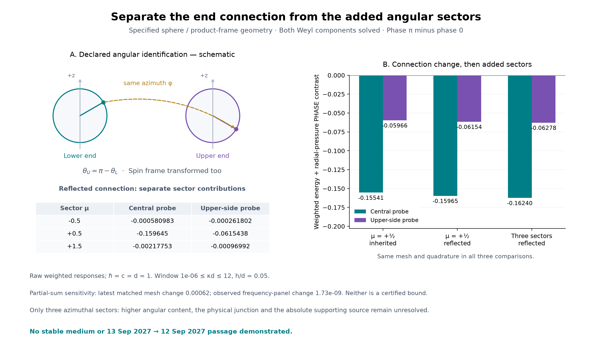

This resolves a missing angular/connection sensitivity in the conditional
model. It does not establish an absolute negative source, a consistent
physical junction, stable passage, a new physical law, or travel from
13 September 2027 to 12 September 2027.

### Decision gate: an absolute source across a physical collar

Further angular-sector expansion alone cannot answer whether this model
can support a passage. The next physical gate is an absolute radial-null
source budget across a specified smooth finite collar. In proper radial
distance s, write ds4^2=-N(s)^2 dt^2+ds^2+r(s)^2 dOmega^2. Fix the
endpoint geometry, field state, couplings and common renormalization
prescription before calculating the source. The independently verified
[collar identity](../scripts/throat_junction_audit.py) requires
\[
 I_{\rm req}=-{E\over4\pi G}
 \left[\left.{r'\over Nr}\right|_{\rm in}^{\rm out}
       +\int_{\rm in}^{\rm out}{r'^2\over Nr^2}\,ds\right],
 \qquad I_Q=\int T^Q_{ab}k^ak^b\,d\lambda.
\]
Here E>0 fixes the affine null normalization, primes denote d/ds,
and k^t=E/N^2, k^s=E/N. For N,r>0, inner r'=0 and outer r'=N=1,
the required integral is strictly negative. The purely radial spherical
Maxwell field contributes zero to this contraction; this statement does
not replace the stress of a general two-centre magnetic exterior.

The phase-independent reference stress is essential to I_Q and has
not been computed by the current phase-contrast method. Neither
dividing a contrast by a volume nor matching its sign supplies I_Q.
A wrong sign or insufficient absolute magnitude, beyond the stated
uncertainties, rejects the specified state/collar candidate. Agreement
would pass only this necessary integrated condition; all remaining
Einstein equations, junction data and dynamical stability still matter.

The present q=1 geometry has no specified physical collar or absolute
reference source, and lies outside the large-flux control used in
[MMP](https://arxiv.org/html/1807.04726v3). Its current role is a
transport/source-contrast benchmark. The next calculation must first
establish that those missing inputs can be supplied in a controlled
approximation. If they cannot, pivot the support calculation to the
existing large-flux effective-action collar of increments83/84 rather
than extending this benchmark indefinitely. Reuse its verified spherical
solution; do not repeat its opening calculation. The unresolved extension
is its physical nonradial exterior and state matching. This is a decision
rule, not a claim that the complete large-flux construction is solved.

## Opposite chirality and physical boundary consistency — increment97

The supporting-field candidate needs specified physical field content.
[MMP section 2.1](https://arxiv.org/html/1807.04726v3) uses an anomaly-free
theory and, for most of its calculation, one charged massless Dirac field.
The preceding numerical diagnostics retained one Weyl component in a
fixed azimuthal sector. Adding its opposite chirality requires a matching
domain, not an assumed factor of two. Even the resulting two-component
sector is not the complete four-dimensional source.

### What opposite chirality would imply on a consistent domain

For the static magnetic, massless problem, with the same vector charge,
connection, spin structure, endpoint spin/gauge identification and state,
the Hamiltonians satisfy
\[
 H_L(v)=-H_R(-v),\qquad
 \mathcal E_L(v)=\mathcal E_R(-v),\quad
 \mathcal E=-\tfrac12\operatorname{Tr}|H|.
\]
Here v is the compact radial shift of increment96. At v=0, pressure
responses agree and shift responses have opposite signs. A
chirality-dependent chemical potential or boundary condition would
invalidate this inference. Reversing propagation inverts the same
holonomy; it does not introduce an independently adjustable phase.
The derivative statement also assumes differentiability at v=0. The
nonsingular finite frequency window used here has a well-defined
derivative; uncomputed zero-mode crossings or an infrared limit need
their own analysis before extending that statement to the full field.

At positive imaginary frequency, a consistently paired domain gives
\[
 S_L=S_R^\dagger,\qquad B_L(v)=B_R(-v)^\dagger.
\]
The determinant identity det(I-AB)=det(I-BA) then gives
\[
 \det(I-S_LB_L)=\overline{\det(I-S_RB_R)}\quad(v=0).
\]
Thus equal determinant moduli and opposite shift derivatives are
conditional predictions to test. They do not establish an absolute
vacuum stress, self-consistent geometry or stability.

### Rebuild the transport and distinguish two finite boundary prescriptions

[The audit](../scripts/dirac_sewing_audit.py) independently reverses every spatial
Weyl term and each upwind projector on the existing mesh. It retains the
regular-axis subspace and positive kappa times the weighted mass matrix.
Conjugate transpose is used only afterwards to test the weak matrices:
\[
 A_L(\kappa)=A_R(\kappa)^\dagger,\qquad
 G_L=C_R^\dagger,\qquad C_L=G_R^\dagger.
\]
This is an adjoint relation for the dissipative finite approximation,
not proof of a self-adjoint continuum operator. Incoming/outgoing
spherical bases are swapped and projected afresh at both mouths and
the outer sphere. The left raw outer map follows independently from
the radial Riccati equation: its generator swaps C and C-dagger and
has the same real free-decaying terminal data, giving Z_L=Z_R-dagger.

Let F_in and F_out convert right spherical mouth coefficients into
orthonormal facet coefficients. The right and physically swapped left
maps are
\[
 B_R^f=F_{\rm in}B_R^sF_{\rm out}^{-1},\qquad
 B_L^f=F_{\rm out}(B_R^s)^\dagger F_{\rm in}^{-1}.
\]
They generally are not adjoints on a finite polygon. With
W_in=F_in-dagger F_in and W_out=F_out-dagger F_out, the exact difference is
\[
 B_L^f-(B_R^f)^\dagger
 =F_{\rm out}^{-\dagger}
   [(W_{\rm out}-I)(B_R^s)^\dagger
    -(B_R^s)^\dagger(W_{\rm in}-I)]F_{\rm in}^{-1}.
\]
The outer cut has the analogous expression with F_plus and F_minus.
These defects concern the spherical-to-polygon projection and its
induced norms. They cannot be removed by relabeling an adjoint as the
original physical map. The deliberately adjoint-paired facet prescription
is retained separately as an algebraic control.

Throat derivatives are transformed after taking their raw adjoints:
pressure uses +(dB_R)-dagger, while shift uses -(dB_R)-dagger. The actual
physical left exterior response is solved with the swapped outer map;
it is not obtained by transposing a saved right response.

The finite prescription difference also admits an elementary determinant
bound. Let M_0=I-S_R-dagger B_R-dagger, M_1=I-S_L-physical B_L-physical
and epsilon=norm[M_0^(-1)(M_1-M_0)]_2. If epsilon<1 for m channels,
\[
 \left|\log\left|{\det M_1\over\det M_0}\right|\right|
 \leq -m\log(1-\epsilon).
\]
This follows by bounding every singular value of I+M_0^(-1)(M_1-M_0)
between 1-epsilon and 1+epsilon. It compares two finite prescriptions;
it is not a continuum or omitted-mode error bound. Near a singular
sewing, even small map errors can be amplified, which is why the
response and determinant themselves must be checked.

### Computed paired contrast and numerical resolution

The [saved result](../results/dirac_sewing_audit_results.json) passes all ten final
controls in 239.67 seconds, with 257 frequency/geometry evaluations.
The two components are separately assembled and solved at every
integration frequency. The primary q=1, mu=0.5 sector uses b=0.2, d=1,
rho_c=2, R=2, eight angular pairs, L=40 and h=0.05. Its frequency panels
have edges [1e-6,0.002,0.02,0.2,1,4,8,12] and respective Gauss orders
[16,16,24,16,16,16,16].

| Compact throat probe | Paired Q_rho+p | Paired Q_shift residual |
| --- | ---: | ---: |
| Central | -0.155407748962 | -2.71427e-10 |
| Upper side | -0.059658260732 | -1.04395e-10 |

The total retained-sector phase-energy contrast is -0.519720292591.
These are phase-pi minus phase-zero quantities in units hbar=c=d=1;
the displayed integrated quantities restore units hbar*c/d. Neither
probe result is divided by a volume. Q_shift is minus the weighted
lower-index energy-flow contrast, not an absolute current. Both radial
null contrasts consequently approach the corresponding Q_rho+p as
the finite flow residual decreases.

At h=0.035 with order8 panels, Q_rho+p is -0.155981635126 and
-0.059878486185; Q_shift is +5.52174e-12 and +2.12375e-12.
Matched order8 mesh changes in Q_rho+p are -5.73878e-4 and
-2.20222e-4, while energy changes by -0.00201591. The flow residual
changes sign, and its mesh sensitivity exceeds its primary magnitude.
It is not evidence of a physical nonzero net flow. Nor do these finite
comparisons certify the continuum pressure sign or convergence order.

The first order8-to16 energy comparison changed by 2.12065e-7 and
failed the declared 2e-7 numerical target. That failure is retained in
the record. Refining only the dominant [0.02,0.2] panel to order24
reduces the sum of observed panel changes to 1.71544e-8 for energy and
at most 1.73409e-9 for Q_rho+p. These are convergence diagnostics,
not rigorous remainder estimates. Omitted infrared/ultraviolet bounds
and the combined continuum bound remain explicitly absent.

At kappa=0.4, physical mouth/outer map Frobenius defects against the
adjoint prescription decrease as follows:

| Mesh h | Mouth defect | Outer defect |
| --- | ---: | ---: |
| 0.08 | 0.0404228 | 9.84570e-5 |
| 0.05 | 0.00130861 | 1.40702e-5 |
| 0.035 | 0.000297961 | 3.52845e-6 |

The largest sampled left/right phase-energy mismatch likewise shrinks
from 1.22046e-6 to 2.50246e-8 to 7.45952e-10 across these meshes.
The right response reproduces increment96. Sparse equation residuals
are at most 4.58e-15. Independent reconstruction of every saved
physical response trace agrees within 2.78e-17; the exact Gram-defect
identity agrees within 3.40e-16. All eighteen audited finite sewings
have epsilon<=0.0254577 in the determinant bound above. A separate
audit reconstructed the mixed-order nodes, panels and totals exactly,
with component-sum residuals at most 4.44e-16.

This supports combining the two chiralities in this prescribed,
retained-sector model. It leaves absolute stress, the remaining
angular modes, physical junctions, backreaction and stability open.
The motivating published wormhole is causal; 13 September 2027 to
12 September 2027 remains unproved. No new physical law or obtainable
supporting material has been established.

### Next feasibility calculation: missing azimuthal sectors

The next substantive extension is to calculate the missing mu=-0.5 and
mu=1.5 sectors with their actual axis conditions and lead bases. For
integer flux q=1, the first nonzero spherical spinor level has j=1 and
three harmonics; see the angular spectrum in
[Borokhov, Kapustin and Wu, section 4 and Appendix](https://arxiv.org/pdf/hep-th/0206054).
In the present gauge patch, m=mu-q/2, so the current mu=0.5 sector
contains only its m=0 harmonic. This patch conversion is our convention,
not an additional claim about that paper's notation.

Adding the other two sectors covers that first multiplet but still
leaves higher multiplets incomplete. The two-centre exterior couples
the allowed n channels inside each mu sector, so an isolated n=1
determinant is not an additive source contribution. The useful next
quantity is the change in the actual three-sector contrast. Multiplying
the present value by three would assume a symmetry the exterior lacks.

An absolute reference stress and the remaining angular sum are still
required before backreaction. A negative phase difference alone cannot
tell whether either state's total null stress is negative. The purpose
of the next calculation is to test that missing-source sensitivity, not
to accumulate another set of pairing benchmarks.

## Throat stress contrasts from compact metric variations — increment96

This increment moves the metric probe into the prescribed throat. It
targets an angularly integrated combination of energy density and radial
pressure, which is more directly relevant to the geometry than the
exterior energy-density probe of increment95. It still compares two
declared loop phases on the same geometry; it supplies neither an absolute
source nor a material preparation procedure.

### Compact metric variation with unchanged mouth data

Use a fixed throat coordinate y and a purely magnetic connection:
\[
 ds^2=-N(y)^2dt^2+A(y)^2dy^2+r(y)^2d\Omega^2,
 \qquad \chi=r\sqrt N\,\Psi.
\]
With time convention exp(-iEt), each nonzero angular pair obeys
\[
 \partial_y\chi=
 \left[iE{A\over N}\sigma_3+{\lambda A\over r}\sigma_2\right]\chi,
 \qquad \lambda=\sqrt{n(n+q)}.
\]
The radial norm is integral (A/N) chi-dagger chi dy, and the current per
common coordinate time is chi-dagger sigma_3 chi. A flat-dy canonical
spinor would instead be sqrt(A/N) chi. The spherical spinor rescaling
and chiral zero-mode starting point follow [MMP, Appendix C](https://arxiv.org/pdf/1807.04726);
the nonzero-pair convention is derived in [the existing matching note](../docs/CURVED_THROAT_MATCHING.md).
No second physical zero-mode chirality is added to the retained Weyl field.

For a smooth nonnegative f with compact support away from both cuts,
choose the finite path
\[
 N_\eta=N e^{\eta f},\qquad A_\eta=A e^{-\eta f},\qquad r_\eta=r.
\]
The clock and endpoint bases are unchanged near the cuts. Both metric
coefficients remain positive, while the frequency coefficient A/N gains
exp(-2 eta f) and the angular coefficient A/r gains exp(-eta f). In the
existing angle coordinate sigma, their undeformed values are ell and
lambda sec(sigma), respectively. Differentiating only one of these
coefficients would represent a different stress probe.

The static metric variation gives
\[
 {d\Delta\mathcal E\over d\eta}\bigg|_0
 =\int dy\,d\Omega\,NAr^2 f\,
       \Delta(T_{\hat0\hat0}+T_{\hat r\hat r}).
\]
This interpretation is conditional on the same continuum, state and
subtraction hypotheses as increment95. It is a smeared phase contrast,
not a pointwise stress value. It is also the half-sum of the two opposite
radial null contractions: an individual contraction includes the
additional plus or minus 2T_hat0hatr. Stationarity does not eliminate
that energy-flow term.

The one-chiral-channel circle provides a concrete counterexample to
assuming that flow vanishes at phases zero and pi. Its symmetric-sea
contrast has Delta E=-pi/(4L) and Delta p=Delta rho=-pi/(4L^2), with
|Delta T_hat0hatr|=|Delta rho|. The two null contrasts are therefore zero
and 4 Delta rho, rather than two copies of 2 Delta rho. This is an exact
control for the isolated chiral channel, not a computed flux value for
the actual exterior/throat system. Opposite chiralities can cancel flux
under additional matching assumptions, but that cancellation has not
been computed here.

### Differentiate the throat map, retaining the computed exterior

Let S_ext be the outer-matched exterior response, held fixed during this
compact throat variation. The curved radial scattering gives B_phi(eta)
in the unchanged endpoint coordinates. For M_phi=I-S_ext B_phi,
\[
 {d\Delta\mathcal E\over d\eta}\bigg|_0
 ={1\over\pi}\int_0^\infty\Re\operatorname{Tr}\left[
 M_\pi^{-1}S_{\rm ext}B_\pi'
 -M_0^{-1}S_{\rm ext}B_0'\right]d\kappa.
\]
The sign follows by differentiating the existing -1/pi integral of
log|D_pi/D_0|. Tangent Riccati equations can calculate B' without
forming an exponentially growing transfer matrix. Directly perturbed
finite-eta scattering maps and determinants provide separate checks.

The physical zero channel supplies an exact control. With
I_f=integral (A/N)f dy, its optical length derivative is -2I_f and
\[
 \partial_\eta\log t_0=-2iE I_f
                        =2\kappa I_f\quad(E=i\kappa).
\]
For an ideal single closed chiral channel of total optical length L,
Delta E=-pi/(4L) consequently gives derivative -pi I_f/(2L^2).
This circle is a normalization control; it does not replace the computed
exterior or include its escape and higher-mode response.

### A compact stationary shift probes energy flow

The missing component can be obtained without another exterior solve.
At fixed N,A,r, consider
\[
 ds^2=-N^2dt^2+A^2(dy-vdt)^2+r^2d\Omega^2,
 \qquad v=\eta(N/A)f.
\]
For |eta f|<1, the exact coordinate change T=t+F(y),
F_y=(A/N) eta f/(1-eta^2 f^2), diagonalizes the radial metric, with
N_tilde=N sqrt(1-eta^2 f^2) and A_tilde=A/sqrt(1-eta^2 f^2).
Thus the diagonalized scattering operator changes only at second order.
The endpoint time difference remains at first order: d Delta F/deta=I_f.
It must be retained when sewing to the unchanged exterior clock.

The original transfer matrix is exp(-iE Delta F) times the diagonalized
one. Its determinant is not one for a finite shift. Applying the general
transfer-to-scattering quotients gives
\[
 \partial_\eta S_{\rm throat}=
 \begin{pmatrix}
 0&iE I_f S_{12}\\-iE I_f S_{21}&0
 \end{pmatrix}.
\]
Reflections therefore have zero first derivative, while the two
transmissions have opposite derivatives, including for nonzero angular
pairs. At E=i kappa the physical forward zero channel gains +kappa I_f.
The metric diagonalization, the transfer quotients and the stress sign
were checked independently with exact symbolic algebra.

With lower orthonormal indices, the corresponding energy derivative is
\[
 Q_{\rm shift}=-\int NAr^2 f\,\Delta T_{\hat0\hat r}\,dy\,d\Omega,
 \qquad Q_\pm=Q_{\rho+p_r}\mp2Q_{\rm shift}.
\]
Here Q_plus and Q_minus smear the contractions with k_hat=(1,+1) and
(1,-1). The isolated forward chiral circle has Q_rho+p=2 Q_shift,
so its plus contraction vanishes, while the minus contraction is twice
Q_rho+p. This also checks the off-diagonal metric sign. This virtual shift
does not construct moving mouths or a chronology-changing identification.

### Geometry compatibility remains a separate requirement

In a static spherical geometry, the radial Einstein equation is
\[
 \rho+p_r=-{1\over4\pi G rA^2}
 \left[r_{yy}-\left({A_y\over A}+{N_y\over N}\right)r_y\right].
\]
This is the proper-distance identity already checked from full curvature
in [the junction audit](../scripts/throat_junction_audit.py), written in fixed y.
The published stress/geometry relation and radial null integral are given
in [Visser, Kar and Dadhich, equations 3 and 6–7](https://arxiv.org/pdf/gr-qc/0301003).

For the present product r=b, the geometric combination is exactly zero
for every N and A, including the probe path. Therefore a nonzero quantum
phase contrast cannot be advertised as support of that unchanged product.
More generally, for any two-dimensional radial-time metric at fixed sphere
radius b, its Einstein block is G_ab=-g_ab/b^2: the two-dimensional Ricci
contribution cancels and the sphere contributes curvature 2/b^2. In an
orthonormal radial frame this requires both rho+p_r=0 and T_hat0hatr=0.
Purely magnetic local L(F^2) terms at fixed r and fixed connection also
have zero variation on this path: N_eta A_eta=NA and F^2 is unchanged.
That fact does not remove the fermionic state contribution, trace terms
or the missing junction source.

A separate symbolic calculation verifies the first radius response.
Writing r=b+epsilon u at fixed N,A gives
\[
 \delta(\rho+p_r)=-{N\over4\pi G bA}
             \partial_y\left({u_y\over AN}\right).
\]
This identifies the curvature response that a complete source would have
to generate. Applying it requires the complete angular and field content,
absolute reference stress and the other Einstein equations. The one-sector
phase contrast does not close that system or establish stability.

### Computed contrasts and numerical scope

[scripts/throat_null_response.py](../scripts/throat_null_response.py) and its
[saved record](../results/throat_null_response_results.json) use two peak-one smooth
weights exp[1-1/(1-u)] inside u<1, zero elsewhere. For cut=atan(2), their
(center,width) are (0,0.65 cut) and (0.60 cut,0.25 cut), with
u=((sigma-center)/width)^2. Both vanish strictly before the mouth cuts.
The two pressure-sensitive tangents share each radial mode solve, and
the shift kernels reuse its transmission coefficients.

At q=1, mu=0.5, b=0.2, d=1, rho_c=2, R=2, eight angular pairs, L=40,
h=0.05 and sixteen-point quadrature on each frequency panel, the window
[1e-6,12] gives:

| Probe | Q_rho+p | Q_shift | Q_plus | Q_minus |
| --- | ---: | ---: | ---: | ---: |
| Central | -0.07770387476 | -0.03922773033 | +0.00075158590 | -0.15615933543 |
| Upper side | -0.02982913055 | -0.01508758859 | +0.00034604663 | -0.06000430773 |

These are weighted phase contrasts in units hbar=c=d=1, restoring units
hbar*c/d. In particular, Q_shift is minus the weighted contrast in the
lower-index energy-flow component. None is divided by a volume.

The signs persist for h=0.08, 0.05 and 0.035. At h=0.035, Q_plus is
0.00075599090 and 0.00034799091; its latest matched-order mesh changes
are 4.405e-6 and 1.944e-6. Q_minus is -0.15673762602 and -0.06022647713,
with latest changes 5.783e-4 and 2.222e-4 in magnitude. Eight-to-sixteen
frequency quadrature changes any reported observable by at most 8.06e-9;
for Q_plus the largest change is 4.64e-11. Mesh sensitivity dominates.
These observations do not certify the continuum signs.

All fifteen controls pass with warnings treated as errors in 210.53
seconds, with 340 frequency/configuration evaluations. Independent full
transfer tangents agree within 1.44e-14. Finite stationary-shift and
combined-metric Richardson checks agree within 2.21e-10 and 6.47e-10,
respectively. The direct metric determinant derivative agrees to
2.83e-9 relative error. The exterior response is exactly unchanged from
increment95 at the three shared representative frequencies. Root's
independent reconstruction of the stored response traces agrees within
1.39e-17 and reproduces all seven integration records for all four
observables.

The zero channel cancels exactly from Q_plus at the analytic level:
its pressure-sensitive derivative is twice its shift derivative. At
kappa=0.4 the stored central-probe Q_plus integrand is 3.994409e-4,
while its numerical zero-channel residue is -1.471e-11. Directly masking
the zero entry of the stored raw derivative matrix leaves the paired-mode
contribution. This identifies the origin of the small positive value in
the retained model at the representative frequencies; it is not evidence
of an absolute positive or negative physical source.

The separate infrared interval [1e-8,1e-6] contributes at most 6.00e-10
in magnitude among these observables, and [12,16] at most 4.45e-10.
The omitted tails remain unbounded. Angular-cutoff, matching-radius,
far-tail and tighter ODE checks are sampled sensitivities, not combined
continuum or integrated error bounds. The near-zero finite-mesh
determinant plateau remains a numerical feature rather than a proved gap.

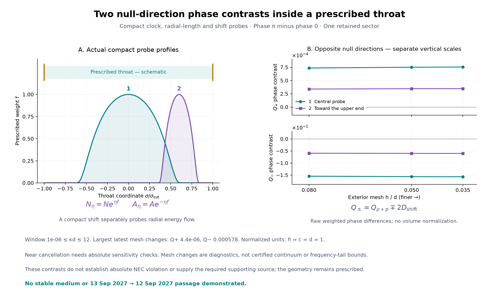

### The next field-completion gate is a domain check

For a static massless Dirac field with the same vector charge, magnetic
connection and physical domain in both chiral blocks, the continuum
relation H_L(v)=-H_R(-v) implies E_L(v)=E_R(-v) for the symmetric sea.
Energy and pressure contributions would then add and the energy flows
would cancel. This requires the same spin structure, spin/gauge endpoint
identification and state prescription. Reversing a path reverses its
holonomy; it does not permit assigning an unrelated boundary phase.

This relation cannot simply be imposed on the present finite-grid data.
With upwind dissipation, the adjoint-paired discretization instead has
\[
 A_L(\kappa)=A_R(\kappa)^\dagger,\qquad
 G_L=C_R^\dagger,\qquad C_L=G_R^\dagger.
\]
Independently reversing the transport, characteristic
projectors and boundary maps is the necessary check before interpreting
this algebra as the opposite physical chirality.

A read-only audit of the actual frozen94 representative mouth matrices
at kappa=0.4 already finds a finite-grid mismatch. The physically swapped
spherical map becomes F_out B_raw^dagger F_in^{-1}, whereas the adjoint
of the existing facet map is F_out^{-dagger} B_raw^dagger F_in^dagger.
Their maximum entry difference is 3.6972e-4, with relative Frobenius
difference 3.3088e-4, for either phase. A weighted raw adjoint reproduces
the facet adjoint to 4.45e-16, but changes the boundary prescription at
finite mesh spacing. It cannot be substituted without documenting and
checking that change.

The corresponding outer-boundary comparison and mesh dependence have
not yet been evaluated. The next bounded calculation must check both
boundaries before doubling existing results or claiming a completed
Dirac stress tensor. Absolute reference stress, other angular sectors
and a consistent geometry would still remain afterward.

## Compact local source diagnostic — increment95

The next question is whether the computed return field can supply a local
source component. A negative global energy contrast alone does not answer
that question. This increment varies the clock rate in compact regions of
the exterior while keeping the spatial geometry, magnetic potential,
mouths, throat and outer boundary data fixed. These variations are probes
of a mathematical energy functional, not generated fields or a material.

### Derivation and an independently testable derivative

In units hbar=c=1, take
\[
 ds^2=-N(x)^2dt^2+d\mathbf x^2,\qquad
 N=1+\eta f>0,
\]
where the nonnegative, axisymmetric smooth function f vanishes near every
boundary cut. In the canonical spinor norm, the massless Hamiltonian is
\[
 H[N]=\sqrt N H_0\sqrt N
      ={1\over2}\{N,H_0\},\qquad
 i\kappa-H[N]=\sqrt N(i\kappa/N-H_0)\sqrt N.
\]
The Hamiltonian follows by specializing the charged Hermitian Dirac
Hamiltonian in [Obukhov, Silenko and Teryaev, equations 2.21–2.25](https://arxiv.org/pdf/1106.0173)
to zero mass, flat spatial metric and no shift or electric potential, then
retaining the Weyl block. The anticommutator identity uses the continuum
first-order differential operator; arbitrary finite matrix products do
not share its exact linearity in N.

The common local determinant factors cancel between the two loop phases.
After the congruence, the weak operator and its first variation are
\[
 A_\kappa[N]=D+\kappa M_{1/N},\qquad
 \partial_\eta A_\kappa\big|_0=-\kappa M_f.
\]
The support restriction keeps every lead map unchanged. With the same
symmetric-sea normalization as increment94, differentiation gives
\[
 \partial_\eta\Delta\mathcal E\big|_0
 ={1\over\pi}\int_0^\infty\kappa\,
 \Re\operatorname{Tr}[(G_\pi-G_0)M_f]\,d\kappa.
\]
This is our derivative of the specified relative functional, not a source
calculation supplied by the cited paper. On a consistent self-adjoint
continuum geometry with common local subtraction it has the interpretation
\[
 \partial_\eta\Delta\mathcal E\big|_0
 =\int d^3x\,f(x)\Delta T_{\hat0\hat0}(x).
\]
The finite calculation retains the restrictions of its frequency window,
angular sector, numerical dissipation and assumed sewing. It does not
establish that continuum interpretation by itself.

For efficient evaluation, let Y=A_out^{-1}G_m, Z=C_m A_out^{-1}, S=C_mY
and K=B_pi(I-SB_pi)^{-1}-B_0(I-SB_0)^{-1}. Then
\[
 G_\pi-G_0=YKZ,\qquad
 \operatorname{Tr}[(G_\pi-G_0)M_f]
 =\operatorname{Tr}_{\rm mouth}[KZM_fY].
\]
The row solve uses an ordinary transpose. A consistently conjugated
adjoint solve is equivalent; replacing the transpose with an adjoint
without also conjugating its input and output is incorrect. A separate
seven-dimensional non-Hermitian matrix example checks this distinction
against a directly inverted Green difference and perturbed determinants.

The smooth weights are exp[1-1/(1-u)] for u<1 and zero otherwise, with
u=((rho-rho0)^2+(z-z0)^2)/a^2. Their (rho0,z0,a) are (0.35,0,0.20),
(0.50,0.50,0.18), and (0.80,0,0.25), in separation units. Rotating the
off-axis meridional disks produces toroidal probe regions. The weighted
meridional volumes are independently known:
\[
 \int\rho f\,d\rho dz
 =\pi\rho_0a^2[1-eE_1(1)].
\]
The fixed azimuthal spinor is already normalized. Do not multiply its
trace by another 2pi, and do not divide the smeared response by a volume
and label the quotient the local stress.

### Computed responses and checks

[scripts/local_lapse_response.py](../scripts/local_lapse_response.py) and its
[saved record](../results/local_lapse_response_results.json) compute all three weights
with shared Green solves. At q=1, mu=0.5, b=0.2, d=1, rho_c=2, R=2,
eight retained angular pairs and far-tail start L=40, the frequency window
1e-6 <= kappa <= 12 gives the following smeared responses. Units are
hbar=c=d=1; the response restores units hbar*c/d, not energy per volume.

| Mesh h | Between mouths | Beside upper mouth | Outer midplane |
| --- | ---: | ---: | ---: |
| 0.08 | -0.006077523698 | -0.003145450946 | -0.003577803511 |
| 0.05 | -0.006149048358 | -0.003185527553 | -0.003623691693 |
| 0.035 | -0.006171052522 | -0.003197989601 | -0.003637972626 |

These rows use eight-point Gauss quadrature on the same seven frequency
panels. Sixteen-point quadrature at h=0.05 gives -0.006149048083,
-0.003185527364 and -0.003623691466; the largest change is 2.76e-10.
The latest mesh changes are 2.20e-5, 1.25e-5 and 1.43e-5. Their signs
persist in these checks; this is not a certified continuum sign bound.

All sixteen controls pass with warnings treated as errors, in 162.91
seconds and 340 shared frequency/configuration evaluations. Direct
finite-lapse determinants at kappa=0.01, 0.4 and 2 converge quadratically
to the derivative; the maximum Richardson relative discrepancy is
1.14e-9. Column and transpose equations have residuals below 5.29e-15.
Independent reconstruction from the saved complex reduced matrices agrees
with every stored representative trace within 4.45e-16.

Weighted-mass integration uses order16. At the representative frequency,
changing it to order24 alters the response by at most 5.55e-8 relative;
an independent polar integral of an affine spinor norm agrees within
8.27e-8 relative. Exact constant-weight and polynomial triangle-mass
controls also pass. These mass controls are distinct from spatial-mesh
and frequency-integration comparisons.

At five selected frequencies, increasing the paired-mode cutoff 8 to12,
matching radius 2 to4, and far-tail start 40 to80 gives maximum absolute
integrand changes 5.52e-8, 8.06e-6 and 1.90e-7 respectively. These are
sampled sensitivities, not bounds on integrated effects. The separate
[1e-8,1e-6] interval contributes at most 3.43e-12 in magnitude among the
three responses; [12,16] contributes at most 1.40e-11. The regions below
1e-8 and above16 remain unbounded, as does the combined continuum error.
The mesh-dependent near-zero determinant behavior from increment94
remains unresolved; a small finite-mesh infrared contribution does not
certify its uniform continuum limit.

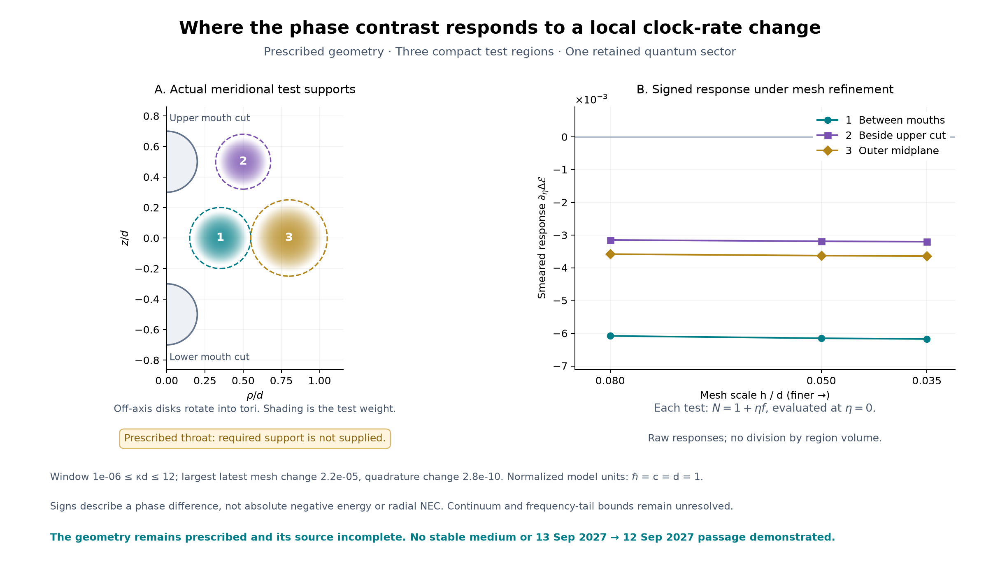

### What would constitute progress toward a supporting medium?

A negative result would mean a lower weighted energy density in phase pi
than in phase zero, conditionally on the stated limits. It would not show
that either absolute density is negative, determine the radial pressure,
or prove that rho+p_r has the sign and magnitude required by the geometry.
The source still has to include the missing field sectors and the same
geometry's reference contribution; then its tensor must satisfy the
semiclassical Einstein equations and a separate stability test.

The next directional variation has a definite sign. For a static effective
action Gamma=-T E and the convention
delta Gamma=(1/2) integral sqrt(-g) T^{mu nu} delta g_mu nu,
\[
 \delta E=\int\sqrt h\left(\rho\,\delta N
                 -{N\over2}T^{ij}\delta h_{ij}\right)d^3x.
\]
Thus a simultaneous compact delta N=eta f and
delta h_ij=-2 eta f s_i s_j, with a specified unit direction s, probes
integral f(rho+T_ss) at the flat baseline. This is a derivation for a
future calculation, not an implemented result. The spatial Dirac operator,
spin connection, canonical norm and discretized fluxes must be varied
consistently; a lapse variation alone cannot supply pressure. Moreover,
rho+T_ss is the half-sum of the two opposite null contractions. An
individual contraction also contains plus or minus 2T_0s. Stationarity
does not establish that flux term vanishes in the retained chiral sector.
The phase comparison would still give only differences of these quantities.

The smaller next implementation is to apply that variation inside the
existing curved throat, where the radial supporting stress is needed,
before changing the full exterior spatial discretization. At a fixed
coordinate y, write ds^2=-N^2dt^2+A^2dy^2+r^2dOmega^2. The rescaled
radial spinor chi=r sqrt(N) Psi obeys
\[
 \partial_y\chi=\left[iE{A\over N}\sigma_3
                   +{\lambda A\over r}\sigma_2\right]\chi,
 \qquad \lambda=\sqrt{n(n+q)}.
\]
Choosing N_eta=N exp(eta f), A_eta=A exp(-eta f), and fixed r changes
the frequency coefficient by exp(-2eta f) and the angular coefficient
by exp(-eta f). Compact f leaves all endpoint bases unchanged. The
existing Riccati throat integration can therefore supply a perturbed
B_phi while the computed exterior response stays fixed. This proposed
derivative measures integral N A r^2 f Delta(rho+p_r) dy dOmega; it still
requires direct determinant checks and the flux caveat above. It has not
been simulated in increment95 and cannot repair the already identified
phase-independent geometry/source mismatch on its own.

That is the physical decision point. Further transport refinement alone
cannot establish it, and obtaining one favorable source component is not
a reason to skip it. The present static probe does not add a chronology
shift. The motivating [MMP construction](https://arxiv.org/html/1807.04726v3)
is explicitly causal, so even a supported traversable configuration would
require a separate argument for backward travel. The example
13 September 2027 to 12 September 2027 remains unproved.

## Phase-dependent vacuum diagnostic from the computed exterior — increment94

This increment connects the computed return field to a finite spectral
quantity, rather than refining a field response without testing its source
implications. The earlier increment84 already supplies a smooth spherical
source and collar in a large-flux approximation; its exterior return paths
are prescribed. The recent q=1 calculation tests return transport in a
different, deliberately simplified geometry. It must not be substituted
directly into that large-flux source or presented as its completed exterior.

### A relative determinant with the geometry held fixed

Let A_out be the discretized imaginary-energy exterior operator with its
decaying outer boundary map included, but with no mouth feedback. G_m
injects the incoming mouth coefficients and C_m extracts the outgoing
ones. The complete mouth response and the sewn boundary determinant are
\[
 S_{\rm ext}(i\kappa)=C_m A_{\rm out}^{-1}G_m,\qquad
 D_\varphi(i\kappa)=\det[I-S_{\rm ext}(i\kappa)B_\varphi(i\kappa)].
\]
Here B_phi is the finite curved-throat map of increment93 in the same
orthonormal polygon coordinates. Both paired-mode cross transmissions
receive their respective opposite phases, and the single Weyl zero mode
retains its one direction. Comparing phase pi with phase zero keeps the
local geometry, reflected amplitudes, magnetic field and subtraction
prescription fixed. It changes the declared global loop holonomy. Merely
rephasing all endpoint bases consistently would not change D.

The finite matrix determinant lemma gives, exactly,
\[
 {\det(A_{\rm out}-G_m B_\pi C_m)\over
  \det(A_{\rm out}-G_m B_0 C_m)}={D_\pi\over D_0}.
\]
This algebraic equality is not a renormalization theorem. Relative
spectral/scattering determinants are a published route to Casimir
quantities; see [Wirzba, equations 4 and 8–13](https://arxiv.org/pdf/0711.2395).
Our finite mouth operator and phase comparison are the specific calculation
here, not a result supplied by that paper for this geometry.

### Fermion normalization and the limits of the interpretation

For one complex first-order self-adjoint Hamiltonian H, the symmetric
filled-sea vacuum energy is -Tr|H|/2. Its relative determinant representation
has the normalization
\[
 \Delta\mathcal E=-{1\over\pi}\int_0^\infty
 \log\left|{D_\pi(i\kappa)\over D_0(i\kappa)}\right|\,d\kappa.
\]
This follows from integrating log[(kappa^2+a^2)/(kappa^2+b^2)], whose
integral is pi(|a|-|b|). Self-adjointness relates the positive- and
negative-imaginary-frequency determinants by adjunction; it does not
require a magnetized fixed-angular-sector spectrum to be symmetric in E.
An unsymmetrized occupied-negative-level energy additionally contains
Tr(H)/2. Its relative local contribution must cancel in the same regulator
before equating the two prescriptions. The modulus alone does not compute
the determinant phase, vacuum charge or eta invariant.

The exact one-channel circle D_phi=1-exp(i phi-kappa L) gives
Delta E_(pi,0)=-pi/(4L), agreeing with a regulated spectral sum. A second
physical chirality would be a separately counted field. We do not double
the computed Weyl sector or assume uncomputed angular sectors are equal.
Published twisted-fermion mode sums provide the independent normalization
context: [Bellucci and Saharian, equations 31 and 41](https://arxiv.org/pdf/0902.3726).

The present discretization has numerical dissipation, a finite angular
basis, and an assumed throat-to-exterior identification. Therefore the
integral computed from it is a finite approximation to the conditional
phase-dependent spectral energy, not a certified four-dimensional vacuum
energy. Local ultraviolet terms can cancel between genuinely identical
local geometries with different flat holonomy; this fact does not certify
our continuum gluing, angular sum, infrared limit or numerical tails.
Nor does a negative energy *difference* establish negative absolute energy
or the local radial null stress required to support the throat. That stress
requires variation of the complete effective action with respect to the
metric, with the source and global state specified consistently.

### Phase tuning cannot repair the unsupported product geometry

There is a separate exact compatibility test within the previously matched
large-q source of increments83/84. Use its dimensionless r_e=1 units,
k=alpha/3, epsilon=q alpha/6 and delta=3 zeta(3) alpha/pi^2. On the
equal-radius product R=1, N=N0 cosh(l), set wbar=w/N0^2. Its orthonormal
Einstein components are (1,-1,1). The matched magnetic and fermionic source
has components
\[
 (\hat\rho,\hat p_r,\hat p_T)=
 \left(1+\delta+k[1+(1-\bar w)\operatorname{sech}^2l],\;
 -1-\delta-k[1+(\bar w-1)\operatorname{sech}^2l],\;
 1+\delta-2\epsilon+k\right).
\]
Thus the Einstein-minus-source trace is exactly 4 epsilon, independently
of the state parameter, while its radial-null component is
-2 k(1-wbar) sech^2(l). A read-only symbolic check verifies both identities.
Changing a loop phase cannot remove the state-independent trace mismatch.
The corrected reference has unequal radii, and the existing opening branch
has varying sphere radius; it cannot be represented by this exact product.
This test applies to the large-q matched source. Its numerical parameters
are not silently assigned to the q=1 transport benchmark.

The scale hierarchy independently prevents that identification. In MMP's
short-exterior approximation, alpha=g^2/(4 pi^2 q) and
ell/r_e=4/(pi alpha), with overlap 1 << rho << ell/r_e. Setting
ell/r_e=sqrt(5), as in the synthetic transport profile if b=r_e, would
require alpha=0.5694 and g^2=22.48 at q=1. These are outside the assumed
small-parameter regime; a change of physical units cannot alter them.
See [MMP, equations 5.36 and 5.40](https://arxiv.org/html/1807.04726v3).
The computed q=1 field therefore remains a transport diagnostic.

### Computed contrast and its numerical limits

[scripts/phase_vacuum_contrast.py](../scripts/phase_vacuum_contrast.py) reuses the existing
geometry, curved radial modes and magnetic tail. At each positive imaginary
frequency it solves for every retained incoming mouth mode, with only the
outer feedback included, and forms the two complete sewn determinants.
The [saved record](../results/phase_vacuum_contrast_results.json) contains the
representative complex matrices and all frequency-panel samples.

For q=1, mu=0.5, b=0.2, d=1, rho_c=2, R=2 and eight retained angular pairs,
the integral over 1e-6 <= kappa <= 12 gives:

| Mesh h | Phase-pi minus phase-zero functional |
| --- | ---: |
| 0.08 | -0.256702633302 |
| 0.05 | -0.259860146966 |
| 0.035 | -0.260868113673 |

These use the same twelve-point Gauss rule on each of seven frequency
panels. At h=0.05, doubling that rule gives -0.259860147289, a change of
3.23e-10. The last spatial-mesh change is 1.008e-3 and dominates this
quadrature comparison. Increasing the paired-mode cutoff from 8 to 12
changes the result by 1.88e-7; it does not include the missing azimuthal
sectors. Moving the matching sphere from R=2 to R=4 changes it by 3.29e-5,
and moving the far-tail start from 40 to 80 changes it by 3.55e-7.
Units are hbar=c=d=1; these numbers are not laboratory energies.

Separate integrations contribute -2.11115e-6 over [1e-8,1e-6] and
-2.00402e-11 over [12,16], at the stated h=0.05 configuration. The
uncomputed regions below 1e-8 and above 16 have no certified bounds. Nor
does the calculation have a combined continuum error bound. At kappa=1e-8,
the periodic sewing's smallest singular value drops from 0.007286 to
0.002441 to 0.001084 as h is refined; its apparent infrared regularity
cannot be interpreted as a physical spectral gap.

All thirteen controls pass with warnings treated as errors (307.38 seconds,
748 frequency/configuration evaluations). Independent outer elimination
and full boundary determinants agree within 1.78e-15 in log magnitude.
The analytic phase derivative agrees with centered finite differences
within 3.20e-10; the largest normalized sparse-equation residual is
5.77e-15. The exact circle integral agrees with the independent zeta sum.
Root independently reconstructed the saved matrix determinants and every
saved comparison-panel integral, and checked the ten dependency hashes.
A separate nonsymmetric-spectrum example verified both the -Tr|H|/2
normalization and the additional trace term for an unsymmetrized sea.

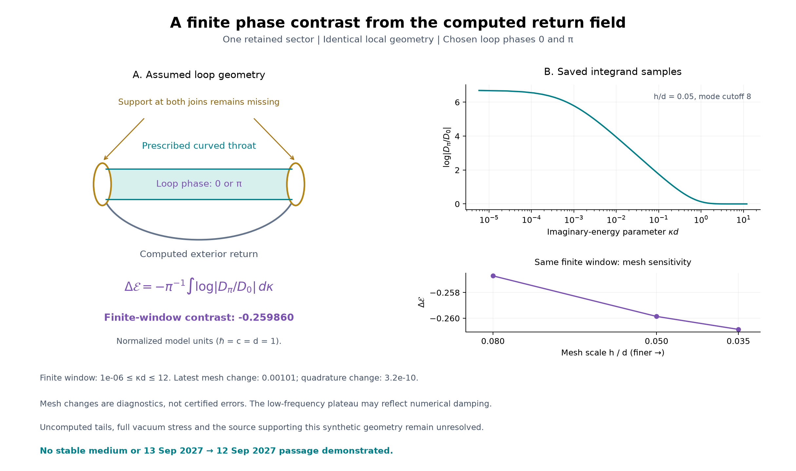

The sign favors phase pi over phase zero in the tested finite model. It
does not establish a minimum over all phases, an absolute energy sign,
negative radial null stress, or stability. This is an actual link from the
computed return field to a spectral source diagnostic; the physical source
problem remains open. No new physical law or passage from 13 September 2027
to 12 September 2027 is demonstrated.

### Next source derivative: a compact lapse variation

A concrete next test can keep the spatial metric and magnetic connection
fixed while varying N=1+eta f with axisymmetric f in a compact region strictly away from every
interface. For the canonical Weyl norm on the flat spatial slice, the
spin-connection term gives
\[
 H[N]=\sqrt N H_0\sqrt N=N H_0-\frac{i}{2}\boldsymbol\sigma\cdot\nabla N,
 \qquad \left.\partial_\eta H\right|_0=\tfrac12\{f,H_0\}.
\]
The congruence i kappa-H[N]=sqrt(N)[i kappa/N-H0]sqrt(N) makes the common
local factors cancel between the two phases. In the real-shift weak form,
A_kappa[N]=D+kappa M_(1/N), so its derivative is -kappa M_f, where M_f is
the spatial mass form weighted by f. Consequently
\[
 \left.\partial_\eta\Delta\mathcal E\right|_0
 ={1\over\pi}\int_0^\infty\kappa\,
 \Re\operatorname{Tr}[(\mathcal G_\pi-\mathcal G_0)M_f]d\kappa.
\]
Here G_phi denotes the sewn Green operator, not Newton's constant. In a
consistent continuum vacuum this derivative is the integral of f times the
phase-difference energy density on the undeformed slice. It is not the
absolute density or radial pressure, and therefore does not establish the
radial null-energy condition by itself.

This is practical without forming a dense volume Green matrix. With
Y=A_out^-1 G_m, Z=C_m A_out^-1 and
K=B_pi(I-S B_pi)^-1-B_0(I-S B_0)^-1, the exact finite-rank identity is
G_pi-G_0=Y K Z and the needed trace is Tr(K Z M_f Y). Constructing Z requires
an ordinary transpose solve, not a Hermitian-adjoint solve. The geometric
identity and sign were independently audited; this source derivative has
not yet been simulated. A direct perturbed determinant will be its first
check. Common local subtractions, ultraviolet/infrared limits, the omitted
field sectors and the dissipative discretization remain explicit conditions.

## Curved mode transport and the missing junction source — increment93

This increment tests the next boundary assumption: a finite curved throat
in place of the independent cylindrical mouth leads. It also checks what
stress would be required to attach that prescribed geometry to the flat
exterior. A successful field solution is not a solution of the gravitational
and quantum-source problem.

### Curved channel equation and endpoint coordinates

For the canonical spinor in the [curved-mode derivation](../docs/CURVED_THROAT_MATCHING.md),
\[
 H_n=-i\sigma_3\partial_x+V_n\sigma_1,\quad
 V_n=\frac{\sqrt{n(n+q)}}{\ell}\sec(x/\ell),\quad
 |x|\leq\ell\arctan\rho_c.
\]
The scattering matrix maps incoming (f_plus(left),f_minus(right)) to
outgoing (f_minus(left),f_plus(right)). Here left is the lower exterior
mouth and right is the upper. A single Weyl zero channel travels only
lower to upper. Its factor is exp(i E L_opt), L_opt=2 ell arctan(rho_c).

For a transfer matrix M, the pair has t=1/M22, r_left=-M21/M22 and
r_right=M12/M22. Propagating a growing transfer matrix is poorly
conditioned for high evanescent modes. The bounded scattering equations are
\[
 r_R'=-iV+2iEr_R-iVr_R^2,\quad
 (\log t)'=iE-iVr_R,\quad r_L'=-iV\exp(2\log t).
\]
The full mouth map identifies the opposite port normals explicitly.
Endpoint phases multiply cross transmissions with opposite signs, while
same-end reflections retain their phase convention. Raw angular and
orthonormal polygon coefficients require the same Gram conversion in
all comparisons. None of these choices derives the physical spin/gauge
identification at the actual nonspherical collar.

### The sharp join has an unprovided surface stress

In units c=1, take the synthetic calibration r_e=b, ell=b sqrt(1+rho_c^2), so both cut
spheres have radius b and lapse one in the exterior clock. Matching the
induced metric does not match its normal derivatives. With the normal
directed from throat toward exterior at either end, the mixed extrinsic
curvatures are
\[
 K^{a}_{b,\rm throat}=\operatorname{diag}(\rho_c/\ell,0,0),\qquad
 K^{a}_{b,\rm flat}=\operatorname{diag}(0,1/b,1/b).
\]
Applying the Israel junction equation, with S^a_b=diag(-sigma,p,p), gives
\[
 \sigma=-\frac1{4\pi G b},\qquad
 p=\frac1{8\pi G b}\left(1-\frac{\rho_c}{\sqrt{1+\rho_c^2}}\right),
 \quad
 \sigma+p=-\frac1{8\pi G b}\left(1+\frac{\rho_c}{\sqrt{1+\rho_c^2}}\right)<0.
\]
These are our application to this specific join of the published junction
conditions in [Poisson and Visser, equations 3 and 6–8](https://arxiv.org/pdf/gr-qc/9506083).
They quantify an additional missing surface source. They do not identify a
material, establish shell stability, or rule out a different smooth
construction. The external magnetic field has also been treated without
its gravitational backreaction; this surface calculation does not repair
the unsolved bulk Einstein equations.

### Smoothing is not a substitute for deriving a quantum source

For a smooth static spherical collar in proper radial distance s,
ds_spacetime^2=-N(s)^2 dt^2+ds^2+r(s)^2 dOmega^2, the Einstein equations give
\[
 \rho+p_s=-\frac{N}{4\pi G r}\left(\frac{r'}N\right)'.
\]
For a radial null ray with conserved E_null=N^2 dt/dlambda, integration
over the collar yields
\[
 \int T_{ab}k^ak^b\,d\lambda
 =-\frac{E_{\rm null}}{4\pi G}
 \left[\left.\frac{r'}{Nr}\right|_{\rm inner}^{\rm outer}
       +\int\frac{r'^2}{Nr^2}\,ds\right].
\]
If the inner cut has r'=0 and the outer flat cut has r'=N=1, the bracket
is strictly positive for positive N and r. A smooth transition therefore
still requires a negative radial null-stress average in this class.
This is the finite-collar version of the established spherical ANEC
identity; see [Visser, Kar and Dadhich, equations 3 and 6–7](https://arxiv.org/pdf/gr-qc/0301003).
It is a necessary geometric condition, not an amount of obtainable
negative-energy material, a new law, or a quantum stability proof.

### Numerical result and what it establishes

The [radial solver](../scripts/curved_throat_modes.py) passes ten controls, including
independent short-interval transfer integration, the analytic constant-mass
solution, real-energy unitarity and imaginary-energy attenuation. It retains
log-transmission when the transmission itself underflows at large barriers.
The [connected calculation](../scripts/curved_exterior_closure.py) passes thirteen
controls, using the frozen exterior, every retained paired throat mode and
the explicit endpoint-coordinate conversion. The [saved matrices and results](../results/curved_exterior_closure_results.json)
allow the conversion, phase placement and work balance to be checked without
rerunning the exterior solver.

For q=1, b=0.2, rho_c=2, E=0.4i, endpoint phase pi, h=0.035,
outer matching radius R=4 and twelve retained angular pairs, the driven
lower-mouth response is 0.334265432139. A matched calculation retaining
the zero-mode connection with the previous semi-infinite paired leads gives
0.334258568965. The difference is 6.86317e-6. At fixed R=2, matched differences
for h=0.08, 0.05, 0.035 are 8.09467e-6, 7.07384e-6, 6.85249e-6.
These paired comparisons settle under refinement, but the absolute mesh
change is 4.49336e-4: they do not certify a continuum physical correction.
All lengths remain in the model's coordinate units; no laboratory scale
is inferred.

Sewing changes the actual incoming amplitude. The correct source work is
1+2 Re(looped upper input), not one. Its representative value 0.550121633
equals the throat, exterior, omitted-mode, numerical-loss and bulk
attenuation terms within 7.8e-16. The canonical throat term is 0.0616888282;
the polygon-coordinate correction is separately recorded as -0.0002738652.
This is a driven imaginary-energy response, not a passage probability.

The [junction audit](../scripts/throat_junction_audit.py) independently verifies both
ends using four-dimensional Christoffel symbols and a Gaussian-normal
derivative calculation. Its full spherical Einstein components reproduce
the smooth-collar identity. A numerical integral agrees with its integrated
form within 8.9e-16. Root replay reproduced the saved audit exactly and
independently checked the connected matrices and source-work sum.

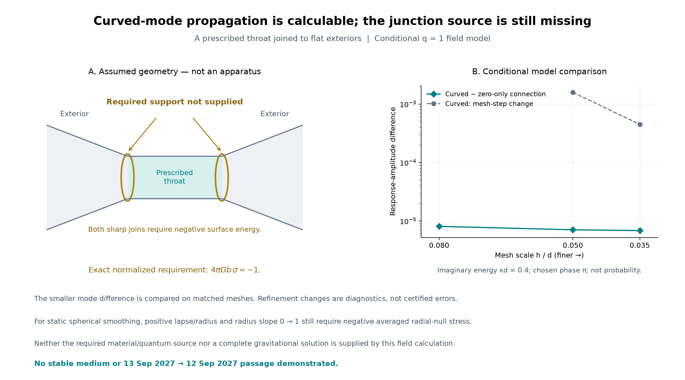

The substantive next gate is the supporting source: derive a quantum stress
on a consistently matched collar and test it against the required geometric
stress, including the magnetic field's gravitational backreaction. The
present synthetic sharp join is not a complete candidate medium. More wave
resolution alone cannot supply its missing source. This is useful feasibility
work, not a discovery of new physics or evidence that the destination is
reachable. Travel from 13 September 2027 to 12 September 2027 remains unproved.

## Imaginary exterior response and a declared throat connection — increment92

The connected q=1 calculation now supplies T(i kappa), with kappa>0,
and a directly checked finite boundary determinant for a specified
zero-mode throat connection. This advances the scattering input needed
for a vacuum calculation. It does not supply a renormalized stress tensor,
a self-consistent geometry, or a physical chronology-changing medium.

### Decaying maps and the necessary norm term

[scripts/imaginary_weyl_leads.py](../scripts/imaginary_weyl_leads.py) keeps the frozen
characteristic bases. With x=kappa R, its free spherical map is
gamma_n=(K_(n-1/2)(x)-K_(n+1/2)(x))/(K_(n-1/2)(x)+K_(n+1/2)(x)),
evaluated by a stable ratio recurrence. In particular gamma_1=-1/(1+2x).
The product-mouth map is beta_n=-i m_n/(kappa+sqrt(kappa^2+m_n^2)).
The actual magnetic tail satisfies
\[
 Z'=C^\dagger+2\kappa Z-ZCZ,\qquad
 \frac{d}{dr}(a^\dagger a-b^\dagger b)
       =-2\kappa(a^\dagger a+b^\dagger b).
\]
Free decay at the finite endpoint L still approximates the field beyond L.
These are upper-half-plane resolvent conditions, not a particle's physical
imaginary energy or a transmission probability.

[scripts/imaginary_exterior.py](../scripts/imaginary_exterior.py) reuses the frozen DG assembly
at zero energy and adds kappa times its weighted mass matrix. The exact
discrete identity becomes
\[
 \|g\|^2=\|u_+\|^2+\text{DG jump/mismatch}
          +2\kappa\int\rho |u|^2\,d\rho dz.
\]
Omitting the last term would falsely report loss of current conservation.
The term represents the imaginary-frequency norm identity, not physical
absorption. A modified-Helmholtz Green spinor with its source inside the
upper excision supplies an independent free control. Its relative L2 error
decreases .05455 -> .02954 -> .01308 for h=.12,.08,.05.

At R=2,h=.05,nmax=12,L=40 the responses at kappa=.1,.4,1 are
.7792950347, .4305086420, .1793359004, real in the fixed endpoint phases.
At kappa=.4, R=2 to 4 changes T by 2.94e-5; h=.05 to .035 changes it by
7.48e-4. L=20 to 40 changes it by 2.90e-11 and L=40 to 80 has no observed
double-precision change. Neither observation certifies an exact infinity
limit. The finer R=4,h=.035 response is .4312649669.

### Directly connecting the computed zero-mode ports

For a *declared* optical length l and endpoint phase theta, use
z=exp(i theta-kappa l) and feed the lower-mouth amplitude back into the
upper input. Write the unsewn response as T=c A_open^(-1)g. The finite
rank-one determinant and driven field then obey
\[
 \frac{\det A_{\rm sewn}}{\det A_{\rm open}}=D=1-zT,
 \qquad u_{\rm sewn}=\frac{u_{\rm open}}{1-zT}.
\]
[scripts/exterior_loop_closure.py](../scripts/exterior_loop_closure.py) checks these identities
against direct sewn DG solves and determinants of the finite boundary
matrices. It retains the full complex T, never replacing it with |T| or
|T|^2. This determinant identity is our finite-model derivation.

At h=.08,R=2,nmax=8,L=40, optical length l=1:

| kappa | T(i kappa) | log abs(D), theta=0 | log abs(D), theta=pi |
| --- | --- | --- | --- |
| .1 | .7752106426 | -1.2087830092 | .5314747141 |
| .4 | .4278701864 | -.3380073626 | .2521662589 |
| 1 | .1779391450 | -.0677010133 | .0634067746 |

The two phases are explicit alternatives, not a derived physical spin
structure. Their log determinants differ in sign; this alone establishes
no vacuum-energy or stress sign. The sampled loop factors lie below one,
which is not a global spectral or dynamical stability proof.

The distinction matters: physical Dirac spectral determinants require
specified self-adjoint matching and a regulator; relative scattering
determinants require a justified reference and spectral relation. See
[Harrison, Weyand and Kirsten](https://arxiv.org/pdf/1606.07834) and
[Wirzba](https://arxiv.org/pdf/0711.2395). These papers provide the
framework, not an identification of this finite DG determinant with the
renormalized four-dimensional functional. Other chiral/angular sectors,
the complete frequency dependence and local subtraction terms are absent.

Verification: 15 imaginary-lead checks, 13 connected-response checks and
6 direct-sewing checks pass under warnings-as-errors. Independent modified
Bessel ratios agree to 1.11e-16; linear radial propagation agrees with the
Riccati map to 1.99e-14. The integrated radial current identity has relative
error 6.06e-14. Direct boundary determinant and sewn-response identities
agree to 1.33e-15, and the full sewn equation has relative residual at most
2.32e-14. These checks verify the stated finite model, not a stress tensor.

[docs/CURVED_THROAT_MATCHING.md](../docs/CURVED_THROAT_MATCHING.md) derives the next
physical matching requirement: after canonical normalization, the radial
angular potential is V_n(x)=N(x)lambda_n/r(x). The zero mode propagates
freely in optical distance; its endpoint map additionally needs the
oriented spin frames, gauge identification and common lapse. A pure-AdS
benchmark must not be mistaken for a controlled exterior junction.

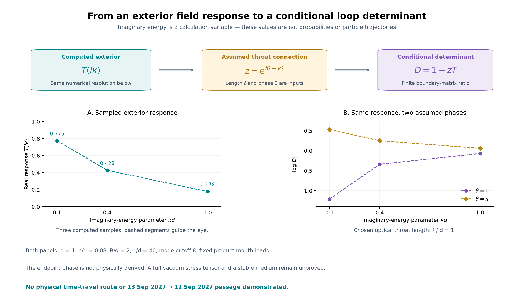

**Next:** replace the nonzero product-lead completion with curved radial
mode matching and determine the physical endpoint map before assigning a
quantum source. The geometry, its preparation and stability remain open.
13 September 2027 -> 12 September 2027 remains unproved; no new physical
law or time-travel material has been established.

## Magnetic exterior continuation — increment91

**Result:** the magnetic tail with corrected boundary coordinates reduces
the two measured complex transmission sensitivities to the matching radius
by factors 196.69 and 331.12. These compare the complete treatment with
increment90, not an isolated tail-only change. This is a numerical improvement in the prescribed q=1 supporting-field
problem. It is not a new physical law, a supporting material, or backward
passage. The destination remains uncertain: even the motivating
[Maldacena–Milekhin–Popov construction](https://arxiv.org/html/1807.04726v3)
is explicitly causal. Its possible formation is a separate open question.

### Actual pair field beyond the mesh

[scripts/magnetic_tail_map.py](../scripts/magnetic_tail_map.py) continues the same magnetic
potential used inside the mesh from matching sphere R to a far endpoint L.
For the radius-one characteristic functions Phi from the frozen
[spherical lead helper](../scripts/spherical_weyl_leads.py), expand
u=(Phi_plus a+Phi_minus b)/r. With c=cos(theta), define
\[
 J(r)=\int_{-1}^{1}\Phi_+^\dagger\sigma_y\Phi_-\,
       \frac{A_\phi(r,c)}{\sqrt{1-c^2}}\,dc,
 \qquad C(r)=\frac{\operatorname{diag}(n)+iJ(r)}r.
\]
There is no extra azimuthal factor: Phi already includes sqrt(2 pi).
The projected radial equations are
\[
 a'=iEa+Cb,\qquad b'=C^\dagger a-iEb,\qquad
 Z'=C^\dagger-2iEZ-ZCZ,\quad b=Za.
\]
C is generally nonsymmetric, so its adjoint cannot be replaced by C.
The boundary value Z(L) is the diagonal free outgoing map. The full pair
field is therefore retained only on [R,L]; its remainder beyond L is still
an approximation. L, angular cutoff, quadrature and ODE tolerance have
separate checks in [the saved tail results](../results/magnetic_tail_map_results.json).
The free outgoing phase convention follows the independently checked
radial equations in [Holder et al., Appendix A](https://arxiv.org/pdf/1704.05481).
The coupled magnetic continuation and numerical comparisons here are our
calculations, not a published time-machine result.

### Coordinate conversion and current

[scripts/exterior_tail_transport.py](../scripts/exterior_tail_transport.py) reuses the frozen
DG solver through its finite-rank feedback API. Its incoming and outgoing
facet bases were separately orthonormalized. If their raw projected Grams
are M_s=L_s L_s^dagger, the required matrix is
\[
 Z_{\rm facet}=L_-^\dagger Z(L_+^\dagger)^{-1}.
\]
SVD of this full matrix supplies the existing feedback triple. Applying
Z directly would silently identify different coordinates. No singular
values are clipped. For the spherical coefficient a, separately record
\[
 J_{\rm sphere}=a^\dagger(I-Z^\dagger Z)a,\qquad
 \Delta J_{\rm geometry}=a^\dagger[(M_+-I)-Z^\dagger(M_--I)Z]a.
\]
Their sum equals the facet current used by the discrete ledger. Small
negative eigenvalues of the polygon flux matrix are reported as geometry
defects, not physical gain. This same-sign projection still neglects cross
characteristic projections and the radial displacement of chord quadrature
points. Mesh refinement remains necessary; this is not an exact polygon
transparent boundary.

### Matched comparisons

At E=.4, d=1, b=.2, q=1, mu=.5, h=.05 and nmax=12:

| Matching R | Previous free exterior: lower-mode flux | Magnetic tail to L=160 |
| --- | --- | --- |
| 2 | .6486841827 | .5932535412 |
| 4 | .5898777422 | .5935444054 |
| 8 | .5948085958 | .5935071651 |

The successive complex-amplitude differences fall from .0376811 and
.0128340 to .000191574 and .0000387599. These are matched-resolution
comparisons, not total error estimates. The residual matching-radius
dependence is now smaller than the measured h=.05 to .035 changes:
.00115523 at R=2 and .00105738 at R=4. At R=2, L=40 to 80 to 160 changes
the amplitude by .0000856579 then .0000248774; nmax=8 to 12 changes it by
2.53e-7. No rigorous infinite-domain convergence bound is claimed.

At R=4,h=.035,nmax=12,L=160 the representative amplitude is
.4607562385+.6187295928i. Its input-current ledger is:

| Contribution | Fraction of unit input |
| --- | --- |
| Lower-mouth zero mode | .5951226204 |
| Retained spherical tail current | .4032040727 |
| Signed tail polygon correction | -.0000716444 |
| Omitted outgoing mode norm, all cuts | .0005859611 |
| Numerical DG loss | .0011589902 |

Nonzero mouth lead modes are evanescent here and carry zero net current
to roundoff. Numerical loss and omitted mode norm are not physical escape.
The saved full modal coefficients and current ledger permit independent
recalculation; the frozen free-map case is also reproduced by the new SVD
integration path.

Validation: 15 isolated tail controls and 9 connected controls pass under
warnings-as-errors. Independent linear radial propagation agrees with the
Riccati map to 2.49e-14, and its conserved flux matrix to 3.23e-14. Direct
angular differentiation agrees to 1.69e-11; the exact lowest entry
C11=1/r-qd/(3r^2) agrees to 3.33e-16. The observed L=256 to 512 map change
is 5.93e-6. Low-channel blocks converge much faster than the highest retained
channels, so whole-operator convergence is not asserted. The final connected
run took 27.44 seconds. A focused independent integration review found no
coordinate, SVD or ledger defect.

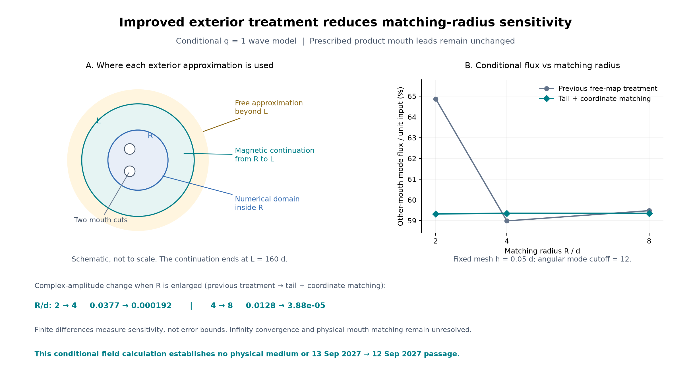

**Direction:** this removes a concrete exterior truncation problem, so the
supporting-field calculation merits continuation. The next substantive
gate is the actual curved-throat matching and the complex-frequency
response needed for quantum stress, rather than more polishing of a
real-energy probability. The large-q candidate, self-consistent geometry,
preparation, stability, and material transport remain unproved. Traveling
from 13 September 2027 to 12 September 2027 remains unproved.

## Connected two-mouth Weyl calculation — increment90

This increment connects two finite mouth cuts through a two-dimensional
magnetic exterior. The test is q=1, mu=1/2, separation d=1, mouth radius
b=.2, and positive energy E=.4 in units hbar=c=d=1. It tests transport of
the proposed supporting field; it is not a material tracer or a human
traversal simulation. It is also distinct from the saved q=100000 geometry.

The finite-mouth completion is explicit: isolated-monopole angular modes
attached to constant-radius cylindrical leads. The exterior contains the
full point-pair potential up to the outer matching surface, with a free
outgoing continuation beyond it. The mouth completion and the outer
magnetic-tail truncation are assumptions to test, not a derived physical
throat or a globally self-consistent Maxwell/Einstein solution.

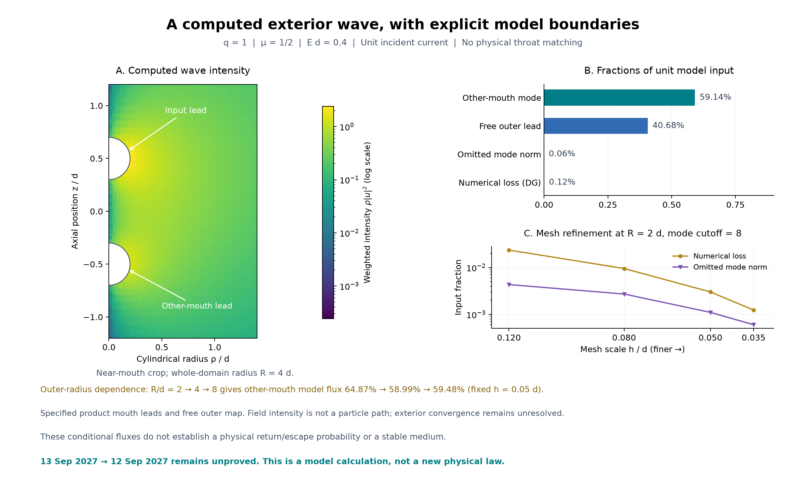

### Weighted equation and numerical current accounting

The original reduced spinor f has measure drho dz. Using u=f/sqrt(rho)
gives measure rho drho dz and removes fractional axis powers from the
q=1 basis. Multiplying the stationary Weyl equation by i gives
\[
 \sigma_x\partial_\rho u+\sigma_z\partial_z u+
 \frac{\sigma_x/2+i\sigma_y(\mu-A_\phi)}{\rho}u-iEu=0,
\qquad
 A_\phi=\frac q2\left(\frac{z+d/2}{r_l}-\frac{z-d/2}{r_u}\right).
\]
The sigma_x/2 term is essential: it cancels the derivative of the rho
weight in integration by parts. Zero weight at the axis alone is not an
operator-domain condition. The forbidden component is constrained there:
for q=1, mu=1/2, u_minus vanishes on the outer axis segments and u_plus
vanishes between the mouths. These select the regular leading axis powers.

[scripts/two_mouth_mesh.py](../scripts/two_mouth_mesh.py) triangulates the half-disk with both
mouth half-disks removed. Its circular cuts are polygonal approximations;
geometry error is reported and reduced with h. The outward computational
normal points into each excised mouth. On a face set
Gamma=n_rho sigma_x+n_z sigma_z and P_plus/minus=(I+/-Gamma)/2.
The piecewise-linear discontinuous Galerkin equation uses the strong face
correction P_minus(u_left-u_right), or P_minus(u-g) at a boundary.

For real E and real magnetic potential, the discrete identity is
\[
 \|g\|_\partial^2=
 \|P_+u\|_\partial^2+
 \sum_{\rm internal\ faces}\|[u]\|_f^2+
 \|P_-u-g\|_\partial^2.
\]
Every face norm includes rho ds. The final two terms are numerical jump
loss and weak boundary mismatch. They must be displayed separately and
converge away; they are not physical absorption. Boundary feedback changes
g, so the ledger must use the total incident trace after feedback, not
only the injected source.

### Outgoing outer waves and declared mouth leads

With spinor harmonics satisfying sigma_r Omega_(+/-n)=-Omega_(-/+n), the
positive-energy outgoing free wave is proportional to
\[
 h_{n-1}^{(1)}(Er)\Omega_{-n}-i h_n^{(1)}(Er)\Omega_{+n}.
\]
This phase follows the first-order radial equations in
[Holder, Huang and Ostrovsky, Appendix A](https://arxiv.org/pdf/1704.05481)
and is checked independently by Cartesian differentiation. Let a_plus and
a_minus be coefficients of normalized radial characteristic harmonics.
At r=R the exact free map is
\[
 a_- =\gamma_n(ER)a_+,\qquad
 \gamma_n=\frac{h_{n-1}^{(1)}-i h_n^{(1)}}{h_{n-1}^{(1)}+i h_n^{(1)}}.
\]
In particular gamma_1=-1/(1-2iER): setting a_minus=0 would not be
transparent even for a free outgoing spherical wave. A stable inverse
Hankel-ratio recurrence avoids huge intermediate functions.

At a mouth the lead coordinate x increases into the excision, so
Gamma=-sigma_r and H_lead=-i Gamma partial_x+Kc. The nonzero q=1 angular
pairs have Kc=m_n sigma_x, m_n=sqrt(n(n+1))/b, n>=1; the underlying
monopole spectrum is given by
[Borokhov, Kapustin and Wu, section 4](https://arxiv.org/pdf/hep-th/0206054).
For a lead with no incoming wave, its characteristic coefficients obey
\[
 a_- =\beta_n(E)a_+,\qquad
 \beta_n=\frac{m_n}{E+p_n},\quad
 p_n=\sqrt{(E+i0)^2-m_n^2},\quad \operatorname{Im}p_n\ge0.
\]
Below threshold this describes a decaying, zero-flux evanescent field.
There is one unpaired zero mode: incoming at the upper mouth, outgoing at
the lower mouth in this Weyl sector. No second opposite zero-mode chirality
is inserted. With E=.4 all nonzero mouth modes are evanescent.

[scripts/spherical_weyl_leads.py](../scripts/spherical_weyl_leads.py) implements both maps,
their angular bases, unit-flux conventions, and independent differential
and normalization checks. Its lower zero-mode phase is
e_minus=(-sin(theta/2),cos(theta/2)); it differs by an overall minus from
the earlier isolated incoming-mode helper. That reference phase must be
carried into any later throat loop, rather than interpreting it as physics.

The solver projects these bases on polygonal face characteristics and
orthonormalizes them, retaining diagonal gamma/beta in that discrete basis.
This preserves contraction and the flux ledger, but mixes angular labels
on a finite mesh. It is an additional geometry approximation tested with
mesh refinement and a known free outgoing solution. It is not exact
spherical matching on each coarse chord. Power outside the retained
angular basis must also be reported as an unresolved modal remainder.

### Controls and interpretation

The independent free controls include a regular cylindrical Bessel wave
and an outgoing Green spinor sourced inside an excised mouth:
\[
 \Psi=(E-i\boldsymbol\sigma\cdot\nabla)
 \frac{e^{iE|\mathbf r-\mathbf r_0|}}{4\pi|\mathbf r-\mathbf r_0|}
 \begin{pmatrix}1\\0\end{pmatrix}.
\]
The latter has total outward flux E^2/(2pi). Its analytic incoming traces
are applied on both mouth cuts solely as a solver control; it is not the
physical single-mouth injection experiment. These controls test complex
wave propagation, not just an algebraic conservation identity.

The connected calculation in [scripts/exterior_boundary_map.py](../scripts/exterior_boundary_map.py)
passes **14 controls** with warnings treated as errors; the recorded run
took 29.89 seconds. Arbitrary-field integration by parts agrees to relative
4.99e-16, independently of the linear solve. The Bessel relative L2 errors
fall from .002154 to .000425; the outgoing Green errors fall from .05197
to .006358 over four meshes. Passing controls does not certify the omitted
exterior or every channel error.

For the representative R=4, h=.035, 12-mode calculation,
\[
 T=0.4512802403+0.6227268563i.
\]
Its unit-input ledger is:

| Contribution | Flux or remainder |
| --- | ---: |
| Lower-mouth zero mode, abs(T)^2 | .5914425928 |
| Retained outgoing free-exterior modes | .4068161443 |
| Unrepresented outgoing boundary modes | .0005861462 |
| DG jumps and weak incoming mismatch | .0011551166 |

The unrounded entries sum to one within 8.9e-16. The nonzero mouth modes
carry no net flux to roundoff because all are evanescent at this energy.
The last two rows are numerical/reconstruction remainders; they are not
additional physical reservoirs.

At fixed R=2, decreasing h=.12,.08,.05,.035 reduces numerical loss from
.0236155 to .0012350. Increasing the angular cutoff from 8 to 12 at h=.05
changes complex T by 2.63e-7. However, at **fixed h=.05 and cutoff 12**:

| Magnetic-field cutoff radius R | Lower-mode flux |
| ---: | ---: |
| 2 | .64868418 |
| 4 | .58987774 |
| 8 | .59480860 |

The complex-amplitude changes are .03768 and .01283, compared with .001052
for the available R=4 mesh refinement. This nonmonotonic radius dependence
is material: **infinite-exterior convergence is unresolved**. The saved
JSON sets `outer_radius_convergence_certified` to false. Three energies
E=.1,.4,1 at R=4,h=.05 also give different amplitudes and phases; they are
samples, not a complete spectrum for a vacuum calculation.

Reproduce the focused calculation without rerunning the older suites:

```powershell
.\.venv\Scripts\python.exe -B -W error -X utf8 scripts/two_mouth_mesh.py
.\.venv\Scripts\python.exe -B -W error -X utf8 scripts/spherical_weyl_leads.py
.\.venv\Scripts\python.exe -B -W error -X utf8 scripts/exterior_boundary_map.py
.\.venv\Scripts\python.exe -B -W error -X utf8 -c "from quantum_horizon_plot import exterior_boundary_progress; exterior_boundary_progress()"
```

The connected script writes its [results](../results/exterior_boundary_map_results.json),
including source hashes, all controls, raw complex boundary traces and one
representative spatial field. Source/input hashes identify the model used.

The remaining requirements are convergence of the connected transmission
amplitude under spatial, angular and outer-radius refinement; extension
to the target charge and actual curved mouth physics; and a complete
state/spectrum before computing quantum stress. A successful conditional
scattering calculation alone does not create or stabilize a passage.
**13 September 2027 to 12 September 2027 remains unproved.**

The next tail calculation can avoid a very large two-dimensional mesh.
For r>d/2 expand the rescaled field in the free characteristic harmonics
Phi_plus/minus=sqrt(2pi) eta_plus/minus. Project the *full* pair potential:
\[
 C(r)=\frac{\operatorname{diag}(n)}r+\frac{iJ(r)}r,\qquad
 J_{nm}=\int_{-1}^1\Phi_{+,n}^\dagger\sigma_y\Phi_{-,m}
                  \frac{A_\phi(r,c)}{\sqrt{1-c^2}}\,dc.
\]
Then a'=iEa+Cb, b'=C^dagger a-iEb, so the outward boundary relation b=Za
obeys
\[
 Z'=C^\dagger-2iEZ-ZCZ.
\]
Starting from the free outgoing map at a larger radius L and integrating
inward would retain magnetic propagation outside the DG matching sphere.
The finite-mode generator preserves diag(I,-I); for real positive energy,
I-Z^dagger Z remains positive for an exact propagated outgoing subspace.
This gives a useful check against numerical failure without clipping singular
values. These equations have been independently checked algebraically;
numerical implementation and refinement in L, angular modes and integration
tolerance are the next unfinished work. A general matrix Z can reuse the
existing solver through its singular-value decomposition.
For mu=1/2 an exact normalization check is
C_11=1/r-qd/(3r^2), valid for r>d/2. C is generally nonsymmetric: keep its
Hermitian transpose in both equations rather than replacing it by C.

## Exact angular matching and a local correction bound — increment89

The second magnetic focus can be included exactly in the angular modes on
a sphere around the first focus. The remaining radial residual is about
158 times smaller at the saved matching sphere than the isolated-monopole
residual. A first radial correction has an explicit analytic residual bound.
These are local improvements to a specified flat-background wave model,
not a transmission probability, a stable throat, or a new physical law.

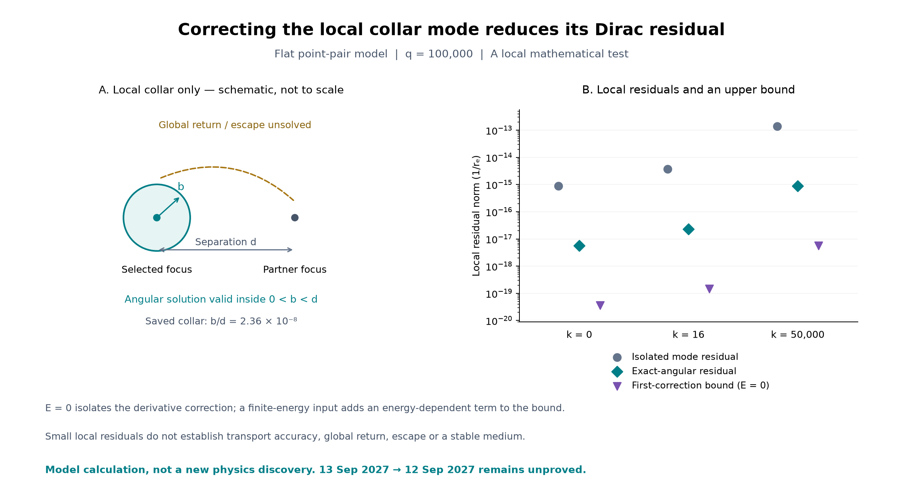

### Exact angular solution in the point-pair field

Use the existing convention H=sigma·(-i grad-A), q>0 an integer, and spheres
of radius 0<b<d around the upper focus. Write epsilon=b/d, c=cos(theta),
tau=(1-c)/2, and D=sqrt(1+2 epsilon c+epsilon^2). The azimuthal one-form
component is
\[
 A_\phi=\frac q2\left(\frac{1+\epsilon c}{D}-c\right).
\]
For mu=k+1/2, k=0,...,q-1, the isolated angular probability in tau is
P0=Beta(k+1,q-k). Let h be the angular spin component with norm
integral h^2 dtheta=1. Its exact correction is
\[
 h_b=\frac{h_0e^F}{\sqrt{\langle e^{2F}\rangle_0}},\qquad
 F=\frac q2\log\!\left[1+
 \frac{4\epsilon^2\tau}{(1+\epsilon+D)(D+1-\epsilon)(1+\epsilon)}\right].
\]
This north-pole-relative form avoids subtracting nearly equal numbers.
It solves h_theta/h=(mu-A_phi)/sin(theta). The correction is regular at
both poles for b<d and preserves the q zero modes and their patchwise powers.
There is no continuation of this q-mode basis asserted through b=d, where
the partner focus changes the enclosed flux.

The standard monopole angular/radial decomposition is described in
[Maldacena, Milekhin and Popov, Appendix C](https://arxiv.org/html/1807.04726v3).
The point-pair factor above and the bounds below are our derivations for
that fixed exterior field; they do not solve its curved finite-mouth match.

Normalization matters when differentiating the basis:
\[
 g=\partial_b F=\frac{2q\epsilon\tau}{dD(1+\epsilon)(1+\epsilon+D)},\qquad
 \partial_b h_b=(g-\langle g\rangle_b)h_b,\qquad
 \sigma=\|\partial_b h_b\|=\sqrt{\operatorname{Var}_b(g)}.
\]
The derivative is orthogonal to every zero mode: normalization removes its
same-k component, and the azimuthal phases remove the others. This does
not remove coupling to the nonzero angular modes.

Define v=(k+1)(q-k)/[(q+1)^2(q+2)], M=(1-epsilon^2)^(-q), and
sigma0=(qb/d^2)sqrt(v). Since g_tau=qb/(d^2 D^3),
\[
 \frac{\sigma_0}{(1+\epsilon)^3\sqrt M}
 \le\sigma\le\frac{\sigma_0\sqrt M}{(1-\epsilon)^3}.
\]
This uses the variance pair identity for P0 and the bounded density ratio
1/M <= Pb/P0 <= M. The exact-angular state's full Weyl residual has this
surface norm; an exact angular solution is not an exact radial solution.

### Correcting the remaining radial term

In the radial spin frame with the radial Jacobian removed,
\[
 \bar H=-i\sigma_z\partial_b+K_b,\quad
 K_b=\frac1b\begin{pmatrix}0&-i(\partial_\theta+V)\\
 -i(\partial_\theta-V)&0\end{pmatrix},\quad
 V=\frac{\mu-A_\phi}{\sin\theta},\quad \chi=(h_b,0).
\]
The smooth monopole-bundle domain makes K self-adjoint. Its isolated
complement gap is Delta0=sqrt(q+1)/b, from the known sphere spectrum
[Borokhov, Kapustin and Wu, section 4](https://arxiv.org/pdf/hep-th/0206054).
Here q is their integer flux n, not their appendix half-flux symbol.
The partner perturbation obeys delta=qb/[4(d-b)^2]. With delta<Delta0/2
and the preserved exact kernel, the complement gap is at least
Delta=Delta0-delta>0.

The first correction has the opposite radial spin:
\[
 \eta=iK_\perp^{-1}\chi'=(0,t),\qquad
 J(\theta)=\int_0^\theta h_b^2(g-\langle g\rangle_b)\,ds,\qquad
 t=-\frac{bJ}{h_b}.
\]
Normalization gives J(pi)=0 and regularity at both poles. Direct substitution
gives the exact residual identity for this approximate state:
\[
 (\bar H-E)e^{iEb}(\chi+\eta)=e^{iEb}(0,it_b-2Et).
\]
Its signed radial flux is 1-||eta||^2, while its positive norm squared is
1+||eta||^2. Flux normalization at each radius introduces an additional
radial derivative; the bound retains it.

The following explicit quantities bound the norms without approximating
the point-pair field:
\[
 \sigma_B=\frac{qb\sqrt{vM}}{d^2(1-\epsilon)^3},\quad
 \rho_B=\frac{q(1+\epsilon+2\epsilon^2)\sqrt{vM}}{d^2(1-\epsilon)^5},\quad
 G=\frac{qb}{d^2(1-\epsilon^2)},\quad
 C=\frac{q}{2d^2(1-\epsilon)^3},
\]
\[
 \eta_B=\frac{\sigma_B}{\Delta},\qquad
 \eta'_B=\frac{\rho_B+G\sigma_B+\sigma_B/b+C\eta_B}{\Delta}.
\]
For eta_B<1 the unit-flux residual norm is bounded by
\[
 B(E)=\frac{\eta'_B+2|E|\eta_B+
 \eta_B\eta'_B\sqrt{1+\eta_B^2}/(1-\eta_B^2)}
 {\sqrt{1-\eta_B^2}}.
\]
To check the derivative estimate, put a=g-mean(g). Then
chi''=[g_b-mean(g_b)+a^2-2 sigma^2]chi,
||a^2-2 sigma^2||^2=mean(a^4)<=G^2 sigma^2, and
K'=-K/b+C_multiplier with ||C_multiplier||<=C. Differentiating
K eta=i chi' gives the displayed eta'_B. This uses the angular Hilbert
norm; radial current is indefinite, so it supplies no automatic unitary
radial propagation or global scattering-error bound.

### Saved matching sphere and verification

For q=100000, b=98.99996752543319 re, and d=4188251800.784477 re:

| k | Isolated residual | Exact-angular residual | Corrected unit-flux bound B(0) |
| ---: | ---: | ---: | ---: |
| 0 | 8.92345e-16 | 5.64366e-18 | 3.56935e-20 |
| 16 | 3.67894e-15 | 2.32675e-17 | 1.47156e-19 |
| 50000 | 1.41094e-13 | 8.92350e-16 | 5.64369e-18 |

All entries have units inverse re. The first two columns are computed
norms; the last is an analytic upper bound evaluated at E=0. Positive-energy
injection must retain B(E), including its 2|E| eta_B term. The original
residual was already small relative to the local angular gap: these ratios
do not measure progress toward a physical machine.

[scripts/dipole_collar_modes.py](../scripts/dipole_collar_modes.py) checks the full cylindrical
Weyl operator against independently differentiated normalization integrals,
axis behavior, quadrature refinement, and the analytic variance enclosure.
[scripts/collar_dressing_bound.py](../scripts/collar_dressing_bound.py) evaluates the bound
and checks an independent q=1 closed-CDF corrector against direct derivatives
and quadrature. Source/input hashes and quantitative errors accompany both
saved result files. Analytic formulas are exact under the stated assumptions;
their printed decimal endpoints are not interval-arithmetic certificates.
The two components passed 12 and 11 controls respectively with warnings
treated as errors. The independent q=1 test at b/d=.2 and E=.4 gives a
unit-flux residual .08322639913 below the bound .26995695630; its 24/48-point
quadratures agree to relative 6.79e-33. The Cartesian-frame reduced Dirac
identity discrepancy is 1.18e-65 at the three checked interior angles.

```powershell
.\.venv\Scripts\python.exe -B -W error -X utf8 scripts/dipole_collar_modes.py
.\.venv\Scripts\python.exe -B -W error -X utf8 scripts/collar_dressing_bound.py
.\.venv\Scripts\python.exe -B -W error -X utf8 -c "from quantum_horizon_plot import dipole_collar_progress; dipole_collar_progress()"
```

### Next: the connected exterior, not further local refinement

The next calculation must connect both finite mouth surfaces to infinity,
retain nonzero angular modes, and determine a complex return map with a
conserved flux budget. Start with a finite-q, fixed-mu stationary 2D Weyl
problem, explicit axis/gauge regularity, and converged outer matching.
The massive radial Dirac R-matrix method of
[Baye](https://doi.org/10.1103/PhysRevA.92.042112) provides a boundary-matching
methodology, but adapting it to this massless, two-mouth domain is new work
here. Its published radial examples are not a solution of our geometry.

The separated two-centre MICZ model adds a squared monopole scalar potential,
as explicit in [Nersessian and Ohanyan, equations 8–12](https://arxiv.org/pdf/0705.0727).
That term is absent from our H^2=Pi^2-sigma·B. Its separability cannot simply
be imported; this observation is not a theorem excluding every possible
spinor separation. A two-dimensional bridge also avoids extending the
local q-mode basis past its domain.

After the return map, the missing chain is quantum state and renormalized
stress, then self-consistent geometry and stability. A local residual bound
does not identify obtainable matter or prepare a wormhole. Passage from
**13 September 2027 to 12 September 2027 remains unproved**.

## Connect incoming modes, open boundaries and quantum stress — increment88

Three executable components now specify the missing transport-to-source
calculation. They do **not** yet solve the physical two-mouth exterior.
The incident reference state is in [docs/INCOMING_MODES.md](../docs/INCOMING_MODES.md),
the outgoing/flux contract in [docs/OPEN_BOUNDARY_SCATTERING.md](../docs/OPEN_BOUNDARY_SCATTERING.md),
and a specified unitary loop/reservoir closure in
[scripts/scattering_vacuum.py](../scripts/scattering_vacuum.py). This is progress within known
quantum field theory; no physical medium or new law is established.

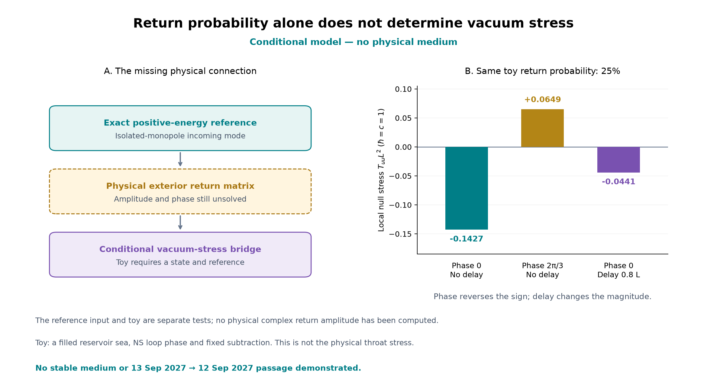

### Incoming state and the actual saved matching sphere

The isolated monopole reference has strictly positive Killing energy,
unit signed radial flux, and a pulse with unit time-integrated injection.
Its spectrum is `a(E)=2a^(3/2) E exp(-aE)` for E>0; truncating its algebraic
time tails changes that spectrum. This supplies a different preparation
from the mixed-energy local increment87 benchmark. It does not turn that
previous benchmark into a scattering experiment.

The lower-mouth north-patch index is `k_local=q-1-k_global`, with
`A_global=A_N+q` and `mu_global=mu_N+q`. Exterior-domain normals point into
both excised mouths: the upper zero mode enters the exterior and the lower
zero mode leaves it. Phases and energies use a common infinity clock.

We evaluated a missing magnetic term at the finest saved increment84 collar:
q=100000, areal R=100, isotropic b=98.99996752543319, and separation
d=4188251800.784477, in re units. The flat point-pair potential produces
the isolated upper mode's residual `sigma_y deltaW f`, where

\[
 \delta W=\frac{q\rho}{2r_{other}(r_{other}+Z)},\qquad
 \sup_\theta|\delta W|\le\frac{qb}{4(d-b)^2}
 =1.4109431438961075\times10^{-13}\,r_e^{-1}.
\]

This is an angular-uniform bound **at this sphere**, not an exterior-volume
or scattering-error bound. Exact Beta-moment enclosures and independently
checked quadrature give RMS residuals 8.92345e-16, 3.67894e-15 and
1.41094e-13 for k=0,16,50000. They are tiny relative to the local angular
gap, but the middle example is 2.97 times the smallest *sampled* loop energy.
Those energies are comparison scales, not assigned spherical k energies or
a continuum lower bound. The residual has zero first-order diagonal
expectation in the reference spinor; its norm is not an energy shift.

An optional spherical tetrad embedding multiplies this magnetic term by
`N_infinity b/R=.9800993638511766`; it does not solve nonspherical Maxwell
or metric matching. Eight reference-mode and six actual-collar checks pass.
An initially missed polar quadrature tail was resolved without changing
tolerances. Full derivation, input provenance and bounds are in the report.

### Outgoing waves must preserve phase and transverse structure

The boundary calibration passes 13 checks, including the exact evanescent
branch and threshold flux-normalization rejection. A local characteristic
exit can spuriously reflect 2/3 of a wave with normal velocity .2. The
calibrated absorber performs well for one angle but reflects .02433 at a
grazing test angle; numerical absorption is not physical escape.

For a product lead with varying tangential W, the outgoing map contains
`Q[E+sqrt(E^2-Q†Q)]^-1`, where `Q=-i partial_s+iW(s)` has a specified domain.
A pointwise frozen W can erase zero modes. The actual exterior still needs
its curved matching, continuum and outgoing solution. The flux contract
states what to measure without double-counting detector flux and absorption.

### A phase-sensitive vacuum closure

For the eventual complex, flux-normalized exterior return matrix and throat
propagator, the interface is
\[
 D(E)=\det[I-P_{throat}(E)R_{exterior}(E)].
\]
The unitary-transition/secular-determinant structure is established for
Dirac quantum graphs in [Harrison, Weyand and Kirsten, Eqs.18–21](https://arxiv.org/pdf/1606.07834).
Reference-relative scattering phase supplies a spectral-density shift;
background and interaction terms must be separated, as in
[Wirzba, Eqs.8–13](https://arxiv.org/pdf/0711.2395).
These references provide the method, not our physical exterior solution.

Our benchmark specifies a unitary loop/reservoir vertex with return
`r(E)=r exp(i beta+iE tau)`, r in [0,1], causal delay tau>=0, and NS
propagation around a physical loop of optical length L. It fills negative
reservoir energies at zero chemical potential and subtracts the same
one-pass system with r=0. A Dirac channel has two complex chiral copies
with conjugate phases. In this defined toy,
\[
 D(E)=1+r e^{i\beta+iE(L+\tau)},\qquad
 \Delta\rho=-\frac1\pi\operatorname{Im}\partial_E\log D,
\]
\[
 E_{Dirac}=\frac{2\operatorname{Re}\operatorname{Li}_2(-r e^{i\beta})}{\pi(L+\tau)},
 \qquad T_{uu}=T_{vv}=\frac{\operatorname{Re}\operatorname{Li}_2(-r e^{i\beta})}{\pi(L+\tau)^2}.
\]
The closed NS energy -pi/(6L) is independently checked using Hurwitz zeta.
At r=1 the isolated loop levels must be retained; disconnected reservoir
scattering no longer detects them. When tau>0, the delay region carries part
of the energy: dividing total energy by L gives the wrong local loop stress.

For L=1 and **return probability .25 in every row**:

| Phase beta | Delay tau | Dirac interaction energy | Local Tuu=Tvv |
| ---: | ---: | ---: | ---: |
| 0 | 0 | -.2854693503 | -.1427346752 |
| 2pi/3 | 0 | +.1298647031 | +.0649323516 |
| 0 | .8 | -.1585940835 | -.0440539121 |

Thus probability cannot determine even the sign of the supporting state
term. These are specified subtracted toy values in hbar=c=1, not an observed
material or the actual candidate geometry's stress. Checks cover unitarity,
complex determinant phase, independent spectral differentiation, local-mode
density, winding sums, imaginary-frequency integrals, closed-circle
normalization, lower-half-plane poles and the conditional bounds below.

### Conditional bound and next physical calculation

Suppose `|R(i kappa)|<=1`, the subtracted vacuum integral is legitimate,
and the physical loop is an otherwise free massless lead. Then
`|1+exp(-kappa L)R|<=1+exp(-kappa L)` gives `E_Dirac>=-pi/(6L)`.
For q channels of the same L, an operator-norm contraction similarly gives
`E>=-q*pi/(6L)`. If changing L is a legitimate local length variation with
R held fixed, `Tuu=-(1/2) partial_L E`; the inequality
`Re[z/(1+z)]<=x/(1+x)` for `|z|<=x=exp(-kappa L)` yields
`Tuu>=-pi/(12L^2)`. Perfect coherent NS return saturates the bounds.
Real-energy unitarity alone does **not** prove the required imaginary-axis
contraction for our projected physical return matrix. These are conditional
consequences of the stated model, not a new universal energy theorem.

The next substantive dependency is the variable-field exterior return
operator with matched finite collars, continuum completion and controlled
phase. Its local renormalized stress can then enter the semiclassical
geometry and a dynamical stability test. The present components define and
constrain that calculation; they are not a completed physical coupling.
**13 September 2027 → 12 September 2027 remains unproved.**

## Resolve spin and transverse localization — increment87

We now have a spinful exterior propagation calculation, together with an
exact transverse benchmark. It exposes a limitation of assigning every
fermion to an infinitesimally thin closed field line: the lowest angular
channel has a marginal, non-normalizable planar zero mode, and the next
normalizable mode has infinite radial variance. These are properties of a
transverse slice, not three-dimensional escape probabilities. A short
two-dimensional packet calculation includes the missing longitudinal spin
coupling, but does not yet produce the physical exterior return matrix.

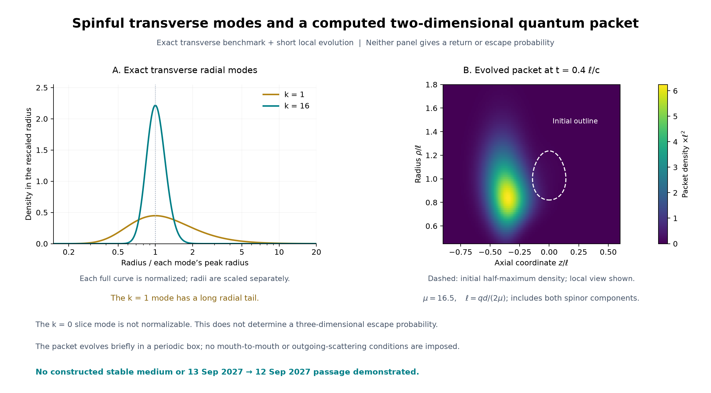

### Fix the spin, gauge and channel conventions

For one Weyl block of the massless Dirac field, take H=sigma·(-i grad-A).
With Aphi=(q/2)[(z+d/2)/r_lower-(z-d/2)/r_upper], use standard Cartesian
curl: B_rho=-partial_z Aphi/rho, B_z=partial_rho Aphi/rho. This is opposite
the printed magnetic-field sign in MMP Eq. 3.14; mixing conventions would
reverse the spin coupling. With
\[
 \Psi=\frac{e^{-i\sigma_z\phi/2}e^{i\mu\phi}}{\sqrt{2\pi\rho}}f_\mu,
 \qquad \mu\in\mathbb Z+\tfrac12,
\]
the measure is d_rho d_z and the exact reduced operator and its square are
\[
 H_\mu=-i\sigma_x\partial_\rho-i\sigma_z\partial_z+\sigma_y W,
 \quad W=(\mu-A_\phi)/\rho,
\]
\[
 H_\mu^2=-\partial_\rho^2-\partial_z^2+W^2
       +\sigma_z\partial_\rho W-\sigma_x\partial_z W.
\]
The executable verifies the square symbolically for arbitrary W. The
continuity equation is partial_t(f†f)+partial_rho(f†sigma_x f)+
partial_z(f†sigma_z f)=0. Physical currents divide these bilinears by
2pi*rho. Thus neither the spin term nor the cylindrical correction can
be dropped when converting the scalar barrier estimate into a solver.

The monopole zero modes give mu=k+1/2, k=0,...,q-1. Their local flux
t=nu/2 has the sphere distribution Beta(k+1,q-k): its mean is
2(k+1)/(q+1), its density per dnu peaks at 2k/(q-1) for q>1, while its
density per dtheta peaks at (2k+1)/q. A location called a "peak" therefore
needs a specified probability measure. This refines the localization
approximation in [MMP, Appendix C and Section 3.1](https://arxiv.org/html/1807.04726v3).
The q=1 flux density is uniform. The half-integer azimuthal label is not
the independently chosen spin structure around a complete magnetic loop.

A gauge change Aphi->Aphi+n requires mu->mu+n. At the midplane axis use
the regular representative Aphi_reg=Aphi-q; otherwise the singular dphi
coordinate can introduce a fictitious string flux. In a regular axis patch
with mu_local=mu-Aphi_axis, smooth Cartesian components require
f_+/-=O(rho^(|mu_local-/+1/2|+1/2)), with no logarithmic branch. These
axis conditions do not determine the physical radial mouth continuation.

### An exact transverse zero mode and its long tail

At z=0, Aphi=qd/[2sqrt(rho²+d²/4)]. The lower spin component of the
transverse operator satisfies (partial_rho+W)u=0, giving
\[
 u(\rho)=\rho^{-\mu}\exp[-q\,\operatorname{asinh}(d/(2\rho))].
\]
Its norm with measure d_rho is finite exactly when 1/2<mu<q+1/2.
For a=q-mu+1/2, b=2mu-1,
\[
 \mathcal N=\frac{d^{1-2\mu}}2[B(a,b)+B(a+1,b)],\qquad
 \langle\rho^p\rangle=d^p
 \frac{B(a+p/2,b-p)+B(a+1+p/2,b-p)}{B(a,b)+B(a+1,b)},
 \quad -2a<p<b.
\]
The k=0 norm diverges logarithmically at infinity. For k=1,
N=1/[d²(q²-1)] and the mean radius is qd(q²-1)/(q²-1/4), but its second
moment diverges. For normalizable modes the exact slice mean satisfies
<Aphi>=k, hence <nu>=2k/q; this is different from the sphere mean above.

The resulting planar count q-1 is a known Aharonov–Casher result, not a new
law. Here B_z=-qd/[2(rho²+d²/4)^(3/2)] is smooth, has definite sign, and
total flux -2pi*q. The strict integer-flux count for this class follows from
[Erdős and Vougalter, Theorem 3.1](https://arxiv.org/pdf/math-ph/0109015).
These zero modes lie at the threshold of essential spectrum [0,infinity),
not below a global transverse gap; see
[Bony, Espinoza and Raikov, Section 4.1.1](https://arxiv.org/pdf/1801.01346).
Consequently a planar count of 99,999 at q=100,000 cannot be interpreted as
exactly one escaping wormhole channel or an escape probability of 1/q.

At fixed mu and large q, rbar=rho/(qd) has inverse-gamma density
p(rbar)=rbar^(-2mu)*exp(-1/rbar)/Gamma(2mu-1). For k=1, the exact q=100,000
5%,50%,95% radial quantiles in qd units are 0.210799,0.595824,2.81404;
for k=16 they are 0.0239019,0.0315783,0.0429231. The first mode is much
broader than one classical contour. The finite-q CDF converges to its
large-q limit as q^-2 in the tested range. Independent half-line integration
checks the normalization, CDF and flux mean; no finite cutoff is used to
normalize the marginal mode.

### Propagate a specified packet with the spinful operator

The short bulk test uses the far-dipole field in length units qd/(2mu),
so its midplane peak radius is one and Aphi=mu*rho²/(rho²+z²)^(3/2).
For mu=16.5, initialize the lower component proportional to
rho^(-mu)*exp(-mu/rho)*exp[-z²/(4*0.12²)]. This is a specified local test
packet, not a prepared throat mode, energy eigenstate or measured object.
The full rho,z operator is evolved to t=0.4 with exact Fourier kinetic
steps and exact local Pauli-matrix rotations in a Strang split.
No positive-energy projection has been applied. An independent application
of the 256-grid Hamiltonian gives <H> approximately zero and <H²>=17.89160776;
the initial test spinor contains both energy signs. Physically valid incoming
energy and flux data are therefore an explicit next calculation.

The refined run has <rho>=0.93641736, <z>=-0.35843794 and <sigma_z>=-0.60852339.
Its spin components are referred to the fixed Cartesian basis: changing
their populations can reflect spin direction following the bent field,
and does not by itself diagnose Landau-level excitation or particle loss.
The field here is the base dipole; increment85's polarization correction
and the curved mouth geometry have not yet been coupled into this test.

The initial box had a left boundary too close to the evolving packet.
The edge-probability control failed at about 1e-5. Moving that boundary
from rho=0.15 to 0.03, and to 0.015 in the wider comparison, reduces the
largest sampled edge probability to 6.24e-9 without weakening the check.
The periodic box preserves total probability to 1.42e-13. Timestep halving
reduces the reported moment difference from 2.85354e-5 to 7.13485e-6;
spatial and widened-domain differences are 3.50e-10 and 1.68e-9 respectively.
These are convergence diagnostics, not certified errors or outgoing fluxes.

For an independent reference, translate the transverse profile as
u0(rho)(0,1)*F(z+t). Its continuum operator residual contains the omitted
off-plane coupling sigma_y[W(rho,z)-W(rho,0)]. The exact Duhamel residual
integral bounds exact evolution under the semidiscrete Hamiltonian. Its
numerically evaluated value is about 0.871219; the observed Strang packet
distance from the reference is about 0.595140. The numerical comparison
does not enclose splitting or quadrature errors, so it is not a rigorous
error bound on the split propagator. Probability conservation alone was
not treated as proof of a correct physical scattering solution.

The [executable](../scripts/spinful_return.py)
and [saved result](../results/spinful_return_results.json)
pass nine controls. The final warnings-as-errors process exited 0; no bulk
evolution job remains active. Independent matrix exponentials reproduce
the spin updates to 1.2e-16, and independent radial integration reproduces
normalization and CDF to 6.3e-16. The figure was regenerated from the final
data and visually inspected; all 154 earlier figures are unchanged.
Run `.\.venv\Scripts\python.exe -B -W error -X utf8 scripts/spinful_return.py`.
Source SHA256: `2030dfe67004bb2bc4e2d07bb6bc9f95bebcdb21f740955d895170951f629623`.
Result SHA256: `62ff1743af6430b586d164531ec5a02134494e3d749f379922fef28676d5fd83`.

### What is still needed for an exterior return amplitude

The next calculation must introduce correctly normalized incoming data
and outgoing boundary conditions, account for reflected, returned and
escaped flux, and verify the complex amplitude and phase under boundary
changes. Near-mouth/strong-field matching supplies data that a periodic
box cannot choose physically. The lowest channels cannot be justified
using a globally gapped transverse projection. A return probability by
itself would still be insufficient for the continuum vacuum stress.
The present slice and bulk benchmarks are building blocks for that task.
**No stable medium, new physical law or 13 September 2027 to 12 September
2027 passage is demonstrated.**

## Full-path validity and distant-field sensitivity — increment86

The local path correction now has a sharper domain check. We calculated
the complete Cartesian first and second magnetic derivatives along the
point-source paths, proved the first-derivative maximum formula, and found
an exact counterexample to checking second derivatives only at endpoints.
We also derived how a bounded uncertainty in the distant field affects an
interior path. These results strengthen the conditional model; they do not
complete its quantum source, finite entrances, stability or chronology.

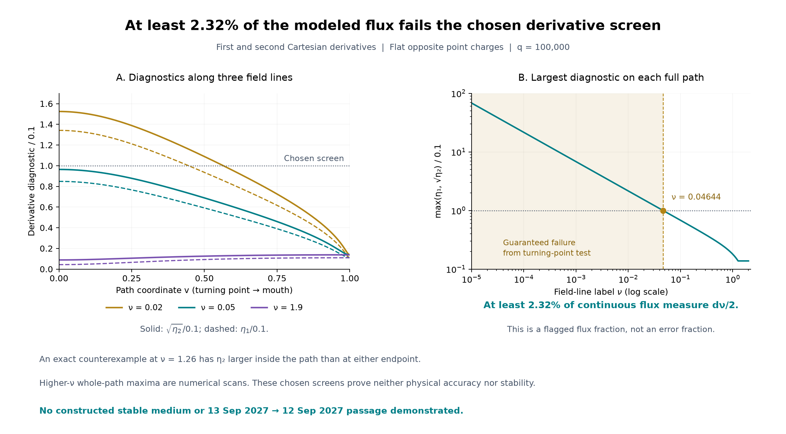

### Measure variation of the vector field

In the flat exterior and natural units, take two opposite magnetic charges
with Q=q/2 and field B=Q(r_plus/r_plus³-r_minus/r_minus³). Use the complete
Cartesian tensor norms, including changes of field direction:
\[
 \eta_1=\frac{\|\partial_i B_j\|_F}{|B|^{3/2}},\qquad
 \eta_2=\frac{\|\partial_i\partial_j B_k\|_F}{|B|^2}.
\]
For t=r_near/r_far and c equal to the cosine between the two radius
vectors, cancellation-free contractions are
\[
 b^2=(1-t^2)^2+2t^2(1-c),\quad
 j^2=6[(1-t^3)^2+3t^3(1-c^2)],
\]
\[
 k^2=90[(1-t^4)^2+t^4(1-c)(5c^2+5c+2)],\quad
 \eta_1^2=\frac{j^2}{Q(b^2)^{3/2}},\quad
 \eta_2=\frac{\sqrt{k^2}}{Qb^2}.
\]
These follow by contracting the derivatives of each monopole field;
the cross contractions contain the Legendre polynomials P1, P2 and P3.
They avoid subtracting nearly equal far fields. At a turning point,
\[
 \eta_{1,t}=\frac6{\sqrt{q\nu}}\sqrt{1-\nu^2/4},\qquad
 \eta_{2,t}=\frac{3\sqrt{5(48-30\nu^2+5\nu^4)}}{q\nu}.
\]
At either point mouth their limits are sqrt(12/q) and 6sqrt(10)/q.
The separation d cancels from both diagnostics. These flat point-mouth
limits are not a substitute for the actual curved collar calculation.

For eta1, its supremum is exactly max(eta1_turning,sqrt(12/q)). The executable
contains a rational polynomial certificate: after substituting
v²=u(2-nu*u)/(2u-nu), its derivative reduces to a degree-nine polynomial.
A monotone change u=(nu+2z)/(nu*(1+z)) puts z in (0,infinity). Exact positive
root isolation of its ten coefficient polynomials proves at most one
negative-to-positive derivative crossing, so no interior maximum exists.
All rational brackets and coefficient factorizations are saved in JSON.

The corresponding endpoint claim for eta2 is FALSE. An exact example is
\[
 \nu=63/50,\quad u=14/9,\quad v^2=28/833,\qquad
 q^2\eta_2^2=\frac{945276640861045}{2562028497522}.
\]
Here q*eta2=19.20823609 exceeds both its turning value 19.17691888 and its
mouth limit 18.97366596. An independent contraction of all Cartesian
second derivatives verifies this example. The initial endpoint-only
assertion failed and was replaced with this regression check and full-path
numerical extrema; it was not made to pass by increasing its tolerance.

### What the selected screen does and does not establish

For the common nominal variation scale h=0.1, use eta1<h and eta2<h².
This threshold is our diagnostic choice, not a theorem about quantum error.
At q=100000 the turning-point cuts are nu1=0.03598834355 and
nu2=0.04644447197. Thus **at least 2.3222% of the continuous flux measure
dnu/2 fails this chosen screen**. Numerical extrema on 349 curves, with
endpoint-clustered refinement, identify no further failing interval. That
scan does not prove an all-nu second-derivative envelope.

The existing 128-channel quadrature flags 2.2248% of its sampled weight;
this differs from the continuum fraction because of its finite nodes.
Their baseline state contribution is 1.50282e-4 and their formal increment85
shift contribution is 1.18746e-8. Neither is a bound on physical error or
the fraction of particles that escape. No channels were dropped or
reweighted, and no new state root was claimed.

The lowest positive antiperiodic fermion energy is pi/L, whereas the stored
state parameter uses 2pi/L. With clock factor A, the exterior energy is
E_infinity=pi/(A*Lnu). Its ratio E_infinity²/(2B_min) has maximum 2.3714e-4
among screened quadrature paths. This supports separation of that lowest
mode from the excited Landau levels in this flat model; it does not check
all vacuum frequencies or an arbitrary injected object. The published
guiding criterion and far-channel escape estimate are discussed in
[MMP, Section 3.1 and Appendix E](https://arxiv.org/html/1807.04726v3).

### Bound propagation of an assumed distant uncertainty

Let U=2/nu2=43.06217543. Within u<U, suppose the difference of two linear
flux solutions has no additional source, shares the regular point-mouth
data, and obeys |delta psi(U,v)|<=beta*psi0(U,v). A harmonic comparison gives
\[
 |\delta\psi(u,v)|\le
 \frac{2\beta U}{(U^2-1)^2}(u^2-1)(1-v^2).
\]
Using increment85's positive length kernel, its nu=1 first length variation
therefore obeys |delta f|/f <= 6.50625347e-5*beta. **If** beta=0.01, this is
0.650625 ppm. There is no additional epsilon factor for an arbitrary total
flux uncertainty. Comparing this coefficient to the 17.18 ppm shortening
gives beta<0.2640 as a sufficient sign condition in the linear model only.
We have not derived an allowed physical beta, nor bounded nonlinear terms.

For uncertain source harmonics supported beyond U, the exact radial Green
function separately gives
\[
 \delta f_l(u)=-\frac{g_l(u)}{l(l+1)}
 \int_U^\infty\frac{d_l(z)\delta s_l(z)}{z^2-1}\,dz,
 \quad g_l=(u^2-1)P_l',\quad d_l=-(u^2-1)Q_l'.
\]
Under the explicit norm |delta s1|<=A1/u, the dipole response uses
I1(U)=sum_{k>=1}2k/[(2k+1)² U^(2k+1)] = 2.78399372124523e-6,
asymptotic to 2/(9U³). Choosing A1=16pi/(3sqrt3), solely as an illustration
equal to the local action's asymptotic coefficient, bounds its nu=1 length
coefficient by 7.81330e-5. If the entire uncertain source is additionally
of order epsilon, that corresponds to 0.0005824 ppm. The local model's own
small tail does not justify either assumption about the unknown current.
The interior dipole homogeneous solution is a uniform incident magnetic
field; physical finite-mouth multipoles remain independent missing data.

### Verification and the next physical calculation

[scripts/magnetic_path_validity.py](../scripts/magnetic_path_validity.py)
passes eight controls, including exact polynomial certificates, Cartesian
derivative comparisons, charge scaling and refined path extrema. The last
warnings-as-errors run exited 0 in 4.49 seconds. Independent Green integration
and a positive series reproduce I1; solving actual perturbed flux contours
reproduces the length response 5.80241039296421 within 1.65e-11. The close
agreement of sampled maxima under refinement is not a continuum-error proof.
Run `.\.venv\Scripts\python.exe -B -W error -X utf8 scripts/magnetic_path_validity.py`.
Source SHA256: `d8918c03455bbbefcb28564a0271a5e34f69d9d4f8bee143658dd35478975b74`.
Result SHA256: `c95fa072f86172ce6619202005214b39ca4a0a48d58745bc4c08eb15dfd1075e`.
Increment84 and85 source/data are unchanged.
The new figure was rendered from that final result and visually inspected;
all 152 earlier image artifacts remain unchanged.

The next step has two distinct physical inputs. Escaping state channels
need a spinful Dirac return amplitude and phase with conserved flux,
rather than an assumed perfectly closed circle. A concrete starting
operator is H=sigma·(-i grad-A), H²=(-i grad-A)²-sigma·B, with correctly
quantized angular channels, throat-side mode matching and outgoing infinity
conditions. Even a return probability alone would not fix the Casimir stress.

Vacuum polarization in the distant weak-field, massless regime instead
contains a nonlocal F log(Box/mu²) F kernel, as derived in
[Donoghue and El-Menoufi, Eqs. 5 and 27–28](https://arxiv.org/pdf/1503.06099).
It cannot be substituted by a pointwise log B or simply added to the retained
strong-field and lowest-mode actions without matching their subtraction.
The general derivative terms also differ from the special fixed-direction
case in [Gusynin and Shovkovy](https://arxiv.org/abs/hep-th/9804143).
Next: formulate the correctly normalized spinful exterior return problem
and its matching data; keep the vacuum-current norm explicitly unresolved.
**No new physical law, stable medium, or 13 September 2027 to 12 September
2027 passage has been demonstrated.**

## Derive the exterior path correction — increment85

The first field-path correction is now calculated from the same local
magnetic action used in the throat. For the selected regular point-source
boundary conditions, an analytic sign argument shows that it bends the
flux contours inward and shortens their return lengths. A representative
path shortens by about 17.18 parts per million. The full formal average
increases the state parameter by about 6.737e-6. This replaces an arbitrary
path rescaling with a derived correction, within the stated approximation.

The local approximation is not uniformly valid on the longest loops.
Consequently the formal shifted state is not a completed physical exterior
solution. No new physical law, stable medium or past-time passage is proved.

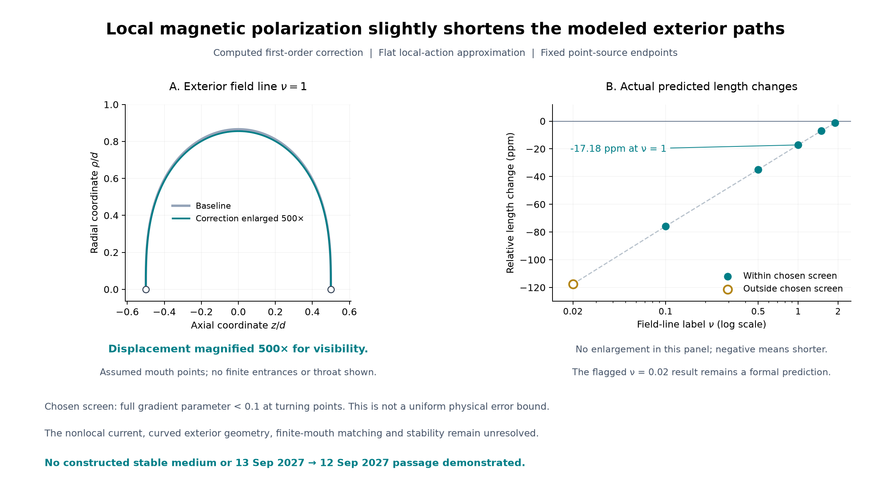

### Vary the magnetic action at fixed flux

For X=2B², the retained action and constitutive field are
\[
 \mathcal L=-\frac{X}{4g_*^2}+\frac{X\log(X/X_*)}{96\pi^2},\qquad
 \mathbf H=\frac1{g_*^2}[1-\epsilon(\log(X/X_*)+1)]\mathbf B,
 \quad\epsilon=\frac{g_*^2}{24\pi^2}=\frac1{60000}.
\]
This is the already declared local one-loop term, using the strong-field
framework reviewed by [Dunne, Section 5](https://arxiv.org/pdf/hep-th/0406216).
It does not contain the full derivative expansion or state-dependent
current. In a source-free, flat exterior, write B=B0+epsilon*B1. Then
div B1=0 and curl B1=grad(log B0²) cross B0. A constant logarithm shift
does not bend paths at this order when charge/flux data are held fixed.
In particular, the large -4*log(d/r_e) normalization drops out of the
dimensionless shape equation.

Use separation units with prolate coordinates
rho=(1/2)*sqrt[(u²-1)(1-v²)], z=u*v/2. The unperturbed flux is
psi0=2u(1-v²)/(u²-v²); its contours psi0=nu are the paths already used
in increment67. With B_rho=-psi_z/rho and B_z=psi_rho/rho,
psi=psi0+epsilon*psi1, define D=u²-v² and
C=u²(1+3v²)+v^4-v². The independently derived equation is
\[
 \mathscr L\psi_1=(u^2-1)\psi_{1,uu}+(1-v^2)\psi_{1,vv}
 =S(u,v)=\frac{12u(u^2-1)(1-v^2)(1+v^2)}{DC}>0.
\]
The constitutive-curl derivation reproduces its factor 12 independently.
The stream-function representation enforces div B1=0 identically.

We select zero flux correction on v=+/-1, on u=1, and at the two point
foci, with decay at infinity and no additional singular point multipoles.
These are specific mathematical boundary conditions, not derived data for
a physical finite throat. Fixed total flux alone would not exclude extra
point-supported dipoles or higher multipoles.

### Prove the sign and control the artificial outer boundary

Let b=psi0*log u. Direct differentiation gives
\[
 -\mathscr L b=
 \frac{2(u^2-1)(1-v^2)(3u^2+v^2)}{uD^2},\qquad
 0<S\le2(-\mathscr L b).
\]
For example, the difference 2*(-L b)-S has a positive prefactor times
v²*[6u^4+u²+9u²v²-v²+v^4], nonnegative for u>=1 and |v|<=1.
The maximum principle therefore bounds the regular decaying solution:
\[
 -2\psi_0\log u\le\psi_1\le0.
\]
Root independently verified the background, barrier and homogeneous-bound
identities symbolically. For a zero outer boundary at u=U, the difference
from the infinite-domain solution is bounded in the interior by
\[
 |\Delta\psi_1|\le
 \frac{4U\log U}{(U^2-1)^2}(u^2-1)(1-v^2).
\]
This follows from a harmonic comparison function and the boundary barrier.
It bounds this artificial boundary only, not numerical or physical errors.
The actual far solution has the resonant term
-16*pi*(1-v²)*log(u)/(9*sqrt(3)*u), plus a function of v divided by u.
Assuming faster multipole decay would miss it. The relative first-order
expansion requires 2*epsilon*log u<<1 and is not uniform to infinity.

Along an unperturbed contour u(v), its first displacement and length
variation are
\[
 \delta u=-\frac{\psi_1}{\psi_{0,u}}
 =\frac{\psi_1D^2}{2(1-v^2)(u^2+v^2)}\le0,\qquad
 \delta f=2\int_0^1 K(v)\delta u\,dv,
 \quad K=\frac{3u(1+v^2)D}{2C^{3/2}}>0.
\]
The boundary term vanishes for these fixed point mouths. This proves
delta f<=0 within this linear boundary-value problem. A finite mouth
retains an endpoint term and requires its actual embedding data.

### Solve the field and vary the loop state

The [executable](../scripts/magnetic_path_polarization.py)
expands psi1 in odd harmonics (1-v²)P'_l(v). Their radial equations are
(u²-1)f_l''-l(l+1)f_l=s_l(u), solved with tridiagonal differences on a
nonuniform log-u grid. Both the near-focus and outer grids are refined.
Angular projection increases from 192 to 288 points and 24 to 36 modes;
outer boxes U=20000 and 40000 have the explicit boundary bound above.

| Flux contour nu | Calculated fractional shortening, ppm |
|---:|---:|
| 0.02 | about 117.55 |
| 0.1 | about 75.86 |
| 0.5 | about 34.92 |
| 1.0 | about 17.18 |
| 1.5 | about 6.97 |
| 1.9 | about 1.22 |

These are first-order changes epsilon*delta f/f0, not measured paths.
The shortest axial path has zero first-order bending by symmetry. The
figure magnifies the nu=1 displacement by 500 for visibility; its right
panel gives the actual calculated ppm values.

Using increment84's saved full-flux quadrature and its independently
checked state-map derivative, propagate the first-order change without
pretending to solve a new complete geometry:
\[
 \delta L_\nu=\epsilon d\,\delta f_\nu/A,\qquad
 \delta w=\frac{-2\langle\Omega_\nu^2\delta L_\nu/L_\nu\rangle}{1-F'(w)}.
\]
The fixed-geometry change is 1.70921316e-5; applying the conditioning factor
0.39416058 gives delta w=6.73704448e-6 and a **formal linear estimate**
w=1.6194502634. This is not a new nonlinear root solve. Recomputing the
Shapiro integral on bent paths, finite-mouth data and the complete exterior
quantum current are not included.

The [saved result](../results/magnetic_path_polarization_results.json)
passes eight controls. Full grid/mode refinement changes delta w by
8.54e-11; changing the outer box changes it by 9.66e-16, against an
analytic outer-boundary contribution bound of 1.17e-15 for that formal
state shift. The direct arc variation, positive-kernel formula and
finite differences agree to better than 5.58e-8 relatively under the
recorded normalization. These checks do not certify total continuum error.

An independent Green-function calculation, using exact Legendre P'/Q'
radial solutions instead of differences or splines, gives
psi1(2,0) approximately -1.0727052167880844. It exposed an initially fixed
near-focus grid. After fixing that refinement, the saved fine value is
-1.0727002267812458; doubling both radial grids gives -1.0727039704132446.
Their errors decrease from 4.99001e-6 to 1.24637e-6, a factor 4.004,
consistent with second-order convergence. A tiny discrete residual was
not treated as evidence of equally tiny continuum error.

Run `.\.venv\Scripts\python.exe -B -W error -X utf8 scripts/magnetic_path_polarization.py`.
Source SHA256: `25f8848948ab099aeb13ea721c359ad15207a690fcb1094d490104839bc8352e`.
Result SHA256: `f6adb6e9fb95f79105642d17092db8f3bae9a95dca38d37c7e6329d3b131e678`.
The final warnings-as-errors run exits successfully; increment84 code and
data remain unchanged. The extra doubled-grid audit evaluates one field
point, not a repeated historical benchmark suite.
The figure was regenerated from the final data and visually inspected;
the 150 earlier image artifacts remain unchanged.

### The long-loop limitation changes what comes next

At a point-path turning plane,
\[
 B=\frac{q\nu^3}{2d^2},\qquad
 \epsilon\log(X/X_*)=\epsilon[6\log\nu-4\log(d/r_e)],\qquad
 \frac{\|\nabla B_i\|}{|B|^{3/2}}
 =\frac6{\sqrt{q\nu}}\sqrt{1-\nu^2/4}.
\]
The last expression includes direction changes; it is sqrt(2) times the
magnitude-gradient diagnostic at that plane. For q=100000, a chosen
turning-point screen below 0.1 requires approximately nu>0.036. This is
neither a uniform path check nor an error theorem; second derivatives
must also be considered. The logarithm is still small when this gradient
screen fails. The paper's treatment already notes limitations on following
far magnetic paths [MMP, Section 3.1 and Appendix E](https://arxiv.org/html/1807.04726v3).

On the stored 128-point quadrature, 1.878% of flux samples fail this screen.
Their contribution to the formal shift is only 7.60e-9, but their baseline
state contribution is 9.16e-5. Neither number bounds their actual error.
Moreover, uncertain distant currents can affect shorter paths through the
elliptic field equation. We retained the full flux measure and flagged
these contributions; discarding and renormalizing them would hide the issue.

Derivative terms exist in the published effective action, including a
general tensor expression and more restricted fixed-direction examples
[Gusynin and Shovkovy, Eq. 50 and Eqs. 71–76](https://arxiv.org/pdf/hep-th/9804143).
The fixed-direction formula cannot simply be inserted for a turning dipole.
Next: determine the relevant gradient/current correction and finite-mouth
matching, starting with a quantified validity region. We have established
a conditional first-order field correction, not its complete physical
realization. **13 September 2027 to 12 September 2027 remains unproved.**

## Close the corrected source around a prescribed return path — increment84

The corrected spherical source admits a positive central opening when its
state is determined by a complete modeled round trip. The source and
geometry now agree within this composite approximation. The exterior
magnetic paths remain prescribed: we have not solved the nonradial
Einstein-Maxwell problem or established physical stability. The throat is
still slower than the shortest exterior route, and no past-time passage
has been obtained.

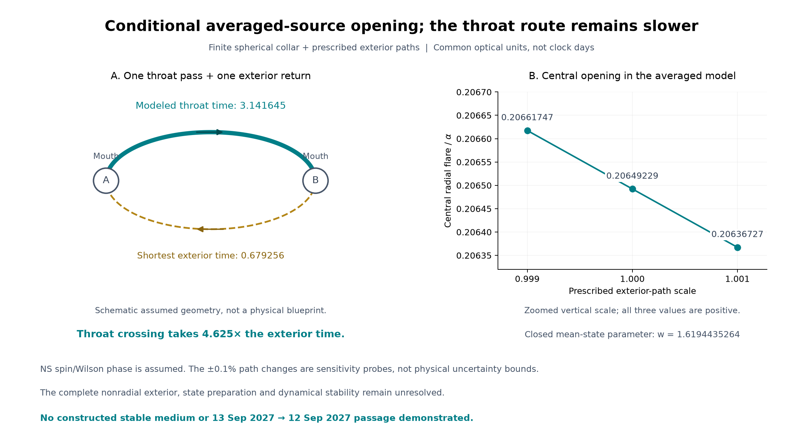

### Use the radius variation of the derived source

In r_e=1 units, write ds²=-N(l)²dt²+dl²+R(l)²dOmega², n=log N,
a=n_l, b=R_l, k=alpha/3, epsilon=q*alpha/6 and
E=1+delta+4*epsilon*log R, where delta=3*zeta(3)*alpha/pi².
For z=a-b/R, U=z_l+a*z and W=w*exp(-2n), variation of qW_D[h/R²]
gives, with stresses multiplied by 8*pi*G*r_e²,
\[
 (\hat\rho,\hat p_r,\hat p_T)_{\rm CFT}
 =\frac{k}{R^2}(2U-z^2-W,-z^2-W,U).
\]
The angular stress is essential; using the old radius-independent
Polyakov source would omit it. The local magnetic and gapped potential
contribution is (E,-E,E-2*epsilon)/R^4. The combined trace is
-4*epsilon/R^4. The angular reduction and optical state prescription use
[Maldacena, Milekhin and Popov, Sections 5.2/5.5 and Appendices C/F](https://arxiv.org/html/1807.04726v3).
The completed bulk coefficient and its limits were derived in increment83.

The radial constraint and independently checked evolution equations are
\[
 C=-1+b^2+2Rab+E/R^2+k[(a-b/R)^2+W]=0,
\]
\[
 a_l=\frac{R^2-k}{R^2-3k}
 \left[\frac{E-2\epsilon+k(Ra-b)^2}{R^4}-a^2-\frac{2ab}{R}
 -\frac{k(R^2+k)}{R^2(R^2-k)}W\right],\qquad
 b_l=ab+\frac{kR}{R^2-k}(W-a_l).
\]
An independent symbolic derivation gives C_l=0 on this system; the
radial-null and angular Einstein residuals vanish identically. With
C(0)=0, all independent components are satisfied. At the symmetric
center N=1, a=b=0 and R0²*(1-k*w)=E(R0). Its opening is
\[
 \left.\frac{R_{ll}}R\right|_0
 =\frac{k}{R_0^2-3k}
 \left[w-\frac{R_0^2-2\epsilon}{R_0^4}\right].
\]
The numerical integration stores R=R0+alpha*y and b=alpha*v so this small
opening is not extracted by subtracting order-one Einstein components.
The central radius offset is solved at 50-digit precision and retained
separately. We guard the regular branch R²>3k and integrate x_l=1/N.

### Let the full loop determine the averaged state

The massless field uses x=integral(dl/N); replacing h by h/R² does not
insert any additional R into that optical length. We assume the combined
spin-structure/Wilson phase is antiperiodic (NS), without claiming its
preparation. The matching cuts are transparent, not reflecting walls.
Every channel has one throat crossing and one exterior return, in a
common clock:
\[
 L_\nu=2x_b+\frac{d f(\nu)-2(R_b-1)+M_b\,\mathrm{Shapiro}_\nu}{A},
 \qquad A=N_{100}/b_{100},\qquad
 w=\int_0^2\frac{d\nu}{2}\left(\frac{2\pi}{L_\nu}\right)^2.
\]
The exterior f and Shapiro integrals reuse the increment67 point-magnetic
path engine. M_b is a finite-cutoff local-magnetic mass fit, not a proved
ADM mass for the full returning-field source. Every trial w recomputes
the collar and clock. We keep q=100000, alpha=1e-9 and
d/r_e=4188251800.784477 fixed at their previous model values. This separation
was a prior modeling convention, not a measured or constructed geometry.

The source averages inverse squared periods. An inverse squared mean
period would be incorrect; indeed the ideal point-path continuum's mean
period diverges at its longest-loop endpoint while this source average
converges. No endpoint flux is discarded or reweighted.

### Numerical result and independent leading check

| Quantity | Corrected composite model |
|---|---:|
| Self-consistent w | 1.6194435263649365 |
| Previous bare-source w | 1.6194849990455538 |
| Change from the previous source | -0.0000414726806173 |
| Product-reference w | 0.9999666659679863 |
| Central opening R_ll/(alpha*R) | 0.2064922868873819 |
| Throat optical crossing time | 3.1416450656611814 |
| Shortest exterior optical time | 0.6792563875155420 |
| Throat/exterior travel-time ratio | 4.6251240671465865 |

Times are in the same dimensionless central-clock units, not seconds.
Positive opening is a local geometric result in this model. The state
parameter is not a measurable material specification, and numerical
precision is not physical accuracy.

The leading matching relation can also be obtained without integrating
the full collar. On the source-consistent product with radii Rs and LA,
N=cosh(l/LA); integrate the exact NEC equation for (b/N)_l and use
integral_0^infinity sech³(l/LA)dl=pi*LA/4. This yields
\[
 A\simeq\frac{12R_s}{\pi\alpha L_A(w-L_A^{-2})},\qquad
 w\simeq\left\langle\left[
 \frac{2\pi}{\pi L_A+df(\nu)/A}\right]^2\right\rangle.
\]
At the saved finite-model w, A_leading=6165936479.45171 differs from the
integrated clock by 1.57e-8 relatively, while pi*LA differs from the
finite crossing by 4.98e-8. The independent leading closure root is
1.6194435407342618, 1.44e-8 above the finite result. This is a leading
approximation check, not an all-orders equality or physical error bound.

The [new executable](../scripts/dirac_return_closure.py)
and [saved results](../results/dirac_return_closure_results.json)
pass eight controls. Joint 64-to-128 channel quadrature and tighter ODE
integration change w by at most 1.41e-11; moving the matching cut between
10, 30 and 100 changes it by 9.37e-12. Fine-run closure residuals are below
7.87e-14; sampled Einstein residuals are below 3.77e-14. Near-throat
constraint/alpha is below 1.45e-8 in the fine runs. The separately checked
leading-clock and central-flare formulas agree at their stated order.

An independent RK45 integration assembled the radial-null and angular
Einstein equations as a separate two-by-two linear system. It agrees on
optical x within 1.76e-12, clock normalization within 6.59e-10 relatively,
and central opening to the displayed precision. Its isotropic radii differ
by at most 1.92e-9; three independently reconstructed channel periods agree
within 6.59e-10 relatively. This is sufficient to resolve the 4.15e-5 model
shift. The audit reused magnetic-path helpers, and is not independent
evidence for the prescribed exterior's physical correctness. A slower
Radau audit was terminated; the final RK45 check completed with no live job.

The local-magnetic isotropic-coordinate anchor differs from R_b-1 by
3.25e-5 at R_b=100; the associated modeled period bound is 2.20e-14.
This accounts only for that coordinate mismatch, not the actual corrected
field paths. The sampled maximum hatted curvature is 1.9999333, giving
curvature²*log(q)/q=0.00046049. This is a bulk expansion diagnostic, not a
bound on every omitted derivative, boundary or loop contribution.

Run `.\.venv\Scripts\python.exe -B -W error -X utf8 scripts/dirac_return_closure.py`.
Source SHA256: `595b0d4578bc13f828020b956a2d5ce41e0e11b12de47df4e0d5a19119829140`.
Result SHA256: `6baf84864641725f0e2378a368e99eeef5beb0dd08b053a84ea21b674d2fce03`.
The final warnings-as-errors run exits successfully. Root verified the
source identity, recomputed the saved full-weight state average, and
inspected the new figure. All 148 earlier image artifacts were preserved.

### The next uncertainty is the exterior, not the root finder

For the state map F(w), F'=-1.53703707 and 1/(1-F')=0.39416058.
The derivative converges under halving its numerical step. Naive repeated
substitution w<-F(w) would diverge; a bracketed root solve succeeds.
Neither statement establishes physical dynamical stability.

As a sensitivity probe, rescaling only the prescribed flat exterior
length contribution by 0.999 or 1.001 gives w=1.6198190872 or 1.6190684798.
The central opening stays positive at 0.20661747 or 0.20636727 in alpha
units. A 0.1% imposed length change therefore moves w about nine times
more than this iteration's source correction. This is not a claimed
physical uncertainty interval or a solved magnetic deformation.

The corrected nonlinear Maxwell law can alter the exterior field lines;
the nonradial metric, quantum current, global interfaces and state
preparation remain unresolved. Higher-loop and subleading derivative
terms also remain omitted. Next: derive the exterior field-path correction
from the same action before treating these precise conditional numbers
as predictions. A static branch is not a formation or stability proof.
**13 September 2027 to 12 September 2027 remains unproved.**

## Derive the missing bulk source and test different shapes — increment83

We now derive the leading missing term from the gapped angular modes,
instead of treating increment82's coefficient as an adjustable pressure.
It passes unequal-radius spectral and action-variation checks. Its radial
null stress is exactly zero: it changes the reference geometry but does
not itself hold a throat open. This advances the specified mathematical
model; it establishes neither new physics nor a stable physical medium.

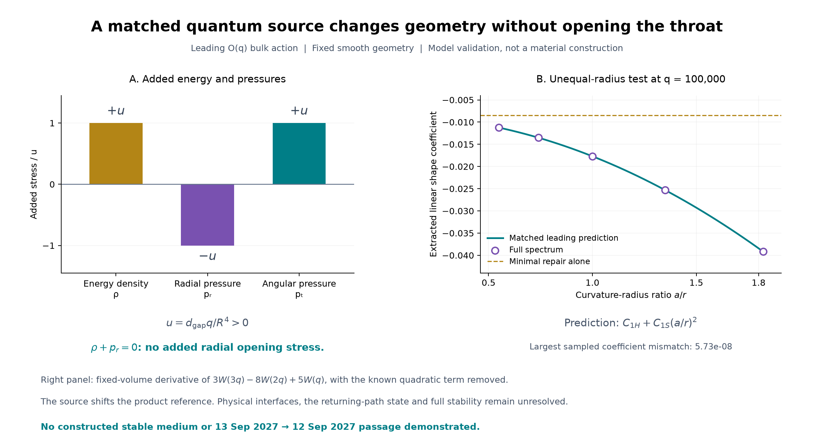

### Reduction, regulator and scope

For a spherically symmetric metric, write
\(ds_4^2=h_{ab}dx^a dx^b+R^2d\Omega^2
=R^2(d\hat s_2^2+d\Omega^2)\), with \(\hat h=h/R^2\).
The massless Dirac rescaling is \(\Psi=R^{-3/2}\hat\Psi\).
In this frame the angular reduction has q massless two-dimensional Dirac
fields, and levels \(m_n^2=n(n+q)\), multiplicity \(2(q+2n)\), n>=1.
There is no additional spin multiplier. We use the charged spinor spectrum
in [Castellano, Montella and Zatti, Section 2](https://arxiv.org/pdf/2603.15730)
and the spherical reduction of
[Maldacena, Milekhin and Popov, Appendices C and F](https://arxiv.org/html/1807.04726v3).
The derivation and matching below are our calculations using these inputs.

Keep the lowest-mode functional \(qW_D[\hat h;\mathrm{state}]\) exactly
once, normalized as a massless CFT with no added two-dimensional
cosmological term. The split into zero and gapped modes creates cancelling
q-dependent ultraviolet terms. Regulate the full four-dimensional field
in one scheme and inherit the compensating subtraction in the gapped
tower; independently chosen mode-by-mode vacuum constants would change
the matching. The four-dimensional Weyl Jacobian has q^2 gauge and q^0
gravitational terms, with no O(q) term. Include the magnetic running/logarithm
once. Arbitrary additional matter interactions or higher-dimension operators
are not part of this minimal one-loop model.
Common four-dimensional gravitational and F^2 counterterms cannot shift
this linear-q coefficient. Arbitrary added reduced-theory Weyl-invariant
functionals can: symmetry alone does not establish the completion.

For v=q*t the angular heat trace has the expansion
\[
 A_q(t)=q\coth(v/2)+a_1(v)+O(q^{-1}),\qquad
 a_1(v)=\operatorname{csch}^2(v/2)[1-(v/2)\coth(v/2)].
\]
Its subtracted, convergent coefficient is
\[
 J=\int_0^\infty\frac{a_1(v)+1/3}{v^2}\,dv
 =-6\zeta'(-2)=\frac{3\zeta(3)}{2\pi^2}.
\]
Consequently the leading additional bulk action, in units hbar=c=1, is
\[
 d=\frac{J}{16\pi^2}=\frac{3\zeta(3)}{32\pi^4}
 =0.001156902640964738,\qquad
 \Gamma_{E,\mathrm{add}}=4\pi d q\int\frac{\sqrt h}{R^2}\,d^2x,
 \qquad
 \Gamma_{L,\mathrm{add}}=-4\pi d q\int\frac{\sqrt{-h}}{R^2}\,d^2x.
\]
This is an O(q) local bulk term, not the whole determinant on an arbitrary
finite throat. The exact lowest-mode state remains a separate input.

### Vary the action, rather than guessing a pressure

Define U=4*pi*d*q/R^2, \(t_{ab}=-Uh_{ab}\), and
\(J_R=-\partial_R U=8\pi dq/R^3\). They obey
\(\nabla^a t_{ab}=J_R\partial_bR\) and \(t^a{}_a+RJ_R=0\).
The four-dimensional stress in an orthonormal frame is
\[
 (\rho,p_r,p_T)=\frac{dq}{R^4}(1,-1,1),\qquad
 -\rho+p_r+2p_T=0,\qquad \rho+p_r=0.
\]
Thus the added source is conserved and traceless, with positive energy
density and radial tension. The tension does not outweigh the energy:
this source alone supplies no radial null-energy violation.

The derivative expansion uses the gap in the hatted frame. For one massive
two-dimensional Dirac field its first non-topological curvature term is
\(-\int\sqrt{\hat h}\,\hat{\mathcal R}^2/(960\pi m^2)\), consistent with
[Ribeiro, Shapiro and Zanusso, Eqs. 26–28](https://arxiv.org/pdf/1803.06948).
The tower coefficient involves
\(\sum_{n=1}^N 2(q+2n)/[n(n+q)]
=2(H_N+H_{N+q}-H_q)\). After common ultraviolet subtraction, its q-dependence
is O(log q), below the O(q) potential for fixed smooth geometry. The
two-derivative Euler term has no interior metric stress with its boundary
completion. Higher curvature powers p>=2 scale as O(q^(1-p)) in the tower
sum. This ordering is not uniform in q-dependent geometries: the gap test
|curvature|<<q alone is insufficient for accuracy through O(q). Curvature
squared times log(q)<<q and derivative controls are also required.
Interfaces, sharp gradients, excited massive modes and chronology horizons
are outside this demonstrated bulk approximation.

### Independent shape and action tests

Use the increment82 flux contrast 3w(3q)-8w(2q)+5w(q), now at
a=exp(eta), r=exp(-eta), fixed product volume. With s=exp(-4eta),
\[
 \mathcal R_q(\eta)=C_0q^2/s+q(C_{1,H}+C_{1,S}/s)+o(q),
 \quad C_{1,S}=-8d.
\]
The additional potential predicts the entire 1/s dependence, with no
new fitted constants. At q=100000 the full spectrum gives:

| a/r | Extracted linear coefficient | Predicted coefficient |
|---:|---:|---:|
| 0.548812 | -0.011230993665 | -0.011231051004 |
| 0.740818 | -0.013522780829 | -0.013522805020 |
| 1.000000 | -0.017698653083 | -0.017698653098 |
| 1.349859 | -0.025307568548 | -0.025307544389 |
| 1.822119 | -0.039171905550 | -0.039171848260 |

The maximum residual is 5.74e-8. At q=1000 it is 5.74e-6, consistent
with an omitted lower-order contribution; we have not identified that
contribution from a fitted remainder. Quadrature refinement changes the
extracted coefficient by at most 2.57e-9 at q=100000. Direct shape variation
and integration by parts agree within 1.25e-15 in response/q^2. Independently
finite-differencing the integrated action at eta=+/-0.3 agrees with the
response within 8.89e-13 after Richardson extrapolation. These are numerical
consistency tests, not a certified total error bound.

A separate adaptive calculation at q=100000, eta=0.3 gives action/q^2
=-0.026217812071318722 and response/q^2=-0.1048700284978591, differing
from the saved result by 8.67e-17 and 3.33e-16. Its extracted coefficient
differs by 3.33e-11; its own action derivative agrees within 1.06e-14.
This audit used separate hyperbolic heat moments, quadrature and an
exponential-integral tail, while sharing the exact angular-spectrum helper.

The [executable](../scripts/dirac_matched_source.py)
reuses the checked spectrum and heat-kernel helpers; its
[saved result](../results/dirac_matched_source_results.json)
passes all eight declared controls, including ten symbolic identities.
Run `.\.venv\Scripts\python.exe -B -W error -X utf8 scripts/dirac_matched_source.py`.
Source SHA256: `fbf61a47d7b4c9d2f538121611421e08332c9081d9549db0efe3830810f2354e`.
Result SHA256: `63316431fd4baec08191af18f3e4b8324258a6406725a34689fdd4ad5316170d`.
After the full eight-control run, only product-reference ordering metadata
and strict-first-order values were added. The algebraic geometry and
symbolic checks were rerun; saved spectral numbers are unchanged. Root
inspected the new plot; all 146 older plot artifacts were preserved.

### Correct the reference geometry without overclaiming its accuracy

Retain increment80's magnetic logarithm and set, in r_e=1 units,
\(k=\alpha/3\), \(\epsilon=q\alpha/6\),
\(\delta=3\zeta(3)\alpha/\pi^2\), Q=1+delta and S=R^2.
The energy coefficient is **additive**: E(S)=Q+2*epsilon*log(S).
Q changes the effective energy coefficient, not quantized magnetic flux.
For the homogeneous reference state, the reduced equations give
\[
 S=Q+2\epsilon\log S+k(1-2\epsilon/S),\qquad
 L_A^2=\frac{S^2}{S-2\epsilon},\qquad
 \Omega_{\mathrm{ref}}^2=\frac{S-2\epsilon}{S^2}.
\]
At alpha=1e-9 and q=100000, the resummed truncated-action solution changes
S from 1.0000000003333333 to 1.0000000006987270, and Omega_ref^2 from
0.9999666663333556 to 0.9999666659679863. The algebraic Einstein residuals
are below 1.24e-61 at 60-digit working precision. These digits check the
equations, not their physical precision.

Strict first-loop order instead gives S=1+delta+k,
L_A^2=1+delta+k+2*epsilon and Omega_ref^2=1-delta-k-2*epsilon,
plus omitted higher-order terms. Here epsilon^2=2.78e-10 is comparable to
k=3.33e-10. Solving truncated equations exactly does not establish
higher-loop accuracy or a finely tuned opening threshold.

For a symmetric throat with prescribed w=Omega^2, the central constraint
and flare identity are
\[
 S(1-kw)=E(S),\qquad
 \frac{R_{ll}}R=\frac{k}{S-3k}
 \left[w-\frac{S-2\epsilon}{S^2}\right],\quad S>3k.
\]
This identity does not determine w: it must come from the field's actual
returning path and state. No finite-collar or dynamical stability result
is claimed in increment83. Next: combine this derived bulk source with a
self-consistent exterior return path, retaining the magnetic logarithm
once and bounding omitted terms before interpreting an opening.
Travel from **13 September 2027 to 12 September 2027 remains unproved**.

## A missing contribution survives at the model's flux — increment82

Increment82 moves from the low-flux diagnostic to q=100000. The result is
a finite matching condition on the same one-loop Dirac vacuum: the minimal
trace-repaired source omits a term of the same order in flux as the quantum
term it retains. This is a calculation within the specified field theory,
not a new physical law, a complete wormhole source or a material recipe.

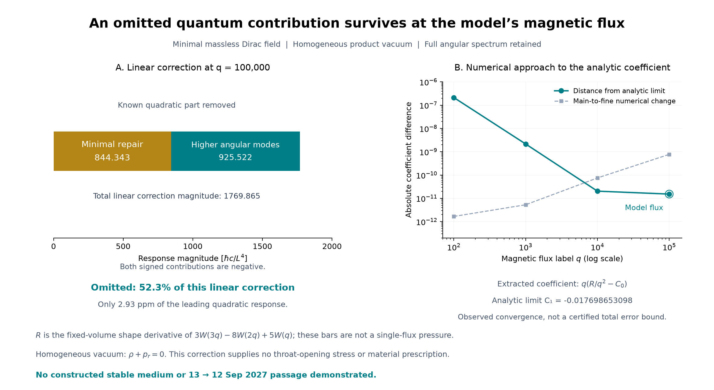

### Remove the low-flux reference before extrapolating

Keep the complete homogeneous H2(a) x S2(r) spectrum and vacuum prescription
of increment81, with one minimally coupled massless Dirac field, no electric
field, and no photon or graviton loops. The spectra are those of
[Castellano, Montella and Zatti, Section 2](https://arxiv.org/pdf/2603.15730).
All flux sectors are evaluated at the same geometry and with the same
subtraction prescription; they need not each solve Einstein's equations.

Replace the previous contrast by

\[
 \mathcal C_q=3w_E(3q)-8w_E(2q)+5w_E(q),\qquad
 B_q(t)=3A_{3q}(t)-8A_{2q}(t)+5A_q(t).
\]

The weights satisfy sum(c)=sum(c*p^2)=0, cancelling common gravitational
and Maxwell counterterms. At q=100000 all three fluxes are large: no q=0
or q=1 reference contaminates the comparison. The reference radii are
again a=r=L, and the deformation is a=L*exp(eta), r=L*exp(-eta).
In units hbar=c=L=1, the pressure-response combination is

\[
 R_q=\left.\partial_\eta\mathcal C_q\right|_0
 =-\frac1{2\pi^2}\int_0^\infty H'(t)B_q(t)\,dt.
\]

This R_q denotes the new contrast, not the different R_q of increment81.
It measures minus twice the corresponding H2-versus-sphere stress
difference. It is not a single-flux pressure or a radial null stress.

### The analytic prediction includes two terms proportional to flux

Our independent derivations give

\[
 R_q=C_0q^2+(C_{1,H}+C_{1,S})q+o(q),
\]
\[
 C_0=-\frac{27\log3-32\log2}{24\pi^2},\quad
 C_{1,H}=-\frac1{12\pi^2},\quad
 C_{1,S}=-\frac{3\zeta(3)}{4\pi^4}.
\]

The retained minimal completion gives C1,H but misses C1,S. Numerically,
C0=-0.03158612760311052, C1,H=-0.00844343197019481 and
C1,S=-0.00925522112771790. These coefficients follow from the complete
spectrum rather than fitting an adjustable pressure to a throat.

For the derivation, write y=q*t. For each p=1,2,3,

\[
 A_{pq}(y/q)=pq\coth(py/2)+a_1(py)+O(q^{-1}),\qquad
 a_1(y)=4\sum_{n\geq1}ne^{-ny}-2y\sum_{n\geq1}n^2e^{-ny}.
\]

Let b0=9*coth(3y/2)-16*coth(y)+5*coth(y/2) and
b1=3*a1(3y)-8*a1(2y)+5*a1(y). The convergent integrals are

\[
 \int_0^\infty\frac{b_0(y)}{y^2}dy
 =-\frac{27\log3-32\log2}{6},\qquad
 \int_0^\infty\frac{b_1(y)}{y^2}dy=-\frac{3\zeta(3)}{\pi^2}.
\]

In particular, integral[(a1+1/3)/y^2]=3*zeta(3)/(2*pi^2), an ordinary
convergent integral; the added constants cancel in b1. The remaining
hyperbolic contribution follows by writing H=1/(2t)+h(t), with h(0)=1/12
and h(infinity)=0. The angular zero modes give B_q -> -2q away from the
transition at t~1/q, yielding C1,H. A matched small-y/large-y expansion
supports the asymptotic remainder o(q); this is not a certified error
bound at any particular finite q. The numerical calculation below retains
the exact angular spectrum instead of substituting this expansion.

### Test at the actual model flux

The quantity (R_q/q^2-C0)*q should approach C1,H+C1,S.

| q | Computed coefficient of the linear correction |
|---:|---:|
| 100 | -0.01769886644245 |
| 1000 | -0.01769865526151 |
| 10000 | -0.01769865311828 |
| 100000 | -0.01769865308268 |
| Analytic limit | -0.01769865309791 |

At q=100000 the dominant contribution is about -315861276.0311, the
retained linear contribution is -844.3432, and the omitted contribution
is -925.5221. The missing term is about 52.29% of the combined linear
correction, but only 2.93 parts per million of the dominant term.
Neither percentage measures progress toward time travel. Both terms must
be retained when claiming accuracy at this order in q.

The [bounded executable](../scripts/dirac_high_flux.py)
reuses the already checked hyperbolic kernel. Its
[results](../results/dirac_high_flux_results.json)
pass eight declared controls. High-precision angular sums avoid floating
point cancellation; direct variation agrees with integration by parts.
The q=1 contrast independently matches a combination of the saved
increment81 results within 1.54e-14. No old simulation was rerun.

At q=100000, refining the cutoff and quadrature changes R/q^2 by
7.73e-15 and the extracted linear coefficient by 7.73e-10. An independent
adaptive integration with different cutoffs and a separate hyperbolic
moment calculation agrees on that coefficient within 1.26e-10.
The analytical bound for omitted excited modes in the far infrared is
7.53e-24 in R/q^2. These checks and that partial bound do not constitute
an interval-certified bound on the full numerical error. The final
two-term remainder is below reliable numerical resolution at the largest
flux; do not infer its scaling from its final rounded value.

The executable also evaluates an explicit Euler–Maclaurin bound for the
ultraviolet approximation at q=100000. With y_cut=0.01, its contribution
to the error in R/q^2 is at most 1.24e-16; at y_cut=0.02 it is at most
7.91e-15. These are bounds on that piece only, evaluated with 85-digit
non-interval arithmetic. They include the angular-series remainder and
the bound |H'-H3'|<=t^3/792. They do not include rounding or the main
quadrature. Root independently reproduced the bound values supplied by
the analytic audit. The observed last-digit drift is consistent with
this deliberately truncated ultraviolet series.

For reproducibility, the bound uses the order-eight Euler–Maclaurin
polynomial
\[
 P_M(y)=2\sum_{m=2}^{M}B_{2m}\sum_{j=0}^{m-2}
 \frac{(-1)^j S_{2m-2j}y^{2m-j-1}}{q^j j!(2m-2j)!},
 \qquad S_k=3\,3^k-8\,2^k+5.
\]
The positive remainder polynomial is evaluated in uv_truncation_bounds()
using the usual Euler–Maclaurin derivative bound. The response weight
satisfies |H'|<=1/(2*t^2)+1/120. This yields an elementary integral bound
on the difference between P8 and the implemented cubic–quintic series.

Reproduce with
`.\.venv\Scripts\python.exe -B -W error -X utf8 scripts/dirac_high_flux.py`.
Final source SHA256:
`95e309c996e14acc0453b1f79aa3285d98f4c2c9a51014bc710cd4618db952d7`;
result SHA256:
`b8625d3b3da0b0d574a6aa58b6eaa80ec05810ec6eff31c1a7492f595f6b822b`.
The saved numerical cases are unchanged after adding the bound metadata;
the final warnings-as-errors run passes all eight controls. Root inspected
the new figure; its numerical data and labels agree with the saved result.

### What this fixes, and what is still required

We have fixed one high-flux vacuum matching datum beyond the trace. We
have not derived the full conserved source on a radius-varying throat.
The homogeneous reference still has rho+p_radial=0 and therefore does
not itself supply the negative radial stress needed for a smooth throat.

It would be incorrect to add the full determinant to the retained
lowest-mode action: that would double count its vacuum contribution.
The next source construction must subtract the retained-sector vacuum
in a common prescription before adding the physically specified
returning-field state. Derivative terms, higher-loop ordering and the
response to perturbations remain to be determined.

Do not infer a unique local B*R action from this one product datum.
[Fucci, Eqs. 6.16 and 7.29–7.32](https://arxiv.org/pdf/0906.2430)
shows that curvature terms in a magnetic background include several
tensor contractions and that their massless spinor expansion has infrared
singularities. Thus taking that local expansion first and then setting
the mass to zero is not a replacement for our exact product calculation.
[MMP, Section 5.2](https://arxiv.org/html/1807.04726v3#S5.SS2)
also allows contributions from other four-dimensional modes in its
two-dimensional trace discussion.

No stable manufactured medium, preparation method or passage from
13 September 2027 to 12 September 2027 has been established.

## A finite spectral test of the missing quantum pressure — increment81

We now test information that a trace anomaly cannot determine. The
calculation uses the complete charged-Dirac spectrum on a fixed product
background, rather than choosing an extra pressure to make a throat work.
It is a new diagnostic in this project, not a claimed discovery of a new
physical law. Two independently computed small-flux cases expose a finite
response missed even after the minimal trace repair.

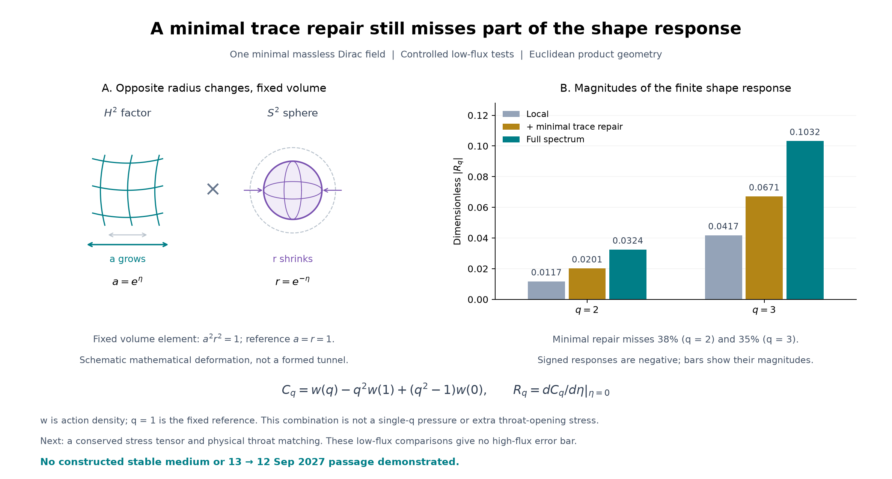

### Why the trace repair was not enough

The proposed lowest-mode action W[h/R^2] has a known two-dimensional Weyl
cocycle; see [MMP, Appendix F](https://arxiv.org/html/1807.04726v3) and the
[dilaton-invariant effective-action construction](https://arxiv.org/pdf/1210.3284).
Its combined four-dimensional Weyl trace can vanish without fixing its
stress uniquely: adding a functional of h/R^2 can preserve that trace and
change the null stress. We therefore did not rerun the collar solver with
this arbitrarily selected completion. Matching the full determinant is the
more informative next step.

### Specified field theory and observable

Take one minimally coupled massless four-component Dirac field on
Euclidean H2(a) x S2(r), with flux 2*pi*q through the sphere and no electric
field. Use the homogeneous heat kernel on complete H2, per proper volume;
there is no material boundary, prepared circulating Casimir state, photon
loop or graviton loop. q is a nonnegative integer. Product geometries at
different q are off-shell backgrounds for this field calculation, not a
family already shown to solve Einstein's equations.

The sphere spectrum and hyperbolic density follow from
[Castellano, Montella and Zatti, Sections 2–3](https://arxiv.org/pdf/2603.15730),
with their monopole parameter g=q/2. Only their minimally coupled spectrum
is used, not the supersymmetric mass relations or nonminimal couplings.
The sphere has q zero modes and excited eigenvalues n(n+q)/r^2 with total
degeneracy 2(q+2n). Define

\[
 H(u)=\int_0^\infty d\lambda\,\lambda\coth(\pi\lambda)e^{-u\lambda^2},
 \quad A_q(u)=q+2\sum_{n=1}^\infty(q+2n)e^{-un(n+q)}.
\]

The four-component heat kernel per proper four-volume is
H(t/a^2)A_q(t/r^2)/(4*pi^2*a^2*r^2). Its leading term is
1/(4*pi^2*t^2), which checks the spin counting.

Our diagnostic is the flux combination

\[
 \mathcal D_q W=W(q)-q^2W(1)+(q^2-1)W(0),\qquad q\geq2.
\]

All three terms use the same field theory, geometry and subtraction
prescription. This cancels the usual one-loop local curvature terms,
which are independent of q, and the Maxwell counterterm, proportional to
q^2. This is not an invariance under arbitrary higher-dimension operators
in a different effective theory. Nor does it separately determine W(q).

Our independent fixed-q heat-kernel expansion gives

\[
 \mathcal D_q A(u)=-\frac{q^2(q^2-1)}{360}u^3
 -\frac{q^2(q^2-1)}{504}u^4
 +\frac{q^2(q^2-1)(q^2-20)}{15120}u^5+O_q(u^6).
\]

Together with H(u)~1/(2u), this makes the proper-time integral ultraviolet
finite. In the infrared, D_q A tends to q-q^2 and
H(u)~1/(2*sqrt(pi*u)), giving an integrable u^(-3/2) tail.
The expansion is for fixed q, not a uniform approximation at q=100000.

### A deformation that measures more than the trace

Set a=L*exp(eta), r=L*exp(-eta); the product volume factor stays fixed.
Below L=1 and hbar=c=1. Use the real, parity-even convention
W_E=-(1/2)*log(det(D-dagger D)), equal to +1/2 integral K(t)/t.
This specifies the determinant sign without assuming a phase. Therefore

\[
 \mathcal D_q w_E(\eta)=\frac1{8\pi^2}\int_0^\infty\frac{dt}{t}
 H(te^{-2\eta})\mathcal D_q A(te^{2\eta}),
\]
\[
 \mathcal R_q=\left.\partial_\eta\mathcal D_qw_E\right|_0
 =\frac1{4\pi^2}\int_0^\infty dt[-H'\mathcal D_qA+H\mathcal D_qA']
 =-\frac1{2\pi^2}\int_0^\infty dt\,H'\mathcal D_qA.
\]

The last identity uses vanishing endpoint terms. Restoring units, the
response is multiplied by hbar*c/L^4. For an analytically continued
isometry-invariant stress T_ab=P_H*h_ab, T_ij=P_S*g_ij, metric variation
gives D_q(P_H-P_S)=-R_q/2. This is a combination across flux sectors,
not the pressure of a single sample or an available exotic material.

The local logarithm used in increment80 predicts, with the same common
reference scale across fluxes,

\[
 \mathcal D_qw_{E,\mathrm{local}}=-\frac{q^2\log q}{96\pi^2r^4},
 \qquad \mathcal R_{q,\mathrm{local}}=-\frac{q^2\log q}{24\pi^2}.
\]

Their difference is a finite test of what this leading local source
omits on the curved product. Small-q results are not an error bar for
the existing q=100000 geometry, especially because the subtraction
includes the low-flux q=1 reference.

There is also a direct test of the proposed trace repair. In the natural
homogeneous H2 vacuum, with no extra combined-Weyl-invariant finite
functional, q*W[h/R^2] has P_H=-q/(96*pi^2), P_S=q/(96*pi^2) at L=1.
Its contribution to the response combination is (q-q^2)/(24*pi^2).
Adding this to the local expression defines a specific minimal
approximation that can be compared with the full spectral integral. It
is not a derived separation of the determinant into independent sectors;
double counting and matching have not been proved absent. Disagreement
rejects this specified sum as an exact source, not every possible
trace-repaired completion.

### Numerical result

Responses below are the signed shape derivative R_q, in units hbar*c/L^4.

| Flux q | Local magnetic term | Local + minimal trace repair | Full one-loop spectrum |
|---|---:|---:|---:|
| 2 | -0.011705082129 | -0.020148514099 | -0.032427732176 |
| 3 | -0.041742261544 | -0.067072557455 | -0.103182122960 |

The minimal repaired sum misses about 38% and 35% of the full response
magnitude in these two low-flux tests. This is a discrepancy in a defined
cross-flux observable, not a percentage error in the high-flux throat and
not a percentage of progress toward time travel. Common curvature/F^2
renormalization constants cannot absorb the discrepancy in this contrast.

The root independently evaluated the integration-by-parts expression with
35-digit direct angular sums and adaptive floating-point quadrature for
the hyperbolic moment. It obtained -0.03242773217598199 and
-0.1031821229596531; quadrature estimates were 1.1e-11 and 4.3e-12.
The q=2 UV cutoffs 0.003 and 0.001, with analytic cubic/quartic tails,
changed the answer by 6.8e-15. These are numerical consistency checks,
not interval-certified error bounds. Independent Euler–Maclaurin and
Hurwitz-zeta derivations agree on the small-t coefficients, and 50–65 digit
direct sums check their remainder scaling.

The [saved executable](../scripts/dirac_flux_response.py)
and [results](../results/dirac_flux_response_results.json)
pass all six declared controls: defining heat integral, direct angular
spectrum, action and response refinement, integration by parts, and
finite differences in eta. The maximum direct-versus-integration-by-parts
discrepancy is 4.3e-16; Richardson-extrapolated finite differences differ
by at most 3.92e-14. Independent root integrations agree within 1.1e-15.
Root re-executed the entire bounded benchmark with warnings treated as
errors and reproduced the saved result dictionary exactly. These observed
agreements do not replace a rigorous error bound. No previous geometry
simulation was rerun or changed.

Reproduce from the project directory with
`.\.venv\Scripts\python.exe -B -W error -X utf8 scripts/dirac_flux_response.py`.
Source SHA256: `1c0bd730c3e4add3e2e4a17bf0f3d5e5a57389316c55238846a01efde7cbd650`;
result SHA256: `0208b2573f3df42bff3e3336af2809a4f2b075ac92dcc0c4114036aba94d60c5`.

Even a nonzero response does not open a throat: product isometries give
rho+p_radial=0 for this reference vacuum. The missing next object is
the stress response to a spatially varying throat and a physically
specified global field state. Before using these results in the saved
high-flux model, establish controlled high-flux matching; the q=1
reference makes naive extrapolation of the percentages inappropriate.
Then test the returning-field state's radial stress and its response to
perturbations using the matched action. Stability, formation and a passage from
13 September 2027 to 12 September 2027 remain unproved.

## Magnetic vacuum polarization shifts the reference geometry, but cannot open a throat alone

Increment80 tests an omitted physical source contribution rather than another
entrance trajectory. A declared local approximation to fermion vacuum
polarization changes the magnetic background, while its radial null stress
is exactly zero. Separately, a full-theory trace test shows why adding this
local term to our bare two-dimensional source is still insufficient for
exact four-dimensional matching. Neither result establishes a manufactured
medium or a new physical law.

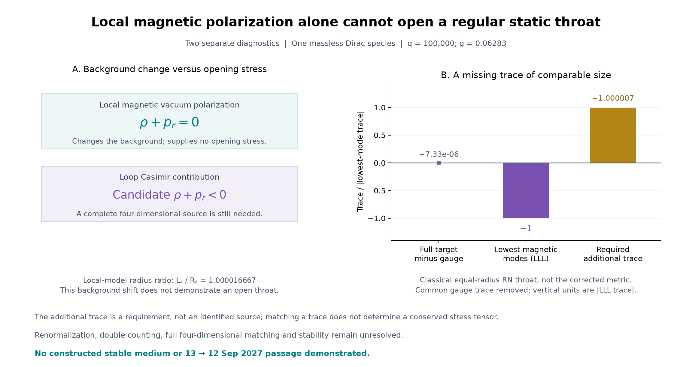

### A specified source action instead of an adjustable pressure

Use signature (-+++), hbar=c=1, one massless unit-charge Dirac fermion,
magnetic flux 2*pi*q and X=F_mu_nu F^mu_nu. The leading local magnetic
action tested here is

\[
L(X)=-\frac{X}{4g_*^2}+\frac{X}{96\pi^2}\log\frac{X}{X_*},\qquad
X_* =\frac{q^2}{2r_e^4},\quad r_e^2=\frac{\pi Gq^2}{g_*^2}.
\]

The positive logarithmic coefficient follows from the strong-field
one-loop Dirac effective action and beta function
([Dunne, Eqs. 5.12–5.15](https://arxiv.org/pdf/hep-th/0406216)). This is a
leading local-field approximation, not the complete massless determinant.
The finite X term has been absorbed into g_* so the displayed loop term
vanishes at X_*. The coupling must use the same magnetic reference as
[MMP, Eq. 2.3](https://arxiv.org/html/1807.04726v3); applying the running
again would double count it. These are hypothetical theory parameters,
not measured properties of an available material.

Metric variation, with deltaGamma=+(1/2) integral sqrt(-g) T^mu_nu
delta g_mu_nu, gives

\[
\rho=-L,\qquad p_r=L,\qquad p_\perp=L-2XL_X,
\qquad T^\mu{}_\mu=4(L-XL_X)=-\frac{X}{24\pi^2}.
\]

The gauge-trace sign agrees with the explicit mostly-plus Dirac result in
[Bastianelli and Broccoli, Eq. 4.20](https://arxiv.org/pdf/1808.03489).
In particular, rho+p_r=0. For a static spherical metric with proper radial
distance l and positive lapse N, Einstein's radial null equation is

\[
\left(\frac{R'}N\right)'=-\frac{4\pi G R}{N}(\rho+p_r).
\]

Thus a smooth minimum with R'=0 cannot flare outward in a connected region
supported by this source alone: it would retain constant R. This conclusion
does not apply to additional nonlocal Casimir stress, which can have a
different radial null contraction.

### Its geometry can be solved and checked

Let epsilon=g_*^2/(24*pi^2) and x=r/r_e. In the finite spherical collar the
local action admits the extremal metric

\[
f(x)=1-\frac{2(1+2\epsilon)}x+
\frac{1+4\epsilon(\log x+1)}{x^2}.
\]

It retains a double horizon at x=1. The product reference geometry has
sphere radius R_S=r_e and AdS2 radius

\[
\frac{L_A^2}{R_S^2}=\frac1{1-2\epsilon}.
\]

For the existing q=100000, g_*=0.0628318531 benchmark, L_A/R_S-1 is about
1.67e-5 (0.00167%). This is a conditional background recalibration, not an
increase in traversability. The coefficient 1+2*epsilon is an integration
constant of this local spherical model, not a computed ADM mass of the
complete two-mouth geometry. The horizon reference does not construct or
prepare a traversable wormhole.

The overlap normalization changes to rho_th=ell*(r-R_S)/L_A^2 and
tau=t/ell. Its ideal global-throat null crossing remains pi*ell; changing
the radius calibration alone produces no past-directed shortcut.

### An independent full-theory requirement is still missing

Evaluate the one-loop trace on the **classical extremal RN reference**;
this is distinct from the corrected local-action geometry above. The
published gravitational Dirac anomaly is
(C^2/20-11*E4/360+b*Box R4)/(16*pi^2), where E4 is the Euler density.
The coefficient counts one four-dimensional Dirac field, not q such
fields. R4=0 on this reference, so the scheme-dependent Box R4 term
vanishes. See
[Bastianelli and Broccoli, Eq. 35](https://arxiv.org/pdf/1911.02271).
This tests the fermion contribution on classical metric and gauge
backgrounds; photon and graviton vacuum loops are excluded.

At the equal-radius product limit, setting r_e=1 for the following traces,

\[
T_{\rm full}=-\frac{q^2}{48\pi^2}+\frac{11}{720\pi^2},\qquad
T_{\rm gauge}+T_{\rm bare\ LLL}
=-\frac{q^2}{48\pi^2}-\frac{q}{48\pi^2}.
\]

Consequently the missing trace is

\[
\Delta T=\frac{q}{48\pi^2}+\frac{11}{720\pi^2}.
\]

After the common gauge term is removed, this is comparable in magnitude
to the retained lowest-Landau-level (LLL) trace, with opposite sign.
It is a necessary constraint on the missing reduction/curvature terms;
it does not determine their full stress tensor or authorize inserting an
arbitrary compensating pressure. State changes cannot repair a
state-independent trace mismatch. A consistent determinant and subtraction
must also avoid counting the retained modes twice.

This does not refute the leading MMP construction. That construction
explicitly distinguishes symmetry-preserving radius shifts from the
state-dependent stress that opens a throat
([MMP, Section 5.2](https://arxiv.org/html/1807.04726v3)). Our calculation
makes that distinction quantitative for this benchmark and supplies a
test any proposed more exact source must satisfy.

### Accuracy and next calculation

The magnetic curvature ratio is 2/q=2e-5 at the product reference; the
one-loop logarithmic change relative to Maxwell reaches 3.07e-4 across
x=1–100. These support testing a small local correction but do not bound
the omitted nonlocal or curvature stress. The known two-loop/one-loop
strong-field 1PI logarithm ratio is 3g_*^2/(16*pi^2)=7.5e-5. Its gauge-trace
scale relative to classical magnetic energy is 5e-9, already comparable
to alpha=1e-9. These are ordering diagnostics, not numerical error bars or
evidence that higher terms open a throat.

The immediate physical dependency is a source completion that satisfies
this trace test and the stress/current conservation identities. A subsequent
collar recalibration must vary the same action in both gravity and Maxwell
equations; substituting the corrected metric into the old electromagnetic
response is insufficient. The geometry still needs the physical exterior,
quantum state and interface data. Travel from 13 September 2027 to
12 September 2027 remains unproved.

Source and runnable checks: `scripts/magnetic_polarization.py` and
`results/magnetic_polarization_results.json`. All 23 symbolic identities vanish,
including stress conservation, all independent Einstein components,
the horizon/product conditions and the separate classical-RN invariants.
Independent 70-digit integration of the mass equation agrees with its
analytic solution to 9.1e-72; ordinary-float metric values agree to 6.42e-17.
The near-horizon formula retains relative agreement within 3.86e-16 for
supplied offsets down to 1e-24, avoiding subtraction of order-one terms.
These are arithmetic checks, not physical error bars. The coordinator
replayed the complete new result with exact equality and independently
checked the LLL curvature formula and spherical nonlinear Maxwell equation.
Prior solver and increment79 results remain unchanged. Reproduce with
`.\.venv\Scripts\python.exe -B -W error scripts/magnetic_polarization.py`.

## Finite entrance motion: verified response, still positive return times

Increment79 replaces the small-motion approximation with finite composed ray
maps and nonlinear clock feedback. It assumes an existing throat with
transparent field matching, a straight flat exterior, and prescribed motion
of entrance B. It does not create that throat or supply its supporting matter.

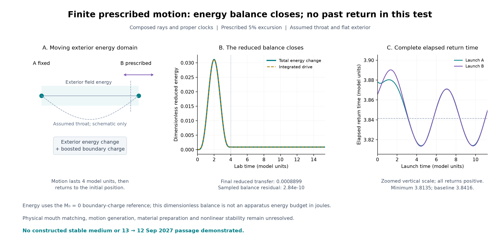

For the same compact motion profile as increment78, we tested displacements
of 0, 0.05%, 0.1% and 5% of the initial separation D=0.7. The 5% case has
peak speed 0.0333226c. Its clocks evolve using proper-time derivatives but
are integrated on a common laboratory timeline with lapses
\(g_A=1\), \(g_B=\sqrt{1-\dot d^2}\). Emission events, throat exits and exterior
returns are solved using their actual clock and null-ray equations.

| Fine 5% motion result | Value in normalized model units |
|---|---:|
| Stationary complete return time | 3.841592654 |
| Shortest sampled complete return | 3.813455460 |
| Longest sampled complete return | 3.890274964 |
| Largest sampled shortening relative to stationary return | 0.73244% |
| Net reduced energy transfer after motion ends | 0.000889929468 |
| Maximum energy-balance residual | 2.84e-10 |

All sampled returns remain after launch. These are massless signal checks;
neither a finite-mass abiotic payload nor a human has been modeled here.
Normalized time units have not been mapped to a constructed physical device.

### Energy balance for the moving exterior

Let \(v=\dot d\), \(\eta=\operatorname{atanh}v\),
\(\gamma=(1-v^2)^{-1/2}\), \(a=d\eta/d\sigma=\gamma^3\ddot d\),
and \(B_i=-b_0(K_i-1/2)\). The flat exterior's integrated field energy is
\(E_{\rm ext}\); \(q_{\rm in/out}\) denote the normalized chiral stresses in
the proper-clock convention. Our derived balance is

\[
E_{\rm ext}-2D Q_0+B_A+\gamma(B_B-2a/3)=W(t),\qquad
\dot W=v\left(aB_B-q_{{\rm in},B}-q_{{\rm out},B}-a^2/3\right).
\]

The acceleration term matters: merely integrating a fixed exterior window
would miss the moving boundaries and their clock factors. An independent
direct field integral agrees with the implemented primitive to 1.87e-10;
an independent drive integral agrees to 2.94e-12. Symbolic checks give exact
zero for the balance identities, including a passive vacuum control.

This is an improved boundary charge in a reduced model, not an identified
material mass. An unspecified rest-energy reference M0 adds
\(M_0(\gamma-1)\) to the energy and \(M_0\dot\gamma\) to the drive. It cancels
from the completed-cycle net transfer because both endpoint speeds are
zero. Therefore the positive residual transfer is a model result; it is
not a calculation of apparatus energy in joules.

The ingredients use the published stress transformation law in
[Fewster and Hollands, Eqs. 2.7–2.9](https://arxiv.org/pdf/math-ph/0412028)
and the boundary flux conventions discussed in
[Engelsoy, Mertens and Verlinde, Eq. 6.15](https://arxiv.org/html/1606.03438).
The combined finite-motion implementation and balance above are our
derivation under the stated assumptions, not a claim of a new physical law.

### Verification and the remaining physical gap

Halving weak-motion amplitude reduces nonlinear-minus-linear differences
by factors 4.0002–4.0041, consistent with second-order corrections. Halving
the moderate-motion timestep changes the compared outputs by at most
2.48e-9. The static solution is recovered to 1.78e-15. All declared checks
pass, and the coordinator independently replayed the fine case with exact
numerical equality after excluding runtime metadata. Independent analytic
and source reviews found no concrete defect. Previous increment78 data
and the shared older solver are unchanged.

These finite-duration checks are not a stability theorem. The solver uses
retarded histories, so its history guards cannot decide whether a spacetime
with closed causal curves exists. No new physics discovery, physical source
material, preparation method or past-going trajectory is established.

The next decisive question is whether the assumed throat and its junction
to the exterior can be supported by a specified quantum state and matter
model satisfying the gravitational and boundary equations. A motion scan
alone cannot answer it. Travel from 13 September 2027 to 12 September 2027
remains unproved.

Source and recorded checks: `scripts/moving_exterior_maps.py`,
`scripts/moving_exterior_nonlinear.py`, `results/moving_exterior_nonlinear_results.json`.

## Motion of an entrance changes both the ray timing and the quantum source

Increment78 adds a **prescribed moving entrance** to the linear response
problem. The exterior in this test is a single straight, flat channel;
it is not the full magnetic geometry of increment77. The motion is an
input, while the throat clocks and chiral source respond. No equation
here supplies the apparatus that moves a physical wormhole mouth.

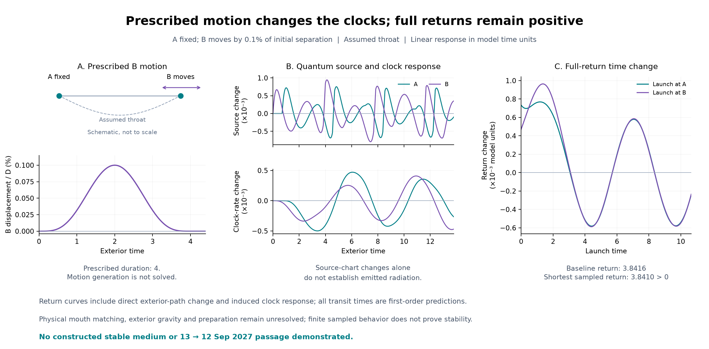

### Derive the transport before changing the delay

Set c=1, put A at x=0, and prescribe B at x=d(t)>0 with |d_dot|<1.
Its proper clock is

\[
\sigma(t)=\int_0^t\sqrt{1-\dot d(u)^2}\,du.
\]

The backward ray maps give the emitter's proper time in terms of the
receiver's proper time:

\[
E_A(t+d(t))=\sigma(t),\qquad
E_B(\sigma(t))=t-d(t).
\]

For A, the parameter t is the emission event at B. For B, it is the
reception event at B. Both maps have slope exp(-eta), eta=atanh(d_dot),
evaluated at these different events. The Schwarzian is
\(\{E,s\}=E'''/E'-3(E''/E')^2/2\).

Let r,l be the throat clock maps and let S_i denote their Schwarzians.
With E mapping the receiving proper clock to the emitting proper clock,
the composed return map is l composed with E composed with inverse r
(with the fixed throat endpoint shifts). In our normalization it gives

\[
J_{\rm in}=\frac16+
\left[\frac{E'l'(E)}{r'}\right]^2\left(J_{\rm past}-\frac16\right)
+\frac{S_r-E'^2 S_l(E)-\{E,s\}}{3r'^2}.
\]

The chiral, normal-ordered state transforms with the squared map derivative
and Schwarzian; the geometric anomaly must be added separately.
[Fewster–Hollands, Eqs. 2.7–2.9](https://arxiv.org/pdf/math-ph/0412028)
provide that transformation law. Thus replacing s-D by E(s) while keeping
the old amplitude factors is insufficient. Conversely, a passive change
of coordinates in flat vacuum must not be reported as new physical
energy: the state and geometric contributions cancel in the covariant
stress. Our exact-map control checks this cancellation explicitly.

### Couple a small motion to the existing clock response

Write d(s)=D+h(s), with h already including its small amplitude. Proper
time differs from the lab clock only at second order in this motion.
At first order,

\[
E_A(s)=s-D-h(s-D),\qquad E_B(s)=s-D-h(s).
\]

For the initial circle vacuum, Q0=J0-1/6=-Omega^2/6 and
Omega=2pi/(pi+D). The additional terms in the chiral stress recurrence are

\[
i_A(s)=\frac{h'''(s-D)+\Omega^2h'(s-D)}3,
\qquad i_B(s)=\frac{h'''(s)+\Omega^2h'(s)}3.
\]

These are derived source terms, not independently adjustable negative
energy. The clock response and its returning source are evolved together
using the existing solver. Its arithmetic return history is valid to
first order: shifting an already first-order response by the small
change in travel time contributes at second order. The state is not reset
to an instantaneous vacuum after each change of separation.

The test uses D=0.7, duration T=4, and

\[
h(s)=0.001D\,256z^4(1-z)^4,\quad z=s/T,\quad 0<s<T,
\]

with h=0 outside this interval. The displacement and its first three
derivatives join continuously to zero. The largest displacement is 0.1%
of D. Times are optical model units, not seconds or calendar dates.

For a null probe launched at exterior time s, the first-order complete
returns are

\[
C_A=\pi+D+\xi_A(s)-\xi_B(s+\pi)+h(s+\pi),
\]
\[
C_B=\pi+D+\xi_B(s)-\xi_A(s+\pi)+h(s+\pi+D).
\]

Here xi_i is the computed throat-clock displacement. The different final
arguments follow from emission at B versus reception at B; adding the
old fixed D to both exit times would omit this distinction. These are
massless signal diagnostics, not a finite-mass payload calculation.

### Check the source and the effective balance independently

The boundary energy balance is driven by incoming minus outgoing flux,
with the clock Jacobians included. This is the structure of
[Engelsoy–Mertens–Verlinde, Eq. 6.15 and footnote 9](https://arxiv.org/pdf/1606.03438).
For the linear model define B=-b0(delta K_A+delta K_B), where
delta K_i=xi_i'''+xi_i', and define the old fixed-window excess integral
E0=int_(s-D)^s(delta qout_A+delta qout_B)du. The new recurrence implies

\[
B+E_0=\frac{h''(s)+h''(s-D)+\Omega^2[h(s)+h(s-D)]}{3}.
\]

This is an **effective-drive identity**, not the actual stored energy in
the moving exterior or mechanical work. The old E0 omits the moving-domain
baseline and proper-chart geometric terms. In particular, its apparent
adiabatic coefficient must not be used as an apparatus energy budget.
For the compact drive above, the right side returns to zero at this
order after T+D. Net production and motion cost require higher-order
analysis; zero first-order net balance does not establish zero cost.

The independent finite-amplitude ray-map calculation passes constant
velocity controls and a second derivation using rapidity. Their largest
jet/Schwarzian comparison difference is 2.22e-16. Passive flat-vacuum
covariant stress cancels to 1.73e-18. Halving the amplitude reduces the
linearization errors by approximately four, as expected for omitted
second-order terms. At amplitude 0.001 the sampled peak speed is
0.0006663c and the exact proper-clock lag after the motion is 3.5645e-7.
The largest sampled exact-versus-linear source difference is 9.6804e-7;
this is a truncation effect, distinct from the solver's time-step error.
It is not a bound on the error of a fully coupled nonlinear evolution.

### The coupled run: some trips shorten, but none returns to the past

The run covers four initial loop times. Duration T=4 ensures that a probe
launched at s=0 encounters both nonzero geometric return corrections,
so the test exercises the changing path as well as the clock response.
For that launch the clock and geometric contributions are respectively
(0.0005887611, 0.0001446210) from A, and
(0.0004707438, 0.0000003750) from B. Both total changes are positive.
Later launch times sample either sign of the change:

| Sampled quantity | Launch from A | Launch from B |
|---|---:|---:|
| Unmoved full return time | 3.841592654 | 3.841592654 |
| Smallest return-time change | -0.000581216 | -0.000587495 |
| Largest return-time change | +0.000768677 | +0.000964183 |
| Smallest full return time | 3.841011438 | 3.841005158 |

A negative **change** means a faster trip than the unmoved baseline; the
full elapsed times remain positive. These are sampled first-order null
returns within the declared model. They are not a chronology theorem for
stronger motion or a demonstration of past travel.

The minimum sampled throat-clock rate is 0.99950105. The largest change
in the center's area-excess coefficient is 0.00076103 of its background
value; that coefficient is not the full four-dimensional area. The largest
source perturbation is about 0.339% of its background magnitude. These
small-response checks keep the test within its chosen linear regime;
they do not prove nonlinear stability.

Halving the maximum step from 0.1 to 0.05 changes the recorded comparison
by at most **2.9097e-10**, below its **2e-8** threshold. The independent
source recurrence residual is 1.20e-17; the effective-drive balance
residual is 7.75e-11; direct quadrature of the outgoing source agrees with
its independently formed primitive within 2.03e-12. The exact source
drive has the proper causal onset; numerical response before that onset
is below the stated 1e-10 check.

The solver was reused by extracting its existing nested implementation.
A nonzero-pulse legacy case agrees bitwise with the pre-edit solver at
83 saved points. Fifty-five other existing functions retain their AST
hashes. A separate, replayable vector-versus-literal-scalar source control
agrees to 1.63e-19. The coordinator reran the focused new test with warnings
treated as errors: its entire result reproduced exactly in 10.35 seconds.
Earlier static, spectrum and distributed-response artifacts are unchanged.

**What changed:** the computation now evolves the clock/source response
to a motion-derived transport law, instead of holding the exterior journey
fixed. **What remains:** the trajectory is prescribed; a physical equation
for the mouths, changing magnetic geometry, full gravitational matching
and higher-order energy accounting are not solved. The next step is to
retain finite ray-map composition and a consistent moving-domain energy
balance before testing stronger driving. It would be invalid to scale
these first-order changes until a negative return is obtained.
**13 September 2027 to 12 September 2027 remains unproved.**

Runnable focused checks:

```powershell
.\.venv\Scripts\python.exe -B -X utf8 -W error scripts/moving_exterior_maps.py
.\.venv\Scripts\python.exe -B -X utf8 -W error -c "import json; from pathlib import Path; from mmp_pulse import moving_exterior_response_checks; saved=json.loads(Path('results/moving_exterior_response_results.json').read_text()); assert moving_exterior_response_checks()==saved['result']"
.\.venv\Scripts\python.exe -B -X utf8 -c "from quantum_horizon_plot import moving_exterior_progress; moving_exterior_progress()"
```

## Distributed source sampling now passes the declared numerical checks

Increment77 resolves the finite-time source-sampling failure recorded in
increment76. **This is a numerical result within the assumed linear model,
not a physics discovery or a construction of a time-travel medium.**

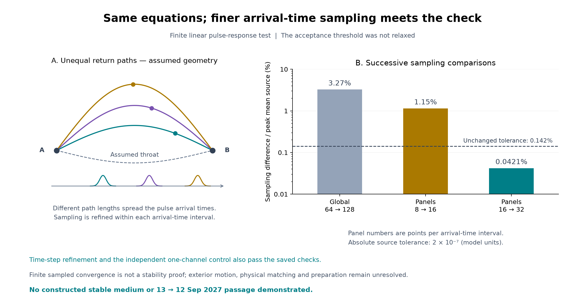

The old global channel grids missed narrow returning pulse fronts. Halving
the time step barely changed the answer, so finer time stepping did not
address the discrepancy. We instead split the flux integral into panels
whose external return delays change by roughly one pulse width, then
regenerated the actual magnetic path at every quadrature node. The full
normalized channel distribution remains included, even where a return has
not yet arrived. Interpolation chooses panel boundaries only; it supplies
neither the source values nor the evolved paths.

| Channel comparison | Largest sampled source difference | Difference / peak source response | Declared source test |
|---|---:|---:|---|
| Original global 64 / 128 | 4.6023e-6 | 3.266% | Failed |
| 8 / 16 nodes per panel (312 / 624 total) | 1.6171e-6 | 1.1476% | Failed |
| 16 / 32 nodes per panel (624 / 1248 total) | 5.9390e-8 | 0.04215% | Passed |

The absolute acceptance threshold remains **2e-7**. Halving the time step
in the final 1248-channel solve changes the complete recorded comparison
by at most **6.4104e-13**, below the unchanged **2e-8** threshold. A separate
single-channel limit agrees with the literal older recurrence to
**1.7347e-18**. The repeated 624-channel sampled profile is bitwise identical
between runs. These are refinement comparisons on a finite sample grid,
not certified bounds on continuum error or on all future evolution.

The final small-pulse run covers four shortest return-loop times. At the
sampled points, the minimum mouth-clock rate is about **0.999687** and the
minimum linearized full return time is **3.82069**, in the model's units.
They remain positive. This calculation does not show a backwards exit.
The prior analytic exclusion of exponentially growing clock modes still
applies only to its stated linear, fixed-exterior vacuum model; it is not
being extended to nonlinear motion or arbitrary excited states here.

### A path-integral defect was corrected separately

The attempted global 256 / 512 refinement exposed a narrow endpoint layer
in the very long magnetic paths. For flux label nu below 1e-4, the shared
path-length helper now integrates an algebraically equivalent scaled
speed with breakpoints around that layer. It preserves the original
branch for larger nu and does not relax tolerances. Independent 60-digit
integration of the original Cartesian derivatives gives relative errors
at most **3.05e-14** in the three recorded difficult cases. The saved 128
legacy periods remain bitwise unchanged.

The aborted global run is retained as **INCOMPLETE**, with its one computed
256-channel record and terminal failure reason. Both earlier failed
sampling comparisons remain available; neither is relabelled as passed.

### Meaning and next direction

We can now use this finite-time solver with the stated numerical controls
to examine the assumed source response. This removes a computational
obstacle; it does not supply a material, a formation mechanism, or a
physical four-dimensional throat. The next physical question is whether
changing mouth clocks, exterior paths and the quantum source can obey
one coupled set of equations. **13 September 2027 to 12 September 2027
remains unproved.** No mapping from these dimensionless times to a
calendar-day jump has been established.

The underlying model draws on [Maldacena, Milekhin and Popov's wormhole
construction](https://arxiv.org/abs/1807.04726), [nearly-AdS2 boundary
dynamics](https://arxiv.org/abs/1606.01857), and the [conformal stress
transformation](https://arxiv.org/abs/math-ph/0412028). Those sources do not
claim to establish this numerical refinement result or a laboratory
construction. Our calculation and its limitations are recorded in
`results/distributed_loop_panel_fine_results.json`.

Runnable checks (the full response check takes several minutes):

```powershell
.\.venv\Scripts\python.exe -B -X utf8 -W error -c "from mmp_pulse import _magnetic_return_length_precision_checks; print(_magnetic_return_length_precision_checks())"
.\.venv\Scripts\python.exe -B -X utf8 -W error -c "from mmp_pulse import distributed_loop_response_checks; print(distributed_loop_response_checks(orders=(16,32),delay_panels=True)['verification'])"
.\.venv\Scripts\python.exe -B -X utf8 -c "from quantum_horizon_plot import distributed_sampling_progress; distributed_sampling_progress()"
```

## Unequal return times: a clock-mode result and a stationary timing limit

Increment76 moves from small static path corrections to the response of the
two mouth clocks. The new analytic result concerns our **linear, fixed-exterior,
transparent-channel JT/CFT model**. It is not a stability proof for a physical
four-dimensional wormhole or a discovery of a new law of physics.

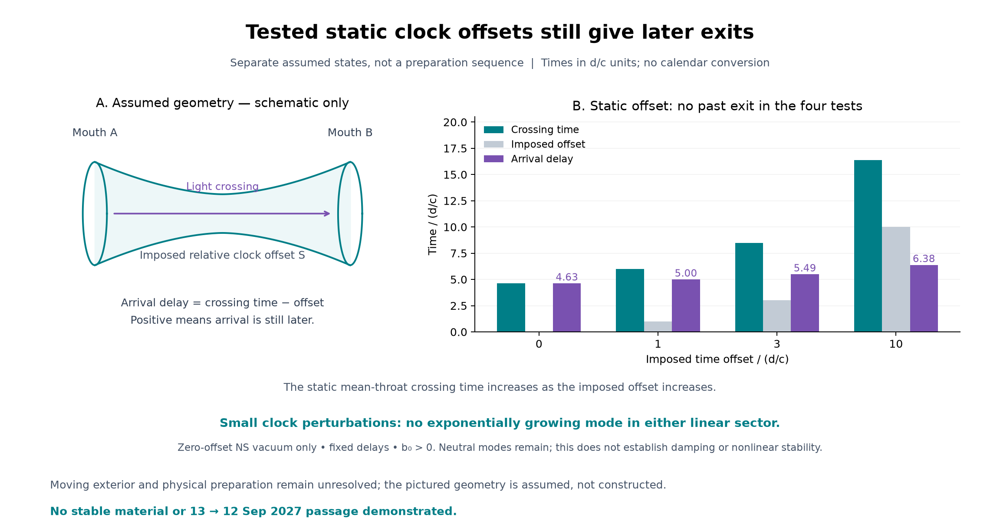

### What changes relative to the earlier zero-delay result

Let channel weights be positive and sum to one. In units where a leading
throat light crossing takes pi, define

\[
L_\nu=\pi+D_\nu,\quad \Omega_\nu=2\pi/L_\nu,\quad
b_0=\frac{\pi}{6}(\langle\Omega_\nu^2\rangle-1)>0,
\quad k=\frac1{3b_0}.
\]

Here D_nu are fixed external return delays; b0 is the boundary coefficient
divided by alpha. Each channel starts in its NS vacuum, with zero relative
mouth-time offset. The identity Omega_nu*L_nu=2pi and the same weighted
mean in b0 are essential. This theorem does not automatically cover the
separate shifted, excited states calculated below.
For normalized incoming-source primitives A and B,
P A=-j_plus and P B=-j_minus, with P=partial^3+partial. Linearizing the
existing transported-state recurrence gives the characteristic functions

\[
G_{\rm s}(\lambda)=\lambda(\lambda^2+1)
+k\left\langle(\lambda^2+\Omega_\nu^2)
\frac{(1-e^{-\pi\lambda})(1-e^{-D_\nu\lambda})}
{1-e^{-L_\nu\lambda}}\right\rangle,
\]
\[
G_{\rm a}(\lambda)=\lambda(\lambda^2+1)
+k\left\langle(\lambda^2+\Omega_\nu^2)
\frac{(1+e^{-\pi\lambda})(1+e^{-D_\nu\lambda})}
{1-e^{-L_\nu\lambda}}\right\rangle.
\]

These correspond to A+B and A-B. For Re(lambda)>0, none of the eliminated
return denominators vanishes. Their derivation uses the
[chiral stress transformation, Fewster–Hollands Eq.2.9](https://arxiv.org/pdf/math-ph/0412028)
and our existing leading boundary matching. The
[nearly-AdS2 boundary dynamics](https://arxiv.org/html/1606.01857)
and [MMP channel construction](https://arxiv.org/html/1807.04726v3)
motivate the approximation; those papers are not being cited as proofs of
this particular distributed-delay statement.

Set z=lambda^2. The symmetric function G_s/lambda has the representation

\[
z+1+4k\left\langle\frac1{L_\nu}
\sum_{n\ge1}(1-\cos(n\pi\Omega_\nu))
\frac{z+\Omega_\nu^2}{z+n^2\Omega_\nu^2}\right\rangle.
\]

For nonreal z its imaginary part has the sign of Im(z): each n>=2 term
adds a nonnegative multiple of Im(z), and the leading z makes the sign
strict. For real z>=0 it is positive. Hence it has no zero corresponding
to Re(lambda)>0.

The antisymmetric function has a less obvious positive spectral form:

\[
\frac{b_0\lambda G_{\rm a}(\lambda)}{(z+1)^2}
=b_0+\left\langle\sum_{n\ge2}\frac{c_{\nu n}}{z+n^2\Omega_\nu^2}\right\rangle,
\]
\[
c_{\nu n}=\frac{8n^2(n^2-1)\Omega_\nu^4
\cos^2(n\pi\Omega_\nu/2)}{3L_\nu(n^2\Omega_\nu^2-1)^2}\ge0.
\]

The right side has an imaginary part of the opposite sign to Im(z), unless
all spectral weight vanishes, in which case it equals the positive b0.
It is positive for z>=0. This excludes exponentially growing modes in the
antisymmetric sector too. The sum follows from the circle Green-function
partial fractions, consistent with the
[hyperbolic partial-fraction identities](https://dlmf.nist.gov/4.36).

At n*Omega=1, use the continuous coefficient limit
pi^2*(n^2-1)/(6*L*n^2), not 0/0. A pole at z=-1 can cancel one displayed
factor there. Neutral-mode multiplicities must be recovered from the
uneliminated equations at such resonances. The exclusion concerns the
open right half-plane and does not require an incorrect blanket count
of the neutral modes. Positive normalized mixtures preserve the sign
argument, including the long-delay limit when the spectral integral is
defined by its positive-real-z bound. A continuous delay distribution may
have a spectral cut; no universal neutral-root multiplicity is asserted.

**Meaning:** this extends the earlier D=0 exponential-mode exclusion to
unequal fixed return times. It does not prove damping, bounded evolution
for every initial history, nonlinear stability, finite-payload safety,
physical exterior matching, or topology formation. Finite-time numerical
response and executable identity checks are recorded in the accompanying
distributed-clock result files.

`distributed_clock_spectrum_checks()` checks nine combinations of real or
complex Laplace frequency and channel distribution, including D=0, periods
near 3.24, 10 and 40, and the exactly resonant period 4pi. It compares the
closed forms with accelerated spectral sums at 50 decimal digits. Maximum
antisymmetric/symmetric differences are 1.64e-12 and 5.96e-12; every
difference is below its explicit N^-5 series truncation bound. Those bounds
do not certify floating-point rounding. Exact symbolic checks cover the
tail identity and the resonant derivative/weight. The old D=0 identity
agrees to 5.35e-51. A separate coordinating-agent replay reproduced the
saved JSON exactly, with Python warnings treated as errors. The sign proof,
rather than the nine sample points, establishes the exclusion.

### Supplementary pulse run: source quadrature is not converged

`distributed_loop_response_checks()` evolves a small one-pass external test
pulse through four shortest-loop times. It uses the saved 64/128 channel
profiles as fixed delays in a **leading pi-throat model**, not a dynamic
extension of the full finite collar. The pulse has normalized area
pi*1e-4/2 and width .4; no physical matter preparation is supplied.

The saved run is explicitly **UNCONVERGED**. Doubling channel quadrature
from 64 to 128 changes the mean-source response by 4.6023e-6, about 3.27%
of its sampled peak, above the declared 2e-7 tolerance. Halving the time
step changes the comparison by only 6.60e-13, below its 2e-8 tolerance.
Thus finer time stepping is not the remedy for this failed control.
These are numerical comparisons, not certified continuum error bounds.
The channel recurrence and small-response checks pass; the extra
single-channel degeneration run was skipped after the failed flux test.
The positive sampled transit times are not accepted as a converged travel
prediction. This limitation does not enter the independent analytic sign
proof above. No pulse curve from this unresolved calculation is in the
progress figure. Resolve the channel integral before using this solver for
quantitative forcing or claims about a payload.

### A stationary clock shift still fails the past-exit test

The separate `stationary_offset_gate_checks()` reuses the full saved
channel paths and the radius-varying mean collar. It solves four stationary
offset states, with exterior length E_nu fixed, clock conversion A(w), and
throat optical time T_th(w):

\[
P_{\nu,\pm}=T_{\rm th}+(E_\nu\pm S)/A,\qquad
w=\left\langle(2\pi/P_{\nu,+})^2\right\rangle.
\]

The long chirality stays in its vacuum. Neutral short-chirality pair
mixtures with probability [1-(P_minus/P_plus)^2]/24 balance its mean
stress. This state construction and the general timing obstruction were
already proved in `stationary_balance_checks()`; the new computation
calibrates them with the full profile and finite collar.

| Imposed offset S/(d/c) | Crossing time/(d/c) | Exit delay after subtracting offset |
|---:|---:|---:|
| 0 | 4.6251 | 4.6251 |
| 1 | 5.9996 | 4.9996 |
| 3 | 8.4903 | 5.4903 |
| 10 | 16.3819 | 6.3819 |

Every exit remains later than entry. Positive NS excitation energies and
**aggregate** flux balance imply
w <= [2pi/(T_th+(E_min+S)/A)]^2. The checked condition
sqrt(w)*T_th>=pi then implies A*T_th>=S+E_min. Per-channel balance supplies
one saturating construction; it is not required by the bound.
All short periods and mixture probabilities pass their positivity checks.
The largest 64/128 quadrature difference across the checked w and exit
delays is 1.43e-12. This is numerical agreement within the ansatz, not a
physical error bar. The four rows are separate states, not a realizable
driving trajectory.

**Direction:** stop treating static precision as a route to yesterday.
The unresolved step is motion of the physical mouths and exterior, with
their changing return times and quantum source solved together. No
manufacturable medium has been established. **13 September 2027 to
12 September 2027 remains unproved.** No physical separation or conversion
of these dimensionless calculations into calendar dates is selected.

Runnable checks:

```powershell
.\.venv\Scripts\python.exe -B -X utf8 -W error -c "from polyakov_response import stationary_offset_gate_checks; print(stationary_offset_gate_checks()['verification'])"
.\.venv\Scripts\python.exe -B -X utf8 -W error -c "from polyakov_response import distributed_clock_spectrum_checks; print(distributed_clock_spectrum_checks()['verification'])"
.\.venv\Scripts\python.exe -B -X utf8 -W error -c "import json; from pathlib import Path; from mmp_pulse import distributed_loop_response_checks; r=distributed_loop_response_checks(); Path('results/distributed_loop_response_results.json').write_text(json.dumps(r,indent=2)+'\n',encoding='utf-8'); print(r['verification'])"
```

## Gravity-induced path bending is comparable to the quantum-current term

Increment75 adds the field-line bending caused by the existing weak
gravitational background to the full channel-state calculation. **Its
contribution is comparable to the quantum-current path correction.** The
gravitational optical/Shapiro delay was already included in increment67;
it is not added again.

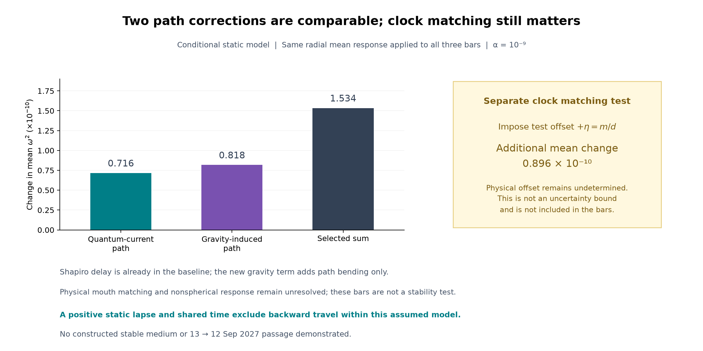

### Separate the field-path change from the optical delay

In the prescribed static metric

\[
ds^2=-(1-2U)dt^2+(1+2U)d\mathbf x^2,\qquad
U=m/r_++m/r_-,
\]

coordinate magnetic flux obeys div B=0 and curl[(1−2U)B]=0 at first order.
These follow from the curved-spacetime Maxwell constitutive equations;
see [Gibbons–Werner](https://arxiv.org/html/1903.00223). The metric is an
assumed gravitational background, not a proposed laboratory material.

The previously verified point-source solution changes the flux by
delta nu=epsilon S_g, epsilon=m/d, with

\[
S_g=2\nu(1/u-1),\qquad
b(\nu)\equiv\frac{\delta\bar L_{\rm path}}\epsilon
=\int_{-1}^1 S_g K_L\,ds<0.
\]

K_L is the path-variation weight checked in increment74. The harmonic
choice preserves the two charges and assumes no extra point multipoles or
imposed field at infinity. Actual finite-mouth data are not selected by
that choice. The same formula is independently verified by differentiating
the existing corrected contour and its arc length.

At the endpoints of the flux range,

\[
b(\nu)\sim-2C_L/\nu\quad(\nu\to0),\qquad
b(\nu)\sim-(2-\nu)\quad(\nu\to2),
\quad C_L=2+\operatorname{asinh}(\sqrt3)/\sqrt3.
\]

Unlike the quantum-current contribution, this particular far-path
fractional change tends to a finite coefficient: delta L/L→−2epsilon.
This fact does not repair the missing finite-q quantum description.

### Selected mean-state update and explicit missing inputs

At the saved benchmark m/r_e=1 and d/r_e=4.1882518008e9, the two new
fixed-collar mean forcings and their mean-throat-adjusted contributions are:

| Contribution | Fixed-collar forcing | After mean throat response |
|---|---:|---:|
| Quantum-current path change | 1.81690e-10 | 7.16140e-11 |
| Gravity-induced path change | 2.07568e-10 | 8.18141e-11 |
| Selected sum | 3.89258e-10 | 1.53428e-10 |

These are dimensionless changes of the frequency-squared state parameter,
not measures of stability or time-travel capability. All use the same
implicit denominator 1−F'=2.537067684 from the actual mean collar. Their
adjusted positive-mouth dipole change is 4.98747789e-10.

To avoid silently fixing missing clock/interface data, let eta be an
independent logarithmic offset of the clock converting exterior lengths
into throat time, and theta an independent added throat optical time,
both at fixed mean state. The resulting linear response is

\[
\boxed{\delta w_{\rm mean}
=1.53428154\times10^{-10}
 +0.375311365\,\eta-0.286907821\,\theta.}
\]

The mean-state clock response is already included in the denominator;
eta is an additional matching datum, not that same response counted twice.
A **test**, not a physical choice, eta=m/d changes the mean by 8.96105e-11,
comparable to either selected path contribution. The affine expression,
rather than its value at eta=theta=0 alone, is therefore the useful result
for the remaining matching problem.

### Finite cut and checks

For fixed global isotropic mouth spheres a=R_b/d, the arc-length variation
includes endpoint motion along each sphere. If u−s_c=2a, its exact addition
to the truncated curvature integral is 2E, where

\[
E=\frac{u_\epsilon(u-s_c)^2}{2\sqrt C(1-u_s)},\qquad
u_\epsilon=-\frac{2(u-1)(u^2-s_c^2)}{u^2+s_c^2}.
\]

The resulting difference is b_cut−b_point=−nu(2−nu)a^4+O_nu(a^5).
This fixed-sphere statement is not a bound on the real interface response
or on motion of the physical matching surface. Nine finite-cut cases
agree with independent direct contour and moving-endpoint differentiation
within 1.78e-15; their fourth-power limit is checked without subtracting
large nearly equal path lengths.

The 64/128 flux means differ by less than 7.8e-15 relatively for this new
gravitational term; the inherited quantum-current numerical uncertainty
remains that of increment74. Independent six-channel shape/contour
variations agree within 7.8e-16. Clock and throat-time sensitivities agree
with separate finite differences to 1.4e-11. A redundant extremely-long
path-length diagnostic triggered the old quadrature's roundoff warning;
it was replaced by the analytic leading-length normalization. The targeted
benchmark then passed with Python warnings promoted to errors.

### The static calculation has a causal limit

This construction assumes N>0 and a globally shared static time t,
with no time offset in the mouth identification. Then
g_inverse(dt,dt)=−1/N²<0: future causal curves increase t. **Within those
assumptions, static path/source corrections cannot enable a trip to the
past.** The benchmark throat optical crossing time is approximately
4.62506 d in exterior time units. A physical matched spacetime has still
not been constructed here.

The next decisive dependency is the physical mouth/clock matching and any
allowed relative-time driving. More decimal places in the static correction
cannot supply that mechanism. An actual orbital construction also needs
motion effects: [MMP Eq. 6.50](https://arxiv.org/html/1807.04726v3) gives
v²=r_e/d, so its clock correction enters at the same order considered here.
Nonspherical Einstein response, interface conditions, quantum endpoint
validity, preparation and dynamical stability remain open. No general
impossibility theorem for all time-travel proposals is claimed.

Reproduce this increment only:

```powershell
.\.venv\Scripts\python.exe -B -X utf8 -W error -c "from polyakov_response import save_gravity_feedback_benchmark; save_gravity_feedback_benchmark()"
.\.venv\Scripts\python.exe -B -X utf8 -c "from quantum_horizon_plot import gravity_feedback_progress; gravity_feedback_progress()"
```

Data: `results/polyakov_gravity_feedback_results.json`. Original inputs and earlier
results are unchanged. Existing contour and path-weight code was extracted
for reuse; focused comparisons verified that its values are preserved.

## First return-path feedback and the mean throat response

Increment74 follows the current-generated field through the paths and back
into the quantum source. **The selected magnetic response shortens the flat
return paths. Letting the existing mean throat and its clock respond reduces
the resulting mean source change by about 61%.** This is a conditional static
response calculation, not a dynamical stability result.

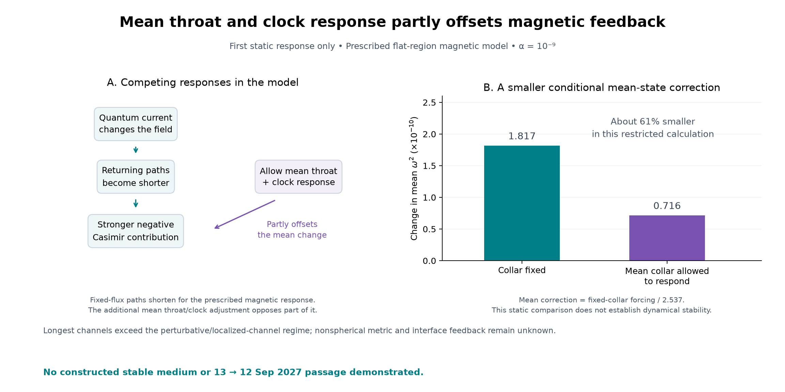

### From the current to the path length

With dimensionless separation units, solve
Delta_* w=−rho jhat_phi and delta nu=lambda w, lambda=8pi²alpha. The
azimuthal [free-space Green representation](https://arxiv.org/html/2510.11663v1)
gives

\[
w(\rho,z)=\frac\rho\pi\int_0^2d\nu'\int_{-1}^1ds'
 \frac{\widehat j_\phi V}{\sqrt D}H(m),\quad
D=(\rho+\rho')^2+(z-z')^2,\quad m=\frac{4\rho\rho'}D,
\]
\[
H(m)=\frac{(2-m)K(m)-2E(m)}m,\qquad
V=\frac{(u^2-s^2)^2}{16\sqrt{(1-s^2)^2+\nu^2s^2}}.
\]

K and E use the parameter m here, rather than the modulus sqrt(m); see
the [elliptic-integral definitions](https://dlmf.nist.gov/19.2). The cited
Green derivation assumes a localized source. Our source has a radius^-3
tail; its vector-potential integral converges at each finite point, and
the separate asymptotic calculation below handles that tail. No artificial
outer wall is imposed.

At fixed flux, delta X=−lambda w grad(nu)/|grad(nu)|². Varying the full flat
path length gives

\[
\frac{\delta\bar L_{\rm ext}}\lambda=\int_{-1}^1w K_Lds,\qquad
K_L=\frac{3u(1+s^2)(u^2-s^2)^2}
 {4\sqrt{(1-s^2)^2+\nu^2s^2}\,[u^2(1+3s^2)-s^2+s^4]^{3/2}}.
\]

Both H and K_L are positive, while the prescribed current is negative.
Thus w<0 and this path-length contribution is negative. Endpoint work
vanishes at the ideal point mouths. This does not determine endpoint work
at physical interfaces or the optical change from a perturbed metric.
At fixed common clock, the frequency-squared state parameter changes by
delta omega_nu²=−2 omega_nu² delta Lbar/Lbar, so its magnetic contribution
is positive.

### Allowing the mean throat to respond

Let w_mean be the mean frequency-squared parameter used by increment67,
and F(w_mean) its original complete-period mean map. Holding that collar
fixed gives a mean forcing 1.8168957623e-10. Recomputing the actual collar
at nearby w_mean changes its optical time and common clock, giving

\[
F'=-1.537067684,\qquad
\delta w_{\rm mean}=\frac{\delta F_{\rm magnetic}}{1-F'}
 =7.16140044\times10^{-11}.
\]

The retained fraction is 0.39415582. The mean clock fractional change is
−1.15602484e-10. The corrected angular channel changes include both the
direct magnetic forcing and their derivatives with respect to w_mean;
their weighted mean equals the computed delta w_mean. Their positive-mouth
dipole change is 3.50610719e-10. The magnitude of F' is **not** an eigenvalue
of physical time evolution: it cannot diagnose dynamical instability.
This linear mean adjustment also leaves the nonspherical Einstein response
and physical interface conditions unresolved.

### Longest paths expose a limitation

For nu→0, define C=2+asinh(sqrt(3))/sqrt(3). The far-field stream obeys

\[
w_\infty''(\mu)=\frac{(1-\mu^2)^2(1+\mu^2)}
 {4C^2(1+3\mu^2)^{3/2}},\qquad w_\infty(\pm1)=0.
\]

Its midpoint is −0.00974685794. Consequently

\[
\delta\bar L/\lambda\sim-0.02205264214/\nu^2,\qquad
\delta\bar L/\bar L\sim-0.00798908621\,\lambda/\nu.
\]

The first frequency-moment correction converges, but the fractional path
correction is not uniformly small as nu→0. The [underlying channel
model](https://arxiv.org/html/1807.04726v3) also loses localization when
nu q is of order one. Neither a convergent integral nor a tiny bulk response
controls the missing endpoint quantum state. An unweighted average of the
length variation would diverge and is not a valid substitute for the
frequency-weighted calculation.

### Checks and remaining work

Eight Duffy triangles handle each Green kernel's integrable self-ring
logarithm. A reciprocal source-flux coordinate resolves long paths;
interpolation removes the known quadratic zero of the state frequency.
Refining flux/path/source orders from 64/24/32 to 128/48/64 changes the mean
forcing by 8.32e-7 and dipole forcing by 8.42e-7 relatively. The coefficient
interpolation comparison is 2.09e-7. These are numerical diagnostics, not
physical uncertainty bounds. Independent angular integration and Cartesian
path variation agree with their kernels; a Cartesian Maxwell residual
converges at second order and extrapolates to 2.86e-7 relatively. Five exact
far-limit identities and an independent ODE integration also pass.

The next missing terms are the nonspherical optical/metric response and
physical interface contribution to the same complete-loop variation.
Unknown corrections must replace the modeled contribution where its
approximation fails. No prepared material, stable medium, new experimental
physics discovery or 13 September 2027 → 12 September 2027 passage follows.

Reproduce only this increment (about a minute for the fine quadrature):

```powershell
.\.venv\Scripts\python.exe -B -X utf8 -c "from polyakov_response import save_return_feedback_benchmark; save_return_feedback_benchmark()"
.\.venv\Scripts\python.exe -B -X utf8 -c "from quantum_horizon_plot import return_feedback_progress; return_feedback_progress()"
```

The full data and explicit assumptions are in `results/polyakov_feedback_results.json`.
Earlier results and inputs are preserved.

## Returning current supplies a finite magnetic contribution

Increment73 replaces an artificially clamped patch calculation with a
free-space Biot–Savart integral for the prescribed returning-channel current.
**Its contribution is finite, negative in the chosen orientation, and of
the same order as the quantum dipole source.** This supplies one additive
magnetic input; it does not select the complete coupled boundary data.

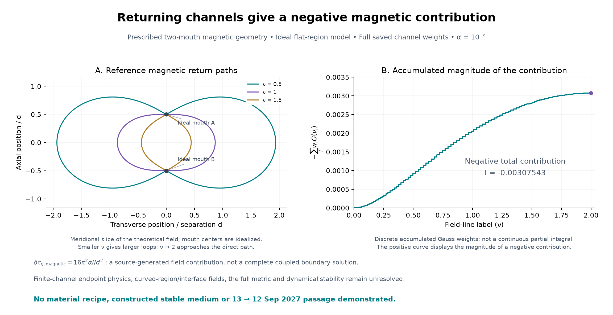

### Assumptions and result

Use the full increment67 flux profile and optical periods, with all lengths
expressed in mouth-separation units d. The assumed flat-region current is

\[
\widehat j_\phi=-\frac{(\mathbf t\times\boldsymbol\kappa)_\phi}
 {12\overline L(\nu)^2},\qquad \widehat j=j d^3,
\]

where t is the **unit** field tangent and kappa its curvature. The physical
magnetic field is q b/(2d²). The channel volume element is
2 pi d³ (speed/|b|) dnu ds, while the saved flux weights integrate dnu/2.
Pairing both halves of each path gives a compact, negative integrand:

\[
I=\frac12\int_0^2G(\nu)d\nu,\qquad
G=-\int_0^1\frac{(u^2-1)u^2(1+s^2)(u^2+3s^2)}
 {4\overline L^2 C^{3/2}(u^2+s^2)}ds,
\quad C=u^2(1+3s^2)-s^2+s^4.
\]

Here u is the existing prolate field-line coordinate. Numerically,

\[
I=-0.003075432322285623,\quad
\delta B_z=\frac{g^2}{d^2}I,\quad
\delta c_g^{\rm magnetic}=\frac{16\pi^2\alpha}{d^2}I
 =-2.76860076568\times10^{-29}.
\]

The last expression uses the existing canonical RN magnetic convention,
alpha=g²/(4pi²q), and the fixed benchmark alpha=1e-9. It is a **magnetic
contribution**, not a solved coupled RN master amplitude. Relative to the
classical companion input −2/d² it is +2.42826403e-10; relative to the
reference quantum dipole amplitude it is −2.23118834. Those comparisons
explain why a tiny correction still belongs in this order of calculation.
Neither number measures stability or proximity to a working device.

### Numerical and analytic checks

The 64/128 flux rules and 64/128/256 path rules change I by at most
1.59e-13 relatively. A separately evaluated Cartesian current, field
derivative and path Jacobian reproduce the 64-node result to 2.23e-16.
The worst Cartesian point loses precision near the axis (1.07e-8 relative
pointwise difference); a 50-digit Cartesian evaluation resolves it and
agrees with the compact formula to 1.41e-13. These are convergence and
consistency diagnostics, not rigorous numerical or physical error bars.
The source helper's original default behavior is preserved exactly in
the three compatibility samples.

At nu→0, G≈−0.03018945214 nu; at nu→2,
G≈−(pi/32+1/6)(2−nu)/(2 Lbar(2)²). Both formal endpoints are integrable.
The near-mouth current's dipole projection depends on Wbar0−Wbar2/5
=0.7805729671, where Wbar=4pi²/Lbar²; it is not set by Wbar1.

For an excised point-model ball of radius a=99/d, let
C_a=(1+2a+2a²)/(1−2a)³ and Wmax=(2pi/Lmin)². A valid lower period bound is
Lmin=clock*throat_optical_time/d+1−198/d, using f(nu)≥1 and positive Shapiro
delay. The upper-mouth omitted |I| is at most Wmax C_a a²/(48pi²);
the lower-mouth bound is Wmax C_a a⁵/[120pi²(1−a)³]. Their sum is below
1.48e-18, or 4.79e-16 of |I|. **This bounds only the omitted assumed flat
point-current. It places no bound on the actual throat/interface response.**

### Physical limit and next dependency

The [Maldacena–Milekhin–Popov model](https://arxiv.org/html/1807.04726v3)
provides the magnetic-channel framework. Appendix E requires nu q much
larger than one for localized field-following channels. Extending our
continuum current to nu=0 is therefore formal: the small formal tail is
not an error bound on the missing finite-q quantum state. The far current
falls as radius^-3; its center field converges although the usual total
magnetic dipole moment diverges. A vacuum dipole outer condition would
discard this distributed source.

Where the flat/channel approximation fails, the unknown correction is the
actual current contribution minus the one already included formally. It
must replace that modeled contribution, rather than count it a second time.

The next dependency is coupled exterior response and its effect on channel
periods, together with the unknown interface contribution. These are not
fixed by adding the single magnetic coefficient computed here. The cited
wormhole itself preserves ambient causality. This calculation neither
demonstrates manufacture nor enables 13 September 2027 → 12 September 2027.
The current integral and checks are our calculation within the stated model;
we have not established a new physical discovery.

Run only this increment:

```powershell
.\.venv\Scripts\python.exe -B -X utf8 -c "from polyakov_response import save_return_current_benchmark; save_return_current_benchmark()"
.\.venv\Scripts\python.exe -B -X utf8 -c "from quantum_horizon_plot import return_current_progress; return_current_progress()"
```

Results: `results/polyakov_return_current_results.json`. The earlier collar
transport result and full flux-profile input remain unchanged.

## The large local terms partly cancel in the boundary response

Increment72 follows the corrections identified in increment71 through
the existing outer collar, from R=10 to R=100. **The leading local terms
cancel when projected onto the growing boundary mode. A smaller, finite
correction remains.** An independent analytic calculation agrees with the
numerical result. This is a calculation within our assumed static channel
model, not a new experimentally established physical effect.

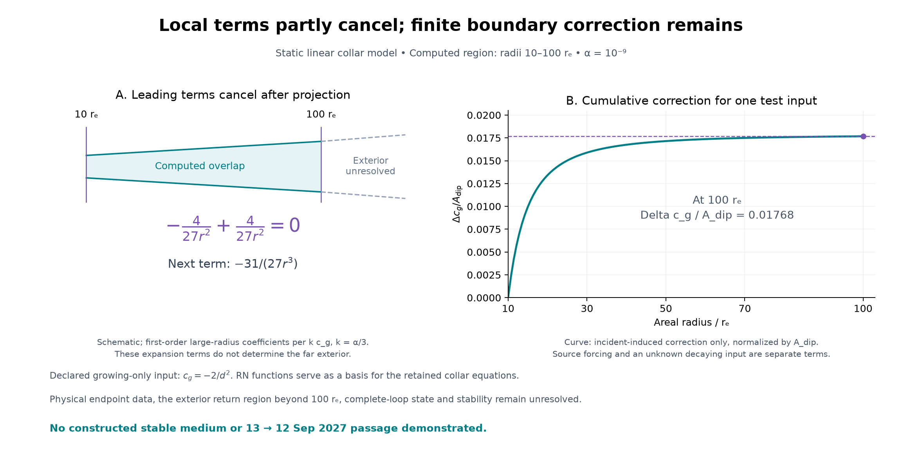

### Propagation that retains the missing terms

Write the two invariant fields as

\[
Y=(P,X)^T=\Phi_{\rm RN}(R)c+A_{\rm dip}y_p(R).
\]

Phi contains the growing and decaying RN solutions, expressed in the
same (P,X) variables as our quantum collar; y_p is the sourced RN
particular solution. Here RN functions are a convenient basis, not a
physical interface to electrovacuum. For outward proper distance l,

\[
Q=M_{\rm full}-\frac{B}{B_{\rm RN}}M_{\rm RN},\qquad
E=\Phi^{-1}Q\Phi,\qquad
\frac{dc}{dl}=Ec+A_{\rm dip}z,
\]
\[
z=\Phi^{-1}\!\left[
Qy_p-b_{\rm full}\frac{A_c^2}{N^2}
+\frac{B}{B_{\rm RN}}\frac{b_{\rm RN}}F\right],
\quad B=\frac{dR}{dl},\ B_{\rm RN}=\sqrt F.
\]

Both the radial-coordinate correction and the affine source term are
included. The RN basis has determinant −3/B_RN, giving an analytic inverse
that avoids numerical matrix inversion. This reuses the full local
operator already checked against the component field equations. The
published [RN polar dipole analysis](https://arxiv.org/abs/gr-qc/9507012)
supplies the background framework; this transport calculation is ours.

### Why the local comparison did not determine the final change

At first order in k=alpha/3, at fixed R>1 in the outer region, the
homogeneous mismatch for a growing input approaches

\[
k c_g\left(-\frac49,\frac{4}{9R}\right).
\]

The two leading contributions to the growing projection are proportional
to −4/27 and +4/27. Their sum is zero. The surviving radial response is

\[
\frac{dc_g}{dR}=-\frac{31k c_g}{27R^3}+O(R^{-4})
\]

at this order. The code also retains the full rational expression before
the large-R expansion, and verifies the three background equations and
the projection algebra exactly. This expansion is not uniform near the
throat or at arbitrarily large radius; it does not justify extending the
radial channel model to infinity.

The refined finite-band calculation gives

\[
c_{100}=(I+D)c_{10}
+A_{\rm dip}\left[a+(1-e^{-2\epsilon})a_{\rm clock}\right],
\]
\[
D\simeq\begin{pmatrix}
-1.92398827\times10^{-12}&-2.27185191\times10^{-15}\\
-6.52512232\times10^{-7}&9.49121979\times10^{-12}
\end{pmatrix},
\]
\[
a\simeq\binom{-2.56812229\times10^{-13}}{-1.36901473\times10^{-7}},
\qquad
a_{\rm clock}\simeq\binom{0.02577762}{2213.32694}.
\]

The endpoint coefficients remain inputs. In particular, the decaying
amplitude is not set to zero as a physical condition. A growing-only
test input c_g=−2/d² gives the accumulated homogeneous correction
Delta c_g=2.19364754e−31, or Delta c_g/A_dip=0.0176784 in our normalized
units. This is a diagnostic column of the response, not the total change
of a matched spacetime, an amount of matter, or a percentage of progress.
Changes of the decaying coefficient in this basis do not by themselves
measure an instability.

### Keeping a tiny clock correction measurable numerically

The source correction involves the difference of nearly equal clock
factors. We therefore integrate the small quantity delta_0 directly:

\[
\delta_{0,l}=A-\frac{B}{R(R-1)},\qquad
\delta_0(100)=\log\frac{B(100)}{B_{\rm RN}(100)}.
\]

Here A=d(log N)/dl. The actual log ratio is
log[N/(A_c B_RN)]=delta_0+epsilon, with
epsilon=log[N(100)/(A_c B(100))]. Thus epsilon=0 follows the existing
operational clock calibration A_c=N(100)/B(100); the separate a_clock
column preserves deviations from that calibration. We do not silently
select epsilon using a subtraction of rounded large logarithms.
The reconstruction differs from the saved background log values by at
most 1.44e−13. This finite input precision is distinct from the 70-digit
arithmetic used to subtract local operators.

All transfer entries were checked between 513 and 1025 coefficient
samples and two background refinements; the largest relative change
is 3.93e−7. Splitting propagation at R=30 reproduces the full transport,
including both source columns. A determinant identity also passes.
Integrating the independently derived first-order rational expression
gives D_gg=−1.92398827049e−12, agreeing with the full result within
1.56e−9 relative. An independent replay reproduced the saved data.

### What remains outside this result

The next connection is to the nonspherical region where magnetic paths
bend and return, including its quantum current, metric response and
complete-loop state. R=10–100 is still within the existing radial collar;
it is not the complete exterior. The boundary data, state feedback and
dynamical stability remain unselected or unsolved. The underlying
[magnetic/Casimir construction](https://arxiv.org/html/1807.04726v3)
is a long wormhole without ambient causality violation. Nothing here
establishes a stable manufactured medium or passage from
**13 September 2027 to 12 September 2027**.

Saved results: `results/polyakov_overlap_results.json`. Reproduce only this
increment with
`.\.venv\Scripts\python.exe -B -X utf8 -c "import polyakov_response as p; p.save_overlap_transport_benchmark()"`.
The preceding increment71 still reproduces its saved output exactly.

## A smooth center fixes one boundary; the exterior needs its quantum terms

Increment71 removes one arbitrary input in the **reflection-even static
sector** of our assumed throat. It also finds that a state-only
Reissner–Nordström (RN) exterior approximation is insufficient to calculate
the first quantum correction for the tested companion field. This is
progress in specifying and testing a conditional model, not evidence of
a constructed medium, dynamical stability or a new discovery in physics.

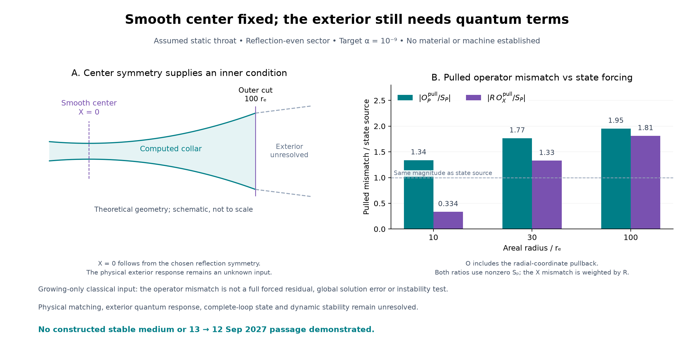

### The inner boundary is now derived within a stated symmetry sector

For reflection through the center, using fixed internal magnetic-flux
labels, the invariant field P is even and its companion X is odd.
Smoothness therefore requires X(0)=0, while P(0) is initially free.
We integrate from the center to the previous artificial cut x=0.5 and
compose that response with the already checked collar operator.
This gives, at the outer radius R=100 in units r_e=1,

\[
X_{\rm out}=0.02000000000002\,P_{\rm out}
 -(6.02214655\times10^{-12})\alpha^2\delta w,
\]
\[
P(0)=(2.66577487\times10^{-24})P_{\rm out}
 -0.01608599836\,\alpha^2\delta w.
\]

The center thus no longer supplies an arbitrary second boundary value.
The exterior still has to determine P_out. These equations describe a
static linear response in this symmetry sector; generic asymmetric
mouth data and time-dependent perturbations are outside this calculation.
No relation here is a time offset in seconds.

### The complete saved flux profile fixes the source orientation

Use the current reference state's common clock
\(A_c=6.16595813737\times10^9\), separation
\(d=4.18825180078\times10^9 r_e\), and \(\alpha=10^{-9}\).
These belong to the assumed benchmark, not measured or manufactured hardware.
The positive-mouth exterior harmonic is Y=1−nu, opposite the earlier
internal plotting coordinate mu=nu−1. Projection over **all** saved flux
channels gives

\[
\delta w_Y=-1.41529346347,\qquad
A_{\rm dip}=-\frac{\alpha\,\delta w_Y}{3A_c^2}
 =1.24086376432\times10^{-29}.
\]

This is an amplitude in the normalized stress tensor
rho_1=p_r1=A_dip/(R²F), not an amount of matter or an SI energy density.
Direct projection of the channel periods agrees with projection of their
state frequencies. The 64- and 128-node amplitudes differ by 2.11e−15
relative. This replaces the old retained-band source for this reference
state; adding the old band result would double-count incompatible data.
The finite angular profile itself is not a proof that a linear
susceptibility captures all nonlinear angular feedback.

### Why the apparently accurate exterior shortcut is insufficient

The RN source enters the momentum map as well as the differential equation:

\[
\Pi=\sqrt F X-\frac{2F P}{R(3R-2)}
              -\frac{2R A_{\rm dip}}{3R-2}.
\]

Dropping the last term would incorrectly match the forcing. Our code checks
both homogeneous solutions, the sourced particular solution and this map
symbolically: all eight residuals vanish exactly. The existing RN polar
dipole framework is published; this source map is our derivation from our
previously component-checked equations. See
[Burko's polar dipole analysis](https://arxiv.org/abs/gr-qc/9507012).

But the full collar also contains polarization and background-response
terms. Test their local omission on the growing classical companion input
\(Y_{\rm class}=c_g(g,X_g)\), where
\(c_g=-2/d^2=-1.140156396\times10^{-19}\).
Pull this radial RN test field onto the collar's proper-distance
coordinate. With B=dR/dl and B_RN=sqrt(F), define
O=[M_full−(B/B_RN)M_RN]Y_class and S=b_RN*eta. At R=100, the omitted
first-component term has magnitude about **1.95 times** S_P; the second,
scaled by R to compare dimensions, has magnitude about **1.81 times** S_P.
The RN second-component state forcing is exactly zero, so no ratio to
that zero component is used. These are local classical-operator
mismatches on a specified test field, not the full forced residual or
error bounds on a global solution. The saved data also retain the
matrix-only comparison (M_full−M_RN)Y_class separately; it omits the
radial-coordinate correction and must not be confused with O above.

The ordering explains the issue: c_g is of order alpha², while the
redshifted state amplitude is of order alpha³. Omitted terms of order
alpha*c_g can therefore compete with the retained quantum source even
when the classical geometry is very accurately approximated by RN.
High precision in the classical coefficients does not solve this issue.

For reference, combining the center relation with the RN algebra gives

\[
P_{\rm out}=9866.77852\,c_g
 +(3.92283531\times10^{-30})\delta w_Y
 +33.61357824\,\Xi_{\rm ext}.
\]

Xi_ext retains the unspecified exterior correction in this representation.
It must **not** be set to zero and called a completed quantum solution.
Nor does this algebra bypass the previously established nonzero quantum
normal pressure: an abrupt exact match to a source-free RN exterior still
requires additional physical interface conditions. Moving cuts and the
complete returning-field state remain to be solved.

### What this means for the original goal

The next useful calculation must retain the exterior quantum response and
its coupling to the returning channels. Repeating state-only RN matching
would not settle the relevant order. The underlying
[Maldacena–Milekhin–Popov construction](https://arxiv.org/html/1807.04726v3)
uses a long wormhole and explicitly does not violate ambient causality;
our conditional refinements do not turn it into a past-travel mechanism.
**13 September 2027 → 12 September 2027 remains unproved**, even for a
tiny abiotic tracer. No manufacturable exotic matter or dark-matter recipe
has been obtained.

Reproduce this increment only with
`.\.venv\Scripts\python.exe -B -X utf8 -c "import polyakov_response as p; p.save_center_exterior_benchmark()"`.
Results are in `results/polyakov_center_results.json`. Core/collar coefficient
refinement differs by at most 3.19e−11 relative; parity and composition
checks pass. An independent replay reproduced the saved result exactly;
the local omission diagnostic also agrees between two background
refinements. The code retains explicit assumptions and the unknown
exterior term instead of converting them into selected boundary data.

## Movable boundary geometry and the collar's optical feedback

The solved collar response now predicts the actual geometric and magnetic
quantities needed at an interface, including movement of the interface.
We also calculated this collar's contribution to the optical-length
variation that changes its quantum state. These results are assembled
into one linear response matrix; the surrounding spacetime must still
supply compatible boundary data.

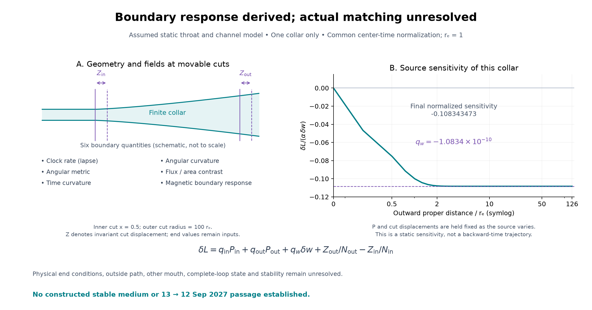

### Geometry that can be compared across an interface

Write the displaced cut as l=c+zeta*cos(Theta), with an angular relabeling
theta=Theta+beta*dTheta(cos(Theta)). Define the invariant embeddings

\[
Z=\zeta+\frac{RB}{2D}v,\qquad
\beta_* =\beta+\frac{B^2}{2D}v,\qquad D=B^2-RB_l-1.
\]

For the invariants P and X derived in increment69, the six boundary
coefficients are

\[
\begin{aligned}
\delta\ln N_\Sigma&=h_0/2+AZ,\\
\tfrac12\delta\ln\gamma_{\Theta\Theta}&=BZ/R-\beta_*,\\
\delta K^t{}_t&=q_0/2+A_lZ,\\
\delta K^\Theta{}_\Theta&=-DZ/R^2,\\
\delta(\mathrm{cap\ flux-area\ contrast})&=P/4-BZ/R,\\
\delta F_{n\phi}&=X/2+2Z/R^2.
\end{aligned}
\]

The first four multiply cos(Theta); the cap contrast and normal-field
coefficients multiply sin^2(Theta). The normal points toward increasing
proper distance at both cuts, and phi remains a coordinate index.
The cap contrast uses the same normalized magnetic flux minus normalized
area convention as our earlier finite-RN boundary calculation.

Here h_0=C(P+KX)/(R^2 H)+eta/H and
q_0=(-A+B/R)h_0+C X/R^2, with K=RB+kA,
H=1+kd+K(A-B/R), eta=k*delta_w/N^2 and k=alpha/3.
q_0 is the actual metric derivative in the locally selected v=0
representative. Differentiating h_0 while selecting a new representative
at every point would give the wrong boundary curvature.

A direct symbolic calculation starts from an arbitrary perturbed metric,
pulls it back to the displaced surface, normalizes the surface normal,
and calculates extrinsic curvature from the connection. All six
expressions agree exactly. All six also cancel exactly for a pure
coordinate perturbation with the compensating surface displacement.
No Einstein equations are needed for that geometric check.

Using the previously solved collar response, the code now maps seven
inputs, (P_inner,P_outer,Z_inner,Z_outer,beta_inner,beta_outer,delta_w),
to twelve boundary observables and one optical-length change. The
13-by-7 matrix is saved in `results/polyakov_embedded_results.json`. It preserves
the coupling between the cuts; it does not choose their physical values.
Two local compatibility relations per cut provide an additional check
on the boundary reconstruction, with numerical residual below 2.22e-16.

### Optical length with the coordinate contribution removed

Along a static magnetic channel, the original first-order optical change is

\[
\delta L_{\rm collar}
=\int\frac{v-h}{2N}\,d\ell+
\left[\frac{\zeta}{N}\right]_{\rm inner}^{\rm outer}.
\]

Under a radial coordinate shift T, the integrand changes by (T/N)_l
and the endpoint term by -[T/N]. They cancel. The regular quotient gives

\[
\delta L_{\rm collar}
=-\int\frac{h_0+RF_0/D}{2N}\,d\ell+
\left[\frac{Z}{N}\right]_{\rm inner}^{\rm outer},
\]

where F_0=B*v_l evaluated in the local representative is already fixed by
the field equations. The small P coefficient is factored with an explicit
k before numerical evaluation. This avoids subtracting two nearly equal
vacuum contributions. Endpoint displacement is retained throughout.

For the target alpha=1e-9 collar from x=0.5 to R=100*r_e, the result is

\[
\begin{aligned}
\delta L_{\rm collar}={}&
4.67821138021\,10^{-10}P_{\rm inner}
-2.75707353542\,10^{-11}P_{\rm outer}\\
&-0.877582562048\,Z_{\rm inner}
+1.63818986052\,10^{-10}Z_{\rm outer}\\
&-1.08343472503\,10^{-10}\delta w.
\end{aligned}
\]

These are dimensionless coefficients in the common center-time
normalization, not seconds or a calendar offset. The angular relabelings
cancel. The last coefficient holds the invariant endpoint values and
embeddings fixed; it is not the response of physically unconstrained mouths.

For the saved delta_w=3*s1, that fixed-input contribution is
-1.53337808443e-10. The plotted cumulative response shows where along
this one collar it accumulates. All seven columns of the combined
boundary operator agree within 1.31e-13 relative under refinement. Optical
coefficients agree within 6.52e-12 relative; independent integrations
agree with the quadrature components within 5.17e-15 absolute. Numerical
agreement does not bound the omitted quantum or nonlinear physics.

### What remains before this can describe a physical medium

To join two regions smoothly, the boundary geometry and its extrinsic
curvature must satisfy the junction conditions; a discontinuity requires
the corresponding specified surface layer. This is the established
[Mars-Senovilla junction framework](https://arxiv.org/abs/gr-qc/0201054).
Our six coefficients are the corresponding local data for this model,
including the magnetic field conditions.

The background quantum normal pressure is still nonzero: approximately
-4.92e-10 at the inner cut and -3.33e-22 at R=100 in the saved normalization.
Therefore an abrupt exact join to a purely electrovacuum exterior remains
incompatible with a layer-free matching. Its small size alone cannot
justify silently deleting a source while claiming an exact solution.

Next, combine this boundary operator with the exterior field response and
the complete-loop state equation delta_w=-2w*deltaL_full/L_full. The outer
paths, the other side, physical embeddings and clock normalization all
contribute. This new calculation supplies one missing part of that
equation; it does not close it. The
[published MMP framework](https://arxiv.org/html/1807.04726v3) supplies the
channel/Casimir starting point. The embedded operator and optical response
above are our conditional derivations, not a published new discovery.

**A stable manufactured medium and 13 September 2027 to 12 September 2027
travel remain unproved**, including for a tiny abiotic tracer.

Reproduce only this increment:
`.\.venv\Scripts\python.exe -B -X utf8 -c "import polyakov_response as p; p.save_embedded_collar_benchmark()"`.
Source: EMBEDDED_COLLAR block. The existing boundary solver gained only
an optional return of its dense solutions so this calculation can reuse it.

## Target-parameter invariant response and the full collar boundary map

The target alpha=1e-9 calculation now converges efficiently. We removed
the residual coordinate mode, factored the small quantum forcing before
evaluating it, and retained cancellation-safe background derivatives.
We also calculated the complete linear response operator for one side of
the assumed wormhole: from the inner cut x=0.5 to the outer cut R=100*r_e.
The operator accepts physical boundary values; it does not determine them.

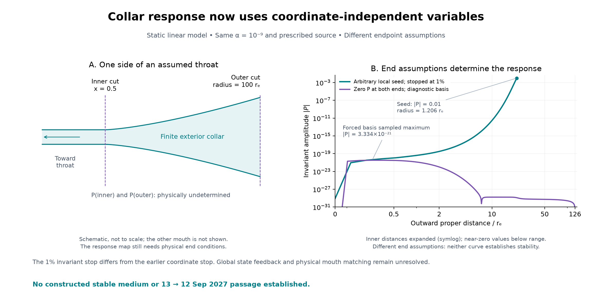

### What the calculation establishes

The previous three-variable system contains a coordinate mode that is
very stiff near the throat. Removing it leaves two quantities that do not
change under that residual coordinate transformation. In the conventions
of the following increment68 section, define D=B^2-R*B_l-1 and

\[
P=2m+\frac{2B^2}{D}v,\qquad
X=2m_l-\frac{2B}{RD}v.
\]

Both vanish for the homogeneous coordinate mode
(m,m_l,v)=V*(-2,2/(RB),2D/B^2), V_l=-V/(RB). They retain the physical
static dipole response. A convenient local representative is v=0,
m=P/2, m_l=X/2. With F=B*v_l, the quotient equations become

\[
P_l=X+\frac{2BF}{D},\qquad
X_l=2m_{ll}-\frac{2F}{RD}.
\]

These equations have no 1/B singularity. They still require nonzero D
and the other declared denominators; their removal is not assumed.
For the saved finite collar, min|D|=0.0298 and minH=0.0298, with C>1.
The full matrix is in `_invariant_collar_matrix`. The physical forcing is
eta=k*delta_w/N^2, k=alpha/3. Its small coefficients are evaluated as

\[
b_P=\frac{2B(B^2-1-RAB)}{RDH},\qquad
b_X=-\frac{k(A_l-d)[2R(B_l+2AB)+k(A^2+d)]}{CDH},
\]

where d=w/N^2 and H=1+kd+(RB+kA)(A-B/R). Direct subtraction of the
original large terms loses this small source. At one independently
checked near-throat state, b_P is about 3.15e-9 and b_X about 3.51e-19.
The background B_l is likewise evaluated with the existing scaled mass
and radius variables, rather than subtracting 1-R^-2-B^2.

Two independent background states were checked at 70-digit precision
against the original equations and differentiated coordinate generator.
The largest gauge, matrix or source discrepancy is below 9e-71. These
are local algebra checks; the numerical integration has separate checks.

### The old arbitrary seed, now at the target parameter

The initial data are the same conditional seed as before: m=m_l=0,
v=-alpha*s1/N^2 at x=0.5, with delta_w=3*s1 frozen. We stop at |P|=0.01.
This is an invariant-amplitude convention, different from increment68's
coordinate-amplitude gate; the two reported radii are not comparable
instability thresholds.

| Check | Result |
|---|---:|
| Target alpha | 1e-9 |
| Radius at the invariant 1% gate | 1.206168195323*r_e |
| Proper distance from the inner cut | 21.340323695190*r_e |
| Gate-radius change under refinement | 6.29e-13*r_e |
| Right-hand-side evaluations, coarse / refined | 3227 / 6422 |
| Agreement with saved amplified-alpha raw-variable P | 4.78e-13 absolute |

In local timing trials the factored target integration took about 0.08s;
background construction and the other checks take additional time. The
unfactored quotient pilot required over 20s and about one million function
calls. Factoring and appropriate absolute tolerances resolved that
numerical bottleneck. This is a computational improvement, not new physics.

### Boundary response without selecting the missing physical boundaries

Let L=126.308338311159*r_e be the proper distance to R=100*r_e. The solved
linear operator gives, in dimensionless r_e=1 units,

\[
\begin{pmatrix}X(0)\\X(L)\end{pmatrix}
=\begin{pmatrix}
-2.770812416173&2.39564648777\,10^{-23}\\
-4.47197101871\,10^{-33}&0.0200000000000
\end{pmatrix}
\begin{pmatrix}P(0)\\P(L)\end{pmatrix}
+\chi\begin{pmatrix}-0.219577107805\\-1.80664396419\,10^{-11}\end{pmatrix},
\qquad \chi=\frac{\alpha^2\delta w}{3}.
\]

X uses increasing proper distance at both endpoints; it is not an
outward normal derivative with opposite signs at the two ends. The
homogeneous coefficients come from forward and backward integrations.
The logarithmic Wronskian consistency error is 8.53e-13; the tiny coupling
entries agree to 4.94e-11 relative under refinement. Their small values
are static response coefficients, not transmission probabilities or a
stability proof.

The affine source basis is solved separately by collocation with P=0
at both cuts. This is a basis used to represent arbitrary endpoint data,
not a claim that the physical wormhole has those endpoints. For the saved
delta_w=3*s1 it gives sampled max|P|=3.33429e-21. This number describes
one invariant component of that particular basis, not all metric changes.
The scaled affine profile changes by 6.39e-12 under refinement; the final
differential-equation residual is 3.52e-11. Collocation solves N*(P,X)
and then removes that scaling. Without it, absolute-error control missed
the small intermediate tail even though the peak appeared converged.
Six regional checks now agree within 2.56e-5 relative to each region's
peak magnitude, including that tail. This is not a pointwise relative
error bound at zero crossings or a certified physical error estimate.

The tiny forced basis and the growing seed solve different boundary
problems. Together they show why a growing arbitrary seed cannot decide
physical instability. The actual solution requires the throat-side
conditions, exterior matching, endpoint geometry and complete-loop state
feedback. Nonlinear angular mixing and time-dependent perturbations
remain outside this static linear operator.

### Next direction and the yesterday example

Next, express the induced metric, curvature and magnetic data at each
finite cut in these variables and combine them with the exterior and
state equations. The previously missing local collar response is now
available for that matching calculation. A physical source, formation
mechanism and stable medium are still unproved.

The underlying channel framework is the published
[Maldacena-Milekhin-Popov model](https://arxiv.org/html/1807.04726v3).
The quotient, factored formulas and boundary map here are our conditional
derivations and numerical results, not formulas or discoveries attributed
to that paper. **13 September 2027 to 12 September 2027 remains unproved**,
even for a tiny abiotic tracer.

Reproduce only this increment:
`.\.venv\Scripts\python.exe -B -X utf8 -c "import polyakov_response as p; p.save_invariant_collar_benchmark()"`.
Source: INVARIANT_COLLAR block. Data: `results/polyakov_invariant_results.json`.
Earlier source blocks and benchmarks are preserved.

## Conserved mouth sources and a first coupled outward trial

The local angular response now has explicit equations through the
varying-radius collar, including the quantum stress and the induced
electric current from bending magnetic channels. The source and current
come from the same specified channel action. Both conservation identities
and all ten Einstein/four Maxwell component reductions pass. A conditional
outward integration also passes refinement checks at amplified alpha.
This supplies a coupled linear model, not a physically matched or stable
medium.

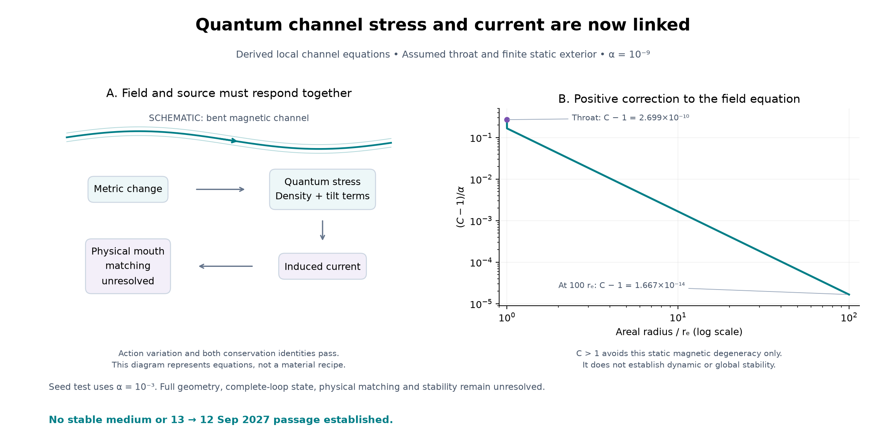

### What changed physically

Previously the leading product throat admitted h_tt=h_xx=H(theta), with
no magnetic perturbation. Extending that expression through a widening
mouth is not enough. The old source is conserved on the unperturbed
spherical geometry, but changing the metric also changes its covariant
divergence. The neglected connection terms act on the nonzero quantum
background stress. Small metric amplitude alone does not eliminate this
requirement.

Our extension follows the magnetic-flux channels used in the
[Maldacena-Milekhin-Popov lowest-Landau-level construction, sections 2.3 and 3.1](https://arxiv.org/html/1807.04726v3#S2.SS3).
The specific collar action variation and equations below are our
derivation, not formulas quoted from that paper. They assume neutral,
static channels that follow smooth magnetic flux and retain specified
state constants. They are not the full four-dimensional quantum
determinant or a material-generation procedure.

### Stress and current from one action

Use ds^2=N^2(-dt^2+dx^2)+R^2 dOmega^2, sigma=log N, and
F_theta_phi=2Q sin(theta). The normalized quantum stress is
S=8*pi*G*T in natural units; Maxwell and force conventions are
div F=-J and div S=F.J/2. Write the dipole perturbations as
delta g_tt=g_tt*h*cos(theta), delta g_xx=g_xx*v*cos(theta), and
delta A_phi=m*sin^2(theta).

The perturbed flux labels move by
delta theta=-m*sin(theta)/(2Q). Consequently their density and direction
both change. The source acquires a density term (m/Q)S_ab and a tilt term
delta S_x_theta=-R^2*p*m_prime*sin(theta)/(2Q). These terms must be
included together. Here rho and p are the background quantum energy
density and radial pressure, not total electromagnetic stress.

For k=alpha/3 and w=Omega^2, the intrinsic Polyakov source variation is

\[
\frac{\delta S_{tt}}{\cos\theta}
=\frac{k}{R^2}\left[h''-\sigma'v'
 +(2\sigma''-\sigma'^2)(h-v)-\delta w\right]
 +\frac mQ N^2\rho,
\]
\[
\frac{\delta S_{xx}}{\cos\theta}
=\frac{k}{R^2}\left[-\sigma'h'+w(h-v)-\delta w\right]
 +\frac mQ N^2p.
\]

Primes here mean conformal x derivatives. Varying the channel-displacement
action independently of Maxwell's equation gives

\[
J^\phi=-\frac{\rho h-pv}{2Q}
-\frac{(R^4p\,m')'}{2Q^2N^2R^2}.
\]

Direct four-dimensional divergence checks give exactly zero for the
radial Ward residual and for the angular residual after subtracting the
Lorentz force. Thus the current is derived from the proposed action;
it is not a force chosen solely to cancel a failed conservation test.

The resulting magnetic equation is

\[
(C m')'-\frac{N^2}{R^2}[2m+Q(h+v)]
=\frac{N^2R^2}{2Q}(\rho h-pv),\qquad
C=1-\frac{R^4p}{2Q^2}.
\]

The existing state has p<0, so C>1. This particular static magnetic
operator does not lose its highest-derivative coefficient. For the
alpha=1e-9 collar, the sampled maximum C-1, including the throat, is
2.69914e-10; at R=100 it is 1.66667e-14. This is a coefficient check,
not a proof of dynamical stability or control of every homogeneous mode.

### The gravity equations and the trial that was actually run

The implementation now retains the background quantum trace when
converting linearized Ricci equations to Einstein equations. Reusing the
electrovacuum conversion would drop terms of the same order as the new
quantum response. In proper distance l, with A=d(log N)/dl and B=dR/dl,
the mixed constraint is

\[
\dot h=-A(h-v)+\frac BR(h+v)+\frac{2C}{R^2}\dot m
\quad(Q=1).
\]

The radial, temporal, angular and Maxwell equations, plus both source
variations, are recorded in `results/polyakov_channel_results.json`. Eliminating
the pressure constraint gives three first-order ODEs, implemented in
`_coupled_collar_seed`. Their algebraic reconstruction was checked by
independently differentiating the pressure constraint and mixed equation.

We ran a diagnostic with alpha=0.001, keeping w and the dipole coefficient
from the earlier state as frozen inputs. At x=0.5 it sets m=dm/dl=0 and
v=-alpha*s_1/N^2; the pressure constraint determines h. These are test
initial data, not physical mouth conditions. Integration stops when the
largest of |h|, |v| and |m| reaches 0.01.

| Check | Result |
|---|---:|
| Radius at the declared 1% gate, tighter run | 1.244313830562*r_e |
| Proper distance from x=0.5 to the gate | 7.727468382779*r_e |
| Gate-radius change under refinement | 2.75e-11*r_e |
| Maximum scaled algebraic field-equation residual | 2.47e-16 |

The last residual checks the reconstructed equations; it is not a
certified integration error. The radius refinement tests the actual
integration separately. This trial shows that the particular initial
seed grows outward and cannot simply be presumed small through R=100.
It does not establish a physical instability, because the physical end
conditions and allowed homogeneous response have not been selected.

The target alpha=1e-9 raw-variable trial was numerically delicate. Its
gate radius shifted between solver settings, and a tighter run required
about 1.89 million right-hand-side evaluations. A second tight run was
interrupted; the process is terminal. These target-alpha values are
**not accepted as verified results**. The reported numerical seed test
above is the amplified control only.

### Next direction and the yesterday example

The raw reduction contains a known coordinate mode with derivative
V_l=-V/(RB), which becomes extremely stiff as B approaches zero. The
kinematic invariant

\[
\Psi=2m+\frac{2B^2}{B^2-RB_l-1}\,v
\]

removes that mode and reduces to the existing RN master in its applicable
limit. The next numerical step is deriving its actual quantum-collar
equation, rather than importing the RN potential. Then physical mouth
data and the complete-loop state variation must be included:
delta w_geometry=-2w*delta L/L. The collar supplies only its part of
delta L; exterior paths and endpoint motion also contribute.

This is linear angular susceptibility about a spherical mean state.
Using the saved finite anisotropy as a trial seed does not validate
omitted quadratic angular couplings or the complete charged-field theory.
The negative quantum pressure passes one specific magnetic-coefficient
test; it does not establish an available stable material.

**13 September 2027 to 12 September 2027 remains unproved**, including
for a tiny abiotic probe. No backward clock offset, formation process or
new route to yesterday has been produced.

Reproduce only this increment:
`.\.venv\Scripts\python.exe -B -X utf8 -c "import polyakov_response as p; p.save_flux_channel_benchmark()"`.
Source: `scripts/polyakov_response.py`, FLUX_CHANNEL_CURRENT block. Data:
`results/polyakov_channel_results.json`. Earlier benchmarks remain unchanged.

## A consistent average state and its leading angular response

The finite static collar and the external magnetic paths now give a
self-consistent **spherical average** in our approximate model. The former
single-delay state fails this check at the fixed separation used here.
This closes one equation; it does not close the full four-dimensional
geometry or prove a stable medium. We then calculated a particular angular
metric response in the leading throat approximation and checked every
linearized Einstein and Maxwell component. Its size stays small for this
specified source. This is additional local progress, not global stability.

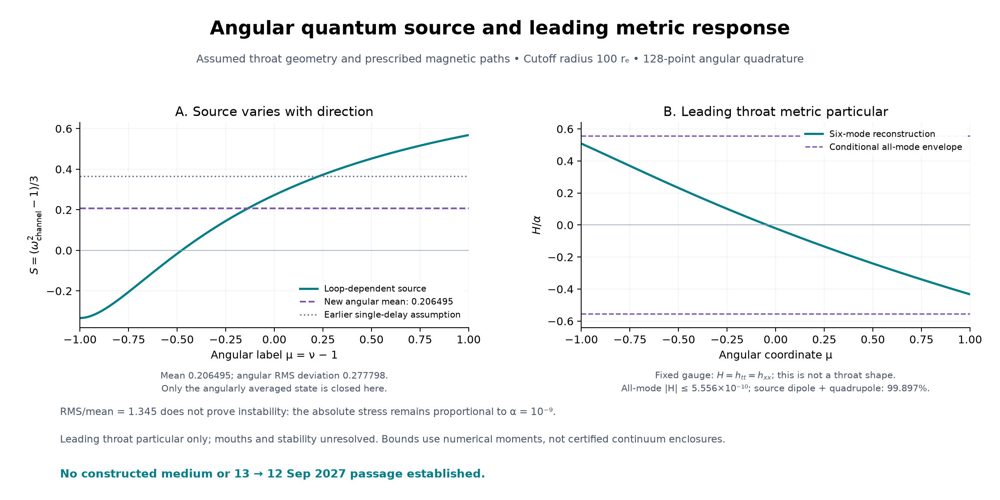

### The result and its meaning

All numbers below are conditional calculations in dimensionless model
units, not measurements or published discoveries. Alpha=1e-9. We fix
d/r_e=4.188251800784477e9 once, by preserving the previous shortest leading
delay 1.2 in its old leading clock. This is a comparison convention, not
an independently determined physical separation.

| Quantity | Result |
|---|---:|
| Previous single-delay state parameter Omega^2 | 2.0944094527 |
| Average demanded by its actual magnetic paths | 1.0937196633 |
| New self-consistent average Omega^2 | 1.6194849990 |
| Mean source coefficient S=(Omega_channel^2-1)/3 | 0.2064949997 |
| Angular RMS variation of S | 0.2777984013 |
| Dipole share of angular variance | 96.1324% |
| Quadrupole share of angular variance | 3.7647% |

The old parameter cannot be retained while replacing all its equal-length
paths with the actual distribution at this separation. Recomputing both
the collar and its clock at each trial produces the new averaged root.
The RMS exceeds the mean by a factor 1.3453, so the angular source cannot
be described as a tiny fraction of its mean. This **does not prove a large
metric deformation or an instability**: the source itself is a quantum
correction of order alpha relative to the classical throat background.
Its gravitational response must be calculated rather than inferred from
that ratio; the leading result follows below.

### The equation that was closed

Each magnetic channel is labelled by nu in (0,2), with flux weight dnu/2.
Let f(nu) be its existing point-monopole path length divided by d. We use
one common clock T=A*t_center, anchored at areal radius 100*r_e with
A=N_100/b_100 and b=dR/dl. This is an isolated-mouth calibration, not a
completed two-mouth metric junction. At the new root A=6.1659581374e9.
For collar cutoff R_b and isotropic radius rho_b approximately R_b-1,

\[
L_\nu(w)=2x_b(w)+\frac{d f(\nu)-2\rho_b+\Delta S_{\nu,b}}{A(w)},
\qquad
w=\int_0^2\frac{d\nu}{2}\left(\frac{2\pi}{L_\nu(w)}\right)^2.
\]

Here Delta S is the first weak gravitational optical correction,
2*integral U dl, including spatial curvature as well as clock delay.
It is evaluated along prescribed magnetic curves. The full collar is
recomputed for each w. We neither assign independently adjustable clocks
to channels nor discard channels and renormalize their weights. The
limiting nu=0 path has infinite length; its inverse-square contribution
has a finite integral. A mean path length is not used.

The source average follows the channel treatment in
[Maldacena, Milekhin and Popov, section 5.5, Eq.5.44](https://arxiv.org/html/1807.04726v3#S5.SS5).
That paper also describes angular quantum stress exciting coupled
gravitational/electromagnetic angular modes; it does not identify large
relative angular variation with instability. Our optical integrand uses
the static weak metric in [Soffel and Han, Eqs.1-3](https://arxiv.org/pdf/1409.3743).
Their light-ray calculation does not independently establish our magnetic
paths in the curved metric. The finite-collar feedback and reported
numbers are our computations. The leading-order average equation was
already implemented in this project; it is not a new physics discovery.

### Checks and the remaining physical errors

The bracketed roots at R_b=10,30,100 all have positive channel periods.
Increasing flux quadrature from 64 to 128 points changes the roots by
less than 4.9e-15. The maximum equation residual is 8.7e-14. The roots
across cutoffs span 9.38e-12. An independently written Cartesian path
integrand agrees with the endpoint-safe expression to 7.7e-15 scaled;
the axial integral agrees with its analytic logarithm to 1.5e-14.
These are numerical checks, not certified physical error bounds.

At fixed reference state, adding the weak optical correction reduces the
cutoff span of the mean from 1.156e-9 to 2.385e-11. The new root differs
from the leading average by -1.501e-8. That difference must not be sold
as a complete higher-order physical prediction: companion clock and
spatial matching, changes to magnetic paths, angular geometry and the
full quantum source have not been included. At the outer cutoff the
estimated omitted second-order self-field period scale is 3.28e-12;
the companion potential scale is 2.39e-10. These refer to different
quantities and are not a combined error bar.

### The angular response, now calculated locally

Project the source on Legendre polynomials with mu=nu-1:

\[
S(\mu)=\bar S+\sum_{j\geq1}s_jP_j(\mu),\quad
s_j=(2j+1)\int_{-1}^1\frac{d\mu}{2}S(\mu)P_j(\mu).
\]

The first coefficients are s_1=0.47176449 and s_2=-0.12052540;
their variance contributions are s_j^2/(2j+1). They contain 99.897% of
the source variance. Using the coupled equations in
[Michelson and Spradlin, Eqs.3.28-3.30](https://arxiv.org/pdf/hep-th/9906056),
we obtain a sourced tensor particular, distinct from the homogeneous
mass-six scalar sector already studied in this project.

In the unit-radius product metric
ds^2=sec^2(x)(-dt^2+dx^2)+dOmega^2, take the gravitationally normalized
angular source J_tt=J_xx=-alpha*(S-mean S), with zero mixed/angular source
components and zero prescribed current. Then our particular is

\[
h_{tt}=h_{xx}=H(\mu)
=-2\alpha\sum_{j\geq1}\frac{s_jP_j(\mu)}{j(j+1)},
\qquad \delta F=0.
\]

Other metric components vanish. This perturbation is traceless and
transverse in the two-dimensional throat. Direct variation of the full
four-dimensional metric and magnetic stress gives
delta E_tt=delta E_xx=-Delta_S2 H/2=J_tt, with all other components zero.
All ten Einstein and four Maxwell component checks pass symbolically for
a generic angular function; the six-mode spherical-operator residual is
2.22e-16. The magnetic invariant delta(F^2) vanishes at this order.
The monopole j=0 is excluded and supplied by the spherical solution.

There is also a useful analytic size inequality. Cauchy-Schwarz,
|P_j|<=1 and a telescoping series give

\[
|H|\leq2\alpha\sigma_S,
\qquad |H_{j>L}|\leq\frac{2\alpha\sigma_{S,j>L}}{L+1},
\quad
\sum_{j>L}\frac{2j+1}{j^2(j+1)^2}=\frac1{(L+1)^2}.
\]

Evaluating this inequality with our numerical source moments gives
|H|<=5.556e-10. The six-mode reconstruction reaches 5.082e-10 in magnitude;
the remaining-mode bound is 3.002e-13. In these fixed coordinates,
delta(log N)=-H*cos^2(x)/2, bounded by 2.778e-10. These are small local
metric corrections, not invariant travel-time measurements or certified
continuum error bounds. The analytic inequality is exact for the stated
source norm; that norm was evaluated numerically.

This solves a **leading, static particular with a frozen source**. Physical
boundary data and possible additional homogeneous modes are unchosen;
the varying-radius collar, induced quantum currents and state feedback
are absent. Zero prescribed current is an assumption, not a derivation
of the full charged quantum source. The next task is carrying this
response into the finite collar while retaining the coupled constraints
and consistent source/current response. A local smallness bound does not
prove dynamic stability.
The amplitude inequality also does not bound angular derivatives or
curvature, additional boundary modes, or the finite collar.

### Direction and the yesterday example

The calculated null throat crossing takes 3.1415927044 center-clock
units, versus 0.6792539910 for the shortest exterior return segment:
the throat route is about 4.625 times slower. No backward clock offset
has been generated. **13 September 2027 to 12 September 2027 remains
unproved, even for a tiny abiotic probe.** The magnetic loops describe
the supporting charged quantum fields, not an engineered passenger
trajectory. Preparation, probe backreaction and dynamical stability
remain open.

Reproduce this increment only:
`.\.venv\Scripts\python.exe -B -X utf8 -c "import polyakov_response as p; p.save_closure_benchmark()"`.
Source: `scripts/polyakov_response.py`, MAGNETIC_STATE_CLOSURE block. Numerical
record: `results/polyakov_closure_results.json`. The additional angular check is
`p.save_angular_casimir_benchmark()`, with record
`results/polyakov_angular_results.json`. Prior benchmarks are preserved.

## A finite exterior region with the quantum source retained

The static reduced model now continues from the throat into a finite
spherical exterior region, reaching areal radius 100*r_e. It retains the
same quantum source and solves the angular equation as well as the radial
equations. This advances beyond boundary values alone. It does not extend
the finite pulse, prove stability, close the returning field path, or create
a wormhole from ordinary initial conditions.

We first checked the existing research rather than repeating it: an
infinite spherical continuation of this constant NS state cannot have
ordinary finite-mass asymptotic flatness. The new calculation is therefore
a finite collar around an already assumed throat. Its eventual connection
to the other mouth must use the returning geometry, not a claimed empty
infinity.

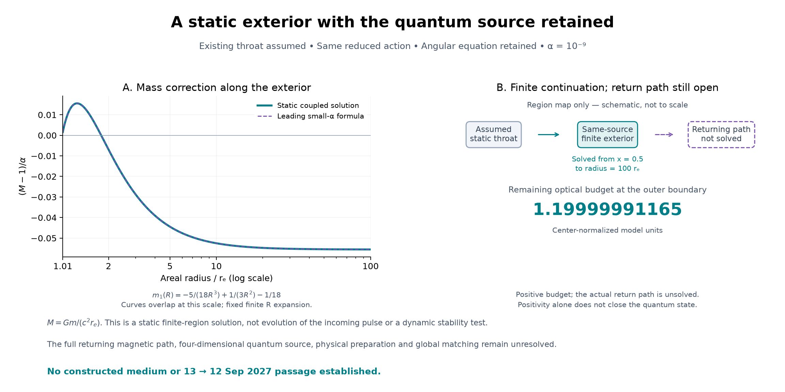

### What the continuation supplies

Use R=physical areal radius/r_e and M=G*mass/(c^2*r_e). The charged mass
function is defined by (dR/dl)^2=1-2M/R+1/R^2, where l is proper radial
distance in r_e units. N is the lapse relative to the throat center. For
alpha=1e-9 and Omega^2=2.094409452695286:

| Areal radius R | Lapse N | Charged mass correction M-1 | Remaining conformal path |
|---|---:|---:|---:|
| 10 | 3.141188801e9 | -5.250000004e-11 | 1.19999996603 |
| 30 | 3.373869452e9 | -5.519547329e-11 | 1.19999995318 |
| 100 | 3.455307681e9 | -5.552250004e-11 | 1.19999991165 |

The lapse and outward radius derivative remain positive on the calculated
branch. At R=100, dR/dl=0.990000000000561. The distance from the starting
point x=0.5 is 125.739256614*r_e. These are numerical properties of the
static solution, not a stability test. M remains positive: M-1<0 means a
small decrease from the unit charged reference mass, not a stock of
negative-mass material.

The already solved symmetric center connects the two collar branches. A
radial light ray between their R=100 endpoints has positive center-clock
travel time

\[
\Delta t=2x(100)\,r_e/c=3.14159274194063\,r_e/c.
\]

The assumed NS optical period is pi+1.2. Subtracting this calculated
interior/collar segment leaves the last table column. A positive remainder
means the state has room for a returning path; it does not construct that
path or determine the physical mouth separation. No backward clock
offset has been introduced.

### Equations and the numerical change of coordinates

We continue the existing static equations with k=alpha/3, b=dR/dl,
a=d(log N)/dl and W=Omega^2/N^2:

\[
b_l=\frac{R}{R^2-k}\left(1-R^{-2}-kR^{-4}-b^2\right)-ab,
\]
\[
a_l=R^{-4}-\frac{b_l+ab}{R}-a^2,
\qquad
b^2+2Rab+ka^2=1-R^{-2}-kW.
\]

The quantum source is unchanged. In stress units multiplied by
8*pi*G*r_e^2/c^4, its energy density and radial pressure are

\[
\rho_q=\frac{\alpha}{3R^2}(2a_l+a^2-W),\qquad
p_q=-\frac{\alpha}{3R^2}(a^2+W),\qquad p_\perp=0.
\]

Continuing the old near-throat conformal variables directly would approach
their coordinate singularity. We instead evolve proper distance with
y=(R-1)/alpha, h=(M-1)/alpha^2, n=log N, and the optical coordinate x.
Writing b=alpha*beta gives

\[
\beta^2=\frac{y^2}{R^2}-\frac{2h}{R},\quad
B=\frac{y}{R^2}+\frac{\alpha h}{R}-\frac{W}{6},\quad
a=\frac{2B}{R\beta+\sqrt{R^2\beta^2+2B/3}}.
\]

This rationalized root avoids subtracting nearly equal numbers. Evolve
y_l=beta, n_l=a, x_l=exp(-n), and

\[
h_l=\frac{\beta}{6}(2a_l+a^2-W).
\]

Initial values come from the existing solution at x=0.5. We check the
overlap again at x=0.6,0.9,1.2. This is a coordinate/variable change for the
same equations, not an artificial pressure taper or a newly specified
material.

### A derived outer correction checked against the full solution

At fixed finite R>1, the leading small-alpha exterior has
b0=1-1/R and a0=1/R^2. Inserting these into the mass-source equation gives
our conditional expansion

\[
M(R)=1+\alpha\left[-\frac{5}{18R^3}+\frac{1}{3R^2}-\frac1{18}\right]
+o(\alpha).
\]

The coefficient peaks at 7/450 when R=5/4, then crosses zero at
R=(sqrt(21)-1)/2. At R=100 it is -0.0555225. The physical-alpha simulation
gives -0.0555225000395. Across the fixed-radius checkpoints, the maximum
coefficient difference is 5.39e-11; for amplified alpha values 0.001,
0.0005,0.00025, it decreases from 5.27e-5 to 2.67e-5 to 1.34e-5.

The leading matched lapse relation is

\[
\frac{\alpha N}{1-1/R}\longrightarrow
\frac{12}{\pi(\Omega^2-1)}=3.49020983398706.
\]

These are fixed-radius expansions. Taking R to infinity at fixed alpha
would reintroduce the known constant-state obstruction. In particular,
the coefficient's apparent -1/18 limit is not a finite ADM mass of a
completed infinite solution. This is a derived check inside the specified
effective theory, not a claimed new physical law.

### Verification and the next connection

An independent replay reproduces every saved result in 1.42 seconds.
The focused benchmark passes. Halving the integration step and tightening
tolerances changes the recorded quantities by at most 3.21e-14 in the
declared component scaling. The overlap with the prior conformal solver
agrees within 1.23e-13. A separate proper-distance formulation evolves b
and a directly, without algebraically imposing the mass constraint; at
the amplified control alpha=0.001, it agrees within 7.79e-15 in state and
within 2.16e-9 in its separately reconstructed mass identity.

Independent local polynomial differentiation on six proper-distance
intervals checks the angular equation instead of taking its derivative
from the evolution RHS. Degrees 12,20,28 give maximum angular residuals
4.94e-9,2.34e-13,2.92e-14. The last is 2.92e-5 when divided by the physical
alpha; it must not be confused with a certified relative quantum error.
The last radial derivative residual is 3.19e-14. Refinement comparisons
and these residuals are not rigorous continuum error bounds.

For connecting to the actual two-mouth geometry, the necessary geometric
overlap is r_e << physical R_boundary << d. The separation d is still
unsolved. The optical remainder must equal an actual returning-field
integral. MMP uses multiple matched regions and fermions on returning
magnetic field lines; its spherical zero-mode separation does not fail
merely because R varies. It does not make our reduced action the complete
four-dimensional quantum source. [MMP, Sections 3-5 and Appendix C](https://arxiv.org/html/1807.04726v3)

For a monopole field Bmag=q/(2R^2), the field-line localization screen is
epsilon_B=2*sqrt(2/q)*abs(dR/dl). At R=100 its coefficient is
2.80014285/sqrt(q). Flux q is not fixed by this benchmark, so this is a
condition to check, not an asserted physical validity margin. Excited
fields must also satisfy the relevant local angular-gap condition.
[MMP, Section 3.1](https://arxiv.org/html/1807.04726v3#S3.SS1)

Run from the project directory:

```powershell
.\.venv\Scripts\python.exe -B -c "from polyakov_response import save_collar_benchmark; save_collar_benchmark()"
```

See [implementation](../scripts/polyakov_response.py)
and [saved results](../results/polyakov_collar_results.json).

The next task is to use this finite exterior background and its exported
clock/stress/curvature data in the returning-path calculation, then evolve
the pulse through the completed system. The full quantum state, omitted
four-dimensional polarization, formation and dynamic stability remain
unresolved. **Travel from 13 September 2027 to 12 September 2027 remains
unproved.**

## Boundary data that retain the quantum source

We have calculated the exterior metric values and first derivatives needed
to carry the throat model's quantum stress through a timelike boundary.
The metric and curvature identities agree to numerical roundoff, and the
independent Einstein-versus-quantum-source residual decreases with grid
refinement. This supplies boundary data, not a solved exterior or a physical
medium. It assumes the same existing throat and finite CFT state as before.

The simpler alternative fails a necessary test: ordinary positive-energy
single-stream radiation cannot match at any of the 322 sampled events,
whatever finite radial boundary velocity is chosen. This conclusion is
about a particular exterior matter model, not all possible exteriors.

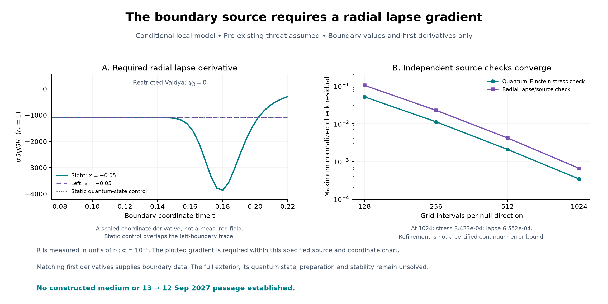

### Why changing the boundary speed is insufficient

For a shell-free join, normal pressure and normal energy flow must agree
across the boundary. Continuity of the observer's energy density does not
follow from those two conditions alone. This distinction is explicit in
[Fayos, Senovilla and Torres, Eqs. 67-68](https://arxiv.org/pdf/gr-qc/0206076).
The same-charge monopole Maxwell contribution cancels between the two
sides; the following test concerns the remaining quantum source.

Here is our local algebraic test. Set a=(1+w)/(1-w)>0 for a timelike radial
velocity w, epsilon=+1 on the right and -1 on the left, and
kappa=2 exp(-2 sigma)/(3 R^2). In normalized quantum-stress units,

\[
p=\kappa(aC_{uu}+C_{vv}/a-2C_{uv}),\qquad
j=\epsilon\kappa(aC_{uu}-C_{vv}/a).
\]

A single null stream needs p=+/-j. Where Cuv is nonzero, its only possible
finite-boost candidates are

\[
a=C_{uv}/C_{uu}>0\quad\hbox{or}\quad a=C_{vv}/C_{uv}>0.
\]

At either candidate its required pressure is

\[
p=\kappa\frac{C_{uu}C_{vv}-C_{uv}^2}{C_{uv}}.
\]

If Cvv<0<Cuv, either there is no candidate, or its pressure is negative.
Positive-energy single-stream radiation has nonnegative pressure, so it
cannot pass. This statement is algebraic and applies to every finite boost
where those sign assumptions hold; it does not assume that the entire
interior stress tensor must itself be null dust.

We sampled x=+/-0.05 at 161 times per side over 0.075<=t<=1.4 on each grid.
At the finest grid, Cvv lies between -0.273602363621 and -0.273602363586;
Cuv lies between 0.250626042594 and 0.250626043329. There are 185 events
with a signed candidate, all requiring negative pressure, between -24.0442
and -0.187320 in our normalized units. The remaining 137 events have no
candidate. These sampled signs are not a certified bound between samples.
Candidate velocities have not been integrated into complete junctions:
passing a normal-stress test would still be only necessary.

### The extra metric function the source requires

Allow the boundary's sphere radius to move. For this calculation its
timelike coordinate curves are x=+/-0.05; these differ from the previous
constant-area curves. We extract full boundary data on the common early
interval 0.075<=t<=0.22, where the chosen outward areal/null chart is
admissible. The wider radiation test above does not extend this matching
interval.

Use the exterior form

\[
ds^2=-e^{2\psi}F\,dq^2-2e^\psi dq\,dR+R^2d\Omega^2,
\qquad F=1-\frac{2M(q,R)}R+\frac1{R^2}.
\]

The general spherical radiative-coordinate form appears in
[Fayos et al., Eq. 1](https://arxiv.org/pdf/gr-qc/0206076).
A radially varying mass already changes the required exterior stress;
[Maharaj, Govender and Govender, Eqs. 6-9 and 19](https://arxiv.org/pdf/1301.1417)
give the restricted generalized Vaidya example. Here we also retain psi.
Setting it to zero throughout the exterior would discard a needed radial
stress component. Setting psi=0 only *along* the boundary is a permitted
null-coordinate normalization and creates no physical clock offset.

Our derived boundary relations make the missing term explicit. In
r_e=c=1 units, let E,P,J denote 8*pi*G times the quantum components
T_UU,T_nn,T_nU after Maxwell subtraction. Define v=dR/dtau, B=n(R),
D=B+v>0, and Delta=E+P+2J. Then

\[
\dot q=D^{-1},\qquad
\psi_R=\frac{R\Delta}{2D^2},\qquad
\psi_q=-vD\psi_R,
\]
\[
M_R=\frac{R^2}{2}\left[-P-J+\frac{B\Delta}{D}\right],\qquad
M_q=\frac{R^2}{2}\left[D^2J-Bv\Delta\right].
\]

They obey the boundary energy relation

\[
\dot M=M_q\dot q+M_Rv=\frac{R^2}{2}(BJ-vP).
\]

In particular, Delta=T(U+n,U+n) in these stress units. A metric restricted
to psi_R=0 forces the exterior value of this component to zero. Matching
P and J alone would instead give E_ext=-P-2J and lose precisely Delta.
Keeping psi_R repairs that missing radial component at the boundary.

We obtain the metric derivatives directly from the solved geometry, then
independently compare its Einstein tensor with the prescribed quantum
source. They are not merely assigned the source values to force a match.
Numerical coordinates Q=alpha*q and z=(R-1)/alpha avoid catastrophic
cancellation in the near-extremal region. With alpha=1e-9:

| Quantity at t=0.22 | Left | Right |
|---|---:|---:|
| alpha*psi_R | -1092.83 | -295.207 |
| M_R/alpha | -0.0152793 | -0.616912 |
| M_q/alpha^3 | Approximately zero | +0.00559805 |
| Delta/alpha | -0.727784 | -49.8320 |

The lapse entries are derivatives with respect to the tightly compressed
areal-radius coordinate. Their large values are not measurements of a
gigantic force or a demonstrated instability. The values are coordinate
data required by this chart; local frame stress is reported separately.

### What has been verified, and what comes next

On 128, 256, 512 and 1024 grids, the maximum Einstein-source residual,
scaled componentwise by 1+abs(source), is respectively 0.051116, 0.0111675,
0.00206956 and 0.000342260. The independent lapse-source residual reaches
0.000655201 and the radial mass-source residual 0.000295230. The largest
last-grid difference among the extracted derivatives is 0.00384314 under
the same scaling. These are numerical consistency and refinement checks,
not rigorous error bounds or a stability proof.

Induced metric, normal normalization, both extrinsic curvatures, mass
identity and mass chain rule agree within 5.17e-14 in the scaled variables.
The zero-source control agrees with the static quantum source within
6.24e-16. Independent analytic auditing and an exact replay of all saved
results pass; the focused benchmark takes about 2.55 seconds.

Run the focused check from the project directory:

```powershell
.\.venv\Scripts\python.exe -B -c "from polyakov_response import save_junction_benchmark; save_junction_benchmark()"
```

See [implementation](../scripts/polyakov_response.py)
and [numerical data](../results/polyakov_junction_results.json).

The next substantive task is to extend these data while solving the
exterior equations and its quantum state, including the angular equation
and outer boundary conditions. A first-derivative fit alone cannot do that.
No new physical law, formation process, material recipe, stable medium or
backward passage has been established. **13 September 2027 to
12 September 2027 remains unproved.**

## Fixed-area boundary candidates lose their timelike character

The finite pulse makes the selected constant-area surfaces become null.
They therefore cannot remain material boundaries for the entire modeled
interval. An ideal light probe does complete its round trip before this
happens. These results concern small radius level sets in an assumed
throat, not constructed entrances or throat formation.

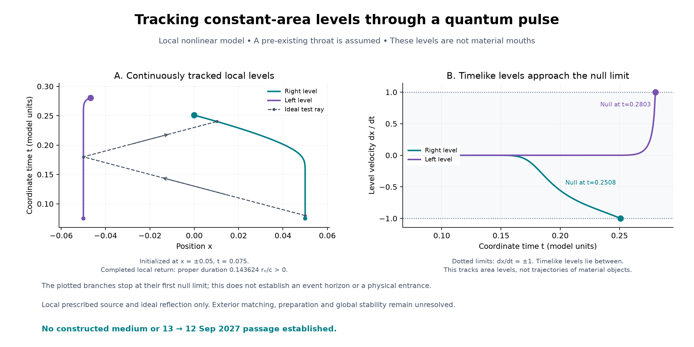

| Event or duration | Refined result | Meaning |
|---|---:|---|
| Probe launch | t=0.0800000 | Right level set, x=0.05 |
| Ideal reflection | t=0.1800000 | Left level set, x=-0.05 |
| Probe return | t=0.2401846 | Right level set has moved to x=0.0101846 |
| Right level set becomes null | t=0.2508156 | End of its admissible timelike continuation |
| Left level set becomes null | t=0.2802693 | End of its admissible timelike continuation |
| One-clock proper duration | 0.14362435 r_e/c | Positive elapsed time between launch and return |
| Static same-cutoff duration | 0.20025026 r_e/c | Undisturbed reference geometry and stationary curves |

The shorter duration includes the changed reflection/return geometry and
motion of the emitter clock. It is not a 28% quantum speed-up or backward
travel. The preceding coordinate-fixed test used different paths, so its
tiny duration shift cannot be compared directly with this result.

### What is tracked

Retain alpha=1e-9 and the exact finite quantum pulse. Initialize at
t0=0.075 with x=+/-0.05 and Ycut=Ybar(0.05), before the pulse arrives at
either point. Since R^2=1+alpha Y, a fixed Y is a fixed physical sphere
area in this model. Follow each continuous level set; do not switch roots:

\[
\dot x=-\frac{Y_t}{Y_x}=-\frac{Y_u+Y_v}{Y_u-Y_v},\qquad
\frac{d\tau}{dt}=e^\sigma\sqrt{1-\dot x^2}.
\]

Full solution grids are interpolated, including their derivatives. The
timelike condition is Yu*Yv<0. At the right endpoint Yv vanishes while
Yu=0.0884532 remains positive; at the left endpoint Yu vanishes while
Yv=0.0170644 remains positive. They are therefore local **past-marginal
spheres**: one future light-ray expansion vanishes and the other is
positive. Missing roots or leaving the numerical diamond would instead
be censored data; that is not what produced these endpoints.

The invariant radius gradient is

\[
(\nabla R)^2=-4e^{-2\sigma}R_uR_v
=-\frac{\alpha^2e^{-2\sigma}}{R^2}Y_uY_v.
\]

This identifies marginal spheres without confusing a small numerical
radius change with a vanishing gradient. [Hayward, Section III](https://arxiv.org/pdf/gr-qc/9303006)
distinguishes these local expansion conditions from the additional
conditions needed for a trapping horizon. We have not established an
event horizon, inner/outer classification, global collapse or loss of all
possible traversable paths.

### Necessary data for a physical exterior connection

On the surviving timelike segments we export the induced proper lapse,
both independent extrinsic curvatures, the charged mass aspect, and the
quantum normal pressure and energy flow. The normal starts outward from
the throat on each side and keeps that orientation. With epsilon=+1 on
the right and -1 on the left, and w=dx/dt,

\[
K^\theta{}_{\theta}=\frac{\epsilon\alpha e^{-\sigma}
\sqrt{1-w^2}\,Y_x}{2R^2},\qquad
K^\tau{}_{\tau}=\epsilon e^{-\sigma}\gamma
\left(\gamma^2\dot w+\sigma_x+w\sigma_t\right).
\]

Here gamma=(1-w^2)^(-1/2). The charged mass is defined by
1-2m/R+1/R^2=(grad R)^2. We evaluate its small extremal excess as

\[
\frac{m-1}{\alpha^2}=
\frac{1}{8R}\left[\frac{4Y^2}{(R+1)^2}
-e^{-2\sigma}Y_x^2(1-w^2)\right].
\]

This avoids subtracting two masses that round to the same floating-point
number. An independent geometric check uses
m-1=(R-1)^2/(2R)-R^3(Ktheta_theta)^2/2.

At t=0.22, the exported quantum components are:

| Component, divided by alpha and multiplied by 8*pi*G*r_e^2 | Right | Left |
|---|---:|---:|
| Normal pressure T_nn | -2.479699 | -0.697225 |
| Normal-time contraction T_nU | +0.677995 | Approximately zero |

These are model normalizations with c=1; restore c^-4 in the stress
normalization for SI. Measured outward energy flux is **minus T_nU**.
The monopole Maxwell stress is separate and continuous for the same
charge and radius.

[The junction equations, Eqs. 7-8 and 22-24](https://arxiv.org/pdf/gr-qc/0310107)
require the induced metric and both extrinsic curvatures to match for a
shell-free connection. The normal stress and flux must also be compatible
with the Einstein constraints. Same-charge RN electrovacuum contributes
no quantum pressure or flux, so it cannot simply replace these nonzero
values across a shell-free boundary. A continuing quantum source or a
specified transition/shell stress is required. No such material or exterior
solution is supplied by exporting the required data.

### Verification and direction

The 128, 256, 512 and 1024 grids give successively smaller endpoint and
probe differences. The final gate-time difference is 3.27e-7, and the
final proper-duration difference is 5.71e-8 r_e/c. Tighter curve integration
changes the gate times by at most 1.90e-9 and the duration by 1.92e-10 r_e/c.

Boundary data are checked on the fixed interval 0.075<=t<=0.22, away from
the null limits. The weakest component is Ktau_tau: its last difference,
scaled by 1+abs(fine value), is 0.00802. Pressure and energy-flow
differences on that interval are below 1.25e-5 and 4.41e-5 in the same
scaling. These are refinement comparisons, not rigorous continuum error
bounds. We do not claim a uniform second-order rate for every extracted
boundary observable.

The zero-source control keeps both surfaces stationary and reproduces
the static round trip. Its stress and acceleration identities agree
within 1.12e-16. The stable charged-mass/extrinsic-curvature identity agrees
within 9.75e-12 in normalized units. Curve radius drift stays below the
declared 2e-8 normalized tolerance. All declared checks pass.

Precomputing the existing spline derivative coefficients removed repeated
whole-grid work. Every pilot number and array, including the independent
1024 tight integration, is unchanged. The complete focused benchmark now
runs in about 6.3 seconds. An independent replay completed in 7.05 seconds
and reproduced the saved output exactly. The new figure was visually
inspected; prior numerical artifacts and source outside the inserted
blocks remain byte-for-byte unchanged.

Run from the project directory:

```powershell
.\.venv\Scripts\python.exe -B -c "from polyakov_response import save_boundary_benchmark; save_boundary_benchmark()"
```

See [implementation](../scripts/polyakov_response.py)
and [saved boundary results](../results/polyakov_boundary_results.json).

This rules out keeping these particular area levels as persistent timelike
boundaries under this pulse. The next physical connection must allow
compatible boundary motion and carry the required quantum pressure and
flux into an exterior region. Formation, global stability and the complete
four-dimensional quantum source remain unresolved. **Travel from
13 September 2027 to 12 September 2027 remains unproved.**

## A finite-energy pulse and a local clock observable

The next calculation replaces the infinitesimal state direction with an
exact finite conformal-field state and lets both radius and metric respond
nonlinearly within the specified Einstein–Polyakov model. The initial data
assume an existing calibrated throat; its formation from ordinary space
is not modeled. This is a local initial-value problem: no exterior,
material mouths or circulating state are supplied by this calculation.

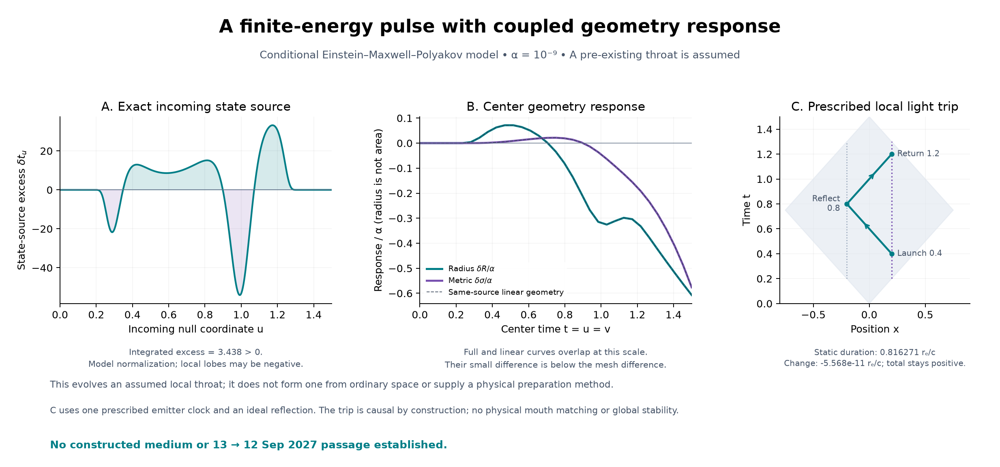

### Verified result

For the selected alpha=1e-9, all declared checks pass. The predicted local
round-trip duration decreases slightly relative to the static geometry;
the elapsed duration itself remains positive.

| Observable | Result | Scope |
|---|---:|---|
| Maximum sampled fractional sphere-area change | 1.6366e-9 | Relative to the static sphere at the same coordinates |
| Maximum sampled conformal-log change | 5.7644e-10 | Change in sigma, not a boundary-clock offset |
| Static local round-trip proper duration | 0.816271075924 r_e/c | One prescribed emitter/receiver clock |
| Change in that duration | -5.56815e-11 r_e/c | Earlier than its static-baseline return, still after departure |
| Last clock grid-refinement difference | 8.59e-16 r_e/c | Numerical comparison, not a certified error bound |

The source changes an assumed geometry in this conditional model; it does
not supply a substance from which to manufacture a throat.

### Source and equations

Write V(u)=u+aD B((u-u0)/D), with the existing smooth compact bump B,
a=0.15752457643370363, D=1.2 and u0=0.15. Extend the map by degree-one
periodicity on the reference circle of length L=pi+D. In the chosen
coordinates the state functions are

\[
\mathfrak t_u=-\frac{\Omega^2}{4}(V')^2-\frac12\{V,u\},
\qquad \mathfrak t_v=-\frac{\Omega^2}{4},\qquad \Omega=2\pi/L.
\]

The [CFT stress transformation](https://arxiv.org/pdf/math-ph/0412028),
Eqs. 2.9 and 3.41, is the published foundation. Our compact profile and
coupled numerical application are the particular test here. The
[Polyakov backreaction framework](https://arxiv.org/pdf/hep-th/0006035)
provides state-dependent stress and anomaly terms; it does not establish
our local calculation as a full four-dimensional quantum solution.

The minimum V' is 0.3327825366, so the map preserves orientation. In the
existing seed normalization, the integrated excess is 2.2921257977;
the integral of delta t_u is 3.4381886966. Direct quadrature and an
independent integration-by-parts expression agree within 1.4e-15.
The latter check uses the vanishing endpoint derivatives:

\[
\int\delta\mathfrak t_u\,du=\frac14\int
\left[\left(\frac{V''}{V'}\right)^2-\Omega^2(V'-1)^2\right]du.
\]

These are positive reference-state charges in model units, not a source
energy quoted in joules or a preparation recipe. Negative local lobes are
retained. The same integrated seed ratio as an earlier eta=4 packet does
not make this local, prescribed state its circulating dynamical history.

With R measured in units of r_e, define S=R^2=1+alpha Y and k=alpha/3.
The exact radius equation can be evaluated without subtracting nearly
equal radii:

\[
Y_{uv}=-\frac{e^{2\sigma}}{2(S-k)}
\left(Y-\frac1{3S}\right)
-\frac{\alpha^2Y_uY_v}{6S(S-k)}.
\]

The angular equation is

\[
\sigma_{uv}=-\frac{\alpha Y_{uv}}{2S}
+\frac{\alpha^2Y_uY_v}{4S^2}-\frac{e^{2\sigma}}{4S^2}.
\]

The uu constraint, with the analogous vv constraint, is

\[
Y_{uu}-2\sigma_uY_u-\frac{\alpha Y_u^2}{2S}
+\frac23(\sigma_{uu}-\sigma_u^2+\mathfrak t_u)=0.
\]

The evolution subtracts the calibrated static background and retains its
normalized corrections, avoiding loss of the small alpha=1e-9 response.
The null-edge metric is a coordinate choice; the radius on the incoming
edge is determined by its constraint. A comparison linearizes the geometry
while keeping this **same exact finite source**. It therefore tests
geometric nonlinearity separately from the previous infinitesimal-state
approximation.

### What the local clock test measures

In coordinates u=t+x and v=t-x, consider prescribed reference curves
x=+0.2 and x=-0.2. An ideal null probe starts at (t,x)=(0.4,0.2),
reflects at (0.8,-0.2), and returns at (1.2,0.2). Its two legs have
u=0.6 and v=1 respectively and remain in the modeled diamond.
The same reference clock at x=0.2 measures

\[
\Delta\tau=\int_{0.4}^{1.2}e^{\sigma(t,0.2)}\,dt.
\]

These coordinate-fixed curves can accelerate and change areal radius;
they are not constructed mirrors or freely falling mouths. The probe has
negligible stress and its ideal reflection does not change the quantum
source. Wherever the metric is regular, g^{tt}=-exp(-2sigma)<0, so t is a
time function. This local construction necessarily returns the probe
after departure. A duration change relative to the static geometry is a
clock response, not backward travel.

### Numerical controls and remaining work

The 128, 256 and 512 interval grids give normalized common-grid state
differences 2.46470e-5 and 6.16740e-6, a ratio of 3.99634. The analogous
clock-difference ratio is 4.00005. Both null constraints decrease under
refinement; the final maximum source-scaled residual is 9.13007e-6 on
the fixed interior inset. Independent differentiation checks the static
background separately, with normalized residuals below 1.17e-11 over all
four alpha cases. The zero-source evolution stays exactly zero.

At alpha=0.01, 0.005 and 0.0025, the maximum differences between nonlinear
and same-source linear geometry, divided by alpha, are 0.00453885,
0.00229771 and 0.00115598. Their halving ratios are 1.97538 and 1.98768.
These differences exceed the sums of the corresponding full and linear
mesh differences by factors 376, 188 and 94, and their own mesh
differences converge at second order. Thus geometric nonlinearity is
resolved in these control calculations. Alpha changes here; the finite
state amplitude stays fixed. These controls are not proposed designs.

At alpha=1e-9 the nonlinear-minus-linear remainder is below the total
solution mesh difference. Its paired-grid estimates are recorded but do
not establish a continuum nonlinear correction at that scale. The
finite-source response and local clock shift are much larger and do
converge. This distinction prevents a successful control test from being
misreported as precision unavailable in the selected weak-gravity case.

Original radius/metric equations evaluated at 70-digit precision agree
with the cancellation-resistant equations in the runnable checks. A
separate root check on six different jets found a maximum normalized
absolute difference of 2.78e-17. Root inspected the implementation and
replayed the focused benchmark, reproducing every saved numerical field
and array exactly in 6.95 seconds. The final metadata-only rename of the
alpha-halving key changed no numerical values. The previous linear
benchmark and its saved data remain unchanged.

Run the focused calculation from the project directory with:

```powershell
.\.venv\Scripts\python.exe -B -c "from polyakov_response import save_finite_benchmark; save_finite_benchmark()"
```

The implementation is in [scripts/polyakov_response.py](../scripts/polyakov_response.py),
with [finite-state results](../results/polyakov_finite_results.json).
The next task is to derive compatible outgoing boundary data and their
connection to an exterior quantum state and physical clocks. Merely
identifying the local coordinate curves as mouths would not perform that
matching. Formation, full four-dimensional matter completion and global
stability remain unresolved. **Travel from 13 September 2027 to
12 September 2027 remains unproved.**

## From residual checks to geometry response and actual exit sensitivity

Two different calculations now address the gap between small equation
residuals and accurate travel times. The first measures timing sensitivity
at the exits that actually occurred in the strong-state runs. The second
evolves both radius and metric perturbations in a closed, local
Einstein-Polyakov benchmark. **The second calculation is not yet a
correction to the first one's boundary clocks.**

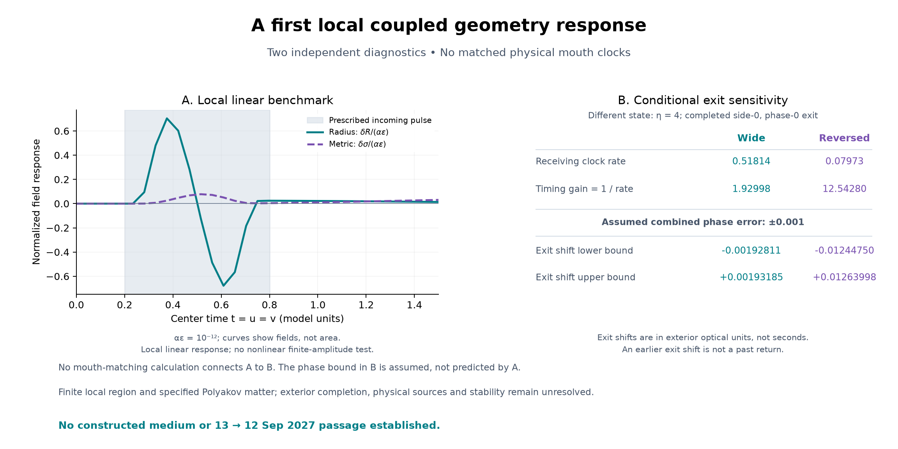

### Actual exits are less sensitive than the late frozen clocks suggest

Each energy-ratio-4 case has one completed launch in the saved 50-probe
set: the initial right-side launch. Its receiver's clock was still running
appreciably when the signal exited. Using the much smaller clock rate at
the end of the simulation would overstate this trip's timing sensitivity.

| Packet order | Receiver rate at actual exit | Time gain per unit matching-phase change | Phase change advancing the trip by 1% of L | Phase change delaying it by 1% of L |
|---|---:|---:|---:|---:|
| Wide | 0.5181401663 | 1.929979695 | 0.02298894 | 0.02200789 |
| Reversed | 0.07972698517 | 12.54280465 | 0.003555160 | 0.003371267 |

These are dense-history evaluations, replacing the preliminary plot
interpolation. Times and phases are model units; L=pi+1.2=4.341592654.
The unperturbed complete return delays remain 4.572619521 and 5.770520034.

For a launch s and receiver clock l, define Y=r(s)+pi. The exit solves
l(e)=Y. If the **combined matching-phase error** is uniformly bounded by
epsilon, monotonicity gives the finite enclosure

\[
l^{-1}(Y-\epsilon)\le\widetilde e\le l^{-1}(Y+\epsilon),
\qquad \widetilde C=\widetilde e+D-s.
\]

This includes emitter-clock, receiver-clock and interior matching changes;
independent bounds combine as epsilon_emit+epsilon_receive+epsilon_transit.
The exterior delay D and launch time are held fixed. An inverse endpoint
outside the available history stays censored, rather than extrapolated.

For the illustrative assumption epsilon=0.001, exit shifts are
[-0.001928112,+0.001931854] for wide and
[-0.012447503,+0.012639976] for reversed. The saved checks also use
1e-9 and 1e-6. These are assumed error sizes, **not predicted geometric
errors**; equality of the first size to alpha does not derive a physical
uncertainty.

For a censored exit, H=Y-l(T)>0. An error epsilon<H cannot make it exit
within the simulated window. The smallest H values over the censored
launches are 0.138987732 and 0.438890549. For a complete return,
G=Y-l(s-D)>0 protects its positive delay whenever epsilon<G. Among launches
whose return comparison uses physical nonnegative exterior history, the
smallest G values are 1.164790335 and 1.115499919. Earlier launches are
flagged separately: future exits alone give C>=D-s>0 when s<D.
These are conditional, launch-specific statements, not a universal
chronology theorem.

Four integrations at refinements 0.25 and 0.125 preserve the earlier
records exactly. The maximum gain-refinement difference is 2.71e-12;
inverse-interval endpoints differ by at most 1.87e-12. A centered inverse
derivative agrees with 1/l'(e) within 3.72e-10 relatively.

### A pulse now changes both radius and metric in a local benchmark

The new standalone calculation uses the existing calibrated static
background and radius-independent Polyakov effective action. In units
r_e=1, set k=alpha/3 and
ds4^2=-exp(2sigma)du dv+R^2 dOmega^2. The coupled bulk equations are

\[
R_{uv}=-\frac{R}{R^2-k}\left[R_uR_v+
\frac{e^{2\sigma}}4(1-R^{-2}-kR^{-4})\right],\qquad
\sigma_{uv}=-\frac{R_{uv}}R-\frac{e^{2\sigma}}{4R^4}.
\]

They are linearized together, including the metric dependence of quantum
stress. The null constraints are retained:

\[
R(R_{uu}-2\sigma_uR_u)+k(\sigma_{uu}-\sigma_u^2+\mathfrak t_u)=0,
\]

with the corresponding vv equation. The source direction comes from an
infinitesimal compact conformal map V(u)=u+epsilon b(u), supported on
0.2<u<0.8. Its state variation is
delta t_u/epsilon=-(b'''+Omega^2 b')/2; delta t_v=0.
Its first-order integrated excess vanishes. Finite positive excitation
energy starts at second order, which is not evolved by this benchmark.

The diamond is 0<=u,v<=1.5, so |chi|<=0.75. Setting delta sigma=0 on the
two initial null rays fixes the conformal coordinate choice. The uu
constraint determines delta R on one ray with zero corner value and
slope; the other ray remains unperturbed. Radius and metric are therefore
not independently overprescribed at a physical mouth.

For alpha=1e-9 and the illustrative linear amplitude epsilon=1e-3, the
largest predicted fractional sphere-area change is about 1.435e-12 and
the largest conformal-log change about 2.316e-13. These are linear-response
predictions for this local source, not finite-amplitude nonlinear results
or the energy-ratio-4 circulating packet. The local initial-value region
is causal by construction; this is not a chronology-horizon simulation.

The 64, 128, 256 and 512 interval grids show second-order convergence:
successive difference ratios are 3.961 and 4.002. On a fixed interior inset,
independent fourth-order differences give a final source-scaled null
constraint residual of 4.90e-5. A zero-source control remains exactly zero.
The analytic linear operator agrees with an independent complex-step
Jacobian within 1.04e-15 relatively. Independently differentiating the
calibrated static profile gives normalized residuals below 7.13e-12.
All declared checks pass, and a separate root replay reproduces every
saved field exactly. These checks validate the linear benchmark, not a
nonlinear finite-amplitude solution.

The runnable implementation is [scripts/polyakov_response.py](../scripts/polyakov_response.py),
with [its saved results](../results/polyakov_response_results.json).

The [Polyakov state-dependent backreaction framework](https://arxiv.org/pdf/hep-th/0006035)
and [spherical throat geometry](https://arxiv.org/html/1807.04726v3#S5.SS3.SSS2)
are published foundations. Our specified action, local initial data and
numerical response are the conditional application being tested here.

### What remains before these calculations can predict a corrected trip

The local response needs to be connected to the circulating quantum state
and to constraint-compatible mouth/exterior matching. Until that is done,
the geometry response cannot be substituted for epsilon in the timing
enclosures above. Small local response alone does not prove global
stability or material feasibility.

All resolved trips still return after departure. **13 September 2027 to
12 September 2027 remains unproved.**

## Spatial consistency extends beyond the center, with a conditional envelope

The strongest two states now have an equation-residual estimate over the
**entire available finite interior**, including their late stress spikes.
The largest conditional bound on an orthonormal component is 2.59e-8 of the
background curvature scale. The six numerical inputs to that analytic
bound converge under both search-grid and evolution-step refinement.
This supports local equation consistency in the specified matter model;
it does not yet establish a corrected solution or its stability.

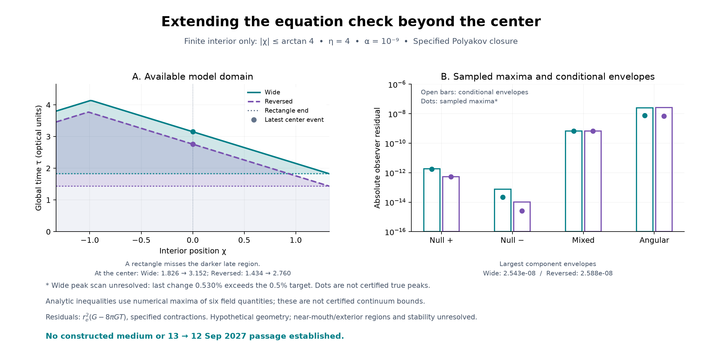

### The region matters

Let a=atan(4), h=pi/2. Right and left entry clocks are
e_R=tau+chi-h and e_L=tau-chi-h. The available region is

\[
|\chi|\le a,\qquad
0\le\tau\le h+\min(r_{\max}-\chi,l_{\max}+\chi).
\]

Both entry histories end at exterior time 4L. Negative-entry jets are the
specified zero initial data. This region excludes the near-mouth portions
outside the finite cutoff and the exterior spacetime.

A rectangular strip spanning the whole spatial width would stop at
tau=1.82649 for the wide state and 1.43398 for its reversal. The last
available center events are at 3.15231 and 2.75979, respectively. Therefore
using just that rectangle would omit the late center stress spikes. The
new characteristic domain retains them and also covers later events away
from the center.

### What is bounded

The reconstruction and Polyakov source are the same as in the preceding
center test. Set F=1+phi and E=G-8piGT. With A and B evaluated on their
respective entry characteristics,

\[
\phi_u=\alpha\left[A''+A'\tan\chi+\frac{G_1}{2}\right],\quad
\phi_v=\alpha\left[B''-B'\tan\chi-\frac{G_1}{2}\right],
\]
\[
G_1=\widehat\beta(\tan\chi+\chi\sec^2\chi)+(A-B)\sec^2\chi.
\]

The four independent spherical residual components are the two radial-null
contractions, the null-cross contraction, and the angular component.
The [MMP spherical equations and angular correction](https://arxiv.org/html/1807.04726v3#A2)
provide the geometric foundation; the conditional quantum source uses the
existing [Polyakov effective-action convention](https://arxiv.org/pdf/hep-th/0006035).
The following bounds applied to these returned states are our calculation.

Suppose A_i and B_i bound the absolute values of their zeroth, first and
second derivatives throughout the needed characteristics. Put
T=4, C=sqrt(17), s_a=T/C, M_0=A_0+B_0 and M_1=A_1+B_1. Then

\[
\phi_- =\alpha(\widehat\beta-TM_0-M_1),\qquad
\phi_+ =\alpha[\widehat\beta(1+aT)+TM_0+M_1].
\]

The weighted derivative bounds are

\[
U=\alpha\left[A_2+s_a A_1+
\frac{\widehat\beta(s_a+aC)+CM_0}{2}\right],\qquad
V=U\text{ with }A_2,A_1\text{ replaced by }B_2,B_1.
\]

They bound |cos(chi) phi_u| and |cos(chi) phi_v|. Let F_min=1+phi_->0.
The absolute residuals obey

\[
|E_+|\le 2U^2/F_{\min}^2,\quad |E_-|\le 2V^2/F_{\min}^2,
\]
\[
|E_\times|\le
2\max_{p=\phi_\pm}\left(\frac p{1+p}\right)^2+
\frac{2\alpha}{3F_{\min}},
\]
\[
|E_\Omega|\le
\max_{p=\phi_\pm}\left|\frac{p(3+2p)}{(1+p)^2}\right|
+\frac{UV}{F_{\min}^2}.
\]

Here every E component includes the factor r_e^2 and the observer
contraction defined in the center test. These inequalities are exact
**conditional on valid jet bounds**. Our inputs are optimized numerical
maxima, not certified interval enclosures; convergence does not exclude
every possible missed extremum. They are not metric-error percentages.

### Results at energy ratio 4

| Order | Null-plus envelope | Null-minus envelope | Mixed envelope | Angular envelope |
|---|---:|---:|---:|---:|
| Wide | 1.80719e-12 | 7.67473e-14 | 6.66667e-10 | 2.54312e-8 |
| Reversed | 5.37681e-13 | 1.04221e-14 | 6.66667e-10 | 2.58787e-8 |

The conditional minimum area ratios are 0.999999994187 and
0.999999994038. Sampled angular maxima are 7.57476e-9 and 6.88049e-9,
below the more conservative envelopes. These are absolute residuals;
the known static calibration defect remains included.

The derivatives were checked symbolically, and static values independently
check the numeric evaluator. Four integrations use evolution refinements
0.25 and 0.125. All earlier coarse records remain exactly identical after
removing the new diagnostics. Each evolution searches exterior-time grids
of 401, 801 and 1601 points per side, then refines local jet maxima. Using
the monotone exterior clock resolves features compressed into tiny throat
clock intervals. The last envelope search change is below 6.20e-14 and
the largest evolution-refinement change is 8.49e-12. State and energy-ledger
checks also pass. About 2.85 and 2.96 million admissible characteristic
pairs were checked on the finest grids of the two coarse evolutions.

**A direct peak check remains unresolved:** the wide pair-grid maximum
changes by 0.5303%, slightly above its declared 0.5% target. The reversed
peak check passes. We retain that failure explicitly; the separate
converged envelope calculation does not turn it into a pass. No further
blind grid enlargement was used.

### What changes next

The evidence no longer points to a large local equation residual inside
this tested region. The next useful question is whether the small omitted
terms can nevertheless change the nearly frozen boundary clocks, where
small geometric changes may have a large timing effect. That requires a
metric/clock response calculation with stated boundary data, rather than
declaring stability from residual size alone.

All previously resolved returns remain later than departure. No physical
medium, matter-production method, or **13 September 2027 to 12 September
2027** journey has been established.


## Strong center stress coexists with small Einstein-equation residuals

The direct equation check changes the interpretation of the previous energy
sweep. Even where the observer's dimensionless chiral stress reaches 22.21,
the largest sampled radial-null residual is only 1.79e-12 in units of the
background curvature. The mixed and angular components also remain small
**under the already specified radius-independent Polyakov source model**.
Large stress alone was therefore not a justified reason to discard these
center equations. This is a consistency result, not a new physical law,
stability proof, or successful backward journey.

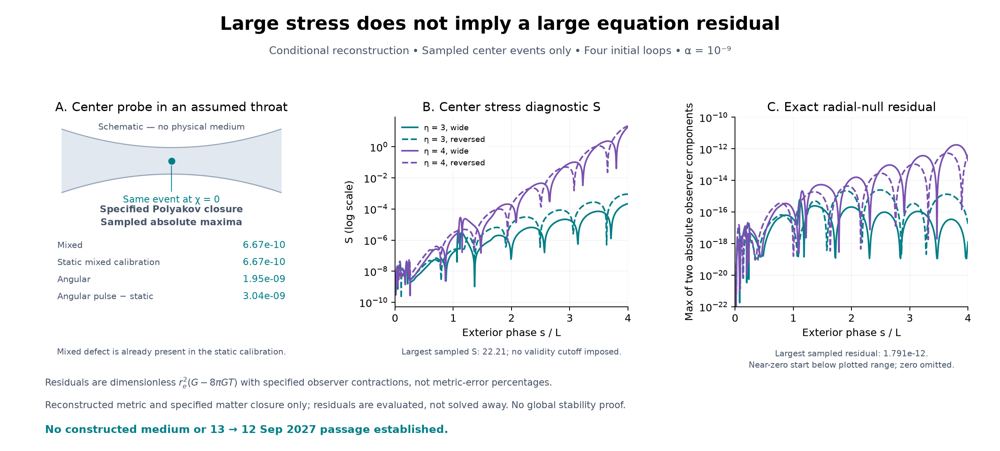

### What was actually calculated

Use the same four-loop histories at energy ratios 3 and 4, both packet orders,
with D=1.2 and alpha=1e-9. Reconstruct

\[
ds_4^2=r_e^2\sec^2\chi(-d\tau^2+d\chi^2)+r_e^2F\,d\Omega^2,
\qquad F=1+\phi,\quad u=\tau+\chi,\quad v=\tau-\chi.
\]

Every pair of source and derivative values is evaluated at the **same center
event**, using the appropriate inverse characteristic on each side. Combining
the two mouths' simultaneous exterior outputs would evaluate different
interior events and give the wrong diagnostic.

For the specified chiral source, 8piG T_uu=alpha J_plus/F. The exact spherical
geometry gives

\[
G_{uu}=-\frac{\phi_{uu}-\tan\chi\,\phi_u}{F}
       +\frac{\phi_u^2}{2F^2}.
\]

The leading constraint cancels the first term against that source, leaving
E_uu=phi_u^2/(2F^2), and similarly for vv. In particular, an apparent
phi-times-second-derivative correction must not be counted separately: the
same factor F occurs in the source. A large second derivative can coexist
with small omitted first-derivative-squared terms.

For the static throat observer and k_plus/minus=U plus/minus E, the
dimensionless radial-null residual is

\[
\epsilon_\pm=r_e^2|\mathcal E(k_\pm,k_\pm)|
=2\cos^2\chi\,\phi_{u,v}^2/F^2,
\qquad \mathcal E=G-8\pi G T.
\]

The saved secondary normalization divides this by
1+4 alpha cos^2(chi)|J_plus/minus|/F. It is a background-plus-source
normalization, **not a fractional source error** or percentage error in the
metric. It remains defined at source zeros.

### Center results

All entries below are maxima over the saved center samples, not certified
continuum bounds. Different columns can peak at different events.

| Energy ratio / order | Stress S | Absolute radial-null residual | Absolute mixed residual | Absolute angular residual |
|---|---:|---:|---:|---:|
| 3 / wide | 2.1845e-4 | 6.1441e-16 | 6.6667e-10 | 1.4785e-9 |
| 3 / reversed | 8.9834e-4 | 2.4921e-15 | 6.6667e-10 | 1.3286e-9 |
| 4 / wide | 19.1686 | 1.7913e-12 | 6.6667e-10 | 1.8999e-9 |
| 4 / reversed | 22.2142 | 5.2891e-13 | 6.6667e-10 | 1.9500e-9 |

The conditional mixed/angular test uses the existing Polyakov effective
action whose quantum part is independent of sphere radius. That specified
action gives zero extra angular pressure and fixes the trace contribution;
we have not inferred the full four-dimensional fermion stress tensor from
the chiral data. The resulting exact residuals of this reconstructed ansatz
are

\[
\mathcal E_\times\equiv r_e^2\mathcal E(k_+,k_-)
=-\frac{2(3\phi^2+\alpha F)}{3F^2},\qquad
\mathcal E_\Omega\equiv r_e^2\mathcal E^\theta{}_\theta
=\frac{\phi(3+2\phi)+\cos^2\chi\,\phi_u\phi_v}{F^2}.
\]

The unperturbed center already has mixed residual -6.6667e-10 and angular
residual 1.0944e-9 because the leading metric omits the known static metric
and trace-reference corrections. This baseline defect is not a new pulse
instability. We also save cancellation-resistant pulse-minus-static values:
the largest absolute mixed change is 1.26e-18; the largest absolute angular
change is 3.05e-9. These differences do not replace the absolute residuals.

The foundations are the [MMP throat equations and reference conventions](https://arxiv.org/html/1807.04726v3#S5.SS3.SSS2)
and the [Polyakov mean-field framework, Eqs. 5.1-5.5](https://arxiv.org/pdf/hep-th/0006035).
The application to these returned states and the residual calculations above
are our derivation. Neither publication proves this driven geometry stable
or supplies a construction recipe.

### Verification and next decision

Eight integrations compare step refinements 0.25 and 0.125. All four
coarse legacy records remain exactly identical after removing the new
diagnostic. The largest relative maximum-norm change among the new null
diagnostics is 2.09e-8, below the predeclared 1e-6 check; the maximum scaled
state change is 6.34e-11 and refined slice-ledger error is 1.74e-13.
Symbolic checks verify the center derivatives, the null cancellation, both
mixed/angular warped-geometry identities, and both static-subtraction
identities. Mixed/angular arrays reuse the converged inputs; they have not
undergone an independent spatial sampling refinement. Historical results
are preserved, including the unresolved earlier off-center peak scan.

**Next:** evaluate the residual tensor away from the center for energy ratio
4, within the solved characteristic domain. Use the existing finite-strip
and one-dimensional envelope machinery to check whether small center
residuals hide a bad spatial region. Small residuals alone do not bound
solution error near sensitive clock evolution, validate the state spectrum,
prove stability, or provide physical materials.

All previously resolved trips still return later than departure. Travel
from **13 September 2027 to 12 September 2027 remains unproved**. This result
improves the model's consistency assessment; it does not make that calendar
trip possible.


## More packet energy suppresses observed returns in this family

At fixed geometry, increasing the initial quantum-state energy reduces
finite-window passage and lengthens the same early signal's return.
This parameter direction has not produced a faster route toward backward
travel. The largest tested energy also gives a large local stress reading,
which requires a geometric validity check rather than a declaration of
collapse.

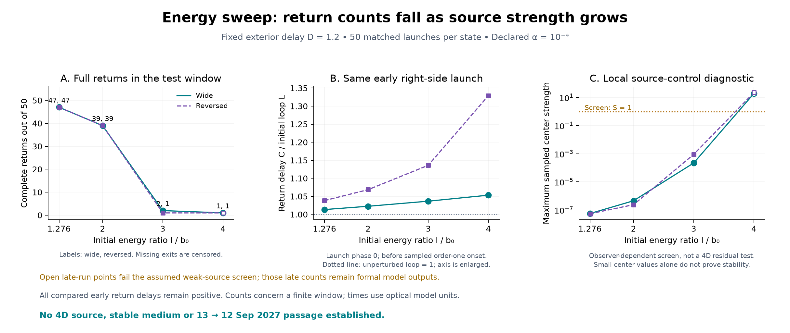

### A change in energy, with the other conditions held fixed

Keep `D=1.2`, `L=pi+D`, synchronized initial mouths, the same initially
exterior state family, and evolution through `s=4L`. Launch the same
50 probes, from both sides at phases `0,0.125,...,3`. Set the normalized
energy `eta=I/b0` to `2`, `3` and `4`, compared with the earlier
`1.276045816289`. The corresponding positive amplitudes are
`0.12412962953797861`, `0.14360153622486665`, and
`0.15752457643370363`. Each map remains orientation preserving; using
the negative amplitude reverses the stress sequence at equal energy.
These are dimensionless state parameters, not available laboratory joules.

| eta | Complete returns within 4L, wide / reversed | Same phase-0 right launch: C/L, wide / reversed | Largest sampled center S, wide / reversed |
|---:|---:|---:|---:|
| 1.276046 | 47 / 47 | 1.013329 / 1.038181 | 5.53e-8 / 5.37e-8 |
| 2 | 39 / 39 | 1.022443 / 1.068425 | 4.48e-7 / 2.35e-7 |
| 3 | 2 / 1 | 1.036513 / 1.135947 | 2.18e-4 / 8.98e-4 |
| 4 | 1 / 1, formal continuation | 1.053212 / 1.329125 | 19.17 / 22.21 |

Counts have denominator 50. Missing exits are censored by the finite
window; they are not proof of permanent trapping. All resolved return
times remain positive. Comparing the same initial launch avoids selecting
different favorable probes as the set of completed trips changes. Its
return occurs before the first resolved order-one center-source reading
in the strongest cases.

The clock gate becomes smaller while passage becomes worse. For example,
the wide case's minimum `G/L` changes from `0.50374` to `0.31466`, then
`0.25479`, while its minimum clock rate falls from `0.2672` to `0.0971`,
then `2.70e-5`. This supports the earlier warning: a shrinking clock gate
can reflect slow clocks, without a shorter physical round trip.

### What the large-source readings do and do not establish

At `eta=4`, the first **sampled** `S>=1` readings occur at exterior phases
`3.45` and `3.43333`. The corresponding center times approach
`3.152306` and `2.759794`; the mappings between exterior and center times
are highly compressed. These are resolved sampled crossings, not certified
first crossings over continuous spacetime. The larger center stress is
numerically reproducible and fails our adopted weak-source screen.

**Interpretation correction:** `S>=1` is not a universal validity limit of
JT gravity, nor a horizon or collapse theorem. It measures chiral stress
for a specified local observer relative to the background gravitational
scale. JT can retain its prescribed two-dimensional curvature while
matter changes dilaton derivatives. Consequently, small area change alone
does not establish control, and large `S` alone does not prove that every
omitted term is large. This clarification supersedes the stronger
historical wording in earlier diagnostic metadata; numerical history is
unchanged.

[MMP section 5.4](https://arxiv.org/html/1807.04726v3#S5.SS4) discusses
separate quantum-fluctuation limits and the risk of excess injected energy
destroying the throat. It does not supply a threshold in our `I/b0` for
these evolving, recirculating states. The late `eta=4` output remains a
formal reduced-model result until its four-dimensional approximation is
checked; the other rows also remain conditional on the model.

Nor does a negative boundary-charge sum prove a horizon. The independently
checked signed energy ledger reads

```text
-b0*(K_right+K_left-1) + X_exterior = I
K_right+K_left = 1 + X_exterior/b0 - eta
```

Exterior excess energy is signed and must not be clipped. Even the
`eta=2` cases have negative charge sums during portions of their evolutions
while returning 39 probes. Initial `eta` or the sign of this charge sum
alone is insufficient to determine passage or chronology.

### Numerical checks and next direction

All six new runs have step refinements from `0.25` to `0.125`. Full-state
normalized differences are below `8.42e-10`; normalized center-strength
differences are below `1.50e-7`; resolved return-time differences are below
`1.96e-10` optical units. Every exit/return status and sampled source
threshold classification agrees. Refined slice-energy residuals remain
below `2.96e-12`. Twelve saved integrations were reused for the focused
checks; baseline data were reused from the preceding verified runs.
No numerical tolerance was loosened, and the historical suite was not rerun.

The planned higher `eta=8` trial is deferred because increasing energy
has already reduced passage and exposed an unresolved approximation
question. The next useful calculation is the omitted-term residual of the
four-dimensional equations on the reconstructed radius
`R=r_e*sqrt(1+phi)`, including derivative terms. That can distinguish a
large observer-measured stress from an actual failure of the approximation.
No stable medium, physical preparation or new physics is established.
**Travel from 13 September 2027 to 12 September 2027 remains unproved.**

## Interior field map and a conditional stress envelope

The same two four-loop evolutions now supply a field map across
`|chi|<=atan(4)` and the common interval `0<=tau<=11.9986498562` in
optical units. The tested mean stress and sphere-area correction remain
small at the declared `alpha=1e-9`. This is stronger spatial evidence than
the preceding center-only samples, but it still assumes the leading throat
model and the supplied initial quantum state.

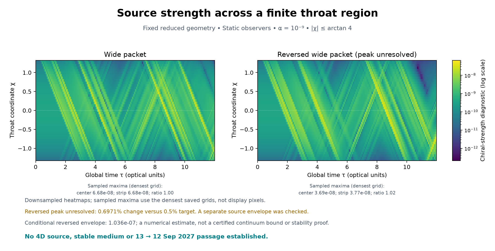

### Reconstruction at one spacetime event

At an event `(tau,chi)`, retrieve the right and left histories whose mouth
clocks equal `tau+chi-pi/2` and `tau-chi-pi/2`, respectively. Let their
bulk jets be `A,A_prime,A_second` and `B,B_prime,B_second`. Then

```text
beta_hat = [(2*pi/(pi+D))^2 - 1]/3,   D=1.2
phi = alpha * [beta_hat*(1+chi*tan(chi))
               + (A-B)*tan(chi) + A_prime + B_prime]
area / extremal_area = 1 + phi
S = alpha*cos(chi)^2 * (abs(J_plus)+abs(J_minus)) / (1+phi)
```

`S` is the modeled chiral density/flux scale measured by the fixed local
observer, normalized by `8*pi*G*r_e^2`. Its geometric normalization follows
the [leading spherical throat reduction in MMP](https://arxiv.org/html/1807.04726v3#S5.SS3.SSS2).
The time-dependent reconstruction and checks here are our application,
not a published construction of this evolving medium. The trace sector and
stress fluctuations are excluded.

Every history query lies within the solved domain. The latest required
entrance clock is `tau_max+atan(4)-pi/2`; the available margins are about
`0.6221` and `0.5093`. Initial negative entrance arguments use the specified
initial throat data. This common rectangle does not cover every event
accessible in the four-period mouth evolution, or the near-mouth region
`atan(4)<|chi|<pi/2`.

### Results and the unresolved direct peak

| Quantity over this common rectangle | Wide | Reversed |
|---|---:|---:|
| Finest evaluated time x position grid | 1449 x 321 | 5793 x 1281 |
| Largest sampled S | 6.68229e-8 | 3.76919e-8 |
| Largest sampled abs(phi) | 4.99087e-9 | 5.64215e-9 |
| Minimum sampled area / extremal_area | 0.99999999993345 | 0.99999999993612 |
| Direct peak sampling change, last refinement | 0% | 0.6971% |

Denser sampling finds a wide-packet center peak about 21% larger than the
earlier estimate. Earlier maxima were explicitly sampled values, not
continuum bounds. For the reversed packet the largest sampled value occurs
away from the center at the final time boundary. Its peak location and
precise amplification remain provisional: the direct scan **does not meet
the 0.5% convergence target**. The plotted arrays are downsampled for display;
the table uses the finest evaluated grids.

### A more direct stress-envelope calculation

Instead of repeatedly enlarging the two-dimensional grid, locate extrema
of the two one-dimensional traveling histories. If their absolute values
obey `|A|<=a`, `|B|<=b`, `|A_prime|<=ap`, `|B_prime|<=bp`, and
`|J_plus|<=jp`, `|J_minus|<=jm` over the required characteristic interval,
then the triangle inequality gives

```text
P = alpha * [beta_hat*(1+cut*tan(cut))
             + (a+b)*tan(cut) + ap + bp],   cut=atan(4)
abs(phi) <= P
S <= alpha*(jp+jm)/(1-P), provided P<1
```

This is an exact conditional inequality. For the reversed packet, local
extremum searches seeded from 1769, 3537 and 7073 characteristic samples
give `jp=36.032762775`, `jm=67.541115876`,
`P=1.61276877e-8`, and a stress envelope `1.0357388032e-7`.
The last search-grid change in that envelope is below `7.5e-12` relative;
a finer evolution changes it by about `2.6e-12` relative.
The maxima used in the inequality are numerically estimated, so this is
**not a certified continuum bound**. In particular, missed extrema have
not been excluded by interval arithmetic. The envelope supports the small
mean-source hierarchy within this model without pretending the direct
peak-convergence test passed.

### Verification and direction

The preceding dynamical records reproduce exactly when the new readout is
removed. Source/area profiles agree under evolution refinement, an exact
static-field control checks normalization, and unavailable histories are
rejected. An independent polynomial manufactured field satisfies all
three leading JT constraints. The recorded verification distinguishes
these integrity checks from the unresolved reversed-packet peak scan.
Saved integrations are reused for the final checks; the historical suite
is not rerun. Prior result data and report sections remain preserved.

This increment finds no sampled loss of the small-field hierarchy in the
chosen interior. It establishes no material-production recipe, global
stability, new physics or backward travel. The next discriminating test is
to increase admissible initial-state energy and compare actual return times:
does the causal gap shrink, or does passage become suppressed first?
**13 September 2027 to 12 September 2027 remains unproved.**

## Four-loop passage persists; local stress depends on packet order

The two wide initial states now evolve through four initial circulation
periods, with 50 signal launches per state. Both complete 47 returns
inside the window. All 18 launches tested in the earlier two-period run
have now completed their returns. This resolves their earlier finite-window
censoring; it does not establish permanent passage or a physical medium.

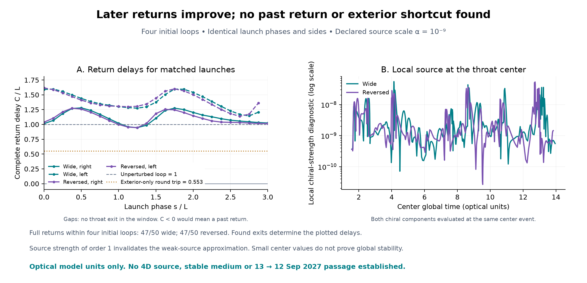

### What changed and what the signals do

The initial states, background and normalized energy remain those of the
preceding comparison: `D=1.2`, `L=pi+D`, amplitudes
`+/-0.103788845708491`, and `I/b0=1.276045816289`. Only the observation
window and launch grid are extended. Signals launch from both sides at
`s/L=0,0.125,...,3`; evolution stops at `s/L=4`.

| Result | Wide packet | Reversed packet |
|---|---:|---:|
| Throat exits resolved | 49/50 | 49/50 |
| Full returns inside the window | 47/50 | 47/50 |
| Earliest 18 launches fully returned | 18/18 | 18/18 |
| Latest 18 launches fully returned | 15/18 | 15/18 |
| Fastest resolved return, C/L | 0.94581246 | 0.94552310 |
| Later / earlier sampled center-stress peak | 0.788607 | 1.897368 |

The fastest return occurs at the same launch phase and side in both cases:
`s/L=1.25`, right mouth. It is approximately 5.4% shorter than the
unperturbed loop. However, an exterior-only round trip takes
`2D/L=0.55279253`, substantially less. The fastest throat transits themselves
take `2.90633243` and `2.90507613`, versus exterior transit time `D=1.2`.
Thus these signals establish neither an exterior shortcut nor a backward
return. A past return would require `C<0`; all resolved returns have `C>0`.
Two resolved exits have exterior returns beyond the observation window;
one launch has no resolved exit. Neither condition means permanent trapping.

### A local, physically normalized source check

Both traveling source components must be evaluated at the same spacetime
event. Multiplying or adding the simultaneous exterior-mouth columns would
combine different center events. The new diagnostic traces both histories
to a common throat-center event and computes, in natural units,

```text
S_center = alpha * (abs(J_plus) + abs(J_minus)) / (1 + phi_center)
         = 8*pi*G*r_e^2 * max(abs(rho_chiral), abs(flux_chiral))
```

Here `J` is the modeled null source divided by `alpha`; density and flux
are measured by the fixed throat-center observer. This is an observer's
local stress scale, not a frame-independent tensor norm. We declare
`alpha=1e-9`, retaining the earlier weak-source convention. Its unperturbed
value is `3.64803151e-10`. The interpretation uses the leading spherical
throat reduction of [Maldacena, Milekhin and Popov](https://arxiv.org/abs/1807.04726);
the pulse state uses [Fewster and Hollands' CFT stress transformation](https://arxiv.org/pdf/math-ph/0412028).
The evolution and diagnostic application here are our calculations.

The wide packet's earlier/later sampled peaks are `5.52543e-8` and
`4.35739e-8`; the reversed packet's are `2.83129e-8` and `5.37201e-8`.
These remain small compared with unity at the declared alpha. The minimum
sampled center area ratio remains above `0.99999999996`. The reversed
packet's larger later peak identifies a question worth testing; two window
maxima do not demonstrate secular growth or instability.

Earlier/later means center events selected by exterior sample windows
`s<=2L` and `s>2L`. These are sampled maxima, not certified bounds over all
times or the entire throat. Small center stress does not verify the trace
sector, stress fluctuations, mouth neighborhoods, full metric feedback,
four-dimensional exterior, state preparation or physical parameter choices.

### Verification and the next decisive check

Clock evolution, bulk matching, charge conservation, return times and
source convergence pass their checks. Both original refinement-0.5
two-period clock prefixes reproduce the saved preceding results exactly.
The reversed case initially fails the source comparison: the normalized
component discrepancy is `1.02569e-6`, above the unchanged `2e-7` threshold.
Refining from `0.25` to `0.125` reduces it to `2.15187e-8`; the wide case
passes at `0.5` to `0.25` with `1.46099e-8`. No tolerance was relaxed.
Accepted source-strength changes are at most `2.81e-16`; return-time
changes are at most `2.79e-10` optical units. The source comparison includes
the small numerical displacement of center event times between runs; it
does not attribute the initial failure solely to that displacement.

The five saved production integrations were reused to finish the focused
checks, with exact parameter/grid/state-construction checks and a fresh
static control. The static strength error is `5.17e-26`. This was not an
independent repeat of those integrations or a rerun of the historical suite.
The saved `long_packet` record retains the failed and successful refinement
attempts; prior JSON data are preserved exactly.

Next, extend the same-event stress and area check across a finite throat
region, with sampling refinement. That addresses the present center-only
blind spot before spending time on still longer evolutions. Four-loop
passage is progress in testing this conditional model, not a new discovery
or a stable-medium construction. **Travel from 13 September 2027 to
12 September 2027 remains unproved.**

## A wider initial state preserves more passage, without forming a time loop

At matched normalized initial energy, the wider quantum packet permits
many more of the tested signals to complete their trips within two initial
loop times. Reversing its stress sequence changes which signals return
within that window. Neither case produces a backward return or approaches
the closed-loop gate more closely than the narrow case in this test.

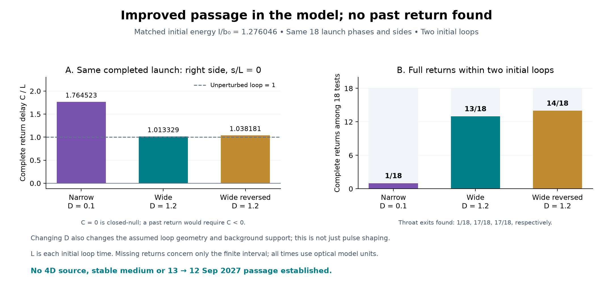

### Controlled changes to the state and background

The solver now accepts the exterior delay `D` consistently. It recomputes
the vacuum, supporting coefficient, initial throat background, loop length,
lambda tilt, retarded lookups and initial energy remainder together:

```text
L = pi + D
b0(D) = pi/6 * [(2*pi/(pi+D))^2 - 1]
k = D/pi
0 < D < pi
```

The narrow case has `D=0.1`, amplitude `a=0.05`. One scalar energy-matching
root sets the wider case to `D=1.2`, `a=0.103788845708491`, giving the same
`I/b0=1.276045816289`. Its `b0=0.573031449434`,
`I=0.731214383653` and `min(V_prime)=0.560387770>0`.
This ratio compares an ideal state's energy with a background coefficient;
it is not an invariant machine-energy budget. Changing `D` changes the
assumed loop geometry as well as the initially exterior packet's duration.

For a further controlled test, replace `a` by `-a`. The symmetric compact
bump obeys

```text
V_negative(s) = D - V_positive(D-s)
delta_negative(s) = delta_positive(D-s)
I_negative = I_positive
```

This reverses the order of local stresses without changing the wide
geometry, total initial energy or map admissibility. The state construction
uses the [CFT stress transformation](https://arxiv.org/pdf/math-ph/0412028).
It supplies an admissible ideal state, not a demonstrated preparation method.
All three cases start with synchronized clocks and no imposed offset.

### Compare actual round trips, not just clock-gate size

We launch 18 signals: both sides at `s/L=0,0.125,...,1`, and evolve each
configuration through `s/L=2`. A throat exit and a complete return to the
launch mouth are counted separately. Missing exits are finite-window
censoring, not zero time or proof of permanent trapping.

| Case | Throat exits found | Complete returns within the window | Return delay C/L for the common launch at s/L=0, right side |
|---|---:|---:|---:|
| Narrow | 1/18 | 1/18 | 1.764523 |
| Wide | 17/18 | 13/18 | 1.013329 |
| Wide, reversed sequence | 17/18 | 14/18 | 1.038181 |

The last column compares the same launch phase and side in all cases.
It is the only launch fully returned inside all three windows. The
unperturbed loop has `C/L=1`; a closed null return needs `C=0`, and a past
return needs `C<0`. Every resolved signal in this launch grid returns
later, and none beats its own unperturbed loop time. The completion-count
improvement establishes better passage over this finite interval, not
permanent stability or a time-travel mechanism.

The minimum sampled complete-return **clock** gates divided by `L` are
`0.494853`, `0.520358`, and `0.514479`, respectively. They remain positive;
the wider cases are not closer to zero by this measure. Moreover,
`G_R=C_R*average(l_prime)` over the associated receiving-clock interval.
A small clock gate can therefore reflect a slow clock rather than a short
physical return. Arrival-indexed legacy minima can also refer to virtual
negative-time initial ancestors; the comparison above uses explicit
nonnegative launches instead.

### Verification and next direction

The focused comparison passed in `30.64` seconds. The wider static control
has no clock drift or excess-energy residual. The original narrow record
reproduces exactly. The initial coarse wide run exceeded the unchanged
charge tolerance; reducing the step resolved it. A further refinement
changes clock variables by at most `3.98e-10` and explicit return times by
`2.97e-11`; refined lambda-slice charge residuals are below `2.30e-12`.
The reflected source identity agrees within `4.45e-14`, and the two wide
initial energies agree within `1e-12`. No tolerance was relaxed.

Reproduce only this increment with `.venv/Scripts/python.exe -B`:

```python
import json
from pathlib import Path
import mmp_pulse as m
j = json.loads(Path("results/mmp_pulse_results.json").read_text(encoding="utf-8"))
assert m.wide_packet_checks(j["lambda_feedback"]) == j["wide_packet"]
```

The next discriminating test is longer evolution of the wider states:
does the improved passage persist through subsequent circulation, or does
the field eventually suppress it? The two stress orders favor different
launches, so neither is an overall winner from this window alone.
This remains a fixed-exterior, leading JT/free-CFT model. The
[parent MMP construction](https://arxiv.org/abs/1807.04726) supplies neither
the changing four-dimensional exterior nor a method to manufacture this
state. No stable physical medium or **13 September 2027 to 12 September
2027** passage is established.

## The coupled solver now evolves in the new causal time

The lambda foliation is implemented in the actual quantum-state and
boundary-clock solver. Static and nonzero-pulse tests reproduce the earlier
exterior-time calculation, and the conserved charge balances on the new
spacelike slices. The tested pulses still produce no backward complete
return. This is a numerical-method advance within the same reduced model.

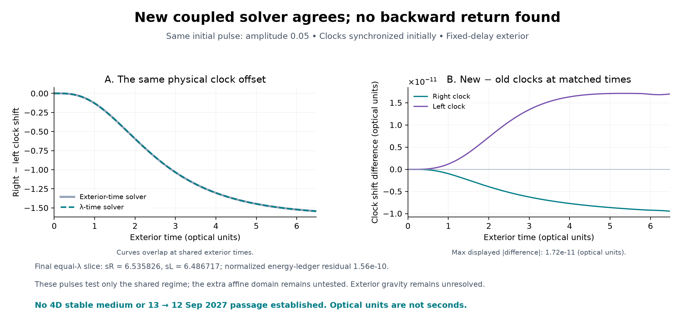

### The physical equations are retained

Set `k=D/pi`, `lambda_i=s_i+k*y_i(s_i)` and
`h_i=ds_i/dlambda=1/(1+k*v_i)`. The state still stores exterior-time
derivatives `v=dy/ds`, `a=dv/ds`, and `K=Schwarzian(y,s)+v^2/2`.
The existing boundary equations become

```text
d(y,v,a,K)/dlambda = h * (
    v,
    a,
    v*(K-v^2/2) + 3*a^2/(2*v),
    v^2*(J_out-J_in)/b0
)
```

Each boundary's three bulk variables acquire its own factor `h` as well.
This changes the integration parameter, not the physical stress definition;
there is no additional Schwarzian to insert merely for integrating in
lambda. The [JT boundary dynamics](https://arxiv.org/html/1606.01857)
remain the underlying approximation.

The two physical mouth times are recovered as `s_i=lambda-k*y_i`.
Exterior propagation uses the other mouth at `s_i-D`; throat propagation
uses the opposite clock inverse at `y_i-pi`. Both inverses search completed
lambda history. The first packet is selected by `0<s_R<D` and evaluated
at `s_R`. Static negative characteristic history uses
`y_R=y_L=lambda/(1+k)`, so both negative inverse maps return
`(1+k)*target`. Physical launch and exit times are converted back to exterior
time before reporting passage results.

Steps are chosen from the available retarded gaps and shortened if a trial
requires unsolved history. The lambda branch does not impose the old
positive-one-way-exterior-time rule. It still stops at numerical resolution
limits or loss of retarded lambda ordering; such a stop is not a physical
chronology-protection result.

### Conserved charge on the tilted slices

The two mouths generally have different exterior times on one lambda
slice. We therefore split the outgoing excess-flux integrals:

```text
dF_R/dlambda = h_R*(Q_R,out-Q0)
dF_L/dlambda = h_L*(Q_L,out-Q0)
E_ext = F_R(s_R)-F_R(s_L-D) + F_L(s_L)-F_L(s_R-D) + R_initial(s_R)
B = -b0*(K_R+K_L-1)
B + E_ext = I_initial
```

The initial packet's signed remaining energy is retained. No extra lapse
factor multiplies the primitive energy values. Common-exterior-time
outputs are reconstructed separately for comparison with the old solver;
the primary new charge check uses actual equal-lambda slices.

### Verified results

All runs start with synchronized entrances. The common exterior interval
is `0` through `6.4831853072`, in optical model units.

| Pulse amplitude | Largest clock-state difference between solvers | Largest probe-return difference | Maximum lambda-slice charge residual |
|---:|---:|---:|---:|
| 0.01 | 1.29e-9 | 1.70e-11 | 2.25e-11 |
| 0.05 | 8.01e-10 | 1.72e-10 | 1.57e-10 |

The zero-input solution agrees with its exact static state within
`1.11e-13`, with zero excess-energy residual. Half-step refinement at
amplitude `0.05` changes clock variables by at most `1.49e-9` and energy
integrals by `2.29e-9`; the component-scaled full-state difference is
`1.82e-8`, and the refined slice residual is `4.69e-11`.
The old quantum records reproduce exactly, as does a captured classical
record and full state. A separate agent checked the implemented physical
time conversions, source transport, primitive weights and charge ledger.

The focused production check passed in `42.65` seconds. Reproduce this
increment with `.venv/Scripts/python.exe -B` from the project:

```python
import json
from pathlib import Path
import mmp_pulse as m
j = json.loads(Path("results/mmp_pulse_results.json").read_text(encoding="utf-8"))
assert m.lambda_feedback_checks(j["quantum_seed_feedback"]) == j["lambda_feedback"]
```

### What this changes next

The new branch removes an artificial exterior-time ordering restriction
while solving the same responding mean-field equations. Its overlap tests
do **not** themselves enter the additional causal regime shown by the
preceding imposed-clock example. A physically admissible source that drives
the system into that regime remains to be found and tested.

The next useful step is a source-design criterion, not a larger blind
amplitude scan: compare achievable clock displacement against the packet's
energy cost and the throat's supporting stress. A cheap source calculation
identifies a specific next comparison: increasing the initially exterior
segment from `D=0.1` to `D=1.2`, at amplitude `0.05`, lowers the normalized
packet cost `I/b0` from `1.276046` to `0.256104`. This changes the assumed
loop geometry; it is not a reduction in a demonstrated device's energy.
For a fair matched-cost test, the wider seed needs amplitude
`0.10378884570849`, still with `min(V_prime)=0.560388>0`.
Independent direct quadrature confirms these initial-state numbers; that
wider packet's coupled evolution has **not** yet been run. The fixed exterior geometry,
full gravitational initial constraints and field preparation remain missing.
The [parent MMP construction](https://arxiv.org/html/1807.04726v3) does not
supply that evolving exterior or a time machine. No stable medium, new
physics discovery or **13 September 2027 to 12 September 2027** passage is
established.

## A solver limitation is separated from the physical chronology question

The existing quantum-pulse runs remain on the causal side of both passage
thresholds. However, the solver's exterior-time history rule cannot follow
every causal configuration of its own ideal model. We derived and checked a
new computational time that removes this particular ordering restriction.
This is progress in the mathematical method, not a new physical medium.

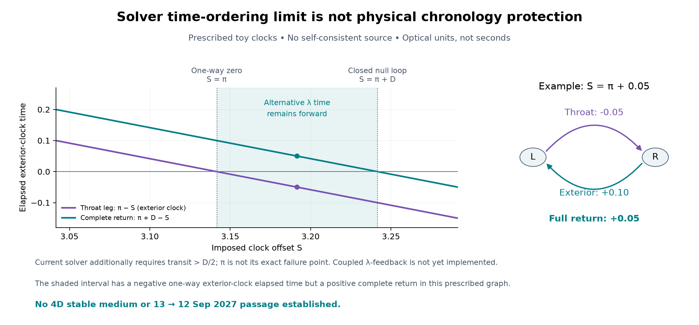

### The exact return condition

Assume strictly increasing entrance clocks `r(s),l(s)`, throat optical
crossing `pi`, and the model's fixed exterior return delay `D`. A right
launch at exterior time `s` returns after

```text
C_R(s) = l_inverse(r(s)+pi) + D - s
G_R(s) = pi + r(s) - l(s-D)
G_L(s) = pi + l(s) - r(s-D)
```

Where the crossing exists, `C_R` and `G_R` have the same sign. Zero is a
closed null return; negative permits a closed timelike trip by adding a
wait at the starting mouth. The opposite direction uses `G_L`. In
contrast, the one-way exterior-time sign is `pi+r(s)-l(s)`. These are
different conditions when `D>0`.

The present solver requires each one-way ancestor in completed exterior
history, and additionally checks one-way delays above `D/2`. It therefore
stops before some configurations with positive complete returns. Neither
its guard failure nor the absence of negative returns in accepted runs is
a proof of chronology protection.

### Constructing a time coordinate that covers the missing regime

Let `k=D/pi` and assign each mouth
`lambda_i(s)=s+k*y_i(s)`. Its derivative `1+k*y_i_prime` is positive.
For a throat crossing, `Delta_lambda=Delta_s+D`: the complete return delay.
For an exterior leg `i@s -> j@(s+D)`,
`Delta_lambda=k*[pi+y_j(s+D)-y_i(s)]`, the opposite gate at arrival.
Both leg types are ordered forward whenever both complete-return gates
are positive throughout the domain.

There is also a geometric construction in the ideal two-strip model.
At equal lambda let the exterior mouth times differ by `ds` and the
throat times by `dtau`; the definitions give `ds=-k*dtau`. Positive
return gates imply `abs(dtau)<pi` and `abs(ds)<D`. Otherwise one endpoint
could reach the other through the throat and return through the exterior
at or before departure. Join equal-lambda endpoints by straight lines
in each conformal strip. Both lines are spacelike and the slices are
nested because the boundary clock rates are positive. This gives a
piecewise smooth time foliation on the domain covered by both inverse
clock maps; strict margins allow local smoothing.

For the exact **imposed-clock control** `r=s+S,l=s,D=0.1,S=pi+0.05`:

| Quantity | Optical model units |
|---|---:|
| Left-to-right throat elapsed exterior time | -0.05 |
| Exterior return time | +0.10 |
| Complete return to the starting mouth | +0.05 |
| Throat elapsed lambda | +0.05 |
| Exterior elapsed lambda | +0.00159154943 |

Thus negative one-way exterior time does not establish a closed causal
loop. For this affine control the time-gradient norm is
`-[(pi+D)^2-S^2]/pi^2`; the closed-null threshold is `abs(S)=pi+D`.
Twenty characteristic circuits in lambda reproduce the independent
exterior-time return map within `1.56e-15`. This is a kinematic regression
test, not a quantum state or matter source supporting these imposed clocks.

### What the previous pulse runs now establish

Using monotone endpoint enclosures, without a new pulse scan, the smallest
lower bound on either one-way clock margin is `1.597045893` over the
saved interval. The corresponding complete-return margin bound is
`1.603179016`. All five runs remain positive throughout their recorded
interval under the monotone computed-clock assumption. These are clock
coordinate margins, not seconds or rigorous ODE error bounds. They say
nothing about later times. Changing-clock controls also verify 61 nested
lambda slices, with the equal-lambda identity accurate to `1.40e-14`.

The focused check takes about `0.016` seconds. Reproduce only this increment:

```python
import json
from pathlib import Path
import mmp_pulse as m
j = json.loads(Path("results/mmp_pulse_results.json").read_text(encoding="utf-8"))
assert m.causal_foliation_checks(j["quantum_seed_feedback"]) == j["causal_foliation"]
```

These gate and foliation formulas are our derivation for the declared
model. [JT boundary-clock dynamics](https://arxiv.org/html/1606.01857)
provide the throat framework, not its missing four-dimensional exterior.
The [parent MMP construction](https://arxiv.org/html/1807.04726v3) is a long
wormhole without ambient causality violation; its stationary exterior
matching does not establish our changing-clock sewing. General quantum
chronology theorems have additional field and horizon hypotheses and are
not consequences of a solver guard.

The energy ledger for that extension has also been derived independently.
Write `F_R,F_L` for the separate integrals of excess outgoing exterior
flux, zero for negative emitter times. On an equal-lambda slice with
mouth times `s_R,s_L`, the exterior energy is

```text
E_ext = F_R(s_R)-F_R(s_L-D) + F_L(s_L)-F_L(s_R-D) + R_initial(s_R)
B = -b0*(K_R+K_L-1)
B + E_ext = I_initial
```

For future evolution from synchronized zero times, `R_initial` is the
same signed remaining packet integral as before. Differentiating the
formula cancels the two boundary flux balances exactly, with each mouth's
own `ds_i/dlambda`. No extra lapse factor multiplies the flux primitives.
This is the existing conserved charge evaluated on the new slices, not
an asserted Hamiltonian for lambda translations.

**Next:** implement the coupled state/clock evolution in lambda, checking
agreement with the existing solver where both apply, before approaching
either causal threshold. That extension is not yet implemented. No stable
medium, physics discovery or 13 September 2027 to 12 September 2027 passage
has been established.

## An initial quantum pulse creates a clock difference, but no tested past return

We now start with synchronized entrances and evolve a quantum pulse together
with their responding clocks. This closes the state/clock feedback in our
existing **leading JT, free-CFT, fixed-exterior-delay model**. It does not
solve the exterior gravitational constraints or create a wormhole.

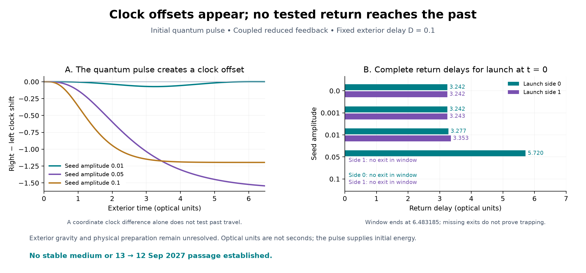

### What changed and what is assumed

The pulse is initially outside the throat, in one chiral field segment of
length `D=0.1`. The throat starts in its original leading configuration,
with no imposed time offset. A smooth degree-one circle map supplies the
state through the [CFT stress transformation](https://arxiv.org/pdf/math-ph/0412028):

```text
L = pi + D
V(s) = s + a*D*B(s/D)
B(z) = exp(4 - 1/[z*(1-z)]) for 0<z<1; otherwise zero
f_initial/q = -pi*V_prime^2/(12*L^2) - Schwarzian(V,s)/(24*pi)
```

The map is identity outside that exterior segment, with all interface
derivatives matching. `max|B_prime|=4.2356404221`; all tested amplitudes
`a<=0.1` keep `V_prime>0`. The state has locally negative and positive
stress, but its total excitation energy is positive. It is an admissible
ideal field state, not a demonstrated preparation method or a material.

We extended the existing [leading MMP throat model](https://arxiv.org/html/1807.04726v3)
and [JT boundary-clock description](https://arxiv.org/pdf/1606.01857).
During the first arrival, the seed is evaluated at exterior time `s`, not
at an evolving mouth clock. Subsequent fields return from the opposite
entrance at `s-D`, transformed with the changing clock Jacobian and
Schwarzian. There is no continuing injection, absorber or classical carrier.
Negative-time characteristic lookups encode the initial field segments;
they do not describe a physical preparation history.

### Actual passage is the deciding test

For a signal launched at exterior time `s0`, we solve
`opposite_clock(exit)=launch_clock(s0)+pi`. Its complete return delay is
`exit+D-s0`. A clock difference by itself does not establish past travel.

The run ends at `s=6.4831853072`, two **initial** loop-time intervals.
All times below are optical model units, not seconds. The return columns
use launch time zero; other explicit launches were at `s=0.1` and `s=1`.

| Pulse amplitude | Initial normalized energy | Largest sampled absolute clock difference | Right launch: return delay | Left launch: return delay |
|---:|---:|---:|---:|---:|
| 0 | 0 | 0 | 3.241593 | 3.241593 |
| 0.001 | 0.000709066 | 0.000719158 | 3.241941 | 3.242660 |
| 0.01 | 0.0710125 | 0.0722664 | 3.277336 | 3.352962 |
| 0.05 | 1.84206 | 1.54379 | 5.719865 | No exit within run |
| 0.1 | 8.35269 | 1.19608 | No exit within run | No exit within run |

Every computed complete return delay is positive. An unreached exit is
stored as `None`, not zero or a claim of permanent trapping. Stronger
pulses do not monotonically increase the sampled clock difference and can
delay passage beyond the tested interval. Very small mouth-clock rates
are coordinate quantities; they do not alone demonstrate a horizon.

### Energy and numerical checks

Define `delta=8*pi*(f_initial/q-f0/q)`, `I=integral_0^D delta`, and
`R(s)=integral_s^D delta` during the first arrival, zero afterwards.
With the existing normalized boundary energy `B` and outgoing excess
flux `A`, the checked ledger is
`B + integral_(s-D)^s A(t)dt + R(s) = I`.
The remaining signed energy `R(s)` can be negative and is never clipped.
Normalized energy here is not a device energy in joules.

The focused check passed in 35.4 seconds. An independent integration by
parts agrees with the packet-energy quadrature within `1.25e-14`.
Half-step runs agree in clock variables within `2.41e-9`; their energy
ledger residuals are below `3.78e-10`. The strongest pulse has a large
field derivative: a uniform absolute comparison failed, so we inspected
the components. Its scaled full-state discrepancy is `2.62e-10`, falling
to `9.38e-11` with a further refinement; absolute clock and energy checks
are retained. A separate agent checked the source, transport and ledger.
The original classical path reproduced its captured record and full state
exactly, and all prior saved result blocks are unchanged.

Reproduce this increment only, from the project using
`.venv/Scripts/python.exe -B` (do not rerun the historical full suite):

```python
import json
from pathlib import Path
import mmp_pulse as m
saved = json.loads(Path("results/mmp_pulse_results.json").read_text(encoding="utf-8"))
assert m.quantum_seed_feedback_checks() == saved["quantum_seed_feedback"]
```

### Direction after this result

The next useful question is whether a clock difference can exceed the
actual causal passage requirement while the same solution remains
traversable. Simply increasing this pulse is not an established route.
Before interpreting any candidate as a physical medium, exterior metric
response, finite-mouth matching, interacting matter and state preparation
must also be supplied. This is a new calculation in our project, with no
claim of a new physics discovery. Travel from **13 September 2027 to
12 September 2027 remains unproved**.

## The shaped state forces an entrance response

We calculated the leading local gravitational response to the preceding
quantum-state plateau. It satisfies all three local JT equations, but it
requires changed mouth conditions. This calculation does **not** close the
feedback between moving mouths and the quantum state.

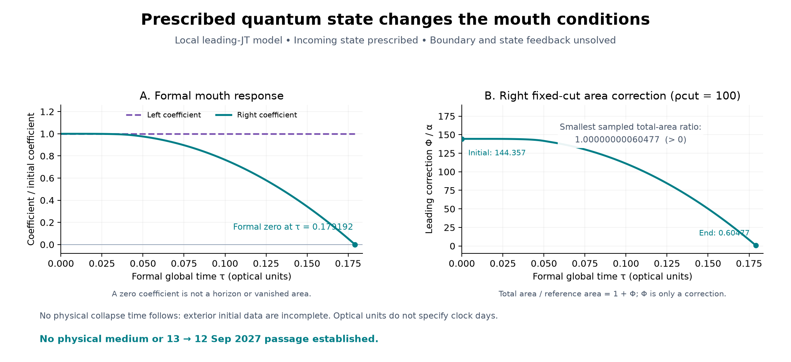

### A compatible local start, with a prescribed incoming state

In the existing optical coordinates `u=tau+chi`, the sphere-area correction
obeys the leading [MMP throat equations](https://arxiv.org/html/1807.04726v3),
using the [local JT solution](https://arxiv.org/pdf/1402.6334):

```text
Phi/alpha = beta_hat*(1+chi*tan(chi)) + A(u)*tan(chi) + A_prime(u),
A''' + A' = -deltaJ(u),
deltaJ = 8*pi*(f_long/q - f_req/q).
```

The short chiral mean stress remains at its old value. The two-dimensional
metric is AdS2 at this order; the sphere-area correction responds.
Set `A=A_prime=A_second=0` inside the exact width-pi plateau. The finite
initial throat strip then has its original area and time derivative.
This supplies **local throat initial data**, not a complete exterior slice
or a mechanism that produced the imposed time offset.

### The entrance conditions change

The formal asymptotic mouth coefficients are
`b_R/alpha=b0_hat+A(tau+pi/2)` and
`b_L/alpha=b0_hat-A(tau-pi/2)`, with `b0_hat=1.443569355948378`.
For the same prescribed incoming profile:

| Formal right-coefficient reduction | Global optical time |
|---:|---:|
| 1% | 0.0414281260 |
| 10% | 0.0741874731 |
| 50% | 0.1341378796 |
| 100% | 0.1791921605 |

The finite right cut at `rho=100` begins encountering the source change
after `tau=0.0099996667`. At the formal coefficient zero, its total area
is still `1.00000000060477` times the extremal area. A coefficient zero
is therefore **not area disappearance, a demonstrated horizon or a
physical collapse time**. The plot stops at this conditional matching gate.

The old classical-pulse solver cannot be reused unchanged: it assumes
static-past clocks, the original vacuum, and a separate classical carrier.
Once mouths move, incoming quantum stress must be transported through the
changed maps, including the Schwarzian term. The supplied delays alone
establish no physical interval during which that feedback can be ignored.

### Verification and next decision

Run from this project with `.venv/Scripts/python.exe -B`:

```python
import json
from pathlib import Path
import mmp_pulse as m
j = json.loads(Path("results/mmp_pulse_results.json").read_text(encoding="utf-8"))
assert m.nonstationary_support_checks(j["stationary_balance"]) == j["nonstationary_support"]
assert m.plateau_gravity_response_checks(j["nonstationary_support"], j["parameters"]) == j["plateau_gravity_response"]
```

The original state results are unchanged after extracting its shared
periodic source helper. Independent Green-function quadrature checks the
response to scaled error `2.35e-13`; the three local equation residuals
are below `1.01e-15` on the saved grid. A separate agent calculation agrees
on the coefficient-zero time and positive area.

The next required advance is compatible state, geometry and mouth data on
a complete initial slice, followed by retarded transport through the
responding mouths. Start from an unshifted configuration when testing
formation; do not assume the desired time offset as the output.
No stable medium or 13 September 2027 to 12 September 2027 passage follows.

## A shaped quantum state passes locally; unchanged throat support fails

We tested a concrete alternative to the vacuum: a smooth quantum state
with a negative-stress plateau. It passes a local source test, but the
strategy of preserving the original supporting stress throughout the
fixed throat for a crossing time fails. This is a conditional result in
our free NS field model, not a new physics discovery or chronology theorem.

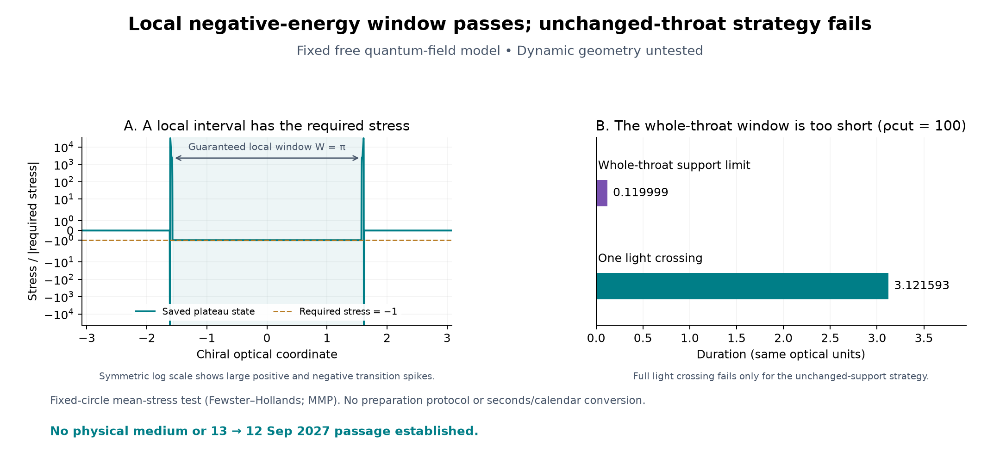

### Constructive local candidate

Use the existing optical chart, with `L0=pi+0.1`, imposed offset
`S=0.9*L0`, and long chiral period `P=L0+S`. No evolution creates this offset.
The original required state-dependent stress is `f_req/q=-pi/(12*L0²)`;
the geometric anomaly remains separate.

A circle map with positive derivative `V_prime` defines a transformed vacuum:
`f/q=-pi*V_prime²/(12*P²)-Schwarzian(V,x)/(24*pi)`.
Set `V_prime=1.9` on a width-`pi` plateau, join it with two smooth
width-`0.05` transitions to `0.03201419798563355`, and require
`V(x+P)=V(x)+P`. The implemented transitions use the standard smooth
`exp(-1/z)` step; the derivative is positive and has the correct integral.
On the plateau its Schwarzian vanishes, giving exactly `f=f_req`.
The short chirality's neutral-pair mixture, probability `0.04125`, supplies
the same constant mean stress using the previously checked NS spectrum.

The computed long-sector coordinate energy is `E/q=9.6529482391` and
`<L0_operator>/q=9.5038672351`. Energy above that sector's vacuum is
**120.05 times the old single-chirality vacuum-energy magnitude**.
This is not ADM energy, a material quantity or a device-power estimate.
Large transition stresses and positive mean energy require a responding
geometry. No physical state-preparation process has been supplied.

### Why the unchanged-throat strategy fails

[Finite-weight quantum energy inequalities](https://arxiv.org/pdf/math-ph/0412028)
constrain the state-dependent chiral stress. Our circle corollary, using
its covariance law and positive energy spectrum, gives for a proper arc
of width `W` and a normalized cosine-squared sampler:
`weighted_mean(f) >= -q*pi/(12*W²)`.
The sampler follows by smooth approximation; sharpness does not guarantee
a finite-energy state attaining the bound.

Maintaining `f<=f_req` everywhere on that arc therefore requires `W<=L0`.
Keeping the original support throughout `chi in [-a,a]` for a time `T`
requires an entire chiral interval of width `W=T+2*a`. Thus:

**`T <= L0-2*a`.**

If the interval spans a whole long period, the full-period energy bound
already rules it out since `P>L0`; no interval case is omitted.
At `a=atan(100)`, the bound is **`T<=0.1199993334`**, while the null crossing
takes **`2*a=3.1215933202`**, in the same optical units. No seconds or
calendar dates are assigned to these numbers.

A ray can keep one chiral coordinate fixed. This result does not exclude
that ray's passage, collapse-free evolving geometries, other fields or
interactions. It rejects unchanged supporting stress throughout the fixed
spacetime strip. The [MMP background](https://arxiv.org/html/1807.04726v3)
and interacting charged sector still need their own consistent response.

### Reproduce and proceed

Run from this project with `.venv/Scripts/python.exe -B`:

```python
import json
from pathlib import Path
import mmp_pulse as m
j = json.loads(Path("results/mmp_pulse_results.json").read_text(encoding="utf-8"))
assert m.nonstationary_support_checks(j["stationary_balance"]) == j["nonstationary_support"]
```

The explicit state, stress transformation, winding, two energy integrals
and sampler normalization are checked. Independent council calculations
agree on the state and the strip bound; these are AI checks, not peer review.
Next: test the state and geometry together, with consistent initial data
and source conservation. Do not polish the rejected fixed-support branch.
No stable medium or 13 September 2027 to 12 September 2027 passage is proved.

## The charged response now reaches finite exterior spheres

The spherical charged mode now extends through two finite
Reissner-Nordstrom (RN) regions to outer spheres at `r=100*r_e`.
Their static response combines with the throat response while retaining
**unknown outer electric displacements**. Physical exterior data, a joined
quantum state and a relative time offset remain unsolved; this does not
establish 13 September 2027 to 12 September 2027 travel.
The parent MMP long wormhole preserves ambient causality; this static
matching adds no mechanism that changes it. [MMP, abstract and Section 5.5](https://arxiv.org/html/1807.04726v3).

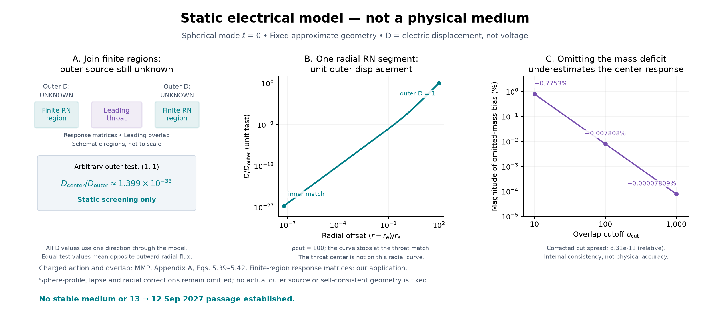

### Retaining the small mass correction matters near the throat

With lengths in `r_e`, `kappa=10` and the saved mass deficit,

```text
b^2=-2*(M-1)=1/ell_RN^2=3.5847490159463543e-19,
F=[(r-1)^2+b^2*r]/r^2,
(F*D_r)_r-kappa*D/r^2=0,  P=F*D_r.
```

The cancellation-free expression for `F` preserves a correction that direct
subtraction in `1-2*M/r+1/r^2` would lose. Both independent radial solutions
are retained; their coefficients are not fixed by discarding one branch.

The collective action and leading overlap/mass correction follow
[MMP Appendix A and Eqs. 5.39-5.42](https://arxiv.org/html/1807.04726v3).
The radial basis, finite response and composition below are our application.

### The composition keeps the outer fields unknown

For each tail, `Ktail` maps `(D_inner,D_outer)` to `(-P_inner,P_outer)`.
The throat map in the same RN clock is `Kth=Kchi/ell_RN`. Eliminating the
two inner endpoint values gives

```text
S=Ktail_aa*I+Kth,
b_inner=-Ktail_ab*S^(-1)*b_outer,
Kouter=Ktail_bb*I-Ktail_ab^2*S^(-1).
```

Here every `D` points in one direction through the throat. At the left
mouth, outward radial displacement has the opposite sign; at the right,
it has the same sign. The diagnostic `b_outer=(1,1)` therefore represents
opposite outward radial fluxes and zero net charge in the finite composite.
It is an arbitrary basis test, not physically supplied boundary data.

For this test, the corrected center displacement is approximately
**`1.3989731914e-33` times the unit outer displacement**. This is a static
screening response, not a particle probability or a predicted field strength.

| Overlap cut `rho` | Center bias from omitting mass deficit | Omitted sphere-profile correction |
|---:|---:|---:|
| 10 | -0.775340% | 2.10942e-4 |
| 100 | -0.00780813% | 2.12194e-7 |
| 1000 | -0.0000780869% | 2.12206e-10 |

The last column is a relative geometric correction, not a percent or an
estimated error in the center response. It compares `1+rho*atan(rho)`
with its asymptotic linear form `pi*rho/2`. A consistent higher-order join
also needs the lapse and radial metric corrections.

Corrected center values agree across these cuts to **`8.31e-11` relative**.
That is consistency within the approximate model, not physical accuracy:
the omitted geometry, nonspherical return, source and junction errors
are not bounded by that agreement. No cut is a completed physical junction.

### Checks and clock convention

The exact extremal radial basis and a separate 70-digit hypergeometric
basis check the tail matrices; the largest relative discrepancy is
`7.59e-12`. Reciprocity agrees within `4.75e-12`. The static charged-energy
identity `integral[F*D_r^2+kappa*D^2/r^2]dr=[D*P]_inner^outer`
holds within `1.42e-12` relative. These check this fixed spherical operator,
not the stability of its Casimir source or responding geometry.

A pure relabel `t_RN=C*t_common` scales **both** throat and tail derivative
maps by `C`; all displacement ratios remain invariant (checked to
`4.45e-16`). It does not implement the companion's physical metric,
rotation or clock corrections.

### Focused reproduction

Run from the project with `.venv/Scripts/python.exe -B`:

```python
import json
from pathlib import Path
import mmp_pulse as m
j = json.loads(Path("results/mmp_pulse_results.json").read_text(encoding="utf-8"))
r = m.charged_mouth_matching_checks(j["throat_charge_response"], j["optical_matching"])
assert r == j["charged_mouth_matching"]
```

Frozen SHA-256 values:

```text
scripts/mmp_pulse.py: fca49b61c91fb8b3a6664422eb319783a4840a9b7b01190d5a0527563ab60f84
results/mmp_pulse_results.json: b6a6a693316d3e5aee0445c29f33c33dea0e504d70aae2ce80a87d799edea4c1
```

[Figure PDF](../figures/charged_mouth_progress.pdf).
The next physical requirement is the actual nonspherical exterior and
quantum state with metric response. Source preparation, a stable medium
and payload passage remain unproved.

## The charged mode now includes the leading throat redshift

The new `throat_charge_response` fixes **kappa=10** from the saved charge
and coupling, including the leading throat redshift. Unknown endpoint data
remain open. This spherical **l=0** sector does not complete the rotating
`l=1` source or establish 13 September 2027 to 12 September 2027 travel.


### Geometry fixes the restoring term

For the fixed spherical metric and original electromagnetic variables,

```text
ds4^2=N^2*(-dt^2+dx^2)+R^2*dOmega^2,
E=partial_x(A_t)-partial_t(A_x),  W=4*pi*R^2/(g^2*N^2),
D=W*E=4*pi*R^2*E_orthonormal/g^2,
D_tt-D_xx+q*D/(pi*W)=0.
```

`D` is gauge-invariant electric displacement. With `R=r_e`,
`N=r_e/(ell*cos(chi))`, `x=ell*chi` and `tau=t/ell`, this becomes

```text
D_tautau-D_chichi+kappa*sec(chi)^2*D=0,
kappa=g^2*q/(4*pi^2)=10.
```

The assumed `q=100000` and `g^2=0.0039478417604357436` fix the coefficient;
the `q-1` flavor-neutral combinations remain massless in this truncation.

The collective-mass mechanism is published in [MMP Appendix A](https://arxiv.org/html/1807.04726v3)
and [Freivogel et al., Section 4.3.1](https://arxiv.org/pdf/2606.12528v2).
Our finite-cut application below does not establish a four-dimensional quantum state.

### Both physical entrance values remain open

At `chi=+/-a`, with `a=atan(rho_cut)`, the matrix `K` maps

```text
b=(D(-a),D(a))  ->  (-D_chi(-a),D_chi(a))=K*b.
```

These inputs are **electric displacements, not voltages**. Optical
derivatives divide the displayed outputs by `ell`; proper-normal
derivatives multiply them by `cos(a)/r_e`. Static potentials instead obey
`A_t-mu_phase=pi*D_x/q` in the common-clock convention.

At the diagnostic cut `rho_cut=4`, the static matrix is

```text
K(0)=[[11.21382134565, -3.66630490873e-5],
      [-3.66630490873e-5, 11.21382134565]].
```

An imposed equal-end test `D(-a)=D(a)=1` gives this normalized center response:

| Diagnostic `rho_cut` | Center / common boundary displacement |
|---:|---:|
| 4 | 0.004758142 |
| 10 | 0.000411189 |
| 100 | 8.21707e-7 |
| 1000 | 1.63372e-9 |

The first ratio is **0.476% of the prescribed boundary displacement**.
It is a static normalization test, not a transmission probability,
measured field strength or physical choice of boundary data.
Cut 4 is an interior diagnostic; the other cuts reuse overlap locations.
None is an established physical throat/exterior junction.

Total charge in the throat segment is `D_right-D_left`; full-loop
neutrality can be supplied by the exterior and does not eliminate the
odd throat response. Within the same spherical reduction, a smooth join
requires matching `D` and `D_x`, with consistent clocks and normals.
The actual exterior response and external forcing remain unknown;
non-spherical returning fields can also mix angular modes and channels.

### Positive sector energy is a limited statement

The charged perturbation energy is
`H_tau=(pi/(2*q))*integral[D_tau^2+D_chi^2+kappa*sec(chi)^2*D^2]dchi`.
Its rate is the boundary flux `(pi/q)*[D_tau*D_chi]_left^right`.

Positivity controls this fixed charged operator when its boundary conditions
supply no energy. It excludes neither driven growth from an active exterior
nor instability of the background Casimir stress or responding geometry.

Forty-digit hypergeometric solutions independently check the initial-value
basis to relative errors below `2.55e-12`. A separate boundary-value solve
agrees in profile within `1.61e-12`. Reflecting-wall finite-difference
errors decrease by about four under each mesh refinement. Full-AdS and
finite-cut reflecting spectra are **operator benchmarks, not device frequencies**.

### Reproduction and next step

Run from the project with `.venv/Scripts/python.exe -B`:

```python
import json
from pathlib import Path
import mmp_pulse as m
j = json.loads(Path("results/mmp_pulse_results.json").read_text(encoding="utf-8"))
r = m.throat_charge_response_checks(j["rotating_source"], j["optical_matching"])
assert r == j["throat_charge_response"]
```

Frozen SHA-256 values:

```text
scripts/mmp_pulse.py: b9dfce321fd6324895d9fd352d39bee9f33e6e9a8921be10e04a5554de769ea7
results/mmp_pulse_results.json: 71058c5610b34bf5cc7fed388d8de073a6a1888a5caf8a0eafb248499d8b02e7
```

[Figure PDF](../figures/throat_charge_progress.pdf).
The proposed next calculation is the same spherical mode's RN continuation,
`(F*D_r)_r-kappa*D/r^2=0`, retaining arbitrary data and a common clock.
It is not yet implemented. Source creation, completed matching, a stable medium
and payload passage remain unproved.

## The loop response propagates; cancellation depends on its spectrum

The new `loop_retarded_response` makes the **causal wave response** explicit.
A sudden change launches undamped circulating disturbances. A specially
timed drive cancels the reference free-channel oscillations, but its success
depends on the loop length and spectrum. **13 September 2027 to
12 September 2027 travel remains unproved.**


### The static mean is not an instantaneous response

For the prescribed static optical circle, `dx=ds/N`, `c=hbar=1`, `A_x=0`
and `k_n=2*pi*n/L`, our application of the
[MMP Appendix G action](https://arxiv.org/html/1807.04726v3) gives

```text
rho=(A_t-phi_t)/pi,  J=phi_x/pi,  rho_t+J_x=0,
(dt^2-dx^2)*rho=-partial_x^2(A_t)/pi,
chi_rho,At(k,omega)=k^2/[pi*(k^2-(omega+i0)^2)]       [n!=0].
```

The retarded pole prescription enforces causality; it is not damping.
The total charge stays `Q=0`, with no response of its zero mode.
For an ideal step `A_t=f(x)`, the exact solution after switch-on is

```text
rho(t,x)=[f(x)-f(x-t)/2-f(x+t)/2]/pi,
```

with periodic arguments and zero response before switch-on. The chosen
localized test cannot reach its observer before `t/L=0.3`; characteristics
establish this bound. Density recurs to its initial value at `t=L`; its time
average is `(f-mean(f))/pi`, with no relaxation. The abrupt step tests
this effective model; it does not specify a physical driver.

Zero charge, winding/holonomy and oscillator means/current are assumed.
Matching the full displaced vacuum additionally assumes an initial oscillator
vacuum and isolated quadratic dynamics; preparation and the complete state
remain uncomputed ([finite-size oscillator foundation](https://arxiv.org/pdf/cond-mat/9805275)).

### A smooth drive can cancel a known free spectrum

For `A_t=f(x)*g(t)`, the tested `C2` ramp averages a raised-cosine
switch over one reference loop period. It has smoothing time
`delta=0.3*Lref`, total duration `T=1.3*Lref`, and residual factor

```text
R(omega_n)=abs(sinc(omega_n*Lref/2)*H(omega_n*delta)),
H(z)=pi^2*cos(z/2)/(pi^2-z^2),  sinc(z)=sin(z)/z.
```

With removable limits retained, the sinc factor vanishes at every
`omega_n=2*pi*n/Lref`, `n!=0`. This proves ideal free-mode cancellation;
independent integrations of `n=1..8` leave residual amplitudes below `7.4e-12`.
Vanishing final mean excitation does not bound transient stress or driver energy.

Using that same timing at the saved prescribed loop lengths gives:

| Channel `nu` | Optical length `L/d` | First-mode residual / static amplitude |
|---:|---:|---:|
| 0.5 | 46.070304 | 5.57% |
| 1.0 | 43.446820 | Zero analytically |
| 1.5 | 42.611570 | 1.76% |

For these three lengths, the common timing does not cancel every loop. These are optical
model times; no laboratory seconds or calendar displacement is inferred.

### Electromagnetic feedback changes the charged spectrum

A **separate flat, uniform 1+1 Maxwell toy**, using the charged-mode
framework of [MMP Appendix A](https://arxiv.org/html/1807.04726v3), gives

```text
m^2=g_2^2*N_flavors/pi,
chi_rho,Aext=k^2/[pi*(k^2+m^2-(omega+i0)^2)],
omega_charged=sqrt(k^2+m^2),  static_factor=k^2/(k^2+m^2).
```

`A_external` is the bare imposed source potential, not a clamped total
potential. Only the charged collective combination gains this mass;
`N_flavors-1` neutral combinations remain massless. Reusing the free-loop
ramp on the first charged mode leaves:

| Illustrative `m*Lref` | Static response / free value | Residual / screened static amplitude |
|---:|---:|---:|
| 1 | 0.975295 | 1.139% |
| 2*pi | 0.5 | 18.262% |

These masses are **illustrative parameters, not derived throat or material
properties**. This calculation does not include the actual curved pair,
variable coupling/lapse, transverse modes or metric response. The free
spectrum's cancellation cannot be carried over unchanged; other controls
adapted to the changed spectrum are not ruled out.

### Checks and reproduction

The independent propagation grids `256->512->1024` reduce the normalized
density error by about four each time; exact characteristics establish
the support bound. Charge conservation, recurrence, mode integrals and
the stated Maxwell oscillator checks pass. These establish neither a new
physical law, gravitational stability nor a physical source.

Run from the project with `.venv/Scripts/python.exe -B`:

```python
import json
from pathlib import Path
import mmp_pulse as m
j = json.loads(Path("results/mmp_pulse_results.json").read_text(encoding="utf-8"))
assert m.loop_retarded_response_checks(j["loop_charge_response"]) == j["loop_retarded_response"]
```

Frozen SHA-256 values:

```text
scripts/mmp_pulse.py: 4b9829472318da182e084c000e6b17d5915a8e84d618b8771691d2f258e7a188
results/mmp_pulse_results.json: 72a7d9bb2d573c86f1659fbb63f521a653fbf3eb4c83581425502c06087f6966
```

[Figure PDF](../figures/loop_retarded_progress.pdf).
The source is externally prescribed. Complete geometry, coupled fields/state,
physical throat/exterior matching and a stable passage remain unresolved.

## A neutral fermion loop responds to its whole optical average

For each declared neutral, independent fermion channel, the new
`loop_charge_response` result is

```text
j_paper=(A_t-mean_loop(A_t))/pi,
mean_loop(A_t)=integral A_t*ds/N / integral ds/N.
```

The response depends on the **complete loop**, including its unresolved
throat. This determines a conditional charge response, not physical end
potentials or a coupled medium. **13 September 2027 to 12 September 2027
travel remains unproved.**


### Fixed charge changes the local response

In the optical coordinate `dx=ds/N`, with lapse `N`, the
[MMP Appendix G](https://arxiv.org/html/1807.04726v3) bosonized action gives

```text
Pi=(phi_dot-A_t)/pi,  Q=-integral Pi dx,  L=integral dx,
mu_phase=phi_dot=mean_loop(A_t)-pi*Q/L,
j_paper=-Pi=(A_t-mean_loop(A_t))/pi+Q/L.
```

Here `j_paper` is charge per optical length; the density per proper length
is `(A_t-mu_phase)/(pi*N)`. The complete-loop projector and constrained
application are our derivations. `mu_phase` denotes the phase's time
derivative; no charge-chemical-potential sign convention is assumed.

This calculation fixes **each channel's charge** and declares compatible
zero spatial holonomy and zero winding. In the antiperiodic (NS) Dirac
sector, `Q=N_R+N_L` and `J=N_R-N_L` have the same parity, so
`Q=J=0` is allowed. Stationary phase derivatives do not specify a localized
phase eigenstate or a preparation protocol
([finite-size bosonization](https://arxiv.org/pdf/cond-mat/9805275), [spin/charge sectors](https://arxiv.org/pdf/1902.06584)).
Allowing charge exchange between channels changes the constraint and also
requires permitted discrete charge allocations; that problem is not solved.

### Exterior cancellation leaves the throat mean unknown

On the actual saved exterior paths, the prescribed zeroth-order optical
measure is even under reflection, and both rotating trial potentials are
odd. Their exterior integrals therefore vanish. The surviving full mean is

```text
mu_phase=(L_throat/L_total)*mean_throat(A_t)       [Q=0].
```

| Channel label `nu` | Weight of the unknown throat mean |
|---:|---:|
| 0.5 | 0.894518 |
| 1.0 | 0.948533 |
| 1.5 | 0.967126 |

Thus **89-97% of the optical mean's weight lies in the unsolved throat**.
No throat mean is set to zero, and no constant throat profile is assumed.

Full-loop reflection symmetry with odd potential would be sufficient to
make that mean vanish; the symmetry must preserve each loop rather than
merely exchange loops. At fixed rotation rate the rotating metric shift
is not invariant under simple `z` reflection. This cancellation uses a
symmetric **zeroth-order measure and first-order potential**; it does not
establish reflection symmetry of the complete rotating geometry or state.

### Positive response curvature is not positive ground energy

At fixed neutral charge and fixed geometry, the response Routhian contains
`integral(A_t-mean(A_t))^2 dx/(2*pi)`, with susceptibility
`delta j=(I-P_loop)*delta A_t/pi`. Its nonnegative curvature is a
constrained response property. The canonical fermion ground energy has
the opposite polarization term; this is not a positive-energy or stability proof.

Constants along a loop are polarization null directions, but different
constants on different loops can still produce a transverse electric field.
For example, `A_t proportional to nu` has zero along-loop variation yet
`E proportional to -grad(nu)` is nonzero. Only a common allowed constant
shift is the tested gauge invariance. In a flat patch the screening term
therefore involves `abs(B)*(I-P_loop)*A_t`; a curved implementation needs
the covariant current and the optical measure.

The constrained solve agrees with the analytic projection within
`1.12e-16`; functional-variation errors are below `1.73e-13` in the
declared numerical normalization. Charge balance and common-shift checks
also pass. These checks do not determine the unknown physical fields.

### Reproduction

Run from the project with `.venv/Scripts/python.exe -B`:

```python
import json
from pathlib import Path
import mmp_pulse as m
j = json.loads(Path("results/mmp_pulse_results.json").read_text(encoding="utf-8"))
assert m.loop_charge_response_checks(
    j["magnetic_loop_source"], j["optical_matching"], j["rotating_source"]
) == j["loop_charge_response"]
```

All 46 prior backward blocks and the forward branch remain unchanged. SHA-256:

```text
scripts/mmp_pulse.py: 19f1ade24eef20f134a066a20efa209c717d82508248a9b6c42d744216c7b3ee
results/mmp_pulse_results.json: c5aadcbd93577f89f5d177a28b776102884ef938a62ddd0552697beaead5d230
```

[Figure PDF](../figures/loop_charge_progress.pdf).
The next step remains a coupled stress, current and state with actual
exterior/throat matching; no source preparation or stable passage is established.

## Rotation, conservation and finite fermion screening

The new `rotating_source` check keeps the actual fermion coupling
**kappa=alpha*q^2=10**. The large-coupling approximation makes the
particular electric potential **20% too large in magnitude**. A separate
test shows why rotating the earlier stress pattern alone cannot supply a
conserved source. Neither result constructs a rotating wormhole or a
relative time offset; **13 September 2027 to 12 September 2027 travel
remains unproved**.


### Conservation requires more than a rotating density

Our four-dimensional calculation keeps the diagonal RN metric fixed
and isolates the radial state term with zero Lorentz force. Here
`S=8*pi*G*T`, and `F` is the RN lapse function. For

```text
omega=Omega_global/C_clock,  Y=sin(theta)*cos(phi-omega*t_RN),
rho=A/(r^2*F),
S_tt=F*rho*Y,  S_rr=rho*Y/F,
```

the energy component of `div S` is `-A*partial_tY/(r^2*F)`, not zero.
Adding the polar energy flux `S_ti=-A*D_i(partial_tY)/(2F)`, with
`i` an angular index, cancels this first-order failure. The remaining
angular components are `-A*omega^2*D_iY/(2F^2)`: a second-order response
is still required. The direct divergence and trace checks pass.

This is a necessary-balance example, not a unique quantum-state
construction. An actual charged source must satisfy `div T=F_EM.j` with its
own current; `F_EM` denotes the electromagnetic field tensor. Rotating both the coordinates and metric instead preserves
covariance and introduces metric shifts; that coordinate change does not
create physical rotation.

### Keep the finite coupling in the screening equation

Starting from [MMP Appendix G](https://arxiv.org/html/1807.04726v3),
specifically its displayed screening equation,

```text
(-Laplacian+g^2*abs(B)/(2*pi^2))*A_t=-2*Omega_global dot B,
```

we use the leading weak-buffer monopole field
`B=q*rhat/(2*r^2)` and `A_t=a(r)*cos(theta)`. This is the original
electromagnetic potential, distinct from the rescaled geometric field
used in earlier RN transfer calculations. Our radial reduction is

```text
-(r^2*a')'+(2+kappa)*a=-q*Omega_global,
kappa=g^2*q/(4*pi^2)=alpha*q^2,
a=-q*Omega_global/(2+kappa)+C_plus*r^s_plus+C_minus*r^s_minus,
s_plus/minus=(-1+/-sqrt(9+4*kappa))/2.
```

With `q=100000` and `alpha=1e-9`, the exact stated-model solution is
`a=-q*Omega_global/12+C_plus*r^3+C_minus*r^-4`.
Its constant particular is **one sixth** of the unscreened particular;
replacing `2+kappa` by `kappa` makes its magnitude **20% too large**.
This approximation needs `kappa>>2`; `q>>1` alone is insufficient.
The ratio compares particular solutions, not complete physical fields.

The finite diagnostic buffer is `100<=r/r_e<=10000`. Its solution retains
both unknown physical endpoint potentials:

```text
a=a_p+W_inner*(a_inner-a_p)+W_outer*(a_outer-a_p).
```

No endpoint is set to zero. Independent collocation agrees with the
analytic boundary-response basis to **1.63e-11** and **4.42e-14** on
1,172- and 5,385-node meshes. This verifies only the leading monopole
screening problem. Finite-RN corrections, the complete pair, rotating
Casimir stress, loop holonomy and throat matching remain open.

### Reproduction and scope

Run from the project with `.venv/Scripts/python.exe -B`:

```python
import json
from pathlib import Path
import mmp_pulse as m
j = json.loads(Path("results/mmp_pulse_results.json").read_text(encoding="utf-8"))
assert m.rotating_source_checks(
    j["magnetic_loop_source"], j["optical_matching"], j["companion_incident"]
) == j["rotating_source"]
```

This freshly rebuilds the new checks. The previous 45 backward blocks
and the forward branch remain unchanged. Frozen SHA-256 values:

```text
scripts/mmp_pulse.py: 9b088fe5b29ecf39fa5d960a9ded080bc251a1d9ec1aa57da5301f4244cfc2ad
results/mmp_pulse_results.json: 3a078ed2a4cbf826d4e2be2e0f789ce037994d5dbd52ebea98bf2956306eb759
```

[Figure PDF](../figures/rotating_screening_progress.pdf).
The next requirement is a mutually consistent rotating stress, current
and quantum state with physical exterior/throat data. A screened electric
potential alone establishes no stable medium, prepared material or payload passage.

## Companion field, common clock and a complete RF event map

The backward calculation now determines one leading classical input from
the other mouth, rather than treating every incident amplitude as unknown.
It still does not determine the quantum exterior, throat response or a
causal time offset. The published MMP long wormhole respects ambient
causality; **13 September 2027 to 12 September 2027 travel remains unproved**.
The separate forward model now follows individual RF kicks through the
full ramp for one perturbed guiding state.


### What the companion field fixes

This uses the previous `M=Q=1` finite RN exterior, with `c=hbar=1`
and radii/times in `r_e`.

For opposite magnetic charges and separation `D=d/r_e`, reconstructing
the weak-overlap field and lapse gives the growing master amplitude

```text
C_g=-2/D^2=-1.23370055013617e-16.
```

This coefficient is matched in `1<<r<<D`; it is not a field measured at
the finite cut `r=4`. In the accelerating mouth frame, the companion
gravity contributes `+1/D^2` to the lapse gradient and the frame term
contributes `-2/D^2`, yielding `C_g/2=-1/D^2`. The reconstruction checks
both the magnetic field and this required acceleration. The normalization
and propagation are our derivations using the
[MMP orbit framework](https://arxiv.org/html/1807.04726v3) and
[Wells' weak-field acceleration relation](https://arxiv.org/pdf/gr-qc/9808044).

The source-dependent relation at a finite inner cut is

```text
P+K_d*H=3*C_g/d_mode(r)+[d_mode(4)/d_mode(r)]*Xi_q(4)+A*J(r),
P=F*H',   K_d=-F*d_mode'/d_mode.
```

Here `d_mode` is the decaying homogeneous solution, not mouth separation.
`Xi_q(4)` retains quantum exterior input and corrections to the leading
classical matching; `A` retains the incomplete quantum source, with only
the leading common-clock normalization determined below. The decaying
response and inner boundary data remain open.
At `r=1.01`, the known classical term is `-1.75308444e-21`, while
the coefficients of `Xi_q(4)` and `A` are `2.22447388e-6` and
`-0.037521522`. None of those unknown amplitudes is assigned zero.
Exact reconstruction, gauge-decay and source/transfer identities pass;
this is a conditional finite-radius boundary relation, not a joined solution.

Our leading orbit application of the
[local/global time relation, Eq. 34](https://astro.troja.mff.cuni.cz/davok/papers/iauresol.pdf)
gives `C=1-3/(2D)+O(D^-2)` on the comoving reference line; equal synchronized
mouths share this rate, so it creates **no relative time offset**.
This relates local RN coordinate time rather than central proper time,
and the source factor `1+3/D` is only an isolated clock correction;
finite-surface simultaneity and the full state update remain open.

### A nearly unchanged separation still rotates

Over the initial `pi*ell` throat light-crossing scale, the chosen circular
point-orbit model turns by **0.418512 degrees**, while its relative radial shrinkage
is only **2.711558e-14**. This is a null reference scale, not a computed
massive-probe transit time. These test different departures from a static
mouth model. A small shrinkage alone does not justify fixed orientation.

The explicit two-point-mass quadrupole calculation gives
`P_GW=(8/5)*r_e^2*d^4*Omega^6/G` in natural units, a factor **12**
above the `2/15` prefactor printed in MMP Eq. 6.53. Both results are
retained as separate comparisons; the standard expression follows from
the [mass-quadrupole energy-flux formula](https://arxiv.org/pdf/gr-qc/0501041).
Electromagnetic radiation dominates this diagnostic. Adding leading
gravitational radiation does not include every correction of the same
relative order. These digits describe the stated numerical model, not
physical orbital precision. Rotating quantum states, induced currents,
mode mixing, radiation capture and throat stability are uncomputed.

### A complete RF event map and a consistent comparison

The forward `rf_event_ramp` follows one perturbed proton guiding state
through **33,756,596 discrete RF kicks** over the actual **24.111284 s**
ramp. Its initial phase error is `+0.02 rad` and relative momentum error `+1e-7`;
the source keeps the earlier 210-degree reference phase. The model resolves
individual gap crossings but still assumes an instantaneous guiding circle.

| Event-map quantity | Result |
|---|---:|
| Final kinetic energy | 5.299624 MeV |
| Pre/post-kick guiding maximum, sampled every 16 turns | 3.333268 mm |
| Largest saved energy-midpoint guiding offset | 3.060093 mm |

Changing drift order changes the endpoint guiding offset by **1.31 nm**;
double versus extended arithmetic changes it by **1.87 pm**.
These checks concern the declared map, not missing transverse or cavity physics.

For a consistent comparison, use `E_mid=(E_pre+E_post)/2` at each gap
and start the averaged model on the same section. On the unchanged saved
16-gap Lorentz traces, this reduces the late projected guiding residual
from **0.574502 mm** to **0.232330 micrometres** over 15 subsequent intervals.
This changes the model comparison, not the stored particle path.

Across the full reduced ramp, the sampled midpoint-versus-matched-average
difference is **5.848957 micrometres** and **5.437912e-5 rad**; the raw
post-kick/old-initialization comparison gives **0.323145 mm**.
Matched-average refinement changes the sampled guiding curve by at most
**1.695 nm**; the peak discrepancy changes by **1.66 nm**.
Sparse samples do not certify a continuous maximum; the last 2,048
consecutive gap sections are resolved. The guiding offsets do not include
betatron excursions, so they do not establish full-beam aperture acceptance.
The displacement from the new circle is first order in kick energy,
although the radial action and reduced canonical-jump difference are
quadratic; that transverse motion is omitted. Finite RF fields, a continuous
Lorentz trajectory for the whole ramp, extraction and capture remain unproved.

### Reproduction and limits

From the project, use `.venv/Scripts/python.exe -B`:

```python
import json
from pathlib import Path
import mmp_pulse as m
import future_time as f

j = json.loads(Path("results/mmp_pulse_results.json").read_text(encoding="utf-8"))
assert m.companion_incident_checks(
    j["optical_matching"], j["coupled_exterior"], j["sourced_rn_transfer"]
) == j["companion_incident"]

d = json.loads(Path("results/future_time_results.json").read_text(encoding="utf-8"))
assert f.proton_rf_event_ramp_checks(
    d["proton_ring"], d["staged_rf_deceleration"], d["rf_ramp_spread"],
    d["rf_event_ramp"]
) == d["rf_event_ramp"]
```

The backward call freshly rebuilds its new checks; the forward call uses
saved full-ramp integrations and recomputes section/consistency checks.
All 44 prior backward and 31 prior forward blocks remain unchanged.

Frozen SHA-256 values:

```text
scripts/mmp_pulse.py: e0ce7791a00277cb83b5343dddca895df609414f0f5a61cfbcff40d6bce22ae0
results/mmp_pulse_results.json: 0277b7afd6883eba3614b7dd9facd01141db6fa615bd94c432132254f136788a
scripts/future_time.py: a3652aa257244919c72ed144201b4109ccf792eede1eb5bd57611e74c63f0807
results/future_time_results.json: 385bfb9bd76bf1ed672063c362cce8a97274c2f9261adadb2f1bf89b0454f296
```

[Figure PDF](../figures/incident_orbit_rf_progress.pdf).
Rotating exterior/throat matching and full transverse RF transport remain
next calculations; no stable medium or captured journey is established.

## A sourced mouth-transfer equation and RF spread tests

**Verified increment:** the mouth calculation now includes a derived
leading quantum stress term instead of leaving its forcing unspecified.
It determines how that term contributes between two finite radii while
retaining the unknown physical boundary data and omitted channels.

**Causal limit:** the published [MMP long wormhole](https://arxiv.org/pdf/1807.04726)
does not violate ambient causality: its traversal takes longer than the
exterior route. Our finite-mouth calculation introduces neither a mouth
time offset nor a closed causal path. It therefore does not establish
13 September 2027 to 12 September 2027 travel, even apart from the
unresolved source, matching and stability questions.

In the separate forward model, changing the RF phase lets four specified
perturbed samples complete the ramp; the crest control fails early.
Short Lorentz checks also reveal a late discrepancy from the averaged
model, so the full transport problem remains open.


### The leading radial source and its coupled response

The new `sourced_rn_transfer` block treats the static, axisymmetric
dipole sector of a Reissner-Nordstrom (RN) region. Radius, RN time,
geometrized mass `M` and charge `Q` use the reference radius `r_e`;
`Q` is distinct from the magnetic flux integer `q`.
The source coefficients below describe the `cos(theta)` dipole in
`r_e^2*S`, where `S=8*pi*G*T`:

```text
F=1-2*M/r+Q^2/r^2,
rho=p_r=A/(r^2*F),       p_perp=tau=J_phi=0.
```

This is the leading radial-channel state contribution based on the
[MMP Casimir framework](https://arxiv.org/pdf/1807.04726).
Its angularly independent radial anomaly has no dipole projection at
this order. The source obeys the two conservation identities and has
zero trace. Its leading radial current vanishes; it is not obtained by
substituting the earlier bent-exterior current at the mouth.

The normalized magnetic field is
`Fcal=sqrt(16*pi*G)*F_original/g_EM`, with background
`Fcal_theta_phi=2*Q*sin(theta)`. For fractional metric amplitudes
`H_t,H_r` and potential perturbation `delta Acal_phi=a*sin(theta)^2`,
our derivation gives

```text
Lambda=6*M/r-4*Q^2/r^2,
H=2*a-4*Q*F*H_r/Lambda,

(F*H')'-U*H = 8*A*Q^3/(3*M*r-2*Q^2)^2,
U=(-36*M^2*Q^2*r^2+18*M^2*r^4+32*M*Q^4*r-8*Q^6)
  /[r^4*(3*M*r-2*Q^2)^2].
```

The homogeneous potential comes from
[Burko, Eq. 87](https://arxiv.org/pdf/gr-qc/9507012), and the
gauge-invariant master definition is related to
[Lucietti et al., Appendix B, Eq. 137](https://arxiv.org/pdf/1212.2557)
by the magnetic-duality mapping used here.
**The nonzero forcing, radial-Casimir projection and source-dependent
reconstruction are our derivations, not quoted formulas from those papers.**

Substituting the reconstructed metric and field into the actual
four-dimensional linearized Einstein-Maxwell equations gives **14
identically zero residual components**. Separate checks verify source
conservation, elimination to the master equation and invariance under
the remaining coordinate gauge. The physical transfer uses `H` rather
than a coordinate-gauge variable that can grow rapidly inward.

### The known flux band is only part of the source

The calculated optical-length moment uses the retained central half of
the flux, `nu in[.5,1.5]`:

```text
I1_known=(3/2)*integral_(.5)^(1.5)
         (1-nu)/(L_global(nu)/d)^2 dnu
        =-8.994950190322512e-6,

A=-(4*pi^2*alpha/[3*(d/r_e)^2])*C_clock^-2
  *(I1_known+I1_unknown),
t_RN=C_clock*t_global.
```

At `C_clock=1` the retained additive contribution is
`A_known=7.30158268279536e-30`. **`I1_unknown` is not set to zero.**
The incomplete band is neither the total source nor a physical taper.
Full optical lengths, state/holonomy information, omitted modes and the
common clock relation remain needed. The small known-band number alone
does not bound the complete response.

### Transfer without fixing the missing endpoint data

With `Y=(H,F*H')`, the solved relation is

```text
Y(r_in)=T(r_in,r_out)*Y(r_out)+A*B(r_in,r_out).
```

`T` is the saved homogeneous transfer matrix. The new column `B`
integrates the derived forcing against that matrix. It retains arbitrary
outer physical amplitudes; computing the source column does not prescribe
them.

For the numerical `M=Q=1` background, an independent exact particular
solution makes the source column check algebraic:

```text
h_p=H_p/A=-4*r/[3*(3*r-2)],
p_p=F*h_p'=8*(r-1)^2/[3*r^2*(3*r-2)^2],
y_p=(h_p,p_p),
B(r_in,r_out)=y_p(r_in)-T(r_in,r_out)*y_p(r_out).
```

This particular solution is a mathematical choice; its own endpoint values
are not imposed as physical boundary conditions.

| Outer radius | Inner radius | Source column `B=(B_H,B_P)` per unit `A` |
|---:|---:|---|
| 4 | 1.1 | (230.379946, -49.4879892) |
| 4 | 1.01 | (152004.673, -4391.00444) |

For illustration, only the retained-band additive `H` term at the second
cut is `1.10987468914e-24` when `C_clock=1`. This is not the complete
`H` or a prediction of a physical mouth field. The larger inward
response is a static radial transfer, not a dynamical stability test.

Independent ODE integration agrees with the basis/source construction
to scaled error below **1.46e-12**. A separate log-radius Radau check
agrees below **1.63e-13**. Splitting the source integral at an
intermediate radius composes to the same affine transfer, checked at
high precision. These tests verify the declared source problem.

Numerical transfer uses **`M=Q=1` only on the finite interval
`1.01<=r<=4`**. The saved bound on the change in `F` from the slightly
`M<Q` matching branch is below `3.621e-15` there. That bounds one
background coefficient, not quantum-state errors, the full solution
error, or extension through the throat. No black-hole horizon condition
is imposed. Physical end matching, the omitted source moments, spherical
pressure balance and nonlinear/dynamical stability remain unresolved.

### RF phase spread: a failed crest control and four surviving samples

The new `rf_ramp_spread` study retains the actual **24.111284 s** ramp
from the previous increment. It replaces the single synchronous reference
with a nonlinear model of phase and guiding-orbit errors. The RF torque
is averaged over turns; the guiding state is assigned an instantaneous
circular orbit.

For `r=R_guiding/R`, it uses canonical angular momentum

```text
L=e*B0*R^2*ell(r),       ell(r)=-.6*r^2+.15*r^4,
deltaL=L-L_s,           psi_dot=omega_s-omega(r,t),
deltaL_dot=-(DeltaW_RF-DeltaU_rad)/(2*pi).
```

The last equation uses per-turn energy differences in joules. The changing
vector potential remains in `L`, so induction is included through the
canonical dynamics. Independent symbolic and pointwise energy checks
verify that it is neither omitted nor counted twice. The phase and
dispersion framework is published in
[Tecker](https://arxiv.org/pdf/1601.04901); these canonical equations and
their particular source model are our derivation.

The chosen reference phase is **210 degrees**, with positive effective
peak voltage `2*(112.5-U_rad,s[eV]) V`, approximately **225 V**.
Its negative voltage slope restores small phase errors under the stated
convention. Four initial combinations are tested:
`psi_0=+/-0.02 rad` and `delta p/p=+/-1e-7`.
A separate nominal linear transverse model assumes **0.1 mm** initial
offsets and **1 microradian** slopes in both planes. Radial and vertical
aperture half-widths are **1 cm**.

| Case or check | Result in the stated model |
|---|---|
| Four off-crest corner samples | Reach 24.111284 s; evaluated envelopes remain inside the aperture |
| Smallest sampled radial margin | 5.899332 mm |
| Vertical margin from the nominal envelope | 8.922307 mm |
| Crest control: inside bound ceases to guarantee containment | 43.411692 ms |
| Crest control: guaranteed-outside threshold reached | 43.524589 ms |

The crest control uses the same positive phase/momentum seed. Its failure
is retained. Between its two threshold times, an envelope touching the
wall does not by itself prove a hit; the later threshold places even the
nearest allowed radial position at the aperture edge in this reduced
model. Four corner cases do not prove acceptance for every point inside
their initial parameter rectangle or for an entire beam.

### Separate numerical agreement from model error

Tightening the reduced-model tolerance from `3e-10` to `3e-12` changes
common-time guiding positions by at most **1.584 nm** and phases by
**1.572e-8 rad**. However, peak estimates sampled on different adaptive
nodes change by **12.245 micrometres**. Those extrema are sampled values,
not certified continuous suprema. The display uses 1,201 common times
and does not resolve every phase oscillation.

For the separate nominal transverse oscillator,

```text
x_ddot+(gamma_dot/gamma)*x_dot+omega_beta^2*x=0,
omega_beta=nu*c*u/(R*gamma),       u=p_s/(m_p*c),
```

a derived norm bound gives final amplitudes at most **1.042056 mm radial**
and **1.077693 mm vertical**. It is a full-interval bound for this
decoupled linear equation. It does not include RF fringe forces,
longitudinal-transverse coupling or nonlinear particle motion.

Two additional **16-turn** checks integrate relativistic Lorentz motion
in the local induction fields, with ideal zero-length RF energy kicks:
one at the beginning of the stored ramp and one near the end.
Both sampled local paths remain inside the aperture. Refinement agrees
to below **6.04e-13 m** at common orbital angles, but the projected
guiding position differs from the averaged model by about
**0.649 micrometres** early and **0.574502 mm** late.
The late difference appears immediately after the first RF kick: it is
a local **discrete-kick versus continuous-torque discrepancy**, not a
numerical failure or a demonstration of full-ramp instability. These short
comparisons supply no full-ramp error bound.

These windows start from separately initialized approximate states;
they are not one continuous Lorentz trajectory over the whole ramp.
The kicks preserve transverse mechanical momentum but supply no finite
cavity, fringe-field or gap-radiation model
([Jensen](https://arxiv.org/pdf/1601.05230)).
Radiation reaction is omitted in the windows. The next transport test
must control the discrepancy between turn averaging and a consistent
finite-field model, as well as acceptance over a specified distribution.
Injection, extraction, cooling, trapping and permanent capture remain
unproved.


### Reproduction and provenance

The additions are `sourced_rn_transfer` in
[results/mmp_pulse_results.json](../results/mmp_pulse_results.json)
and `rf_ramp_spread` in
[results/future_time_results.json](../results/future_time_results.json).
All 43 prior backward blocks and 30 prior forward blocks are retained
exactly. Independent equation/source reviews and focused reproductions
pass within the scopes described above.

From the project, run with `.venv/Scripts/python.exe -B`:

```python
import json
from pathlib import Path
import mmp_pulse as m
import future_time as f

j = json.loads(Path("results/mmp_pulse_results.json").read_text(encoding="utf-8"))
assert m.sourced_rn_transfer_checks(
    j["magnetic_loop_source"], j["optical_matching"], j["coupled_exterior"]
) == j["sourced_rn_transfer"]

d = json.loads(Path("results/future_time_results.json").read_text(encoding="utf-8"))
assert f.proton_rf_ramp_spread_checks(
    d["proton_ring"], d["staged_rf_deceleration"], d["rf_ramp_spread"]
) == d["rf_ramp_spread"]
```

The first call rebuilds the symbolic/source-transfer checks. The second
uses the saved RF integrations and rebuilds their analytic checks and
aggregation; it does not rerun the two full-ramp tolerances or Lorentz
windows. This distinction matters when reproducing the numerical evidence.

Frozen SHA-256 values:

```text
scripts/mmp_pulse.py
8d83ddd623974339c4b6f726b680e320b46b843af67419fd922ddfd5f30e855a
results/mmp_pulse_results.json
4932b9441cd40ca9222d6e3b17e9eca8cbdc14e48285723ccd9c9db9539f1766
scripts/future_time.py
abccfc4f50825e4f54d6737f989f997e7d8873e69ce9707cad33b29f5052c0fe
results/future_time_results.json
290555c659256fca0a45aa156599c14f9d153a004ad77911c5341473d1586028
```

The figure is also available as
[figures/sourced_mouth_rf_progress.pdf](../figures/sourced_mouth_rf_progress.pdf).


**Scope:** a stable tiny-probe route from 13 September 2027 to
12 September 2027 remains unproved. The backward calculation now has a
checked source term and conditional transfer, with no added time offset
or closed causal route; the forward calculation tests an ordinary
deceleration model. Neither establishes a prepared medium, a complete
captured journey or human transport.

## Local Maxwell response, gradual deceleration and fiction checks

**Verified increment:** we solved the first magnetic response to the
previously derived quantum current on two declared exterior patches.
The grid results converge, but changing the assumed boundary changes the
answer substantially. Physical matching remains essential.
The separate ideal proton ramp now has checked clocks and an explicit
induction/RF energy ledger: **24.11 s** in the laboratory and **7.07 s**
on the proton's clock during deceleration. A finite-aperture, captured
particle trajectory remains to be established. The fiction assessment
adds two checks for misleading information and loop-consistency claims.


### A solved local field equation, with declared artificial boundaries

The new `magnetic_patch_response` block uses the flat, unperturbed
complete-loop current at every point of the patch. In natural units,
write `r=rho/d`, `zeta=z/d`, `L_hat=L/d` and
`kappa_hat=d*kappa`, where `d` is the mouth separation:

```text
u=2*psi/q,    lambda=2*g^2/q,    w=delta_u/lambda,
j_hat_phi=j_phi*d^3,             lambda=7.895683520871487e-8,

Delta_* w = -r*j_hat_phi,
Delta_* = partial_r^2 - r^-1*partial_r + partial_zeta^2,
j_hat = -b cross kappa_hat/(12*L_hat^2).
```

Here `q=100000`, `b` is the field direction, `kappa` its curvature,
and `L` each channel's saved full optical length. This implements the
first-response problem defined in
[docs/QUANTUM_COMPLETION.md, Section 7](../docs/QUANTUM_COMPLETION.md).
The axisymmetric Maxwell framework is published by
[Ioka and Sasaki](https://arxiv.org/pdf/gr-qc/0302106);
our quantum current, patch boundary conditions, bound and numerical results
are separate calculations. No plasma constitutive model is imported.

The correction is set to zero on the rectangles' boundaries. These are
artificial matching choices, not constructed walls, physical mouth data
or a claimed cutoff of the exterior current. The solve holds the original
current, loop lengths and flat geometry fixed.

| Rectangle in `(r,zeta)` | Grids | Finest centre `delta B_z*d^2/q` |
|---|---|---:|
| `[.7,1.1] x [-.2,.2]` | 33, 65, 129 | -2.57980409758e-14 |
| `[.6,1.2] x [-.3,.3]` | 97, 193 | -5.88961039399e-14 |

A shared face coefficient makes the divergence-form discrete operator
symmetric. A manufactured solution checks second-order truncation.
The base-grid solution differences decrease by **3.9944** when the
spacing halves; the centre-field differences decrease by **3.9990**.
All relative linear-solve residuals are below **7.04e-12**.
These verify the declared discretization; moving the boundary is a
different physical assumption, not another estimate of grid error.

A continuous maximum-principle barrier independently gives

```text
abs(delta_u) <= 1.63071e-12  (base rectangle),
abs(delta_u) <= 9.45849e-12  (enlarged rectangle).
```

These outward-rounded bounds require the stated zero boundary values.
They bound the flux correction, **not its derivatives or a global
magnetic-field error**. The fine-grid interior field maxima are sampled
values, not certified suprema.

Boundary freedom is also visible without a numerical solve:

```text
w_h=epsilon*r^2,       Delta_* w_h=0,
delta B_z*d^2/q = (2*g^2/q)*epsilon.
```

With `epsilon=9.531137900371111e-7`, adding this homogeneous solution
changes the boundary flux by at most **9.10584e-14** and adds a uniform
field **7.52548e-14** in the table's units, **2.917 times** the base
centre source response. The interior current is identical.
Thus small absolute corrections do not determine the missing boundary
data or establish stability.

The next physical step is to match the exterior response to mouth/throat
and omitted-channel data, with an explicit rule for the complete loops
and quantum state. Updating that current, its nonlocal response, the
geometry and the Einstein equations remains unsolved. This calculation
also omits the separately derived weak-metric forcing.

[docs/QUANTUM_COMPLETION.md, Section 8](../docs/QUANTUM_COMPLETION.md)
proposes a sourced, coupled dipole transfer calculation through the mouth.
It would retain the stress/current moments and unknown matching amplitudes
explicitly. The omitted angular-channel moments are not supplied, and the
sourced reconstruction and physical matching have not yet been derived or
verified. This is a next calculation, not an additional result here.

### Gradual proton deceleration: a reference calculation

The separate `staged_rf_deceleration` block starts with a proton already
stored on a prescribed circular reference, `gamma_i=10`, radius
31.140508 m and circumference 195.661582 m. It removes **250 eV per turn**
until the kinetic energy reaches **5.3 MeV**. It is a new ideal ramp,
not a continuation or capture of the earlier receiver trajectory.

Staged RF deceleration is experimentally used in
[AD operation](https://proceedings.jacow.org/p01/PAPERS/ROPA008.PDF) and
[ELENA operation](https://proceedings.jacow.org/ipac2022/papers/thoxgd1.pdf).
Those antiproton experiments support the mechanism; they do not validate
this bare-proton apparatus. Our reference uses the synchronism and
magnetic-ramp framework in
[Tecker, Eqs. 1-9 and 31-38](https://arxiv.org/pdf/1601.04901),
with an explicitly derived induction term for our own field.

For `D=250 eV`, the averaged relations are

```text
dE/dNturn=-D,        dNturn/dt=beta*c/C,
dp/dt=-D_J/C,        p=e*R*B0,        f_RF=beta*c/C,

t   = C*(p_i*c-p_f*c)/(c*D),
tau = C*(m_p*c^2)*(acosh(gamma_i)-acosh(gamma_f))/(c*D).
```

Use consistent energy units in the clock formulas; `D_J` is `D` in joules
in the momentum equation. The clocks both advance throughout this interval.

| Reference quantity | Result |
|---|---:|
| Laboratory elapsed time | 24.1112840092 s |
| Proton proper elapsed time | 7.07160489586 s |
| Laboratory minus proton time | 17.0396791133 s |
| Revolutions, including final mathematical fraction | 33,756,595.2194 |
| Reference bending field | 1 T to 0.01069752647 T |
| Harmonic-one RF frequency | 1.524518644 MHz to 0.162169740 MHz |

The specified polynomial vector potential has weak-focusing index `n=.4`.
During its linear magnetic ramp, `B=curl A` and `E_ind=-partial_t A`
satisfy the local vacuum Maxwell equations. This is not a finite magnet
or a treatment of the ramp's start and end. Its induction fraction is
`zeta=A_phi(R,0)/(B0*R)=1/2+n/8=11/20`, so the signed energy change per
turn is

```text
induction work       = -137.5 eV,
effective RF work    = -112.5 eV + U_rad,
radiation contribution = -U_rad,
total                 = -250 eV.
```

The RF term compensates radiation once. This partition follows from the
chosen field and is not universal. A positive effective crest amplitude
`V_hat=(112.5-U_rad[eV]) V` at phase `-pi/2` defines the reference's
energy bookkeeping; physical cavity voltage also depends on gap transit and fields
([Jensen, Section 3.6](https://arxiv.org/pdf/1601.05230)).
The crest has zero linear voltage slope and supplies no claimed phase
focusing.

The smooth reference proton radiates **14.1782127191 eV** under the
classical free-space radiation model
([Prat](https://arxiv.org/pdf/2107.09131)).
This is the radiation of one particle. Magnet and cavity source radiation,
stored energy, losses and recovery are uncomputed; the earlier **3.274 TJ**
calculation measured radiation of prescribed receiver currents, a
different quantity.

Symbolic local Maxwell identities, independent energy integrals and a
laboratory-time ODE check agree. The ODE discrepancies are
`1.45e-14` in gamma and `8.89e-16 s` in proper time; these measure numerical
agreement, not physical accuracy. Analytic convexity bounds also compare
the continuum clocks with ideal instantaneous per-turn losses:
conservative absolute biases are **2.756 microseconds** for laboratory
time and **3.034 microseconds** for proper time. This is a quadrature
benchmark, not an error bound on a real distributed-induction and
finite-gap trajectory. High-precision constants are saved as floats;
they are not interval-arithmetic certificates.

The next calculation must test particles with finite phase, momentum and
transverse spread through the changing field and RF phase, with a declared
aperture. Existing static confinement checks do not establish confinement
through this ramp. Finite sources, transition fields, cooling, extraction
at the final fractional turn and trapping remain unsolved.


### Fiction supplies diagnostic questions, not a backward channel

The independently reviewed
[docs/FICTION_PHYSICS.md](../docs/FICTION_PHYSICS.md)
checks six mechanisms from Marvel comics, Steins;Gate and Rick and Morty
against explicit physical requirements. Its two small calculations test
information and consistency assumptions.

For ordinary forward-ordered quantum operations, an independently chosen
later operation that preserves trace cannot change an already recorded
earlier distribution:
`p(a|do(b))=Tr E_b(sigma_a)=Tr sigma_a`.
This follows from trace preservation in the
[Beckman et al. causal-operation framework](https://preskill.caltech.edu/pubs/preskill-2001-causal.pdf).
In the exact fair-bit example, the earlier total-variation distance is
**0**, but keeping only trials where the early bit equals the later
choice gives **1**, with acceptance **1/2**. Future filtering can mimic
a message in selected records. Experimental frequencies fluctuate, so a
finite sample must be assessed statistically; it is not required to give
an exactly zero empirical distance.

For an unmonitored bit-flip loop, the consistency equation
`tau=X*tau*X` admits the full family
`tau=(I+r_x*X)/2`, with `-1<=r_x<=1`. The additional maximum-entropy
selection rule
chooses `I/2`; consistency alone does not. Our assumed depolarizing
extension contracts by `1-epsilon` for `0<epsilon<=1`; at
`epsilon=.1`, 300 iterations give residual **3.56e-14**. By contrast, the corresponding bit-flip
Bell-postselection example has zero acceptance and no normalized output.
These compare declared loop rules, following
[Deutsch](https://doi.org/10.1103/PhysRevD.44.3197) and
[Lloyd et al.](https://arxiv.org/pdf/1005.2219);
they do not build the assumed connection or test gravitational stability.

### Saved checks and reproduction

The new blocks are `magnetic_patch_response` in
[results/mmp_pulse_results.json](../results/mmp_pulse_results.json)
and `staged_rf_deceleration` in
[results/future_time_results.json](../results/future_time_results.json).
The prior 42 backward blocks and 29 forward blocks are retained exactly.
Focused reproductions and independent reviews of the implemented patch,
ramp and fiction checks pass within their declared scopes. The fiction note contains its own small
standard-library check.

Run this from the project with `.venv/Scripts/python.exe -B`. It rebuilds
the patch solves and the reference-ramp checks; neither call runs a
finite-emittance transport simulation.

```python
import json
from pathlib import Path
import mmp_pulse as m
import future_time as f

j = json.loads(Path("results/mmp_pulse_results.json").read_text(encoding="utf-8"))
assert m.magnetic_patch_response_checks(
    j["magnetic_loop_source"], j["optical_matching"]
) == j["magnetic_patch_response"]

d = json.loads(Path("results/future_time_results.json").read_text(encoding="utf-8"))
assert f.proton_staged_rf_deceleration_checks(
    d["proton_ring"]
) == d["staged_rf_deceleration"]
```

Frozen SHA-256 values:

```text
scripts/mmp_pulse.py
5147e7c725b63e09b2286dd29f05c7321b241ea7b8c24fabf6ac605826d8b0d7
results/mmp_pulse_results.json
aeed039dfbc0918720d3cf9f1b65d16fa872fb27456cd234ca11f8493a62f904
scripts/future_time.py
49be65761ac48519df59be762955c6a311e266d8af6d052e7058d113a2d4f108
results/future_time_results.json
61d0c82de43ab18e409e11509302c152d4f5b7099ae468be5b36bd0276ce1b01
docs/FICTION_PHYSICS.md
d43c1d68aa65b8e24e0146d2bfadd5fba5421c1c600030d80bf8b889a3b1471c
```

The figure is also available as
[figures/patch_rf_progress.pdf](../figures/patch_rf_progress.pdf).


**Scope:** a stable tiny-probe route from 13 September 2027 to
12 September 2027 remains unproved. The Maxwell result concerns a
conditional local source response, the RF result concerns ordinary
forward time dilation, and the fiction checks expose assumptions in
information and consistency models. None establishes the missing
chronology-changing medium.

## Complete-loop quantum source and receiver radiation

**Verified increment:** the quantum model now gives stress and current
from one action, with independent checks of their agreement. The current
is generally nonzero, so the assumed magnetic field still needs a response.
In the separate forward receiver model, the unchanged 3.5 ns discharge
radiates about **3.274 TJ**. Analytic bounds on its initial field energy
then give a positive source-work range, conditional on the numerical
spectrum. These results identify the next equations and source costs;
they do not establish a stable medium or a realizable receiver.


### One action for the quantum stress and current

We implement the leading adiabatic fermion-channel proposal in
[docs/QUANTUM_COMPLETION.md](../docs/QUANTUM_COMPLETION.md).
Each retained antiperiodic channel uses its complete optical circumference
`L=closed_integral dl/N`, where `N` is lapse and `dl` is proper length.
The per-channel static action, with `hbar=c=1`, is

```text
Gamma_channel/time = pi/(6L)
                    + (1/(24pi))*integral dl*N*(d_l log N)^2.
```

The first term is minus the negative Casimir energy. The second retains the
geometric anomaly. Its published basis is the cylinder energy and conformal
transformation in [MMP, Eq. 5.24 and Appendix F, Eq. F.28](https://arxiv.org/pdf/1807.04726).
Our extension varies the path and induced metric consistently; the following
curved-channel action/current tests are our calculations.

Let `b=B/abs(B)`, `n_B=abs(B)/(2*pi)`, `u=N^-1*partial_t`, and
`a_parallel=d_l log N`. The leading source is

```text
rho = n_B[-pi/(6N^2 L^2) + (2*d_l a_parallel+a_parallel^2)/(24pi)],
P   = n_B[-pi/(6N^2 L^2) - a_parallel^2/(24pi)],
T^(mu nu) = rho*u^mu*u^nu + P*b^mu*b^nu.

kappa = (b.D)b,     a_perp = D log N - b*(b.D log N),
f = P*kappa + rho*a_perp,
j_perp = B cross f / abs(B)^2,     j_perp cross B = f.
```

The current comes independently from the action's gauge/shape variation;
it was not defined solely from the divergence being tested. For poloidal,
axisymmetric channels it is azimuthal and divergence-free. The original
flat point-monopole field has zero curl away from the mouths, so it cannot
remain an exact Maxwell solution with this new current.

The convention is `delta Gamma=+integral j^mu delta A_mu` and Maxwell
action `-F^2/(4g^2)`; consequently
`nabla_mu F^(mu nu)=-g^2*j^nu`, consistent with `div T=F.j`.
The displayed current is in natural units, not a proposed SI current or
a material-generation recipe.

### What the source checks cover

We sample `nu=.5,1,1.5` in the central half of the magnetic flux,
`nu in[.5,1.5]`, with `q=100000` and mode measure `q*dnu/2`.
The reference full-loop lengths are
`L_nu/d=41.21073658045383+f(nu)`, giving
46.070304, 43.446820 and 42.611570 for those three channels.
This uses the leading matched throat-plus-exterior length; it does not
construct the missing joined metric.

Profiles cover the prolate coordinate `s in[-.98,.98]`. Their closest
sample is still **1.7033 million reference radii `r_e`** from a point mouth center.
The sampled field-gradient and curvature adiabatic measures are below
**0.018372**. These are exterior sample checks, not a certificate through
the mouth or over every omitted channel. The flux-band edges are selection
labels, not physical walls or a taper that switches off the other channels.

Independent checks deform only a compact exterior segment with the bump
`(1-(s/.6)^2)^4`. It and its first derivatives vanish at the support ends,
so the associated endpoint terms vanish for this test. Nonconstant-lapse
tests vary that segment's optical length while retaining an unvaried
complement as conditional state data. The prescribed test metric uses
`N=sqrt(1-2U)`, `gamma_ij=(1+2U)*delta_ij`, with a physical weak-field
mass/separation ratio `7.85398e-9`; the separate `0.01` case amplifies
the identity test and is not a physical correction prediction.

| Check | Maximum relative discrepancy |
|---|---:|
| Direct Cartesian tensor divergence versus action force/current | 9.94e-12 |
| Finite shape derivative of the full action versus predicted force | 1.45e-8 |
| Separate anomaly-action variation | 1.16e-8 |

Step and quadrature refinements are saved separately. Agreement verifies
these variational relations on prescribed backgrounds, not their
self-consistent Maxwell/Einstein solution. Since `P<0`, bending a poloidal
channel gives nonpositive angular diagonal stress and zero azimuthal
pressure at this order. It does not supply the positive isotropic pressure
required by the earlier fixed-background taper.

The next response equation and its missing boundary data are specified in
[docs/QUANTUM_COMPLETION.md, Section 7](../docs/QUANTUM_COMPLETION.md).
In a declared flat axisymmetric patch its first-response equation is

```text
Delta_* delta psi = -g^2*varpi*j_hat_phi,0,
Delta_* = partial_varpi^2 - varpi^-1*partial_varpi + partial_z^2.
```

A source evaluated throughout that patch and stated boundary data are
needed. Three sampled channels do not determine the entire exterior or its
homogeneous magnetic response. Physical mouth response, omitted-band
matching, updated complete-loop lengths and quantum-state/metric feedback
remain unsolved; clamping a finite patch would define a diagnostic problem.


### Radiation from the unchanged 3.5 ns receiver source

This calculation leaves the accepted proton trajectory and source
prescription unchanged: torus major radii 10 and 20 m, minor radius 0.1 m,
charges `+/-18.77026815794324 C`, weighting `2*cos^2(alpha)`, and
discharge duration `T=3.5 ns`. It integrates the radiation of that
isolated impressed source in vacuum; it does not rerun the particle or
model a new receiver.

The exact transverse-current Fourier formula is
[Wang et al., Eq. 2.4](https://arxiv.org/pdf/1801.03263).
The weighted spatial transform, pulse integration and tail estimates below
are our calculations. Define `x=omega*T`, and let `j_4` be the
**spherical** Bessel function. The implemented Beta(5,5) discharge gives

```text
qdot_hat(omega) = -Q*exp[i*omega*(onset+T/2)]*A(x),
A(x) = 945*j_4(x/2)/(x/2)^4,       A(0)=1,

W_rad = mu0*Q^2/(8*pi^2*c*T^3)
        * integral_0^infinity x^2*A(x)^2*G(x/(c*T)) dx,
G(k) = 2*integral_0^(pi/2) sin(beta)*cos(beta)^2*H(k,beta)^2 d beta.
```

`H` is the exact weighted torus-current transform, reduced using ordinary
`J_0` Bessel functions in
[docs/SOURCE_FEASIBILITY.md, Eqs. 1-3](../docs/SOURCE_FEASIBILITY.md).
All interference within and between the surfaces remains inside `H^2`.
The short pulse is not treated as an electrically small source. Continuity
already includes the endpoint charges; adding separate charge radiation
would double count it.

| Quantity | Result |
|---|---:|
| Integrated radiation through x=80 | 3.2740472480895234 TJ |
| Corresponding frequency cutoff | 3.637827 GHz |
| Upper bound on the nonnegative omitted tail | 21,190.22 J |
| Frequency-quadrature refinement change | 4.6797 J |
| Observer-angle/poloidal refinement change | 0.1167 J |

The tail is below `6.473e-9` of the computed energy. Its analytic
inequality uses the exact spherical-Bessel envelope
([DLMF 10.49.2](https://dlmf.nist.gov/10.49#E2))
and `abs(H)<=min(10 m,2/[k*sin(beta)])`, integrated over every omitted
frequency. The finite-band quadrature itself is not interval-certified;
the table must not be read as a rigorous full-spectrum error interval.

Independent time-transform and Cartesian source-transform comparisons,
the low-frequency quadrupole limit, and a temporal Parseval check pass.
Frequency order is refined independently before doubling observer-angle
orders and the poloidal source order. The final calculation uses up to
4096 observer nodes and 64 poloidal nodes, processed in batches.
The 75.5224 keV downstream proton crossing remains the earlier
prescribed-field result; this energy assessment does not establish capture
or a realizable source.

### Initial field energy and work by the receiver current

The prior 6.3552 GJ number bounds only the initial field outside 20.2 m.
The separate, independently reviewed
[total-energy assessment, Section 7](../docs/SOURCE_FEASIBILITY.md)
now bounds the full initial receiver energy. For `A=a-b`, its analytic
self/cross-energy inequalities give

```text
B(a) = (3/4)*[asinh(A/b)/A + asinh(b/A)/b],
U0 <= (ke*Q^2/2)*[B(ai)+B(ao)-2/(ai+ao+2b)],

6.3552 GJ <= U0 <= 1.066275120 TJ.
```

The upper bound uses the actual weighted charged surfaces, including the
negative mutual interaction. It does not assume equipotential conductors
or replace their surfaces with thin filaments. The exact self-energy has
an integrable logarithmic singularity; the assessment supplies a subtraction
formula for a future production calculation. Its separate light estimate
near 0.36234 TJ is a diagnostic, not an exact or production value of `U0`.

For this isolated receiver, Poynting's theorem gives

```text
W_current_to_own_EM = -integral dt dV J.E_receiver = W_rad-U0.
```

Combining the accepted finite-band numerical radiation value, its positive
tail bound and the analytic initial-energy bounds gives the conditional
range **2.20777212809 to 3.26769206928 TJ** of work by the impressed current
into its own electromagnetic field. This strongly supports positive work
for this model, but the uncertified finite-band quadrature prevents
calling it a standalone rigorous work theorem.

This is not a battery-size or total driver-energy calculation. Material
and carrier changes, losses, recovery and cross terms with other sources
remain unsolved. Feeds, shields and additional currents can alter radiation
by interference and require a new combined-source calculation. The large
source demand motivates a different deceleration design.

The next proposed calculation is staged RF deceleration. Published
[AD operation](https://proceedings.jacow.org/p01/PAPERS/ROPA008.PDF)
combines RF deceleration and cooling to deliver 5.3 MeV antiprotons;
[ELENA operation](https://proceedings.jacow.org/ipac2022/papers/thoxgd1.pdf)
reduces 5.3 MeV to 100 keV. These experiments motivate the mechanism, not
validation of our proton receiver. A proposed `gamma=10` proton ramp
toward 5.3 MeV needs a new longitudinal phase and aperture model, changing
bending fields, and the work of their induced electric fields. No such
ramp, replacement capture system or electrical recovery has been
simulated in this increment.

### Saved checks and reproduction

The new blocks are `magnetic_loop_source` in
[results/mmp_pulse_results.json](../results/mmp_pulse_results.json)
and `receiver_radiation_spectrum` in
[results/future_time_results.json](../results/future_time_results.json).
The prior 41 backward blocks and 28 forward blocks are retained exactly.
Source-code, saved-result and assessment-note reviews passed within the
stated approximations. The spectrum checks do not certify its finite-band
quadrature or supply a physical current driver.

Run the following with `.venv/Scripts/python.exe -B` from this project.
It rebuilds the source checks and the spectrum's aggregation from saved
quadrature records; it does not rerun all frequency quadratures or particle
trajectories.

```python
import copy
import json
from pathlib import Path
import mmp_pulse as m
import future_time as f

j = json.loads(Path("results/mmp_pulse_results.json").read_text(encoding="utf-8"))
assert m.magnetic_loop_source_checks(
    j["magnetic_return_paths"], j["optical_matching"]
) == j["magnetic_loop_source"]

d = json.loads(Path("results/future_time_results.json").read_text(encoding="utf-8"))
r = d["receiver_radiation_spectrum"]
rows = copy.deepcopy(r["verification"]["quadrature_results"])
rows[-1]["plot"] = r["plot"]
assert f.proton_receiver_radiation_spectrum_checks(
    d["receiver_duration_scan"], rows
) == r
```

Frozen SHA-256 values:

```text
scripts/mmp_pulse.py
a4419015e873920d3be1dc0609a8689c6eef5b0b70e87555f1098b6b589d55dd
results/mmp_pulse_results.json
1840ab8bf62b19b1fc45c2ee32db8f45326b9c7eb4a83dfe543d92b6c3c8f742
scripts/future_time.py
dbd547699b09df494815f327e0b6c4ef902713eeb39e36e3c826da7cda0e7bfa
results/future_time_results.json
8508918deb6ece5c658feb5c858441a1e750d05dea63f6e3644c3fd26b4778c8
```

The figure is also available as
[figures/loop_source_radiation_progress.pdf](../figures/loop_source_radiation_progress.pdf).

**Scope:** neither calculation creates a stable chronology-changing medium.
The backward route from 13 September 2027 to 12 September 2027 remains
unproved. The forward calculation concerns the existing microscopic tracer
and ordinary time dilation; it does not establish a day-long journey,
physical capture or human transport.


## Quantum-source taper and receiver discharge duration

**Verified increment:** a smooth fade of the quantum stress does not solve
the current throat's attachment problem: conservation requires a sideways
pressure absent from its original source action. The refined 3.5 ns receiver discharge now sends the proton to the downstream
plane with 75.5224 keV remaining and a 6.814 m transverse offset. Capture
and a physically realized source remain unsolved.


### Testing the proposed quantum-stress fade

The geometry is held fixed at the saved static Polyakov throat. Here
`R=Rphysical/r_e`, `R^2=1+alpha*Y`, `V=Y'`,
`alpha=q*hbar*G/(4*pi*c^3*r_e^2)=1e-9`, and
`Omega^2=3.757014384342017`; `q` is the effective two-dimensional central
charge. In the following dimensionless equations, `hbar=c=r_e=1`:

```text
t_ab = 4*pi*R^2*T4_ab = q/(24*pi)*bar_t_ab,
bar_t_tt = 2*sigma'' - sigma'^2 - Omega^2,
bar_t_xx = -sigma'^2 - Omega^2.

t_xx' + sigma'*(t_tt-t_xx) = 8*pi*R*R'*exp(2*sigma)*p_perp.
```

The last equation is four-dimensional stress conservation; our direct
Christoffel calculation gives exactly zero residual. An effective quantum
action must also obey
`(1/sqrt(-h))*delta W/delta R = 8*pi*R*p_perp`.
The original radius-independent Polyakov action `W[h]` has
`p_perp=0`. Its stationary conformal state functions are constants, so
an arbitrary spatial state amplitude is not a free choice.

For a window `w(x)` decreasing from one to zero, conservation instead
requires the following transverse pressures. The SI normalization is
`P_hat=8*pi*G*r_e^2*p_perp/c^4`.

```text
Fade only Omega^2:  P_hat = -Omega^2*w'/(3*V*exp(2*sigma)).
Fade all t_ab:     P_hat = -(sigma'^2+Omega^2)*w'/(3*V*exp(2*sigma)).
```

The state-only fade preserves the trace anomaly but leaves curvature-induced
quantum stress even after `w=0`; it does not produce electrovacuum.
Fading the whole tensor also changes the required two-dimensional trace by
`q*exp(-2*sigma)*(1-w)*sigma''/(12*pi)`. Adding the displayed pressure
repairs only the necessary conservation balance, not the anomaly, quantum
state or Einstein equations.

For the checked `C2` window `w=1-10u^3+15u^4-6u^5`, with `u` the
fraction of the conformal-coordinate interval:

| Interval x | Peak P_hat, state-only fade | Peak P_hat, whole-tensor fade |
|---|---:|---:|
| 0.5 to 0.8 | 3.168789432 | 3.615032790 |
| 0.5 to 1.0 | 1.360196984 | 1.607851859 |
| 0.5 to 1.2 | 0.714340100 | 0.870553711 |

There is a stronger result independent of this window's shape. For any
complete monotone whole-tensor fade on the same increasing-radius branch,

```text
p_perp/abs(p_r,original) = -(1/2)*dw/d(ln R),
integral [p_perp/abs(p_r,original)] d(ln R) = 1/2,
max [p_perp/abs(p_r,original)] >= 1/[2*ln(R_end/R_start)].
```

Across the widest tested interval, `Delta ln R=1.29277814391509e-9`,
so that maximum ratio is at least **3.86763964377e8**. The denominator
is the original radial pressure, not the tapered pressure at its zero.
The near-constant areal radius amplifies the required sideways pressure:
it is order one in `P_hat` while the original quantum radial pressure
is order `alpha`. This is not a small source change on the held-fixed
geometry. The force integrals and independent background refinement checks
agree to roundoff, with differences at most `2.23e-15`.

The published precedent for linking stress conservation, angular/dilaton
response, anomaly and state is
[Fabbri, Farese and Navarro-Salas, Phys. Lett. B574 (2003) 309-318, Eqs. 37-43](https://arxiv.org/pdf/hep-th/0309160).
That paper studies a dilaton-coupled scalar; it is not a replacement for
the MMP fermion theory. MMP's Casimir source instead depends on the complete
magnetic loop, including its exterior return path
([Eq. 5.22 and Section 5.3](https://arxiv.org/pdf/1807.04726)).
The pressure formulas, taper bounds and numerical tests above are our
derivations. They reject this freely prescribed fade on this background;
they do not rule out every wormhole. The next source calculation must
derive its base stress, angular response and anomaly from one specified
quantum theory/state and solve the geometry with them.

The separate [quantum-source completion proposal](../docs/QUANTUM_COMPLETION.md)
makes that next calculation concrete: adiabatic lowest-Landau-level fermions
on complete returning magnetic loops, with metric and gauge variations taken
together. Its leading stress/current formulas are benchmarks within that
approximation. Matching omitted modes and local terms to the four-dimensional
theory, and solving one global throat-plus-exterior, remain unfinished.

### Testing the receiver's discharge duration

The new scan varies only the discharge duration. It reuses the verified
incoming trajectory from the original gamma10 launch, the regularized
`2*cos^2(theta)` source weighting, initial charges
`+/-18.77026815794324 C`, geometry and source onset. The retarded electric
and magnetic fields are then recomputed along the full three-dimensional
proton trajectory using [retarded potentials](https://farside.ph.utexas.edu/teaching/jk1/Electromagnetism/node145.html).
These receiver trajectories are our prescribed-source calculations. The
eight tested durations are
`100, 50, 20, 10, 5, 2, 1, 3.5 ns`.

Five screening cases return upstream and three reach the downstream plane.
Selected comparisons are:

| Discharge duration | Endpoint plane | Kinetic energy | Status |
|---|---:|---:|---|
| 100 ns | -200 m | 855.980 MeV | Baseline screening value |
| 2 ns | +200 m | 10.625 MeV | Screening value |
| 3.5 ns | +200 m | 75.522401 keV | Refined selected trajectory |

The accepted 3.5 ns endpoint is at **71.134125 microseconds** laboratory
time and **54.509408 microseconds** proton proper time from launch, with
**6.814349 m** transverse offset. It undergoes two temporary axial reversals
at 18.512145 and 18.534619 microseconds; receiver radiation has cleared the
particle by 18.536715 microseconds. The downstream plane is not a detector
or trap. No controlled rest, launch-error acceptance or capture is shown.

It was selected because its screening result had the lowest downstream
energy; only this candidate was subsequently refined. The coarse scan
does not resolve every nanosecond wavefront to the strict field tolerance,
so it is not a fully converged ranking or an optimized operating range.
Increasing source resolution changes the selected final energy by
0.653836 eV; tighter steps change it by 0.00020334 eV; raising the poloidal
source order from 16 to 64 changes it by 0.00000230 eV. Separate 128-node
field probes and an independent SI-coordinate, wavefront-split Radau
integration confirm the result. The independent endpoint differences are
19.4 nm, 50.35 fs and 0.000145 eV. These are numerical comparisons, not
physical receiver tolerances or interval-certified error bounds.

Its source cost remains substantial:

```text
Peak charge-transfer current       = 1.31978447985538e10 A,
Supremum current density           = 1.32398144209638e9 A/m^2,
Integral dt dV |J|^2                = 1.07824631485066e11 A^2 s/m.
```

For the same charge and waveform, peak current and the integrated
squared-current norm scale as `1/duration`: both are 28.5714 times the
100 ns values. No resistivity, source drive or material response has been
specified. The initial exterior field-energy lower bound is still
**6.3552 GJ** beyond 20.2 m.

The 3.5 ns duration is a prescribed source-clock duration. At the actual
receiver center, propagation across the full source produces a
**34.0241 ns** spread of arrival times. The calculation uses these retarded
times with a preprogrammed source; it does not establish a practical
synchronization or discharge device. Radiation reaction,
a complete source-radiation budget and final capture are absent. The
separate [source feasibility assessment](../docs/SOURCE_FEASIBILITY.md)
derives a conservative **0.3676 GJ radiation lower bound** for this isolated
prescribed receiver source in vacuum. It retains finite-wavelength
interference rather than assuming the whole pulse is electrically small.
This spectral-band bound and the 6.3552 GJ stored-field bound cannot be
added to infer driver work; full radiation and a source/material energy
balance remain to be calculated.

### Verification and reproduction

The frozen blocks are `quantum_taper` in
[results/mmp_pulse_results.json](../results/mmp_pulse_results.json)
and `receiver_duration_scan` in
[results/future_time_results.json](../results/future_time_results.json).
The receiver's full launch-to-final work residual is `7.1232e-13` in
gamma units. Sampled, normalized Maxwell residuals are at most
`6.94e-10`; the 64-to-128-poloidal field-probe change is at most
`6.01e-12` of the specified source field scale. Two earlier high-order
attempts failed temporary-array allocation without producing accepted
trajectories; batching the same source integrals enabled the accepted
checks. No numerical tolerance was weakened.

Using `.\.venv\Scripts\python.exe -B` from this project directory, these
cached checks reproduce the two saved blocks. The independent SI reference
events are compared here; the separate Radau integration is not rerun.

```python
from pathlib import Path
import json
import mmp_pulse as m
import future_time as f

j = json.loads(Path("results/mmp_pulse_results.json").read_text(encoding="utf-8"))
assert m.quantum_taper_checks(j["polyakov_static"]) == j["quantum_taper"]

d = json.loads(Path("results/future_time_results.json").read_text(encoding="utf-8"))
s = d["receiver_duration_scan"]
assert f.proton_receiver_duration_scan_checks(
    d["proton_ring"], d["proton_finite_coil"], d["regularized_receiver"],
    s["screening"]["records"],
    list(s["selected"]["refinement_records"].values())
    + [s["selected"]["trajectory"]],
) == s
```

Frozen SHA256 values:

```text
scripts/mmp_pulse.py
34721be6e2e11e3e13b708020acf9c98b3cb339b93e44922295b76093084a8f1
results/mmp_pulse_results.json
59dfffe1d2422df0ab30b0f5de35a4c38d8367c9707bc60ee106f7b847a292b3
scripts/future_time.py
eee735ed1eef15af31182e25e9ef5ad6324aa4b863a8a43f36ea54a9962dae07
results/future_time_results.json
688185af47ae5368369281852d99f06b86c6a970e5a2ef18e7cdad0be4e7b1cd
```

**Scope for the original objective:** 13 September 2027 to 12 September 2027
remains unproved. Constant gamma10 motion would give 2 h 24 min of proper
time during 24 laboratory hours, excluding acceleration and recovery.
The calculated trajectory spans microseconds and does not demonstrate
day-long storage, capture, a stable quantum medium or a calendar-date jump.

## Finite-radius mouth data and a receiver with bounded current density

**Verified increment:** the backward calculation now supplies the metric,
curvature and electromagnetic data on a finite exterior attachment surface.
The forward calculation removes the receiver's divergent squared-current
integral. The revised receiver still reflects the proton; neither a joined
quantum-supported mouth nor capture has been demonstrated.


### Reconstructing the fields at the attachment surface

The new static, linear calculation uses the full magnetic Reissner-Nordstrom
exterior at finite radius, with `M=Q=1`, `F=(r-1)^2/r^2` and magnetic flux
parameter `P=2` in the action convention `R-F_m^2/4`. Its perturbations are

```text
g0 = diag(-F, 1/F, r^2, r^2 sin^2(theta)),  Y = cos(theta),
delta_g_ii = 2(n,l,k,k)_i Y g0_ii,
A_phi = P(1-cos(theta)) + a(r) sin^2(theta).
```

The functions `n,l,k,a` are reconstructed from the coupled master `H` and
one quadrature `I`, using [Burko, Eqs. 71-75 and 88-99](https://arxiv.org/pdf/gr-qc/9507012).
Our magnetic duality and normalization are checked by extracting the master
again using [Lucietti et al., Eq. 137](https://arxiv.org/pdf/1212.2557).
Direct first-order substitution gives exact zero for all ten independent
Einstein components, all four Maxwell components, the radial constraint
and the master re-extraction residual. This verifies the reconstruction
subject to its master equation; it is not a finite-amplitude solution.

Allowing a static radial displacement and angular relabeling gives
`r=c+zeta cos(Theta)`, `theta=Theta+b D_Theta cos(Theta)`.
With the normal pointing toward increasing `r`, the six boundary amplitudes
are our specialization of the perturbed-hypersurface framework in
[Mars, Proposition 2 and Section 8](https://arxiv.org/pdf/gr-qc/0507005):

```text
lapse_log       = n + zeta F'/(2F)
angular_half    = k + zeta/r - b
mixed_K_tt      = sqrt(F)(n' - l F'/(2F)) + zeta [F'/(2sqrt(F))]'
mixed_K_angular = sqrt(F)(k' - l/r) + zeta (3-2/r)/(r^3 sqrt(F))
cap_contrast    = a/P - k - zeta/r
normal_F_phi   = sqrt(F) a' + P zeta/(r^2 sqrt(F))
```

The first four multiply `cos(Theta)`; the last two multiply the appropriate
`sin^2(Theta)`. Cap contrast compares magnetic flux with cap area. The final
quantity is a normal field-tensor component: its jump would require a
specified surface current. It is not itself that current.

Changing the additive gauge constant in `I` while moving the embedded
surface consistently leaves all six amplitudes unchanged; all six symbolic
residuals vanish. The angular metric coefficient alone does not establish
an intrinsic dipole deformation of a sphere.

For independently normalized cuts, `H(c)=1`, decay at infinity,
`I(c)=zeta=b=0`, the two angular metric/curvature amplitudes vanish and:

| Cut c/M | Lapse amplitude | Mixed K_tt amplitude | Cap contrast | Normal F_phi amplitude |
|---|---:|---:|---:|---:|
| 1.1 | 0.2990430622 | -1.1418007829 | 0.25 | -1.1124401914 |
| 2 | 0.0372340426 | -0.0877659574 | 0.25 | -0.3510638298 |

These are linear response coefficients in `M=1` units. Extrinsic curvature
restores as `1/M`; `normal_F_phi` retains a coordinate angular index and
must be divided by `r sin(Theta)` to obtain an orthonormal angular component.
A separate 45-digit evaluation of all six coefficients at `c=2` agrees
within `2.35e-16`.

**The join remains unsolved.** The exact product throat has zero background
mixed angular curvature, while a regular finite RN cut has `sqrt(F)/r>0`.
A first-order dipole cannot repair that spherical background mismatch.
The radius-varying Polyakov model has the separate, previously verified
quantum normal-pressure obstruction at an abrupt electrovacuum join.
A compatible background and its angular quantum stress/current response
are still needed on one common attachment surface.

### Removing the source-current divergence changes the trajectory

Both torus charge measures now have normalized poloidal weight
`w(alpha)=2 cos^2(alpha)`. The initial total charges remain `+/-18.7702681579 C`.
This weighting makes the radial transfer-current density vanish at the
slab edges instead of diverging. Current jumps at the charged surfaces
supply the endpoint charge transfer, preserving continuity.

The exact norm reduction and independent volume integration give

```text
integral |J|^2 dV = C qdot(t)^2,       C = 0.590461304918 m^-1,
integral dt integral |J|^2 dV = 3.77386210198e9 A^2 s/m.
```

Multiplication by an assumed constant resistivity in ohm metres would give
an Ohmic diagnostic in joules. No resistivity or conductor response has
been supplied, so this is not a heating prediction. The prescribed source
still reaches **461.925 MA** total current and **46.3394 MA/m^2** current
density. Its initial exterior field-energy lower bound remains **6.3552 GJ**
beyond radius 20.2 m. Finite current density does not establish feasibility.

The weighting changes the static field, so all incoming trajectories were
recomputed from the original gamma10 launch. Charge, launch and geometry
were held fixed. The same 100 ns discharge rule is then applied using the
new crossing and retarded source distances; it is not a replacement
low-energy injection. Source timing is assumed preprogrammed, and no
physical drive or preparation mechanism is established.

| Event | Lab time from launch | Proton proper time | Kinetic energy | Direction |
|---|---:|---:|---:|---|
| Revised receiver-center crossing | 18.499176 microseconds | 1.878711 microseconds | 8.829152 MeV | Downstream |
| Returns to the upstream plane at -200 m | 19.394300 microseconds | 2.361300 microseconds | 855.979970 MeV | Upstream |

The net launch-to-final kinetic-energy reduction is **7.588469 GeV**.
The work balance includes both the original control field and the revised
receiver field, with maximum residual `7.53e-13` in gamma units.
Source quadrature and time-step/tolerance refinements preserve reflection.
A separate SI-unit Radau integration agrees at the endpoint within
`2.94e-11 m` and `3.42e-11` in gamma. These are numerical consistency checks
of the prescribed source, not physical accuracy or capture evidence.
The old unweighted-trajectory radiation bound is not transferred to this
changed path; radiation reaction and a source radiation budget remain absent.

The source weighting, finite-current calculation and trajectories are our
derivations using the standard
[retarded Maxwell potentials](https://farside.ph.utexas.edu/teaching/jk1/Electromagnetism/node145.html).
The sources do not claim this receiver as an apparatus.

The requested **13 September 2027 to 12 September 2027** return remains
unproved. Constant `gamma=10` would give **24 laboratory hours to 2 hours
24 minutes of proton proper time**, excluding acceleration and recovery;
that is a kinematic future-time comparison. The computed route above lasts
microseconds and does not demonstrate day-long storage or reunion.

The new saved blocks are `coupled_boundary` in
[results/mmp_pulse_results.json](../results/mmp_pulse_results.json)
and `regularized_receiver` in
[results/future_time_results.json](../results/future_time_results.json).
All historical result blocks and the sections below are preserved.

## Coupled exterior response and a causal receiver discharge

**Verified backward result:** the exterior now has the correct coupled
electric/magnetic and gravitational dipole response. Its exact static
solutions agree with numerical integration. An independent second-order
boundary solver also reproduces all 18 sampled time-dependent responses.
This supplies exterior boundary data; it does not attach the exterior to
the throat or create a medium. A causal receiver discharge preserves
substantial energy removal but reflects the proton. Independent field
and trajectory checks confirm that outcome; capture remains unsolved.


### The exterior responds through gravity as well as electromagnetism

Our magnetic-background scalar maps by electromagnetic duality to the
physical **polar dipole** of electric Reissner–Nordstrom spacetime. Its
published master equation is

```text
(-partial_t² + partial_rstar² - F U) H = 0,    drstar/dr = 1/F,
F = 1 - 2M/r + Q²/r²,
U = 2(9M²r⁴ - 18M²Q²r² + 16MQ⁴r - 4Q⁶)
    / [r⁴(3Mr - 2Q²)²].
```

The potential follows from [Burko, Eq. 87](https://arxiv.org/pdf/gr-qc/9507012).
The gauge-invariant master combines metric and electromagnetic data, as
defined in [Lucietti et al., Eq. 137](https://arxiv.org/pdf/1212.2557).
The earlier test-Maxwell equation does not describe this coupled mode.

For the computed extremal exterior, set `M=Q=1`. Our exact static basis is

```text
g(r) = 3r(r-1)²/(3r-2),
d(r) = r(30r²-45r+17)/[10(r-1)³(3r-2)].
```

Direct symbolic substitution verifies `(F H')'-U H=0` and
`F(g d'-g' d)=-3`. The first branch grows as `r²`; the second decays as
`1/r`. A finite exterior beginning at `r_c>1`, with decay at infinity,
therefore has normalized solution `H=d(r)/d(r_c)`.
The divergence of `d` at the discarded radius `r=1` is not an error in
this finite-domain problem. Imposing a black-hole horizon condition there
would select a different boundary problem.

### A checked exterior boundary relation

Define the canonical response `K0=-F H'/H` at the inner boundary. The
outward normal of the **exterior domain** points toward decreasing `r`.
The proper-normal logarithmic response is `K0/sqrt(F)`, and a relative
clock normalization `t_RN=C t_global` multiplies the canonical response
by `C`. These factors matter when matching mouths.

| Exterior cut r/M | Canonical response M K0 | Proper-normal response M K0/sqrt(F) |
|---|---:|---:|
| 1.1 | 0.2138205422 | 2.3520259645 |
| 2 | 0.4135638298 | 0.8271276596 |
| 10 | 0.1006591074 | 0.1118434526 |

For the normalized decaying solution, an independent integral verifies

```text
integral_rc^infinity [F H'² + U H²] dr = K0 > 0.
```

The maximum computed discrepancy is `1.41e-15` in these dimensionless
units. A separate Riccati integration agrees with the exact result to
`1.63e-14`. Positivity is also established algebraically for every `r>1`,
rather than inferred from the six sampled cuts.

If the exterior supplies a growing master amplitude `A`, the boundary
relation becomes `F H'+K0 H=3A/d(r_c)`. The amplitude `A` has not yet been
converted to a physical applied magnetic field. Setting `A=0` assumes
decay at infinity; it cannot describe every externally driven mouth.

### Changing fields require more than the static response

For a real positive Laplace rate `s`, the decaying radial mode obeys
`(F h')'-(U+s²/F)h=0`. Its response `K(s)=-F h'/h` satisfies

```text
dK/dr = (K²-s²)/F-U.
```

For example, at `r_c/M=1.1`, the response changes from **0.213821** at
zero rate to **0.233852** at `sM=0.1` and **0.536520** at `sM=0.5`.
Doubling the outer numerical boundary from 600 to 1200 while refining
integration changes the 18 sampled responses by at most `3.14e-14`.
An independent second-order collocation solver agrees to `9.99e-15`.
Its separate Laplace energy integral agrees to `3.89e-16` for one case.
These checks establish the sampled exterior response, not a complete
causal boundary kernel or an evolving joined wormhole.

Our convention gives the leading overlap relation `H -> -Q Psi`, with
the variation of the electromagnetic duality operator included. A formal
global-throat scaling with `epsilon=Q/ell`,
`M=Q(1-epsilon²/2)` and `r=Q(1+epsilon rho)` reproduces
`F/epsilon² -> 1+rho²` and `Q²U -> 6`; both limits are symbolically checked.
This scaling family has `M<Q` and is distinct from the exactly extremal
exterior used in the numerical calculation. It neither supplies a
complete regular background nor fixes the quantum-supported mass/radius
relation. A finite attachment still needs the metric, extrinsic curvature,
field flux/current, boundary displacement, common clocks and quantum
stress response in one consistent solution.

### A finite-time discharge produces reflection rather than capture

The new receiver source starts from the exact same charged tori and the
same incoming gamma10 proton. Its charge falls smoothly to zero over a
fixed **100 ns**. Explicit radial transfer currents connect paired inner
and outer surface elements. If `Delta` points from the inner element to
the outer element, their current distribution is

```text
J(x,t) = -qdot(t) Delta integral_0^1 delta³(x-x_inner-u Delta) du,
```

averaged over the original angular charge measure. The distributional
continuity equation holds exactly: charge removed from one endpoint is
delivered to the other. Retarded potentials and fields include the charge
derivative, current and current-derivative terms. This is our imposed
Maxwell source construction using the standard
[retarded potentials](https://farside.ph.utexas.edu/teaching/jk1/Electromagnetism/node145.html),
not a published receiver design.

The onset is fixed at **18.4659056475 microseconds**, before the earlier
slow crossing at **18.4989282333 microseconds**. No changed field reaches
that crossing before the proton does. For any fixed source point,
`d[t-distance/c]/dt=1-n dot v/c>0` along a subluminal trajectory.
Consequently the entire original launch-to-crossing solution remains
valid. This is a causal continuation of the original proton, not a new
low-energy injection or an instantaneous removal of its electric field.
The old control pulse has also cleared all its source points by the
crossing; its field stays zero on the subsequent route. The storage
magnetic field remains included.

| Event in the refined run | Lab time from launch | Kinetic energy | Direction |
|---|---:|---:|---|
| Original receiver-center crossing | 18.498928 microseconds | 9.3827 MeV | Downstream |
| All receiver-discharge fields cleared | 18.635638 microseconds | 816.5361 MeV | Upstream |
| Reaches the upstream plane at -200 m | 19.402489 microseconds | 816.5361 MeV | Upstream |

At the final checkpoint, **gamma=1.870255105**, speed is **0.845051 c**,
and accumulated proton proper time is **2.374609 microseconds**. The
receiver removes about **1.22216 nJ net** along the complete trajectory.
However, from the already slow center crossing onward the discharge
**adds** about **0.129320 nJ**, reversing the proton and raising its energy.
A brief turning point does not establish trapping.

The correct energy check during the discharge is
`Delta(gamma m c²)=integral e E dot v dt`. The static-potential invariant
does not apply while the source changes. The fine run's maximum work
residual is `7.15e-13` in gamma units; after every receiver field has
passed, gamma stays constant to rounding precision. Source-quadrature
and integration-step refinements preserve the reflection outcome.
The current-support clearance exceeds **9.73 m** under the stated
numerical-path assumptions. It is not an interval-certified trajectory.

The source waveform's peak total transfer current is **461.925 MA**.
Moreover, this particular family of radial lines has an integrable
current-density divergence at the edges of the annular slab. A
finite-resistivity Joule-heating integral would diverge without smoothing
that distribution. Thus the calculation tests a conserved, causal
mathematical source; it is not a buildable conductor prescription.
Actual finite current density, drive response and support material remain
required. An independent SI-unit Radau integration confirms reflection,
including the axial turning event, receiver-field clearance and return
to the upstream plane. Its work residual is below `6.75e-13` in gamma
units. Compared with the final fine run, its upstream position differs
by `2.67e-11 m`, gamma by `2.30e-11`, and proper time by `7.53e-18 s`.
These are numerical reproducibility comparisons, not physical accuracy
claims for the source or incoming particle. The field construction also passes independent axial
quadrature and potential/Maxwell consistency checks.

An additional conservative estimate bounds radiation emitted by the
proton **on the computed nonradiating path** below `1.225e-19 J` through
the continuation from the reused receiver-center state to the upstream
endpoint, conditional on the numerical source-gap bounds. The earlier
launch segment is excluded from this new radiation audit. That is
less than `9.36e-10` of its final kinetic energy. It does not bound the
full radiation-reaction trajectory error or the radiation from the
receiver. The loose bound exceeds the tiny kinetic energy at the turning
event, so that event is not a physically precise sub-eV stopping result.

### The prescribed receiver already requires a large stored field energy

For the existing angularly uniform charged tori, the exact axisymmetric
quadrupole moment is
`Q2=Q(a_outer²-a_inner²)/2=2815.540223691486 C m²`.
Outside a sphere of radius `R>20.1 m`, the electrostatic multipole expansion
and field-energy identity give

```text
U_out = (k_e/2) sum_l [(l+1)/(2l+1)] M_l²/R^(2l+1)
      >= 3 k_e Q2²/(10 R^5).
```

Every omitted multipole contributes nonnegative energy. At **R=20.2 m**,
this gives **U_out >= 6.3552 GJ**, before counting the field inside that
sphere. Root and an independent agent obtained the same bound from the
[multipole expansion](https://farside.ph.utexas.edu/teaching/jk1/lectures/node32.html)
and [electrostatic energy identity](https://farside.ph.utexas.edu/teaching/em/lectures/node56.html).
This is our calculation for the prescribed isolated receiver source.
It is stored field energy, not dissipation per proton, energy radiated in
the discharge, or a minimum required by all possible receiver designs.
For comparison, our initial gamma10 proton has only **1.353 nJ** of kinetic
energy. The source burden remains an unresolved engineering requirement.

**What changed and where this leads:** the exterior now supplies checked
coupled boundary data, while the discharge exposes a specific failure
of the receiver: fields present during energy removal also reverse the
particle. A next receiver model needs finite current density and a
deceleration/field-clearance schedule that satisfies the final trajectory
conditions; a momentary turn is insufficient. Staged RF deceleration and
gated capture remain alternatives supported by the component experiments
discussed below. No such combined capture system is implemented here.
The backward branch still requires a finite junction and angular quantum
stress/current response.

**Date example:** 13 to 12 September 2027 remains unproved. At sustained
gamma10, 24 lab hours correspond to 2 hours 24 minutes of proper time,
excluding acceleration and recovery. This calculation covers microseconds
and ends with a moving proton upstream; it does not demonstrate a
complete one-day journey, a clock reunion or human transport.

## Coupled field and gravity, and a receiver deceleration test

**Current result:** the leading coupled magnetic/gravitational dipole now
passes direct four-dimensional checks. A finite electrostatic receiver also
slows the simulated proton substantially, but returns its energy on exit.
The latter result identifies why this receiver is a deceleration stage,
not a capture system.


### The throat calculation now includes its angular gravitational response

`scripts/mmp_pulse.py::coupled_dipole_checks()` replaces the fixed-metric assumption
for one physical angular dipole sector of the **leading classical** throat.
It reconstructs both the magnetic perturbation and the metric, then checks
all ten independent linearized Einstein components and four Maxwell
components directly in four dimensions. These checks pass for arbitrary
time dependence satisfying the master equation.

The published Einstein–Maxwell dipole equation is
`(-partial_tau²+partial_chi²-6 sec²(chi)) Psi=0`.
[Michelson–Spradlin, equations 3.28 and 3.36–3.39](https://arxiv.org/pdf/hep-th/9906056)
In a coordinate choice with zero perturbation of the sphere-metric trace,
our reconstruction is

```text
delta g_AB = -Psi cos(theta) g_AB,   delta g_Am = delta g_mn = 0,
delta A_phi = -P Psi sin²(theta)/4,
delta(F²)/F0² = -Psi cos(theta).
```

Here `A,B` are the time/radial directions, and `m,n` the sphere directions.
The computed geometry uses unit throat radius and the paper's magnetic
normalization `P=2`; changing that normalization requires the corresponding
coupling/radius relation. The last line gives a physical interpretation:
`Psi` measures an angular change in magnetic strength. It is invariant
under infinitesimal coordinate changes because the background `F²` is
constant. The reconstruction and direct component checks are our
application of the published equations.

### Matching the magnetic field also requires matching the local clock and geometry

For a polar cap ending at angle `theta_cap`, an invariant relation is

```text
delta[Flux_cap/(2pi P)-Area_cap/(2pi r_e²)]
    = -Psi sin²(theta_cap)/4.
```

Moving the cap edge does not alter this linear relation: the background
difference is identically zero. At a **fixed coordinate cut**, in the
specified gauge and common time normalization, the lapse changes by
`delta log N=-Psi cos(theta)/2`. A boundary displacement
`delta chi=eta1 cos(theta)` adds `eta1 tan(chi_cut) cos(theta)` to that
lapse change. Thus the fixed-cut clock formula alone is not invariant
under changing the boundary embedding.

For symmetric cuts `chi=+/-c`, let `d= D_Psi (Psi_left,Psi_right)` denote
the outward derivatives. The boundary's normal acceleration also changes:

```text
r_e delta kappa = cos(c)/2 [tan(c) Psi_boundary-d] cos(theta),
kappa = outward_normal dot gradient(log N).
```

Consequently an exterior solution must supply metric and extrinsic-curvature
matching data, or a specified surface stress, as well as electromagnetic
matching data. The earlier Maxwell-only join omits a term at the same
perturbation order. These relations are derived for fixed diagnostic cuts;
no actual exterior has been attached.

### Static response and a precisely limited linear stability result

The static master equation has basis
`E=1+3tan²(chi)` and `O=[3tan(chi)+chi E]/4`, with unit Wronskian.
This reuses the earlier degree-2 **radial mathematics**, while the physical
coupled angular mode is a dipole. It does not reuse the Maxwell-probe
physical energy normalization.

At cutoff `rho=tan(c)=4`,

```text
D_Psi = [[8.32706093501, -0.000530322767284],
         [-0.000530322767284, 8.32706093501]].
```

With normalized boundary values `(0,1)`, the center value is **1/98 =
0.01020408**. An illustrative overall amplitude `0.001` gives a fixed-cut
north-pole lapse change of `-0.0005` at the right boundary and about
`-0.000005102` at the center. These are perturbations of an assumed
geometry, not a created medium or a material-transmission fraction.

For homogeneous, time-independent Dirichlet data at the fixed cuts, the
master equation conserves the positive mathematical quadratic form

```text
E_master = 1/2 integral [Psi_tau²+Psi_chi²+6 sec²(chi) Psi²] dchi.
```

This excludes growing finite-energy solutions in this closed linear scalar
problem. It does not prove stability of coupled mouths, moving boundaries,
the separate vector sector, quantum matter or the nonlinear geometry.
The physical action prefactor of this energy has not been calculated here.

| Diagnostic cutoff rho | Lowest even frequency | Lowest odd frequency |
|---|---:|---:|
| 4 | 3.00135420947 | 4.00733176590 |
| 10 | 3.00001642156 | 4.00009688423 |

Frequencies are in throat-coordinate time `tau`; exterior frequencies are
divided by `ell` when `t=ell tau`. Independent collocation reproduces the
shooting frequencies within `4.45e-15`, and the static response matrix
within `1.07e-14`. Numerical Rayleigh identities and step refinements pass.

### Why the linear reconstruction cannot yet be used as a finite-amplitude medium

Continuing this metric and field ansatz to finite amplitude leaves an
exact Maxwell-density residual proportional to amplitude squared, even
when the linear master equation is satisfied. At `theta=pi/4`, the
normalized `(0,1)` profile and cutoff 4 give maximum residuals
`1.7e-5` and `4.25e-6` for amplitudes `0.001` and `0.0005`: exactly a
factor four. The exact divergence formula is checked symbolically.
This identifies the need for higher-order corrections to fields and/or
geometry; it is not a check of every nonlinear Einstein component. The
amplitudes are independent classical diagnostics, not validated disturbance
strengths for the much smaller quantum-supported MMP opening.

**Next backward step:** determine the boundary response of a coupled exterior
and the angular quantum stress/current response. The mass-six operator
cannot simply be transferred to the finite Polyakov background by swapping
metric factors. That background has varying radius and quantum support,
so its coupled equations must be rederived. All 37 preceding result blocks
remain unchanged.

### A finite receiver slows the proton, then gives its kinetic energy back

The receiver is a pair of concentric charged torus surfaces, centered at
the preceding nominal 5 km arrival and aligned with its incoming momentum.
Major radii are **10 m and 20 m**, with **0.1 m** minor radius. Their
opposite total charges are fixed once at approximately **18.7703 C** each.
The design potential rise is **8.4353 GV**, intended to leave
`gamma=1.01`. Its achieved value is calculated from the full trajectory,
not imposed on the particle.

The exact prescribed charge measure is
`dQ=+/-Q dtheta dphi/(4pi²)`, corresponding to
`sigma=+/-Q/[4pi² b(a+b cos(theta))]`. This is not uniform charge per area
and is not a solved conducting-electrode configuration. Fields follow
Coulomb's law with `E=-grad(Phi)`. Equal and opposite charge, with zero
net dipole moment, gives an axial potential tail proportional to
`1/|z|³`. The launch potential is still about **199 V**, so the receiver
field is included from the original launch alongside the original
magnetic storage and retarded control fields.

| Event in this continuous proton trajectory | Gamma | Speed / c |
|---|---:|---:|
| Initial launch | 10 | 0.99499 |
| Receiver center-plane crossing | approximately 1.01 | 0.14037 |
| 200 m downstream of the receiver | approximately 9.9969168 | 0.99498 |

At the slow crossing the proton still has **9.38 MeV** of kinetic energy.
It crosses within about **78 micrometres** of the receiver axis in this
one ideal launch. The center and downstream events occur at about
**18.49893** and **19.18717 microseconds** of lab time. Its proper times
are approximately **1.87846** and **1.97588 microseconds**.

The energy accounting explains the result:

```text
Delta(gamma m c²) = W_control + W_receiver,
W_receiver = -e [Phi(x)-Phi(x_initial)].
```

After the control pulse has cleared, `gamma m c²+e Phi` is constant.
The receiver removes about `1.3515e-9 J` of kinetic energy by its center,
then returns most of it by the downstream checkpoint. There is no
irreversible energy sink or switched barrier in this model. It therefore
**transmits and reaccelerates this particle; it does not capture it**.

Source quadrature and trajectory time-step refinements preserve this
outcome. An independent Cartesian SI/Radau calculation agrees with the
refined downstream position within **3.58 micrometres** and the center
gamma within `2.35e-12`. Coulomb-field derivatives, divergence and curl,
high-precision axial potential integrals, work accounting and conditional
continuous clearances are checked. The narrow slow-crossing event is
included explicitly in the plot data.

The imposed inner and outer charge sheets have maximum normal-field jumps
of about **54.24 GV/m** and **26.98 GV/m**, respectively, from Gauss's law.
These are discontinuities across the sheets, not the field on either face
or a conducting electrode's voltage. Charge preparation, material response
and support stresses remain unresolved apparatus requirements.
The earlier launch-sensitivity study omitted this receiver; those old
trajectories cannot establish the new receiver's acceptance. Its field
changes every trajectory from launch. Likewise the earlier purely magnetic
far-escape bound is not applied in this electric field.

### Next receiver direction: staged deceleration and controlled capture

Published experiments provide a better starting point than requiring a
single static multi-gigavolt barrier:

- ELENA has operated RF deceleration from **5.3 MeV to 100 keV**, with
  electron-cooling plateaus in a typical **13-second** cycle.
  [Ponce et al., operational report](https://proceedings.jacow.org/ipac2022/papers/thoxgd1.pdf)
- PUMA measured **100 keV to 3898 +/- 3 eV** using a drift tube switched
  from **-96 kV to ground while the antiprotons were inside**. Removing
  the exit potential step prevents the energy recovery seen in our static
  receiver. Its measured discharge time was about **80 ns**, with about
  **250 ns** trigger latency; this demonstrated deceleration and transport.
  [Fischer et al., 2024](https://arxiv.org/pdf/2401.11875)
- GBAR reports capture at **3 keV** using a gated entrance and **-8 kV**
  far barrier in a **5 T** trap, followed by electron cooling. Cooling
  below a **140 eV** confinement threshold took about **1.5 seconds**.
  [Lee et al., 2026 primary paper](https://arxiv.org/html/2603.21168v1)

These are antiproton mechanisms. A proton has the opposite charge, so
electromagnetic polarities and the cooling/trap configuration require
redesign. The shared electron/antiproton trap cannot simply be inverted
to reproduce proton cooling. Our slowest proton remains about **3128
times** the GBAR injection energy; ELENA itself does not accept the
initial 8.44 GeV proton.

The next reduced model should use RF energy removal and magnetic/phase
tracking, followed by a lower-energy gated trap with a justified cooling
channel. The thin-gap relation `Delta K=e V sin(phase)` is a starting
approximation, not a replacement for finite fields, causally timed source
currents and proper energy accounting. These stages have **not** been
implemented in the present receiver calculation.

**Date example:** 13 to 12 September 2027 remains unproved. Maintaining
`gamma=10` for 24 lab hours would still give 2 hours 24 minutes of proper
time during that hold, excluding acceleration and recovery. This iteration
tests microsecond trajectories and a conditional linear throat sector,
not a complete one-day transport apparatus.

## Previous increment: magnetic boundary response and launch sensitivity

**Current result:** a prescribed magnetic-throat boundary problem is now
checked, and 26 fixed-source launch variations have been simulated. Twenty-five
reach the 5 km checkpoint; one misses it within 30 microseconds. These are
selected samples, not a success probability or a proven tolerance region.
The next steps are coupled gravity/field matching for the backward branch
and targeting/capture for the forward branch.


### Specifying a magnetic charge does not specify the mouth's angular field

`scripts/mmp_pulse.py::magnetic_boundary_response_checks()` now computes the static
Maxwell boundary response on the prescribed spherical throat. This supplies
one necessary relation for future mouth matching. It does **not** determine
the coupled geometry's physical magnetic polarizability.

Write the background and angular perturbation as

```text
ds² = exp(2 sigma(x))[-dt²+dx²] + r(x)² dOmega²,
delta A_phi = a_j(x)(1-mu²)P_j'(mu),    mu=cos(theta).
```

Here `j>=1` is an angular mode number. These modes change the distribution
of magnetic flux while preserving its total monopole charge. Direct
substitution in the Maxwell equations gives

```text
a_j'' - j(j+1)exp(2 sigma)/r² * a_j = 0.
```

This is our reduction of the Maxwell action on the leading throat geometry
used in [MMP, Eqs. 2.1 and 5.18–5.19](https://arxiv.org/pdf/1807.04726).
It assumes the metric is prescribed and the added field has no electric
current source. It is electromagnetically gauge invariant when expressed
as flux through specified polar caps; allowing the geometry and caps to
move requires a coupled spacetime-gauge treatment.

For the leading global throat, `exp(2 sigma)/r²=sec²(x)`. The dipole mode
has exact even and odd solutions

```text
E(x)=1+x tan(x),    O(x)=tan(x),    E O'-E' O=1.
```

At `x=+/-xc`, define boundary values `a_minus,a_plus` and outward canonical
derivatives `-a'(-xc),a'(+xc)`. The matrix `D` maps the values to those
derivatives. At `rho_c=tan(xc)=4`,

```text
D = [[ 4.23016902544, -0.01983097456],
     [-0.01983097456,  4.23016902544]].
```

For example, holding the left boundary coefficient at zero and the right
one at one gives a center coefficient of **0.07932389824**. This describes
a normalized **static magnetic-field perturbation**, not particle
transmission, a travel time, or an experimentally generated medium.

The off-diagonal term is evaluated without cancellation:

```text
D_minus_plus = -1/[2 rho_c(1+rho_c atan(rho_c))].
```

| Dipole cutoff rho_c | Magnitude of cross-boundary term / diagonal term | Center coefficient for boundary values (0,1) |
|---|---:|---:|
| 4 | 0.0046879863 | 0.0793238982 |
| 10 | 0.0003151912 | 0.0318242755 |
| 100 | 3.1827809e-7 | 0.0031830982 |
| 1000 | 3.1830957e-10 | 0.0003183099 |

The weak static coupling at large cutoffs does not justify replacing the
actual boundary conditions with black-hole horizon conditions. The code
also checks modes `j=2,3`; where their two parity eigenvalues round to the
same floating-point number, the positive splitting is retained separately
using the exact unit Wronskian.

### What is proved, and why it is not a spacetime-stability proof

With both boundary values fixed, the static probe problem has a unique
solution. For a difference solution with zero boundary values,

```text
integral [a'^2 + V a^2] dx = 0,    V=j(j+1)exp(2 sigma)/r²>0,
```

so the difference vanishes. For `j=1`, the probe energy is
`4pi/(3 g_EM²)` times this integral. For nonzero boundary values it equals
the same prefactor times `a_boundary^T D a_boundary`. The code checks this
identity by independent energy quadrature. This is a uniqueness and
positive-energy result for the fixed-background probe, not a gravitational
or quantum stability result.

The calculation also evaluates the dipole operator on the existing
finite-strip Polyakov backgrounds. At `alpha=1e-9`, with the same coordinate
cutoff and clock normalization, its changes from the leading operator are

```text
delta D_diagonal = -6.0956880277e-8,
delta D_cross    = -3.4943970109e-10.
```

These small differences are calculated through an exact two-operator
Green identity, avoiding subtraction of nearly equal responses:

```text
(D2-D1)_ij = integral f_i^(1) f_j^(2)(V2-V1) dx.
```

Each `f` has the corresponding unit Dirichlet boundary data. Using the
first background's profile twice gives only the first variation. Its
remainder falls by a factor **3.99945** when the illustrative background
parameter is halved from `1e-5` to `5e-6`, consistent with a quadratic
remainder. No quantum state is recalculated by this probe test.

Independent differential-equation integration agrees with the exact mode
bases within `1.94e-12` relative across twelve mode/cutoff cases. Direct
energy quadrature agrees within `6.69e-13` relative. The angular equations,
radial mode equations, Wronskians and RN comparison modes are verified
symbolically. Initial symbolic checks needed a common sine/cosine normal
form to recognize zero; the equations and tolerances were unchanged.

### The missing gravitational response enters at the same perturbation order

The fixed metric approximation cannot be promoted to the actual response
of a magnetically supported throat. With background monopole
`F_theta_phi=P sin(theta)` and dipole perturbation `a(x)sin²(theta)`,

```text
delta rho = 2P a cos(theta)/(g_EM² r⁴),
delta T_radial,theta = P exp(-sigma) a' sin(theta)/(g_EM² r³)
```

in an orthonormal frame. Although the density's angular average vanishes,
these local sources are first order and require an angular metric response.
Charged-background perturbation theory explicitly contains this coupling
and the resulting metric terms in Maxwell's equations.
[Bičák–Ledvinka, section 2, Eqs. 1–3](https://arxiv.org/pdf/gr-qc/0012006)

The RN exterior probe equation is `(F a_R)' - j(j+1)a/R²=0`. For `j=1`,
`R²-Q²` is a growing solution; at extremality a normalized decaying solution
is `(2R-Q)/[2(R-Q)²]`. Both are retained at a finite traversable cutoff.
Discarding the latter using horizon regularity would impose a black-hole
boundary condition on a different problem.
[Azreg-Aïnou, magnetic test-field solution](https://arxiv.org/pdf/1603.07894)

Clock normalization is also necessary. With global `t=ell*tau` and local
RN reference time `t_RN=C*t`, matching without a surface current requires
continuous `a` and `+/-a_chi/ell=C F a_R`, after the induced metric is
matched and angular conventions aligned. This relation has been derived;
an actual joined throat/RN solution has not been constructed here.

### Published coupled equations identify the next variable to solve

The leading Einstein–Maxwell throat has a physical dipole scalar with
`mass² * r_e² = 6`, rather than the fixed-metric Maxwell coefficient 2.
[Michelson–Spradlin, section 3.7, Eq. 3.37](https://arxiv.org/pdf/hep-th/9906056)
derive this on a magnetic `AdS2 x S2` background. In our conventions, with
`Y=cos(theta)`, sphere-metric trace `g_background^(ab) delta g_ab=pi Y` and magnetic charge
`P`, the corresponding combination is

```text
h_sphere = g_background^(ab) delta g_ab = pi cos(theta),
Psi = pi - 4a/P,
delta pi = -4 zeta,    delta a = -P zeta,    delta Psi = 0,
Psi'' - 6 sec²(chi) Psi = 0                 (static leading throat).
```

The normalization and static-coordinate reduction here are our translation.
The existing degree-2 radial basis solves this differential equation, but
`Psi` is a coupled **angular dipole**, with different boundary data and
energy normalization from a degree-2 Maxwell probe. Boundary/gauge modes
must also be handled in finite-mouth matching.

Independent invariant RN equations give the same dipole coefficient in
both parity sectors.
[Lucietti et al., section 6 and table 1](https://arxiv.org/pdf/1212.2557)
Their black-hole horizon-instability conclusion is not being applied to a
finite traversable throat. Neither publication supplies the angular quantum
stress response needed for our corrected MMP background.

**Next backward step:** solve for coupled geometry and field boundary data,
then include the quantum source's angular response. This published baseline
prevents treating the probe matrix above as the physical mouth response.
All 36 earlier result blocks remain unchanged, including the Casimir source
and equilibrium calculations. Independent reviews of the new code/results
passed; a separate full-interval boundary solver reproduced its perturbed
response matrices within `7.11e-15` absolute.

### Forward release: small launch errors require a three-dimensional test

The new launch branch reuses the same retarded torus fields and Lorentz
equation, with `b=0.1 m` and the preceding pulse unchanged. Radial/vertical
position offsets and direction angles are varied while preserving initial
`gamma=10`. A timing offset means `phi=phi0+omega0 delta_t` with the source
start fixed. It is a **phase-equivalent launch offset**, not a delayed
electrical trigger or a calibrated hardware tolerance.

All 26 screen cases are retained: the nominal and combined launches, eight
timing offsets, and sixteen individual position/direction variations. The
`+50 ns` sample is the only one that misses the outward checkpoint by
`30 microseconds`; it is at cylindrical radius `40.526 m` then, with a
positive conditional control-surface clearance bound of `0.07488 m`.
The successful `+37.5 ns` sample and this miss do not establish an exact
threshold, monotonic response, or permanent trapping.

Two representative cases were refined in source quadrature and time step:

| Launch change | Lab time to cylindrical 5 km | Proton proper time | Arrival displacement from the preceding nominal result |
|---|---:|---:|---:|
| Radial and vertical position +1 mm; both direction angles +10 microradians | 18.481004 microseconds | 1.848057 microseconds | 5.812 m |
| Phase equivalent to +37.5 ns | 18.834535 microseconds | 1.883368 microseconds | 9,085 m |

The first case reaches `z=-0.06720 m`; its arrival direction changes by
about `1.162 mrad`. The timing case arrives on a different part of the
5 km cylinder, with a direction change about `2.280 rad`. A displacement
larger than 5 km is possible because this compares two points on the
boundary, not their distances from the origin. **Outward escape does not
establish delivery to a receiver.**

An independent Cartesian SI/Radau implementation retains the retarded
fields throughout, including the interval when they vanish causally.
Its endpoint differences from the refined production runs are
`0.538 micrometres` and `2.836 micrometres`, respectively. Refining source
quadrature changes the production endpoints by `8.3 nm` and `0.66 nm`;
refining the time step changes them by `2.8 nm` and `140 nm`.
These comparisons test numerical consistency within the prescribed-source
model, not uncertainty in a physical current source.

Two-amplitude central differences give the following local arrival-position
sensitivities. These are norms of derivatives on the same cylindrical
checkpoint, not independent error budgets that should be added as scalars.

| Input varied alone | Local arrival-position change |
|---|---:|
| Phase-equivalent timing | 33.34 m per ns |
| Radial position | 24.03 m per mm |
| Vertical position | 2.016 cm per mm |
| Radial direction | 1.803 m per microradian |
| Vertical direction | 4.682 mm per microradian |

The derivative estimates change by at most `0.078%` between the tested
amplitudes. They use the coarse numerical screen; this does not certify
every small derivative component or a hardware acceptance region. The
combined example partly cancels individual effects, so its 5.812 m shift
is not a worst-case alignment result. Reflection of the vertical inputs
reproduces the expected reflected endpoint in the saved numerical data.
All 23 previous result blocks are preserved exactly using their original
LF serialization. The prior fully audited `b=0.1 m` default trajectory
reproduces exactly through the changed shared helper. The new aggregation
reproduces from its cached records, and the main entry-point wiring was
checked using previously verified calculation results.

### A sufficient escape bound that allows vertical motion

The former midplane argument is not used for these launches. The source
distance and retarded-clearance calculations retain all three coordinates.
For each time interval, the signed distance to a control surface obeys
`d(t)>=min(d_left,d_right)-c Delta_t/2`. Positive bounds over all intervals
exclude contact conditional on the computed positions; solver errors are
not certified by interval arithmetic.

After the complete control pulse has passed, only the static storage field
remains, so momentum magnitude `p` is constant. Let `r=|position|`,
`w=radial_unit_vector dot velocity_unit_vector`,
`s=sqrt(a_storage²+h_storage²)` and `C=mu0 |I_storage| a_storage`.
The two storage loops fit inside radius `s`. Biot–Savart and the relativistic
Lorentz equation give the following sufficient bound, derived here:

```text
|B| <= C/(r-s)²,                     r>s,
d(w²)/dr >= -2 |q| |B|/p,            while w>0,
w(r)² >= w0² - 2 |q| C/[p(r0-s)].
```

If the final expression is positive at an outward point after pulse
clearance, a future radial turning point is excluded within this model.
The two representatives give margins about `0.91334`. This uses spherical
radius and direction even though the stopping event is a cylindrical
5 km checkpoint. It assumes the prescribed static storage field persists
and does not include radiation reaction or apparatus feedback.
[Lorentz-force framework](https://farside.ph.utexas.edu/teaching/jk1/Electromagnetism/node153.html)

**Direction:** the next forward task is targeting and deceleration/capture,
using the launch sensitivities to specify the required acceptance. A
constant `gamma=10` for 24 laboratory hours would accumulate **2 hours
24 minutes** of proper time, excluding acceleration and recovery. Time
dilation has experimental support, but these new numerical release
segments span only microseconds.
[Chou et al., optical-clock measurements](https://tsapps.nist.gov/publication/get_pdf.cfm?pub_id=905055)
For the requested dates, **13 to 12 September 2027 remains unproved**;
13 to 14 September by reduced aging retains its relativistic basis, with
the full transport apparatus unresolved.

## Previous increment: finite source surfaces and weak magnetic paths

**Latest result:** both finite-thickness control-current models release the
proton to 5 km with the original pulse unchanged. The thicker source shifts
the arrival point by about **534 metres** relative to the filament model,
so launch robustness and capture remain important. The backward model now
includes a checked first-order magnetic-path correction and one derived
companion-clock matching term. No past-travel medium is established.


## Weak-gravity magnetic paths and finite wire sources

### The forward trajectory survives two finite source profiles without retuning

`scripts/future_time.py::proton_finite_torus_control_checks()` replaces each control
filament with a specified torus-surface current. It keeps the previous
major radius and half-separation `a=h=1.25 m`, current `-5.25 MA`, pulse
duration `1.28 microseconds`, and initial azimuth `6.1869361023549825 rad`.
The two minor radii are `b=0.025 m` and `b=0.1 m`. Storage coils and initial
proton momentum are unchanged. **These are two tests, not a tolerance range
or a search for a new successful pulse.**

With torus angles theta and phi, the source is

```text
x = R + (a+b cos(theta))cos(phi),
y = (a+b cos(theta))sin(phi),    z = +/-h + b sin(theta),
K_phi = I(t)/(2 pi b),          I(t) = I_peak sin^4(pi t/T), 0<t<T.
```

The surface area element is `b(a+b cos(theta))dtheta dphi`. Consequently
`K dS = [I(t)dtheta/(2pi)] dl`: equal poloidal current weights already include
the area factor through each circular line element. No additional radius
factor should multiply the ring current. The closed azimuthal surface
current is divergence-free; zero source charge is consistent with this
prescription. The time-dependent source fields use retarded potentials,
including the electric field and both current and current-derivative terms
in the magnetic field. [Fitzpatrick, Eqs. 80–86](https://farside.ph.utexas.edu/teaching/jk1/Electromagnetism/node9.html),
[Tong, section 6.1.3](https://www.damtp.cam.ac.uk/user/tong/em/el5.pdf)

| Source minor radius | Lab time to 5 km | Proton proper time | Endpoint displacement from filament | Minimum surface clearance |
|---|---:|---:|---:|---:|
| 2.5 cm | 18.49497099 microseconds | 1.84945408 microseconds | 34.534 m | 1.225 m |
| 10 cm | 18.48117232 microseconds | 1.84807416 microseconds | 533.930 m | 1.150 m |

Both arrive moving outward. Their displacement from the filament result
is a **change in the source model**, far larger than the numerical refinement
differences; it must not be described as a solver error. The 10 cm case
ends at approximately `(-4985.4754,-380.8344,0) m`. The source thickness
changes the exit direction appreciably even though the transit time changes
only slightly.

Causal clearance is checked over the entire continuous torus, independently
of the integration nodes. For a torus centered at `zc`,

```text
d_max = sqrt((r_local+a)^2+(z-zc)^2)+b,
d_min = abs(sqrt((r_local-a)^2+(z-zc)^2)-b).
```

All source retarded times have passed the pulse when `t-max(d_max)/c=T`.
For every fixed source point and subluminal proton, `t-distance/c` increases,
so the field remains zero at the proton afterward. Radiation can still be
present elsewhere. Whole-surface clearance occurs at `1.3733500793` and
`1.3739235185 microseconds`. Midplane symmetry gives the continuous geometric
bound `h-b`, attained by a bracketed crossing of local cylindrical radius
`a` on each computed trajectory.

The actual post-pulse energy and angular momentum pass the existing
continuous radial-barrier check. Its lower margins are `0.000170875` and
`0.000271435`; these are **not timing or field tolerances**. The bound uses
60-digit numerical coefficients without outward-rounded interval
certification and applies to the specified midplane storage-field motion.

The full audits separately refine azimuthal source integration `32→64`,
poloidal integration `16→32`, and the time step by a factor of two. The
sampled position changes are respectively `(0.90,6.41,11.46) nm` and
`(1.16,4.92,6.07) nm`. Work–energy residuals stay below `4.45e-13` in gamma;
Maxwell, potential-field, zero-current orbit and post-pulse invariant checks
also pass. Independent SI/Radau integrations with Cartesian source
quadrature agree at the endpoint to approximately `0.56 micrometres`.
Retain this larger cross-method difference alongside the internal
refinements; neither is a certified physical error bound. All 22 prior
forward result blocks remain unchanged.

The calculation specifies a **surface current, not a conductor response**.
It does not solve current redistribution, a drive circuit, resistivity,
heating, supports or radiation reaction. The storage coils remain ideal
filaments. Earlier thin-wire energy and stress estimates are not promoted
to exact costs for this current profile; the thin-filament radiation helper
explicitly rejects a finite-torus input.

**Next forward step:** test timing and three-dimensional launch perturbations
with this finite source, then design a capture/deceleration trajectory and
address how the current is generated. This remains a microsecond extraction
segment. A sustained gamma-ten hold would give 2 hours 24 minutes of proper
time during 24 laboratory hours, excluding acceleration and recovery; that
complete trip has not been simulated here. **13→12 September 2027 remains
unproved; the conditional future example is 13→14 September 2027.**

### Gravity changes the exterior magnetic paths as well as their clock rate

`scripts/mmp_pulse.py::weak_magnetic_response_checks()` supplies a new **first-order
Maxwell calculation on a specified weak gravitational background**. It
addresses the field-path deformation omitted in the previous optical test.
It does not supply the actual finite-mouth boundary data or solve the full
Einstein–Maxwell–quantum system.

For the static isotropic metric, in geometric units,

```text
ds² = -(1-2U)dt² + (1+2U)dx²,    U = m/r1 + m/r2,
div B_flux = 0,    curl[(1-2U) B_flux] = 0 + O(U²).
```

`B_flux` is coordinate magnetic flux density. The locally measured field
is `B_flux/(1+U)²` to the retained order; its spatial integral curves agree
in this isotropic chart. The constitutive factor follows from covariant
Maxwell equations, as described by
[Gibbons–Werner, Eqs. 34–42 and 52](https://arxiv.org/pdf/1903.00223).
It does not imply a laboratory material with the same gravitational metric.

Our analytic specialization sets `A=1/r1`, `B=1/r2`, and uses magnetic
charge amplitude `g_m` (distinct from the electromagnetic gauge coupling):

```text
psi0 = g_m(A-B),       B0 = -grad psi0,
psi1 = -U psi0 - (2m/d)psi0,
delta B = 2m g_m[(A-1/d)grad B - (B-1/d)grad A].
```

The correction preserves both point-monopole charges. More generally,
`psi1=-U psi0+H` permits any harmonic `H`. The displayed choice additionally
assumes no extra point-source multipoles and no imposed field at infinity.
**Specifying each finite mouth's total charge alone would not fix those
multipoles.** Matching to the actual angular mouth geometry is still needed.
The leading opposite-charge path model being extended is
[MMP section 3 and Appendix D](https://arxiv.org/pdf/1807.04726).

In the existing prolate coordinates the corrected flux label satisfies

```text
nu = 2[(1-2 epsilon)u + 2 epsilon](1-s²)/(u²-s²),
epsilon = m/d.
```

This quadratic specifies contours of the **truncated** magnetic field.
Only its derivative at `epsilon=0` is retained as a gravitational
perturbation. Exact evaluation of that quadratic does not supply higher
orders of gravity. The arc-length variation includes motion of both
endpoints along their fixed global isotropic cutoff spheres.

With `d=1.2732395447e8 re`, the leading mass approximation is `m=re`, hence
`epsilon=7.853981634e-9`. At an outer cutoff of `999 re`:

| Flux label nu | Exterior field-path change / m | Midplane radius change / m |
|---|---:|---:|
| 0.1 | -51.60924312 | -19.02379462 |
| 0.5 | -7.57716671 | -3.09838668 |
| 1.0 | -2.31631971 | -1.15470054 |
| 1.5 | -0.71451839 | -0.50395263 |
| 1.9 | -0.10666961 | -0.16855595 |
| 2.0, axial | 0 | 0 |

Here **m is a gravitational length, not a metre label**. The nonaxial
paths shorten in this point-source boundary model. This is the Euclidean
path contribution to the first-order optical length; the gravitational
optical factor from the preceding increment is a separate contribution.
It is not an arrival in the past. The selected cutoffs `99,999,9999 re`
give nearly identical leading variations, with separately recorded endpoint
terms. That agreement does not constrain unknown boundary multipoles.

Checks include the linear Maxwell curl/divergence equations, flux integrals
around both charges, stream-function gradients, and the original zero-gravity
path. The largest scaled Maxwell residual is `5.51e-15`; the charge-flux
error is below `8.14e-16` in `4 pi g_m` units. Independent 40-digit coordinate
differentiation and arc-length integration agrees within `8.89e-16 m` in
the tested cases. These numerical residuals validate the specified formulas,
not the omitted gravitational orders. All 35 earlier result blocks remain
unchanged.

### The companion-clock term has a derivation, not a fitted cancellation

For a constant companion potential `Uc=m/d`, the static weak metric gives

```text
t_local = (1-Uc)t_global,    r_local = (1+Uc)r_global.
```

`t_local` is the isolated RN reference time; a local observer's proper time
also includes the RN lapse. Holding the **local** mass and charge fixed,
the optical density transforms to first order as

```text
n_global(r) = n_RN(r) + Uc[2n_RN(r) + r n_RN'(r)].
```

This follows from the static clock and spatial factors in
[Soffel–Han, section 2, Eqs. 1–3](https://arxiv.org/pdf/1409.3743).
The code verifies the transformation symbolically for general isolated RN.
At extremality `n_RN=(1+m/r)²`, its response is `2+2m/r`.

For two mouths and fixed **global isotropic annulus** endpoints `99→9999 re`,
the universal term is `+0.0003110176727053895 re`, canceling the previously
identified exterior term of the same negative value. The chosen pullback
also yields `+1.4498828711e-7 re` from its mixed logarithmic term. The latter
is not a complete two-body coefficient: the exterior metric has not been
retained consistently to that mixed order. This annulus diagnostic does
not determine an absolute throat time or update its quantum state.

The static assumption matters. In the circular orbit proposed by MMP,
each equal mouth has `v²=re/d`; its kinetic clock correction `-v²/2` is
the same order as `-Uc`. A slowly rotating configuration therefore still
needs that correction and the corresponding moving-coordinate matching.
[MMP section 6.1, Eq. 6.50](https://arxiv.org/pdf/1807.04726)

**Next backward step:** determine the allowed angular boundary response
and source through a finite mouth, then include the required motion and
quantum-stress corrections. Neither the Casimir source nor the equilibrium
or stability calculation has been replaced by these exterior diagnostics.

## Previous increment: optical matching and smaller control geometry

The previous result: including the weak gravitational optical factor removes
the leading artificial dependence on the exterior joining radius. The
recorded cutoff spread falls by about **939 times**, but known omitted
joining terms prevent interpreting this as physical accuracy or stability.
A separate smaller-control-geometry search found a verified ideal-source
proton trajectory with **5.22 times lower estimated pair stored energy**
at the same conductor aspect ratio. No past-travel medium is established.

## Optical matching and a smaller control geometry


### A missing gravitational delay explains the outer-cutoff drift

`scripts/mmp_pulse.py::optical_matching_checks()` combines leading throat, isolated
RN mouth and exterior magnetic-path approximations as an **optical matching
diagnostic**. It compares different joining surfaces rather than asserting
an exact junction. The existing path calculation was extracted into shared
helpers; its full saved result still reproduces exactly.

Use charge radius `re=1`, `alpha=1e-9` and the preceding stationary branch
with `d/ell_v=0.1`. Then `ell=1.67020824364e9 re` and
`d=1.27323954474e8 re`. The local RN parameter is

```text
m = 1-1/(2*ell^2),
F(R) = (1-1/R)^2+1/(ell^2*R),
Rc-1 = rho_c/ell.
```

Here `m` is below the extremal value. Only the mouth approximation is used;
the central RN continuation is not retained. At finite exterior path length,
this local parameter does not determine the entire variational binding or
ADM energy. The leading coordinate and mass relations follow
[MMP Eqs. 5.33 and 5.39–5.41](https://arxiv.org/pdf/1807.04726).

The nominal sum of optical lengths is

```text
L = 2*ell*atan(rho_c) + 2*integral_Rc^Rm dR/F(R) + L_exterior_cut.
```

The RN integral has an analytic primitive, verified independently against
a quadrature in logarithmic radial coordinates. Its definite arctangent is
evaluated with `atan2`; lower-radius differences are formed directly to
avoid subtracting nearly equal numbers.

Matching radii must use consistent coordinates. The isolated RN relation is

```text
b_RN^2 = 1-m^2,
Riso = [Rm-m+sqrt((Rm-m)^2+b_RN^2)]/2,
Rm = Riso+m-b_RN^2/(4*Riso).
```

Thus areal radii `100,1000,10000 re` correspond approximately to isotropic
radii `99,999,9999 re`. The flat magnetic path is truncated at this
isotropic radius. Its discarded end caps have total length `2*Riso` to a
separately bounded precision in the ideal point-magnetic-field model. The
bound does not cover gravitational or quantum corrections.

The exterior metric supplies an additional optical factor. In a weak,
static isotropic field,

```text
ds^2 = -(1-2U)*dt^2+(1+2U)*dl^2,
U = m/r1+m/r2,
dt = (1+2U)*dl + O(U^2).
```

Both the lapse and spatial curvature contribute; using only `1/N` on the
old Euclidean path would miss half the leading correction.
[Soffel–Han, section 2, Eqs. 1–3](https://arxiv.org/pdf/1409.3743)

On our fixed prolate magnetic path, the extra length is
`16*m*integral_0^sc u*speed/(u^2-s^2) ds`. The axial path independently gives
`4*m*log[(d-Riso)/Riso]`. The exterior contributes `-4m*log(Riso)` to its
cutoff dependence, canceling the two isolated mouths' `+4m*log(Riso)`.
This local metric calculation does not include deformation of the magnetic
path by gravity. Such a curved path is not the stationary straight ray of
ordinary first-order free-light propagation, so its deformation can affect
finite terms at the same order.

For `rho_c=100`, `nu=1`, the following are residual lengths relative to
`pi*ell+d*f(nu)`, in units of `re`:

| Outer areal radius / re | Flat exterior | With fixed-path weak gravitational factor |
|---|---:|---:|
| 100 | 84.88415315 | 145.98396432 |
| 1000 | 94.14889288 | 146.00213607 |
| 10000 | 103.36463721 | 146.00365531 |
| Spread | **18.48048407** | **0.01969098** |

The spread drops **938.5 times**. The positive delay itself increases; this
is a reduction in artificial joining-radius dependence, not in travel time.
The remaining spread is also explained by omitted terms:

```text
dL_total/dRiso approximately 2*m^2/Riso^2 - 4*m/d,
integrated prediction = 0.02000200020 - 0.00031101767
                      = 0.01969098253 re.
```

The first term is an exterior self-field term beyond the retained order;
the second is the companion potential missing from isolated-mouth matching.
The prediction differs from the computed spread by `1.9e-10 re`. Identifying
these terms is not a consistent construction of the missing geometry.

### Inner-cutoff sensitivity prevents an accuracy claim

Even small observed cutoff drift can hide a larger missing joining term.
Replacing only the asymptotic radius map by the known leading spherical
area relation

```text
Rc-1 = 2*[1+rho_c*atan(rho_c)]/(pi*ell)
```

changes the provisional optical length as follows, with all other pieces
held fixed:

| Inner rho_c | Change in L/ell |
|---|---:|
| 10 | -4.1762046e-5 |
| 100 | -4.2434524e-9 |
| 1000 | -4.2441301e-13 |

This is an **assumption sensitivity**, not an improved join. The throat
metric and source would also need correction. In particular, the first
row is much larger than the roughly `1e-8` nominal normalized cutoff drift.
Using an exact square root of a first-order area perturbation would import
uncomputed higher-order terms; the diagnostic avoids that resummation.

The RN primitive/logarithmic-quadrature check agrees within `1.5e-50`
relative at 50-digit precision. Independent evaluations confirm the
coordinate conversion, Shapiro factor, cap bound, matching rows and
radius-map sensitivities. Numerical checks validate these specified
formulas, not the omitted physics. All 34 previous throat result blocks
remain unchanged, and the new helper reproduces its saved output exactly.

**Direction:** this resolves a leading outer-matching inconsistency and
identifies what remains. A corrected source needs smooth metric derivatives,
the local conformal anomaly, angular response, companion-field matching and
the changed magnetic path. The calculation does not update the quantum
state, equilibrium root, stability result or calendar mapping.

### A smaller control pair reduces energy, with a wire-size tradeoff

`scripts/future_time.py::proton_localized_control_checks()` retains all **18** new
screens: six reached the outward 5 km checkpoint and twelve did not do so
within 30 microseconds. The latter are time-limited outcomes, not proofs of
permanent trapping. The selected case minimizes the pair's estimated
quasistatic magnetic energy among those successes at fixed `b/a=0.02`.
Only that candidate received the complete verification suite; no global
optimum is claimed.

The control loops now have radius `a=1.25 m` and centers at
`(31.14050793,0,+/-1.25) m`. Their peak current is `-5.25 MA`, pulse duration
`1.28 microseconds`, and initial proton azimuth `6.18693610235 rad`. The
original storage field is unchanged. Both the old displaced control and
this smaller pair break symmetry about the storage axis; angular momentum
is therefore evolved through the pulse, not artificially held fixed.

| Conductor comparison | Pair stored energy | Inductive emf per loop | Equivalent pair-only hoop stress |
|---|---:|---:|---:|
| Prior: a=5 m, b=10 cm | 928.38 MJ | 493.33 MV | 612.77 MPa |
| Selected: a=1.25 m, b=2.5 cm | 177.70 MJ | 107.92 MV | 7.506 GPa |
| Selected: a=1.25 m, b=10 cm | 117.68 MJ | 71.47 MV | 347.53 MPa |

The first comparison reduces stored energy **5.22449 times**, but shrinking
the conductor raises the stress estimate. Keeping the `10 cm` wire radius
tests a different assumption and avoids that particular penalty. It also
raises `b/a` to `0.08`, making the thin-wire approximation less accurate:
the next surface-current self-inductance term is a `0.0048` relative
correction indicator, not a remainder bound. These estimates use the
published inductance and magnetic-force formulas described below.
[Dengler](https://www.aemjournal.org/index.php/AEM/article/view/331/pdf),
[Myers et al.](https://w3.pppl.gov/~hji/paper/Myers16-pop.pdf)

All three rows concern control-pair quasistatic terms, not total apparatus
energy or actual terminal voltage. Crucially, neither candidate wire has
been substituted into the trajectory's electromagnetic source: the
verified trajectory still uses ideal filament currents. A thicker envelope
and a cost estimate do not establish its current distribution, transient
field, survival or preservation of the orbit.

The selected trajectory clears all filament-source retarded times at
`1.3732727208 microseconds`, at radius `42.808 m`. It reaches 5 km at
`18.495924941 microseconds`, having accumulated `1.849549475 microseconds`
of proper time, with final gamma `10.0002559295`. Its exit direction differs
from the prior candidate. The continuous post-pulse radial bound is
positive, with a lower margin of **0.000164275**. That small dimensionless
margin is not a measured field or timing tolerance.

Modeled radiation is **1,220.7105 J**. The work/gamma ledger residual is
`4.22e-13`; source-quadrature and half-step position comparisons differ by
`2.15 nm` and `5.04 nm`. Independent SI/Radau integration with Cartesian
sources and uninterrupted retarded fields reproduces the 5 km endpoint
within **0.549 micrometres**, with laboratory/proper-time differences
`8.72e-18 s` and `5.45e-19 s`. Retain this larger cross-method position
difference alongside internal refinements; neither is a certified physical
error bar. Independently integrated electric work is `3.84733085353e-14 J`,
with a `1.96e-12` work/gamma residual.

An independent Bessel-spectrum calculation gives `1220.710504830117 J`,
agreeing within `3.39e-11 J`; the omitted frequency tail is bounded by
`4.92e-10 J`, separately from all other uncertainties. Independent
Neumann and Biot-Savart calculations confirm the conductor estimates.
The continuous ideal trajectory attains the midplane distance lower bound
of `1.25 m` from either source centerline, leaving hypothetical envelope
clearances of `1.225 m` and `1.15 m`. The filament pulse-clear event is not
the wavefront-clearance event for an unmodeled finite conductor.

A single-time distance probe initially exposed an empty-array sampling
branch; its guard was fixed and the unchanged selected parameters then
passed the entire audit. All 21 prior result blocks and original helper
defaults reproduce exactly, as does the complete new result using the
retained 18 attempts. The prior JSON uses LF serialization; normalizing it
to CRLF changes its byte hash without changing any data.

**Direction:** explicitly replace the filament by a finite current
distribution, then test timing and spatial perturbations before trusting
the reduced energy estimate as a transport design. Drives, storage-coil
coupling, supports, heating, capture and reunion remain unsolved. For the
backward route, continue the smooth geometry/source matching work above.
**13 to 12 September 2027 remains unproved.** A sustained gamma-ten forward
hold still gives 2 hours 24 minutes of proper time during 24 outside hours;
this microsecond extraction trajectory is not that completed experiment.

## Previous increment: finite return paths and finite conductor costs


### The exterior quantum paths have different lengths

`scripts/mmp_pulse.py::magnetic_return_path_checks()` now calculates the flat-region
field lines of opposite point magnetic charges. This reproduces the
published leading approximation, using an independently derived prolate
coordinate parametrization. It does not repair the exact junction tested
in the preceding increment. The physical mouth, overlap region and
nonspherical gravitational response remain unresolved.
[MMP, section 3, section 5.5 and Appendix D](https://arxiv.org/pdf/1807.04726)

Let `d` denote mouth separation and `nu` label magnetic flux, uniformly
distributed on `(0,2)` in the continuum approximation. With `s` between
minus one and one, the path in units of `d` is

```text
u = [1-s^2 + sqrt((1-s^2)^2 + nu^2*s^2)]/nu,
z/d = u*s/2,
rho/d = sqrt((u^2-1)*(1-s^2))/2.
```

Numerical arc length gives `Lflat=d*f(nu)`:

| Flux label nu | Exterior length / separation |
|---|---:|
| 0.1 | 26.7262027025 |
| 0.5 | 4.85956720829 |
| 1.0 | 2.23608389708 |
| 1.5 | 1.40083296164 |
| 1.9 | 1.06223375334 |
| 2.0 | 1.00000000000 |

The limiting `nu=0` path diverges; it is not treated as a finite circle.
Every half-path is at least as long as its straight chord to the midplane,
giving the useful exact geometric bound `f(nu)>=2/nu>=1`.
The continuum mean path length diverges at this endpoint, even though the
inverse-period Casimir integrals converge. A single mean return delay is
therefore not a valid replacement for the actual distribution.

For the leading matched-region optical circumference, use
`L_nu=pi*ell+d*f(nu)`. Replacing `pi` by the already integrated finite-strip
length `2*atan(4)` would omit throat and mouth overlap contributions. The
old finite-cutoff Polyakov solution is consequently preserved as its own
specified-source benchmark.

The mean source diagnostic is

```text
Omega2_bar = integral_0^2 (dnu/2)*[2*pi/(pi+(d/ell)*f(nu))]^2,
beta_bar/alpha = (Omega2_bar-1)/3.
```

At `d/ell=0.1`, our calculation gives `Omega2_bar=3.14757101693935` and
`beta_bar/alpha=0.71585700564645`. The common-shortest-path value was
`0.91900479478067`: support is **22.105% lower**. The angular RMS variation
of this dimensionless coefficient is `0.270981195367`; replacing all
channels by the average discards a substantial source variation. About
`4.272%` of the continuum flux has a nonnegative leading traceless null
source at these fixed scales. This describes the leading source, not the
sign of the complete renormalized stress tensor.

Minimizing the leading energy with these paths changes the throat scale.
Define `ell_v=16*re^3/(qG)`, `z=ell/ell_v`, and `delta=d/ell_v`, with
`c=hbar=1`. The implemented energy and stationary equation are

```text
E*ell_v/q = 1/(16*z^2) + 1/(24*z)
           - (pi/6)*integral_0^2 (dnu/2)/(pi*z+delta*f(nu)),
z*[Omega2_bar(delta/z)-1] = 3.
```

| d/ell_v | Solved ell/ell_v | Throat transit / fastest exterior transit |
|---|---:|---:|
| 0.1 | 1.31177848705 | 41.2107365805 |
| 1 | 2.60146279510 | 8.17273640568 |
| 10 | 10.3637311613 | 3.25586216802 |
| 100 | 78.1653735608 | 2.45563763344 |

The large-separation ratio tends to **2.34711786**, reproducing the paper's
approximately 2.35. These stationary solutions remain slower than the
outside route. Positive energy curvature verifies only the chosen scale
variation, not complete dynamical stability. No time offset is constructed.

An independent implementation of the paper's angular arc integral agrees
with the prolate calculation. Flux-label residuals are below `5.7e-14`;
128/256-point source quadrature changes the recorded quantities by at most
`1.5e-14`. These are numerical consistency checks, not physical error bars.
The independent angular calculation reproduces the four matching roots
within `4.3e-14`; an endpoint roundoff warning prevents treating its tighter
requested tolerance as a certified bound.
For an illustrative cutoff `nu<1/q`, `q=100000`, and `d/ell=0.1`, the
omitted *formal vacuum integral* is bounded by
`pi^2/(6*q^3*(d/ell)^2)=1.645e-13`. Modes near this range lack controlled
field-line localization. The bound says nothing about their actual leakage,
anomaly, finite-charge corrections or backreaction.

**Direction:** the finite paths supply a physically motivated distribution
of delays. The next backward model needs angular gravitational response
and consistent mouth/state matching; substituting the mean into a spherical
equation alone would not accomplish that. The apparatus still has no
formation mechanism or demonstrated past-directed route.

### The reduced radiation does not remove the conductor burden

`scripts/future_time.py::proton_finite_conductor_checks()` saves the new additive
`finite_conductor` result. All 20 previous result blocks remain unchanged.

The selected pulse still has peak current magnitude `6 MA` per loop and
duration `1.28 microseconds`. Its two control loops have radius `5 m` and
are separated by `10 m`. A leading thin-wire model, with surface current
and wire radius `b`, gives

```text
Lext = mu0*a*[ln(8*a/b)-2],
Upair = (Lext+M)*Ipeak^2,
abs(loop inductive emf)_peak = (Lext+M)*max(abs(dI/dt)).
```

The exact filament mutual inductance is `M=0.709299630929 microhenry`.
These formulas estimate the **control pair alone**. They exclude mutual
energy with the storage-field coils, feeds, supports and a driven conductor
response. External self-inductance depends logarithmically on wire radius;
the filament limit has divergent self-energy.
[Dengler, circular-loop derivation](https://arxiv.org/pdf/1204.1486)

| Wire radius b | Pair magnetic energy | Inductive emf around each loop | Equivalent pair-only hoop stress |
|---|---:|---:|---:|
| 1 cm | 1.4492 GJ | 770.09 MV | 87.663 GPa |
| 10 cm | 0.92838 GJ | 493.33 MV | 0.61277 GPa |

The `10 cm` example stores roughly **2,289 times** the pulse's calculated
radiation energy of `0.405611 MJ`. Stored energy can be recovered; it is
not all dissipated. A closed-loop inductive emf is not automatically the
voltage across a particular supply terminal. Feeds and current delivery
must be specified before making that identification.

Local magnetic surface pressure also differs from hoop tension. For the
`10 cm` example, the former self-field estimate is `57.30 MPa`; the
equivalent hoop stress including the other control loop is `612.77 MPa`.
The latter assumes a static load carried by the wire cross-section while
holding its radius fixed during the virtual hoop expansion. It does not
predict the stress actually established during a microsecond pulse.
[Myers et al., hoop-force analysis](https://w3.pppl.gov/~hji/paper/Myers16-pop.pdf)

These quasistatic estimates are useful scale checks. The current varies
slowly compared with `a/c`, but the finite ratio supplies no certified
transient error bound. Storage-field forces can oppose part of the control
pair's hoop force. No material, resistive heating model, dielectric design
or total apparatus energy budget has been supplied.

Independent Neumann and elliptic-integral evaluations agree; mutual-force
derivatives also agree with direct Biot-Savart forces. A 60-digit check
verifies the stated formulas to relative differences below `4e-61`, and
the focused helper reproduces its saved output exactly. This arithmetic
precision does not reduce the physical approximation errors. The next
surface-current self-inductance term changes the leading `10 cm` value
by `0.03%`; this is a correction indicator, not a certified remainder or
transient error bound. A separate reviewer confirmed the numerical table,
units and interpretation.

**Direction:** compare a more localized causal extraction field and include
the storage-field coupling and drive before claiming a realizable pulse.
The existing displaced pair already breaks the storage-axis symmetry;
symmetry does not require retaining that particular control geometry.
A new geometry must include induced electric fields and reproduce the full
outgoing trajectory. Further reductions in emitted radiation alone are
insufficient. **13 to 12 September 2027 remains
unproved.** Forward time dilation is established physics, but the existing
microsecond proton trajectory is not a completed 24-hour journey, capture
or reunion experiment.

## Previous increment: matching the throat and reducing the control-pulse cost

### The exterior cannot simply be attached at the cutoff

`scripts/mmp_pulse.py::polyakov_junction_checks()` uses the solved static interior,
with the same source and parameters, to test joins to a same-charge
Reissner-Nordstrom (RN) exterior. This is a matching diagnostic, not a
constructed shell. The interior integration was extracted into a shared
helper; the previous static benchmark still reproduces exactly.

In units of magnetic charge radius `re`, define

```text
v=exp(-sigma)*R_x>0,   a_in=exp(-sigma)*sigma_x,
F=1-2M/R+1/R^2,       w=sqrt(Fcut)>0,
M=G*physical_mass/(c^2*re).
```

The normal points from the throat toward increasing exterior radius. A
constant rescaling of the exterior time coordinate matches the induced
lapse; it cannot remove the jump in extrinsic curvature. Israel's junction
conditions give

```text
Sigma_hat = 2*(v-w)/R,
p_hat = ((1-1/R^2)/w+w-2v)/(2R)-a_in.
```

Here `Sigma_hat=8*pi*G*re*surface_energy/c^4` and
`p_hat=8*pi*G*re*surface_tangential_pressure/c^4`. Surface pressure is in
N/m, unlike bulk pressure in Pa. Positive `p_hat` denotes pressure, not
tension. The jump convention follows
[Visser and Wiltshire, Eq. 8](https://arxiv.org/pdf/gr-qc/0310107);
their surface tension has the opposite sign to our pressure.

There is an exact local obstruction to a join with no shell. The existing
quantum normal pressure is

```text
bulk_pressure_hat = -alpha*(sigma_x^2+Omega^2)/(3*R^2*exp(2sigma)) < 0
```

where `bulk_pressure_hat=8*pi*G*re^2*p_CFT/c^4`. The same-charge Maxwell normal pressures match, while
exact RN electrovac contains no corresponding quantum pressure. A join with
continuous metric and extrinsic curvature requires continuous total normal
pressure. Abruptly removing the source violates that condition.

Setting `w=v` matches the angular extrinsic curvature and removes surface
energy density, but leaves

```text
p_hat = -R*bulk_pressure_hat/(2v) > 0.
```

At fixed compact position, both `bulk_pressure_hat` and `v` scale with alpha, so their
ratio need not be small. At the outermost studied cutoff `x=atan(4)`, the
required normalized shell pressure is **0.0654899865333** even though the
surface energy is zero. This violates the surface dominant energy condition;
it is not a claim of negative surface energy density.

The obstruction holds for a whole family of static outward RN joins at
these cutoffs. Nonnegative shell energy requires `0<w<=v`. Put
`A=1-1/R^2`. Since `A>v^2`,

```text
dp_hat/dw=(1-A/w^2)/(2R)<0,
p_hat >= p_hat(w=v),     Sigma_hat <= 2v/R.
```

| Cutoff x | Lower bound on p_hat | Upper bound on nonnegative Sigma_hat |
|---|---:|---:|
| 0.5 | 1.07976748444 | 9.64195e-10 |
| 1.0 | 0.243153072393 | 2.47422e-9 |
| atan(4) | 0.0654899865333 | 5.91529e-9 |

Each row excludes `Sigma>=abs(p)` for every member of that static outward
same-charge family. It is a continuous parameter bound, not just a sampled
shell search. Dynamical joins, continued quantum matter, other exterior
geometries and smooth transitions are outside this argument.

Independent high-precision calculations reproduce the outer-cutoff result.
For the zero-surface-energy join, the geometric mass excess is only
`M-1=3.17254638856e-19`. The code evaluates it as
`(R-1)^2/(2R)-R*v^2/2` to avoid numerical cancellation. The cutoff lies
outside the RN outer horizon; that horizon belongs to the discarded RN
continuation below the cutoff, not to the actual unspecified joined
interior. The surface-pressure/normal-force identity agrees within
`8.2e-16` in the stated normalized units. All 32 prior throat result blocks
remain unchanged.

### Continuing the quantum state changes the exterior problem

A mechanical shell does not make the transparent fermions disappear.
Continuing the same CFT into exact RN also fails the specified coupled
equations because its trace anomaly is state-independent:

```text
t2_trace=q*R2/(24*pi),
R2=-F_second=4M/R^3-6/R^4.
```

This curvature cannot vanish on an open charged-RN region. RN can still be
an approximation in a controlled overlap; it is not an exact completion
with the full continued quantum source.

An infinite spherical extension with the same nonzero NS state constant is
also incompatible with ordinary finite-mass asymptotic flatness. Assuming
`N->C>0`, `B->1` and standard derivative falloffs gives

```text
rho_hat=8*pi*G*re^2*rho_quantum/c^4 ~ -alpha*Omega^2/(3*C^2*R^2),
d(m_geometric/re)/d(R_physical/re) -> -alpha*Omega^2/(6*C^2) != 0.
```

The mass therefore cannot approach a finite ADM value. This necessary-
condition argument does not determine the alternative asymptotics.
Moreover, the optical length `integral B*dR/N` to infinity diverges, so the
route cannot close the assumed finite quantum circle. A finite returning
magnetic path is the relevant next geometry; MMP's exterior is not globally
spherical. [MMP, sections 4–5](https://arxiv.org/pdf/1807.04726)

A published quantum-corrected charged exterior is useful for comparison,
but its Boulware scalar state and regularized stress differ from our NS
fermion source. Its solutions cannot be inserted without changing the
model. [Arrechea et al., *Reissner-Nordstrom geometry counterpart in semiclassical gravity*](https://arxiv.org/pdf/2102.03544)

The next backward calculation must specify that returning path or a
different source/state completion and recompute the optical circumference
together with the geometry. No shell material, stability result, or time
offset has been supplied by this junction audit.

### A lower-radiation pulse that still sends the proton outward

`scripts/future_time.py::proton_lower_radiation_control_checks()` records a bounded
search over **21** durations, current amplitudes and initial orbit phases.
The source loops, storage coils, initial gamma of ten and retarded Lorentz
equations are unchanged. Nine trials reached 5 km; twelve did not reach it
within the 30-microsecond screening interval. The latter result is not a
proof of permanent trapping. The code separately handles source-clearance,
ODE-failure and checkpoint-time outcomes.

Each tested duration uses the full retarded radiation integral, with the
exact quadratic current-amplitude scaling. The lowest-radiation successful
screened candidate then receives the full field, refinement, work and
post-pulse escape checks. It passed those checks. This is a bounded search,
not a global optimum or a verified neighborhood of operating tolerances.

| Quantity | Earlier pulse | Selected pulse |
|---|---:|---:|
| Duration | 80 ns | 1,280 ns |
| Peak current per control loop | -10 MA | -6 MA |
| Initial proton azimuth | 0.5 rad | 6.35638477486 rad |
| Total radiated energy | 1.213348966 GJ | 405,611.461 J |
| Laboratory time to 5 km | 17.3227 microseconds | 18.1468 microseconds |
| Proton proper time to 5 km | 1.71681 microseconds | 1.81390 microseconds |
| Net electric work on the proton | 83.2317 MeV | 4.42942 MeV |

The phase change aligns the moving proton with the source pulse; it is an
initial condition, not an instantaneous momentum turn. Source current still
starts at laboratory time zero, and all electromagnetic changes propagate
through the retarded field.

The selected pulse clears the entire proton-to-source causal support at
`1.43079419226 microseconds`, when the radius is `56.00565 m`. Its actual
post-pulse gamma is `10.0047208264`. The subsequent continuous radial bound,
using the changed energy and angular momentum, excludes a later radial
turning barrier in the exact midplane model; its lower margin is
`0.04107682349`. No fixed-gamma kick threshold is substituted.

The work/momentum energy ledger differs by at most `2.99e-13` in gamma.
Doubling source quadrature changes sampled position by `2.36e-10 m`;
halving integration steps changes it by `7.67e-10 m`. The four-point Maxwell
residual is below `1.15e-12 T` under the recorded length normalization.
These numerical agreements are not physical device tolerances. The
screening wrapper reproduces all 21 records and the selected full audit;
all 19 previous result sections remain unchanged.

An independent SI/Radau calculation used mechanical momenta and literal
Cartesian source integration, retaining the full retarded field history at
every step instead of switching fields at clearance. It reproduced the
5 km endpoint within `7.38e-8 m`, with laboratory/proper-time differences
`1.23e-17 s` and `6.15e-19 s`. Its work/gamma residual was `3.51e-12`.
This larger cross-method position difference should be retained alongside
the smaller internal refinement differences, rather than treating those
refinements as certified error bounds. An independent Bessel-spectrum
calculation gives `405611.461085243 J`, agreeing within `7.1e-9 J`; its
omitted frequency tail is bounded below `1.03e-8 J`, separately from other
numerical uncertainties. No material defect was found. A nonterminal
checkpoint event also confirms that none of the 21 screening pulses
crossed 5 km before causal clearance.

The selected pulse's sampled peak electric field at the proton is about
`1.013 MV/m`; its current changes at up to `1.913e13 A/s`. Its duration is
12.21 loop-circumference light times, improving the timescale separation
compared with the previous pulse. That ratio alone does not construct a
uniform current, finite conductor or drive network.

Radiation is **99.96657% lower** for these specified free-space current
sources. Magnetic energy stored near a finite conductor, losses, terminal
voltage, stresses and energy recovery are still unaccounted for and could
dominate a real circuit budget. Different feeds or shielding would change
the fields and require renewed trajectory checks. The calculation retains
ideal filaments and exact midplane initial data; it does not establish
timing tolerance, three-dimensional robustness, capture or reunion.

The retarded field and radiation formulas use
[Tong's electromagnetic derivation](https://www.damtp.cam.ac.uk/user/tong/em/el5.pdf);
the parameter search and these trajectory comparisons are our calculations.
Next the source needs a finite-conductor and drive-energy model, while the
throat needs its returning exterior quantum path. **13 to 12 September 2027
remains unproved.** For **13 to 14 September**, a sustained factor of ten
still gives 2 hours 24 minutes of proper time during a 24-hour laboratory
hold; this microsecond outgoing segment is not that completed journey.

## Previous increment: a specified static quantum source and the pulse's radiation cost

### What changed in the throat calculation

`scripts/mmp_pulse.py::polyakov_static_checks()` solves the spherical
Einstein-Maxwell equations together with a **radius-independent Polyakov
conformal field theory**, including its trace anomaly and specified vacuum
state. All additional local dynamical source terms are set to zero in this
benchmark. Its angular pressure is consequently zero by the chosen action;
we do not infer a pressure by fitting the desired geometry.

```text
W = -q/(96*pi) * integral sqrt(-h) R2 Box_inverse R2 + W_state[h].
```

The Polyakov action and the need for separate state data are standard;
this particular coupled finite-strip calculation is ours.
[Fabbri, Navarro and Navarro-Salas, Eqs. 5.1–5.5](https://arxiv.org/pdf/hep-th/0006035)
Their choice of an additional local term is not copied into this benchmark;
we retain the resulting quantum shift of the reference radii explicitly.

For `h=exp(2sigma)(-dt^2+dx^2)`, `u=t+x`, `v=t-x`, the source is

```text
t_uu=t_vv=q/(48*pi) * (sigma_second-sigma_prime^2-Omega^2),
t_uv=q/(48*pi) * sigma_second,
t_ab=4*pi*R^2*T4_ab,   p_perp=0.
```

Conservation and `t^a_a=q*R2/(24*pi)` are checked symbolically. The state
constant assumes transparent fermions with antiperiodic boundary conditions
around an optical circle of length `2*pi/Omega`. This is source-state data,
not a tunable substitute for a physical exterior.

In units where the magnetic charge radius `re=1`, put `k=alpha/3`. The closed
static equations and independently monitored constraint are

```text
R_second = R/(R^2-k) * [exp(2sigma)*(1-1/R^2-k/R^4)-R_prime^2],
sigma_second = exp(2sigma)/R^4-R_second/R,
H = exp(2sigma)*(1-1/R^2)-R_prime^2-2R*sigma_prime*R_prime
    -k*sigma_prime^2-k*Omega^2 = 0.
```

The derivative of `H` vanishes identically under the evolution equations.
Reflection symmetry gives `R_prime(0)=sigma_prime(0)=0`; fixing the central
lapse gives `sigma(0)=0`. The constraint then fixes
`R(0)^2=1/(1-alpha*Omega^2/3)`. These data are used as initial conditions,
with no resetting of the constraint during integration.

We use the existing `alpha=1e-9`, `Omega^2=3.757014384342017`, and integrate
over `|x|<=atan(4)`. To resolve small corrections accurately, the solver uses
`R^2=1+alpha*Y` and `sigma=-log(cos x)+alpha*Z`.

| Result at x=atan(4) | Value |
|---|---:|
| Y, area excess divided by alpha | 6.12606924996 |
| Z, conformal correction divided by alpha | -13.4531556754 |
| Lapse relative to the center | 4.12310557015 |
| re^2 times the base curvature | -1.99999996391 |

The normalized constraint remains below `2.76e-11`. A separate high-precision
integration in different variables agrees at the endpoint within `2.01e-13`
in Y and `1.09e-12` in Z. Halved steps and tighter tolerances change the
normalized four-component solution by at most `9.46e-11`.

We also differentiate a polynomial representation of the solved fields,
instead of substituting the ODE right-hand sides as their derivatives. The
largest rescaled equation residual is `1.18e-9`. The code records the factors
converting these residuals to the actual null, mixed and angular Einstein
components. An independent 50-digit solution and spatial finite-difference
check at `x=1` reproduces all components, with sixth-order stencil convergence.
These are mean-field equation checks, not bounds on quantum fluctuations.

The exact constant-radius reference is another independent check:

```text
Sref=Rref^2=(1+sqrt(1+4alpha/3))/2,
Omega_ref=1/Sref,  sigma_ref=-log cos(x/Sref).
```

It reproduces the numerical reference to `1.30e-12` in Z. At first order,
`Yref=1/3` and `Zref=-x*tan(x)/3`. Subtracting both the sphere and clock/metric
reference shifts, followed by the appropriate radial coordinate change,
recovers the earlier MMP comparison. Its reference-radius convention and
static correction are explicit in
[MMP, section 5.3.2 and Appendix B](https://arxiv.org/pdf/1807.04726).
The raw area shift alone is not a sufficient calibration.

Numerical amplitudes `1e-5`, `5e-6`, and `2.5e-6` show the expected scaling:
halving alpha halves the error in the *normalized* first-order fields, hence
quarters the corresponding unscaled error. These larger amplitudes are
convergence tests, not proposed physical parameter choices.

**What remains:** the stipulated optical circle has total length `pi+0.1`,
while the solved strip has length `2*atan(4)`. Its remaining optical path
must therefore be `0.58995732625`, rather than `0.1`. A positive remaining
length does not supply an exterior solution. The strip edges are not
reflecting walls. Exterior matching, the source's full four-dimensional
renormalization, higher modes, dynamical stability and formation still need
checking. The previous pulse clocks have not been recomputed in this metric.

### What the control pulse costs before any circuit is designed

The two radius-5 m control loops retain their previous source: a simultaneous
`-10 MA * sin^4(pi*t/T)` pulse with `T=80 ns`, centered 10 m apart vertically.
For radiation reaching a far observer in direction `n`, let `u=t-r/c` and

```text
S(n,u) = sum_loops integral I_prime(u+n dot x_source/c) dl,
r*E_radiation = -mu0*S/(4*pi),
dU/(du*dOmega) = mu0*|S|^2/(16*pi^2*c).
```

The closed-loop integral is transverse. Integrating its square includes
both propagation across each loop and interference between the two loops.
It uses the retarded-potential radiation field rather than a small-loop
approximation. The underlying retarded field follows
[Tong, Electromagnetic Radiation, section 6.1](https://www.damtp.cam.ac.uk/user/tong/em/el5.pdf).

The integrated radiation energy is **1.213348966 GJ**. Independent
time-domain and frequency-domain calculations agree within `1.8e-5 J`.
The time-domain quadrature refinement changes the result by `9.30e-6 J`;
the independent frequency calculation bounds its omitted high-frequency
tail below `0.00101 J`. That bound covers the tail alone, not all numerical
or physical uncertainty. The new `source_feasibility` result preserves all
18 preceding forward sections; the new `polyakov_static` result preserves
all 31 preceding throat sections. Both focused helpers reproduce exactly.
A simple magnetic
dipole approximation instead gives **4.645964717 GJ**, about 3.83 times too
large for this short pulse. As the duration is increased by factors of
10 and 100 with peak current held fixed, the exact/dipole ratios approach
one: `0.98302645` and `0.99982843`. Those duration changes do not preserve
the previous proton trajectory; an outgoing path would need recalculation.

This is radiated energy of the prescribed sources, separate from the
**83.23 MeV** gained by one proton. A realization preserving this outgoing
field must account for that energy. Additional feeds or shielding currents
could change the total radiation by interference; such a redesign requires
recalculating its total fields and particle trajectory. This is not a
universal energy floor for every possible extraction device, a
generator-terminal peak-power calculation or a full circuit budget. The
finite radiation result also does not remove the divergent self-energy of
the ideal zero-thickness filaments.

Light takes about **104.8 ns** to go around one loop, longer than the specified
80 ns pulse. A spatially uniform current waveform is therefore an imposed
distributed-source assumption. A newly triggered local feed cannot establish
it everywhere without propagation or advance coordination. This does not
forbid a coordinated feed network; that network has not been modeled.

The next forward task is a less costly source waveform/geometry with its
particle motion recalculated, plus a finite-conductor drive model. The next
backward task is to connect the solved source/metric to consistent exterior
and dynamical data. **13 September to 12 September 2027 remains unproved.**
For **13 to 14 September**, a constant time-dilation factor of ten still
gives 2 hours 24 minutes of proper time during a 24-hour laboratory hold;
this iteration does not demonstrate that complete journey.

## Previous increment: the omitted gravity equation and a finite electromagnetic control

### Correcting one missing component of the throat geometry

`scripts/mmp_pulse.py::angular_metric_checks()` adds a new verified result while
preserving all 30 preceding sections. For sphere radius `R`, two-dimensional
base metric `h`, magnetic charge scale `re`, and angular pressure `p_perp`,
the exact angular equation is

```text
Box_h R / R - R2[h]/2 - re^2/R^4 = 8*pi*G*p_perp.
```

It follows from the spherically reduced Einstein-Maxwell action
`I=(1/(4G))*integral sqrt(-h)[R^2*R2+2*(nabla R)^2+2-2*re^2/R^2]`, plus a
specified matter effective action `W[h,R]` and boundary terms.
[Medved, Eq. 9](https://arxiv.org/pdf/hep-th/0111091)
An independent four-dimensional Christoffel/Ricci calculation checked the
angular equation and all three base equations with zero symbolic residual.

Write `R=re*sqrt(1+phi)`, `h=exp(2psi)*h0`, and `D=re^2*Box0`. Linearizing
the angular equation around the throat gives

```text
(D-2)*psi = -Dphi/2 - 2phi + P,  P=8*pi*G*re^2*p_perp.
```

The existing leading dilaton satisfies `Dphi=2phi`. Therefore the required
curvature change is `re^2*delta R2=6phi-2P`. The fixed-curvature ansatz
generally misses this component. This is a required correction within the
specified source sector, not a stability criterion.

### Static benchmark, with its gauge kept explicit

In Schwarzschild coordinates the published first-order solution is

```text
ds4^2=re^2[-f*dTau^2+drho^2/f+(1+phi)*dOmega^2],
f=1+rho^2+gamma,
phi=beta*(1+rho*atan(rho)),
gamma=-beta*[rho^2+rho*(3+rho^2)*atan(rho)-log(1+rho^2)].
```

It has `gamma(0)=gamma_prime(0)=0` and satisfies `gamma_second=-6phi` in the
zero-additional-angular-pressure convention.
[MMP, Appendix B, Eqs. B.4–B.5](https://arxiv.org/pdf/1807.04726)
This `gamma` is not directly the conformal-gauge `psi`; changing gauges also
requires a radial coordinate shift. We keep the published gauge for this
benchmark.

For `S=1+phi`, the exact angular residual of the specified trial metric is

```text
Eangular = f_second/2 + (f*S_second+f_prime*S_prime)/(2S)
           -f*S_prime^2/(4S^2)-1/S^2.
```

The uncorrected metric has a first-order residual. With the correction its
constant and linear terms vanish symbolically, and the exact remaining
expression factors as `beta^2` times a regular function on a fixed compact
region. Halving beta reduces this residual by approximately four. An
independent ODE integration reproduces `gamma/beta` to `8.57e-13` over
`0<=rho<=4`.

For the existing `beta=9.1900479478e-10`:

| Location | Absolute angular residual, uncorrected | With static correction |
|---|---:|---:|
| Center, rho=0 | 2.7570e-9 | 3.3783e-18 |
| rho=1 | 4.9224e-9 | 1.6381e-17 |
| rho=4 | 1.7378e-8 | 1.9579e-16 |

These are residuals of **one Einstein component in the stated reference
convention**, not errors of a complete four-dimensional solution.

At overlap cutoffs `phi=1e-5` and `1e-4`, the fractional metric correction is
approximately `-1e-5` and `-1e-4`. The corresponding first-order increases in
static chart transit time between the same cutoff coordinates are
`2.58599e-8` and `3.25078e-8`. A separate direct-rho integration reproduced
the second result and its resummed truncated comparison within `1.72e-16`
relative. These positive coordinate-time corrections do not establish a
physical mouth offset or a past-travel route. Resumming the truncated metric
also does not supply the missing higher-order sphere-radius solution.

### What the source still needs to specify

The chiral mean stress alone does not fix angular pressure. The exact
radius conservation identity is

```text
t_ab=4*pi*R^2*T4_ab,
D_R=(1/sqrt(-h))*deltaW/deltaR=8*pi*R*p_perp,
nabla_a t^a_b=D_R*partial_b R.
```

For example, an effective-action term
`Wlambda=lambda*integral sqrt(-h)*R2*log(R/R0)` has vanishing base stress
at constant radius but nonzero angular pressure. Its coefficient must come
from physical renormalization/matching, not from selecting a number that
makes travel work. Dilaton-spinor anomaly terms and this kind of
finite-renormalization dependence are discussed by
[van Nieuwenhuizen, Nojiri and Odintsov, section 2](https://arxiv.org/pdf/hep-th/9901119).
The example's stress and radius Ward identities were independently checked
symbolically.

The reference convention matters too. MMP absorbs metric-proportional
quantum contributions into the reference radii. At a symmetric center, the
full two-dimensional CFT trace and the trace-subtracted source give
`1-1/S0=alpha*Omega^2/3` and `alpha*(Omega^2-1)/3`, respectively. The
`alpha/3` difference is a reference-radius shift, not an error in the old
clock solver. Adding the full trace to the old reference without adjusting
its radii would be inconsistent.

Relative to a calibrated static throat the general result is
`Delta(re^2*R2)=6*Delta_phi-2*Delta_P`. Smooth local radius terms with
coefficients of order q affect `Delta_P` only at order `alpha^2*epsilon`
on a fixed compact interior, provided the required derivatives remain small.
Under those assumptions and at leading order in omitted loop effects, the
saved conditional center-curvature changes are at most `9.21e-10`,
`2.66e-9`, and `4.33e-9` for the `.1/16-loop`, `.3/4-loop`, and `.5/4-loop`
histories. These are required leading corrections, not a solved evolving
metric. The ordering need not hold at a cutoff moving toward the formal
boundary, with large local coefficients or excited angular modes.

Next the evolving correction needs a specified pressure prescription and
exterior-compatible boundary/initial data, together with corrected radius,
state and mouth evolution. Multiplying the old cutoff lapse by `exp(psi)`
alone would miss a comparable cutoff displacement. A conserved radial null
fluid can extend the carrier model; a canonical four-dimensional scalar
must additionally solve `Box_h psi+2*nabla(log R)*nabla psi=0`.

### Finite-control calculation

`scripts/future_time.py::proton_retarded_control_checks()` replaces the prescribed
direction change with a continuous Lorentz trajectory. The original storage
coils remain unchanged. Two additional horizontal loops, each radius **5 m**,
are centered at `(R_orbit,0,+5 m)` and `(R_orbit,0,-5 m)`. Their common
impressed current is

```text
I(t)=(-10 million amperes)*sin^4(pi*t/T), 0<t<T,
I=0 otherwise, T=80 nanoseconds.
```

The proton begins on the nominal clockwise gamma10 orbit at azimuth `.5`
radians. Its trajectory changes through the forces, without resetting its
position, direction or energy. The compact current is C3; current production
is an input to the electromagnetic model, not a demonstrated circuit.

For displacement `dvec=x-x_source`, `d=|dvec|`, and `t_ret=t-d/c`, the fields
come from

```text
A = mu0/(4pi) * integral I(t_ret)*dl/d,
E = -mu0/(4pi) * integral I_prime(t_ret)*dl/d,
B = mu0/(4pi) * integral [I(t_ret)/d^3 + I_prime(t_ret)/(c*d^2)]
                                      * (dl cross dvec).
```

A spatially uniform current around each closed loop is divergence-free;
zero charge density and zero scalar potential are consistent source data.
The retarded potential then supplies both induced electric and magnetic
fields, satisfying the sourced Maxwell equations. The integration splits
each source loop at the exact retarded waveform-support boundaries.
These source/field relations follow
[Tong, Electromagnetic Radiation, §6.1](https://www.damtp.cam.ac.uk/user/tong/em/el5.pdf).

Source current ending at 80 ns does not end its effect everywhere at that
instant. The calculation uses the maximum distance to each **entire** loop:
`dmax=sqrt((r_local+a)^2+(z-z_loop)^2)`. The pulse clears the particle when
`t-max(dmax)/c=T`. This occurs at **304.093870 ns**. For every fixed source
point, `d(t-d/c)/dt>=1-|v|/c>0` along a timelike trajectory, so the signal
cannot re-enter the particle's later path. Only then does the integrator use
the original field alone. The outgoing radiation shell still exists
elsewhere; the global field has not reverted everywhere.

| Quantity | Continuous-control result |
|---|---:|
| Outgoing radius reached | 5 km |
| Total laboratory time | 17.322658535 microseconds |
| Accumulated proton proper time | 1.716807737 microseconds |
| Final gamma | 10.088707379 |
| Net electric work | 83.231657 MeV |
| Sampled peak control electric field | 220.204 MV/m |
| Sampled peak control magnetic field | 1.637 T |

Gamma is not monotonic during the pulse: the sampled range is approximately
9.9795 to 10.3700 before it settles. The independent work state integrates
`d(gamma)/dt=e*v dot E/(m*c^2)` and agrees with the momentum-derived energy
within `2.33e-12` in gamma units. The magnetic field does no work.

The new check includes vacuum Maxwell and potential/field residuals,
independent Cartesian source integration, a zero-current circular-orbit
control, source quadrature refinement and time-step refinement. Doubling
the source quadrature order changes sampled positions by `1.4e-10 m`;
halving integration steps changes them by `1.58 micrometres`. After pulse
clearance, gamma and the original-field canonical angular momentum drift
by at most `4.44e-13` and `2.46e-13`. These are numerical residuals, not
hardware tolerances. Focused reproduction exactly matches the saved block,
and all 17 previous forward sections remain unchanged.

A separate reviewer differentiated the retarded potential at 40-digit
precision and matched the implemented fields within `1.2e-15 T` in the
stated normalized comparisons. An independent SI/Radau trajectory used
literal Cartesian source integration (2048 nodes per control loop), kept
the full pulse history active throughout, and reproduced the 5 km endpoint
within 7.1 nm. Its laboratory/proper-time differences were `2.6e-17 s` and
`3.4e-18 s`. The larger `1.58 micrometre` step-refinement difference above
remains the numerical qualification; cross-method agreement does not
replace that error check.

Using the **actual** final momentum magnitude and canonical angular
momentum, continuous interval and infinite-tail bounds exclude a later
radial turning barrier for this outward midplane trajectory. The lower
inequality has a positive margin of `0.00409588` in the stated normalized
variables. This does not reuse the earlier 6.93-degree threshold, which
assumed different endpoint conditions. High-precision evaluation is not
formal outward-rounded interval certification.

An independent 512-cell continuous bound with direct static-source
quadrature also gives positive lower/upper constraint margins of
`0.00767058` and `1.75237107`. Its tighter lower bound is consistent with
the saved, more conservative margin. No material defect was found in the
retarded control, electric-work accounting or post-pulse escape check.

The current demand and electric field are substantial model requirements.
The ideal filaments have divergent self-energy; finite conductors,
distributed drives, voltage, source-energy budget and mechanical response
have not been modeled. The present result establishes electromagnetic and
trajectory consistency for prescribed current sources, not their physical
construction. Exact midplane symmetry is also an assumption. Out-of-plane
errors, radiation reaction, RF, injection, prior-day storage, slowing,
capture, reunion and clock readout remain to be connected.

The next forward question is source feasibility and a complete extraction
and retrieval path. The next backward question is the corrected source and
exterior matching. **13 September 2027 to 12 September 2027 remains
unproved.** A constant-gamma10 hold would still give 2 hours 24 minutes of
proper time over a 13-to-14 September laboratory day; this new simulation
is a microsecond-scale outgoing segment, with a changing gamma during its
control pulse, rather than that complete day-long journey.

## Previous increment: interior geometry and same-coil escape

### What the longer and stronger throat tests establish

`nonlinear_pulse_solution()` now supplies both the earlier benchmark and
`nonlinear_interior_checks()`. This reuses the same leading JT/CFT closure,
positive classical carrier, assumed initial throat, common exterior delay
`D=.1`, pulse width `.4`, and ideal source/absorber reservoirs.

| Input epsilon | Background loop times simulated | Minimum sampled clock rate | Minimum sampled complete return |
|---|---:|---:|---:|
| .1 | 16 | .832298 | 3.063902 |
| .3 | 4 | .617587 | 2.784372 |
| .5 | 4 | .409367 | 2.573432 |

Time is dimensionless here. The clock-rate and return minima need not occur
together. Epsilon specifies the input integral; it is not automatically the
finite-delay binding-energy fraction. The zero-input control is static.
Positive returns are results for these histories, not a general theorem
forbidding past travel. The solver requires completed causal histories and
does not continue by inventing future data.

The 16-loop `.1` and four-loop `.5` runs pass halved-step/tighter-tolerance
checks, with maximum full-state differences `2.60e-10` and `1.38e-10`.
Refined bulk matching errors are below `2.77e-12`; reduced energy-ledger
errors are below `1.25e-14`. The earlier nonlinear benchmark reproduces
exactly after extracting the shared solver. All 29 previous MMP result
sections are preserved; the interior result is section 30.

The interior field is reconstructed independently of the clock equations:

```text
Phi = phi/alpha
    = betaHat*(1+chi*tan(chi))
      + (A(u)-B(v))*tan(chi) + A_u(u)+B_v(v),
u=tau+chi, v=tau-chi, betaHat=(Omega^2-1)/3,
alpha=1e-9, sphere area=4*pi*re^2*(1+alpha*Phi).
```

Each time slice uses `tau=min(r(s),l(s))`, so the entire sampled strip
`-.8<=chi<=.8` is covered by both completed histories. Across 244 time slices
and 41 spatial points, the largest fractional **total sphere-area** changes
are `3.64e-10`, `9.53e-10`, and `1.59e-9` for the three rows. The area-excess
relative to the extremal sphere can change substantially even while the
total area changes by little. `Phi=0` is extremal area, not disappearance.

The signs of the two future null expansions equal the signs of `Phi_u`
and `Phi_v`. Both negative indicate a future-trapped sphere; both positive
indicate a past-trapped sphere. The perturbed histories contain both types
on the sampled region. At the unperturbed center both expansions already
vanish. Thus a zero, or a contracting region, does not by itself prove a
permanent event horizon or destruction of this negative-energy throat.
This distinction is consistent with
[Hayward's dynamic-wormhole framework](https://arxiv.org/abs/gr-qc/9805019).
Our implementation does not locate global event horizons.

Bracketed stationary points additionally use the independently checked
identity
`Phi_chichi=tan(chi)*Phi_chi+sec(chi)^2*Phi-(Jplus+Jminus)`.
A positive value certifies that particular point as a local spatial minimum;
the search is not a uniqueness or exhaustive-root proof.

### Approximation checks and their limits

For fixed small `phi_cut`, solve `phi(tau,chi)=phi_cut`, using the distance
`delta=pi/2-|chi|` to avoid boundary cancellation. Its motion and proper-lapse
comparison with the static cutoff are

```text
dchi/dtau = -Phi_tau/Phi_chi,
N/N0 = clock_rate * sin(delta0)/sin(delta) * sqrt(1-(dchi/dtau)^2).
```

At `phi_cut=1e-5` and `1e-4`, the sampled curves remain timelike. Across the
tested nonzero inputs the largest speed is approximately `1.08e-4` in these
conformal coordinates. The largest relative lapse residual is approximately
`1.12e-8` at the first cutoff and `1.12e-10` at the second. The finite overlap
hierarchy `beta<<delta<<1` holds at the sampled cutoffs.

These tiny residuals measure agreement **inside the leading JT metric**.
They are not full four-dimensional errors: omitted metric corrections can
be of order `phi_cut`, much larger. A solved finite-cutoff boundary problem,
four-dimensional exterior matching, and fluctuations remain open. The
matching expansion and its domain follow
[MMP, section 5.1 and Appendix B](https://arxiv.org/pdf/1807.04726), and the
boundary metric/dilaton conditions follow
[Maldacena–Stanford–Yang](https://arxiv.org/pdf/1606.01857).

The saved results also diagnose local chiral stress on a declared smaller
grid and the classical carrier's RMS frequency:

```text
local stress/flux strength = alpha*cos(chi)^2/(1+phi)
                            * max(|Jplus+Jminus|,|Jplus-Jminus|),
omega_rms^2 = integral (a'v-a*v')^2/v^5 ds / integral a^2/v ds,
a=sin^2(pi*s/w), v=r'(s).
```

The stress quantity is multiplied by `8*pi*G*re^2`; it excludes the trace
sector and fluctuations. The RMS frequency is amplitude independent and
equals `9.068997` for the undistorted launch shape. Total pulse energy cannot
be substituted for one-particle frequency. Neither this classical bandwidth
nor a large clock-map derivative alone certifies excitation of omitted
fermionic angular modes. The initial Schwarzian scale, about `5743.78`, is
also not a later-time fluctuation bound. Independent helper checks reproduced
the chiral derivatives/curvature identity to `1.9e-14`, and the two frequency
integrations agreed to `3.6e-15` in an unequal-clock test.

The three nonzero cases have sampled local source strengths `9.66e-10`,
`2.94e-9`, and `4.72e-9`, and carrier RMS frequencies `9.07056`, `9.07370`,
and `9.07686`. Their finite source grid has 61 time samples and nine spatial
points; its maxima are not continuum upper bounds. All 244 bracketed
stationary points in each case have positive computed second derivative,
so those particular points are local minima. This does not make them an
exhaustive set of minima or prove global stability.

### A proton that can leave the original coil field

`proton_finite_coil_escape_checks()` retains the two source loops, their
currents, and the exact field used by the preceding storage calculation.
At the nominal radius `R`, prescribe a clockwise proton's new direction:
`p_r=p0*sin(theta)`, `p_phi=-p0*cos(theta)`, `p_z=0`, with unchanged gamma10.
**This direction change is initial data, not a simulated physical kick.**

Writing `rho=r/R`, `Ahat=Aphi/(B0*R)`, and conserved canonical angular
momentum `ell=rho*(p_phi/p0+Ahat)`, outward motion requires

```text
p_r^2/p0^2 = 1-(ell/rho-Ahat)^2 > 0,
sup[rho*(Ahat-1)] < ell < inf[rho*(Ahat+1)].
```

Analytic Taylor bounds cover every point from `R` to 200 m; a source-distance
bound covers the entire remaining infinite radial tail. They enclose the
critical rotation between **6.928022869° and 6.928022909°**. Coefficients use
60-digit arithmetic, without formal outward-rounded interval arithmetic.
This threshold applies to this symmetric, fixed-energy, one-parameter
family; it is not a minimum over all possible controls or 3D routes.

| Prescribed rotation | Result in the unchanged coil field |
|---|---|
| 5° | Turns at 36.530684 m and returns inward to the nominal radius |
| 10° | Reaches radius 1 km after 3.856255 microseconds of lab time |

For 10°, the accumulated proton proper time is **0.385625 microseconds**.
The field at the checkpoint is still about `0.00016575 T`. The analytic tail
bound excludes a later radial barrier for this exact midplane state.
Energy and angular-momentum residuals are below `3.2e-15` and `2.7e-14`;
an independent radial flight-time integral agrees within `2.8e-20 s`.
A separate SI/Radau integration using literal Biot–Savart quadrature
reproduces Cartesian endpoints within `0.4 nm` and times within `5.3e-19 s`.
These are numerical checks, not attainable hardware tolerances.

Next the direction change must come from a finite electromagnetic control
in this same field. Noether's theorem narrows this choice: axisymmetric
potentials conserve `P_phi=r*p_phi+e*r*Aphi`, even when time dependent.
The chosen same-radius, same-energy endpoint with restored original `Aphi`
has `Delta ell=1-cos(theta)>0`. An exactly axisymmetric control therefore
cannot produce this particular endpoint family. A localized control that
breaks azimuthal symmetry, or different endpoint conditions, is required.
This is our symmetry deduction, not an exclusion of axisymmetric escape
with different final energy, position or magnetic flux.

Out-of-plane errors, radiation/RF, finite conductors,
injection, slowing, capture, reunion and clock readout also remain unsolved.
The earlier ideal filaments still have divergent self-energy; no new
material or source-construction claim follows from these trajectories.

### Direction and the calendar example

The past branch now has stronger consistency diagnostics, but still assumes
the throat exists and has produced no backward return. **13 September 2027
to 12 September 2027 remains unproved.** Increasing pulse amplitude alone
has not established a path to it. The next relevant physics question is
whether finite-cutoff/exterior corrections and the actual source state
support the reduced solution, rather than simply running it longer.

The future branch uses ordinary relativistic time dilation, which has been
[measured with optical clocks](https://tsapps.nist.gov/publication/get_pdf.cfm?pub_id=905055).
At constant gamma10, **13 to 14 September 2027 in the laboratory corresponds
to 2 hours 24 minutes of particle proper time** during the 24-hour hold.
This is a conditional time calculation: the current outgoing simulation
lasts microseconds and does not establish day-long storage and retrieval.
Entry and exit add their own elapsed times. No new dimension or dark matter
enters the forward model. Human transport and proton clock readout have not
been demonstrated.

## Previous increment: dynamical clocks and one common coil field

### A source that drives the clocks, rather than specifying their motion

`scripts/mmp_pulse.py::nonlinear_pulse_checks()` closes the leading JT clock,
dilaton and free-CFT mean-state equations with a fixed common exterior delay
`D=.1`. The throat and its initial NS vacuum are assumed to exist. The
exterior geometry, cutoff prescription and ideal launch/absorption channels
remain assumptions. Self-consistency here refers to this reduced model.

At the right mouth, independently prescribe a positive classical input:

```text
Ihat_R(s)=(pi*epsilon/2)*8/(3w)*sin^4(pi*s/w), 0<s<w, w=.4,
Ihat_R=0 otherwise; integral Ihat_R ds=pi*epsilon/2.
```

This flux is C3, not C-infinity. A classical massless scalar realizes it:
choose its exterior derivative to satisfy
`(dpsi_R/ds)^2=(re^2/(2G))*I_R`, with `I_R=alpha*Ihat_R`, and set
`psi(u)=psi_R(r_inverse(u-pi/2))`. Its only nonzero null stress is
`T_uu=(dpsi/du)^2`, which is conserved in the fixed conformal throat.
The normalized carrier source at entrance is therefore
`J_carrier(r(s)+pi/2)=Ihat_R(s)/r'(s)^2`.
The classical chiral-source framework is given by
[Almheiri–Polchinski, §3.2](https://arxiv.org/pdf/1402.6334).

The pulse traverses once and is absorbed at the left reservoir. It does not
enter the circulating fermion-vacuum history. We do not identify an arbitrary
positive flux with a prepared NS quantum state or omit a quantum scalar's
vacuum while claiming a coherent-state construction. The source energy is
`E_s=q*epsilon/16`, in dimensionless exterior units; physical natural-unit
energy is `E_s/ell0`. At finite D, epsilon is not automatically a fraction of
the actual binding energy.

For each mouth clock `y=r,l`, evolve four variables:

```text
v=y', a=y'', K={y,s}+v^2/2, S=K-v^2/2,
y'=v, v'=a, a'=v*(K-v^2/2)+3*a^2/(2v),
K'=v^2*(J_out_total-J_in_total)/B0,
B0=b0/alpha=pi*(Omega^2-1)/6,
Omega=2*pi/(pi+D), J0=(1-Omega^2)/6.
```

These equations have no implicit fourth derivative. Incoming vacuum stress
is computed from completed histories, using

```text
J_Rin_vac = 1/6 + [l'(s-D)/r'(s)]^2*(J_Lout_vac(s-D)-1/6)
                 + [S_R(s)-S_L(s-D)]/[3*r'(s)^2],
```

and its left/right counterpart. Outgoing stress is found at the earlier
throat entrance, e.g. `a_R=l_inverse(r(s)-pi)` for an exit at R. The state
transformation follows [Fewster–Hollands](https://arxiv.org/pdf/math-ph/0412028).
The factors of clock rate in the boundary energy flux follow
[Maldacena–Stanford–Yang, Eq. 4.22](https://arxiv.org/pdf/1606.01857).
Six auxiliary bulk variables independently reconstruct the dilaton's mouth
coefficients and check `r'=bR(r)/b0`, `l'=bL(l)/b0`.

The method advances by half the exterior delay. Every integration stage
requires positive rates and throat emission times in already solved
history. No missing history is extrapolated. If such a guard later fails,
step size and causal foliation must be examined before any physical claim.

### Results and where the pulse energy goes

All runs span four background loop lengths, `s_final=12.9663706`.

| Input epsilon | Minimum sampled clock rate | Minimum sampled one-way time | Minimum sampled complete return |
|---|---:|---:|---:|
| 0 | 1 | 3.141593 | 3.241593 |
| .01 | .985971 | 3.122370 | 3.222370 |
| .1 | .863593 | 2.963942 | 3.063937 |

The intermediate `.005` and `.0025` cases also pass. All times in this table
are dimensionless. Even the stronger input remains far from the exterior
shortcut time `D=.1`. A positive return here is a finite-run result, not a
universal no-time-travel theorem. The clocks respond and acquire an offset;
an offset alone is insufficient to return to the past.

The normalized boundary charges are `E_R=-B0*K_R`, `E_L=-B0*K_L`. Let
`Q_out=v^2*(J_vac_out-1/6)-S/3` be each outgoing exterior CFT flux. The
checked energy balance is

```text
Delta(E_R+E_L) + integral_(s-D)^s Delta(Q_Rout+Q_Lout) dt
              = integral_0^s (Ihat_R-Ihat_absorbed) dt.
```

Interior matter is already represented through the JT constraints and the
boundary charges; adding its energy again would double count it. Multiplying
this ledger by `q/(8*pi*ell0)` gives physical energy units within the reduced
description. It is not a four-dimensional ADM-energy construction.

For `.1`, injected and absorbed normalized energies are `.157079632679`
and `.141790043512`. The difference equals the boundary change
`.0315622220444` plus the exterior-field change `-.0162726328773`.
The energy has not been silently removed. Ideal reservoirs and fixed exterior
delay still lack a complete material/gravitational realization.

The strongest run's maximum center **area-excess** change is about 16.10%:
this means `|delta_phi/beta0|`, not a 16% change of total sphere area.
The zero-source solution stays static. Differences from the old linear
clock response decrease quadratically with input amplitude: halving epsilon
reduces the error by approximately four. The largest full-state refinement
errors are `3.01e-11` for `.01` and `6.09e-12` for `.1`; refined matching and
energy residuals are below `2.75e-12` and `5.58e-15`, respectively.

The next backward step is to test the nonlinear closure farther in time or
with stronger specified sources while checking its approximation and causal
domain. Formation, physical reservoir/exterior matching, interactions and
stress fluctuations remain necessary for a physical-medium claim.
**13 September 2027 → 12 September 2027 remains unproved.**

### Forward storage in the field of two explicit current loops

`scripts/future_time.py::proton_finite_coil_checks()` uses two coaxial circular loops
of radius **50 m**, at heights **+40 m and -40 m**, with equal currents of
about **105,988,263 ampere-turns per loop**. Their common field gives **1 T**
at the nominal clockwise proton orbit of radius **31.1405 m**, with gamma10.
The required ampere-turns are model parameters, not demonstrated hardware.

The exact circular-filament field and vector potential are checked against
direct Biot–Savart source integration. Primary formulas were accessible as
indexed text from [Simpson et al., equations 1–5](https://ntrs.nasa.gov/api/citations/20010038494/downloads/20010038494.pdf);
direct PDF access returned 403. The implementation's field/source agreement
is `1.54e-15` in the stated normalized units. These sources have finite
locations, but ideal zero-thickness filaments have divergent self-energy:
finite conductor geometry, material/current limits and mechanical design
remain unspecified.

The local field index is `n=-R*Bz'(R)/Bz(R)=.620827693`. It gives real
radial and vertical oscillation frequencies relative to revolution frequency,
`.615769687` and `.787926198`. The same field is used throughout storage,
the aperture calculation and the exterior profile; no old polynomial field
or arbitrary cutoff is attached.

There is also an analytic bound beyond a finite trajectory sample. Define

```text
rho=r/R, zeta=z/R, Ahat=A_phi/(B0*R), p0=e*B0*R,
ell=rho*(p_phi/p0+Ahat),
(p_r/p0)^2+(p_z/p0)^2+V=(gamma^2-1)/(gamma0^2-1),
V=(ell/rho-Ahat)^2.
```

Both energy and canonical angular momentum ell are conserved. At the
nominal orbit, `ell=Ahat(1,0)-1`, `V=1`, its gradient vanishes, and its
Hessian is `diag(2*(1-n),2*n)`. A source-distance bound on third derivatives
controls the Taylor remainder over the **entire** meridional 1 cm box,
giving `V-1>=3.8129717588e-8` at every boundary point.

The selected displaced proton has radial/vertical offsets **1 mm/0.5 mm**,
meridional momenta `p_r/p0=p_z/p0=1e-5`, and azimuthal momentum chosen to keep
the same ell. Its energy excess is only `7.5103053969e-10`, below the entire
boundary barrier. Hence this state cannot escape the box while the ideal
field and conserved invariants remain unchanged. This is not a claim about
every possible injection or perturbation.

The actual 20-turn trajectory stays within **1.121 mm radially** and
**.638 mm vertically**. Its energy and canonical-angular-momentum errors are
below `2.34e-14`; the measured oscillation frequencies agree with the local
prediction. For the nominal gamma10 orbit, proper time runs at one-tenth
lab time. The date example remains: ideal 24-hour storage advances the lab
from **13 to 14 September 2027** while **2 hours 24 minutes** pass for the
proton. This calculation does not establish a physical day-long storage,
injection or retrieval experiment.

The bound also explains the next task: the stored state will not exit merely
because the field weakens far away. A control must change at least one of
the fixed-field, fixed-energy or fixed-angular-momentum assumptions. Changing
the field also changes the effective potential. The next forward calculation should include that control in
this same coil field and account for switching fields and energy if needed.
Radiation, RF, collisions, finite conductors, capture and deceleration remain
outside the current conservative result.

The 1 cm meridional cross-section sweeps out a toroidal tube around the
orbit. The continuum bound is analytic with independently checked
high-precision constants; no outward-rounded interval certificate is claimed.
An independent 55-digit source integration reproduces the barrier and
initial energy excess. A separate 20-turn SI-unit Radau integration, using
Cartesian Biot–Savart quadrature directly, agrees with radial samples within
`7.8e-8 mm` and the full endpoint within `4.6 nm`. These differences describe
numerical consistency, not physical magnet tolerances.

Full checks pass for all **29 MMP** and **16 forward** result blocks; previous
blocks are preserved. The current visual is `figures/coupled_coil_progress.png` with
a PDF companion. Previous verified increments follow below.

## Previous increment: prescribed clocks and local outgoing field

Transporting the initial quantum state through a smoothly
changing mouth clock produces a large stress change before the assumed
closed-loop threshold. The prescribed clock motion fails its own leading
gravity balance, so it is not a solved time-travel medium. On the forward
branch, a smooth local magnetic field carries the proton away from the ring
and into a weak-field region. That field is a replacement candidate, not a
verified connection to the earlier storage ring. Both calculations and their
scope were independently reviewed.

## Driven quantum state and outgoing proton: latest verified increment

### What the backward calculation now tests

`scripts/mmp_pulse.py::driven_clock_checks()` retains the initial quantum state while
the mouth clocks change. It uses a prescribed leading AdS2 throat and a common
exterior delay; it does not solve the full evolving geometry. All throat times
below are dimensionless, with no assignment to seconds or calendar dates.

Let `s` be the common exterior clock, `l(s)=s`, and

```text
r(s)=s+epsilon*H(s), epsilon=.05, width=1, D=.1,
H'(s)=g(s/width),
g(x)=exp(-1/x)/[exp(-1/x)+exp(-1/(1-x))] for 0<x<1,
g=0 before0, g=1 after1.
```

This smooth drive has exactly static past data and becomes exactly affine:
`r(s)=1.05*s-.025` after `s=1`. Its clock rate stays positive. The physical
sewing is prescribed in shared throat/exterior coordinates; a passive clock
relabeling with all propagation maps transformed would not create an offset.

For `h0=pi/2`, the exact backward return maps in this ansatz are

```text
p_plus(u) = l(r_inverse(u-h0)-D)-h0,
p_minus(v)= r(l_inverse(v-h0)-D)-h0.
```

With `L0=pi+D`, the transported NS state is determined by

```text
F(p(x))=F(x)-L0; F=x in the static past,
F(x)=p^N(x)+N*L0 after N backward returns reach that past,
f(x)/q = -pi*F'(x)^2/(12*L0^2) - {F,x}/(24*pi),
{F,x}=F'''/F' - (3/2)*(F''/F')^2.
```

The stress transformation follows
[Fewster–Hollands, Eqs. 2.7–2.9](https://arxiv.org/pdf/math-ph/0412028).
The NS vacuum normalization and throat Weyl contribution follow
[Maldacena–Milekhin–Popov, Eq. 5.24 and Appendix F](https://arxiv.org/pdf/1807.04726).
Our return-map calculation adds the geometric contribution afterward:
`j/alpha=1/6+8*pi*f/q`. It does not replace the transported state with a fresh
instantaneous vacuum. No state is continued through a fixed point of `p`.

### Shortcut, closed loop, and the missing boundary source

For a left-to-right passage, the right exit time is `t=r_inverse(s+pi)`.
The throat first becomes as fast as the assumed exterior route when
`t-s=D`; a complete throat-plus-exterior return reaches zero elapsed time
when `t-s+D=0`. The thresholds differ:

| Event in the prescribed model | Left entry time | Right exit time |
|---|---:|---:|
| First shortcut | 61.2318531 | 61.3318531 |
| First closed null return | 65.4318531 | 65.3318531 |

The fixed incoming null coordinate is `xstar=67.0026494`. At the first
shortcut, `xstar-v=4.2` and `f_minus/q=-4.99821734`, compared with the initial
`-0.0249144754`: about **200.6 times the initial magnitude**. This is one
chiral state component, not invariant total energy, a collapse criterion, or
an achronal-ANEC integral over a complete four-dimensional geodesic.

The late return map is `p_minus=xstar+1.05*(x-xstar)`. Its repeated blueshift
gives phase-dependent growth proportional to inverse squared distance from
the fixed point. More precisely, `delta^2*f(xstar-delta)` is periodic in
`log_1.05(delta)`. The transition history fixes that waveform. It need not
have one constant coefficient or a common sign at every phase.

Our analytic check is stronger than a numerical scan: write
`F=L0*H(z)`, `z=-log(delta/Dref)/log(a)`, `a=1.05`, with
`H(z+1)=H(z)+1` and `H'>0`. Then

```text
delta^2*f/q = -[1/2 + ({H,z}+2*pi^2*H'^2)/(log(a))^2]/(24*pi).
```

At a minimum of the smooth positive periodic `H'`, `H''=0` and `H'''>=0`;
the bracket is strictly positive. Thus at least one negative divergent
geometric sequence exists for this transported NS vacuum. This is a result
about the prescribed return map, not a proof of chronology protection.
Large repeated blueshifts eventually invalidate the low-energy description.

Most importantly, the imposed clocks must also match the throat response.
Fixed induced metric and dilaton give, at leading asymptotic JT order,
`r'=bR(r)/b0`, `l'=bL(l)/b0`, with `b0/alpha=1.44356936` here.
The cutoff framework is described by
[Maldacena–Stanford–Yang](https://arxiv.org/pdf/1606.01857).
Finite-cutoff velocity and higher-order corrections remain outside this test.
Our nonlinear necessary balance residuals are

```text
K_r={r,s}+r'^2/2,
R_R=b0*K_r' + r'^2*[j_plus(r+pi/2)-j_minus(r-pi/2)],
R_L=b0*K_l' - l'^2*[j_plus(l-pi/2)-j_minus(l+pi/2)].
```

Both must vanish for unforced leading matching with the same static past.
They do not: for example, at `s=30`, `R_R/alpha=1.91019` and
`R_L/alpha=-1.91019`; at the shortcut entry the magnitudes exceed 100.
They are already nonzero during the initial ramp. This identifies a missing
driving term. It does not show that an arbitrary required term can be
realized by physical matter, nor exclude every externally forced solution.
The new calculation therefore rejects the assumption that the chosen mouth
motion is automatically a self-consistent wormhole evolution.

The next backward step must specify a physical boundary/exterior source,
including its stress and conservation law, and solve for the clocks and
transported state together. Prescribing the same clock again and naming its
residual a realizable source would not answer that question. Formation,
four-dimensional exterior matching, interactions and local stress
fluctuations remain open. **13 September 2027 → 12 September 2027 is unproved.**

### Forward branch: a smooth local outgoing field

`scripts/future_time.py::proton_outgoing_candidate_checks()` uses the saved kicker
departure as initial data in a replacement field. In the right-handed local
frame `(s,x,z)`—clockwise tangent, outward radial direction, vertical—define

```text
w=(s+i*z)/a, a=1 metre,
A=a*sqrt(pi)*erf(w)/2, C=exp(-w^2),
Psi=(Bd+g*x)*Im(A),
B=((Bd+g*x)*Im(C), g*Im(A), (Bd+g*x)*Re(C)), E=0.
```

The potential is harmonic, so its gradient satisfies the vacuum Maxwell
equations. This follows the scalar-potential approach in
[Papaphilippou, Wei and Talman, §II](https://arxiv.org/pdf/physics/0302069),
and the analytic-fringe modeling approach in
[Muratori, Jones and Wolski](https://journals.aps.org/prab/pdf/10.1103/PhysRevSTAB.18.064001).
This particular potential and trajectory are our calculation. The region is
finite: `-.05<s<5.05 m`, `|x|<.5 m`, `|z|<.01 m`; no global finite-energy
coil configuration is supplied.

At entry, `Bd` and `g` match the old field and its full first spatial
derivative. The candidate proton reaches `s=5 m` in **16.7678643 ns** of lab
time and **1.67678643 ns** of proper time. It is **284.865 mm** outside the
nominal ring radius, where this ideal field has magnitude `1.391e-11 T`.
The old-ring control remains only **10.749 mm** outside the nominal radius
in a field of `0.999862 T`.

This is not a verified stitched trajectory: the two alternatives start from
the same state but evolve under different fields. Harmonic uniqueness
prevents changing an analytic field's continuation while retaining it
exactly on an open subset of the same connected vacuum region. The second
longitudinal derivatives explicitly differ: `-1.999743` versus
`-.000412485 T/m^2`. One common field/source geometry must be designed and
the preceding orbit rechecked. Weak field is not exactly zero field, and one
off-axis check is not a general stability proof. Slowing, capture, RF,
radiation, switching and a complete reunion protocol are not joined here.

For the date example, time dilation supports the forward direction:
an ideal maintained `gamma=10` for 24 lab hours gives **2 hours 24 minutes**
of proton proper time, advancing the lab from **13 to 14 September 2027**.
That full storage-and-retrieval experiment is not established by this 5 m
calculation; the general experimental basis remains the
[NIST optical-clock relativity measurements](https://tsapps.nist.gov/publication/get_pdf.cfm?pub_id=905055).

### Verification and visual record

The new CFT helper passes inverse-map, state-transport, symbolic boundary,
and independent 60-digit stress checks. The largest high-precision scaled
stress error is `9.56e-13`; affine fixed-phase scaling agrees within
`6.56e-13`. An initial failure exposed amplified cancellation in repeated
coordinate subtraction. Evolving the distance to the fixed point directly
resolved it; tolerances were not weakened. All **28 saved MMP result blocks**
reproduce exactly under the full check function.

All **15 forward result blocks** also reproduce exactly. An independent
global-coordinate, laboratory-time Radau integration reproduces the outgoing
candidate, old-ring control and 1 mm vertical-offset trajectories within
`3.2e-14 m`. Maxwell identities, energy and proper clocks pass. These are
numerical consistency errors, not physical engineering tolerances.

The latest diagram is `figures/driven_outgoing_progress.png` with a PDF companion.
The calculation advances our consistency tests and the forward local model;
it does not establish a material medium, an exotic-matter recipe or physical
past travel. Previous verified increments follow below.

## Previous increment: stationary compensation and finite kick

A changed fermion state can balance the offset-induced
stresses. We derived a sharp bound showing that the supported stationary
throat still has a positive return time, including unequal exterior channel
delays. This closes one proposed stationary route to past travel within the
specified model. It is not a universal prohibition. Physical preparation,
an actual wormhole and a complete forward-travel apparatus remain unproved.
The forward branch now also includes a verified finite magnetic-fringe
calculation that pushes a nominal proton across a chosen radial boundary.

## Stationary compensation and physical length: latest verified increment

`scripts/mmp_pulse.py::stationary_balance_checks()` goes beyond the previous
vacuum-only obstruction. It asks whether **any stationary finite-energy
state in the specified free NS fermion sector** can supply balanced stresses.
The answer is yes over a restricted range, with an explicit state. Matching
the resulting throat length then preserves a positive return time.

### A sharp source bound and a state that attains it

Write `P_long=L+|Delta|`, `P_short=L-|Delta|>0`. The chiral excitation
operators have the free-fermion spectrum

```text
L0 = sum_(A,r>0) r*(n_particle(A,r) + n_antiparticle(A,r)) >= 0,
r = 1/2, 3/2, ...,
f_i = (2*pi/P_i²)*(<L0_i>-q/24).
```

Stationarity removes nonconstant stress Fourier expectations. Thus the
constant chiral mean cannot be below its vacuum value. This uses the
NS spectrum and Casimir normalization described by
[Cappelli et al., §3](https://arxiv.org/pdf/hep-th/9211071), and positivity of
`L0` as established in
[Fewster–Hollands, §5.1](https://arxiv.org/pdf/math-ph/0412028). These CFT
papers are inputs; the following wormhole bound is our application.

To make `f_long=f_short=f`, the most negative common value is

```text
f_min = -pi*q/(12*P_long²),
<L0_short> = q*[1-(P_short/P_long)²]/24,   <L0_long>=0,
beta_max/alpha = [(2*pi/P_long)²-1]/3.
```

The last expression includes the throat's positive anomaly term and
`beta=-2j`, with the previous normalization of total `j`. Consequently some
balanced stationary mean source has `beta>0` **iff `P_long<2*pi`**. No
stationary mixed, non-Gaussian or cross-chiral-entangled state in this sector
beats the bound. Sufficiency allows mixtures; pure energy eigenstates can
have additional discrete restrictions.

An explicit neutral construction leaves the long chirality in vacuum and,
for each short-channel complex fermion, mixes vacuum with its lowest
particle–antiparticle pair. The pair has `L0=1`, zero electric charge and
even fermion parity. Its probability is
`p=[1-(P_short/P_long)²]/24`, between zero and `1/24`. Our density-matrix
check verifies normalization, stationarity, charge neutrality and the mean.
Finite-mode excitations preserve the local Hadamard property at each fixed
spacelike quotient. This specifies a state mathematically; it is not an
experimental preparation procedure or a state on a solved four-dimensional
geometry with interacting gauge fields.

For the fixed-coordinate example `L=pi+.1`, an offset `Delta=1` needs
`p=.0300295810` and leaves `beta_max/alpha=.3981097973`. The coefficient
reaches zero at `|Delta|=pi-.1`, before the null identification at `pi+.1`.
Positive excitations remove the net flux but also reduce the negative stress
available to support the throat.

We also checked a limited fluctuation diagnostic. For `q` independent pair
mixtures, `Var(L0_short)=q*p*(1-p)`. A different stationary mixture of
adjacent **total** pair counts has the same mean and variance
`frac(q*p)*[1-frac(q*p)]`. Equal pair energies make the latter construction
possible in the common-period model; symmetric mixtures over degenerate
configurations preserve equal single-channel mean occupations. The conversion
to the global excitation contribution to `j/alpha` multiplies its standard
deviation by `16*pi²/(q*P_short²)`. These are whole-loop zero-mode variances,
not bounds on locally smeared stress noise or metric stability. The difference
between preparations prevents treating one ensemble's noise as a universal
obstruction.

### Changing the physical throat length does not evade the return-time bound

The fixed-coordinate cutoff above is not a maximum physical clock offset.
Let `S=c*|physical time offset|`, and let `d` be the exterior optical travel
length, measured using the same exterior clock. Then
`L=pi+d/ell`, `|Delta|=S/ell`. Positive stationary support requires

```text
pi*ell > d+S,
shorter complete return = pi*ell+d-S > 2*d >= 0.
```

Increasing the physical throat/redshift parameter `ell` can restore support
at a given physical offset, but makes the passage sufficiently long that the
complete return remains future-directed. This is a necessary causal bound
in this stationary leading model, not an assumption that `ell` stays fixed.

As a conditional matching calculation, use `ell=4*r_e/(pi*beta)`, the
leading symmetric overlap relation from
[MMP, Eqs. 5.39–5.40](https://arxiv.org/pdf/1807.04726). Set

```text
ell_v = 4*r_e/(pi*alpha),  z=ell/ell_v,  x=(d+S)/(pi*ell_v),
(z+3)*(z+x)² = 4*z³,  z=x+w,  1<=w<3,
return/ell_v = pi*w+2*d/ell_v.
```

The root is unique: `1/z` decreases while the source side of the matching
equation increases. Solving for `w` avoids subtracting nearly equal large
lengths when calculating the return. Independently computed 60-digit roots
agree within `3.71e-15`; direct source/matching substitution agrees within
`1.11e-16`. For `d/ell_v=.1`, physical offsets `S/ell_v=1,10,100` give
`ell/ell_v=1.70906,5.35014,34.68123` and positive shorter returns
`4.46917,6.90797,9.05431` in the same units. These are not assigned seconds.
At large `x`, `z=x+3-27/(4*x)+O(x^-2)`.

The algebraic branch is not physically certified at unlimited length.
Its gravitational fluctuation parameter is `r_e³/(G*ell)=q/(16*z)`, which
must be much greater than one in the leading approximation. For `q=100000`,
the formal million-unit offset sample gives only `.0196`, outside that
regime. MMP's fluctuation estimates do not certify our compensated state's
local noise, stability or preparation.

**Unequal channels do not supply a loophole in this bound.** For normalized
positive weights `w_i` and exterior delays `d_i>=d_fast>=0`, positivity and
total stationary flux balance imply

```text
beta/alpha <= [sum_i w_i*(2*pi/[pi+(d_i+S)/ell])²-1]/3
           <= [(2*pi/[pi+(d_fast+S)/ell])²-1]/3.
```

Thus positive support requires `pi*ell>d_fast+S`, and even the fastest
exterior return remains greater than `2*d_fast`. Here `d_fast` is an optical
null travel length, not an arbitrarily selected magnetic-line length. Only
total flux balance is needed; no equal-delay or independent-state assumption
is used in the inequality. The saved weighted examples are **bounds evaluated
at the common-delay matched scale**, not matched solutions for their own
unequal-channel system.

Two agents independently checked the spectrum, state, normalization,
matching and variable-channel argument. This result changes the next action:
further stationary state adjustments within this same sector cannot produce
the requested past-directed return. A next past-travel model must address
time-dependent state/geometry and its actual exterior matching, or identify
a justified change to the theory. Merely relabeling clocks or retuning this
mean source does not suffice. **13 September 2027 → 12 September 2027
remains unproved.**

### New carrier literature relevant to the next model

[Freivogel, Fumagalli and Tomašević, 10 June 2026](https://arxiv.org/abs/2606.12528)
is a preprint, with no journal reference listed when checked. It calculates
exterior scattering on a stationary MMP background. Low-frequency scalar
transport is generally suppressed and resonant, whereas ideal charged
massless lowest-Landau fermion modes transmit freely. Its gauge-field
analysis separates a massive collective mode from `N-1` massless flavor
combinations. Finite masses and interactions limit extrapolation. This favors
checking a neutral flavor excitation and its exterior matching; it does not
prove transport of a grain or an identifiable material object. Our
free-fermion compensation states have not been projected into that interacting
sector. The paper supplies no past-directed transport demonstration.

Its chronology citation also changes the next consistency check.
[Tomašević, Universe 9 (2023) 159, §4](https://doi.org/10.3390/universe9040159)
gives a heuristic achronal-ANEC argument: under fixed throat length and
constant mouth redshifts, a throat becomes a faster route than the exterior
before a complete causal loop closes. It does not calculate the backreaction
that would stop the extrapolation. Universal self-consistent achronal ANEC
is conjectured in [Graham–Olum](https://arxiv.org/pdf/0705.3193);
[Wall's derivation from the generalized second law](https://arxiv.org/pdf/0910.5751)
has specific semiclassical and horizon assumptions. Therefore the next driven
model should monitor the actual earliest arrival map and assess the **total**
stress on complete achronal null geodesics. Neither a selected fermion loop
nor a local throat stress alone determines that global integral. These papers
provide a conditional obstruction, not an assumption-free impossibility proof.

### Future branch: a finite magnetic kick toward an outgoing path

`scripts/future_time.py::proton_kicker_checks()` replaces an instantaneous impulse
with a locally vacuum-consistent fringe field. In local coordinates `s=-Y`,
`z=Z` measured in metres, define

```text
w=s+i*z,
b(w)=Bk/2*[tanh((w+l/2)/a)-tanh((w-l/2)/a)],
delta B=(0,-Im b,Re b),  E=0.
```

The Cauchy–Riemann identities give both `div B=0` and `curl B=0` in the
strip `|z|<pi*a/2`. This retains the longitudinal fringe component required
by Maxwell's equations. It follows the physical requirement discussed by
[Papaphilippou, Wei and Talman, Physical Review E 67, 046502](https://arxiv.org/pdf/physics/0302069);
the chosen analytic profile and ring calculation are our benchmark.

The field is superposed on the existing `n=.4`, `B0=1 T` ring. Its negative
vertical component bends the clockwise proton outward. The thin-map minimum
field integral to reach the `1 cm` boundary is `.00774597 T m`, but that
minimum only grazes the boundary at a turning point. We instead choose a
`12 mm` linear amplitude and verify the actual outward crossing.

| Finite-fringe example | Checked value |
|---|---:|
| Vertical field coefficient | -9.294996 mT |
| Length parameter / fringe scale | 1 m / 5 cm |
| Time from finite entrance to 1 cm crossing | 135.792015 ns |
| Proton proper time to crossing | 13.579201 ns |
| Outward angle at crossing | 0.165011 mrad |
| Maximum sampled radial displacement | 12.001530 mm |

The reference orbit starts with nominal `gamma=10` before the magnet. Four
short integrations compare the chosen strength, 1% strength, no kick, and
refined steps/tolerances. The no-kick orbit remains circular within
`9e-14 m`. Refinement changes radial displacement by `2.49e-13 m` and crossing
time by `4.71e-18 s`. A separately integrated linear response agrees with
the circular-path force quadrature; nonlinear-versus-linear relative error
falls from `1.46e-4` to `1.46e-6` when the force falls to 1%. The exact
static Lorentz system conserves energy, and the accumulated clock agrees
with laboratory elapsed time divided by ten. No radiation or RF is included
in this short passage.

An independent Radau integration in physical metres and laboratory
nanoseconds agrees with the saved radial trajectory to `1.24e-11 m` and
crossing time to `4.80e-17 s`. Both full checkers also exactly reproduce all
saved MMP and future-travel result blocks after these additions.

This is **aperture departure, not completed extraction**. The original
polynomial ring field continues outside the chosen boundary; there is no
matched field-free region or septum yet. The analytic field describes a
static pulse plateau locally, with no switch-on/off, induced electric fields,
finite coils or return-current design. Its tails are retained; the finite
entrance omits a quantified small earlier tail. The role of kickers together
with septa is explained in
[Barnes et al., CERN Accelerator School](https://arxiv.org/pdf/1103.1583).
The saved departure position and momentum supply initial data for a future
matched outgoing-field calculation. They do not yet connect RF storage,
injection, slowing and capture into one protocol.

The current [progress figure](../figures/balance_kicker_progress.png), also available
as [PDF](../figures/balance_kicker_progress.pdf), displays the source bound, conditional
positive return times and finite outward-kick trajectory. Past travel from
13 to 12 September 2027 remains unproved. The forward 13-to-14 September
example retains its time-dilation basis, with entry/storage/exit still to
be joined and checked.

## Previous: physical time offset and proton RF

The previous increment and this one both make mathematical progress. They
do not establish that a time machine can be built. The new picture is
[offset and RF progress](../figures/offset_rf_progress.png), also available as
[a PDF](../figures/offset_rf_progress.pdf).

### A time offset changes the quantum source

`scripts/mmp_pulse.py::time_offset_checks()` treats a **family of fixed backgrounds**,
not a simulated formation process. In natural units, start with the flat
two-dimensional quotient

```text
ds² = -dt² + dx²,   (t,x) ~ (t+Delta,x+L),   |Delta| < L.
ell_loop² = L²-Delta².
T = t-(Delta/L)x is single-valued, with |grad T|² = -(1-Delta²/L²) < 0.
```

Consequently this region admits a global time: it has no closed timelike
curve. At equality the compact identification becomes null; beyond it that
identification is timelike. The boost with velocity `Delta/L` maps the
identification to an ordinary spatial circle of circumference `ell_loop`.
For `q` complex massless fermions in its antiperiodic vacuum, our transformed
stress calculation gives

```text
rho_rest = p_rest = -pi*q/[6(L²-Delta²)],
u=t+x, v=t-x,
f_uu = -pi*q/[12(L+Delta)²],
f_vv = -pi*q/[12(L-Delta)²],
T_ab T^ab = pi²*q²/[18(L²-Delta²)²].
```

The last expression is a scalar. At **fixed finite L**, it diverges as the
proper circle shrinks toward zero; this is more than a large boosted-observer
energy. As a control, holding `ell_loop` fixed while setting
`L=ell_loop*cosh(theta), Delta=ell_loop*sinh(theta)` leaves it unchanged.
Then `Delta/L` can approach one only with unbounded `L,Delta`, without a
finite null identification. Our normalization and state choice follow the
flat-cylinder energy and antiperiodic fermions in
[Maldacena–Milekhin–Popov, §5.2 and Appendix F](https://arxiv.org/pdf/1807.04726).
The quotient calculation and application here are our derivations.

For comparison with the old global-AdS2/JT throat, now use dimensionless
optical lengths `L=L_physical/ell0, Delta=Delta_physical/ell0`. Physical
two-dimensional stress is restored by dividing the dimensionless stress by
`ell0²`. The common throat Weyl contribution is `q/(48*pi)`, giving total
JT sources, not perturbations relative to the old background,

```text
alpha = G*q/(4*pi*r_e²),
j± = (2*G/r_e²)[f± + q/(48*pi)],
j±/alpha = [1-(2*pi/(L±Delta))²]/6,
d = j+ - j- = 8*pi²*alpha*L*Delta/[3(L²-Delta²)²].
```

For any time-independent `phi(chi)` in the fixed global-AdS2 conformal
chart, the two null JT constraint operators coincide. They therefore
require `j+=j-`. This vacuum violates that requirement whenever `Delta!=0`.
Simply adding an offset while retaining the static throat is inconsistent.
If we instead **artificially hold the unequal sources fixed**, an exact
local solution of all three leading JT equations is

```text
phi = beta*(1+chi*tan(chi)) - d*tau*tan(chi),
beta = -(j+ + j-),
d/dtau(b_R-b_L) = -2*d.
```

The center can remain constant while the two asymptotic mouth coefficients
drift apart. The homogeneous modes `cos(tau)*sec(chi)`,
`sin(tau)*sec(chi)`, and `tan(chi)` cannot cancel that time-linear drift.
This is a diagnostic of what must change, not a closed moving-state solution
or a computed collapse time. Symbolic checks verify the boost, tensor
invariant, time function, static-source mismatch and all three forced JT
equations. Six source-mismatch samples at `L=pi+.1` agree with an independent
formula to `2.9e-14` scaled error. At `Delta/L=.9`, the short-direction vacuum
stress is 100 times its zero-offset magnitude; at `.99`, it is 10,000 times.
These ratios are not material quantities or a proposed construction recipe.

**Physical offset versus labels.** A passive relabeling of the two clocks,
with the matching maps transformed consistently, cancels out of the composed
return map. A physical offset of the embeddings relative to the same exterior
clock does not: the two inverse maps become
`p+(u)=u-(pi+D+Delta)` and `p-(v)=v-(pi+D-Delta)` in the common-delay ansatz.
The invariant information is in the full matching and return map, rather
than the names or readings assigned to individual clock coordinates.
[Morris–Thorne–Yurtsever (1988)](https://journals.aps.org/prl/abstract/10.1103/PhysRevLett.61.1446)
proposes physical wormhole time offsets; it does not supply the quantum
source solution tested here.

**Applicability limits.** Actual MMP fermion channels have different exterior
field-line delays. The fastest exterior causal route can also be shorter
than a selected field line. This common-delay quotient therefore does not
locate a four-dimensional chronology threshold. Short-return modes eventually
violate MMP's low-energy condition `E << sqrt(q)/d`, and large stresses leave
the small-dilaton regime. The family of vacua is not the state generated by
driving mouths dynamically. Other states, compensating fluxes and geometries
remain open. The separate
[Kay–Radzikowski–Wald theorem](https://arxiv.org/pdf/gr-qc/9603012) concerns
linear scalar fields at compactly generated Cauchy horizons; it cannot be
applied automatically as a universal prohibition for this fermion family.

### The future fallback: RF mean balance and phase focusing

`scripts/future_time.py::proton_rf_checks()` extends the existing `gamma=10`,
`B0=1 tesla`, `R0=31.1405 m`, focusing-index `.4` proton model with a localized
**effective thin RF gap**. It uses the circular-orbit family for radiation
loss and phase slip. An RF cavity has electric and magnetic fields; its
effective voltage includes the transit-time factor. We have not solved the
cavity boundary-value problem or imposed an inconsistent static circulating
electric field. See
[Jensen, Cavity Design Procedures](https://arxiv.org/pdf/1601.05230).

Define phase as laboratory arrival phase, so a later arrival means greater
phase. With positive voltage along proton motion,

```text
gain = e*Vhat*sin(phi),
alpha_c = 1/(1-n), eta_T = dlnT/dlnp = alpha_c-1/gamma² = 497/300,
phi_s = pi-asin[U0/(e*Vhat)],
a = 2*pi*h*eta_T/(beta²*E0), b = e*Vhat*cos(phi_s), D = U'(E0),
M = [[1,a],[b,1-D+a*b]], det M = 1-D.
```

The falling RF slope gives restoring motion; the rising branch is unstable
with our phase convention. Schur stability requires `D>0` and
`-4+2D<a*b<0`. Our time-based slip has the opposite sign from the
frequency-based convention in
[Tecker, Longitudinal Beam Dynamics](https://arxiv.org/pdf/1601.04901).
We independently differentiate the exact circular family to verify `a,D`
with 65-digit arithmetic.

| Our ideal effective-gap example | Value |
|---|---:|
| Peak effective voltage | 1 mV |
| Harmonic / RF frequency | 1 / 1.524519 MHz |
| Synchronous phase | 179.89068 degrees |
| Mean gain equals mean loss per turn | 1.90795 micro-eV |
| Restoring oscillation period | about 3.8933 s |
| Longitudinal amplitude damping time | about 87.11 years |
| Averaged bucket energy half-height | about 1,886.48 eV |

Restoring oscillations are fast compared with radiation damping. The latter
is extremely weak; the model is not a claim of robust noise rejection.
The continuous-turn averaged Hamiltonian with constant mean loss is

```text
H = a*deltaE²/2 + e*Vhat*[cos(phi)-cos(phi_s)+(phi-phi_s)*sin(phi_s)].
```

With energy-dependent loss, its derivative becomes
`-a*deltaE*[U(E0+deltaE)-U0]`, nonpositive where loss increases with energy.
This Hamiltonian is not an exact discrete-map invariant. We compared the
linear-slip, nonlinear-sine discrete map with its conservative averaged ODE
at 402 samples spanning 5,935,460 turns (about one restoring cycle).
The maximum difference is `1.07179e-7` over phase in radians and energy
divided by `944.657756645 eV`. The averaged dimensionless Hamiltonian drifts
by `2.53e-16`. The comparison omits energy-dependent damping to isolate the
averaging error; its tiny effect is checked separately in the high-precision
matrix. It does not test full nonlinear `T(E)` or a day of operation.
Energy deviations are stored separately because the mean loss per turn is
about one double-precision spacing of the proton's 9.38 GeV total energy.

Independent review checked the actual map, Hamiltonian, signs, units and
derivatives. RF changes the invariants used by our old static-field aperture
proof: that proof must not be reused for this combined system. Transverse RF
forces, field errors, noise, stochastic photon emission, cavity geometry,
injection/extraction and material survival are not solved. The longitudinal
bucket does not itself supply an injection mechanism.

**Direction and dates:** past travel now needs dynamically consistent mouth
driving, matching and quantum-source feedback. A stable center alone is an
insufficient diagnostic. The future branch needs finite injection/extraction
and combined RF/transverse transport. **13 September 2027 → 12 September
2027 remains unproved.** During ideal constant-`gamma=10` circulation,
24 lab hours correspond to 2 hours 24 minutes of proton proper time, taking
the lab from 13 to 14 September. Injection and extraction add their own
elapsed times. This is ordinary time dilation, not a newly created dimension.

## Earlier verified increments

## Complete return loops and radiation: latest verified increment

The previous turn was progress. This turn extends the transparent MMP/JT
mean-field calculation through eight background loop times, proves a
zero-delay characteristic-spectrum result for that closure, and adds
radiation-driven drift to the proton model. These are our reduced
calculations, not observations of a device.

### Eight loops, two carrier prescriptions

`scripts/mmp_pulse.py::loop_return_checks()` retains all delayed contributions,
including the opposite-mouth histories missing before the first return.
Writing `L=pi+D`, `Q=d²/dx²+Omega²`, its source recurrence is

```text
j_plus-j_plus_L = i_plus+c0*Q(A+A_L-B_D-B_pi),
j_minus-j_minus_L = i_minus+c0*Q(B+B_L-A_D-A_pi),
A'''+A'=-j_plus, B'''+B'=-j_minus.
```

At finite time this is a finite winding sum; only stored field values and
second derivatives are needed. There is no numerical differentiation of
delayed data. Two additional integrated variables provide the ray-map
time shifts. Both `D=0` and `D=.1` run from zero history to `8*(pi+D)`.
For a once-injected circulating carrier, `i_plus=p`, producing the returning
pulse train `sum p(x-nL)`. A separate one-pass carrier has
`i_plus=p-p_L`, whose train telescopes to `p`. Returning energy is not
repeated external injection. All cases retain the induced CFT response.

After the first crossing, the physical matching-clock rates at `s=x-pi/2`
are `1+[A(x)-B(x-pi)]/b0` and `1+[B(x)-A(x-pi)]/b0`.
For example, `eta_plus'=[-A-A_L+B_D+B_pi]/b0`; integrate that expression
to obtain the inverse map `p_plus=x-L+eta_plus`. The calculation monitors
both its derivative and its positive return-time gap `L-eta_plus`.

| Eight-loop case | Minimum sampled mouth-clock rate | Minimum inverse-ray rate | Minimum return-time gap |
|---|---:|---:|---:|
| D=0, one pass | .987558 | .985497 | 3.127110 |
| D=0, circulating | .987499 | .991508 | 3.127117 |
| D=.1, one pass | .984115 | .983061 | 3.224713 |
| D=.1, circulating | .986623 | .988758 | 3.224713 |

The gaps use dimensionless throat time. In D=.1 one-pass motion, the largest
clock-rate deviation grows from about 1.31% in the first interval to 1.63%
in the eighth; do not characterize that finite observation as a bounded
all-time response. Reconstructing the field on 17 points across
`-.8<=chi<=.8` and 301 times gives maximum fractional **total sphere area**
changes of `2.63e-11,2.66e-11,3.16e-11,2.55e-11` in table order. This
sample does not cover the physical mouths or certify a global bound.

Halving the integration step cap changes the eight normalized states by at
most `2.74e-10`; the stress recurrence residual is below `3.88e-15`.
Both D0 center responses also agree with independent pulse convolutions.
Another agent integrated the original S/C delayed equations with RK45 at
D=.1, one pass, `x=7.183185307179587`, agreeing with all eight production
states within `1.71e-12` and sources within `3.98e-13`. At that point,
`delta_phi/alpha=-.011813973693729`. Earlier baseline and first-interval
results remain exactly unchanged.

There is no free periodic one-point function once a truly static complete
past is imposed: the transported coordinate `F=x+zeta` satisfies
`zeta-zeta_L=eta`, hence `zeta=sum eta(x-nL)`. Transporting the initial
cylinder vacuum reproduces the accumulated mean stress through the
[CFT transformation law, Fewster–Hollands Eq. 2.9](https://arxiv.org/pdf/math-ph/0412028).
This closes the retarded **linear mean-stress** problem under the assumed
sewing. It does not construct a smooth globally admissible quantum state
and excitation or supply omitted four-dimensional/exterior dynamics.

The [MMP background itself preserves causality](https://arxiv.org/pdf/1807.04726).
Our sampled perturbed clocks and return gaps remain positive; these checks
are not a theorem about the complete perturbed spacetime. Completing a
circulation is not a closed timelike curve. A stable traversable throat
alone would not establish the requested 13→12 September 2027 journey.

### An analytic zero-delay result, with redundant growth removed

For our D0 difference equation, remove the nonzero exponential factor from
the characteristic determinant and set `z=lambda²`, `k=4/(3*pi)`:

```text
H=lambda*(lambda²+1)*sinh(pi*lambda/2)+k*(lambda²+4)*cosh(pi*lambda/2),
H=k*(z+1)*cosh(pi*lambda/2)*F(z),
F(z)=4+3*z*sum_(n=1..infinity)1/[z+(2*n+1)²].
```

The expansion follows by logarithmically differentiating the
[cosh product in NIST DLMF Eq. 4.36.2](https://dlmf.nist.gov/4.36.E2).
For nonreal z,

```text
Im F(z)=3*Im(z)*sum_(n=1..infinity)(2*n+1)²/abs(z+(2*n+1)²)².
```

Thus F cannot vanish off the real axis and is positive on `z>=0`.
Its zeros are negative. The odd-integer poles cancel the corresponding
cosh zeros without extra characteristic zeros; `lambda=+/-i` are separately
double roots, checked by `H(i)=H'(i)=0`, `H''(i)/2=-13/3`.
There are **no exponentially growing characteristic modes in this D0
linear closure**. This is not a nonlinear, finite-D or arbitrary-history
stability theorem. The first other positive frequencies are
`2,4.05356973503,6.04088995507,8.03202312549,10.02612158746`.
The sum-channel determinant `lambda*(lambda²+1)*(1-exp(-pi*lambda))`
also has only imaginary roots, with a double root at zero.

Raw coefficients can nevertheless grow: `C=exp(ix)` reconstructs zero
field, while `C=x*exp(ix)` reconstructs
`delta_phi=i*exp(i*tau)*(sin(chi)+chi*sec(chi))`. All secular x terms
cancel. The latter is an infinitesimal AdS2 frame change of the background;
the mouth-clock combinations cancel the secular part as well. Likewise
`S=constant` is redundant and `S=b*x` gives the static change
`b*(1+chi*tan(chi))`. A circulating packet has a static mean shift
`-J/pi*(1+chi*tan(chi))`; the separate one-pass carrier does not.

`zero_delay_spectrum_checks()` saves the proof structure, exact symbolic
double-root/field identities and independent 50-digit series checks
(factorization errors below `1.8e-49`). An independent 10-pi evolution
agreed with the bounded reconstructed D0 observables, including circulating
center mean `delta_phi/alpha=-.005`. Oscillations are undamped here.

### Proton losses: the orbit drifts even though the field focuses

`scripts/future_time.py::proton_slow_loss_checks()` follows nearby circular
equilibria and leading transverse amplitudes. With `r=R/R0`,

```text
f=1.2-.2*r², h=r*f, gamma=sqrt(1+99*h²),
gamma_dot=-kappa0*f²*(gamma²-1),
r_dot=-kappa0*gamma*f²*h/h', tau_dot=1/gamma,
kappa0=3.131383481595541e-11 per second.
```

These combine magnetic rigidity with published transverse radiation power.
[Prat, Eqs. 8–9](https://arxiv.org/pdf/2107.09131).
Starting on the circular orbit at exactly gamma 10, after one lab day:

| Quantity | Slow focusing-field result |
|---|---:|
| Radius change | −1.404109574 mm |
| Gamma | 9.999732156398 |
| Proper time | 8640.115710850 s |
| Local focusing index N | .399956715848 |

The inward shift is larger than the uniform-field result because weak
focusing increases momentum dispersion, initially by `1/(1-n)=5/3`.
High-precision inverse-time quadrature and the slow ODE agree within
`5.4e-19 m`; proper times agree to the available double precision. These
are checks of the reduced equations, not physical measurement precision.

Keeping the field-gradient term in the
[Landau–Lifshitz equation, Spohn Eq. 8](https://arxiv.org/pdf/physics/9911027),
the leading moving-orbit equations in our calculation are

```text
N=.4*r²/f, Omega=e*B0*f/(m*gamma),
x_ddot+b_r*x_dot+Omega²*(1-N)*x=0,
z_ddot+b_z*z_dot+Omega²*N*z=0,
b_r=kappa0*f²*[(1-N)/gamma-gamma*(1-2*N)/(1-N)],
b_z=kappa0*f²*N/gamma,
A_i/A_i0=sqrt(omega_i0/omega_i)*exp(-integral b_i dt/2).
```

The one-day radial/vertical amplitude ratios are
`.999963985118/1.000004589988`. Combining these with the previous small
offsets and momentum kicks gives leading estimated excursions from the
original orbit of **2.482 mm radially and .702 mm vertically**, within the
chosen ±1 cm tube. The drift-to-vertical-frequency ratio is `8.6e-17`,
supporting timescale separation, not certifying the cumulative error.
Energy chain rule, angular-momentum torque, and the uniform-field radial
WKB cancellation also pass executable checks.

Radiation changes canonical angular momentum: the earlier fixed-invariant
all-time aperture proof cannot be reused. The circular center alone reaches
the inward 1 cm boundary after about **7.124 days** without replenishment.
This is an averaged estimate, not a full radiation-reaction tracking run.
The nominal circular clock is not exactly the clock of the earlier kicked
initial state; its slightly different gamma alone changes a one-day clock
by roughly four microseconds. RF, finite injection/extraction, errors,
collisions and intact organic matter remain unmodeled.

Reproduce using the existing Python scripts. Source SHA256:
`scripts/mmp_pulse.py`: `6f7f6574ef2ccfa131c60679dd15398eeda00ac3df7c059dc96d5c6c419c494c`;
`scripts/future_time.py`: `b76362d9b4a74d1e3ad4530b7d4dd75ab500a524dac790334419696f1d9a372c`.
`figures/return_loss_progress.png/.pdf` visualizes both finite-return and slow-loss
results. Next primary question: whether a physically consistent time offset
could turn the causal throat benchmark into a past-directed route; that
step has not been supplied by the present stability checks. Forward work
needs energy replacement and a complete finite injection/extraction path.

## New check: weak focusing contains the disturbed proton

`scripts/future_time.py::proton_focusing_checks()` now checks an exact local magnetic
field, a conservative aperture bound, and 100 reference turns of disturbed
relativistic motion. This extends the uniform-ring calculation below.
Weak focusing is established accelerator physics; the linear tunes agree with
[Kim and Semertzidis, PRAB 25, 024001 (2022), section II.A](https://arxiv.org/pdf/2110.10003).
The polynomial Maxwell field and energy-bound benchmark here are our choices,
not a new experimentally validated accelerator design.

Use cylindrical `r,z` divided by the reference radius `R=31.14050793 m`.
With `B0=1 T`, the dimensionless field and azimuthal vector potential are

```text
Br/B0=-n*z*r, Bphi=0, Bz/B0=1+n/2-n*r^2/2+n*z^2,
ap=Aphi/(B0*R)=r*(1+n/2)/2-n*r^3/8+n*r*z^2/2.
```

Both `div B=0` and `curl B=0` hold exactly in the local vacuum region.
The code also checks that the curl of this vector potential gives the field.
At the reference orbit, `-r*(partial_r Bz)/Bz=n`. Set `n=.4`, giving
radial gradient `-.01284500564 T/m` and linear tunes `sqrt(.6),sqrt(.4)`.
Currents outside this region and a finite-energy global magnet remain unmodeled.

With fixed canonical angular momentum `ell=Lz/(e*B0*R^2)=-1/2+n/8`, define

```text
V(r,z)=(ell/r-ap)^2,
Hnorm=(p_r^2+p_z^2)/p0^2+V=(gamma^2-1)/(gamma0^2-1),
gradient V(1,0)=0, Hessian V(1,0)=diag(2*(1-n),2*n).
```

The local minimum is present for `0<n<1`. More strongly, a complete boundary
extremum calculation on `|r-1|<=.01/R, |z|<=.01/R` gives a normalized
boundary energy above the reference orbit of `4.12485421908e-8`.
On vertical edges the only additional candidate radii obey, with `a=.01/R`,

```text
(3*n/8)*v^2-[(1+n/2)/2+n*a^2/2]*v-ell=0, v=r^2.
```

Radial edges require their midpoint and endpoints. The mechanical azimuthal
momentum never vanishes in this rectangle, excluding a missing class of
stationary points. Evaluating every candidate uses 60-digit arithmetic.

The test starts at radial offset `+1 mm`, vertical offset `+.5 mm`, and
`p_r/p0=p_z/p0=1e-5`. Choosing the azimuthal momentum to preserve `ell` gives
energy excess `9.21819691015e-10`, leaving margin `4.03267224998e-8`.
**Conservation therefore forbids escape for this initial condition in the
ideal static model.** Actual initial gamma is `10.000000004563006`; the
momentum is not subsequently rescaled to exactly gamma 10.

Full Cartesian Lorentz integration, without a small-displacement approximation
inside the ODE, gives these sampled maxima over 100 reference turns:

| Field | Radial displacement | Vertical displacement |
|---|---:|---:|
| Uniform, n=0 | 1.0473 mm | 196.1616 mm |
| Focusing, n=.4 | 1.0778 mm | .70175 mm |

The uniform-field vertical drift agrees independently with its exact straight
vertical motion. Focused energy and canonical angular-momentum errors are
below `3e-13`. An independent review extracted the actual implemented field
and ODE, proved both invariant derivatives vanish, and checked the clock
rate and complete aperture argument. All prior saved results are preserved.

This is about **65.6 microseconds** of particle tracking. The all-time
conservative bound is not a one-day device test: radiation, RF, collisions,
field errors and injection/extraction break or modify its assumptions.
There is no grain/organic survival model or measured proton clock. Next:
combine the existing radiation estimate with focusing and a finite electric
injection/extraction protocol. The forward interpretation remains 13→14
September 2027 with less probe proper time; 13→12 remains unproved.

Reproduce: `.\.venv\Scripts\python.exe -B scripts/future_time.py`.
Source SHA256: `46384ef419436bd5cb515a14db327ad1c3ed260c6ab30afb989ab29055f5f1d4`.
Figure: `figures/proton_focusing_progress.png/.pdf`.

## New check: moving mouth clocks and Casimir feedback

`scripts/mmp_pulse.py::boundary_feedback_checks()` adds a separate result to the
fixed-source baseline below. It solves our first-interval linear closure,
including transparent circulation and a finite common exterior delay.
The older top-level JSON model, remaining-work text and numbers describe
only the preserved baseline; `boundary_feedback` contains the new result.

The published ingredients are the transparent magnetic loops and anomaly in
[MMP, equations 5.22–5.27 and Appendix F](https://arxiv.org/pdf/1807.04726),
the chiral stress transformation in
[Fewster–Hollands, equations 2.7–2.9](https://arxiv.org/pdf/math-ph/0412028),
and fixed proper metric/dilaton cutoff data in
[Maldacena–Stanford–Yang, equations 2.4 and 3.11–3.12](https://arxiv.org/pdf/1606.01857).
The delayed closure and numerical application below are our derivation under
additional assumptions; those papers do not demonstrate this apparatus.

With `h=pi/2`, exterior clock `s=t_infinity/ell0`, and mouth clocks
`tau_R,L(s)=s+xi_R,L(s)`, the two-chiral bulk solution is

```text
delta_phi=[A(u)-B(v)]*tan(chi)+A'(u)+B'(v),
P A=-j_plus, P B=-j_minus, P=d^3/dx^3+d/dx,
xi_R'(s)=[A(s+h)-B(s-h)]/b0,
xi_L'(s)=[-A(s-h)+B(s+h)]/b0.
```

All three bulk equations pass exact symbolic checks. The clock relations
use the leading matching overlap of physical cutoff curves with fixed
dilaton and proper metric. They do not clamp the coordinate coefficients
of the previous calculation. An evolving exterior lapse would contribute
an additional term and is outside this model.

For the common dimensionless exterior delay `D`, the inverse transparent
return map is `p_plus(u)=tau_L(tau_R_inverse(u-h)-D)-h`; interchange R,L
for the minus map. They follow the same chirality around the loop and are
not reflecting-mirror conditions. Let `L=pi+D`, `Omega²=(2*pi/L)^2`.
Separate the flat normal-ordered chiral state function from the anomaly:

```text
f0=-q*pi/(12*L^2), full t2_uu=f+q/(48*pi),
f(x)=p'(x)^2*f(p(x))-q*Schwarzian(p,x)/(24*pi),
p=x-L+eta,
delta_f(x)-delta_f(x-L)=-q/(24*pi)*(eta'''+Omega²*eta').
```

Transforming the full covariant stress with the Schwarzian would give a
wrong coefficient; a passive coordinate transformation is not physical
particle production. At D=0 this distinction recovers `t2_uu=-q/(16*pi)`.
Generic retarded one-chiral mouth motion changes the return map and requires
feedback at the same perturbative order as the pulse. Common clock changes
that leave the map unchanged are an exception.

For finite D, the consistent background coefficient is
`beta=alpha*(Omega²-1)/3`, `phi0=beta*(1+chi*tan(chi))`,
`b0=pi*beta/2`, `c0=2/[pi*(Omega²-1)]`. Positive beta requires `D<pi`.
Writing `S=A+B`, `C=A-B`, `Q=d²/dx²+Omega²`, and `X_a=X(x-a)`, our full
linear return identities are

```text
P(S-S_L)+c0*Q(S+S_L-S_D-S_pi)=-i_sum,
P(C-C_L)+c0*Q(C+C_L+C_D+C_pi)=-i_diff.
```

Only `0<=x<=pi` has been integrated, with zero perturbation history. On
that interval the pi and full-loop terms vanish, so method-of-steps solves

```text
S'''+S'+c0*Q(S-S_D)=-i,
C'''+C'+c0*Q(C+C_D)=-i.
```

For D=0 these reduce to `S'''+S'=-i` and
`C'''+(4/(3*pi))*C''+C'+(16/(3*pi))*C=-i`.
Use the existing width `.4` pulse and fixed `J/alpha=pi*.01/2` for both
D=0 and D=.1. The `.01` binding-energy fraction is calibrated at D=0
only. A separate one-pass carrier and new circulating injection agree on
this interval; beyond it their forcing conventions differ.

At `x=1`, after injection has ended:

| Quantity | D=0 | D=.1 |
|---|---:|---:|
| Center `delta_phi/alpha=S'/alpha` | −.0112501797501 | −.0109436314311 |
| `j_plus/alpha` | −.00476239058726 | −.00512980874561 |
| `j_minus/alpha` | +.00476239058726 | +.00448164227867 |
| Right clock rate | .997134996583 | .996903404636 |
| Left clock rate | .999820926758 | .999859498079 |

These clock rates refer to exterior time **s=x-pi/2**, not s=x. At D=.1
the opposite chirality vanishes until the exterior delay has elapsed.
At the previous center-peak time `x=pi/2+.2`, D=.1 gives
`delta_phi/alpha=-.0148890165974`, corresponding to a full sphere-area
fraction `-1.48890165837e-11` for alpha `1e-9`. At D=0 the center response
equals the fixed-source result exactly during this interval because the
induced chiral source changes cancel in their sum. This cancellation does
not eliminate the clock, spatial or stress changes.

Verification: D0 ODE versus independent matrix-exponential convolution
differs by at most `2.55e-13` in the alpha-normalized variables. Halving
the step cap changes D0/D.1 solutions by `2.34e-13/3.69e-16`.
Bulk-source and stress-return identities have residual at most `1.39e-17`.
Sampled clock and inverse-map rates stay positive. Another agent independently
computed the D=.1 values, while a second reviewed the actual implementation
and reproduced the saved feedback JSON exactly. All previous baseline keys
are unchanged.

**Scope:** this closes a reduced initial response, not full four-dimensional
semiclassical evolution. It assumes fixed exterior lapse/geometry, one common
delay instead of MMP's differing channel lengths, and an initial antiperiodic
vacuum. Necessary mean-stress compatibility is not a certified global state.
No complete-return stability, fluctuations, construction, traversal or
backward date mapping is established. Next: extend retarded propagation
through a full circulation with an explicit pulse convention; then test
channel-dependent delays and exterior response before stability claims.

Reproduce: `.\.venv\Scripts\python.exe -B scripts/mmp_pulse.py`.
Source SHA256: `a26ce1470eeead4a3e76ba8f3c0824c0286e4c446ebb826e0476200b2dfcc2e0`.
Figure: `figures/mmp_feedback_progress.png/.pdf`.

## Corrected weak 257-grid evolution completed

The previously live corrected R4 run reached `t=-.01` with 1944 accepted
steps, no rejections, and elapsed runtime 9287.7621 seconds. Its endpoint
and checkpoint arrays match bitwise; the solver and accepted input hashes
are unchanged. Reloading the five comparison cases passed provenance,
finite-state and metric/velocity symmetry checks. All 27 fine endpoint
diagnostics reproduced exactly in independent postprocessing.

Core state differences are `4.44868144325e-3` for 65→129 and
`1.44718569804e-4` for 129→257. Their ratio is 30.7402, also on strict common
65-grid points. The observed order 4.9421 is **not** a claim that the
fourth-order method is fifth order: maximum locations move, and three grids
do not certify an asymptotic regime. The 129-grid boundary-control and
time-step-control differences are respectively 3.5635% and 0.0100% of the
finer spatial difference.

The fine Hamiltonian, momentum and gauge residuals are
`2.86845e-7`, `1.91396e-6`, and `8.82643e-8`; their medium/fine reductions
are 17.39, 15.86, and 16.16. Freefall energy across 65/129/257 is
`.0873840573/.0878000207/.0878042714`; tidal norm is
`.0691477358/.0624958422/.0623082626`. The last refinement changes those
two observer diagnostics by about 0.00484% and 0.301%, respectively.
The derivative-based Einstein residual is more sensitive to the boundary
than the state norm. These are numerical comparisons, not certified error bounds.

The final grid remains Lorentzian and its sampled travel margin is positive.
This supports the finite negative-time classical calculation. It does not
include the quantum source response, reach the horizon, or demonstrate
passage to yesterday. No further gravity evolution has been started.

The final NPZ **archive file** SHA256 is
`1e2baa8cef47cdde5d08ba56c366bd7492f944c92ad66d57dd21439e66384ae8`.
The unpacked state-array **C-order bytes** have SHA256
`d30a7c2668c22a251498b1b6ba0cdf1b33db5b0126696c8acc6ae2569293c44d`.
These hash different representations; an initial ambiguous agent label was
resolved by rereading the exact file and identifying the array-byte hash.
`results/ori_radius4_symmetric_weak_refinement_audit.json` stores all five cases,
comparisons, explicit hash definitions and read-only reproduction code. Its
embedded reproduction command passed exact report equality, including the
27 fine endpoint diagnostics. No simulator or existing result was changed by
writing this audit.

## A signal in the alternative throat: coupled reduced equations

`scripts/mmp_pulse.py` now tests a positive-energy signal in the leading spherical
MMP/JT throat, rather than only differentiating a static energy minimum.
This is a conditional calculation with a fixed leading conformal metric and
prescribed background Casimir source, not full four-dimensional evolution.

Set `chi=atan(rho)`, `u=tau+chi`, `v=tau-chi`, with

```text
ds2=re^2*sec(chi)^2*(-dtau^2+dchi^2), R2=-2/re^2,
sphere area=4*pi*re^2*(1+phi), phi0=alpha*(1+chi*tan(chi)),
alpha=G*q/(4*pi*re^2), ell=16*re^3/(G*q).
```

These background conventions match [MMP, equations 5.31 and 5.34–5.40](https://arxiv.org/pdf/1807.04726).
The constraint and mixed-equation structure follows JT dilaton gravity;
it is also displayed in [Almheiri–Polchinski, equations 3.2–3.5](https://arxiv.org/pdf/1402.6334).
The following retarded specialization and checks are our calculation.

Add a conserved traceless chiral source `F(u)=t2_uu>=0`, with
`j=8*pi*G*deltaT4_uu=2*G*F/re^2`. Only its uu component is nonzero.
The transverse sphere area is fixed to its leading value in this conversion;
its response produces higher-order corrections. The perturbation satisfies

```text
delta_phi_uu - tan(chi)*delta_phi_u = -j(u),
delta_phi_vv + tan(chi)*delta_phi_v = 0,
delta_phi_uv + delta_phi/(2*cos(chi)^2) = 0.
```

Both unsourced equations and the sourced equation are solved by

```text
delta_phi=A(u)*tan(chi)+A'(u),
A'''+A'=-j,
A(u)=-integral_0^u j(s)*[1-cos(u-s)] ds,
```

with zero response before injection. These equations are for the
**perturbation**: the total background-plus-pulse uu and vv right-hand sides
are `alpha/2-j` and `alpha/2`. All three perturbation and three background
identities, the constant-curvature metric equation, and the energy
normalization pass exact symbolic checks. A first symbolic attempt left
unsimplified half-angle identities; applying the exact chain-rule operators
`D_u=partial_u+partial_chi/2`, `D_v=-partial_chi/2` makes all residuals zero
without weakening the assertions.

The injected Killing energy obeys

```text
E_tau=integral Fdu=ell*E_infinity,
J=integral jdu=(pi*alpha/2)*epsilon,
epsilon=E_infinity/abs(E_bind), |E_bind|=G*q^2/(256*re^3).
```

Use the nonnegative compact C3 packet
`j=J*8/(3*w)*sin(pi*u/w)^4` on `0<u<w`, zero outside, with
`w=.4, epsilon=.01`. It is a prescribed classical source, not a constructed
Hadamard quantum state. Parameters `alpha=1e-9,q=1e5,g=.0628318531`
obey `alpha=g^2/(4*pi^2*q)` and permit the formal weak-coupling/large-q
hierarchy. This does not audit all fluctuations or approximation errors.

After the pulse,

```text
C=sinc(w/2)*64*pi^4/[(4*pi^2-w^2)*(16*pi^2-w^2)], sinc(x)=sin(x)/x,
A/J=-1+C*cos(u-w/2), A'/J=-C*sin(u-w/2),
C=.99840051022278198249.
```

DOP853 evolution on `u=0..pi` agrees with direct convolution quadratures
and the post-pulse closed form within `3.33e-12` for `(A,A',A'')/J`.
At the center, `tau=w/2+pi/2`, the response is
`delta_phi/alpha=-.01568283854`. This is a change in the **small background
area excess**. The fractional change of the full sphere area is instead
`delta_phi/(1+alpha)=-1.56828385256e-11`. Neither number is a stability bound.

The useful new constraint concerns the throat's formal matching data:

```text
bR,L=lim_(chi->+/-pi/2) cos(chi)*phi, b0=pi*alpha/2,
delta_bR(tau)=A(tau+pi/2), delta_bL(tau)=-A(tau-pi/2).
```

Holding either coefficient at its original value for **all global times in
this fixed gauge** forces `A=0`, hence `j=0`. The nonzero packet cannot meet
that clamped-boundary assumption. At first-passage time `tau=.5`,
`bR/b0=.9870495247489`, while `bL/b0=1` because the packet has not reached
the left mouth. These are matching coefficients, not measured mouth radii.

This formal asymptotic extraction is not uniformly inside the small-phi
four-dimensional regime. Physical matching needs an overlap region, moving
cutoffs, and exterior dynamics. Fixed physical dilaton boundary values can
allow moving cutoff curves; they are not equivalent to clamping the above
coordinate coefficients. Reflected/recirculating pulses and changes in the
Casimir state can also modify the source. Those effects have not been solved.

Two agents independently checked the equations, energy factors, and boundary
signs. The result identifies necessary boundary response; it establishes
neither collapse nor sustained signal transmission, and no backward-date
mapping. Next: solve the moving-boundary and state-response problem before
interpreting any closure threshold. Reproduce with
`.\.venv\Scripts\python.exe -B scripts/mmp_pulse.py`.

## A localized forward route: one proton in a ring

The enormous distance in the four-leg example below is a property of that
chosen trajectory, not a lower bound on forward time dilation. A magnetic
field can bend a charged particle into a circulating orbit. Circular-orbit
time dilation has experimental support from muon lifetimes; this does not
measure a clock attached to our proposed proton.
[Bailey et al., Nature 268, 301–305 (1977)](https://www.nature.com/articles/268301a0).

For a proton perpendicular to uniform B, force balance gives

```text
e*v*B = gamma*m_p*v^2/R,
R=gamma*m_p*v/(e*B), omega=e*B/(gamma*m_p),
a_lab=v^2/R, a_proper=gamma^2*a_lab, d_tau=d_t/gamma.
```

This uses published magnetic rigidity, with proton mass rather than electron
mass. [CERN Geant4 physics reference, equation 210](https://geant4.web.cern.ch/documentation/dev/prm_html/PhysicsReferenceManual/electromagnetic/xray_production/InvSynFracInt.html).
Constants are the [NIST 2022 CODATA values](https://physics.nist.gov/cuu/Constants/Table/allascii.txt),
matching the installed SciPy constants. No new dependency was installed.

For `gamma=10, B=1 tesla`, our calculation gives:

| Quantity | Ideal proton result |
|---|---:|
| Bending radius / circumference | 31.14050793 m / 195.66158188 m |
| Speed | 0.994987437107 c |
| Revolution frequency | 1.524518644 MHz |
| Kinetic energy | 8.444448805 GeV = 1.352949856e-9 J |
| Proper acceleration | 2.857267547e17 m/s² |
| Proper time during 24 lab hours at constant energy | 2.4 hours |

The magnetic field does no work. Injection needs an electric accelerating
system; keeping energy fixed also requires replacement of radiation losses.
The classical free-space transverse radiation formula, retaining beta, is

```text
P=e^2*gamma^4*a_lab^2/(6*pi*epsilon0*c^3)
 =e^4*B^2*(gamma^2-1)/(6*pi*epsilon0*m_p^2*c).
U_turn=P*2*pi/omega.
```

The first expression is published; the substitution is our application.
[Prat, CERN Accelerator School notes, equations 8–9](https://arxiv.org/pdf/2107.09131).
It gives `P=4.660265314e-19 W` per proton, `U_turn=1.907952282 micro-eV`,
and `251.3124425 keV` replaced during one day. This is approximately
`2.97607e-5` of the initial kinetic energy. The corresponding effective
energy-gain voltage is only `1.90795 microvolt/turn`; it is **not** an RF
installation's actual operating voltage or power requirement. Apparatus
energy is excluded. Conducting chamber shielding, edge fields and control
radiation can modify the free-space estimate.

Without energy replacement, an orbit-averaged slow-spiral approximation gives

```text
gamma_dot=-kappa*(gamma^2-1),
kappa=e^4*B^2/(6*pi*epsilon0*m_p^3*c^3), u0=acoth(gamma0),
gamma(t)=coth(u0+kappa*t),
tau(t)=[log(cosh(u0+kappa*t))-log(cosh(u0))]/kappa.
```

After one day this predicts `gamma=9.999732161229`,
`tau=8640.115709459 s`, and a radius decrease of `0.842489 mm`. Thus
the approximately tenfold time difference survives this particular loss
test. This is not a full radiation-reaction or beam-lattice simulation.

`scripts/future_time.py` now includes `proton_ring_checks()` and preserves every
earlier result. Its relativistic Lorentz-force integration checks ten turns
without imposing constant gamma inside the ODE: normalized position error
`2.89e-13`, gamma error `1.23e-13`, and clock error `3.20e-14` in inverse-omega
units. A separate damping ODE matches the analytic gamma within `1.78e-15`
and proper time within `9.10e-12 seconds`. Independent derivation and code
review found no concrete formula or unit defect.

**Scope:** this is a storage interval, not a complete rest-to-rest journey.
Injection, extraction and braking add time via `tau_total=integral(dt/gamma)`.
Uniform B supplies bending but does not focus vertical errors. Ten ideal
turns do not demonstrate one-day confinement. The orbit diameter is not the
facility footprint. A proton is an abiotic particle, not an intact grain;
charge-to-mass ratio and internal-force limits obstruct automatic scaling.
For a 1-pg body to have the same rigidity, its formal required charge is
`9.58e-8 C`; that arithmetic does not establish an intact body can carry it.

`figures/proton_ring_progress.png/.pdf` shows the ideal ring and elapsed times.
13 September 2027 to 14 September with less probe time remains the forward
interpretation; nothing here reaches 12 September. Next forward test is
transverse focusing and finite injection/extraction, before a complete
small-particle protocol could be claimed.

## Small abiotic probe and forward-time fallback — 15 September 2026

The user now prioritizes a tiny abiotic payload, permits changing an
unproductive medium approach, and accepts forward time dilation as a fallback.
Backward travel remains the primary question. These additions establish
neither a physical past-travel medium nor a guarantee of eventual success.

### What reducing the payload changes

For a neutral, nonspinning classical test particle with negligible self-force,
the background geodesic equation is independent of rest mass when its initial
four-velocity is fixed. Finite-body forces require additional modelling.
[Poisson, Pound and Vega, Living Reviews in Relativity (2011)](https://arxiv.org/abs/1102.0529).

On our existing critical untwisted metric, take `q=1/sqrt(2)` and
`lambda=-1..0`. Here `p_z/m=-q`: q is the positive magnitude of the specific
Killing momentum. The central trajectory and transverse tidal eigenvalues are

```text
T=q*lambda-lambda^2/4, z=-2*log(1-lambda/(4*q)), x=y=0,
E_x=2*(mu-a)/(4*q-lambda)^2, E_y=2*(mu+a)/(4*q-lambda)^2.
```

For initially comoving infinitesimal separations, the Jacobi equation is
`f_i''=-E_i*f_i`, with `f_i(-1)=1, f_i'(-1)=0`. Our solution is

```text
nu_x=227/75, nu_y=223/75, r=(4*q-lambda)/(4*q+1),
f_i=[(1+nu_i)*r^((1-nu_i)/2)+(nu_i-1)*r^((1+nu_i)/2)]/(2*nu_i).
```

At the formal classical boundary it gives separation factors
`1.0860282770937247600` and `1.0826056106011383893`. Multiplying infinitesimal
separation by 1 micrometre gives changes of 86.0283 and 82.6056 nanometres.
These are **linear rescalings**, requiring small separation compared with the
local curvature/variation scales; `d0/ell << 1` suffices here. They are not a
bonded grain's predicted strain. Physical proper time is `ell*lambda/c`, and
ell remains unspecified. The geometric-deviation framework is published;
this specialization is our calculation.
[Carroll, lecture notes, equation 3.113](https://www.preposterousuniverse.com/wp-content/uploads/grnotes-three.pdf).

`abiotic_probe_checks()` verifies both initial conditions and differential
equations at high precision. Independent DOP853 integration reproduces the
endpoint factors to within `4.45e-16`. The prior 28 result sections are
unchanged; the new record has 29. Smaller separation reduces absolute tidal
displacement, while this fractional separation change stays the same. Smaller
mass does not resolve source matching or quantum regularity at the horizon.

### A finite-acceleration future trip

Motional time dilation is experimentally measured in optical ion clocks.
[Chou et al., Science 329, 1630–1633 (2010), primary paper](https://tsapps.nist.gov/publication/get_pdf.cfm?pub_id=905055).
Our new application uses flat spacetime and four equal probe-proper-time
legs with signed proper acceleration `+a,-a,-a,+a`. Rapidity follows
`0 -> h -> 0 -> -h -> 0`; the probe returns to the station at rest.

```text
h=a*tau_probe/(4*c),
t_station=4*c*sinh(h)/a,
x_max=2*c^2*(cosh(h)-1)/a,
gamma_max=cosh(h), K_max=(gamma_max-1)*m*c^2.
```

These follow by integrating `dt/dtau=cosh(theta)`,
`dx/dtau=c*sinh(theta)`, `dtheta/dtau=+/-a/c`. They do not assume
instantaneous velocity reversal. The acceleration switches discontinuously;
a finite-jerk propulsion system is not included.

| Quantity, for 24 station hours | One-g acceleration | Tenfold station/probe time ratio |
|---|---:|---:|
| Probe elapsed time | 23 h 59 min 59.992811 s | 2.4 hours |
| Station minus probe elapsed time | 7.18902249 ms | 21.6 hours |
| Proper acceleration | 9.80665 m/s² | 624555.6842 m/s² ≈ 63687g |
| Peak speed / c | 0.000706567432 | 0.999753168400 |
| Maximum distance from station | 4.575390053e9 m | 1.266642544e13 m ≈ 84.67 AU |
| Peak kinetic energy for 1 picogram | 22.43462443 microjoules | 3955.444004 joules |

One picogram is `1e-15 kg`, a mass normalization rather than a specified
grain. It changes kinetic energy, not the time ratio, route size or required
acceleration. Peak payload kinetic energy is **not total mission energy**.
Propulsion, confinement, gravity, radiation, collisions, internal bonding and
survival remain outside this trajectory model. A station is idealized as
inertial; mapping its dates onto Earth's clocks would need further corrections.

`scripts/future_time.py` independently integrates all four worldline legs, verifies
reunion at rest and maximum distance, and checks the special-relativistic
normalization. The largest elapsed-time quadrature discrepancy is
`1.46e-11 seconds`. Another agent independently reproduced the numerical
results; a separate review found no trajectory or unit defect.

For the station's calendar, **13 September 2027 -> 14 September 2027** with
only 2.4 probe hours is allowed by the ideal model. It is not a demonstrated
flight and does not reach **12 September 2027**. The next forward-path test
is a specified small-particle force/clock protocol, not another exotic medium.

### Alternative medium: a useful capacity filter

The MMP benchmark below supplies an approximate quantum-source/geometry
pair. Its basic weakly coupled one-fermion version has

```text
r_e^2=pi*q^2*G/g^2, |E_bind|=G*q^2/(256*r_e^3),
therefore |E_bind|*r_e=g^2/(256*pi) << 1.
```

Our inference: a freely injected localized massive object needs `E_inf>=m`
and `m*r_e>>1`, incompatible with `E_inf<<|E_bind|`. Increasing q alone
does not fix that capacity conflict. This agrees with the paper's wave
transmission discussion. The sourced throat identity
`rho*phi'-phi=-alpha/(1+rho^2)`, `phi=alpha*(1+rho*atan(rho))`,
and matching `ell=16*r_e^3/(G*q)` were also symbolically reproduced.
These checks do not establish formation or full dynamical stability.
[Maldacena, Milekhin and Popov, §§5.3–5.4](https://arxiv.org/pdf/1807.04726).

The larger-capacity proposal assumes an unobserved dark gauge/gravity sector
and very low temperatures. It supplies no demonstrated material-production
or wormhole-formation process. This is not ordinary dark matter that we know
how to manufacture. [Maldacena and Milekhin, §§3.1–3.4](https://arxiv.org/pdf/2008.06618).
Next medium test: a weak positive-energy signal's effect on the sourced
throat, including boundary and Casimir response. It has not been run.

Reproduce the current small-probe and forward checks and their visual:

```powershell
.\.venv\Scripts\python.exe -B scripts/ori_quantum_source.py
.\.venv\Scripts\python.exe -B scripts/future_time.py
.\.venv\Scripts\python.exe -B -c "from quantum_horizon_plot import probe_future_progress; probe_future_progress()"
```

`figures/probe_future_progress.png/.pdf` compares the two tests. The ongoing
corrected R4 257-grid evolution is classical and does not include the newly
calculated quantum backreaction; its endpoint is still pending.

## Finite disturbances with their initial gravity included

`scripts/ori_disk_constraints.py` now constructs numerical initial data for the **curved
Ori core**, including the energy and momentum of a finite scalar disturbance.
It adjusts the spatial metric and extrinsic curvature together, using the
published Einstein–scalar constraint formulation.
[Choquet-Bruhat, Isenberg and Pollack, CQG 24, 809 (2007), equations (4)–(13)](https://arxiv.org/pdf/gr-qc/0610045).

The calculation solves four nonlinear elliptic equations for a conformal factor
`psi` and three vector components `W`. In the conventions `8*pi*G=c=1` and
`Pi=n(phi)`, the physical constraints are

\[
H=R^{(3)}+K^2-K_{ij}K^{ij}
-\sum_A\bigl(\Pi_A^2+|D\phi_A|^2\bigr)=0,
\]
\[
M^i=D_jK^{ij}-D^iK+\sum_A\Pi_A D^i\phi_A=0.
\]

The free data are Ori's `a=.02`, `t=-1` slice, a disk of radius 1, and a `k=1`
complex scalar mode (two real canonical fields). A radial polynomial tapers
the scalar to zero at the wall. Its coordinate-time derivative is tapered
before calculating the normal momentum. The conformal metric class and Ori's
spatially varying mean curvature are held fixed. All three tensor directions
are retained; the scalar stress and metric are independent of `z`.

The physical metric is `gamma=psi^4*gamma_bar`. The conformal extrinsic
curvature is corrected by `LW`, and the physical scalar momentum is
`Pi=psi^-6*Pi_bar`. The solver keeps the terms involving the gradient of `K`;
assuming constant mean curvature here would give the wrong equations.

**Executed results:** all nine built-in checks pass, including vacuum recovery,
direct tensor reconstruction, basis refinement, quadrature refinement and
finite-amplitude solves. A common **3,944-point validation set** includes the
origin, shrinking rings, interior points and the circular boundary. These
are sampled residuals in model units, not certified continuum bounds.

| Scalar amplitude | Final basis degree | Maximum sampled `abs(H)` | Maximum sampled momentum norm |
|---|---:|---:|---:|
| 0 (vacuum control) | 22 | 3.89e-16 | 1.38e-16 |
| .003 | 22 | 5.11e-15 | 2.63e-15 |
| .01 | 22 | 5.33e-13 | 2.71e-14 |
| .03 | 22 | 4.35e-11 | 1.66e-13 |
| .1 | 22 | 5.46e-9 | 1.90e-11 |
| .3 | 26 | 1.16e-8 | 9.49e-11 |
| 1 | 34 | 1.78e-8 | 1.77e-10 |

At amplitude `.03`, leaving the original geometry uncorrected gives a
Hamiltonian error of about `.003854`; the corrected initial data reduce it to
about `4.35e-11`. A separate reviewer evaluated the saved weak-disturbance data
at **1,102 additional points** and reproduced the latter accuracy. For amplitude
1, increasing nonlinear integration resolution changes the expansion
coefficients by less than `5e-18`. Small-amplitude geometry changes scale as the
square of the scalar amplitude, as expected from its stress tensor.

Two preliminary discretizations were rejected. Square collocation left
off-grid corner errors near `1.44e-5` despite small solver residuals. A
parity-only polar grid failed independent checks near the origin and did not
converge at higher resolution. The final basis uses Cartesian polynomials
times `1-r^2`, enforcing smoothness at the center and boundary values
algebraically. Its first and second derivatives were independently checked
against SymPy. The relevant disk regularity framework is published work.
[Vasil et al., JCP 325, 53–73 (2016)](https://arxiv.org/pdf/1509.07624).

The output `data/ori_constraint_coefficients.npz` contains the `.03` and `1.0`
amplitude solutions; `results/ori_constraint_results.json` records all refinement
attempts, including insufficient coarse resolutions. `scripts/disk_basis.py` defines
the basis; `seed_data`, `fields` and `residual` in `scripts/ori_disk_constraints.py`
reconstruct and check the data at arbitrary disk points.

**This is initial-data construction, not time evolution.** Dirichlet values
`psi=1,W=0` do not match their normal derivatives to an exterior spacetime.
The taper vanishes at the wall, not in a vacuum collar; its zero extension is
only `C^3`. No laboratory preparation, continuum existence theorem, generic
stability result, exterior completion or human passage has been established.

## What was actually executed

| Calculation | Result | What it tests |
|---|---|---|
| Original five scripts | All pass; all 14 original manifest hashes match | Published vacuum geometry, exact scalar sector, initial energy and trial coupling |
| Original 144 mode evolutions | Energy amplification about 1.19e23–5.02e26; numerical/exact error below 1.43e-9 | Disturbances on a fixed geometry |
| Original 2,916 coupling cases | Every case retains a divergent branch | Algebraic checks, not additional time evolutions |
| New positive-energy support | All 16 Einstein-equation residuals and both scalar equations vanish symbolically | Exact coupled matter and geometry in a special family |
| 48 new spectator cases, three resolutions each | Finest error 3.81e-9; refinement improves error by about 16 each time | Independent RK4 evolution against an exact solution |
| Spatial twist: 72 geometries, 216 modes | Largest mode error 1.41e-10; instability remains | Exact coupled support plus a linear spectator diagnostic |
| Six homogeneous coupled evolutions | Largest reference error 2.83e-7; normalized constraint residual below 2.51e-15 | Gravity and a scalar evolved together in the compact Bianchi-I/Misner limit |

The archive's reduction is genuinely four-dimensional:
`S=T+b*x^2+d*y^2`. It is not an axis-only approximation. The original source
files were left unchanged. Archive hashes, output comparisons and actual rerun
results are recorded in `results/reproduction_report.json`.

## A specified source for the curved core

Start with Ori's metric, using dimensionless coordinates and `z` of period
`2*pi`. We set `c=1` and retain a positive scalar coupling `kappa`:

\[
ds^2=dx^2+dy^2-2\,dT\,dz+(F-T)dz^2.
\]

Choose two real, canonical massless scalar fields:

\[
\phi_1=\epsilon\cos kz,\qquad \phi_2=\epsilon\sin kz,\qquad
\mu=\kappa\epsilon^2k^2\ge0,
\]

\[
F=\frac{a-\mu}{2}x^2-\frac{a+\mu}{2}y^2.
\]

For integer `k`, both fields are periodic. Direct calculation gives

\[
\Box\phi_A=0,\qquad
R_{zz}=\mu=\kappa\sum_A(\partial_z\phi_A)^2,
\]

with every other Ricci component zero. Thus the source and geometry solve the
coupled equations. The stress obeys the null energy condition; it is not a
negative-kinetic-energy field. The central circle has `g_zz=-T`, so the specified
smooth extension retains closed timelike circles for `T>0`.

The geometry is already encompassed by Ori's **null-dust extension in footnote
1**. Our scalar realization and checks are local derivations; no discovery or
priority claim is made. [Ori, PRL 95, 021101 (2005)](https://arxiv.org/pdf/gr-qc/0503077).

## Why that source does not stabilize this candidate

Add an independent, initially zero spectator scalar pair. Its linear equation
decouples from gravity because its stress starts at second order in its amplitude.
It has the exact mode

\[
\chi=\delta e^{inz}(-S)^{s+2in},\quad
S=T+bx^2+dy^2,
\]

\[
b=\frac{1-\sqrt{1+8a-8\mu}}8,\qquad
d=\frac{1-\sqrt{1-8a-8\mu}}8,
\]

\[
s=\frac{\sqrt{1+8a-8\mu}+\sqrt{1-8a-8\mu}-2}{4}.
\]

For `a,mu>=0` and `a+mu<1/8`, `s<=0`. Along the regular central observer used in
the downloaded calculation, its energy behaves as

\[
\rho_\chi\sim\delta^2(2n^2+s^2/2)(-T)^{2s-2}.
\]

It diverges for every nonzero `n` and disturbance amplitude. Increasing the
support intensity makes this exponent worse:

\[
\frac{\partial s}{\partial\mu}
=-\frac1{\sqrt{1+8a-8\mu}}-\frac1{\sqrt{1-8a-8\mu}}<0.
\]

This is an analytic statement throughout that parameter domain, supported by
the 48 numerical cases. It is not a nonlinear prediction of what eventually
replaces the geometry. The support fields are treated self-consistently; the
additional growing spectator's gravity has not been evolved.
There is also a regular constant-`u` branch. The result establishes a remaining
unstable family, not divergence of every possible disturbance.

## Finite spectator mass does not remove the growing branch

`coupled_ori.massive_spectator_checks()` tests an independent scalar whose
background value is zero, obeying `(Box-m^2-xi*R)chi=0`. The mass and curvature
coupling are finite constants. This is the standard scalar equation;
the reduction below is our calculation.
[Hollands and Wald, equation 1 and Lagrangian 113](https://arxiv.org/pdf/1401.2026).

For `chi=exp(i*n*z)*F(S)` in the exact rotating or untwisted geometry, direct
full-four-dimensional differentiation gives

\[
S F''+(1+2\operatorname{tr}B-2in)F'-m^2F=0.
\]

The exact scalar curvature is zero since `R_zz=mu` and `g^zz=0`, so finite
`xi*R` vanishes. With `x=-S>0` and `p=-2*tr(B)+2in`, the equation becomes
`x*G''+(1-p)*G'+m^2*G=0`. Its indicial polynomial is `r*(r-p)`:
finite mass leaves the leading roots `0,p` unchanged. For noninteger p,

\[
G_{\rm reg}={}_0F_1(;1-p;-m^2x),\qquad
G_{\rm sing}=x^p{}_0F_1(;1+p;-m^2x).
\]

The second solution remains `x^p*(1+O(m^2*x))`. For positive `tr(B)` its
amplitude diverges; with `tr(B)=0,n!=0`, the amplitude is bounded but its
derivative grows as `1/x`. At the repeated root `p=0`, the logarithmic second
solution persists (`Y0(2*m*sqrt(x))` for positive mass). Negative integer p
requires the Bessel basis and retains its singular branch, with logarithmic
terms when mass is positive. A regular branch exists; eliminating the other
coefficient imposes a special relation between the two initial-data values.
[NIST DLMF, relations and limiting forms](https://dlmf.nist.gov/10.16),
[section 10.7](https://dlmf.nist.gov/10.7).

Twelve independent DOP853/60-digit special-function comparisons at masses
`0,1,10`, plus two repeated/resonant-root checks, reach `S=-1e-12`. Maximum
scaled state disagreement is `4.83e-11`. Root reran the focused checker and
reproduced the saved result exactly; prior result sections remain unchanged.

This rules out finite mass as a repair of this separated spectator branch.
It does not establish generic nonlinear instability, quantify the improved
nonminimal stress tensor, or rule out other matter theories. Giving the
supporting fields mass would change the coupled solution and requires a
different calculation. No obtainable stabilizing material follows.

## A further attempted repair: spatial twist

Ori's footnote 2 supplies an additional exact metric family:
`g_xz=w*y`, `g_yz=-w*x`, and an additional `w^2*(x^2+y^2)` in `g_zz`.
Our symbolic calculation confirms it also supports the same two scalar fields.

Allow the more general scalar coordinate `S=T+X^T B X`, with real symmetric
two-by-two `B` and `X=(x,y)`. The closure condition `(grad S)^2=S` implies

\[
\operatorname{tr}B=4\operatorname{tr}(B^2)+\mu\ge0,
\qquad s=-2\operatorname{tr}B\le0.
\]

An explicit real branch exists for every finite twist in the domain above.
Set `C=1-8*mu`, `W=16*w^2`, and

\[
u=C-\frac{32a^2}{C+W+\sqrt{(C+W)^2-64a^2}},\quad r=-\sqrt u,
\]

\[
h=(1-\sqrt u)/4,\quad v=ar/(u+W),\quad c=-2wa/(u+W),
\quad B=\begin{pmatrix}(h+v)/2&c\\c&(h-v)/2\end{pmatrix}.
\]

Here `0<u<=1` and `h=tr(B)>=0`. The same nonzero-periodic-wave disturbance
therefore retains divergent energy. Since `(grad S)^2=S`, the entire `S<0`
region has a time function. The mode is smooth on an initial `S=-1` patch.

The 216 evolutions check this branch at finite endpoints; the trace identity
gives the wider conclusion. This rejects the proposed twist repair **in this
specified field sector**, not all rotating geometries. These formulas and
the diagnostic are our derivations from the published ansatz.

## What a genuinely coupled evolution showed

A separate compact Bianchi-I benchmark evolves
`A,B,H_A,H_B,Pi,phi`, with `Theta=H_A+2*H_B`:

\[
\dot A=H_AA,\quad\dot B=H_BB,\quad
\dot H_i=-\Theta H_i,\quad\dot\Pi=-\Theta\Pi,\quad\dot\phi=\Pi,
\]

\[
2H_AH_B+H_B^2=\Pi^2/2.
\]

It contains the flat compact Milne/Misner limit when the scalar vanishes.
Constraint-consistent data give an independent exact solution with
`q=1+Theta_0*tau`, `Pi=epsilon/q`, and

\[
R=-\epsilon^2/q^2.
\]

Every nonzero scalar amplitude in this exact family produces curvature blowup
as `q` approaches zero. The numerical runs stop at `q=1e-6`; the infinite-limit
claim comes from the exact solution. An independent Radau solve has error below
`4.98e-9`, and tightening the main solver's tolerance reduces its error.
Generalized Kasner-scalar solutions provide the published basis for this
benchmark. [Ritchie, CQG 39, 135007 (2022)](https://arxiv.org/abs/2205.10930).

This is **not an evolution of the curved Ori core**. Misner perturbation
results have their own assumptions and cannot silently be transferred to it.
[Denaro and Dotti, PRD 92, 024017 (2015)](https://arxiv.org/abs/1505.01092).

## Ordinary electromagnetic support: exact, conditional result

`coupled_ori.maxwell_checks()` verifies a second realization of the exact
null source. It replaces the two support scalars with a Maxwell field; it
does not add electromagnetic matter to the existing scalar source. In units
`c=8*pi*G=1`, with rationalized Maxwell normalization, choose

\[
F=A\,dz\wedge[\cos(kz)\,dx+\sin(kz)\,dy],\qquad \mu=A^2.
\]

The potential `A_x=A*sin(k*z)/k`, `A_y=-A*cos(k*z)/k` is periodic for positive
integer `k`. In the evolution coordinates the metric has `g_tz=-1`,
`g_xz=(2e-a)x`, `g_yz=(2e+a)y`, and
`g_zz=(e-mu/2)(x*x+y*y)-t`. Symbolic differentiation with this actual metric gives

\[
dF=0,\quad \nabla_aF^{ab}=0,\quad F_{ab}F^{ab}=0,\qquad
G_{ab}=T_{ab}=A^2(dz)_a(dz)_b.
\]

All 16 Einstein residuals, four Maxwell divergences and four independent
closure components vanish exactly. For every unit timelike observer,
`rho=A^2*(U^z)^2>=0`. Thus an ordinary field theory supplies this exact stress;
negative-energy matter is not required for this particular conditional solution.
This is not a statement about all wormholes or all proposed time machines.

The local precedent is the Einstein-Maxwell plane-wave family in
[Balakin, van Holten and Kerner, CQG 17, 5009–5024 (2000), section 3.1](https://arxiv.org/pdf/gr-qc/0009016).
The relation follows by setting `T=t+a*(x*x-y*y)/2-e*(x*x+y*y)` and then
`u=-2*exp(-z/2)`, `v=T*exp(z/2)`, which puts the local metric in Brinkmann form.
The identification `z~z+2*pi` becomes `(u,v)~(exp(-pi)*u,exp(pi)*v)`.
This prescribes how local plane-wave charts join around the toroidal region;
it does not require a new compact spatial dimension in the completed exterior.
Producing radiation alone does not establish the prescribed gravitational data.
Our calculation verifies a specialization of
published solutions, with no priority claim. It supplies no finite apparatus,
exterior matching, generic stability result or safe traversal.

There is also a precise localization obstruction in this ansatz. Allowing
`F=dz wedge(E_x(x,y,z) dx+E_y(x,y,z) dy)` while keeping the field source-free
and purely aligned gives, at each fixed `z`,

\[
\partial_xE_x+\partial_yE_y=0,\qquad
\partial_yE_x-\partial_xE_y=0,\qquad \Delta_\perp E_i=0.
\]

For smooth compact transverse support, integration by parts yields
`integral |grad E_i|^2 = -integral E_i*Delta E_i = 0`; hence the field is zero.
For the unchanged quadratic metric, Einstein's equation imposes
`E_x^2+E_y^2=mu`. Its Laplacian already forces both transverse gradients to
vanish. Thus this exact radiation source cannot simply be tapered into a
finite apparatus. This is our analytic deduction from the checked equations,
not a general prohibition of finite electromagnetic pulses: broader fields,
sources, boundaries or geometry can fall outside these assumptions.

## Energy growth needs an observer and a curvature check

A concrete counterexample prevents overinterpreting the simulations. On the
axis of the exact null-support solution, the slice-normal observer measures

\[
\rho_n=\frac{\mu}{-t},
\]

which diverges as `t` approaches zero. Yet the regular timelike direction
`V=(partial_t+partial_z)/sqrt(2+t)` measures

\[
\rho_V=\frac{\mu}{2+t}\longrightarrow\frac{\mu}{2}.
\]

The normal observer becomes infinitely boosted relative to this regular
direction. The exact solution has `R=R_ab*R^ab=R_abcd*R^abcd=0`, although its
tidal tensor need not vanish. Hence diverging slice-normal energy, or even a
slice-normal tidal norm, is insufficient evidence of a physical singularity.
Conversely, vanishing scalar invariants alone cannot exclude null curvature
singularities. A regular or parallel-transported frame is also relevant.

These are direct derivations, checked against the exact metric in
`ori_evolution.self_check()`. New numerical diagnostics compute Ricci curvature
geometrically from the evolved metric, compare it with the scalar source,
and separately measure energy in `V`. The numerical normalization of `V` is
monitored; it is used only while its squared norm is negative. Negative
numerical values of the signed Ricci contraction are retained as diagnostic
data, not clipped to suggest convergence.

The same distinction holds for tidal curvature. At the exact solution's axis,
the regular observer's squared tidal norm is
`(a*a+mu*mu)/(2*(2+t)^2)`, which approaches `(a*a+mu*mu)/8` at zero.
The normal observer instead measures `(a*a+mu*mu)/(2*t*t)`. The implementation
now contracts the full Riemann tensor with the regular observer and checks
orthogonality and symmetry of the resulting spatial tidal tensor. Its exact
benchmark and an independent orthonormal-frame derivation agree.

Rechecking the original short run's saved states confirms finite invariant
curvature growth: the strong case's central `R_ab*R^ab` changes from about
`.11124` to `50.47844` by `t=-.8`. The independent source contraction at the
endpoint is `50.47855`. This growth is not solely a normal-observer boost,
but finite growth still does not establish an asymptotic singularity.
The additional measurements are in `results/ori_observer_checks.json`.

## Curved-core evolution: verified early interior calculation

`scripts/ori_evolution.py` now evolves the corrected curved initial data with its scalar
gravity, rather than treating the new disturbance as a spectator. The closed
symmetry sector is a z-independent metric and
`chi=Phi(t,x,y)*exp(i*z)`, representing two real canonical massless scalar fields.
The scalar stress is exactly z-independent. All four spacetime tensor indices
and scalar z derivatives are retained. This is a restricted nonlinear sector,
not a calculation of arbitrary three-dimensional disturbances.

The equations, in units `8*pi*G=c=1`, are

\[
R_{ab}-\nabla_{(a}C_{b)}
=\operatorname{Re}(\partial_a\chi^*\partial_b\chi),\qquad
C_a=\Gamma_a+H_a,\qquad \Box_g\chi=0.
\]

In the existing Ori coordinates, the prescribed **covariant** gauge source is
`H=(0,0,0,-1-4e)=(0,0,0,-1.25)`. Its covariant derivative includes the connection
even though these coordinate components are constant. The metric principal
part is `-g^{cd} partial_c partial_d g_ab/2`. Initial spatial metric velocities
come from `partial_t gamma=-2 alpha K+Lie_beta gamma`; the remaining four metric
velocities are solved from `C_a=0`. The KG equation uses the actual connection
throughout. These are published GH equations, with our specific gauge,
symmetry reduction, initial data and discretization.
[Lindblom et al., CQG 23, S447 (2006)](https://arxiv.org/abs/gr-qc/0512093),
[Pretorius, CQG 22, 425 (2005)](https://arxiv.org/abs/gr-qc/0407110).

The first calculation covers `t=-1` to `-.8` on a Cartesian square
`[-.7,.7]^2`. Interpretation is restricted to its central disk `r<=.2`.
Fourth-order finite differences and RK4 use nested grids 25, 49 and 97 per
direction. The two prescribed boundary layers use linear or quadratic initial
Taylor data; these are explicitly **not constraint-preserving boundary data**.
Their accelerations are approximated from the nearest interior row. They
provide an early-interior sensitivity test, not a physical exterior solution.

Eleven actual evolutions include vacuum and non-vacuum exact solutions,
three spatial resolutions for each of two amplitudes, two additional boundary
choices, and a halved time step. Separate tensor checks compare independent
Ricci constructions and an exact time-dependent scalar pp-wave benchmark.

| Finest-grid result, t=-.8 | Weak seed, epsilon=.03 | Strong seed, epsilon=1 |
|---|---:|---:|
| Maximum interior Hamiltonian residual | 3.565e-8 | 2.217e-5 |
| Maximum interior momentum norm | 5.747e-9 | 1.529e-5 |
| Maximum interior positive gauge-constraint norm | 2.315e-9 | 2.469e-6 |
| State refinement ratio, expected about 16 | 15.946 | 15.670 |
| Interior change between boundary choices | 8.33e-16 | 1.52e-14 |
| Central energy density, initially | .000899504 | .575206 |
| Central energy density, finally | .00519342 | 3.81545 |
| Central energy-density ratio | 5.77365 | 6.63319 |
| Central tidal-tensor norm, initially | .0141693 | .742936 |
| Central tidal-tensor norm, finally | .0186892 | 4.45834 |
| Central g_zz, finally | .800255 | 1.12772 |

These are sampled numerical errors and values in model units, not certified
continuum bounds. Energy is `(|Pi|^2+|D chi|^2)/2`, measured by observers normal
to the time slices. Tidal norm uses `E_ij=R_i a j b n^a n^b` and the positive
spatial metric. The state comparisons include metric components, velocities,
and complex scalar data. Halving the time step changes the weak interior state
by `5.99e-10`, below its spatial uncertainty. Exact-solution evolution errors
are below `1.35e-14`; the independent pp-wave check is below `7e-17`.

The central field energy and tidal curvature grow during this interval. Finite
growth does not establish a blowup, asymptotic instability, or a stable passage.
The spatial metric stays positive, and the GH time slices stay spacelike in
the computed run. A valid time function itself excludes closed timelike curves
within this evolved domain; a later failure of `g^{tt}<0` would indicate loss
of this foliation, not automatically a curvature singularity or a valid
chronology-violating extension.

### Domain limitation and next calculation

For the unperturbed background, the fastest inward radial null characteristic
lies on the y axis and obeys

\[
\frac{dr}{dt}=\frac{-Qr-\sqrt{er^2-t}}{-t+(e-Q^2)r^2},\qquad Q=.145.
\]

Independent integrations agree that a signal from `(t,r)=(-1,1)` reaches the
central circle at `t=-.288006104422`. Its limiting characteristic to `(0,0)` is
`t=-C_y r^2`, where

\[
C_y=\left(\frac{1+\sqrt{1-8a}}4\right)^2-e=.167064392374.
\]

The limiting initial background radius is `2.44657228819` for the axis.
This is our characteristic calculation from Ori's metric, not a general bound
on a perturbed spacetime or on a finite extraction region. A circular domain
and an inscribed Cartesian square have different distances to their boundary.
For the whole core `r<=.2` through `t=0`, the background calculation requires
an effective square half-width exceeding `2.59900857`, before finite-difference
boundary layers are deducted. Its circumscribing disk must therefore exceed
radius `3.67555317`; radius 4 and half-width 2.8 are a possible next choice.

Across the perturbed weak/strong square runs, the largest sampled Cartesian
light speed is about `1.242`. Its estimated travel distance over `.2` time units is `.2484`,
against at least `.4417` from the nearest prescribed boundary layer to the
chosen core. This is a sampled margin, not a certified bound between grid
points or diagnostic times. Numerical stencils also permit tiny influence
beyond physical cones. The measured boundary sensitivity and refinement are
therefore essential supporting checks. CTT boundary choices already affected
the initial data; the wall comparison does not remove that initial choice.

## Larger domain and longer coupled evolution

The new accepted weak initial data keep the original scalar profile supported
inside radius 1 and enlarge the constraint-data disk to radius 3. They are saved
in `data/ori_large_constraint_coefficients.npz`; acceptance and all earlier coarse
attempts are recorded in `results/ori_large_constraint_results.json`. The initial
annulus `1<r<3` is matter-free, with the corrected vacuum-constraint geometry.
It is not automatically the original Ori metric, and matching beyond radius 3
is still unestablished.

Enlarging the constraint disk changes `psi`, `W` and the physical momentum
`Pi=psi^-6*Pi_bar` even inside the pulse. This is a new constraint completion
of the weak seed, not a continuation of the saved radius-1 states. Its
nonmonotonic evolution applies to this radius-3 initial family; the two
histories are not spliced together. Resolution and evolution-wall comparisons
within the new study all use the same accepted radius-3 coefficients.

High radial resolution is necessary for a narrow source on this larger disk.
The accepted basis has total degree 200 and angular cap 8, with radial,
angular and quadrature checks. A fresh set of 19,508 points gives maximum
Hamiltonian residual `2.89124e-8` and momentum norm `7.08148e-9`. On the
extraction square `|x|,|y|<=2.1`, the corresponding values are `1.52550e-9`
and `1.54816e-10`. These are sampled validation maxima, not rigorous bounds.
The polynomial cutoff remains only `C^3` for the field; a separate infinitely
smooth cutoff is a different seed and is not substituted without validation.

The longer evolution uses that square and the sampling map
`x=2.1*sinh(2.5*u)/sinh(2.5)`, with the analogous map for `y`. Tensor components
remain in the original physical coordinates. First and second derivative
chain rules include the map's Jacobian and curvature. Nested grids 33, 65 and
129 concentrate points near the central core without moving the walls inward.

Adaptive steps use the actual metric's characteristic rates in `x,y` and the
retained exact `k_z=1` scalar direction. Every stage checks that the full spatial
metric is positive definite. A step exceeding the configured stage CFL is
rejected and retried. An independent controlled test forced 12 rejections;
accepted state, clock, travel and CFL accounting remained correct. Earlier
benchmark records predate this enforcement and retain their measured CFL
values rather than being relabeled as guarded runs.

The optimized metric kernel was independently compared with the original
connection-derivative calculation. Mapped analytic derivatives and an
independent ADM momentum example converge at fourth order. Exact mapped vacuum
evolution errors through `t=-.1` are `9.60633e-6`, `5.86840e-7`, `3.64967e-8`
on the three grids, improving by about 16 each refinement. Non-vacuum exact
checks on grids 33 and 65 show the same convergence.

All six guarded coupled runs are complete: grids 33/65/129, alternate walls at
65/129, and a halved time step at 65. The six comparison checks in
`results/ori_large_evolution_results.json` pass. The main fine run took about 17 minutes
on this machine during concurrent work. The analysis and figure can be
regenerated with `scripts/ori_large_analysis.py`.

| Radius-3 weak family, t=-.1 | Measured value |
|---|---:|
| Finest core Hamiltonian residual | 5.89944e-7 |
| Finest core momentum norm | 1.26019e-6 |
| Finest core gauge-constraint norm | 1.73197e-7 |
| State differences, 33→65 and 65→129 | .00106264 and .000133399 |
| State refinement ratio / observed order | 7.96589 / 2.99384 |
| Fine-state change between wall choices | 4.79370e-7 |
| State change after halving time step at 65 | 2.47796e-8 |
| Central geometric Ricci squared | 5.48489e-8 |
| Independent scalar-source Ricci squared | 5.50733e-8 |
| Central regular-observer tidal norm | .00745215 |
| Central slice-normal tidal norm | .14127545 |
| Central g_zz | .100104334 |

The constraint residuals improve by factors about 14.6, 15.3 and 16.0 with
each refinement. The full state shows approximately third-order convergence,
not fourth order. This is consistent with the seed's finite cutoff regularity,
but that explanation is not established merely by observing the order. The
separate smooth-seed study provides a further check.

Central normal-observer energy starts at `.00089913`, reaches `.00675770`
among the sampled times, and ends at `.000172527`. The regular-observer energy
also varies nonmonotonically and ends at `.00284047`. The geometry and curvature
remain finite over the computed interval; no asymptotic or onset conclusion
follows. In particular, this is not evidence of a stable time-travel passage.

The fine boundary-state difference is roughly 278 times smaller than the
last spatial state difference. Curvature is more sensitive to derivatives:
the maximum core Einstein-component residual is `6.01e-6` for the quadratic wall
and `3.61e-5` for the linear wall. Both values are recorded; a small state
difference is not claimed to bound every curvature error. At the center, the
Ricci-squared change between walls is `2.08e-12`, and the regular tidal-norm
change is `3.90e-8`.

The cumulative characteristic travel estimate is sampled at every RK stage,
not certified between grid points or stages. At grid 129 it is `1.67669`,
against a wall-to-core gap of `1.81844`. Grid 65 also has a positive sampled
margin; grid 33 does not satisfy this conservative global bound. All runs retain
their actual boundary-sensitivity results. These checks support a finite
interior calculation rather than proving continuum isolation.

The separate infinitely smooth weak initial family has now passed fresh
19,508-point validation, with `H=3.02717e-8`, `M=8.77985e-9` at degree 240 and
angular cap 8. The earlier strong cap-8 member remains rejected:
its small sampled physical residuals do not compensate for an unresolved
higher-angular projected residual. Subsequent strong refinement to degree 440,
cap 12 now passes every unchanged acceptance criterion. On 19,508 fresh points,
`H=5.00489e-8`, `M=3.05549e-10`; on the extraction square, the maxima are
`1.61389e-10` and `1.55444e-11`. Expanded cap 16 gives `5.37470e-13` projected
residual; increased quadrature gives `2.44486e-16`, both below `2e-12`.
`results/ori_smooth_constraint_results.json` preserves rejected attempts and full
reproduction commands. All weak/strong/aggregate acceptance flags are true.

The accepted bundle is frozen as `data/ori_smooth_accepted_coefficients.npz`, SHA256
`4aedd5b31fa743f1490ece2daaf116e0f69b58b63934a4663760e8a6da73e23f`.
The strong evolution uses `strong=True` and this bundle's `strong_` fields;
the separately frozen weak snapshot remains unchanged. Constraint acceptance
concerns sampled equations on the finite disk, not exterior matching or stability.

The current Taylor wall must not simply be extended to onset and interpreted
as an isolated spacetime. Evolving through loss of a valid Cauchy description
would not establish a unique physical continuation.

## Freely falling central observers

The prescribed regular vector `V=(dt+dz)/sqrt[-g(dt+dz,dt+dz)]` is useful for
local measurements, but generally is not one freely falling observer. We now
also reconstruct a central timelike geodesic velocity with fixed Killing
momentum `p_z=-.5`. Metric independence of `z` conserves `g_zU` along geodesics.
[Carroll's GR notes, equation 5.43](https://preposterousuniverse.com/wp-content/uploads/grnotes-five.pdf).

Writing `A=g_tt`, `B=g_tz`, `C=g_zz` and `D=B^2-A*C` on the symmetry axis,
normalization and conserved momentum give

\[
U^t=\sqrt{\frac{p_z^2+C}{D}},\qquad
U^z=\frac{p_z-BU^t}{C}
=-\frac{A p_z^2+B^2}{D(p_z+BU^t)}.
\]

The rational expression avoids cancellation on the branch where `p_z` and
`B` have the same nonzero sign. It remains finite as `C` reaches zero, provided
`D>0` and `p_z^2+C>0`. A zero of the latter quantity is a turning point of the
time parametrization, not automatically a curvature singularity.

The axis must remain invariant under geodesic motion. The implementation
checks all four components of `U^t*dU/dt+Gamma(U,U)`, including transverse
acceleration, as well as unit normalization and conserved momentum. The
velocity is enough to evaluate central observables because the metric is
independent of `z`; no numerical position, winding or proper-time history is
inferred from the eleven diagnostic samples.

For the exact vacuum/null-supported benchmark, set `p_z=-q<0` and
`w=sqrt(q^2-t)`. Direct integration gives

\[
U^t=w,\quad U^z=\frac1{w+q},\quad
w(\tau)=w_0-\tau/2,\quad
z(\tau)-z_0=-2\log\frac{w(\tau)+q}{w_0+q}.
\]

Thus this exact branch reaches `t=0` at finite proper time and finite winding.
Its energy and tidal norm obey `rho=mu*(U^z)^2` and
`K=sqrt((a^2+mu^2)/2)*(U^z)^2`. The checks include `t=-1e-30` and the exact
horizon, without evolving the PDE through a failed spacelike foliation.
The freely falling `p_z=0` branch instead winds infinitely as `t` tends to zero.
In the exact geometry, the prescribed regular vector has
`p_V=-(1+t)/sqrt(2+t)`, which changes with time and therefore is not geodesic.
These are deductions for the stated classical model, not a construction result.

The new runnable checks agree with exact energy/tidal/geodesic identities to
`1.19e-13`. Recomputed smooth weak grid-129 endpoint values are
`U^t=.59213946`, `U^z=.91672837`, energy `.001300227`, and tidal norm `.01171422`.
The full geodesic residual is `2.22e-13`. Changing the fine wall changes this
tidal norm by `2.25e-8`; all previous numerical comparisons remain unchanged.
Only endpoint free-fall measurements are available in the older saved weak
histories; new runs record them at every diagnostic time.

## Completed smooth weak evolution

The immutable weak snapshot `data/ori_smooth_weak_coefficients.npz` has SHA256
`5f274dfc0a2d4447ebf51f38ac41d01bb1bae47017d7755fc58b60cd42e7d83b`.
It contains only accepted weak data, so updates to the unresolved strong
member cannot change a running weak case. The infinitely smooth seed is a
different initial field, not a higher-resolution representation of the
polynomial seed.

All six controls now finish at `t=-.1`: grids 33, 65 and 129, linear walls
at 65 and 129, and a half time step at 65. They use the same snapshot, mapped
square `L=2.1`, stretch `2.5`, and core `r<=.2`.
`results/ori_smooth_evolution_results.json` records recomputed endpoint diagnostics,
all six comparison checks passing, and the precise scope of those checks.

| Measurement | Smooth-family result |
|---|---:|
| State difference, 33 versus 65 | `2.361926e-3` |
| State difference, 65 versus 129 | `9.783198e-5` |
| State refinement ratio; observed order | `24.14268`; `4.59351` |
| Finest Hamiltonian / momentum / gauge residual | `5.1843e-7` / `1.21417e-6` / `1.48987e-7` |
| Finest state change under wall choice | `4.95445e-7` |
| State change under half time step, grid 65 | `1.67267e-8` |
| Finest geometric / source Ricci squared | `2.81179e-8` / `2.82935e-8` |
| Finest central regular tidal norm | `.00730234` |
| Finest central regular energy density | `.00207245` |

Hamiltonian and momentum errors improve by about 16 times per refinement;
gauge errors improve by about 18–19 times. The three-grid state order is an
observation, not a proof of an asymptotic convergence order. Its larger
refinement ratio than the polynomial family's is consistent with improved
regularity, but the two profiles also differ physically.

The fine wall-state difference is about 197 times below the last spatial
state difference. Derivative diagnostics remain more sensitive: the maximum
core Einstein-component residual is `3.79e-6` versus `3.79e-5` for the two
walls. Central Ricci squared changes by `1.45e-12` and regular tidal norm by
`3.85e-8`. Geometry/source Ricci-squared disagreement is about `.62%` in the
fine main run. These limits are retained rather than inferred from state error.

Fine and medium sampled wall-to-core margins are positive (`.14177`, `.06198`),
but the coarse conservative margin is negative (`-.08870`). No continuum
isolation theorem follows. The fine central `g_zz=.1001062` and inverse
`g^tt=-.1002557` remain on the pre-onset side of this foliation.

The comparison script now accepts `--smooth`; its original polynomial
comparisons were reproduced exactly. Independent review found compact/full
basis and constraint reconstruction bitwise equal at degrees 8, 17 and 240;
analytic seed-gradient and normal-momentum checks agreed to `4.66e-14` and
`1.71e-14` respectively. The plots were generated from the saved runs.

## Completed strong smooth short evolution

The accepted `epsilon=1`, radius-three smooth family has now been evolved from
`t=-1` to `t=-.8`, with the same six grid, wall and time-step controls used
for the weak study. All six numerical comparison checks pass in
`results/ori_smooth_strong_short_evolution_results.json`. This is a different initial
constraint completion from the older radius-one strong experiment.

| Measurement | Result |
|---|---:|
| State differences, 33→65 and 65→129 | `1.540159e-3`, `1.142660e-4` |
| Observed refinement ratio / order | `13.47871` / `3.75261` |
| Fine Hamiltonian / momentum / gauge residual | `2.21605e-5` / `5.44475e-6` / `3.40650e-6` |
| Fine wall-state difference | `3.43170e-13` |
| Half-step difference at grid 65 | `1.88747e-8` |
| Central Ricci squared, initial→final | `.14798057` → `21.84253067` |
| Final matter-source Ricci squared | `21.84239427` |
| Central free-fall energy, initial→final | `.73729690` → `3.72566034` |
| Central free-fall tidal norm, initial→final | `.73209691` → `3.78911504` |

The scalar curvature invariant increases by a factor `147.60`; its fine
geometry/source relative disagreement is about `6.24e-6`, and that error
shrinks with grid refinement. This supports finite physical curvature growth
in the model rather than attributing the observation solely to a changing
observer. It does not establish divergent curvature or a singularity.
The free-fall measurements use fixed `p_z=-.5`; the final four-component
geodesic residual is `1.64e-14`.

All sampled spatial metrics remain positive. The endpoint has central
`g_zz=1.518737`, `g^tt=-.845809`; it does not reach the onset surface.
The conservative sampled boundary margins are positive at all three grids,
about `1.34`, `1.49` and `1.57`. The fine main run took about 298 seconds.
The generated PNG/PDF includes separate prescribed, slice-normal and freely
falling observer energy histories and was visually checked.

## Strong smooth extension to t=-0.5

The extension of the same accepted family to `t=-.5` has completed all six
runs. `results/ori_smooth_strong_mid_evolution_results.json` recomputes their endpoints;
all six comparison checks and the algebraic self-check pass. The corresponding
PNG/PDF was generated and the PNG visually inspected.

| Measurement | Result |
|---|---:|
| State differences, 33 to 65 and 65 to 129 | `.014227788`, `.003350211` |
| Observed refinement ratio / order | `4.24683` / `2.08639` |
| Fine Hamiltonian / momentum / gauge residual | `.001042586` / `.000553754` / `.000068986` |
| Fine wall-state difference | `8.58202e-13` |
| Half-step difference at grid 65 | `2.12762e-7` |
| Fine central Ricci squared / matter prediction | `724.774978` / `724.811562` |
| Fine central free-fall energy / tidal norm | `21.420276` / `21.208240` |

The invariant grows by `4897.77` from the initial event. Its geometry/source
relative disagreement is `5.04728e-5`, about `.00505%`, while the medium/fine
invariant difference is `.1233%`. The former is an equation-consistency check,
not a total numerical uncertainty. State convergence is slower than in the
short study; three grids do not establish a formal or asymptotic order.
All three core constraint residuals decrease at both refinements, with final
medium/fine ratios `13.71`, `14.65` and `12.67`.

The sampled boundary margins remain positive (`.88730`, `1.03729`, `1.11662`)
and the two wall prescriptions differ negligibly in the core. This controls
the tested finite interval; it does not supply an exterior solution. Central
`g_zz=.978824`, `g^tt=-1.48756`; every sampled spatial metric remains positive.
The free-fall geodesic residual is `6.93e-14`. No central null orbit or curvature
divergence has been demonstrated.

The directly measured fine-wall changes in free-fall energy and tidal norm
are `5.86e-13` and `2.69e-11`. Those observer checks are now included in all
four completed comparison reports; rerunning them preserved every previous
comparison exactly and all six checks pass for each. Independent read-only
review found no strong-mid family, end-time or file-routing defect. It also
confirmed that the two state-error maxima occur in scalar time derivatives at
different near-core-edge points, reinforcing the sampled-order qualification.

## Strong smooth extension to t=-0.1: fourth grid completed

The original six runs and the added grid257 have completed. The existing
three-grid report remains in `results/ori_smooth_strong_late_evolution_results.json`;
the new endpoint is in `results/ori_smooth_strong_late_257.json/.npz`. A separate
read-only comparison used the same accepted data, legacy solver checksum,
physical domain, sample times and endpoint across grids65/129/257. Every
final state equals its checkpoint exactly. Fresh center-stencil diagnostics
reproduce the saved central observables exactly.

| Grid | Central Ricci squared | Geometry/source disagreement | Freefall energy | Freefall tidal norm |
|---|---:|---:|---:|---:|
| 65 | 120.9895 | 15.834% | 18.9861 | 21.0471 |
| 129 | 91.2505 | 1.4303% | 17.8708 | 19.2010 |
| 257 | 88.3375 | 0.09772% | 17.7334 | 18.9993 |

The last refinement changes curvature by 3.30%, freefall energy by 0.775%,
and the tidal norm by 1.06%, measured against the finest values. The much
smaller geometry/source disagreement is a consistency check, not the
curvature error bar. State differences on nested physical grids are
`.0994885` and `.0126269`, ratio 7.8791 and observed order 2.9780. Fixed common65
nodes give the same maxima, both in the central imaginary scalar velocity.
This measured order is not a guaranteed asymptotic continuum error estimate.

Finest H/M/gauge residuals are `.00390399`, `.000473509`, and `.0000552541`,
improving by 14.33, 15.64 and 14.51 times from grid 129. The existing129 wall-state
sensitivity `4.95737e-10` and65 half-step difference `5.49026e-6` remain below
the spatial-resolution differences; corresponding257 controls have not run.

All four grids have a sampled curvature peak at `t=-.46`, with values
`764.9493`, `791.2700`, `793.3663`, and `793.496973`. The new peak differs from
grid129 by0.01646%; its source estimate is `793.501774`. The finest curvature
then declines and rebounds, reaching `88.3375` at `-.1`. This supports finite,
nonmonotonic growth on the tested interval, not uninterrupted divergence.
Peak position between samples, a continuum bound, chronology extension and
nonlinear stability remain unestablished. At the finest endpoint,
`g_zz=.2422006`, `g^tt=-1.3756332` and the minimum sampled spatial eigenvalue
is`.2339749`; no central null orbit is reached.

## Accepted radius-four initial data and closer-onset exploration

The new weak smooth family has radius 4, source radius 1, `epsilon=.03`, degree
400 and angular cap 12. Both acceptance flags are true. Fresh 19,823-point ADM
checks give `H=4.0291902e-9`, `M=1.0264904e-9`; inside square `L=2.8`, they give
`1.9607579e-10` and `7.4107303e-12`. Minimum sampled `psi=1`.
The expanded degree-440/cap-16 test passes at `1.91281128e-12`, only `4.36%`
below the unchanged `2e-12` target. Padding 16 at the original basis gives
`1.01710709e-17`. These are sampled checks, not continuous supremum bounds.

The earlier degree-320/cap-12 candidate remains rejected: its expanded
degree-360/cap-16 residual was `3.92467e-11`. Its successful sampled ADM check
did not override that failure. All rejection history and executable
construction/validation commands remain in `results/ori_radius4_constraint_results.json`.
The immutable evolution snapshot `data/ori_radius4_accepted_coefficients.npz` has
SHA256 `029531840edee1e79f5760f843c9b71ab04c9039cece9a6f311e816e0e1cb394`.
The larger domain defines a distinct initial constraint completion; no R3
history has been spliced onto it.

Its first evolution, grid 65 with `L=2.8`, stretch 3, reaches `t=-.01`.
Central `g_zz=.01015304`, `g^tt=-.01018118`, with positive sampled spatial
metrics. Endpoint H/M/gauge errors are `.000126732`, `.000498319` and
`.0000270927`; Einstein component error is `.0391042`.
Geometric/source Ricci squared are `9.86157e-7` and `8.18335e-7`.
These coarse errors prevent a precision or stability claim. The main grid-129
attempt stopped at its observer-tidal symmetry/orthogonality assertion after
the saved `t=-.109` checkpoint; its `t=-.01` endpoint is not accepted. An
unchanged replay reproduced the failure at step 975 and saved the original
failed state in `data/ori_radius4_weak_129_failure.npz`, with measurements and hashes
in the matching JSON. The original checkpoint and code were preserved.

The tidal tensor's asymmetry is `1.64637e-10`, above its `1.10204e-10`
threshold; orthogonality is zero. Redundant metric/velocity entries drifted
apart by `7.55e-15`/`1.108e-11`, producing central acceleration asymmetry
`1.302e-8`. The observer remains well behaved and the four-metric condition
number is `1.016`. This is numerical loss of symmetry, not evidence of a
curvature singularity. A diagnostic-only symmetric projection changes the
state by at most `5.541e-12`, restores Riemann pair symmetry to `1.39e-17`,
and passes every unchanged diagnostic. Tidal norms change by less than
`8e-13`. This is a diagnosis, not a corrected evolution.

The original half-step129 control also terminated at the observer-tidal
assertion, leaving its last checkpoint at `-.109` (1442 steps); it has no
accepted final state. The original linear-wall129 control completed and its
final state matches its checkpoint exactly.

The shared correction is now implemented: `pack()` averages each metric and
velocity matrix with its transpose, preserving their ten independent entries
through initial data, every RHS and Taylor-wall construction. The diagnostic
assertion is unchanged. The new regression reproduces the redundant-entry
defect on the original solver and passes after correction, while preserving
both complex scalar fields. All existing self-checks pass, including bitwise
checkpoint/resume. An exact adaptive n17 run through `-.1` has maximum state
error `5.58855e-14` and bitwise-symmetric final metric and velocity.

Corrected solver SHA256 is
`a389f71d34d780d5693c84fd014e5bad21b4d18f926df7aa568ca0b34f5ac645`.
Fresh R4 runs use `ori_radius4_symmetric_weak_*` stems, separate from every
original output/checkpoint. Main65 and main129 have completed with bitwise-symmetric metrics and
velocities, exact final/checkpoint agreement, and unchanged code/data hashes.
Main65 differs from its legacy result by at most`3.96e-12` in the state and
`2.82e-10` in the freefall tidal norm, supporting preservation under the
symmetry correction. Main129 takes975 steps through`-.01`; its H/M/gauge
residuals are`4.98820e-6`, `3.03543e-5`, and`1.42674e-6`. Central geometric/source
Ricci squared are`7.80739e-7`/`8.08166e-7`; freefall energy and tidal norm are
`.0878000` and`.0624958`. Grid65 gives`.0873841` and`.0691477`, respectively,
so the third corrected grid remains necessary. Corrected linear-wall129 and
half-step129 controls have now completed. Main versus half-step129 core state
difference is `1.44725225137e-8`, compared with spatial65→129 difference
`.00444868144325` and wall difference `5.156998913e-6`. The temporal/spatial
ratio is `3.25322e-6`. Freefall energy and tidal norm change by `3.81254e-9`
and `9.53971e-9`; the maximum Einstein residual changes by `7.25336e-9`.
These controls support temporal accuracy of this sampled endpoint; they
are not continuum convergence or physical stability proofs.

The corrected half-step run reached `-.01` in1944 steps with zero rejections.
Its unchanged diagnostic assertions, final/checkpoint equality, bitwise g/v
symmetry and code/data hashes passed. The corrected257 run remains active
under a separate stem and the same frozen provenance. The legacy strong R3
n257 is complete; its original solver archive remains available for
historical checkpoint resumption.

The exact-background wall audit uses the actual nearest prescribed row,
`b_n=2.8*sinh[3*(1-2/(n-1))]/sinh(3)`. Backward integration from the entire
core's limiting point requires `b_n>2.39597889` through `t=-.01`, or
`b_n>2.59900857` through background `t=0`. Independent RK45 and DOP853
integrations agree within `6e-14`.

| Grid | Nearest wall | Margin at -.01 | Margin at 0 |
|---|---:|---:|---:|
| 33 | `2.31865706` | `-.07732183` | `-.28035151` |
| 65 | `2.54812252` | `.15214363` | `-.05088605` |
| 129 | `2.67112614` | `.27514725` | `.07211756` |
| 257 | `2.73481190` | `.33883301` | `.13580332` |

Grid 33 is unsuitable as an isolated-core control at this endpoint. Grid 65's
background wall characteristic arrives at the core around `t=-.00170289`,
limiting closer-onset use. Widening at fixed stretch cannot fix either case
within R4: the needed nominal widths exceed `4/sqrt(2)`.
The completed perturbed grid-65 run records travel `2.21224232` against gap
`2.34812252`, leaving sampled margin `.13588020` through `-.01`. This is not
a certified perturbed continuum bound. The more conservative background
Cartesian-speed envelope leaves only `.0159831` at grid 129 through `t=0`.
Actual travel, refinement and wall comparisons therefore remain essential.

## Closed-orbit and foliation tests

For the periodic Killing field `xi=partial_z`, let `lambda=g(xi,xi)=g_zz`.
In a regular Lorentzian region containing the complete orbit, negative lambda
makes that orbit a closed timelike curve; zero makes it a closed null curve.
Positive lambda excludes only this particular type of causal orbit.
Ori distinguishes the generally nongeodesic null circles from the special
central null geodesic in his construction.
[Ori 2005, equation (5) and following discussion](https://web.mit.edu/~jfc/nb/tmp/PhysRevLett_95_021101.pdf).

Our diagnostic deduction from Killing's equation is

\[
\xi^b\nabla_b\xi^a=-\tfrac12\nabla^a\lambda.
\]

At a nonzero null orbit, geodesicity up to reparametrization is equivalent to
`d(lambda) wedge xi_flat=0`. Equivalently, exactly at `lambda=0`,
`g^{ab} partial_a(lambda) partial_b(lambda)=0`: a null vector orthogonal to a
nonzero null vector must be parallel to it. This scalar equivalence must not
be used away from zero. The corresponding gradient relation appears in the
standard Killing-horizon formulation; applying it to one orbit does not
establish the existence of a whole Killing horizon.
[Racz and Wald, section 2](https://arxiv.org/pdf/gr-qc/9507055).

On the reflection-symmetric center put `h=g_tt`, `b=g_tz` and
`Delta=b^2-h*lambda>0`. If a regular central zero is reached, then
`d(lambda)=lambda_dot dt`, `xi_flat=b dt`, and the orbit's nonaffinity is
`kappa=-lambda_dot/(2b)`. Exact Ori gives `kappa=-1/2`. Thus central null
geodesicity follows conditionally from symmetry and regularity; it is not
a stability or formation proof.

The central inverse metric satisfies `g^tt=-lambda/Delta`. Consequently the
ADM lapse can diverge as lambda tends to zero while the spacetime metric is
nondegenerate. Away from the center the spatial cross terms can invalidate
the t foliation earlier. A failed slicing test is therefore separate from a
curvature singularity. Conversely, a regular local chart does not provide a
global temporal function around a complete closed causal orbit.

The boundary of chronology violation and the Cauchy horizon of a specified
initial surface require global causal information. A nongeodesic closed null
curve can already be deformed into a timelike one, so its points need not lie
on that boundary. [Minguzzi and Sanchez, theorem 2.30 and section 3.2](https://arxiv.org/pdf/gr-qc/0609119).
Finite scalar invariants do not establish extendibility; freely falling
curvature measurements also matter. The simulations currently stop before
any demonstrated central null orbit and establish neither a chronology
extension nor a curvature singularity.

## Conditional focusing test at a central null orbit

`coupled_ori.null_screen_jacobi_checks()` implements a further deduction from
the standard null Jacobi equation. It applies only at an actual regular
`lambda=g_zz=0` orbit, with z independence, independent x and y reflection
isometries and a positive transverse metric. Axis confinement alone is not
enough. The eight general reflection-jet coefficients `Gamma^a_zi`, for
`i=x,y`, vanish symbolically. Consequently the orthonormal transverse vectors
are parallel along the orbit and the screen curvature matrix
`K_ij=R(e_i,xi,e_j,xi)` is constant. This matrix is distinct from the initial
slice's extrinsic curvature.

Write the orbit nonaffinity as `varkappa=-lambda_dot/(2*g_tz)` at the null
orbit; it is not the gravitational coupling. In this parallel frame, transverse
Jacobi fields obey

\[
J_{zz}-\varkappa J_z+\mathcal KJ=0,
\qquad J=e^{\varkappa z/2}Y,
\qquad Y_{zz}+(\mathcal K-\varkappa^2 I/4)Y=0.
\]

An eigenvalue `r>varkappa^2/4` produces a sine solution with a second zero
after `Delta z=pi/sqrt(r-varkappa^2/4)`. Lower eigenvalues give hyperbolic-sine
solutions; equality gives a linear solution. Thus, for this constant-screen
orbit, absence of conjugate pairs is equivalent to

\[
\boxed{\lambda_{\max}(\mathcal K)\leq\varkappa^2/4.}
\]

This is necessary for the orbit to lie on an achronal boundary, not sufficient
for full achronality or horizon formation. A segment extending beyond a
conjugate point permits a timelike deformation; extra windings then obstruct
achronality of the closed orbit. The screen projection preserves the relevant
conjugacy test. [Minguzzi and Sanchez, theorem 2.30 and lemma 2.35](https://arxiv.org/pdf/gr-qc/0609119).

At the null orbit Einstein's equation gives
`tr(K)=R_zz=kappa_G*k^2*|Phi_H|^2`. Therefore the weaker necessary trace bound is

\[
\kappa_G k^2|\Phi_H|^2\leq\varkappa^2/2.
\]

Our gravitational coupling and winding number are both one. The trace bound
can pass while one eigenvalue fails. In the exact supported Ori family,
`K=diag((mu-a)/2,(mu+a)/2)` and `varkappa=-1/2`. At `a=.02,mu=.04` neither
direction has conjugate pairs. At `mu=.12` the trace bound passes but the
largest-eigenvalue condition fails; first conjugacy occurs after
`Delta z=36.2759873`, or `5.77350269` windings. These are exact local geometric
benchmarks, not claims that the evolved pulses reach those parameters.

The checker verifies all transport identities, the exact screen curvature and
Jacobi substitution, and four independent ODE integrations including the
critical equality case. Maximum scaled state error is `1.38e-14`; conjugacy
event error is `1.42e-14`. Root reran the checker, reproduced its saved result
exactly and independently confirmed that all eight previous result sections
were unchanged. No novelty or stability theorem is claimed.

Here `ds/dz=C*exp(varkappa*z)` for an affine parameter s. Nonzero varkappa
makes one affine direction incomplete even though the orbit can wind
arbitrarily many times. Finite conjugacy intervals do not require completeness;
completeness-dependent rigidity theorems require separate hypotheses.
[Galloway, theorem 4.1](https://arxiv.org/pdf/math/9909158).
A whole smooth Killing horizon generated by xi has zero expansion and shear,
so Raychaudhuri requires `R_zz=0`, hence `Phi_H=0` for this nonzero winding.
An isolated closed null orbit supplies no such whole-hypersurface hypothesis.
[Ashtekar, Beetle and Lewandowski, equation 2.6](https://arxiv.org/pdf/gr-qc/0111067).
None of these null-generator tests may be applied to the current finite-time
samples with positive g_zz as though a horizon had already been reached.

## Rotation removes one conjugacy obstruction in an exact benchmark

`coupled_ori.twisted_null_screen_jacobi_checks()` uses Ori's published metric
extension `g_xz=w*y`, `g_yz=-w*x`, adding `w^2*(x^2+y^2)` to `g_zz`.
[Ori 2005, footnote 2](https://arxiv.org/pdf/gr-qc/0503077).
For the existing null-supported family our direct symbolic calculation gives
screen transport `Omega=[[0,w],[-w,0]]`, the same
`K=diag((mu-a)/2,(mu+a)/2)`, and `varkappa=-1/2`. The screen is now rotating;
the earlier parallel-frame eigenvalue criterion cannot be applied unchanged.
The complete screen equation and its scalar normalization are

\[
D_z^2j-\varkappa D_zj+\mathcal K j=0,\quad D_z=\partial_z+\Omega,
\qquad j=e^{\varkappa z/2}Y,
\]
\[
Y''+2\Omega Y'+(\mathcal K+\Omega^2-\varkappa^2 I/4)Y=0.
\]

At `a=.02,mu=.12,w=.1`, the fundamental matrix `Y(0)=0,Y'(0)=I` has

\[
\det Y(z)=\frac{4z^2-[\sin(\omega z)/\omega]^2}{3}\geq z^2,
\qquad \omega=\sqrt3/20.
\]

Thus it has no conjugate pairs on any finite interval, including arbitrarily
many windings. The full matrix equation, initial conditions and determinant
identity were checked exactly. Independently, the real symmetric matrix
`L=[[-.25,.05],[.05,-.25]]` satisfies
`[Omega,L]+L^2-varkappa*L+K=0`. For an endpoint-zero vector q, its weighted
index form factors as

\[
\int e^{-\varkappa z}(|D_zq|^2-q^T\mathcal Kq)\,dz
=\int e^{-\varkappa z}|D_zq-Lq|^2\,dz.
\]

A Jacobi field with both endpoints zero would make this expression vanish,
forcing a homogeneous first-order equation with zero initial value. Therefore
it is identically zero. The exact `w=.2` branch has another verified symmetric
certificate, with branch parameter `U=(sqrt(273)-15)/50`. Both branches were
validated directly; they lie outside the old sufficient sweep sector.

Rotation does not remove the trace obstruction. For the symmetric optical
matrix B, `theta=tr(B)` obeys

\[
\theta'\leq-\tfrac12(\theta-\varkappa)^2
 -(\mu-\varkappa^2/2).
\]

When `mu>varkappa^2/2`, point-launched bundles must reach a conjugate point by
`Delta z <= pi*sqrt(2/(mu-varkappa^2/2))`. Screen-frame transport Omega is not
optical vorticity; its commutator has zero trace. These are applications of
the standard Jacobi and matrix Riccati equations.
[Minguzzi and Sanchez, lemma 2.35](https://arxiv.org/pdf/gr-qc/0609119),
[Galloway, equations 2.2–2.4](https://arxiv.org/pdf/math/9909158).

Three independent ODE/matrix-exponential comparisons through `z=80` agree
within `1.68e-12` scaled error. Root reran the new check and reproduced its
saved result exactly; the nine previous result sections retain the combined
canonical-JSON SHA256 `814e6b9cc05b83ca36a96587d88b5183c3f0158ab8445ef8429a814087c54d32`.

`figures/ori_rotating_focusing.png` and `.pdf` plot `det(Y)/z^2`, taking its limit one
at zero. The untwisted curve is
`sinh(sqrt(.0125)*z)/(sqrt(.0125)*z) * sin(omega*z)/(omega*z)`;
the rotating curve is `(4-[sin(omega*z)/(omega*z)]^2)/3`.
The former first vanishes after `5.77350269` windings; the latter is at least
one. The plot was visually inspected. Positivity follows from the analytic
inequality, not from the finite plotted interval.

This removes one necessary-condition failure, not the remaining instability.
The exact spectator branches still have `s=-.5` and `s=-.4127442941` for
`w=.1` and `.2`. Neither full achronality, formation, nonlinear stability,
nor a human route follows. These exact benchmarks have not been reached by
the live coupled numerical initial-data families. No novelty claim is made.

## Formal negative null support: a branch criterion, not a material

`coupled_ori.negative_null_support_checks()` allows `mu<0` formally in the
exact geometry, while keeping the independent massless spectator canonical.
This is a different source from the positive-energy fields in the live PDE
runs. For nonzero `p=s+2in` and a nonzero coefficient of the selected branch,
regular-observer kinetic energy scales as `(-S)^(2s-2)`. Boundedness requires
`s>=1`. At `a=.02`, the favorable real quadratic branch satisfies

\[
\boxed{\mu\leq-1-\frac{2a^2}{9+16w^2}.}
\]

Without rotation the threshold is `-11251/11250`, approximately
`-1.0000888889`. The rotating closure polynomial
`(r^2-C)*(r^2+W)+16*a^2=0`, with `C=1-8*mu`, `W=16*w^2` and
`s=-(r+1)/2`, verifies this threshold at `r=-3`. The full three closure
equations also vanish exactly. The trace identity independently requires
`mu<=-1`; finite rotation approaches this limit without attaining it when
`a!=0`. These dimensionless values are not kilograms or an attainable amount.

At the untwisted threshold the four algebraic branches have
`s=1,-73/150,-77/150,-2`. The other branches cannot automatically be imported
as instability counterexamples for the same initial-value problem: the `++`
mode is already singular on the complete favorable `S_--=-1` initial slice,
at transverse-axis radii `1.14960` and `1.15987`.

The additional causal audit checks what smoothing away that initial pole
actually permits us to infer. At this untwisted critical parameter,
`S_-=T-19*x^2/75-37*y^2/150` and
`S_+=T+151*x^2/300+149*y^2/300`. Both obey `(grad S)^2=S` exactly.
On `tau=S_-=-1`, the other branch's pole is the ellipse
`227*x^2+223*y^2=300`. In the `tau` coordinate the metric is

\[
ds^2=(dx+2b_-x\,dz)^2+(dy+2d_-y\,dz)^2-2d\tau\,dz-\tau dz^2.
\]

Here `g^tautau=tau<0`. On any compact negative `tau` interval, the causal
inequality bounds `dz/dtau`; the transverse coordinate speeds grow at most
linearly with their positions. Thus a causal curve cannot escape to infinity
at an interior finite `tau`, and the complete levels are Cauchy surfaces
within this negative-time region. For a normally hyperbolic scalar equation,
matching the field and its normal derivative on an initial set guarantees
agreement on its domain of dependence.
[Bar, Ginoux and Pfaffle, Theorem 3.2.11](https://arxiv.org/pdf/0806.1036).

Our explicit zero-Killing-momentum null rays along either axis have
`r=A*exp(c*Z)+B*exp(-d*Z)` and `T=c*d*r^2-(dr/dZ)^2`, where
`c=-2*beta_-`, `d=2*beta_+=c+1/2`, `H=c+d` and `Z` is unwrapped `z`.
Taking `u=A/B` in `(-1,0)` and `B^2=2/[H*(1-4*c*u)]` starts the ray on
`tau=-1`. It reaches the center at

\[
Z_f=\frac{\log(-1/u)}{H},\qquad
T_f=-\frac{2H(-u)^{2d/H}}{1-4cu}<0.
\]

For initial radii `1.00,1.10,1.14`, the x-axis arrival times are
`-.0774150,-.0180892,-.00204759`; the y-axis values are
`-.0821864,-.0224390,-.00516786`. These are dimensionless coordinate
times, not dates or elapsed Earth seconds. As the starting radius approaches
the pole ellipse from inside, arrival approaches zero from below. Both
axis families satisfy the null condition, conserved momentum and all four
geodesic equations exactly; six numerical endpoints have error below `6e-17`.
These explicit arrivals are not a minimization over all causal paths.

A fixed smooth transverse cutoff regularizing the pole before the ellipse
therefore loses its guaranteed agreement with the singular solution before
the central null orbit forms. Moving the cutoff delays this loss, but finite
propagation alone cannot import that exact solution's asymptotic divergence
arbitrarily close to onset for any one such cutoff. Losing the guarantee
does not prove the solutions differ or that growth disappears. This closes
an invalid shortcut to an instability claim; it proves neither stability nor
the absence of a different smooth-data instability. The checker records
these hypotheses and root reproduced its complete saved result exactly.

Even the favorable equality case is not a smooth-crossing certificate.
At `s=1,n!=0`, derivatives are bounded but oscillate without a limit. For
massless zero winding the `s=1` solutions `1,x` are regular; adding positive
mass introduces a second solution with `x*log(x)` and a logarithmically
divergent derivative. These qualifications are explicitly tested/recorded.

The necessary source is the entire tensor

\[
T_{ab}=\frac{\mu}{\kappa}(dz)_a(dz)_b,
\qquad T_{ab}k^ak^b=\frac{\mu}{\kappa}(k^z)^2,
\quad \kappa>0.
\]

It is negative null dust. Canonical scalar and Maxwell fields cannot supply
its negative null contractions. A positive-distribution particle model of
dark matter cannot supply them either; this statement does not classify all
hypothetical dark-sector theories.
[Andreasson, Einstein–Vlasov system and energy conditions](https://arxiv.org/pdf/1106.1367).
Wrong-sign supporting scalars give a formal source but introduce ghosts,
whose gravitationally coupled quantum vacuum has a separate instability
problem. They are not an identified stable material.
[Cline, Jeon and Moore](https://arxiv.org/pdf/hep-ph/0311312).

For the standard zero-temperature ideal flat-space plate-pair model, the
bulk Casimir tensor is `Ccas*diag(-1,1,1,-3)`, with
`Ccas=pi^2*hbar*c/(720*d^4)>0` in an orthonormal `-+++` frame. This comes
from the published plate calculation, not a source engineered for this model.
[Brown and Maclay, equations 6–9](https://www.quantumfields.com/old/brownmaclay.pdf).
It has rank four and contraction `T_ab*T^ab=12*Ccas^2`; the required
negative null tensor has rank one and contraction zero. Scaling the plate
gap or applying a finite boost cannot equate them.

There is a stronger local algebraic exclusion. Normalize the target as
`-A*ell_a*ell_b`, `A>0`, with `ell^a=(1,nx,ny,nz)` and `|n|=1`.
For the two plate-tangent null vectors `k_plus/minus=(1,+/-1,0,0)`, each
Casimir contraction vanishes, while the target contractions sum to

\[
-A[(-1+n_x)^2+(-1-n_x)^2]=-2A(1+n_x^2)<0.
\]

Any added stress obeying the null energy condition has a nonnegative sum.
Therefore this supplied Casimir tensor plus NEC-respecting matter cannot
equal the required negative-null tensor, in any orientation. This statement
assumes the stated flat-space bulk tensor; it is not a theorem excluding
actual plates with curvature, finite-size, edge or material backreaction
corrections, other negative-energy configurations, or other target metrics.

The one-pair exclusion does **not** extend to independent contributions
with different normals. There is a constructive local algebraic match.
Three equal orthogonal ideal plate tensors sum to
`C*diag(-3,-1,-1,-1)`. With `C=2A`, add five positive null beams, each of
weight `A`, directed along `+x,-x,+y,-y,-z`. Their sum gives

\[
A\begin{pmatrix}-6&0&0&0\\0&-2&0&0\\0&0&-2&0\\0&0&0&-2\end{pmatrix}
+A\begin{pmatrix}5&0&0&1\\0&2&0&0\\0&0&2&0\\1&0&0&1\end{pmatrix}
=A\begin{pmatrix}-1&0&0&1\\0&0&0&0\\0&0&0&0\\1&0&0&-1\end{pmatrix}
=-A\ell_a\ell_b,
\qquad \ell^a=(1,0,0,1).
\]

Each beam is `A*k_a*k_b` with future-null `k`, so its null contractions
are nonnegative and its energy flux for any future timelike observer is
future causal. The compensation respects both the null and dominant energy
conditions. Root independently verified the null vectors and complete
matrix equality using SymPy. This decomposition is our conditional algebra;
the individual supplied ideal tensors come from the published Casimir model.
[Fulling et al., equation 1](https://arxiv.org/pdf/hep-th/0702091).

Within the same three-equal-contribution ansatz, four positive beams give
an exact minimum coefficient `C=4A/3`: their directions are
`(+/-2*sqrt(2)/3,0,-1/3)` and `(0,+/-2*sqrt(2)/3,-1/3)`, each weighted
`3A/4`. Necessity follows because the required positive-radiation component
matrix has a `(0,z)` principal minor `C*(3*C-4*A)`, which cannot be negative.
The four-beam construction, plus a forward beam of weight `3*C/4-A`,
proves sufficiency for every `C>=4A/3`. This minimizes the coefficient in
that ansatz, not the number of beams or every possible physical resource.
The checker verifies all nine listed rays, both tensor equalities and the
NEC/DEC identities exactly. Root read the implementation and reproduced the
complete final JSON; the agent verified every preexisting audit field and
all other functions/result sections remained unchanged.

This assumes that three independent contributions can be specified and
added at the same point. It does not calculate the joint vacuum state of
three actual orthogonal plate pairs. Three plate pairs acting on the same
electromagnetic field do not create three independent quantum fields.
Their boundaries, material stresses,
curvature corrections and backreaction could change the answer. Nor has
this local equality established regional conservation or a quantum state
on the actual periodic geometry. It removes an algebraic obstruction under
stated assumptions, without identifying an attainable material or stable
medium. The single-pair exclusion and this multi-contribution construction
are compatible results with different premises.

Nine ODE/exact-solution comparisons above, at and below threshold for
`w=0,.1,1` reach `S=-1e-6`, with maximum relative error `8.50e-10`.
A separately recorded deeper probe reaches relative error `5.75e-8`, due
to constant-mode contamination of a decaying solution. It is not counted
as part of the tighter nine-case validation. Root reproduced the saved new
checker exactly and independently verified the threshold polynomial and
Casimir sum proof. Previous result sections remain unchanged.

A viable quantum source still needs its actual state, fluctuations and
applicable energy inequalities on this curved periodic background, together
with finite-region matching and preparation. Boundary-free Minkowski bounds
cannot simply be applied for arbitrary sampling durations here.
[Ford and Roman, equation 1 and its applicability](https://arxiv.org/pdf/gr-qc/9607003).
No stable medium, manufacturing recipe, global stability result or controlled
human passage follows from this conditional branch bound.

## Quantum regularity of the complete negative-source geometry

The favorable spectator branch is not a quantum-regular crossing. We have now
identified the actual horizon and checked compact generation for a specified
complete analytic extension, independently of the flat cavity calculation.
This result is about `M=R_tau x R^2_(x,y) x S^1_z`, with period `2*pi`,
not an unspecified finite core or the perturbed numerical runs.

Write `r=(x,y)`, `J=[[0,-1],[1,0]]`, and select a symmetric closure matrix B.
With `tau=T+r^T*B*r` and `Q=2B-wJ`, exact pullback gives

```text
ds^2 = |dr+Q*r*dz|^2 - 2*d_tau*dz - tau*dz^2.
(grad tau)^2=tau.
```

Orient `partial_tau` future. In the negative region, every future causal
curve parameterized by tau obeys

```text
0 <= dz/dtau <= 2/(-tau),
|dr/dtau+Q*r*dz/dtau| <= 1/sqrt(-tau).
```

On a closed negative-tau slab these bounds and Gronwall exclude infinite
winding or transverse escape. Inextendible causal curves in tau<0 therefore
cross each complete negative-tau level exactly once. For future curves with
`dz>0`, `d_tau/dz>=-tau/2` excludes reentry from tau>=0 into tau<0.
At tau>=0 the constant-tau integral curves of `L=partial_z-Q*r.partial_r`
are past-inextendible and avoid `Sigma={tau=-1}`; they have norm `-tau`.
Consequently `D(Sigma)={tau<0}`, `D+(Sigma)={-1<=tau<0}` and the whole
`H+(Sigma)` is tau=0, rather than only its central null orbit.

At the critical branch `mu=-1-2*a^2/(9+16*w^2)`, the B eigenvalues are
`-1/4 +/- |a|/(2*sqrt(9+16*w^2))`. For a=1/50, its horizon flow satisfies

```text
dr/dz=(-2B+wJ)*r,
|r(z)| <= exp[m*(z-z0)]*|r(z0)|, z<=z0,
m=1/2-a/sqrt(9+16*w^2) >= 37/75.
```

Every past generator enters and remains in the SAME compact tube
`K={tau=0,|r|<=R0,z modulo2*pi}`, for any fixed R0>0. The set of past
accumulation points is precisely the central periodic null circle. The
nonaffinity of L is -1/2, and its past affine length is infinite. This proves
compact generation under the stated full-extension assumptions.

The result also covers more negative source strengths on the chosen algebraic
branch. Set `C=1-8*mu`, `W=16*w^2`, and choose the larger root U of
`(U-C)*(U+W)+16*a^2=0`, with `r_branch=-sqrt(U)`. The closure solution is

```text
h=(r_branch+1)/4,
v=a*r_branch/(r_branch^2+W), c=-2*a*w/(r_branch^2+W),
b=(h+v)/2, d=(h-v)/2, B=[[b,c],[c,d]].
eig(B)=(r_branch+1)/8 +/- a/(2*sqrt(r_branch^2+W)).
```

All three closure equations were checked exactly. For mu<=-1, `C>=9` and
`P(8)<0`, so the larger U>8. Hence
`lambda_max(B)<=(1-sqrt(8))/8+.02/(2*sqrt(8))=-.225017856687341<0`.
The same compact-generation proof applies for all mu<=-1, a=.02 and finite
real w on this branch. Increasing the negative source or tuning this rotation
does not remove this geometric property; other branches and extensions are
not classified by this argument.

[Kay, Radzikowski and Wald, Theorems2/2prime](https://arxiv.org/pdf/gr-qc/9603012)
apply to a Klein-Gordon distributional bisolution initially Hadamard on the
Cauchy domain. At every horizon base point, subtraction of a local Hadamard
parametrix fails to yield even a locally square-integrable function. Thus the
usual renormalized scalar square and stress are singular or ill-defined there.
The theorem as stated treats a free Hermitian scalar; it is not automatically
a Maxwell, Dirac or interacting-field result. Our geometry has R=0, so a
finite xi*R term does not alter that scalar equation.

This is not a theorem that measured stress diverges along every approach, nor
a prediction of what quantum gravity or backreaction ultimately does.
[Cramer and Kay](https://arxiv.org/pdf/gr-qc/9606027) explicitly distinguish
finite limiting stress in an initial region from a well-defined horizon
stress. The negative sign of mu does not evade the geometric hypotheses.
A finite glued core or perturbed evolution requires its own horizon audit.

### Classical observer measurements do remain finite

For any q>0, an exact central unit timelike geodesic is

```text
T=q*lambda-lambda^2/4, x=y=0,
z=-2*log(1-lambda/(4*q)), lambda<=0, p_z=-q,
u^z=2/(4*q-lambda).
kappa*rho=4*mu/(4*q-lambda)^2,
K_tidal^2=8*(mu^2+a^2)/(4*q-lambda)^4.
```

The four geodesic equations, normalization, conserved momentum and full
observer tidal contraction were verified symbolically, including generic
finite w. The existing numerical observer helper matches twelve cases within
2.23e-16. At fixed q>0 these quantities have finite lambda=0 limits. Physical
proper time is `ell*lambda/c`, energy density is `(kappa*rho)` times
`c^4/(8*pi*G*ell^2)`, and stored tidal squared scales as ell^-4. Its square
root scales as ell^-2. The earlier q=1/sqrt(2), ell=1m benchmark gives
`rho=-2.4079409635e42 J/m^3`; finiteness is not a human-safety statement.

`quantum_horizon_geometry_checks()` retains these exact identities, the
critical and extended-branch checks, numerical generator flow, theorem
hypotheses and scope. Two independent agents agreed on the global proof;
one reviewed the implementation. `scripts/quantum_horizon_plot.py` generates the
PNG/PDF `quantum_horizon_progress` from this construction; root inspected the
PNG. It draws only a mathematical embedding of a bounded horizon patch.

The final full `scripts/coupled_ori.py` command passed in28.32 seconds, reproducing
all13 saved result sections exactly without changing the source. Final SHA256:
`d1b1ed70792215eda7c34b5a6e53d1a12e49fe0f49c6cf4c0f9148406fad5a18`.
Removing only the added helper/main hook reconstructs the prior source hash.
Run just this audit with `.\.venv\Scripts\python.exe -B -c "from coupled_ori import quantum_horizon_geometry_checks; print(quantum_horizon_geometry_checks())"`.

### Cover propagator and the actual scalar source test

The exact local change of coordinates, for any u0>0, is

```text
u=u0*exp(-z/2), v=-2*T/u, X=R(-w*z)*r,
ds^2=-2*du*dv+dX^T*dX+X^T*H(u)*X*du^2,
H(u)=2/u^2 * R(2*w*log(u/u0))*diag(a-mu,-a-mu)*R(-2*w*log(u/u0)).
```

The deck transformation identifying z with z+2*pi acts as
`gamma(u,v,X)=(exp(-pi)*u,exp(pi)*v,R(-2*pi*w)*X)`. It is an isometry,
not an ordinary spatial translation in v. The horizon is the lift of
`tau=T+r^T*B*r=0`, NOT simply u=0. Exact pullback, deck action and generic
curvature contractions were independently checked.

Although `R=Ricci^2=Riemann^2=0`, local tidal curvature is nonzero. The local
four-dimensional conformal trace terms `Weyl^2`, Euler4 and BoxR vanish as
well; the standard anomaly structure is given in
[Herzog and Huang, Eq.1](https://arxiv.org/pdf/1301.5002).
This says nothing by itself about the full state-dependent stress or its
existence on a non-Hadamard horizon.

For the untwisted case, let `nu_x=sqrt(1-8mu+8a)` and
`nu_y=sqrt(1-8mu-8a)`, both positive. The transverse Jacobi solution is

```text
B_i(u,u')=2*sqrt(u*u')*sinh[(nu_i/2)*log(u/u')]/nu_i,
Delta=(u-u')^2/(B_x*B_y).
```

It solves `B_i''=[(nu_i^2-1)/(4u^2)]*B_i`, with coincident value0 and first
derivative1, and has no other zeros for positive u,u'. These are the
geometric propagator inputs described by
[Harte and Drivas, Eqs3.1-3.2,3.44 and sectionIV](https://arxiv.org/pdf/1202.0540).
The local massless scalar kernel `sqrt(Delta)/(8*pi^2*sigma_+)` is an exact
bisolution away from its singular surface; its massless Hadamard tail vanishes.
The Wightman time-oriented prescription is required, not an unspecified i0.

At an axis point and its nth nonidentity deck image, put eta=|n|*pi/2:

```text
sigma_n=-8*T*sinh(eta)^2,
sqrt(Delta_n)=sqrt(nu_x*nu_y)*sinh(eta)
               /sqrt[sinh(nu_x*eta)*sinh(nu_y*eta)].
```

The paired periodic image contribution to the scalar square is

```text
phi2_image = -1/(32*pi^2*T) * sum_(n>=1)
  sqrt(nu_x*nu_y)/(sinh(n*pi/2)*sqrt[sinh(nu_x*n*pi/2)*sinh(nu_y*n*pi/2)]).
```

At the untwisted threshold, nu_x=227/75 and nu_y=223/75. Root independently
reproduced the coefficient `0.00007429508695420424257506753647076714/(-T)`.
The 30-term positive series tail is below3.081e-84, excluding roundoff;
70-digit arithmetic was used. The flat coefficient is
`0.000622674915934919237872317923830523/(-T)`. Curvature decreases this
particular winding coefficient without changing its inverse-T dependence.
The state construction and full stress calculation below now justify this
particular scalar-square result before the horizon. This remains one state,
not a result for every quantum source.

### State construction on the prescribed pre-horizon geometry

For this subsection only, take w=0, a=1/50, mu=-11251/11250 and u0=1.
The following is our analytical construction using published field-theory
methods; it is not a published proof of a time machine or experimental state
preparation. A second agent independently challenged the distributional,
causal and quotient steps and found no remaining gap within this scope.

Choose the minus-root Rosen chart:

```text
r_i=(1-nu_i)/2<0, e_i=u^r_i, E=e_x*e_y, J_i=u^nu_i/nu_i,
X_Ri=x_i/e_i, V=v-sum_i(r_i*x_i^2/(2*u)),
ds^2=-2*du*dV+sum_i e_i^2*dX_Ri^2, tau=-u*V/2.
```

Thus the lifted initial domain D is u>0,V>0. The original future direction
has `partial_T V=-2/u`. The correctly oriented positive-frequency modes are

```text
f_(k,p)=[(2*pi)^3*2*k*E(u)]^(-1/2)
        *exp[+i*k*V+i*p.X_R+i*sum_i(p_i^2*J_i)/(2*k)], k>0.
```

**Correction to the earlier draft:** its opposite signs used the reverse
time orientation. Complex conjugating the modes, with transverse momentum
relabeled, fixes that error. The spacelike image values and stress computed
from them are unchanged. The minus-root chart is chosen here to make D and
the tail bounds simple; both Rosen roots describe the same cover kernel.
An exact Klein-Gordon check and Gaussian integration reproduce the kernel,
following the mode-to-Wightman method of
[Cho, Eqs.73–85](https://arxiv.org/pdf/2309.02252).

For a compact smooth test function, the mode quadratic form is an integral
of `|F_f(k,p)|^2 dk d^2p/[2k(2*pi)^3]`, hence positive if it is continuous.
After transverse and V Fourier transformation, its u amplitude is smooth,
compactly supported, and Schwartz in k,p. At small k use p=sqrt(k)*q:
the measure becomes proportional to dk d^2q, while the u phase derivative
is at least `c*|q|^2` on that compact support. Repeated integration by parts
gives `|F_f(k,sqrt(k)*q)|<=C_N*(1+|q|^2)^(-N)` uniformly for 0<k<=1.
Fourier decay in V controls large k. These bounds depend on finitely many
test-function seminorms and establish a continuous positive distribution.

The full null-sector commutator needs more than that infrared estimate.
Regularize the mode endpoints with U=u+i*epsilon and U'=u'-i*epsilon,
and V,V' with the same respective shifts. On compact positive-u intervals,
Im J(U)>0 and Re J'(U)>c for sufficiently small epsilon. The regulated
Gaussian integrals give exactly

```text
I_i=J_i(U)-J_i(U'),
D_epsilon=V-V'+2*i*epsilon-sum_i (X_Ri-X_Ri')^2/(2*I_i),
W_epsilon=-1/[8*pi^2*sqrt(E(U)*E(U'))*sqrt(I_x)*sqrt(I_y)*D_epsilon].
```

Square roots follow the analytic branches fixed by the regulated modes.
The compact-support bounds extend uniformly to small epsilon. Its
distributional limit is `sqrt(Delta)/(8*pi^2*sigma_+)`, including the
`u=u'` null generators, with the original future orientation, for example
the time function `-(u+V)`. An unsigned `sigma+i0` is insufficient.

This particular full Rosen cover is globally hyperbolic: the time function
`-log(u)-V` and causal inequalities bound every causal diamond in a compact
u interval away from zero, a compact V interval, and transverse coordinates
using `|Delta X_Ri|^2<=2*|Delta V|*|Delta J_i|`. The explicit causal
inequality also makes those diamonds closed. This is a proof for this
profile, not a claim that all plane waves are globally hyperbolic.
There are no conjugate hyperplanes. The antisymmetric kernel therefore
equals the unique tail-free causal propagator. With P=Box and
E_causal=G_ret-G_adv, for u!=u' its normalization is

```text
E_causal = sign(u-u')*sqrt(Delta)*delta(sigma)/(4*pi),
W-W^T = i*E_causal.
```

The full regulated prescription covers u=u' as well. In using
[Harte–Drivas, Eqs.4.2–4.8](https://arxiv.org/pdf/1202.0540), their
`Box G=-4*pi*delta` convention must be converted to ours. This closes the
commutator issue without introducing an extra zero-mode atom; it does not
assert that all classical solutions independent of V and X_R vanish.
The subdomain V>0 is causally convex, since u and V are monotone on causal
curves.

The remaining step is descent under the periodic identification. For
n>0, lambda=exp(-pi*n), the deck map is
`(u,V,X_Ri)->(lambda*u,lambda^-1*V,lambda^-r_i*X_Ri)`. Define real

```text
I_i=J_i(u)-lambda^nu_i*J_i(u'),
F_n=V'-lambda*V+lambda/2*sum_i
    (X_Ri-lambda^-r_i*X_Ri')^2/I_i,
alpha=(nu_x+nu_y+2)/4=2,
W(p,gamma^n p')=lambda^alpha/
    [8*pi^2*sqrt(E(u)*E(u'))*sqrt(I_x*I_y)*F_n].
```

On any compact subset strictly inside D x D, sufficiently large n has
I_i bounded below by a positive constant and F_n>=min(V')/2>0.
Since r_i<0, all remaining endpoint derivatives stay bounded. Thus every
finite derivative of the image tail is bounded by
`C_(K,beta)*exp(-2*pi*|n|)`; negative n follows from invariance and
Hermiticity. **These are compact-interior estimates, not uniform bounds
approaching the horizon.** The finitely many other images retain their
ordinary distributional null singularities.

Simultaneous deck invariance and convergence justify reindexing, so the
image sum is periodic in each argument separately. The positive Fejer sums
`(2N+1)^-1 sum_(j,k=-N..N) W(gamma^j p,gamma^k p')` converge to it
distributionally; positivity passes to that limit. A smooth partition over
fundamental domains handles compact quotient test functions. Far images
are spacelike on compact lifts, so the causal-propagator image sum is locally
finite and gives the correct quotient commutator. Nonidentity self-images
are spacelike in D; near the diagonal their contributions are smooth,
including the uniformly smooth tails. The identity image supplies the
usual Hadamard singularity. These are the free-field state requirements
reviewed by [Hollands–Wald, Eqs.12–24](https://arxiv.org/pdf/1401.2026).

We therefore have an admissible quasifree Hadamard state on the prescribed
D/Gamma, strictly before the horizon. This establishes neither uniqueness,
an Einstein-source match, an extension through tau=0, nor applicability
to a rotated metric or a glued exterior.

### Full scalar stress: this state fails the geometry's source test

Use one real massless scalar, hbar=c=1, and covariant coordinates (T,x,y,z).
With the stated cover kernel and no added smooth cover bisolution, the
massless Hadamard tail vanishes: sqrt(Delta) depends only on the null
coordinates and its wave operator is zero. Standard Minkowski-normalized
local subtraction leaves zero cover stress. The curvature-squared finite
ambiguity tensors vanish by null alignment (R=0, Box R_ab=0 and the
relevant contracted curvature products vanish). This conclusion does not
follow merely from vanishing scalar invariants. Gravitational couplings
are held fixed. Under these assumptions the smooth nonidentity remainder
gives the full renormalized stress in D/Gamma.

Differentiate the full off-axis two-point kernel before setting x=y=0:
`M_ab=partial_a partial_b' W_image`, then for minimal coupling
`T_ab=M_ab-g_ab*g^cd*M_cd/2`. On the axis the result is

```text
T_ab = [[A/T^3,  0,       0,       B/T^2],
        [0,      Cx/T^2,  0,       0    ],
        [0,      0,       Cy/T^2,  0    ],
        [B/T^2,  0,       0,       D/T  ]].
A  = .00000700223677418118298798090297022
B  = .00000371836929503269485449508878240
Cx = .0000396576573240943771466094384591
Cy = .0000396719931477071451996354193285
D  = .0000391423552904965340274079961622
trace = .0000788951486559173156252355831931/T^2.
```

For reproduction, each positive winding h=n*pi/2 contributes

```text
f=sqrt(nux*nuy)/(64*pi^2*sinh(h)*sqrt(sinh(nux*h)*sinh(nuy*h))),
L=coth(h)+sum_i nui*coth(nui*h)/2,
P=csch(h)^2+sum_i nui^2*csch(nui*h)^2/2,
a=f*csch(h)^2, b=f*(L*coth(h)+csch(h)^2)/4,
ci=f*nui/(4*sinh(h)*sinh(nui*h)), d=f*(L^2+P)/8,
j=a-2*b+cx+cy.
(A,B,Cx,Cy,D)=sum_(n>=1) (a,b+j/2,cx-j/2,cy-j/2,d+j/2),
trace coefficient=-sum_j, Cphi=2*sum_f.
```

The required Einstein source is `mu/kappa*dz^2`, which has T_TT=0 and
zero trace. Here every a is positive, so T_TT=A/T^3<0 for T<0. Since
partial_T is null, this is also a null contraction mismatch, not merely
a coordinate artifact. It rules out this state as the sole source even
before testing the remaining components. It is not a traveller's measured
energy density or an injury estimate.

Changing the scalar curvature coupling does not repair the mismatch.
Because R=0 the same field equation applies; with Q=<phi^2>,

```text
T_ab(xi)=T_ab(0)+xi*(G_ab*Q+g_ab*Box Q-nabla_a nabla_b Q),
T_TT(xi)=(A+2*xi*Cphi)/T^3,
trace(xi)=(1-6*xi)*trace(0).
```

The convention follows [Hollands–Wald, Eq.6](https://arxiv.org/pdf/gr-qc/0404074).
Keeping transverse derivatives of Q is essential for the trace identity
`trace(0)=-Box Q/2`. Its nonzero sign is analytic, not a rounding inference:

```text
-j=f*[1/2+sum_i nui*(cosh(h)*cosh(nui*h)-1)
                    /(4*sinh(h)*sinh(nui*h))]>0.
```

Thus zero trace forces xi=1/6. But then the TT numerator is
`A+Cphi/3=.0000317672657589159305130034151271>0`. No real xi gives
the required full source for this image state under the stated subtraction.
Other states, additional sources and a changed geometry remain untested by
this exclusion. Multiple identical copies only multiply the same mismatch.

### Can additional ordinary matter supply the missing stress?

Let eta>0 denote the fixed dimensionless gravitational coupling, so the
required source is `mu/eta*dz^2`. This makes the normalization explicit when
comparing quantum stress with geometry. A matter addition obeys the null
energy condition (NEC) if its contraction with every null vector is
nonnegative. Positive-density classical dust, for example, has
`T_ab=rho*u_a*u_b`, hence `T_ab*k^a*k^b=rho*(u.k)^2>=0`. The following
tests apply to any addition satisfying that condition; they do not assume
that every unknown dark-matter model must satisfy it.

On the axis set s=-T>0 and choose the null vector

```text
k=(s*(1+Rx^2+Ry^2)/2, sqrt(s)*Rx, sqrt(s)*Ry, 1),
s*T_scalar(k,k)=-A*(1+R^2)^2/4+B*(1+R^2)+Cx*Rx^2+Cy*Ry^2-D.
```

For minimal coupling, Rx=0,Ry=2 gives
`s*T_scalar(k,k)=.00009437348393686312736872848>0`, whereas the target
contraction is mu/eta<0. The difference must violate the NEC. Thus ordinary
NEC-obeying matter cannot repair this minimal scalar state even at any one
axis point. The positive sign also follows term by term from the monotone
hyperbolic bounds; it is not a cancellation of poorly resolved sums.

The full curvature-coupling improvements are more informative than an
extension of that claim by analogy. Define H_i by Q_,ii=-H_i/T^2:

```text
Hx=.0000423011722159022475179833232616,
Hy=.0000411940381417281411574203066537,
Delta(A,B,Cx,Cy,D)/xi =
  (2*Cphi, 3*Cphi/2+Hx+Hy, -(Cphi+Hy), -(Cphi+Hx),
   (3/2-mu)*Cphi+Hx+Hy).
```

These follow by differentiating the full diagonal Q, not its axis-only
restriction. At xi=1/6, maximize the null contraction over all transverse
directions. The x direction maximizes it, with R^2=2.56451698829241;
the largest scaled contraction is
`max[s*T_scalar(k,k)]=-.000003518097107352127205402316`.
Consequently the required compensator passes the NEC in all axis null
directions precisely when

```text
abs(mu)/eta <= .000003518097107352127205402316/s.
```

The k^z=0 direction passes as well because A_(1/6)>0. This is only a
necessary local matter test. It does not supply a matter field, check its
other energy conditions, establish off-axis matching or prove stability.
Under physical rescaling `ds_phys^2=ell^2*ds_model^2`, vacuum stress in
orthonormal frames scales as hbar*c/ell^4, giving
`eta=8*pi*l_P^2/ell^2`, where `l_P^2=hbar*G/c^3`. The local condition becomes
`ell/l_P<=.00940274244094611/sqrt(s)`. At s=1 this is below the Planck
length, so it does not support a controlled semiclassical engineering
claim. The near-horizon limit cannot be used to bypass the state-regularity
obstruction or the need to calculate backreaction.

For the entire unbounded pre-horizon D, there is a simpler exclusion for
every finite xi. Choose Rx=Ry=0 and define

```text
C0(xi)=-A/4+B-D+xi*(mu-1/2)*Cphi,
T_compensator(k,k)=mu/eta-C0(xi)/s.
```

For fixed finite xi and positive finite eta, this tends to mu/eta<0 as
s grows. In particular it is negative whenever
`s>eta*max(0,-C0(xi))/abs(mu)`. The complete domain contains these axis
points. No NEC-obeying addition repairs this particular state throughout
that domain. This argument does **not** exclude restricted starting
intervals, a changed early-time state or exterior, or a backreacted geometry.
Finite intervals remain relevant to a proposed formation process.
The effective gravitational coupling is fixed and positive; counterterms
proportional to G_ab cannot be treated as freely adjustable extra matter.

An independent agent verified the null-contraction algebra and all 16
improvement components by off-axis differentiation. The root checker also
compares first-pair transverse Q derivatives with the coefficient formula
(error below1.43e-65), maximizes the conformal null polynomial analytically,
and verifies the global witness's coupling coefficient. These are our
source-specific deductions using the scalar stress convention cited above,
not a universal no-go theorem for all exotic matter.

### Explicit winding singularities and reproducibility

There is also an explicit near-horizon check beyond coincidence values.
For n>=1, lambda_n=exp(-pi*n), epsilon>0 small, choose original coordinates

```text
p=(-epsilon/2, 0, 0, 0),
q=(-(1+epsilon)*lambda_n*epsilon/2, 0, 0, -2*log(1+epsilon)).
```

They satisfy `sigma(p,q)=epsilon^2*(1-lambda_n)>0` locally, while
`sigma(p,gamma^n q)=0` with a nonzero kernel prefactor. In cover coordinates
the winding null path has constant v=epsilon and u>0, so it lies in T<0.
Both points approach the same central horizon point as epsilon tends to
zero. The resulting winding singularity cannot be removed by subtracting
the local zero-winding kernel. This illustrates the mechanism behind the
previous KRW obstruction; it is not a traversable horizon construction.

`scripts/ori_quantum_source.py` reproduces the image geometry, all axis stress
coefficients, off-axis left/right wave-equation checks, coupling test and
six winding-null pairs. Its runnable checks use 60-digit arithmetic:
the independently differentiated first-pair TT error is 3.57e-66 or less;
the full tensor from four positive/negative pairs agrees within 5.62e-65;
generic wave-equation residuals are below 1.43e-65. The full off-axis
identities and flat boost-image limit were also checked analytically by
an independent agent. Smooth bisolutions give conservation before the
horizon; axis-only derivatives would not establish that fact.

For 30 positive winding pairs, a geometric tail bound with monotone
hyperbolic weights bounds all seven coefficient tails by 1.648e-86. This
excludes arithmetic rounding and must be multiplied by the component's
displayed power of |T|. No interval-arithmetic accuracy claim is made.
The state proof above is an analytical argument, not an automated theorem
proved by the numerical checks. Source, results and plot are locally
reproducible with

```powershell
.\.venv\Scripts\python.exe -B scripts/ori_quantum_source.py
.\.venv\Scripts\python.exe -B scripts/quantum_horizon_plot.py
```

The second command retains the earlier horizon visual and also writes
`figures/ori_quantum_source_progress.png/.pdf`. Its toroidal drawing represents a
bounded mathematical patch with periodic z, not a material tube or entrance.
The plotted stress is on a fixed geometry, not a backreaction simulation.
Before the response audit below, the source SHA256 was
`da7ab25a61e235ee92c952d0cf805e76c44e4ee4203f143499d7bf66ab85fedd`.
That checkpoint's main command and a separate full check reproduced all27 saved
JSON sections exactly, with the source unchanged. The frozen classical
solver/data and prior coupled/cavity sources also retained their hashes.

### First gravitational-response checks and a regular observer

We now have two distinct diagnostics: a necessary first-order response of
null-bundle area, and an exact energy measurement of the chosen quantum
state by a regular classical observer. They are our calculations on this
model, not published solutions of its semiclassical Einstein equations.
Neither rescues the failed sole-source construction above.

For the response expansion, retain the original formal classical null
support at zeroth order and add the scalar correction with coupling
eta=8*pi*l_P^2/ell^2. This does not identify a material that realizes the
original negative source. On the background, k=partial_T is null and affine,
k_flat=-dz is closed, and its transverse optical matrix vanishes. The code
checks these properties directly for the original metric. If the classical
support remains of the rank-one form rho*l_a*l_b, with (l.k)_0=0, then
`delta[rho*(l.k)^2]=0` even allowing regular first-order changes in the
support and congruence. Within this source class its response cannot cancel
the quantum contribution to this null contraction at first order.

In the leading Einstein-term approximation, write beta=eta*A_xi and s=-T.
The first-order null optical equation is

```text
d theta1/dT = -delta R_kk = -beta/T^3.
```

The full optical equation includes the quadratic expansion and shear
terms; see [Galloway, Eq.2.4](https://arxiv.org/pdf/math/9909158).
They have no first-order contribution about a vanishing optical matrix.
For initial theta1(-s0)=0 and beam-area ratio 1 at T=-s0,

```text
theta1 = beta*(1/s^2-1/s0^2)/2,
area/area0 = 1+beta*(s0-s)^2/(2*s*s0^2)+O(beta^2).
```

The remainder statement is for fixed intervals bounded away from s=0.
The displayed area correction is also the first-order change in log area.
Both tested couplings have A_xi>0, so the effect is defocusing: the bundle
starts spreading. A_xi=0 would remove only this diagnostic, not the other
stress components. In particular, this is not the creation of a tunnel.

The dimensionless quantity chi=abs(beta)/s bounds the displayed area
correction by chi/2, and

```text
(theta1^2/2)/abs(delta R_kk)
    = chi*(1-s^2/s0^2)^2/8.
```

These are useful optical estimates, not bounds on the full metric,
unknown Weyl/shear response or quantum-state changes. A small area change
does not establish gravitational stability.

As an independent check of the optical approximation only, impose zero
shear and the same prescribed Ricci profile in the nonlinear optical
equation. With r=s/s0, epsilon=beta/s0>0 and b=sqrt(area/area0), it becomes

```text
b_rr=epsilon*b/(2*r^3), b(1)=1, b_r(1)=0,
x0=sqrt(2*epsilon),
b(r)=x0*sqrt(r)*[K_2(x0)*I_1(x0/sqrt(r))
                 +I_2(x0)*K_1(x0/sqrt(r))].
```

The modified-Bessel solution satisfies both initial conditions and the ODE.
Independent numerical integration at r=.1 gives:

| epsilon | First-order area | Prescribed optical area |
|---:|---:|---:|
| .001 | 1.00405 | 1.004056481724506 |
| .002 | 1.00810 | 1.008125948733413 |
| .010 | 1.04050 | 1.041153105693184 |

The first two errors differ by approximately a factor of four when
epsilon doubles, consistent with the second-order remainder. The root's
DOP853 integration and Bessel radius agreed within6.67e-15 at these three
endpoints. This solves an imposed optical ODE, not the Einstein equations;
it does not prove a metric realizes that imposed Ricci profile.

For the separate observer test, use the exact central unit freefall
trajectory established earlier. Put delta=-lambda>0, so

```text
T=-delta*(4*q+delta)/4,
U^T=q+delta/2, U^z=2/(4*q+delta), U^x=U^y=0.
```

Its components stay finite and its norm is -1 at the classical boundary.
Contracting all contributing components of the quantum tensor gives

```text
P(delta)=A*(2*q+delta)^2-2*B*delta*(2*q+delta)+D*delta^2,
rho_Q,model = -16*P(delta)/[delta^3*(4*q+delta)^3].
```

For both minimal and conformal coupling, A>0 and A*D-B^2>0, so P>0.
This observer therefore measures negative quantum energy throughout the
central trajectory, and
`rho_Q,model ~ -A/(q*delta^3)` as delta tends to zero. This is a
source-specific divergence of a scalar observer contraction on the
prescribed geometry, not an inference from T_TT alone and not a statement
about every Hadamard state or every observer.

In physical units,

```text
rho_Q=(hbar*c/ell^4)*rho_Q,model,
rho_cl=c^4/(8*pi*G*ell^2)*4*mu/(4*q+delta)^2,
R=abs(rho_Q/rho_cl)=4*eta*P/[abs(mu)*delta^3*(4*q+delta)].
```

The equality R=1 has a unique positive root for both cases. To check
uniqueness, its derivative is negative with numerator proportional to

```text
48*A*q^3+16*(3*A-2*B)*q^2*delta
 +4*(4*A-5*B+D)*q*delta^2+2*(A-2*B+D)*delta^3;
```

each coefficient is positive for the actual two coefficient sets. Thus
the ratio grows monotonically from zero to infinity along future freefall.
Its exact equality equation and near-horizon estimate are

```text
abs(mu)*delta_star^3*(4*q+delta_star)=4*eta*P(delta_star),
delta_star ~ (4*eta*A*q/abs(mu))^(1/3), for delta_star << q.
```

If d=ell*delta=c*remaining_proper_time and Lq=ell*q, the asymptotic physical
comparison scale is `d_star~(32*pi*A*Lq*l_P^2/abs(mu))^(1/3)`. It is a
proper-length expression for this observer, not a distance to a machine's
entrance. R=1 marks comparable contributions to this energy measurement;
it is not a universal error bound or a solved semiclassical instability.

For a reproducible illustrative choice q=1/sqrt(2), eta=10^-12:

| Coupling | Exact delta_star | First-order null-area change at the same T, s0=1 |
|---|---:|---:|
| Minimal | 2.70550193590328e-6 | 1.83008755606766e-12 |
| Conformal | 4.47880050422949e-6 | 5.01533193271203e-12 |

This comparison uses two congruences, not one physical beam travelling
with the observer. The null-bundle calculation is evaluated at the
observer's axis T; z-translation invariance lets an equivalent bundle
pass through that event. The dots in the new visual mark these events.
Even a tiny displayed optical area change can coexist with a quantum
energy contribution as large as the formal classical one. Neither number
by itself proves how the full geometry evolves.

`response_checks()` verifies the null/affine and optical identities,
observer contraction and asymptotic limit, ratio monotonicity, eight
equality roots over eta=1,10^-6,10^-12,10^-60, and the independent optical
ODE checks. The prior27 result sections were reproduced unchanged before
adding `first_order_response`. `scripts/quantum_horizon_plot.py` also generates
`figures/ori_quantum_response_progress.png/.pdf`, inspected by the root.
The final main command and separate full check reproduced all28 saved
sections exactly. Final response-audit source SHA256:
`bbd63d6c96b6b5c62333234cee5f4b4362fba242402ea83c7fb223fd4b6ccbe2`.
An independent review confirmed the algebra and normalization. Its three
presentation findings were fixed: zero initial expansion is explicit,
the area bound is restricted to 0<s<=s0, and the plot distinguishes the
null congruence from the observer's trajectory. No frozen gravity solver
or data changed.

The missing calculation is a coupled response, including the other
Einstein equations and constraints, support conservation and the field's
response to the changed metric/state. In a regular perturbative expansion
some terms enter at higher order; that ordering is not uniform at the
horizon. Higher-curvature variations cannot be discarded just because
their background tensors vanish. The stress-response kernel and its local
terms enter the full calculation; this framework is discussed in
[Anderson, Molina-París and Mottola, sectionIII](https://arxiv.org/pdf/gr-qc/0209075).
Their flat-space stability result is not applied to this curved quotient.

**Direction after this result:** the actual quantum source supplies a
nonzero optical forcing and a growing regular-observer energy. Next comes
a coupled metric/state-response test or a justified change of model;
the imposed optical equation alone cannot decide horizon formation or
survival. The separate classical grid-convergence run still does not
include this quantum source. Any proposal retaining this complete
compactly generated horizon faces the KRW obstruction under its assumptions.

For 13 September 2027 to 12 September 2027 there is still no demonstrated
route: model coordinate T has no established calendar mapping, the source
does not support the assumed geometry, and a regular horizon crossing is
unresolved. Nothing calculated here establishes human passage or predicts
specific injuries. This is progress in testing and rejecting a candidate,
not evidence that yesterday has become physically accessible.

## One conducting cube: the local quantum source calculation

We next replace the three independently supplied ideal tensors with one
quantized electromagnetic field satisfying all six perfectly conducting
walls of a cube of side `L`. This remains a zero-temperature, flat-space
boundary model, not a solution of the coupled Ori geometry. The common
transverse modes, including the one-polarization modes with exactly one
zero index, follow [Lim and Teo, section 5.C.1](https://arxiv.org/pdf/0804.3916).
We calculate local field correlations; the regularized total cavity energy
divided by volume is not substituted for the center value. Maclay explicitly
averages over spatial coordinates in his energy/stress analysis.
[Maclay, PRA 61, 052110, equations 3 and 12](https://www.quantumfields.com/old/physreva_cavity.pdf).

With Minkowski point-splitting subtraction, our center calculation gives

\[
\rho_0=q_c\frac{\hbar c}{L^4},\qquad
q_c\simeq-0.269624593197241,\qquad p_x=p_y=p_z=\rho_0/3.
\]

The pressures follow from cubic symmetry and the vanishing bulk Maxwell
trace. The vacuum has zero flux at this point. The numerical coefficient is
our evaluated local calculation, not an experimental measurement or a
coefficient attributed to an unread paper.

For unit side length, each nonzero integer image displacement `m` has
`si=(-1)^mi` and `S=s1*s2*s3`. Differentiating the conducting image Green
function gives its energy contribution

\[
\frac{1+S}{2\pi^2}
\left[-\frac{\sum_i s_i}{|m|^4}
+2\frac{\sum_i s_i m_i^2}{|m|^6}\right].
\]

The zero image is exactly the subtracted Minkowski term. Odd-reflection
sectors cancel between electric and magnetic energies. Summing the even
translations and the sectors with two odd indices gives

\[
q_c=-\frac{Z_3(2)}{16\pi^2}
-\frac{3\pi}{8}\sum_{j,k\ {\rm odd}}
\frac{\coth(\pi r/2)\operatorname{csch}^2(\pi r/2)}{r},
\quad r=\sqrt{j^2+k^2},\quad
Z_3(s)=\sum_{m\ne0}|m|^{-2s}.
\]

Both terms are strictly negative. Ewald evaluation and the exponentially
convergent odd-index sum give an analytic omitted-tail bound below
`1.37e-23` for the selected truncation. This does not include arbitrary-
precision rounding, which was not certified by interval arithmetic. Root
independently reproduced the result using a modular-theta integral for
`Z3(2)=16.5323159597616696...`; an independent agent checked the physical
polarizations, normalization, reflection sectors and center trace.

A separate calculation sums the actual transverse modes with regulator
`exp(-tau*omega)` and subtracts `3/(pi^2*tau^4)`. Five finite regulators
agree with the independently regulated image formula within `1.83e-12`.
The largest discrepancy occurs when subtracting raw values around `23454`;
it is not uncertainty of that size in the convergent zero-regulator sum.
The same image normalization reproduces the published parallel-plate and
right-angle-wedge densities. Sharp edges have nonintegrable local energy,
so the center density must not be inferred from regularized total energy.
[Nesterenko, Lambiase and Scarpetta, equations 3.38–3.41](https://arxiv.org/pdf/hep-th/0202089).

At the center, write `C=-rho0/3>0`. The tensor has the same isotropic form
`C*diag(-3,-1,-1,-1)` as the earlier algebraic sum. It can therefore be
compensated pointwise by nonnegative null radiation for
`0<A<=|rho0|/4`, with the explicit four-beam construction at equality.
No uniform negative-null tensor has been obtained throughout the cube.
The subsequent construction resolves compatibility with the field's ideal
boundaries at one event, with the following limits.

### A same-field state at one event, and the stationarity obstruction

Six normalized conducting-cavity modes can independently prescribe arbitrary
center electric and magnetic vectors at an initial instant. The `(0,1,1)`
permutations have `f(center)=2e_i` and zero center curl. The `(1,2,2)`
permutations, with cyclic amplitudes `(0,-2,+2)`, have zero center value and
`curl f(center)=8*pi*e_i`. Direct symbolic checks verify divergence,
Helmholtz equation, unit norm and all conducting-face conditions. In units
`L=c=1`, choose electric-mode momenta `P_i=-E_i/2` and magnetic-mode
coordinates `Q_i=B_i/(8*pi)`, leaving the other initial coordinates zero.

A finite coherent displacement shifts the field operator by this classical
solution. Its renormalized quadratic stress is the cavity-vacuum stress plus
the classical Maxwell stress; taking a positive mixture adds the classical
tensors with their probabilities. This applies the displacement identities,
not an assumption of multiple independent electromagnetic fields.
[Glauber, equations 3.10–3.13 and section VII](https://www.ifi.unicamp.br/~cabrera/teaching/aula%2016%202011s1.pdf).

At `A=-rho0/4`, use the four earlier null directions. In each coherent
component prescribe `E` perpendicular to its direction `n`, with
`|E|^2=3A`, and `B=n cross E`. An equal-probability mixture then gives
exactly the required added tensor and hence `-A*ell_a*ell_b` at the center
at `t0`. These are local null Maxwell tensors, not global plane-wave beams.
The finite-mode state is admissible in the ideal free cavity; this supplies
no preparation apparatus or bound on stress fluctuations.

For that particular six-mode state the subsequent center fields obey

\[
E(t)=E_0\cos(\pi\sqrt2\,\tau),\qquad
B(t)=B_0\cos(3\pi\tau),\qquad \tau=c(t-t_0)/L.
\]

Consequently its flux relative to the matching value is the product of
these cosines, while `rho(t)/A=-4+(3/2)*(cos_E^2+cos_B^2)`. Its exact target
energy is reached only when both squared cosines equal one. Their irrational
frequency ratio precludes a nonzero exact recurrence for this witness.
`figures/casimir_center_dynamics.png/.pdf` plot these analytic quantities; root
inspected the PNG. This is one state's evolution, not a universal duration
bound for all possible cavity states.

There is also a stronger *stationary-state* obstruction for the exact cube.
At its center, electric modes have two odd indices and therefore
`|n|^2=2 mod 4`; magnetic modes have one odd index and `|n|^2=1 mod 4`.
Their frequency sets cannot overlap. For any stationary density operator
under the free cavity Hamiltonian with the required quadratic expectations,
`<a_r^dagger*a_s>` vanishes at unequal frequencies and `<a_r*a_s>` vanishes
because all frequencies are positive. Thus every symmetrized center `E_i B_j`
correlator is zero. The same-mode commutator term vanishes too, and temporal
point splitting and Minkowski subtraction preserve the zero result:

\[
\boxed{\langle T^{0i}\rangle_{\rm center}=0\quad\text{for stationary states}.}
\]

A nonzero negative-null tensor requires nonzero flux, so no stationary state
of this free closed ideal cubic cavity supplies it at the center. This proof
does not require the state to have cubic spatial symmetry. Root derived the
argument and an independent agent checked parity, polarizations, degeneracies
and subtraction against the published physical modes. It does not exclude
nonstationary approximate matching: high-frequency electric and magnetic
frequencies can become arbitrarily close. Driving, ports, changed shape,
other fields, real or moving walls, and curved time-dependent geometry change
the hypotheses. The center result and its limits are meaningful source tests,
not a stable medium or a chronology-changing solution.

### A resonant rectangle permits stationary center flow

The cube obstruction depends on its spectrum. For rectangular side lengths
`Lx=Ly=L`, `Lz=sqrt(5/8)*L`, physical modes `(2,1,3)` and `(2,3,2)` have the
same frequency `omega=pi*c*sqrt(97/5)/L`. The exact ratio is essential to this
ideal resonance; the diagram's 0.791 is a rounded illustration.

Using the normalized transverse modes from
[Lim and Teo, section 5.C.1](https://arxiv.org/pdf/0804.3916), our construction
makes their center fields `E=E0*cos(omega*t+theta)*ex` and
`B=B0*cos(omega*t+theta)*ey`. Uniformly mixing the common phase makes the
same-field coherent-state density operator stationary: free evolution only
shifts the uniformly distributed phase. Coherent displacement follows
[Glauber's radiation-state formalism](https://www.ifi.unicamp.br/~cabrera/teaching/aula%2016%202011s1.pdf).
These sources supply the framework; this particular mode pairing and mixture
are derived here.

The added center stress has energy `(E0^2+B0^2)/4`, flux `E0*B0/2` along z,
and pressures `((B0^2-E0^2)/4, (E0^2-B0^2)/4, (E0^2+B0^2)/4)`.
For `E0=B0`, it is exactly positive null radiation; changing the sign of B0
reverses the flux. Exact symbolic checks cover both modes' normalization,
orthogonality, transversality, wave equations, all six conducting faces,
center fields, every tensor component and finite conserved excitation energy.
Root reran the full cavity checker and reproduced the saved JSON exactly.

Independent review also verifies a divergence-free average Poynting field,
zero net flux through every full xy section, and zero integrated field
momentum. Local counterflow permits the center flux while the closed walls
transmit no power. The state can break time reversal even in a reciprocal
cavity. The vacuum itself retains zero flux.

This result removes the cube's stationary-flux obstruction. It establishes
positive added radiation at the center, without assuming that the rectangle
has the cube's vacuum tensor. Its actual vacuum energy and pressures require
a separate calculation. No finite region, material, self-consistent curved
geometry, stability or human passage follows from this resonance witness.
The exact checks are in `rectangular_resonance_checks()` and the
`rectangular_resonance` JSON section.

### Stationary full center stress: conditional construction and vacuum audit

In the same rectangle, write the vacuum tensor as
`Q=diag(-D,p,p,-D-2p)`. Assume `D>0`, `p<0` and `D+p>0`, and define
`W=(D+p)/2`. Our exact algebra and independent mode audit construct the
negative-null target `-A*ell_plus*ell_plus` for every `0<A<=W`.

The two resonant families contribute positive center null stresses along
opposite z directions, with weights `w_minus=W` and `w_plus=W-A`.
An additional normalized physical mode `(1,1,0)`, polarized along z, has
center magnetic field zero. Independently averaging its phase and choosing
center electric amplitude `sqrt(-4p)` adds
`diag(-p,-p,-p,p)`. Thus, component by component,

```text
Q + W*ell_minus*ell_minus + (W-A)*ell_plus*ell_plus
  + diag(-p,-p,-p,p) = -A*ell_plus*ell_plus.
```

These are three phase families in the SAME electromagnetic mode space.
Within each coherent state, sum their displacement amplitudes; then average
over the three independent uniform phases. The two directional families
share modes, so a tensor product of them would be incorrect. Cross terms
average to zero. Free evolution shifts the phases and preserves their joint
uniform distribution, making the full quantum density stationary. This is
a statement about the mean stress, not the absence of quantum fluctuations
or stability under a perturbation. Each excitation has finite positive energy.

The amplitude limit is sharp within mixtures of coherent displacements of
this fixed vacuum. Matching the target requires classical second moments
`Cx=Cy=D-A+p` and `Cz=-2p`. Cauchy-Schwarz for the mean Poynting component
implies `A^2<=Cx*Cy`, hence `2A<=D+p`; the construction attains it. This does
not constrain every squeezed or other nonclassical state. The earlier
`D/4` limit assumed an isotropic cube vacuum and positive null-beam additions.
The new z-polarized mode supplies ordinary positive-energy Maxwell stress
with longitudinal tension, outside that earlier ansatz.

The separate rectangular vacuum audit evaluates local image correlations,
without substituting total cavity energy divided by volume. With
`Lx=Ly=L`, `Lz=sqrt(5/8)*L`, the values in units of `hbar*c/L^4` are:

| Component | Coefficient |
|---|---:|
| rho | -0.377305647190942699 |
| px=py | -0.00128447073953988533 |
| pz | -0.374736705711862928 |

The trace vanishes, and these signs meet the construction's conditions.
An alternating-theta integral evaluated to 60 digits with a different
quadrature partition confirms the coefficients. Independent physical-mode
sums at imaginary-time separations `.4`, `.15`, and `.08` reproduce both
energy and pressures within `2.33e-13`. Root independently summed the image
translation and edge sectors through odd cutoff2501: its transverse pressure
is `-.001280973317475672`, with conservative complete hyperbolic stress-tail
bound `.0006765597874650181`. Because every omitted edge energy is negative,
this yields an upper bound below `-.0006044` before arithmetic-rounding
uncertainty. Numerical quadrature and floating arithmetic are not interval
certificates; the independent calculations strongly support the sign.

Consequently the ideal center construction admits
`A<=0.1880105882257014*hbar*c/L^4`. With the same illustrative Ori observer and
geometry unit `ell=1 m` used below, this formally gives `L<=7.04869e-18 m`
for the rectangle's longer sides. That is an extrapolation of perfect
conductivity, not a usable material model; `ell` is not a passage aperture. Its spectrum, spatial profile and walls are
those of a flat perfect-conductor cavity. It establishes a stationary mean
source at ONE POINT, not the required source throughout the proposed curved
spacetime. A usable region, fluctuation control, physical walls, preparation,
self-consistent gravitational backreaction and traversal remain unsolved.
The symbolic construction and vacuum checks are now in the existing cavity
checker. Root independently reran the entire final checker and reproduced
all saved JSON exactly: cube mode/image disagreement`1.82238e-12`, rectangular
energy/pressure disagreement`2.32536e-13`, and both unit-cube limits passed.
The final source SHA256 is
`76addbe1e05d7eba6e92534697f9ebddb3f23c2f40a2eb905fd2aaf50b4a3a56`.
The conditional identity and its independently calculated vacuum inputs are
separate result sections, making the assumptions explicit.

The remaining gravity test cannot be reduced to a photon-count statistic or
an unsmeared local fluctuation ratio. The relevant stress correlations and
their gravitational response depend on the probe and averaging scales.
[Ford and Wu, section7](https://arxiv.org/pdf/gr-qc/0102063) explain the limits
of simple local criteria; [Anderson, Molina-Paris and Mottola](https://arxiv.org/pdf/gr-qc/0209075)
propose a gauge-invariant linear-response stability test around a
self-consistent semiclassical solution. Neither paper proves this cavity
source stable. Those are frameworks for the next calculation, with the
actual boundary state and metric still to be supplied.

### Robustness of this particular stationary state

The exact mean relies on a chosen mode degeneracy. Perturb the aspect ratio
to `Lz=sqrt(5/8)*L*(1+delta)`, leaving `Lx=Ly=L`, with `delta>-1`. The same
mode indices still admit physical transverse polarizations. Their frequencies
become `omegaE=(pi*c/L)*fE`, `omegaB=(pi*c/L)*fB`, where

```text
fE = sqrt(5 + 72/[5*(1+delta)^2])
fB = sqrt(13 + 32/[5*(1+delta)^2])
Delta = -(8*pi*c/L)*delta*(2+delta)/[(1+delta)^2*(fE+fB)]
      = -(8*pi*c/[L*sqrt(97/5)])*delta + O(delta^2).
```

A common INITIAL phase average leaves the individual squared-field means
constant but multiplies the mean center flux by `cos(Delta*t)`. The ensemble
is no longer stationary when the two frequencies differ. This is reversible
beating, not damping or exponential instability. For nonzero detuning, the first 1% flow change is
`acos(.99)/abs(Delta)`; exact tuning has no beating in this ideal model. For the explicitly ideal example `L=1 micrometre`,
`delta=1e-6`, the detuning is `-1.71064258423e9 rad/s`, the first 1% change is
`82.7405 ps`, and the full beat period is`3.67300 ns`. Exact transversality,
center-field and phase-integral identities plus a 50-digit timing calculation
were independently checked. These are coherence sensitivities of these
particular modes, not a general lifetime bound or a travel-time calculation.
The perturbed vacuum pressures also change; this check does not retune the
full target source or model losses and real walls.

At the maximal amplitude `A=(D+p)/2`, the positive-direction family vanishes.
The remaining two resonant modes and the z mode have fixed coherent-amplitude
magnitudes under phase averaging. Their total photon-count distribution
therefore remains Poisson, with mean

```text
Nbar = [357*V*A/(416*pi*sqrt(97/5))] - [V*p/(2*pi*sqrt(2))]
     = 0.00933248695,       V=sqrt(5/8).
Var(N) = Nbar;             P(N=0) = exp(-Nbar) = 0.9907109256.
```

The zero-photon sector is the cavity ground state, which already has its
vacuum stress. It is not empty of vacuum effects. Mean excitation energy is
`0.1280626480*hbar*c/L`, with variance
`1.7672689204*(hbar*c/L)^2`; its relative standard deviation is`10.3808`.
These global excitation statistics follow from the finite coherent modes;
they are not a local stress-noise calculation. Photon occupation is unchanged
by rescaling L within this ideal construction, so resizing alone does not
make the excitation macroscopically occupied. A separate stress correlation
and gravitational response calculation remains required before inferring
whether the mean source is a reliable approximation for any chosen probe.

### A time-averaged local density test, including vacuum noise

The photon-count statistic above is not a substitute for a local stress
calculation. We have now calculated a specific local observable: center
energy density averaged over time with
`f_sigma(t)=exp[-t^2/(2*sigma^2)]/(sqrt(2*pi)*sigma)`. Time is measured in
`L/c`; density is measured in `hbar*c/L^4`. The mean stays `-A`.
The variance includes the full physical cavity vacuum, not just the three
populated modes or a normal-ordered product with vacuum noise discarded.

Let `w_c(omega)` be the vacuum spectral weight of each of the six center
channels `(Ex,Ey,Ez,Bx,By,Bz)`. Parity makes all off-diagonal vacuum channel
correlations zero at this center. The physical mode polarization projector,
including one-zero-index modes, determines these weights. Wick contraction
gives

```text
V_vac = 1/2 sum_(c,omega,nu) w_c(omega) w_c(nu)
                         exp[-sigma^2*(omega+nu)^2].
```

The double sum is ordered and includes equal modes. It involves the square
of the Wightman function, not its absolute square. In a general mode basis,
the coefficient is `abs(v_m^T v_n)^2`, with ordinary transpose rather than
a dagger. This is our cavity specialization of the quadratic-moment
framework in [Fewster, Ford and Roman, Eq.16](https://arxiv.org/pdf/1204.3570).
Gaussian time smearing makes this interior-worldline second moment finite;
an unsmeared point observable is not being used.

The finite coherent displacement and the law of total variance add

```text
V_linear = A/2 sum_omega (w_Ex+w_By)
             [exp(-sigma^2*(omega-Omega)^2)+exp(-sigma^2*(omega+Omega)^2)]
           -p sum_omega w_Ez
             [exp(-sigma^2*(omega-Omega_z)^2)+exp(-sigma^2*(omega+Omega_z)^2)]
V_phase  = A^2/2 exp(-4*sigma^2*Omega^2)
           +p^2/2 exp(-4*sigma^2*Omega_z^2).
V_total  = V_vac + V_linear + V_phase.
```

Every contribution is nonnegative. Exact resonant spectral shells give
`w_Ex(Omega)=308*Omega/(97V)`, `w_By(Omega)=208*Omega/(97V)`, and
`w_Ez(Omega_z)=2*Omega_z/V`, where `V=sqrt(5/8)`. Thus

```text
V_total >= V_infinity
        = A/2 [w_Ex(Omega)+w_By(Omega)] - p*w_Ez(Omega_z)
        = 8.767116224397473 (hbar*c/L^4)^2.
RMS spread / abs(mean) >= 15.7487494507011.
```

This lower bound actually applies to ANY real normalized temporal sampling
with a well-defined finite second moment. Replace each Gaussian factor by
`abs(f_tilde(frequency))^2`. Resonant difference frequencies are zero, where
normalization requires `f_tilde(0)=1`; all remaining terms stay nonnegative.
Signed, asymmetric or shifted sampling therefore does not remove this noise
floor. Normalization alone does not ensure a finite second moment.

| Gaussian width sigma in L/c | Variance coefficient | RMS spread / abs(mean) |
|---|---:|---:|
| .25 | 67.8776851 | 43.8209 |
| .5 | 29.3143300 | 28.7977 |
| 1 | 13.2718298 | 19.3768 |
| 2 | 9.54720191 | 16.4345 |
| 8 | 8.77152466 | 15.7527 |
| 32 | 8.76711622 | 15.7487 |

`temporal_density_noise_checks()` reproduces these results. The omitted-mode
bound at sigma=.25 and index cutoff18 is below`9.82e-46`; increasing the
cutoff to20 leaves the displayed floating result unchanged. That is an
analytic mode-tail bound, not a floating-point error certificate. At wide
sampling widths, tiny positive vacuum/phase terms underflow to numerical
zero; they are not exactly zero at finite width. An independent calculation
with176 physical polarizations matches all42 checked spectral bins within
`1.62e-15` relative error. The free-space Gaussian normalization is
`1/(560*pi^4*sigma^8)`, a short-sampling limit rather than the cavity value.

This is a concrete obstacle to calling the chosen source quiet. It is not
a lower bound for all quantum states, a detector-response prediction, or a
proof that gravity becomes unstable. The actual gravitational response,
spatial averaging, state optimization and physical walls remain separate
calculations. The prior global excitation variance and this local density
variance are different observables and must not be conflated.

### Full spatial stress of the fixed state

`spatial_source_checks(D,p)` adds the actual off-center vacuum tensor to the
same phase-averaged classical state, with amplitudes fixed at their center
values. No position-dependent retuning is performed. Let
`error(x)=max_ab abs(T_total^{ab}(x)-T_center^{ab})/A`, using the fixed flat
Cartesian reference `T_center=-A*ell_plus*ell_plus`. This componentwise
diagnostic is not an invariant norm or the curved Ori source equation.

| Offset in units L | x-axis error | y-axis error | z-axis error |
|---:|---:|---:|---:|
| .001 | .004482% | .005704% | .007622% |
| .005 | .111997% | .142511% | .190280% |
| .01 | .447374% | .569078% | .757784% |
| .02 | 1.779667% | 2.260924% | 2.978225% |
| .05 | 10.697438% | 13.476668% | 16.419358% |

Offsets are measured in L even along z. Every sampled axis brackets at least
one 1% crossing between .01L and .02L; no uniqueness, monotonicity or full
three-dimensional tolerance ball is inferred. At offsets (.01,.01,.01)L
and (.01,.015,.02)L, errors are 1.55954% and 4.08157%. Off-diagonal stresses
and transverse energy flow are retained.

The image method includes translations and all three double-reflection
families; the other reflection families cancel for this electromagnetic
stress. Shifted theta sums evaluate their full spatial tensor. A separate
physical-mode sum at (.01,.015,.02)L, with imaginary-time regulator .15L/c,
checks energy density and every spatial stress component within 1.45e-13.
This regulator check is not real-time evolution. Exact reflection-tensor
conservation, tracelessness, and normal wall flux are checked. An independent
12-point classical phase-integral check agrees within 1.46e-16.

Root reran the full combined checker in 57.06 seconds: all assertions passed,
all 28 saved result keys matched exactly, and the source stayed unchanged.
The prior 27 result keys were preserved. Source SHA256:
`a46405b54a097a0ddbda03e765d2a6246b0cb51eac56a8bd77b96e80cf8cc884`.
`scripts/casimir_source_plot.py` plots the saved results into
`figures/casimir_source_progress.png` and `.pdf`; both plots were generated and the
PNG visually inspected. This is a quantitative test of the proposed source,
not a demonstrated usable medium.

### Exact open-region matching fails for this closed finite-mode source

The cavity test compares against a fixed-direction flat-space negative-null
target. Its exact center identity cannot extend to any open three-dimensional
interior region. The energy flux comes entirely from the finite trigonometric
classical mean; the static vacuum carries zero flux. Hence every flux
component is real analytic in the connected interior and continuous at the
conducting faces.

A nonzero constant `S_z=-A` on an open patch would analytically continue to
the whole cavity, contradicting zero normal energy flux at its z faces.
Even allowing a varying amplitude in the fixed-direction target
`T=-a(x)*ell_plus*ell_plus` does not resolve this. The local target requires
`S_x=S_y=0`; analyticity extends those identities throughout the cavity.
Stationarity and conservation imply `partial_z S_z=0`. Zero z-face flux then
forces `S_z=0` everywhere, so the target amplitude on the patch is zero.
This argument does not need the vacuum pressures to extend continuously to
sharp edges.

It applies to this closed, stationary, finite-mode-plus-static-vacuum system
and an exact fixed-direction target. Approximate patches, varying null
directions, curved geometry and other boundary/state assumptions are not
excluded. In particular, it is not the actual source equation throughout
the curved Ori geometry. Our prescribed Ori family has coordinate
`R_zz=mu` and `R=0`; its local orthonormal null direction and amplitude must
be supplied by that geometry. A center match in a flat cavity does not
justify applying the favorable negative-null branch criterion throughout
that spacetime. The spatial maps below are therefore diagnostics of the
candidate, not a completed Einstein-source solution.

### Removing the end walls: an infinite-guide filter

An infinite straight ideal conducting guide avoids the closed end faces, but
its standard zero-temperature vacuum has another restriction. The axial
mode dispersion is `omega^2/c^2=kz^2+k_perp^2`, with continuous kz; see
[Valuyan, Moazzemi and Gousheh, Eq.4 and AppendixA](https://arxiv.org/pdf/0806.1628).
Axial boosts preserve the ideal boundaries and positive-frequency modes.
With a symmetry-preserving renormalization, the boost-invariant vacuum has
`T00=rho`, `Tzz=-rho`, `T0z=0`, locally at each transverse position.
A separate local electromagnetic benchmark is the z-invariant wedge tensor
in [Nesterenko et al., Eq.3.42](https://arxiv.org/pdf/hep-th/0202089); its
energy density is not substituted for a rectangular guide.

For the axial null vector `k_minus=(1,0,0,-1)`, the vacuum contraction is
zero. Classical Maxwell fields contribute

```text
T_ab k_minus^a k_minus^b = (Ex+By)^2 + (Ey-Bx)^2 >= 0.
```

Positive mixtures of coherent displacements and any other NEC-respecting
additions preserve this inequality. The target `-A*ell_plus*ell_plus`
instead gives `-4A<0`. Thus this particular infinite-guide vacuum plus such
additions cannot match the axial negative-null target even at a point,
independently of the transverse pressure values. The boost, field and
null-contraction identities were checked symbolically.

This filter assumes an ideal infinite straight guide, its boost-invariant
zero-temperature ground state, and NEC-respecting additions. Finite open
systems, nonclassical negative-energy excitations, real-wall response and
curved geometry require separate analysis. It does not rule out all open
cavities or all quantum sources. The result motivates examining source and
geometry together, rather than treating removal of the end walls as a
sufficient repair.

### A published source-and-geometry benchmark for the next step

[Maldacena, Milekhin and Popov, v3 §§5–6](https://arxiv.org/pdf/1807.04726)
construct an approximate semiclassical Einstein–Maxwell–fermion wormhole.
Charged massless fermions on closed magnetic lines provide negative Casimir
energy. For `r_e << d << ell`, in units `hbar=c=1`, their balance is

```text
E(ell) = r_e^3/(G_N*ell^2) - q/(8*ell),
ell_* = 16*r_e^3/(G_N*q),   E_* = -G_N*q^2/(256*r_e^3).
```

Our symbolic differentiation reproduces this extremum and gives
`E''(ell_*)=G_N^3*q^4/(32768*r_e^9)>0`. This tests only that collective
coordinate, not full dynamical stability. Here `ell` sets optical length,
not a human aperture. Transit takes approximately `pi*ell>d`; this solution
has no causality violation. Magnetic mouths, suitable quantum boundary
conditions and existing topology are assumptions, not a fabrication recipe.

Our inference: use this as a methodological benchmark for calculating stress
and gravity together. It does not supply the Ori source, establish a chronology
change, or demonstrate the 13 September 2027 → 12 September 2027 trip.

### Formal SI scale and the ideal-conductor limitation

For an explicit normalization, choose the regular central observer
`Uhat=(1/sqrt(2),0,0,1/sqrt(2))` at the exact Ori null orbit, where
`g_Tz=-1,g_zz=0`. At `mu=-11251/11250` and geometry unit `ell`, its target
negative energy magnitude is

\[
A=\frac{|\mu|c^4}{16\pi G\ell^2},\qquad
L_{\max}=\left(\frac{|q_c|\hbar c}{4A}\right)^{1/4}.
\]

For the illustration `ell=1 m`, this gives `A=2.40794e42 J/m^3` and
`Lmax=5.45428e-18 m`; the formal `Lmax` scales as `sqrt(ell)`. In contrast,
the ideal `L=1 micrometre` cube has center density only
`-.00852425 J/m^3`. Here `ell` is a geometry normalization, not a demonstrated
human aperture or apparatus radius. The observer choice is explicit; this
is not a universal frame-independent engineering bound.

At the formal tiny size, extrapolating perfectly conducting walls is not
a reliable material model. Real mirrors have frequency-dependent response;
their poor high-frequency reflectivity changes ideal Casimir predictions.
[Lambrecht and Reynaud, section II](https://arxiv.org/pdf/quant-ph/9907105).
Their plane-plate correction formula has not been applied to a cube. This
scale comparison exposes a missing physical regime, not a fabrication recipe
or a proof excluding every negative-energy source. Coupled backreaction,
source fluctuations, stability, exterior matching and human traversal remain
unproved.

## Toroidal region and physical preparation

The spatial patch `D^2 x S^1` fits within ordinary `R^3`. For `R>r0`, the map

\[
(x,y,z)\mapsto((R+x)\cos z,(R+x)\sin z,y),\qquad x^2+y^2\le r_0^2
\]

embeds a solid torus. Its central loop can contract through the surrounding
space, although it cannot contract within the torus itself. The pulled-back
Euclidean metric is `dx^2+dy^2+(R+x)^2 dz^2`; this is an elementary embedding,
not our curved spatial metric or its extrinsic curvature. The generated
cutaway illustrates the region's topology only; its removed wedge exposes
the interior and is not a physical entrance.

For a globally hyperbolic spacetime, complete Cauchy levels have the same
topology and a global time function excludes closed causal curves. This
does not prohibit toroidal patches in a spatial slice with ordinary topology,
and does not determine a continuation beyond its Cauchy horizon.
[Bernal and Sanchez, CMP 257, 43–50 (2005), Theorem 1.1](https://arxiv.org/abs/gr-qc/0401112).

Ori's 2005 construction describes a topologically trivial, asymptotically flat
completion. Its surrounding matter was not specified by a known matter model
and evolution equations. The first closed null orbit lies at the core's domain
of dependence boundary; a regular continuation and generic stability are
separate questions. [Ori, PRL 95, 021101 (2005)](https://web.mit.edu/~jfc/nb/tmp/PhysRevLett_95_021101.pdf).
This limitation must not be generalized to all subsequent constructions:
Ori's 2007 model uses positive-density dust and vacuum with a well-posed matter
initial-value system. It does not establish preparation or generic stability
of the particular perturbed 2005-core family evolved here.
[Ori, PRD 76, 044002 (2007)](https://journals.aps.org/prd/abstract/10.1103/PhysRevD.76.044002).

There is no universal vacuum-curvature floor implied by choosing `a=.02`.
Ori's condition is `a>0`, `e>(2e+a)^2`; smaller positive `a` remains admissible
with our actual `e=1/16`. The exactly flat `a=0` limit has distinct causal
degeneracies discussed in the 2005 paper. Reducing `a` alone supplies no
stability or preparation result.

We also checked a tempting but coordinate-dependent robustness argument.
Adding constants `c_x,c_y` to `g_xz,g_yz` shifts a fixed-coordinate closed null
geodesic to `xN=c_x/a`, `yN=-c_y/a`, `tN=e*(xN^2+yN^2)`.
`coupled_ori.shifted_null_orbit_checks()` verifies all 16 vacuum Ricci
components and `Gamma^mu_zz=(0,0,0,-1/2)` at this orbit, allowing nonaffine
parametrization. Its presence within a fixed patch of radius `r0` requires
`sqrt(c_x^2+c_y^2)<abs(a)*r0`. However, the same check verifies the isometry

\[
X=x-x_N,\quad Y=y-y_N,\quad
T=t-2ex_Nx-2ey_Ny+e(x_N^2+y_N^2),\quad Z=z.
\]

It removes both constants and preserves periodic `z`. Thus the complete
metrics are isometric: the shrinking patch bound is not an invariant physical
perturbation tolerance. A fixed exterior identification could change the
matching question, but is absent here. No claim that all closed causal curves
are removed follows from displacement of this one orbit.

## Physical scale: a conditional dimensional consequence

The calculations use `c=8*pi*G=1`. Restoring a freely chosen length scale
`ell` by `ds_phys^2=ell^2 ds_model^2` gives, in corresponding orthonormal frames,

\[
\rho_{\rm SI}=\frac{c^4}{8\pi G\ell^2}\widehat\rho,
\qquad K_{\rm SI}=\frac{\widehat K}{\ell^2}.
\]

Here `rho` is local energy density and `K` is the Frobenius norm of the electric
Riemann tensor for the stated observer. Curvature scales as inverse length
squared; the density normalization follows from Einstein's equation. This is
a dimensional deduction for this scale-free, massless, zero-cosmological-constant
model, not an extra field equation or a material specification.
[Carroll's GR notes, equation 4.52](https://www.preposterousuniverse.com/wp-content/uploads/grnotes-four.pdf).

For an infinitesimal freely falling separation of physical length `d` in that
instantaneous frame, the worst-direction tidal acceleration is
`c^2*d*||E_hat||op/ell^2`. A symmetric three-dimensional tidal tensor obeys
`K_hat/sqrt(3) <= ||E_hat||op <= K_hat`. Thus, for an illustrative tidal-only
budget `a_budget`, the following scale is necessary in the worst direction,
and the second is sufficient at that event within linear geodesic deviation:

\[
\ell_{\rm necessary}=\sqrt{\frac{c^2d\widehat K}{\sqrt3\,a_{\rm budget}}},
\qquad
\ell_{\rm sufficient}=\sqrt{\frac{c^2d\widehat K}{a_{\rm budget}}}.
\]

These follow from the spectral and Frobenius norm inequality and geodesic
deviation, not a human-safety criterion.
[Carroll's GR notes, equation 3.113](https://www.preposterousuniverse.com/wp-content/uploads/grnotes-three.pdf).
The constants used are `c=299792458 m/s` and `G=6.67430e-11 m^3/(kg s^2)`.
[NIST: c](https://physics.nist.gov/cuu/Constants/Value/c.html),
[NIST: G](https://www.nist.gov/how-do-you-measure-it/how-do-you-measure-strength-gravity).

As a conditional numerical illustration, the completed smooth weak grid-129
main run has maximum sampled central regular-observer `K_hat=.01557159`.
Choosing `d=2 m` and `a_budget=1 m/s^2` gives scale bounds of about
`4.02e7 m` and `5.29e7 m`. At the latter scale, its maximum sampled central
regular energy density `.01106063` corresponds to `1.90e25 J/m^3`, or
`2.12e8 kg/m^3` as an energy-equivalent density. These are local scalar-field
values; they are not a dark-matter density or a total machine mass. The two
fine wall choices agree at the sampled events attaining these maxima; their
endpoint derivative sensitivity is recorded above. These scale estimates
belong to the chosen parameters and do not bound all possible geometries.

`ell` scales all proper lengths; it is not automatically a torus radius or
aperture size. Sampling the center does not bound the full region, unsampled
times, a finite body, or an actual traveler. Acceleration, other stresses and
quantum effects are absent from this estimate. Larger scale lowers local
curvature and density as `ell^-2`, while the slice-normal matter-energy
integral over a fixed homologous spatial region scales as `ell` because
volume scales as `ell^3`. That integral is slice-dependent and is not
automatically an ADM mass. `local_scale_illustration` in each comparison JSON
lists exactly which recorded times are included: the older polynomial history
has only its recomputed endpoint tidal norm; the smooth history has all eleven
diagnostic times. Neither supplies a bound between recorded times.

## Remaining physical interpretation

The conditional unit conversion above specifies no total kilograms, apparatus
size, human tidal tolerance or date offset. Canonical scalar fields give a definite
field theory; they do not supply a method to prepare the required geometry or
an identified obtainable material. Quantum stability and construction remain
unestablished. No dark-matter production recipe follows from these results.

## Reproduce locally

The project `.venv` contains Python 3.12.14, NumPy 2.3.5, SciPy 1.17.0,
SymPy 1.14.0, mpmath 1.3.0 and Matplotlib 3.11.2. From the project directory in PowerShell:

```powershell
.\.venv\Scripts\python.exe chronology_onset_audit\verify_geometry.py
.\.venv\Scripts\python.exe chronology_onset_audit\check_initial_energy.py
.\.venv\Scripts\python.exe chronology_onset_audit\run_modes.py
.\.venv\Scripts\python.exe chronology_onset_audit\test_kinetic_repair.py
.\.venv\Scripts\python.exe chronology_onset_audit\verify_outputs.py
.\.venv\Scripts\python.exe scripts/coupled_ori.py
.\.venv\Scripts\python.exe scripts/coupled_misner.py
.\.venv\Scripts\python.exe scripts/casimir_cavity.py
.\.venv\Scripts\python.exe scripts/disk_basis.py
.\.venv\Scripts\python.exe scripts/ori_disk_constraints.py
.\.venv\Scripts\python.exe scripts/ori_evolution.py
.\.venv\Scripts\python.exe scripts/ori_large_analysis.py
.\.venv\Scripts\python.exe scripts/ori_large_analysis.py --smooth
.\.venv\Scripts\python.exe scripts/ori_large_analysis.py --strong
.\.venv\Scripts\python.exe scripts/ori_large_analysis.py --strong-mid
.\.venv\Scripts\python.exe scripts/ori_large_analysis.py --strong-late
```

The last five commands recompute each study's endpoint diagnostics and
comparisons from saved arrays, and write separate PNG/PDF figures. To regenerate the guarded
large runs before that analysis, save and run this Python block in the project
environment. It uses the accepted coefficient file already supplied here:

```python
import json
from pathlib import Path
import numpy as np
from ori_evolution import evolve

records = {}
for name, n, order, cfl in [
    ('polynomial_weak_33', 33, 2, .15),
    ('polynomial_weak_65', 65, 2, .15),
    ('polynomial_weak_linear_65', 65, 1, .15),
    ('polynomial_weak_half_dt_65', 65, 2, .075),
    ('polynomial_weak_129', 129, 2, .15),
    ('polynomial_weak_linear_129', 129, 1, .15),
]:
    record, state = evolve(n, end=-.1, boundary_order=order, cfl=cfl,
        half_width=2.1, stretch=2.5, adaptive=True,
        data_path='data/ori_large_constraint_coefficients.npz')
    if n == 129:
        stem = 'ori_large_linear_129' if order == 1 else 'ori_large_polynomial_129'
        Path(stem+'.json').write_text(json.dumps(record, indent=2))
    else:
        stem = name
        records[name] = record
        Path('results/ori_large_guarded_results.json').write_text(json.dumps(records, indent=2))
    np.savez_compressed(stem+'.npz', state=state, t=-.1)
```

For the separate smooth weak family, use the same six cases with names
`smooth_weak_*` and `data_path='data/ori_smooth_weak_coefficients.npz'`. Its medium
records go in `results/ori_smooth_guarded_results.json`; the two fine stems are
`ori_smooth_weak_129` and `ori_smooth_linear_129`. Keep the families separate.

For the completed short strong study, use `strong=True`, `end=-.8` and
`data_path='data/ori_smooth_accepted_coefficients.npz'`. Its stems are
`ori_smooth_strong_short_{33,65,129,linear_65,linear_129,half_dt_65}`.
The coarse/medium controls JSON is `results/ori_smooth_strong_short_controls.json`,
keyed by `33`, `65`, `linear_65` and `half_dt_65`; the two fine JSON files
use their respective stems. Save endpoint arrays with `t=-.8`.

For the completed strong extension, use the same six cases with `end=-.5`,
replace `strong_short` by `strong_mid` in every output stem, and save endpoint
arrays with `t=-.5`. Both studies use the same accepted coefficient file.
For the late study use `end=-.1` and `strong_late` stems. Its fourth-grid run
adds `n=257`; it has completed and was checked separately. The existing
analysis helper still stops at129; its report does not automatically include257.

The R4 explorations use `data_path='data/ori_radius4_accepted_coefficients.npz'`,
`strong=False`, `half_width=2.8`, `stretch=3.`, `end=-.01`, and stems
`ori_radius4_weak_65` and `ori_radius4_weak_129`. Grid 65 is completed; the main
grid-129 attempt failed its endpoint observer diagnostic. The corrected solver
uses separate `ori_radius4_symmetric_weak_*` stems; its main65/129 have completed.
Preserve solver version, family, boundary order, CFL and endpoint in analysis.

Adaptive `evolve` calls can supply `checkpoint_path=stem+'.checkpoint.npz'`.
The checkpoint atomically records a completed diagnostic step and resumes on
the next identical call. It rejects a changed case, initial-state hash or
evolution-code hash. `self_check()` includes an intentional interruption and
bitwise comparison against uninterrupted evolution; changed-CFL resumption is
also rejected. Do not edit the evolution code between saving and resuming a
run with a different code version. The pre-symmetry solver is preserved
byte-for-byte in `provenance/ori_evolution_1959d834.py`, SHA256
`1959d83432efff78e61edcca89cda00785c68796fe9b55e37aa619e32cf1d596`.
A partial checkpoint produced by the original module was successfully resumed
under that archive, giving bitwise-identical state, samples and step metadata.
For those historical cases, load the archive explicitly and pass the original
parameters and an explicit original coefficient `data_path`:

```python
import importlib.util
spec = importlib.util.spec_from_file_location(
    'ori_legacy', 'provenance/ori_evolution_1959d834.py')
legacy = importlib.util.module_from_spec(spec)
spec.loader.exec_module(legacy)
# Use legacy.evolve with the original case parameters and checkpoint path.
```

Recorded runtime accumulates completed checkpoint intervals and the
current attempt; unsaved work lost to an interruption is not included.

The new null-orbit/isometry check can run without repeating mode sweeps:

```powershell
.\.venv\Scripts\python.exe -B -c "from coupled_ori import shifted_null_orbit_checks; print(shifted_null_orbit_checks())"
.\.venv\Scripts\python.exe -B -c "from coupled_ori import null_screen_jacobi_checks; print(null_screen_jacobi_checks())"
.\.venv\Scripts\python.exe -B -c "from coupled_ori import twisted_null_screen_jacobi_checks; print(twisted_null_screen_jacobi_checks())"
.\.venv\Scripts\python.exe -B -c "from coupled_ori import massive_spectator_checks; print(massive_spectator_checks())"
.\.venv\Scripts\python.exe -B -c "from coupled_ori import negative_null_support_checks; print(negative_null_support_checks())"
```

Each fine run takes minutes and prints its actual sampled progress. The original
exact mapped benchmarks can be regenerated with the same `evolve` call using
`exact=0.` or `exact=.3` and omitting `data_path`; the old benchmark records retain
their original time-stepping metadata. Their measured numerical errors need not
match bit-for-bit after the subsequent adaptive-stage guard improvement.

These scripts write their results beside themselves. Original downloaded ZIP
and Markdown files remain untouched in Downloads. The original manifest
identifies archived outputs; `results/reproduction_report.json` separately records
their locally regenerated counterparts.
