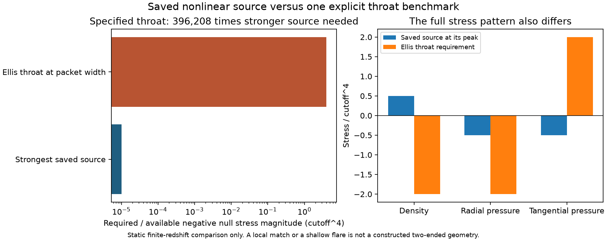

# Saved source versus a static throat

The saved nonlinear packet does not supply the stress required by an Ellis
throat whose radius equals the packet width. Its strongest sampled negative
radial null stress is smaller by a factor of **396,208**. Density and tangential
pressure also have the wrong signs for that benchmark. A very shallow throat
can match the central stress algebraically, but the actual packet has a regular
center, not a two-ended neck. These are limitations of a specified candidate;
they establish neither a general impossibility theorem nor new physics.
The global check below also excludes the strictly static, clock-aligned
subclass with the intended flat/AdS ends or regular cosmological horizons.

This calculation reconstructs fields from the existing
[nonlinear states](../data/nonlinear_packet_evolution_state.npz). It runs no
evolution or refinement. See the [calculator](../scripts/throat_source_budget.py),
[results](../results/throat_source_budget_results.json), and
[preceding evolution](NONLINEAR_PACKET_EVOLUTION.md).

## Geometric requirements

Use the orthonormal stresses, including the vacuum contribution, and units
$\hbar=c=\Lambda=1$. Here $P=\bar M_{\rm Pl}^2/\Lambda^2=10^4$.
The static spherical metric is

$$ds^2=-N(l)^2dt^2+dl^2+r(l)^2d\Omega^2,\qquad N=e^\Phi.$$

Einstein's equations give

$$\frac{\rho}{P}=\frac{1-r_l^2-2rr_{ll}}{r^2},\qquad
\frac{p_r}{P}=\frac{-1+r_l^2+2rr_lN_l/N}{r^2},$$
$$\frac{p_\perp}{P}=\frac{N_{ll}}N+
\frac{r_lN_l}{rN}+\frac{r_{ll}}r.$$

For a smooth static throat with finite positive lapse, $r_l=0$ and
$r_{ll}>0$. Defining $\delta=1-b'(r_0)=2r_0r_{ll}>0$ yields

$$\rho_0=\frac{P(1-\delta)}{r_0^2},\qquad
p_{r0}=-\frac P{r_0^2},\qquad
(\rho+p_r)_0=-\frac{P\delta}{r_0^2}.$$

These are the usual [Morris--Thorne relations](https://doi.org/10.1119/1.15620),
with radial tension equal to minus radial pressure. The numerical comparisons
below are project calculations, not results claimed in that paper.

For constant redshift, $p_{\perp0}=P\delta/(2r_0^2)$. For isotropic pressure,
the lapse must instead obey

$$\frac{N_{ll}}N=\Phi_{ll}+\Phi_l^2
=-\frac{1+\delta/2}{r_0^2}.$$

This proper curvature stays finite as $\delta\to0$. Only if $\Phi(r)$ is
differentiable at the throat does it imply
$r_0\Phi_r=-1-2/\delta$. A large coordinate derivative alone is not an
invariant failure of the effective theory. The saved JSON field
`isotropic_required_redshift_curvature` denotes $N_{ll}/N$, not
$\Phi_{ll}$ alone. It describes an alternative isotropic requirement;
the constant-redshift pressure and that alternative need not coexist.

## Comparison with the actual saved stress

At each saved point use both radial null components,
$T_\pm=\rho+p_r\pm2j$, and define
$S=\max(0,\min(-T_+,-T_-))$. This avoids mistaking a negative component
caused by flux for simultaneous static radial NEC violation. The largest
sampled $S$ is $1.0098732370\times10^{-5}\Lambda^4$ at $Ht=0.25$, $r=0$.
This is a maximum over saved samples, not a certified continuum supremum.
There $j=0$ and

$$\rho=0.499689220154\Lambda^4,\qquad
p_r=p_\perp=-0.499699318887\Lambda^4.$$

At the initial width $r_0=R=70.7000802582/\Lambda$:

| Static comparison | $\delta$ | Required $-(\rho+p_r)/\Lambda^4$ | Required / saved $S$ |
| --- | ---: | ---: | ---: |
| Ellis, constant redshift | 2 | 4.00119928 | 396,208 |
| Unit flare | 1 | 2.00059964 | 198,104 |
| Weak flare | $10^{-4}$ | $2.00059964\times10^{-4}$ | 19.8104 |

Ellis also needs $\rho=p_r=-2.00059964\Lambda^4$ and
$p_\perp=+2.00059964\Lambda^4$. Increasing one source amplitude does not
repair the whole tensor. Even optimistically relocating the peak $S$ to
radius $R$ permits only $\delta=5.04785\times10^{-6}$ in the null equation.
Keeping Ellis's flare would instead require $r_0=44502.21/\Lambda$ at that
same strength; the packet does not provide that source on such a sphere.

Comparing at each sample's actual areal radius
$\mathcal R=Rx\exp(Ht+\zeta)$ gives
$\max(S\mathcal R^2/P)=2.62835\times10^{-6}$, at $Ht=0.5$,
$x=0.836812$. This is still only a necessary static magnitude comparison.

Matching the central pressure and density algebraically gives

$$r_0=\sqrt{-P/p_r}=141.463898156/\Lambda,\qquad
\delta=\frac{\rho+p_r}{p_r}=2.02096180\times10^{-5}.$$

Isotropy then requires $N_{ll}/N=-4.99704368\times10^{-5}\Lambda^2$.
But the actual source point is at $\mathcal R=0$, its stress evolves, and
its surrounding geometry has no neck. No embedding, stationary solution,
formation process or two-ended boundary data follow from this local match.
The regular-center momentum integration constant cannot simply be reused
on a two-ended domain.

## Separate static clock-aligned subclass

For a strictly stationary configuration with the scalar aligned with static
time, $\beta=\Theta=0$. The action's higher-derivative background stress
vanishes. The same quartic action then gives

$$\rho=\rho_\Lambda+\frac{3X^2-2X-1}{4},\qquad
p=\frac{(X-1)^2}{4}-\rho_\Lambda,\qquad \rho+p=X(X-1).$$

With the fixed $\rho_\Lambda=0.499850022701$, completing the square shows
$\rho\ge\rho_\Lambda-1/3=0.166516689368>0$.
This excludes Ellis's negative density at every radius **within this
subclass**; it does not exclude the time-dependent higher-derivative source.

For $0<X<1$, a pressure-matched local throat has

$$\delta(X)=\frac{X(1-X)}{\rho_\Lambda-(X-1)^2/4}.$$

Writing $v=1-X$, its maximum solves
$v^2-8\rho_\Lambda v+4\rho_\Lambda=0$. The admissible root gives
$X=0.414177156$, $\delta=0.585998617$ and
$r_0=155.407536/\Lambda$. The quartic time-kinetic factor there is
$(3X-1)/2=0.121266$, while the gradient factor is
$(X-1)/2=-0.292911$. Local throat algebra supplies neither global existence
nor stability. The [earlier gravitational stability test](LOCALIZED_FIELD_HYPOTHESIS.md)
must not be discarded by treating this algebraic extremum as a stable solution.

## Completed global decision for the static aligned branch

Local matching does not justify a global boundary-value solve in this branch.
[Bronnikov, Baleevskikh and Skvortsova, section 2.2](https://arxiv.org/html/1708.02324)
prove an obstruction for smooth static spherical geometries with isotropic
stress and two flat/AdS ends. In a radial coordinate satisfying
$ds^2=-A(x)dt^2+dx^2/A(x)+r(x)^2d\Omega^2$, put $D=Ar^2>0$.
Pressure isotropy implies

$$D''-4\frac{r'}rD'+4\frac{r'^2}{r^2}D+2=0.$$

At a critical point, $D''=-2-4D(r'/r)^2<0$. But $D\to\infty$ at both
ends requires a minimum. The assumptions exclude thin shells with additional
anisotropic stresses. The paper permits de Sitter ends with cosmological
horizons; it does not prove that all isotropic wormholes are impossible.

There is an additional obstruction for **this fixed static source**, obtained
directly from the density bound above. On a monotone outward branch starting
at a throat, define $b=r(1-r_l^2)$. The density equation gives
$db/dr=\rho r^2/P\ge\rho_{\min}r^2/P$. Since $b(r_0)=r_0$,

$$r_l^2\le\frac{r-r_0}{r}
\left[1-\frac{\rho_{\min}}{3P}(r^2+rr_0+r_0^2)\right].$$

Here $\rho_{\min}=0.166516689368>0$. The right side becomes negative
at finite $r$, so this static branch cannot reach an infinite-radius end.
This argument uses the total density, not a vacuum-subtracted deficit.

For a nonzero strictly aligned scalar $\phi=\omega t$,
$X=\omega^2/(2\Lambda^4N^2)$. At any putative $N\to0$ horizon,
$\rho\sim3\Lambda^4X^2/4$ diverges. The invariant
$T_{\mu\nu}T^{\mu\nu}=\rho^2+3p^2$ diverges as well, so it is not merely
the acceleration of a static observer. Thus this ansatz cannot use a regular
cosmological horizon to complete its static patch. Allowing a radial scalar
profile or time-dependent geometry changes these assumptions.

**Decision:** reject the globally static, aligned branch for these endpoints;
do not launch a two-ended solver for it. The density bound and its application
to the quartic source are deductions within the stated model. The isotropic
no-go theorem is published physics, not a project discovery.

## Physical and effective-theory scales

Reconstruction of the saved states gives the following indicators relative
to the action's nominal $\Lambda$ parameter:

| Indicator | Largest value, unless stated |
| --- | ---: |
| $H/\Lambda$ | 0.00408126 |
| $1/(R\Lambda)$ | 0.0141443 |
| Retained local scalar wavenumber / $\Lambda$ | 0.177920 |
| $|\Theta|/\Lambda$ | 0.0123902 |
| $\sqrt{|R^{(4)}|}/\Lambda$ | 0.0141379 |
| Range of $X$ | 1.00029515 to 1.00030453 |

Here $R^{(4)}=(\rho-3p)/P$ is only the Ricci scalar. These numbers are not
bounds on every curvature component, omitted operator or nonlinear harmonic.
The true strong-coupling cutoff and ultraviolet completion remain unestablished.

Using [NIST's 2022 CODATA constants](https://physics.nist.gov/cuu/pdf/all.pdf),
$P=10^4$ fixes $\Lambda/\bar M_{\rm Pl}=0.01$, so
$\Lambda\simeq2.43532\times10^{16}$ GeV and

$$\Lambda^{-1}\simeq8.10270\times10^{-33}\ {\rm m},\qquad
\Lambda^{-1}\simeq2.70277\times10^{-41}\ {\rm s}.$$

The illustrative packet width is $5.72862\times10^{-31}$ m, the evolved
duration is $3.31120\times10^{-39}$ s, and the algebraically matched radius
is $1.14624\times10^{-30}$ m. The Planck-unit relative uncertainty is about
$1.1\times10^{-5}$. These scales are not a laboratory material specification.
Changing $\Lambda$ relative to the measured Planck scale changes $P$ and
requires a different dimensionless solution; it is not a choice of display units.

## Verification and next physical decision

Eleven executable checks pass: saved provenance, zero central flux, tensor
identities, the three local matching relations, the specified source shortfall,
the static density obstruction and extremum, and physical conversion checks.
An independent derivation confirms the proper-distance throat relations and
the static density bound. The figure was inspected. Passing these checks
verifies the comparison, including its rejections; it does not validate a medium.

The global aligned static branch has now failed the analytic check above.
The next concrete hypothesis retains the action but permits a radially tilted
clock, $\phi=\omega t+\psi(l)$. Its stress must be derived, including the
higher-derivative contribution and the zero net radial energy flux required
by a static metric. First determine whether finite $X>0$, throat flare,
regularity and those source equations can hold together. Do not assume
that tilt automatically supplies the missing anisotropy or stability.
For the quartic term alone,
$T_{tl}=F_X\omega\psi_l/\Lambda^4=0$ forces alignment or $X=1$;
the latter is vacuum stress and supplies no null flare. The derivative
term must therefore provide an actual flux cancellation. Derive the scalar
current and this mixed stress before attempting a global solve.
A dynamical alternative would require the null expansions
$\theta_\pm=2(u\mathcal R\pm e\mathcal R)/\mathcal R$,
not merely a minimum on one spatial slice. Repeating the weak regular-center
simulation does not answer either question.

There is no new-law claim and no demonstrated passage from 13 September 2027
to 12 September 2027. A finite model can test a hypothesis; it cannot establish
a new physical law without independently testable predictions and evidence.

Reproduce this saved-state analysis with
`.\.venv\Scripts\python.exe -B scripts/throat_source_budget.py`.
The JSON records exact source and input hashes. Source SHA256:
`0b57caa820aca69b8e308642bfa8662e80660319079402f126b0c99044de899d`.
Result SHA256:
`39c5ae21fbeb3efbf4ac0c620c12ec81ca32dd5693744115177dabac575e6530`.
