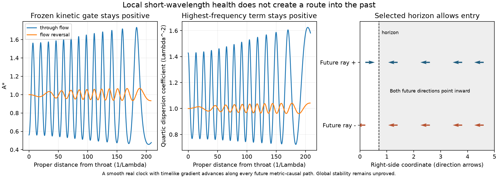

# Tilted clock: causal restriction and local perturbation test

**Decision:** stop tuning this real-clock branch as a backward-time device.
Where the same real scalar remains smooth, single-valued and timelike, it
forbids a closed future-directed metric-causal path. This is an application
of established causal geometry, not a new physical law. The local throat
also passes the coupled kinetic and highest-frequency tests below; those
tests do not establish global stability or a usable passage.

This analysis uses the saved local and separately refined near-horizon
states from [checkpoint149](TILTED_CLOCK_THROAT.md). It does not use the
failed distant continuation and does not evolve another background.

## The clock itself restricts the possible destination

For the same scalar and metric as the [candidate action](EXPANDING_FIELD_COMPLETION.md),
define $s=\sqrt{2\Lambda^4X}$ and $u^\mu=-\nabla^\mu\phi/s$.
Choose $u$ future-directed. Every nonzero future metric-causal tangent $V$
satisfies

$$d\phi(V)=-s\,g(u,V)>0.$$

Thus $\phi$ increases along every such path. Integrating around a closed
future-directed causal curve would give both a positive change and zero,
which is impossible. A smooth real function with timelike gradient is a
temporal function and implies stable causality; see
[Bernal and Sanchez, Commun. Math. Phys. 257 (2005), introduction and Theorem 1.2](https://arxiv.org/abs/gr-qc/0401112).

This argument applies throughout a domain only if the same scalar is
defined there. Local numerical states do not establish a complete global
extension. Stable causality does not by itself prove global hyperbolicity,
geodesic completeness, or a formation mechanism. A circle-valued clock or
a quotient shifting $\phi$ by a constant changes the field's global
assumptions; it does not defeat this argument for a real single-valued field.

The proof concerns paths causal for the spacetime metric. Dispersive field
signals require their own well-posed evolution and causal analysis. A
positive highest-frequency coefficient alone does not settle that issue.

For the requested example, returning from 13 September 2027 to an earlier
event on the same station's history on 12 September would close a causal
loop when joined to the station's ordinary forward history. This branch
cannot accomplish that while the stated global-clock assumptions hold.
Changing a coordinate date is not evidence of that physical return.

## Which horizon did the saved field cross?

In the regular radial coordinate of checkpoint149, $A=Q-W^2$ and
$Q=q^2/(2X)$ in units $\Lambda=1$. Choose the preferred radial unit vector
$e$ toward increasing $x$. The two normalized future radial null vectors are

$$k_\pm=u\pm e,\qquad k_\pm^x=-W\pm\sqrt Q,
\qquad d\phi(k_\pm)=\sqrt{2X}>0.$$

For the right exterior, $A<0$ and $W>\sqrt Q$, so both directions decrease
$x$, toward the static region. The regular advanced chart selects an
incoming past cosmological horizon. Inside $A>0$, one direction increases
$x$ and the other decreases it. The calculated signs agree at every saved
sample on the separately refined interval.

For the reversing solution, reflection gives $W< -\sqrt Q$ in the left
exterior. Both future directions there increase $x$, again toward the
static region. Conditional on regular continuation, the chosen scalar
covers both incoming horizon pieces. It does not provide a future exit
through the opposite outgoing pieces: those are not smooth extensions of
this chosen clock. The figure shows the right piece only.

At fixed $q>0$ and fixed future static Killing direction, changing
$(\psi,W,\chi)$ to $(-\psi,-W,-\chi)$ preserves the metric and stress
but selects the outgoing pieces. For the reversing seed this changes the
sign of $\chi_0$. It does not combine an incoming and an outgoing extension
into one smooth solution. Literal $\phi\mapsto-\phi$ also reverses $q$
and the preferred orientation, so it is a different operation.

## Coupled principal calculation on the actual background

The following is a project derivation for the specified truncated action.
Freeze background coefficients in a local preferred-clock orthonormal
frame, retaining lapse, shift, scalar and both tensor polarizations.
Set $c=\alpha\Lambda^2X$, $\mathcal E=P+3c$ and
$U=XF_X+2X^2F_{XX}$. For a wave direction $n$, write

$$k_n=K_{nn},\quad v_A=K_{nA},\quad
S_{AB}=K_{AB}-\frac{\Theta-k_n}{2}\delta_{AB}.$$

In a conformal scalar spatial gauge let $v=\dot\zeta$, let
$s_n=\partial_n\beta_n$ and $b_A=\partial_n\beta_A$ be shift
derivatives, and let $T_{AB}=\dot\gamma^{TT}_{AB}/2$.
The lapse perturbation is $\nu$. The relevant quadratic block is

$$\begin{aligned}
\mathcal L_{\rm pr}={}&-3\mathcal E v^2+2\mathcal E v s_n-cs_n^2
+\frac P4 b_A b_A+\frac P2T:T\\
&+\nu\left[2(P+9c)\Theta v-\mathcal C s_n
+Pv_A b_A-PS:T-2P\Delta\zeta\right]+\mathcal B\nu^2,
\end{aligned}$$

$$\mathcal C=(P+6c)\Theta-Pk_n,\qquad
\mathcal B=U+\frac P2(K:K-\Theta^2)-6c\Theta^2.$$

Eliminating the shifts gives the velocity coefficients

$$K_0=\frac{P\mathcal E}{c},\qquad
L=\frac P c[\mathcal E k_n-(P+7c)\Theta],\qquad
D=\mathcal B+\frac{\mathcal C^2}{4c}-Pv_Av_A.$$

The Schur identity is

$$\boxed{D-\frac{L^2}{4K_0}-\frac P2S:S
=\mathcal A_*:=U-\frac{c(P-9c)}{P+3c}\Theta^2.}$$

Consequently $P,c,\mathcal A_*>0$ imply a positive reduced kinetic
matrix after eliminating the lapse. Keeping the tensor mixing and the
antisymmetric velocity-gradient coupling yields the highest-frequency
scalar branch

$$\boxed{\omega_{\rm proper}^2=
\frac{Pc}{(P+3c)\mathcal A_*}\,k_{\rm proper}^4
+\text{lower-order terms}.}$$

The coefficient is independent of wave direction. Discarding the tensor
mixing on an anisotropic background would give an incorrect result.
The executable independent matrix construction uses transverse spatial
gauge, with scalar spatial velocity $\operatorname{diag}(1,1,0)$.
Its longitudinal shift differs by $\dot\zeta$ from the conformal gauge
above; the eliminated blocks agree.

On the saved background,
$K_\perp=-w r_l/r$ in proper static coordinates and $K_\perp=-WR/r$
in the regular horizon coordinates; $K_\parallel=\Theta-2K_\perp$.
Here $\Lambda=\alpha=1$, so $c=X$ and $U=X(3X-1)/2$.

| Saved domain | Minimum $\mathcal A_*$ | Range of quartic coefficient |
| --- | ---: | ---: |
| Through-flow static | 0.457383 | 0.723647 to 1.625140 |
| Through-flow near horizon | 0.477750 | 0.719900 to 1.581699 |
| Reversal static | 0.933163 | 0.960763 to 1.042216 |
| Reversal near horizon | 0.933163 | 0.959916 to 1.042216 |

These are sampled extrema. Ninety-one independent quadratic matrices,
including seven wave directions at selected locations, reproduce the
Schur identity and quartic coefficient to relative errors below
$7.7\times10^{-11}$. Their kinetic matrices are positive. The previous
homogeneous de Sitter coefficient is recovered to $1.2\times10^{-16}$.
All eleven saved-state checks pass.

This is a local principal calculation, not a full perturbation spectrum.
Background derivatives, lower-gradient growth, boundaries, long-term
stability, the effective theory's cutoff and a controlled wavelength
window are unresolved. Mathematical large-$k$ behavior is not evidence
that arbitrarily large physical wave numbers belong to this effective theory.

## A finite light-trip check, with the clocks identified

For ideal metric-null rays between symmetric stations at $N=0.1$ inside
the static patch, define $I=\int_0^{l_*}dl/N$. Then the crossing takes
$\Delta t=2I$ and an ideal reflected return takes $\Delta t=4I$.
These are **Killing-coordinate time differences**, in units $1/\Lambda$.
The result JSON's `symmetric_patch_light_crossing` and
`same_station_reflected_round_trip` store these quantities.

For reversal, the crossing and return are 846.883557 and 1693.767115.
For through-flow they are 847.142589 and 1694.285177. Independent spline
and Simpson half-interval integrals differ by less than $4.0\times10^{-8}$.
A stationary endpoint's proper elapsed time for a return is $0.1\Delta t$.
The normalized preferred clock is $T=\phi/q=t+\psi/q$; its one-way
change includes $\Delta\psi/q$, which cancels for the symmetric reversing
branch but generally not for through-flow. It cancels for either return.

No stations or reflectors have been constructed. No external mouths,
payload transport or one-day date offset are inferred from this check.

## Route decision and reproducibility

Further tuning of this same globally regular real-clock branch cannot
remove its metric-causal restriction. Preserve it as a conditional causal
throat model; do not treat more local stability checks as steps to yesterday.
The existing [Dirac quantum-source route](PHYSICAL_EUCLIDEAN_OPERATOR.md)
does not assume this same fundamental scalar clock, but its physical
renormalized supporting stress is still unresolved. That source question
must be answered before any claim of a supported bridge or chronology change.

The immediate dependency is the compact, stress-differentiated identification
of its proper-Euclidean Green kernel with the declared Hamiltonian ground
state, including lapse factors and ordered limits; see the
[existing missing lemma](PHYSICAL_EUCLIDEAN_OPERATOR.md#local-infrared-target-a-gap-is-not-needed-for-source-existence).
Another basis sweep does not establish that identification. Even after it,
spatial remainder control and regulator removal in the fixed renormalization
scheme remain necessary. The current static Dirac background itself has a
global time function, as shown in [the state construction](SEWN_SOURCE_STATE.md),
and therefore also excludes closed causal loops. Its action does not force
the particular scalar clock above on every geometry; this distinction is
not evidence of a chronology-changing solution.

Run the [saved-state calculator](../scripts/tilted_clock_admissibility.py)
with `python -B scripts/tilted_clock_admissibility.py` from the project root.
The [results](../results/tilted_clock_admissibility_results.json) record
exact input and source hashes. They exclude the failed long continuation.
The only post-run changes were explicit time-coordinate wording and plot
layering/label fixes; the numerical result fields were retained unchanged.
The [PNG](../figures/tilted_clock_admissibility_progress.png) and
[PDF](../figures/tilted_clock_admissibility_progress.pdf) are generated
scientific diagrams, not machine blueprints.
