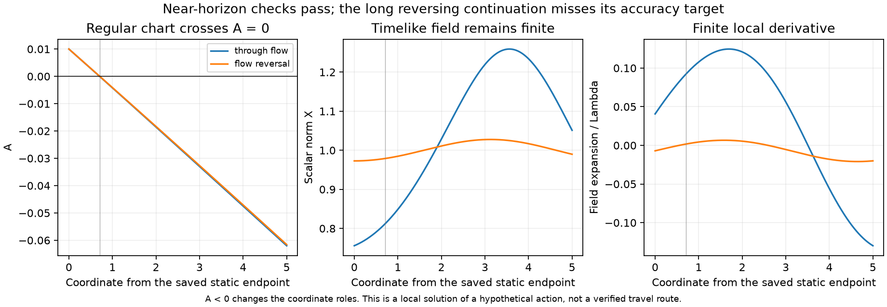
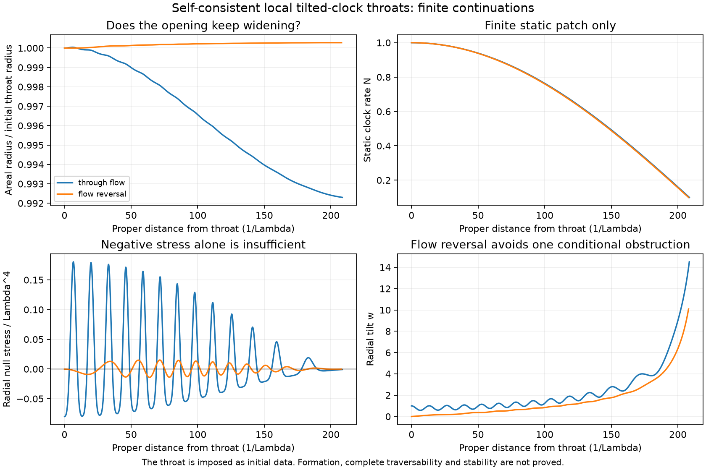

# Tilted clock: a local throat, a horizon crossing, and an unresolved exterior

The same hypothetical action now supplies a **local self-consistent throat**
with a scalar field whose radial flow reverses there. The derivative source
cancels the radial energy flux, and the field and geometry continue smoothly
through a selected horizon in a regular coordinate chart. Separate short
refinement checks pass. The longer reversing continuation fails its requested
accuracy test and develops large derivative indicators. It remains failed.

This is a conditional solution of the displayed truncated field theory, not
an obtainable material, a formation mechanism, a stable global wormhole or
a time machine. Novelty has not been established. The framework remains the
[published ghost-condensate effective-theory family](https://arxiv.org/abs/hep-th/0312099);
the particular equations and numerical results here are project derivations.

The [previous static aligned obstruction](THROAT_SOURCE_BUDGET.md) still holds
under its assumptions. The change here is explicit: allow
$\phi=qt+\psi(l)$, rather than requiring $\psi=0$.

## Derivative source and the energy-flux condition

Retain the [same action](EXPANDING_FIELD_COMPLETION.md):

$$\mathcal L_m=F(X)-aX\Theta^2,\quad
F(X)=\frac{\Lambda^4}{4}(X-1)^2-\rho_\Lambda,\quad a=\alpha\Lambda^2,$$
$$X=-\frac{(\nabla\phi)^2}{2\Lambda^4},\quad
s=\sqrt{2\Lambda^4X},\quad u_\mu=-\nabla_\mu\phi/s,\quad
\Theta=\nabla_\mu u^\mu.$$

Introduce $\chi=-2aX\Theta$. The auxiliary action
$F+\chi\Theta+\chi^2/(4aX)$ reduces to the original action when varied
with respect to $\chi$. Integrating its middle term by parts gives
$F+\nabla\phi\cdot\nabla\chi/s+\chi^2/(4aX)$, permitting an independent
first-derivative variation.

Equivalently, with $Y=aX\Theta$ and
$\Pi^{\mu\nu}=g^{\mu\nu}+u^\mu u^\nu$, the covariant shift current is

$$J^\mu=\frac{s}{\Lambda^4}(F_X-a\Theta^2)u^\mu
-\frac2s\Pi^{\mu\nu}\nabla_\nu Y,\qquad \nabla_\mu J^\mu=0.$$

Here the convention is
$\delta S=\int\sqrt{-g}\,J^\mu\nabla_\mu\delta\phi$ plus boundary terms.
The stress tensor is

$$T_{\mu\nu}=(F+aX\Theta^2+2u\cdot\nabla Y)g_{\mu\nu}
+[2X(F_X-a\Theta^2)-2u\cdot\nabla Y]u_\mu u_\nu
-4u_{(\mu}\nabla_{\nu)}Y.$$

For a stationary field in a diagonal static metric,
$T^l{}_t=-qJ^l$ off shell. Einstein's mixed equation therefore requires
$J^l=0$ for $q\ne0$. This is zero *net energy flux*, not zero scalar tilt.
The derivative contribution can cancel the quartic contribution. Extra
matter or boundary actions would be different models.

## Closed proper-distance equations

Use $\Lambda=\alpha=1$, $P=10^4$,
$\rho_\Lambda=0.4998500227010054$, and
$ds^2=-N(l)^2dt^2+dl^2+r(l)^2d\Omega^2$. Put

$$w=\psi_l/\sqrt{2X},\quad X=\frac{q^2}{2N^2(1+w^2)},\quad
V=\frac{\chi^2}{4X},\quad B=\frac{F_X-V/X}{1+w^2}.$$

The exact zero-current stresses and scalar equations are

$$p_r=F+V,\quad \rho=2XB-p_r,\quad p_\perp=p_r+2XBw^2,$$
$$\chi_l=2XBw,\qquad w_l=\frac{\chi}{2X}
-\left(n+\frac{2r_l}{r}\right)w,\qquad n=N_l/N.$$

Writing $v=r_l$, the remaining first-order equations are

$$r_l=v,\quad v_l=\frac{1-v^2-\rho r^2/P}{2r},\quad
(\log N)_l=n,$$
$$n_l=\frac{p_\perp}{P}-n^2-\frac{nv}{r}-\frac{v_l}{r}.$$

The radial Einstein constraint, checked independently during integration, is

$$p_r=P\left[\frac{v^2-1}{r^2}+\frac{2nv}{r}\right].$$

The identity $p_\perp-p_r=(\rho+p_r)w^2$ excludes the constant-redshift
Ellis stress pattern at a NEC-negative throat. It does not exclude all
other throats. The code also checks the original covariant current and
stress, before their zero-current simplification, and source conservation.

## A conditional obstruction and its precise exception

On any branch where $w\ne0$ everywhere, define $z=\chi/w$. Combining
the scalar equations with $\rho+p_r=-2P(r_{ll}-nr_l)/r$ yields

$$\left[\frac{z+2Pr_l/r}{Nr^2}\right]_l
=-\frac{z^2}{2XNr^2}-\frac{6Pr_l^2}{Nr^4}\le0.$$

If the bracket tends to zero at both complete ends, smoothness and positivity
force $z=r_l=0$ throughout, excluding a flaring throat. The endpoint condition
must be checked: separate decay of $\chi$ and $w$ does not determine their
ratio. This is a model-specific conditional deduction; no priority claim is
made for it.

A regular reversal with $w(l_*)=0$, $\chi(l_*)\ne0$ is outside this argument.
There $w_l=\chi/(2X)$ and $\chi_l=0$, while
$z\sim2X/(l-l_*)$. The quotient has a pole although the original variables
remain regular. Integrating the inequality across it without an interior
boundary contribution would be invalid.

## Actual local throats

Both seeds impose $N_0=1$, $n_0=r_{l0}=0$ and determine
$r_0=\sqrt{-P/p_{r0}}$. The throat is initial data, not something formed
from an initially ordinary region.

| Seed | $X_0$ | $w_0$ | $\chi_0$ | $r_0\Lambda$ | $(\rho+p_r)_0/\Lambda^4$ |
| --- | ---: | ---: | ---: | ---: | ---: |
| Through flow | 0.8 | 1 | 0 | 142.87901046 | -0.08 |
| Flow reversal | 1 | 0 | 0.02 | 141.45672163 | -0.0002 |

The reversing seed has $w_l(0)=0.01$, $\chi_l(0)=X_l(0)=0$,
$r_{ll}/r_0=10^{-4}/P$, and $n_l=-\rho_\Lambda/P$. Its parity is
$w$ odd and $\chi,X,N,r$ even. The ODE is smooth there, so it supplies a
local two-sided solution. All 14 finite-patch checks pass. Radial constraint
residuals stay below $1.4\times10^{-14}$; refinement changes the state by
less than $7.4\times10^{-13}$ in the recorded variables.

At the chosen $N=0.1$ coordinate stop, the reversing radius is only
$1.00027619r_0$ after $208.00749/\Lambda$ proper distance. The through-flow
radius has instead decreased to $0.99230085r_0$. These are nearly cylindrical
patches, not demonstrated connections to large exterior regions. The field
stress oscillates in sign away from the initial throat.

## Crossing the coordinate horizon

To distinguish a coordinate failure from a singular field, set $dx=N\,dl$,
$A=N^2$, $R=r_l/N$, $k=N_l$, $W=Nw$ and
$Q=A+W^2=q^2/(2X)$. Denote $H_X=XF_X-V$. Then

$$r_x=R,\quad R_x=-\frac{rH_X}{PQ},\quad
k_x=\frac{p_\perp+H_XA/Q}{P}-\frac{2kR}{r},$$
$$W_x=\frac{\chi}{2X}-\frac{2RW}{r},\quad
\chi_x=\frac{2H_XW}{Q},\quad Q_x=2k+2WW_x.$$

Here $A=Q-W^2$, $X=q^2/(2Q)$,
$p_r=F+V$, $p_\perp=p_r+2H_XW^2/Q$, and
$\rho_{\rm formal}=2H_XA/Q-p_r$.
These equations are regular at $A=0$ when $r,Q>0$ and the evolved variables
are finite. The radial constraint propagates as
$\mathcal C_x=-2R\mathcal C/r$, so $r^2\mathcal C$ is constant exactly.

For the sampled positive-$W$ crossing, an advanced chart has

$$ds^2=-A\,dv^2+2\,dv\,dx+r^2d\Omega^2,\qquad
\phi=qv+\widetilde\psi(x),\qquad
\widetilde\psi_x=-\frac{2X}{\sqrt{2X}W+q}.$$

The rationalized scalar derivative remains finite. So do the tensor components
$T_{vv}=A\rho_{\rm formal}$, $T_{vx}=-\rho_{\rm formal}$ and
$T_{xx}=2H_X/Q$. Independent short integrations over $0\le x\le5$ give
state differences below $3.5\times10^{-13}$ and horizon-position differences
below $1.4\times10^{-13}$. The reversing horizon is at $x=0.70907865$,
measured from the saved $N=0.1$ endpoint.

For $A<0$, $x$ is temporal. Physical density in the diagonal T-region frame
is $-p_r$, longitudinal pressure is $-\rho_{\rm formal}$, and the radial
null sum is minus the variable called `null_formal`. The old static labels
must not be carried across the horizon. A local advanced crossing also does
not establish future-directed access to both ends. With $q\ne0$, the scalar
cannot be smooth on a bifurcation sphere where the Killing vector vanishes,
since $K\cdot\nabla\phi=q$. A selected horizon branch is the actual scope.

## Failed long continuation and derivative audit

The longer extension has **10 of 11 checks passing**. Its reversing branch
misses the $10^{-6}$ absolute state-refinement target: maximum differences
are $1.88\times10^{-5}$ in $\chi$ and $1.48\times10^{-5}$ in $Q$ by
$x=4000$. The baseline required about four million RHS evaluations.
This is an unresolved numerical accuracy failure, not a demonstrated
physical singularity. The original failed result and all saved arrays remain
unchanged. The separate short horizon check does not replace it.

There is also a physical approximation issue before that endpoint. The small
value of $\Theta$ alone misses its rapidly varying derivatives. In the
preferred-clock frame,

$$D_u\Theta=-W\Theta_x,\quad D_e\Theta=\sqrt Q\Theta_x,\quad
D_u\log X=-WX_x/X,\quad |a_u|=\sqrt Q|X_x|/(2X).$$

In the saved reversing continuation, $|D_u\log X|/\Lambda$ first exceeds
one at the saved sample $x=462.5$, and $|D_u\Theta|/\Lambda^2$ does so at
$x=657.5$. Sampled maxima reach about 125 and 71 respectively. The precise
crossing times and suprema are not certified, especially on the unconverged
long tail. These are nominal-scale indicators, not the true EFT cutoff.
They prevent treating this extrapolation as a controlled global medium.
Near the separately checked horizon, the corresponding reversing maxima
over $x\in[0,5]$ are only about 0.0293 and 0.0143; ultraviolet validity
still requires more than these two numbers.

An exact constant-radius control checks the regular equations on both sides
of $A=0$. Let $z>0$ solve
$3z^2+(P+1)z-\rho_\Lambda=0$. Then

$$r=z^{-1/2},\quad X=1+2z,\quad \chi=2X\sqrt z,\quad
Q=1,\quad W=\sqrt z\,x,\quad k=-zx,\quad R=0.$$

It has $A=1-zx^2$ and zero radial null stress; it is not a flaring throat.
Substitution residuals are below $1.2\times10^{-16}$.
Its radius $141.44964/\Lambda$ helps explain why the trial solution initially
resembles a narrow cylinder. This control is an equation check, not a new
physical discovery or a substitute for testing the throat.

## Next decision and reproduction

Do not spend further long integrations on the uncontrolled tail. The next
physical tasks are to determine the causal access allowed by the selected
horizons and derive perturbation dynamics on the actual flowing throat.
The finite region must survive those tests before it is a candidate stable
passage. Its global completion, formation and physically realizable source
remain absent. No trip from 13 September 2027 to 12 September 2027 is established.

| Calculation | Source | Results | Saved arrays |
| --- | --- | --- | --- |
| Local equations and finite patches | [driver](../scripts/tilted_clock_throat.py) | [14 checks](../results/tilted_clock_throat_results.json) | [state](../data/tilted_clock_throat_state.npz) |
| Long regular-coordinate extension | [driver](../scripts/tilted_clock_extension.py) | [retained failure](../results/tilted_clock_extension_results.json) | [state](../data/tilted_clock_extension_state.npz) |
| Separate near-horizon and scale checks | [driver](../scripts/tilted_clock_diagnostics.py) | [diagnostics](../results/tilted_clock_diagnostics_results.json) | [state](../data/tilted_clock_diagnostics_state.npz) |

Run a driver from the root using `.\.venv\Scripts\python.exe -B scripts/NAME.py`.
The extension deliberately exits nonzero for its retained failed check; it
does not publish a passing figure. The diagnostic driver uses its saved
arrays, performs only the separate short integrations, and leaves the failed
long result untouched. Every JSON records exact input/source/state hashes.
Both displayed figures were inspected. Independent derivations confirmed
the covariant flux relation, throat data, monotonicity identity, regular
coordinate equations and constraint propagation.
